# 3DCKMDiff: 3D CKM Construction Based on Generative Diffusion for Environment-Aware Low-Altitude Communication and Sensing

Haotian Rong∗, Yong Zeng∗†, Xiaoli Xu∗, Ruoguang Li‡, and Jie Xu§

∗National Mobile Communications Research Laboratory, Southeast University, Nanjing 210096, China

†Purple Mountain Laboratories, Nanjing 211111, China

‡College of Information Science and Engineering, Hohai University, Changzhou 213200, China

§SSE and FNii, The Chinese University of Hong Kong (Shenzhen), Shenzhen, China

Email: {220241249, yong zeng, xiaolixu}@seu.edu.cn, ruoguangli@hhu.edu.cn, xujie@cuhk.edu.cn

Abstract—With the rapid development of unmanned aerial vehicle (UAV) assisted low-altitude applications, there has emerged an increasing demand for environment-aware communication and sensing services in complex flight environment to guarantee the robustness and safety of UAV scheduling operations. Channel knowledge map (CKM), which provides location-specific channel knowledge prior, is becoming a promising technique to meet the above requirement. In the context of low-altitude environment, CKM construction needs to be extended from the conventional two-dimensional (2D) plane to three-dimensional (3D) space, which poses a new challenge of a complete 3D CKM based on sparsely sampled data from different slices in the flight region. In this paper, we formulate this problem as a 3D inverse problem and propose 3DCKMDiff via 2D generative diffusion model by learning the joint distribution of multiple slices to gain the 3D prior knowledge. Simulation results demonstrate that compared with benchmark methods, the proposed 3DCKMDiff achieves significant improvements in both CKM construction accuracy and robustness.

Index Terms—Channel knowledge map (CKM), Generative AI, Diffusion model, 3D inverse problem.

## I. INTRODUCTION

With the rapid development of unmanned aerial vehicles (UAVs), a new economic paradigm, namely low-altitude economy (LAE), has gained widespread attention in both academia and industry [1] [2], which enables a variety of aerial applications, such as package transportation and emergency communications, etc. The most important issue for LAE implementation is to ensure a robust and safe UAV scheduling, which highly relies on wireless sensing and communication services. However, the significant increase of antenna numbers and bandwidth in the future wireless networks makes it difficult for real-time channel state information (CSI) acquisition. Besides, wireless sensing may suffer from performance degradation in

This work was supported in part by the National Natural Science Foundation of China under Grant 62301157, in part by the Natural Science Foundation of Jiangsu Province of China under Project BK20230823. This work was supported by the Natural Science Foundation for Distinguished Young Scholars of Jiangsu Province with grant number BK20240070. This research work is supported by the Big Data Computing Center of Southeast University.

complex environment due to terrain factors such as buildings and trees that often block the line-of-sight (LoS) links, forcing signals to propagate through non-line-of-sight (NLoS) paths, thereby failing to provide accurate information about the target’s position and velocity. To tackle such challenges, channel knowledge map (CKM) has been proposed in [3], which is a site-specific database that provides various types of channel knowledge at specific locations, such as channel gain, multi-path angle of arrival/departure (AoA/AoD), path delays, etc. CKM directly reflects the local intrinsic wireless propagation environment by leveraging historical data. By providing location-based prior information of the wireless channel, CKM avoids repeated real-time environmental sensing and CSI acquisition, significantly reducing system overhead and achieving environment-aware communication and sensing. For example, the authors in [4] proposed a training-free millimeterwave alignment scheme based on beam index map (BIM). Besides, in [5], the authors utilized the channel prior information provided by CKM to enhance sensing performance.

However, due to the difficulty of collecting channel knowledge at all locations, CKM may not be completely constructed in practice. Recent works have focused on how to construct complete CKM with limited channel measurement or additional physical environment information. In [6], the authors used the classic path loss model to construct channel gain map (CGM) with limited measurements. Besides, interpolation techniques are also traditional methods for constructing CKM, such as Kriging [7] and k-nearest neighbors (KNN) [8]. However, traditional algorithms rely on predefined models and struggle to fully exploit data, making it difficult to capture the complex relationships of channel knowledge. The development of artificial intelligence (AI), especially the emergence of generative AI, has brought new solutions for CKM reconstruction. For example, the authors in [9] proposed a novel UNet architecture, namely RadioUNet, which is capable of constructing the CKM with sparse measurements and environmental informations. To apply image algorithms for constructing CKM, the study in [10] constructed the CKMImageNet dataset using ray tracing in real physical environments, providing diverse samples for AI model training. The authors in [11] proposed a conditional diffusion model framework, termed CKMDiff, to recover CKM from noisy observable data. The study [12] proposed a cross-AP CKM inference method by using the trained UNet to directly generate the CKM of new access points (APs) based on the CKM of existing APs.

It is worth noting that unlike the 2D CKM, the construction of 3D CKM faces new challenges. Specifically, signal propagation characteristics in 3D space are affected by altitude variations, which cannot be effectively captured by 2D CKM. Moreover, 3D CKM introduces increased data dimension and computational complexity, thereby imposing greater demands on the processing capabilities of the model and making data collection more challenging, as it requires measurements across different altitudes and spatial locations. Therefore, the construction of 3D CKM is particularly important. To enable efficient interpolation in 3D data, the 2D neighborhoods are typically extended to 3D neighborhoods, and the interpolation function is accordingly adjusted to accommodate the signal characteristics in 3D space. For example, authors in [13] employed 3D Kriging interpolation to construct the 3D CKM. In terms of generative AI algorithms, altitude can be incorporated into the 2D generative models to capture the impact of altitude on signal propagation characteristics. Additionally, 3D generative models can be employed, which use voxel-based data representation combined with 3D convolutional structures to model signal variations within the 3D space. Specifically, the authors in [14] leveraged diffusion model with altitude and environmental information to generate CKM at different altitudes. In [15], the authors utilized the 3D conditional generative adversarial network (3D-CGAN) to generate the 3D CGM based on the location of the BS, without additional measurements. All the above methods used environmental information to reconstruct the CKM. However, in practice, complete physical environment is often difficult to obtain. Therefore, we consider reconstructing the complete CKM using sparse measurements without relying on any environmental information.

In this paper, we propose a 3D CKM construction method via diffusion model, namely 3DCKMDiff, which directly reconstructs the complete 3D CKM using the 2D diffusion model [16]. By employing conditional sampling, our method avoids the need for incorporating sparse measurement samples as training conditions. This approach formulates the 3D CKM construction problem from sparse samples as a 3D ill-posed inverse problem. Diffusion models provide an effective approach for solving such ill-posed inverse problems by learning the data priors. In order to utilize a 2D diffusion model to capture 3D priors, we utilize the training strategy proposed in [17], which learns the joint distribution of several neighboring 2D slices. Then, by applying a stochastic mixing algorithm, the learned 2D prior can effectively reflect the 3D prior over the entire region. Simulation results show that the proposed 3DCKMDiff can effectively recover the complete 3D CKM from sparse samples.

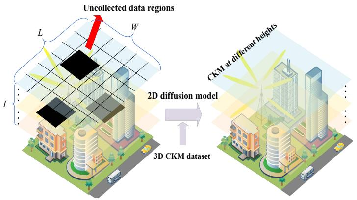

flowchart

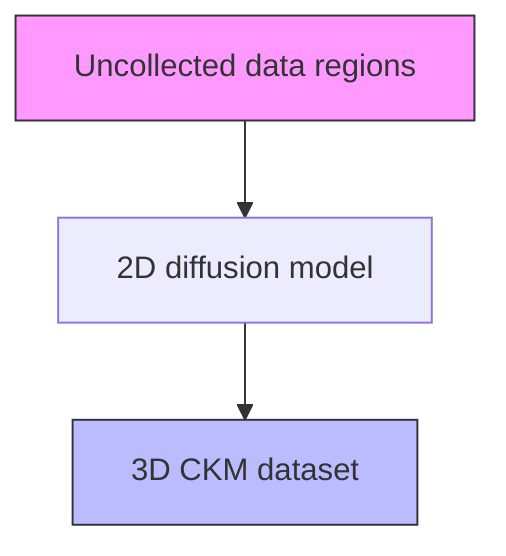

Fig. 1: 3D CKM construction with sparsely observed data

## II. SYSTEM MODEL

We consider the 3D CKM construction problem, which aims to reconstruct a complete 3D CKM within a urban low-altitude region based on sparse measurements from different altitudes. We discretize the target region into $I \times L \times W$ grids, which can be regarded as a stack of I 2D slices at different altitudes, while each slice consists of $L \times W$ grids. Each grid may contain multiple types of channel knowledge, such as AoA, AoD, path loss, etc. For an incomplete 3D CKM containing specific channel knowledge, it can be represented as

$$
\mathbf {y} = \mathbf {A x}, \tag {1}
$$

where $\begin{array} { r c l } { \mathbf { y } } & { \in } & { \mathbb { C } ^ { I ^ { \prime } L ^ { \prime } W ^ { \prime } \times 1 } } \end{array}$ represents the observed channel knowledge data at sparse locations, $I ^ { \prime } L ^ { \prime } W ^ { \prime }$ denotes the total number of observations with I′L′W ′ ≪ ILW . $\mathbf { x } \in \mathbb { C } ^ { I L W \times 1 }$ denotes the complete ground-truth CKM to be reconstructed. $\mathbf { A } \ \in \ \mathbb { R } ^ { I ^ { \prime } L ^ { \prime } W ^ { \prime } \times \dot { I } L W }$ is the masking diagonal matrix, where the diagonal elements $\mathbf { A } _ { j j }$ of the matrix A is either 1 or 0 depending on whether the channel knowledge at that position is observed or not.

We aim to reconstruct the complete 3D CKM x from the sparse measurement values y, as illustrated in Fig.1. However, since actual measurements are usually sparse, the mask matrix A is rank-deficient, which makes the problem underdetermined. Thus, there exist infinitely many solutions when reconstructing the image x from the observed values y, which poses a challenge for accurately recovering the 3D CKM. The most straightforward approach to solve this inverse problem is to maximize its posterior distribution $q ( \mathbf { x } | \mathbf { y } )$ ∝ $q ( \mathbf { x } ) q ( \mathbf { y } | \mathbf { x } )$ . Although traditional interpolation techniques can be extended to 3D CKM reconstruction, they typically fail to effectively leverage the data’s prior distribution $q ( \mathbf { x } )$ , leading to low-quality reconstruction. Notably, by incorporating the measurement values y as conditions into the 3D generative models, we can achieve modeling of the conditional posterior distribution $q ( \mathbf { x } | \mathbf { y } )$ , thereby enabling the reconstruction of 3D CKM. However, 3D models have high computational and storage costs, and adding conditions may limit their generalization ability.

This paper proposes 3DCKMDiff for learning the prior distribution of 3D data using the 2D diffusion model. Based on the 3D CKM dataset, this approach effectively captures the complex spatial distributions in 3D data during training, enabling high-quality reconstruction of 3D CKM.

## III. DIFFUSION MODEL-BASED 3D-CKM CONSTRUCTION

## A. Fundamentals of Diffusion Models

Diffusion models, particularly denoising diffusion probabilistic models (DDPMs) [16], are a class of generative models that learn the prior distribution of data. Their basic structure consists of a forward process that gradually adds noise to clean images, and a reverse process that progressively denoises the noisy image.

• Forward process: the model gradually adds Gaussian noise to the clean data over $T$ time steps, eventually transforming the original data into pure noise. Starting from the clean data $\mathbf { x } _ { 0 } ,$ , the noise addition at step t can be expressed as

$$
q (\mathbf {x} _ {t} | \mathbf {x} _ {t - 1}) = \mathcal {N} \left(\mathbf {x} _ {t}; \sqrt {1 - \beta_ {t}} \mathbf {x} _ {t - 1}, \beta_ {t} \mathbf {I}\right), \tag {2}
$$

where $\beta _ { t }$ controls the intensity of the noise added at each step. $\mathcal { N } ( \cdot )$ is a normal distribution with mean $\sqrt { 1 - \beta _ { t } } \mathbf { x } _ { t - 1 }$ and variance $\beta _ { t } \mathbf { I } .$ . Since the noise added at each step is independent and follows a Gaussian distribution, the perturbations across multiple time steps can be combined. Thus, the marginal distribution of the state at step t, conditioned on the original image $\mathbf { x } _ { 0 } ,$ can be directly derived as

$$
q (\mathbf {x} _ {t} | \mathbf {x} _ {0}) = \mathcal {N} \left(\mathbf {x} _ {t}; \sqrt {\bar {\alpha} _ {t}} \mathbf {x} _ {0}, (1 - \bar {\alpha} _ {t}) \mathbf {I}\right), \tag {3}
$$

where $\begin{array} { r } { \bar { \alpha } _ { t } = \prod _ { i = 1 } ^ { t } \alpha _ { i } } \end{array}$ and $\alpha _ { t } = 1 - \beta _ { t }$

• Reverse process: the diffusion model gradually reconstructs the original image $\mathbf { x } _ { \mathrm { 0 } }$ from the fully noised image xT by progressively removing Gaussian noise. The onestep denoising process can be expressed as

$$
p _ {\theta} (\mathbf {x} _ {t - 1} | \mathbf {x} _ {t}) = \mathcal {N} \left(\mathbf {x} _ {t - 1}; \boldsymbol {\mu} _ {\theta} (\mathbf {x} _ {t}, t), \boldsymbol {\Sigma} _ {\theta} (\mathbf {x} _ {t}, t)\right). \tag {4}
$$

Here, $\mu _ { \theta }$ and $\Sigma _ { \theta }$ are the mean and covariance learned by the neural network. It is shown in [16] that by approximating the posterior distribution $p _ { \theta } ( \mathbf { x } _ { t - 1 } | \mathbf { x } _ { t } )$ with a neural network, the prior distribution of the data can be effectively learned, and the corresponding loss function can be simplified as

$$
\mathcal {L} = \mathbb {E} _ {t, \mathbf {x} _ {0}, \epsilon} \left[ \| \boldsymbol {\epsilon} - \boldsymbol {\epsilon} _ {\theta} (\mathbf {x} _ {t}, t) \| ^ {2} \right], \tag {5}
$$

where ϵ is the noise added from $\mathbf { x } _ { \mathrm { 0 } }$ to $\mathbf { x } _ { t } ,$ and $\epsilon _ { \theta }$ is the noise predicted by the neural network. By minimizing this loss function, the model can effectively perform denoising and generate high-quality samples.

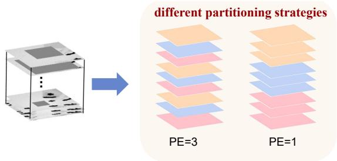

text_image

different partitioning strategies
PE=3
PE=1

Fig. 2: Partitioning strategies and corresponding positional encodings, where slices of the same color belong to the same 3D patch.

## B. Learning 3D Data Priors with 2D Diffusion Model

To enable the 2D diffusion model to effectively learn the prior distribution of channel knowledge in the 3D CKM, we apply the DiffusionBlend++ proposed in [17]. We partition the 3D CKM with multiple altitudes slices into several 3D patches composed of adjacent altitudes slices, and models these patches using diffusion model to approximate the signal propagation characteristics in 3D space. Furthermore, by introducing diverse partitioning strategies and incorporating the relative altitudes between slices as conditional inputs to the network, high-quality 3D CKM is generated.

1) DiffusionBlend++ : In DiffusionBlend++, a 3D CKM with I slices in the z dimension is partitioned into 3D patches, which are composed of k adjacent altitude slices, and the method approximates the 3D data distribution as

$$
p (\mathbf {x}) = \frac {\prod_ {i = 1} ^ {I / k} p \left(\mathbf {x} _ {(i - 1) H + 1 : i H}\right)}{Z}, \tag {6}
$$

where $I / k$ is the number of 3D patches, $H = k L W$ represents k slices of different heights, and Z is a normalized constant. Unlike modeling 2D slices as independent samples, we input multiple slices into the neural network and train a multi-slice joint denoising network to approximate $p ( \mathbf { x } )$ .

However, this method still faces several issues, since some altitude slices that are spatially adjacent may be separated into different patches, making it difficult for the model to learn the signal propagation relationships between them. Moreover, relying solely on adjacent slices makes it challenging to capture the global prior of the 3D data.

2) Partitioning Strategies: To enable the model to learn the variations in channel knowledge across different altitude slices, different partitioning strategies are applied in each training iteration. For example, a skip-based slicing strategy can be used to construct 3D patches from non-adjacent altitude slices. Over multiple iterations, various combinations of altitude slices are fed into the network, allowing the model to learn the channel knowledge prior in 3D space.

3) Positional Encoding: As shown in Fig. 2, when constructing a 3D patch, we use the relative altitude distance $p$ between slices as the positional encoding (PE) input to the network with time step t to provide height information to the

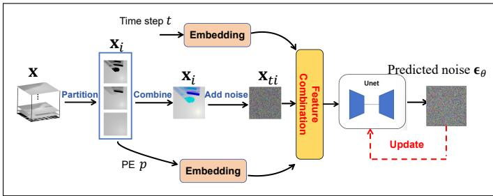

flowchart

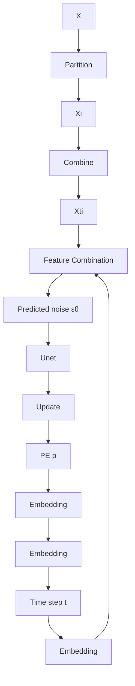

(a) Training Phase  
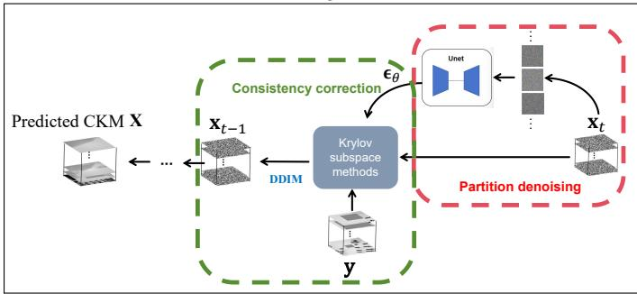

flowchart

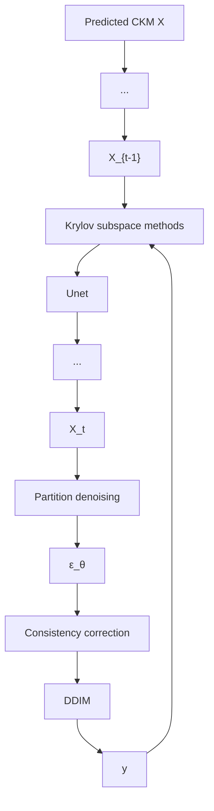

(b) Sampling Phase  
Fig. 3: Overview of the 3D CKM construction framework

2D diffusion model. The positional encoding block consists of a sinusoidal positional encoding module and several dense connection modules. By incorporating PE as a conditional input into the denoising network, the model not only perceives the level of noise during the denoising process but also captures the altitude relationships among different slices, thereby learning the variations in channel knowledge across different altitudes.

## C. Training Phase

During the training phase, a 3D CKM x can be partitioned in multiple ways and $\mathbf { x } = \mathbf { x } _ { 1 } \cup \cdots \cup \mathbf { x } _ { r } ,$ where $r = I / k$ denotes the number of 3D patches and each partitioning strategy l corresponds to a sub-distribution $p _ { l } ( \mathbf { x } )$ . The 3D channel knowledge distribution can be modeled as

$$
p (\mathbf {x}) = \prod_ {l = 1} ^ {j} p _ {l} (\mathbf {x}) ^ {1 / j}, \tag {7}
$$

where $p _ { l } ( \mathbf { x } )$ follows the distribution (6), j represents different partitioning strategies, and $1 / j$ denotes the weight of each distribution. According to (6), the loss function for each subdistribution $p _ { l } ( \mathbf { x } )$ can be written as

$$
L = \mathbb {E} _ {t, \mathbf {x} _ {0}, \epsilon} \left[ \left\| \boldsymbol {\epsilon} - \sum_ {i = 1} ^ {r} \boldsymbol {\epsilon} _ {\theta , i} (\mathbf {x} _ {t i}, t) \right\| ^ {2} \right], \tag {8}
$$

where $\mathbf { x } _ { t i }$ represents the i-th 3D patch after t steps of noise addition. Since the $\mathbf { x } _ { i } ^ { \prime } \mathbf { s }$ are disjoint, the loss can be decomposed and rewritten as

$$
L = \sum_ {i = 1} ^ {r} \mathbb {E} _ {t, \mathbf {x} _ {0}, \boldsymbol {\epsilon}} \left[ \left\| \boldsymbol {\epsilon} _ {i} - \boldsymbol {\epsilon} _ {\theta , i} (\mathbf {x} _ {t i}, t) \right\| ^ {2} \right], \tag {9}
$$

Algorithm 1 The training procedure for 3D CKM construction  
Require: 3D CKM dataset x, number of iterations N,
1: for n = 1 to N do
2: Select $t \sim \text{Uniform}[1, T]$ 3: Select $\mathbf{x} \sim p(\mathbf{x})$ 4: Randomly select a partitioning method
5: Compute relative positional encoding (PE) p
6: Randomly choose one patch $x_{i}$ 7: Compute noisy input: $x_{ti} = \sqrt{\bar{\alpha}_{t}}x_{i} + \sqrt{1 - \bar{\alpha}_{t}}\epsilon$ 8: Take gradient descent step on loss:
9: $\nabla_{\theta}\|\epsilon - \epsilon_{\theta}(x_{ti}, t, p)\|^{2}$ 10: end for
11: return $\theta$

Algorithm 2 The sampling procedure for 3D CKM construction  
Require: Forward model A, measurement y, number of sampling steps T

1: Initialize $\mathbf{x}_{T} \sim \mathcal{N}(0, \sigma_{T}^{2}\mathbf{I})$ 2: for t = T to 1 do

3: Randomly select a partitioning method such that $x_{t} = x_{t1} \cup \cdots \cup x_{tr}$ 4: Compute relative positional encoding (PE) p

5: for each patch $x_{ti}$ do

6: Compute $\epsilon = \epsilon_{\theta}(x_{ti}, t, p)$ 7: end for

8: Compute conditional expectation: $\hat{x}_{t} = E[x_{0}|x_{t}]$ 9: Solve inverse problem: $\hat{x}_{t}' = CG(A, y, \hat{x}_{t})$ 10: Sample $x_{t-1}$ using $\hat{x}_{t}'$ and the predicted noise $\epsilon_{\theta}$ via DDIM sampling

11: end for

12: return x

where $\epsilon _ { i }$ denotes the noise added to the i-th 3D patch. This is equivalent to randomly selecting one $\mathbf { x } _ { i }$ in each training iteration and performing training only on the slices within $\mathbf { x } _ { i }$

For the product of multiple sub-distributions in the form of $( 7 ) ,$ it is proved in [17] that introducing positional encoding p simplifies the training of multiple sub-networks to training a single conditional network. The training process is shown in Algorithm 1.

## D. Sampling Phase

The sampling phase primarily involves two processes: partition denoising and data consistency correction. Firstly, during the partition denoising process, we select a partitioning scheme at each time step, computes its corresponding relative positional encoding $p ,$ and inputs each 3D patch into the denoising network for denoising.

Based on denoising, we employ the Krylov subspace method in [18] to enhance the consistency between the observed channel knowledge data and the generated data. Specifically, at time step t, the true estimate $\hat { \mathbf { x } } _ { t } = \mathbb { E } ( \mathbf { x } _ { 0 } | \mathbf { x } _ { t } )$

is computed using the Tweedie formula [19], followed by conjugate gradient optimization

$$
\hat {\mathbf {x}} _ {t} ^ {\prime} = \operatorname{CG} (\mathbf {A}, \mathbf {y}, \hat {\mathbf {x}} _ {t}, M), \tag {10}
$$

where CG(·) represents the conjugate gradient method applied to (1) starting from xˆt for M steps. To accelerate the reconstruction process, this method is also combined with the denoising diffusion implicit models (DDIM) sampling algorithm [20]. The sampling procedure for 3D CKM reconstruction is provided in Algorithm 2.

The proposed 3DCKMDiff framework for reconstructing 3D CKM is illustrated in Fig. 3. The method of partitioning the 3D data into 3D patches effectively reduces the input data dimensionality to the network. Additionally, by combining the prior knowledge of 3D data with different forward models, the method can adapt to multi-task without requiring retraining.

## IV. NUMERICAL RESULTS

To train and evaluate the 3DCKMDiff, we constructed the 3DCKMImageNet dataset. We obtained the simulation data using ray-tracing techniques provided by Sionna and Wireless InSite. Specifically, in a $7 0 0 \mathrm { m } \times 7 0 0 \mathrm { m } \times 1 0 0$ m area, we first configure relevant parameters such as antennas and carrier frequency. Then, transmitters and receivers are placed within the actual physical environment. We deployed 16 transmitters within the area, each installed at the height of 10 meters. The distance between adjacent transmitters is set to 100 meters. To effectively capture the characteristics of the wireless environment in 3D space, receivers are placed at 20- meter vertical intervals covering a height range from 1 to 100 meters. On each horizontal plane, the receivers are deployed with a spacing of 2 meters. Finally, the obtained simulation data are linearly mapped to [0, 255] to form grayscale images for diffusion model learning. We use 3D images from 5,118 different regions, containing a total of 30,708 channel gain images of size 128 × 128, as the training dataset. The test dataset consists of 1200 images. An Adam optimizer with a learning rate of $1 \times 1 0 ^ { - 5 }$ is used.

We conduct testing on the 3DCKMImageNet dataset. In practical measurements, due to factors such as terrain constraints and privacy protection, the devices may not be able to access certain areas, resulting in complete data absence in those regions. To address this issue, we reconstruct complete 3D CKM images from masked CKM images with varying mask sizes at different altitudes. To comprehensively evaluate the reconstruction performance of 3D CKM, we adopt image quality metrics including peak signal-to-noise ratio (PSNR), structural similarity index measurement (SSIM), and Normalized Mean Square Error (NMSE).

Tables I and II present the 3D CKM reconstruction performance of 3DCKMDiff on 3DCKMImageNet dataset generated by different softwares. We compare our method with the 3D Kriging interpolation method. It can be seen that, compared with the benchmarking method, the proposed approach achieves significantly lower RMSE and NMSE on both datasets, indicating higher reconstruction capability. Meanwhile, the improvements in PSNR and SSIM indicate that 3DCKMDiff better preserves the structure and details of the CKM.

TABLE I: Performance on data generated by Sionna

<table><tr><td></td><td>PSNR</td><td>SSIM</td><td>NMSE</td><td>RMSE(pixel)</td></tr><tr><td>3DCKMDiff</td><td>46.41</td><td>0.9614</td><td>0.0052</td><td>5.6548</td></tr><tr><td>3D-Kriging</td><td>31.85</td><td>0.8818</td><td>0.0135</td><td>13.3483</td></tr></table>

TABLE II: Performance on data generated by Wireless InSite

<table><tr><td></td><td>PSNR</td><td>SSIM</td><td>NMSE</td><td>RMSE(pixel)</td></tr><tr><td>3DCKMDiff</td><td>36.75</td><td>0.9171</td><td>0.0087</td><td>8.4527</td></tr><tr><td>3D-Kriging</td><td>25.82</td><td>0.8732</td><td>0.0205</td><td>16.2259</td></tr></table>

Fig. 4 and Fig. 5 illustrate the visualization results of 3D CKM reconstruction using the 3DCKMDiff, including the reconstructed images, masked images, and ground truth images. We show the reconstruction results at altitudes of 1 m, 20 m, 40 m, 60 m, 80 m, and 100 m, demonstrating that 3DCKMDiff can successfully recover the 3D CKM only relying on sparse measurements. It is worth noting that 3DCK-MDiff can successfully reconstruct a CKM image closely matching the true scenario by leveraging the relationships between different altitudes, with almost no prior knowledge. Experimental results demonstrate that 3DCKMDiff effectively captures prior knowledge of the 3D wireless environment and exhibits robust stability and high efficiency in the task of 3D CKM reconstruction.

Moreover, as shown in Fig. 4, there is a discrepancy between the reconstructed image and the ground truth at 20 meters. This may be due to the fact that images at 1 meter and 20 meters are often grouped into the same 3D patch during sampling, with their masked regions highly overlapping. As a result, the model has less effective observational data, which lowers the reconstruction quality.

## V. CONCLUSION

In this paper, we propose 3DCKMDiff for constructing the 3D CKM based on the 2D diffusion model. This method extends the 2D diffusion model to address the 3D inverse problem by learning from the distributions of multiple slices. Simulation results demonstrate that the proposed method can effectively reconstruct the complete 3D CKM from sparse measurements, and can even infer the CKM at height levels with no sampling data at all.

## REFERENCES

[1] Y. Zeng, Q. Wu, and R. Zhang, “Accessing from the sky: A tutorial on UAV communications for 5G and beyond,” Proc. IEEE, vol. 107, no. 12, pp. 2327–2375, 2019.  
[2] Y. Song, Y. Zeng, Y. Yang, Z. Ren, G. Cheng, X. Xu, J. Xu, S. Jin, and R. Zhang, “An overview of cellular ISAC for low-altitude UAV: New opportunities and challenges,” arXiv preprint arXiv:2412.19973, 2024.

$h = 1 m$  
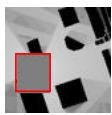

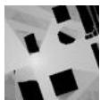

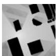

ℎ = 20 ?  
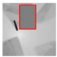

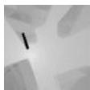

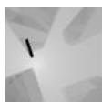

ℎ = 40 ?  
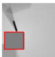

$h = 6 0 m$  
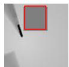

Masked images  
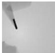

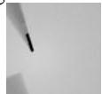

Reconstructed images  
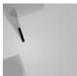

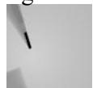  
Ground truth images

$h = 8 0 m$  
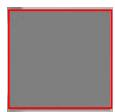

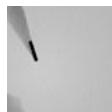

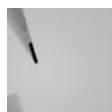

$h = 1 0 0 m$  
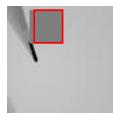

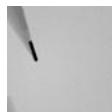

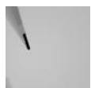  
Fig. 4: Visualization of CKM construction results on 3DCKMImageNet dataset generated by Sionna

$h = 1 m$  
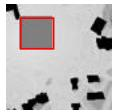

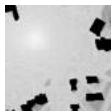

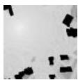

ℎ = 20 ?  
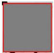

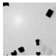

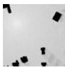

ℎ = 40 ?  
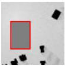

ℎ = 60 ?  
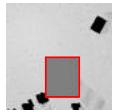  
Masked images

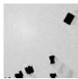

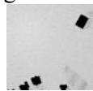  
Reconstructed images

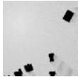

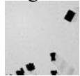  
Ground truth images

ℎ = 80 ?  
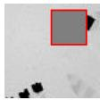

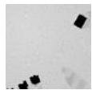

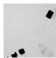

$h = 1 0 0 m$  
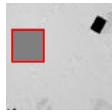

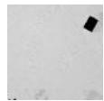

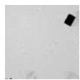  
Fig. 5: Visualization of CKM construction results on 3DCKMImageNet dataset generated by Wireless InSite

[3] Y. Zeng and X. Xu, “Toward environment-aware 6G communications via channel knowledge map,” IEEE Wireless Commun., vol. 28, no. 3, pp. 84–91, 2021.  
[4] D. Wu, Y. Zeng, S. Jin, and R. Zhang, “Environment-aware hybrid beamforming by leveraging channel knowledge map,” IEEE Trans. Wireless Commun., vol. 23, no. 5, pp. 4990–5005, 2023.  
[5] T. Zhao, X. Wang, W. Yang, X. Xi, and J. Li, “On the common AOA error in CKM-based integrated sensing and communications,” IEEE Commun. Lett., vol. 27, no. 7, pp. 1859–1863, 2023.  
[6] X. Xu and Y. Zeng, “How much data is needed for channel knowledge map construction?” IEEE Trans. Wireless Commun., 2024.  
[7] H. Braham, S. B. Jemaa, G. Fort, E. Moulines, and B. Sayrac, “Fixed rank kriging for cellular coverage analysis,” IEEE Trans. Veh. Technol., vol. 66, no. 5, pp. 4212–4222, 2016.  
[8] S. Sun and R. Huang, “An adaptive k-nearest neighbor algorithm,” in Proc. 7th Int. Conf. Fuzzy Syst. Knowl. Discov., vol. 1, pp. 91–94, 2010.  
[9] R. Levie, C¸ . Yapar, G. Kutyniok, and G. Caire, “RadioUNet: Fast radio map estimation with convolutional neural networks,” IEEE Trans. Wireless Commun., vol. 20, no. 6, pp. 4001–4015, 2021.  
[10] Z. Wu, D. Wu, S. Fu, Y. Qiu, and Y. Zeng, “CKMImageNet: A dataset for AI-based channel knowledge map towards environmentaware communication and sensing,” arXiv preprint arXiv:2504.09849, 2025.  
[11] S. Fu, Y. Zeng, Z. Wu, D. Wu, S. Jin, C.-X. Wang, and X. Gao, “CKMDiff: A generative diffusion model for CKM construction via inverse problems with learned priors,” arXiv preprint arXiv:2504.17323, 2025.  
[12] Z. Dai, D. Wu, X. Xu, and Y. Zeng, “Generating CKM using others’ data: Cross-AP CKM inference with deep learning,” arXiv preprint arXiv:2411.17716, 2024.  
[13] Y. Qiu, X. Chen, K. Mao, X. Ye, H. Li, F. Ali, Y. Huang, and Q. Zhu, “Channel knowledge map construction based on a UAV-assisted channel measurement system,” Drones, vol. 8, no. 5, p. 191, 2024.  
[14] L. Zhao, Z. Fei, X. Wang, J. Luo, and Z. Zheng, “3D-RadioDiff: An altitude-conditioned diffusion model for 3D radio map construction,” IEEE Wireless Commun. Lett., 2025.  
[15] Y. Wang, R. Li, D. Wu, J. Chen, and Y. Zeng, “Supporting urban lowaltitude economy: Channel gain map inference based on 3D conditional GAN,” arXiv preprint arXiv:2504.12794, 2025.  
[16] J. Ho, A. Jain, and P. Abbeel, “Denoising diffusion probabilistic models,” Adv. Neural Inf. Process. Syst. (NeurIPS), vol. 33, pp. 6840–6851, 2020.  
[17] B. Song, J. Hu, Z. Luo, J. A. Fessler, and L. Shen, “DiffusionBlend: Learning 3D image prior through position-aware diffusion score blending for 3D computed tomography reconstruction,” Adv. Neural Inf. Process. Syst. (NeurIPS), vol. 37, pp. 89584–89611, 2024.  
[18] H. Chung, S. Lee, and J. C. Ye, “Decomposed diffusion sampler for accelerating large-scale inverse problems,” in Proc. Int. Conf. Learn. Represent. (ICLR), 2024.  
[19] B. Efron, “Tweedie’s formula and selection bias,” J. Amer. Stat. Assoc., vol. 106, no. 496, pp. 1602–1614, 2011.  
[20] J. Song, C. Meng, and S. Ermon, “Denoising diffusion implicit models,” arXiv preprint arXiv:2010.02502, 2020.