# 3D UAV Trajectory Planning for IoT Data Collection via Matrix-Based Evolutionary Computation

Pei-Fa Sun , Yujae Song , Member, IEEE, Kangyu Gao , Yukai Wang , Changjun Zhou , Member, IEEE, Sang-Woon Jeon , Senior Member, IEEE, and Jun Zhang , Fellow, IEEE

Abstract—UAVs are increasingly becoming vital tools in various wireless communication applications including Internet of Things (IoT) and sensor networks, thanks to their rapid and agile non-terrestrial mobility. Despite recent research, planning threedimensional (3D) UAV trajectories over a continuous temporalspatial domain remains challenging due to the need to solve computationally intensive optimization problems. In this paper, we study UAV-assisted IoT data collection aimed at minimizing total energy consumption while accounting for the UAV’s physical capabilities, the heterogeneous data demands of IoT nodes, and 3D terrain. We propose a matrix-based differential evolution with constraint handling (MDE-CH), a computation-efficient evolutionary algorithm designed to address non-convex constrained optimization problems with several different types of constraints. Numerical evaluations demonstrate that the proposed MDE-CH algorithm provides a continuous 3D temporal–spatial UAV trajectory capable of efficiently minimizing energy consumption under various practical constraints and outperforms the conventional fly–hover–fly model for both two-dimensional (2D) and 3D trajectory planning.

Index Terms—Energy minimization, matrix-based evolutionary computation, sensor networks, uncrewed aerial vehicle (UAV) communication, UAV trajectory optimization.

## I. INTRODUCTION

N RECENT years, uncrewed aerial vehicles (UAVs) have played a vital role in wireless communication networks, extending network coverage and enhancing service quality due to their ability to operate in three-dimensional (3D) space [1], [2], [3], [4], [5]. The integration of UAVs into wireless networks provides unparalleled mobility and real-time data collection capabilities, proving to be invaluable in various scenarios, including disaster response, wildlife conservation, infrastructure inspection, and jamming [6], [7], [8], [9], [10], [11].

As one of the representative applications utilizing UAVs in wireless networks, UAV-assisted Internet of Things (IoT) data collection has garnered substantial attention among researchers. In traditional sensor network scenarios, where sensors transmit their sensing data to control centers or cluster heads, communication performance deteriorates as the geographical distance between two nodes increases, primarily due to losses incurred in electromagnetic wave propagation. To address this challenge, the deployment of UAVs for data acquisition from distributed sensors has emerged as a promising solution. The key issue in the UAV-assisted IoT data gathering scenario, wherein UAVs play a role in collecting data from sensors distributed in specific geographical areas, is to design efficient trajectories for UAVs.

Over the past few years, many studies on the UAV trajectory optimization have been conducted under various UAV-enabled wireless communication network scenarios [12], [13], [14], [15], [16], [17], [18], [19], [20]. The study in [12] conducted joint optimization of task offloading decision-making, bit allocation during transmission, and UAV trajectory in the UAV-enhanced edge network, considering the limited battery capacity of IoT mobile devices and UAV energy budget. In [13], a dynamic programming-based algorithm minimized the average age of information of data collected from all sensors by optimizing both the time required for energy harvesting and the UAV trajectory in the UAV-assisted wireless powered IoT system. In [14], a set of optimal curvature-constrained closed trajectories for multiple UAVs was established. The research in [15] focused on a UAV-supported clustered non-orthogonal multiple access system, investigating a joint algorithm that optimizes both the UAV trajectory and subslot duration allocation. The research in [16] addressed how many time-constrained IoT devices a UAV can accommodate when integrated into existing wireless networks by jointly optimizing UAV trajectory and radio resource allocation for multiple access techniques, aiming to ensure each

TABLE I  
SUMMARY OF THE KEY FEATURES OF EXISTING WORKS USING VARIOUS PECMS FOR UAV TRAJECTORY PLANNING

<table><tr><td>Article</td><td>Dim</td><td>Trajectory Rep.</td><td>Energy Model</td><td>3D Terrain</td><td>Objective</td><td>Optimization Method</td></tr><tr><td>[22]</td><td>2D</td><td>Discrete Point</td><td>2D PECM</td><td>No</td><td>Min. Energy Consumption</td><td>SCA and Convex Optimization</td></tr><tr><td>[23]</td><td>2D</td><td>Discrete Point</td><td>3D PECM</td><td>No</td><td>Max. Energy Efficiency</td><td>AO and Dinkelbach&#x27;s Method with SCA</td></tr><tr><td>[24]</td><td>3D</td><td>Discrete Point</td><td>3D PECM</td><td>No</td><td>Max. Energy Efficiency</td><td>SCA and Dinkelbach&#x27;s Method</td></tr><tr><td>[25]</td><td>3D</td><td>Discrete Point</td><td>3D PECM</td><td>No</td><td>Min. Energy Consumption</td><td>Deep Reinforcement Learning</td></tr><tr><td>[26]</td><td>3D</td><td>Discrete Point</td><td>3D PECM</td><td>No</td><td>Max. Fair Throughput</td><td>Deep Reinforcement Learning</td></tr><tr><td>[27]</td><td>3D</td><td>Discrete Point</td><td>2D PECM</td><td>No</td><td>Max. Fair Throughput</td><td>Deep Reinforcement Learning</td></tr><tr><td>[28]</td><td>2D</td><td>Discrete Point</td><td>2D PECM</td><td>No</td><td>Min. Age of Information</td><td>Deep Reinforcement Learning</td></tr><tr><td>[29]</td><td>3D</td><td>Discrete Point</td><td>3D PECM</td><td>No</td><td>Min. Energy Consumption</td><td>Deep Reinforcement Learning</td></tr></table>

IoT device meets its individual target data upload deadline. The authors in [17] presented a practical 3D trajectory optimization algorithm, for which a new energy consumption model for electric quad-rotor UAVs was developed, considering the current and voltage of four battery-powered brushless motors. In [18], a deep reinforcement learning (RL) approach was used for UAV trajectory design within a real 3D urban environment, optimizing trajectory to minimize data collection time without sacrificing practical throughput and flight movement constraints. Similar to the approach in [18], the authors in [19] employed a RL algorithm, focusing on jointly selecting cluster heads from clusters and determining the visiting order of the UAV to the selected cluster heads within large-scale wireless sensor networks. Furthermore, in [20], a two-level RL framework was utilized to address diverse practical scenarios in UAV trajectory optimization for data collection in wireless sensor networks, comprising a first-level deep neural network (DNN) modeling the environment and a second-level deep Q-learning network for online trajectory planning based on environmental features from the DNN.

In the above literature survey on UAV trajectory design, it becomes evident that UAV energy consumption emerges as a critical performance metric for optimizing UAV trajectories. This is because the trajectory inherently involves both speed and time planning, which are closely tied to energy consumption. Consequently, researchers have made additional efforts to precisely model the energy consumption of various UAV types [21]. Among various UAV energy consumption models, Zeng et al. [22] introduced a generalized propulsion energy consumption model (PECM), which is a mathematical formulation that characterizes the relationship between UAV power and its time-varying speed. PECM is the derivation of a closed-form function for UAV power, which significantly simplifies the computation ofenergy consumption. Building upon this foundational work, numerous follow-up studies have been proposed in recent years to further explore energy-efficient UAV operations. The authors in [23] first presented a 3D PECM in which acceleration plays a crucial role in determining UAV power. Then, using this model, they maximized the energy efficiency, defined as the rate of minimum achievable data rate and total energy consumption. Furthermore, the work in [24] maximized the energy efficiency while considering the real effects of wind in PECM, providing a solid foundation for practical applications. In [25], the authors considered minimizing the energy consumption of UAVs based on PECM. Due to planning in the 3D environment, the work extended the previously 2D PECM to a 3D framework. In [26], the study aimed to minimize the fair throughput with the PECM while expanding the existing 2D PECM to 3D scheme. The study in [27] proposed a joint optimization framework for the 3D trajectory design and dynamic bandwidth allocation of UAVs, incorporating PECM-based constraints to reflect the UAVs’ energy limitations during flight. Similarly, [28] investigated the joint optimization of UAV deployment and trajectory planning to minimize the age of information in marine IoT networks. In this work, PECM-based energy constraints were also incorporated to ensure mission completion without energy depletion. In [29], a UAV trajectory planning algorithm was developed for reconfigurable intelligent surface (RIS)-assisted communication scenarios, aiming to minimize PECM-defined energy consumption while maintaining sufficient communication throughput.

Table I summarizes key features of the existing works [22], [23], [24], [25], [26], [27], [28], [29] using various PECMs for UAV trajectory planning. In Table I, “Trajectory Rep.”, “SCA” and “RL” stand for trajectory representation and successive convex approximation (SCA) and deep reinforcement learning (RL), respectively. Table I reveals two notable limitations in the current body of research. Firstly, the existing studies commonly focus on linking discrete points when designing UAV trajectories. This necessitates a greater number of points for smoother UAV trajectories, which can significantly increase computational demands and the complexity of optimization tasks. Secondly, the existing literature often neglects the impact of 3D terrain, a critical factor for UAV operational safety in real-world applications.

In addition, from a methodological perspective, as summarized in Table I, RL-based approaches are recognized as one of the most representative methodologies for UAV trajectory planning. Nevertheless, although the problem can be effectively formulated within the RL framework, designing a suitable reward function remains both critical and nontrivial [30]. Even with a well-defined reward, tuning the associated factors to balance objective optimization and constraint satisfaction presents a considerable challenge [31]. Furthermore, the training process is often computationally intensive and time-consuming [29], [32], [33]. In practical deployments, even minor environmental variations may require retraining, thereby limiting the UAV’s ability to adapt promptly to dynamic mission requirements. Beyond RL methods, heuristic algorithms–particularly evolutionary computation (EC)–offer a practical alternative for UAV trajectory planning, mitigating the limitations of the RL approaches [34], [35], [36]. While EC algorithms do not require an initial feasible solution and typically converge relatively quickly, they exhibit limited capability in handling constraints [37]. This is mainly due to the difficulty in tuning penalty factors in the objective function to balance optimization goals and constraint satisfaction, analogous to reward factor tuning in RL.

To address these challenges, this paper presents the following key contributions:

We have formulated an optimization problem to plan a continuous UAV trajectory aimed at minimizing the total energy consumption based on 3D PECM necessary for mission completion (e.g., data gathering from distributed sensors) while taking into account various constraints such as the UAV’s physical capabilities, diverse communication requirements for each sensor, and the need for avoiding collisions with 3D terrain.

\- We adopt Bézier curves to efficiently generate continuous UAV trajectories that can significantly reduce the number of decision variables in the optimization problem, facilitating low-complexity real-time solutions.

\- To solve the formulated non-convex problem, we propose matrix-based differential evolution with constraint handling (MDE-CH), which ensures feasible solutions and avoids tuning penalty function parameters. Its matrixbased formulation also facilitates parallel computation and improves computational efficiency.

Through comprehensive numerical simulations, we demonstrate the performance of the proposed MDE-CH algorithm across various network scenarios, including 3D terrain presence and variations in communication throughput requirements. Moreover, we present a comparison between MDE-CH and RL, and the results indicate that the trajectories generated by MDE-CH are smoother than those produced by RL.

The rest of the paper is organized as follows. Section II provides a problem formulation including the system model and the UAV energy consumption and channel model for data transmission and reception. In Section III, UAV trajectory optimization over a continuous temporal–spatial domain is described. In Section IV-A, we propose an MDE-CH algorithm to construct 3D UAV trajectory. Performance evaluation is conducted in Section V and concluding remarks are presented in Section VI.

## II. SYSTEM MODEL AND PROBLEM FORMULATION

In this section, we first introduce the system model including the energy consumption model for UAV traveling and the channel model for data gathering. Then we present the UAV trajectory optimization problem considered in this paper.

## A. System Model

We consider a UAV-aided IoT data collection depicted in Fig. 1 in which a single UAV is employed to communicate with K ground nodes (GNs). Let $\mathcal { U } = \mathbf { \bar { \rho } } [ 0 , T _ { x } ] \times [ 0 , U _ { y } ]$ be the 2D network area. This paper considers a 3D space that incorporates arbitrary terrains and physical structures. For such purpose, denote a mapping function $f _ { z } : \mathcal { U } \to \mathbb { R }$ such that $f _ { z } ( x , y )$ returns the ground altitude at the 2D position $( x , y ) \in \mathcal { U }$ including artificial structures such as buildings. Let $[ u _ { k , x } , u _ { k , y } ] \in \mathcal { U }$ be the 2D position of GN k. Then the corresponding 3D position of GN k is given by

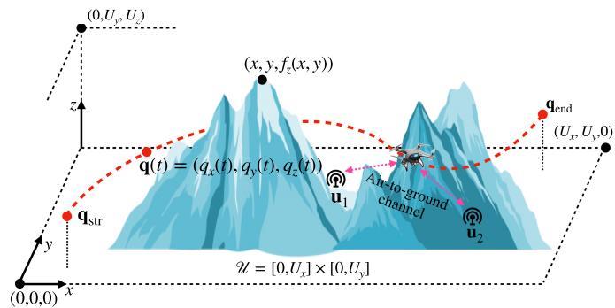  
Fig. 1. 3D UAV trajectory planning for IoT data collection.

$$
\mathbf {u} _ {k} = \left[ u _ {k, x}, u _ {k, y}, f _ {z} (u _ {k, x}, u _ {k, y}) \right].\tag{1}
$$

That is, the position of GN k along the z-axis given by $u _ { k , z } = f _ { z } ( u _ { k , x } , u _ { k , y } )$ . Denote $\mathbf { q } _ { \mathrm { s t r } } = [ q _ { \mathrm { s t r } , x } , q _ { \mathrm { s t r } , y } , q _ { \mathrm { s t r } , z } ]$ and $\begin{array} { r } { \mathbf { q } _ { \mathrm { e n d } } = [ q _ { \mathrm { e n d } , x } , q _ { \mathrm { e n d } , y } , q _ { \mathrm { e n d } , z } ] } \end{array}$ as the UAV’s start position and end position, respectively. To be valid $[ q _ { \mathrm { s t r } , x } , q _ { \mathrm { s t r } , y } ] \in \mathcal { U }$ and $q _ { \mathrm { s t r } , z } \geq$ $f _ { z } ( q _ { \mathrm { s t r } , x } , q _ { \mathrm { s t r } , y } )$ should be satisfied. Similarly, $[ q _ { \mathrm { e n d } , x } , q _ { \mathrm { e n d } , y } ] \in \mathcal { U }$ and $q _ { \mathrm { e n d } , z } \geq { f } _ { z } ( q _ { \mathrm { e n d } , x } , q _ { \mathrm { e n d } , y } )$ should be satisfied.

The aim of the UAV is to collect data from each of K GNs, initially starting from $\mathbf { q } _ { \mathrm { s t r } }$ and returning to $\mathbf { q } _ { \mathrm { e n d } }$ after data gathering. Let

$$
\mathbf {q} (t) = [ q _ {x} (t), q _ {y} (t), q _ {z} (t) ]\tag{2}
$$

be the 3D position ofthe UAV at time $t \in [ 0 , T ]$ , where T denotes the task completion time which is bounded by the maximum allowable time for operating the UAV denoted by $T _ { \mathrm { m a x } }$ , such that $T \leq T _ { \operatorname* { m a x } }$ . Then by sweeping q(t) from $t = 0$ to $t = T .$ the temporal–spatial trajectory of the UAV can be specified by $\{ \mathbf { q } ( t ) \} _ { t \in [ 0 , T ] }$ . To be valid $\{ \mathbf { q } ( t ) \} _ { t \in [ 0 , T ] }$ , the following set of conditions should be satisfied:

$$
\left\{ \begin{array}{l} \mathbf {q} (0) = \mathbf {q} _ {\text {str}}, \\ \mathbf {q} (T) = \mathbf {q} _ {\text {end}}, \\ [ q _ {x} (t), q _ {y} (t) ] \in \mathcal {U} \forall t \in (0, T), \\ q _ {z} (t) \in [ f _ {z} (q _ {x} (t), q _ {y} (t)) + \Delta_ {z}, U _ {z} ] \forall t \in (0, T), \end{array} \right.\tag{3}
$$

where $\Delta _ { z } > 0$ represents the minimum distance that should be maintained from the ground altitude, and $U _ { z }$ represents the maximum allowable altitude for the UAV.

In this paper, we consider two different types of UAV energy consumption. The first is the UAV traveling energy, which is determined by the 3D trajectory of the UAV $\{ \mathbf { q } ( t ) \} _ { t \in [ 0 , T ] }$ . The second is the communication task energy, which is consumed for the transmission and reception of sensing data at each GN and the UAV. In this case, not only $\{ \mathbf { q } ( t ) \} _ { t \in [ 0 , T ] }$ but also other factors such as the required amount of data to be transmitted at each GN will affect the total communication energy. For the following two subsections, we formally state these two energy consumption models.

## B. Energy Consumption Model for UAV Traveling

Before describing the UAV traveling energy model adopted in this paper, we first define the velocity, speed, and acceleration of the UAV, which affect the UAV traveling energy. The velocity of the UAV in meters per second (m/s) at time t in the trajectory is given by

$$
\begin{array}{l} \mathbf {v} (t) = [ v _ {x} (t), v _ {y} (t), v _ {z} (t) ] \\ = \lim _ {\Delta_ {t} \to 0} \frac {\mathbf {q} (t + \Delta_ {t}) - \mathbf {q} (t)}{\Delta_ {t}}. \end{array}\tag{4}
$$

Then, its speed is a scalar quantity of the velocity that is represented as

$$
v (t) = \| \mathbf {v} (t) \|,\tag{5}
$$

where $\| \cdot \|$ is the norm of a vector. Using (4), we can express the acceleration ${ \bf a } ( t )$ in meters per second squared $\mathrm { ( m / s ^ { 2 } ) }$ as

$$
\begin{array}{l} \mathbf {a} (t) = [ a _ {x} (t), a _ {y} (t), a _ {z} (t) ] \\ = \lim _ {\Delta_ {t} \to 0} \frac {\mathbf {v} (t + \Delta_ {t}) - \mathbf {v} (t)}{\Delta_ {t}}. \end{array}\tag{6}
$$

With (4) to (6), we consider the UAV traveling energy consumption model introduced in [25], which is an extended model from the 2D UAV velocity–power model [22] to the 3D model. In [25], the UAV traveling power consumption in watts (W) at time t is calculated based on $\mathbf { v } ( t )$ by

$$
\begin{array}{l} P _ {\text {fly}} \left(\mathbf {v} (t)\right) = \frac {1}{2} d _ {0} \rho s A v _ {x y} ^ {3} (t) + P _ {0} \left(1 + \frac {3 v _ {x y} ^ {2} (t)}{U _ {\text {tip}} ^ {2}}\right) \\ \qquad + P _ {1} \left(\sqrt {1 + \frac {v _ {x y} ^ {4} (t)}{4 v _ {0} ^ {4}}} - \frac {v _ {x y} ^ {2} (t)}{2 v _ {0} ^ {2}}\right) ^ {\frac {1}{2}} + P _ {2} \left| v _ {z} (t) \right|, \end{array}\tag{7}
$$

where $P _ { 0 }$ and $P _ { 1 }$ are the constant blade profile power and the induced power in hovering status, respectively; $P _ { 2 }$ is the constant descending/ascending power; $U _ { \mathrm { t i p } }$ is the tip speed of the rotor blade; $v _ { 0 }$ is the mean rotor-induced speed in hovering status; s and A are the rotor solidity and rotor disc area, respectively; $d _ { 0 }$ is the fuselage drag ratio; $\rho$ is the air density; and $v _ { x y } ( t )$ is the horizontal speed at time $t ,$ namely $v _ { x y } ( t ) = \sqrt { v _ { x } ^ { 2 } ( t ) + v _ { y } ^ { 2 } ( t ) }$ . More specifically, $\begin{array} { r } { P _ { 0 } = \frac { \delta } { 8 } \rho s A \Omega ^ { 3 } \zeta ^ { 3 } } \end{array}$ and $\begin{array} { r } { P _ { 1 } = \overset { \cdot } { ( } 1 + l ) \frac { W ^ { 3 / 2 } } { \sqrt { 2 \rho A } } } \end{array}$ , where δ is the profile drag coefficient, Ω is the blade angular velocity in radians/second, $\zeta$ is rotor radius in meter, l is the incremental correction factor to induced power, and $W$ is the aircraft weight in newton. Using (7), the UAV traveling energy consumption in joules (J) over the whole trajectory is given by

$$
E _ {\text { fly }} = \int_ {0} ^ {T} P _ {\text { fly }} (\mathbf {v} (t)) d t.\tag{8}
$$

Fig. 2(a) illustrates the UAV traveling power with respect to the horizontal speed $v _ { x y }$ when the vertical speed $| v _ { z } |$ is given. As seen in Fig. 2(a), the power consumption during UAV flight is significantly influenced by both its horizontal and vertical speeds [25]. It is also evident that UAV acceleration impacts power consumption, as discussed in [23], which accounts for the additional power consumed during UAV acceleration. Fig. 2(b) illustrates the UAV power consumption model in [23] with respect to the horizontal speed $v _ { x y }$ when the acceleration $\lVert \mathbf a \rVert$ is given. As seen in the figure, the impact of speed on power consumption is more pronounced when $\lVert \mathbf a \rVert$ is small. For the sake of simplicity and to facilitate a clearer analysis, this study does not consider the additional power consumed due to UAV acceleration. However, it is important to note that the proposed MDE-CH in Section IV is universally applicable for various power consumption models, including those in [23], [25].

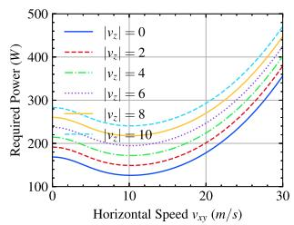

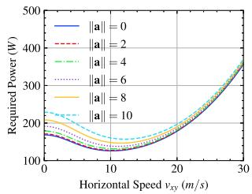  
(a) UAV traveling power with differ- (b) UAV traveling power with different values of vertical speed |vz|. ent values of acceleration a|| when |vz| = 0.  
Fig. 2. UAV traveling power with different vertical speeds and acceleration.

## C. Channel Modelfor Communication Task

1) Air-to-Ground Channel Model: The channel model between the UAV and GNs follows the air-to-ground model in [38]. The channel coefficient between two communication points (i.e., q(t) and ${ \bf { u } } _ { k } )$ at time t is represented as

$$
h _ {k} (t) = \sqrt {h _ {k , \mathrm{LS}} (t)} h _ {k, \mathrm{SS}} (t),\tag{9}
$$

where $h _ { k , \mathrm { L S } } ( t )$ and $h _ { k , \mathrm { S S } } ( t )$ are the large-scale and the smallscale fading coefficients, respectively. The small-scale fading coefficient is expressed as a complex random variable with the expectation $\mathbb { E } [ | \bar { h } _ { k , \mathrm { S S } } ( t ) | ^ { 2 } ] = 1$ . The large-scale fading coefficient is expressed as LoS and non-LoS (NLoS) components, respectively, as follows:

$$
h _ {k, \mathrm{LS}} (t) = \left\{ \begin{array}{l} \beta_ {0} d _ {k} ^ {- \alpha} (t) \text {   for   the   LoS   case }, \\ \kappa \beta_ {0} d _ {k} ^ {- \alpha} (t) \text {   for   the   NLoS   case }, \end{array} \right.\tag{10}
$$

where $d _ { k } ( t ) = \lVert { \bf q } ( t ) - { \bf u } _ { k } \rVert$ is the distance between the UAV and GN k at time $t , ~ \beta _ { 0 } > 0$ represents the channel power according to the 1-meter reference distance, $\alpha \geq 2$ is the path loss exponent, and $\kappa \in ( 0 , 1 )$ is the additional attenuation factor for the NLoS channel. With given wavelength $\begin{array} { r } { \lambda , \beta _ { 0 } = \left( \frac { \lambda } { 4 \pi } \right) ^ { 2 } } \end{array}$

According to [39], the LoS probability of GN k is computed as

$$
\mathbb {P} _ {k, \mathrm{LoS}} (t) = \frac {1}{1 + a \exp (- b (\theta_ {k} (t) - a))},\tag{11}
$$

where $a > 0$ and $b > 0$ are the parameters determined by the propagation environment [38], [39], and $\theta _ { k } ( t )$ is the elevation

angle that is given by

$$
\theta_ {k} (t) = \frac {1 8 0}{\pi} \arcsin \left(\frac {q _ {z} (t) - u _ {k , z}}{d _ {k} (t)}\right),\tag{12}
$$

where arcsin(·) denotes the reverse sine function. Obviously, the NLoS probability of GN k is given as $\mathbb { P } _ { k , \mathrm { N L o S } } ( t ) = 1 -$ $\mathbb { P } _ { k , \mathrm { L o S } } ( t )$ . It is worth noting that the elevation angle inherently depends on the terrain height, which implicitly reflects terrain influence on the LoS probability. Then, the instantaneous achievable data rate in bits per second (bps) from GN k to the UAV is expressed as

$$
R _ {k} (t) = B \log_ {2} \left(1 + \frac {P _ {\mathrm{tx}} | h _ {k} (t) | ^ {2}}{\sigma^ {2} \Gamma_ {0}}\right),\tag{13}
$$

where B is the bandwidth, $\sigma ^ { 2 }$ is the noise variance, and $\Gamma _ { 0 } > 1$ is the channel capacity loss due to the modulation.

2) Data Requirements for GNs: Note that $R _ { k } ( t )$ in (13) contains randomness due to small-scale fading and LoS or NLoS probabilities. Hence, in principle, it is impossible to obtain channel state information (CSI) at the stage of designing or optimizing the UAV trajectory for data gathering, as it depends on the current time and the current location of the UAV. To overcome this limitation, we introduce an approximate expected data rate, which can be determined by the position of the UAV. Specifically, the expected channel gain of GN k is given by

$$
\begin{array}{r l} & {\mathbb {E} \left[ | h _ {k} (t) | ^ {2} \right] = \mathbb {P} _ {k, \mathrm{LoS}} (t) \beta_ {0} d _ {k} ^ {- \alpha} (t)} \\ & {\qquad + (1 - \mathbb {P} _ {k, \mathrm{LoS}} (t)) \kappa \beta_ {0} d _ {k} ^ {- \alpha} (t)} \\ & {\qquad = \hat {\mathbb {P}} _ {k, \mathrm{LoS}} (t) \beta_ {0} d _ {k} ^ {- \alpha} (t),} \end{array}\tag{14}
$$

where $\hat { \mathbb { P } } _ { k , \mathrm { L o S } } ( t ) = \kappa + ( 1 - \kappa ) \mathbb { P } _ { k , \mathrm { L o S } } ( t )$ is the regularized LoS probability. Consequently, according to [22], [40], we have

$$
\begin{array}{l} \mathbb {E} \left[ R _ {k} (t) \right] \leq B \log_ {2} \left(1 + \frac {P _ {\mathrm{tx}} \mathbb {E} \left[ | h _ {k} (t) | ^ {2} \right]}{\sigma^ {2} \Gamma_ {0}}\right) \\ = B \log_ {2} \left(1 + \frac {\gamma_ {0} \hat {\mathbb {P}} _ {k , \mathrm{LoS}} (t)}{\| \mathbf {q} (t) - \mathbf {u} _ {k} \| ^ {\alpha}}\right) \\ := \tilde {R} _ {k} (t), \end{array}\tag{15}
$$

where $\begin{array} { r } { \gamma _ { 0 } = \frac { P _ { \mathrm { t x } } \beta _ { 0 } } { \sigma ^ { 2 } \Gamma _ { 0 } } } \end{array}$ . From now on, we will use $\tilde { R } _ { k } ( t )$ to estimate the achievable data rate at time t. The achievable data rate $\tilde { R } _ { k } ( t )$ is directly influenced by the LoS probability which depends on the elevation angle, and the distance between the UAV and the associated GN. Fig. 3 illustrates the achievable data rate as a function of the elevation angle under different distances between the UAV and the GN. It can be observed that the NLoS component dominates when the elevation angle is below approximately $1 0 ^ { \circ }$ , whereas the LoS condition becomes dominant when the elevation angle exceeds approximately 20◦. Moreover, from Fig. 3, we can conclude that even under NLoS-dominant conditions, the system can still maintain an acceptable data rate as long as the distance between the UAV and the GN is not excessively large.

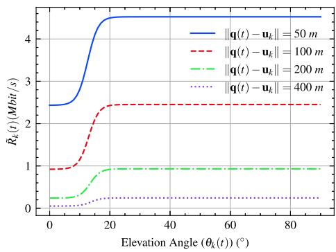  
Fig. 3. The achievable data rate versus elevation angle under different distances.

Let $R _ { k } ^ { \mathrm { t h } } > 0$ be a threshold representing the minimum data rate required for successful communication between the UAV and GN k. This threshold is also beneficial for conserving communication energy by avoiding communication initiation for low data rates. Then the total amount of data in bits received from GN k is given by

$$
Q _ {k} = \int_ {0} ^ {T} \tilde {R} _ {k} (t) \mathbf {1} _ {\left(\tilde {R} _ {k} (t) \geq R _ {k} ^ {\mathrm{th}}\right)} d t.\tag{16}
$$

Let us denote the data requirement for GN k by $Q _ { k } ^ { \mathrm { t h } }$ . That is, the UAV trajectory $\{ \mathbf { q } ( t ) \} _ { t \in [ 0 , T ] }$ should satisfy $Q _ { k } \geq Q _ { k } ^ { \mathrm { t h } }$ for all $k \in [ 1 : K ]$

Finally, the total energy consumption in joules (J) for completing the communication task is given by

$$
E _ {\mathrm{com}} = P _ {\mathrm{com}} \sum_ {k = 1} ^ {K} \int_ {0} ^ {T} \mathbf {1} _ {(\tilde {R} _ {k} (t) \geq R _ {k} ^ {\mathrm{th}})} d t,\tag{17}
$$

where $P _ { \mathrm { c o m } }$ denotes the total power consumption during the communication period, including the transmit power $P _ { \mathrm { t x } }$ for each GN and processing power at the UAV for data reception [22], [41]. Here, $\mathbf { 1 } _ { ( \cdot ) }$ denotes the indicator function, defined by

$$
\mathbf {1} _ {(\theta_ {1} \geq \theta_ {2})} = \left\{ \begin{array}{l l} 1 & \text { if } \theta_ {1} \geq \theta_ {2}, \\ 0 & \text { otherwise }. \end{array} \right.\tag{18}
$$

## D. UAV Trajectory Optimization for Energy Minimization

The objective of this work is to minimize UAV energy consumption under various constraints such as UAV physical limitations and communication requirements through joint UAV trajectory and task completion time optimization. To achieve such an objective, we formulate the following optimization problem:

$$
\min _ {\{\mathbf {q} (t) \} _ {t \in [ 0, T ]}} \left\{E _ {\mathrm{fly}} + E _ {\mathrm{com}} \right\},\tag{19a}
$$

$$
\begin{array}{l l} s. t. & \text { C1: } \mathbf {q} (0) = \mathbf {q} _ {\text { str }}, \\ & \text { C2: } \mathbf {q} (T) = \mathbf {q} _ {\text { end }}, \\ & \text { C3: } [ q _ {x} (t), q _ {y} (t) ] \in \mathcal {U} \forall t \in (0, T), \\ & \text { C4: } q _ {z} (t) \in [ f _ {z} (q _ {x} (t), q _ {y} (t)) + \Delta_ {z}, U _ {z} ] \forall t \in (0, T), \end{array}
$$

$$
\begin{array}{l} \text { C5: } v (t) \leq v _ {\max} \forall t \in (0, T), \\ \text { C6: } | a _ {x} (t) | \leq a _ {x, \max} \forall t \in (0, T), \\ \text { C7: } | a _ {y} (t) | \leq a _ {y, \max} \forall t \in (0, T), \\ \text { C8: } | a _ {z} (t) | \leq a _ {z, \max} \forall t \in (0, T), \\ \text { C9: } Q _ {k} \geq Q _ {k} ^ {\text { th }} \forall k \in [ 1: K ], \\ \text { C10: } 0 \leq T \leq T _ {\max}. \end{array}\tag{19b}
$$

Here, $v _ { \mathrm { m a x } }$ denotes the maximum speed of the UAV and $a _ { i , \operatorname* { m a x } } , i \in \{ x , y , z \}$ denotes the maximum acceleration along the $( x , y , z ) \ – \mathrm { a x i }$ s of the UAV. The reason for imposing a stricter constraint on acceleration than on speed, i.e., limiting acceleration along the $( x , y , z ) { \mathrm { - a x i s } }$ , is to ensure smooth flying speed. Strictly limiting acceleration prevents significant variations or discontinuities in the speed curve, making real-world deployment more manageable. As seen in Fig. 2(b), acceleration has a significant impact on the UAV power consumption, especially at low speeds.

Remark 1: For time-limited or battery-limited environments, the mission time $T _ { \mathrm { m a x } }$ may not be sufficient to visit all GNs for data collection. In such cases, the UAV must select an appropriate subset of GNs that can be visited within the mission time. However, the main focus of this paper is to provide a generalized framework for constructing a continuous UAV trajectory in large-scale networks, i.e., the case where $T _ { \mathrm { m a x } }$ is sufficiently large to cover all GNs. Therefore, we assume that $T _ { \mathrm { m a x } }$ is large enough to guarantee feasible UAV trajectories.

## III. OPTIMIZATION FOR CONTINUOUS UAV TRAJECTORY

In principle, optimizing a continuous UAV trajectory in (19a) is impossible. Instead of optimizing $\{ \mathbf { q } ( t ) \} _ { t \in [ 0 , T ] }$ directly, we first establish a set of discretized control points and generate the corresponding continuous trajectory based on these control points. We then optimize these control points to obtain an optimized $\{ \mathbf { q } ( t ) \} _ { t \in [ 0 , T ] }$

## A. Trajectory Representation Based on the Bézier Curve

For the optimization problem in (19), the decision variables are given as a continuous function $\{ \mathbf { q } ( t ) \} _ { t \in [ 0 , T ] }$ . To solve (19), we aim to replace the decision variables from an uncountable set to a countable discrete set. To this end, we first introduce the following lemma.

Lemma 1: Consider a continuous trajectory $\mathbf { q } ( t )$ for $t \in [ 0 , T ]$ . Then, there exist a set of polynomial functions $\{ \mathbf { q } _ { i } ( t ) \} _ { t \in [ 0 , T ] , i \in [ 1 : m ] }$ such that lim $\begin{array} { r } { \mathsf { 1 } _ { m  \infty } \sum _ { i \in [ 1 : m ] } \mathbf { q } _ { i } ( t ) } \end{array}$ converges to q(t) for $t \in [ 0 , T ]$

Proof: Denote $\begin{array} { r } { u = \frac { t } { T } \in [ 0 , 1 ] } \end{array}$ . Construct a Bernstein polynomial basis function with degree m [42], [43] as

$$
b _ {i, m} (u) = \binom {m} {i}   (1 - u) ^ {m - i}   u ^ {i}.\tag{20}
$$

Then a linear combination of Bernstein polynomial basis functions is given by

$$
\mathbf {b} _ {m} (u) = \sum_ {i = 0} ^ {m} b _ {i, m} (u) \mathbf {c} _ {i},\tag{21}
$$

where $\{ \mathbf { c } _ { i } \} _ { i \in [ 1 : m ] }$ is a set of Bernstein coefficients. Let us set $\mathbf { c } _ { i } = \mathbf { q } ( \frac { i T } { m } )$ . From (21),

$$
\lim _ {m \rightarrow \infty} \mathbf {b} _ {m} (u T) = \lim _ {m \rightarrow \infty} \sum_ {i = 0} ^ {m} b _ {i, m} (u T) \mathbf {q} \left(\frac {i T}{m}\right)\tag{22}
$$

converges to $\mathbf { q } ( u T )$ for $u \in [ 0 , 1 ]$ from the Weierstrass Approximation Theorem [44], [45]. Therefore,

$$
\begin{array}{c} \mathbf {q} _ {i} (t) = b _ {i, m} (u T) \mathbf {q} \left(\frac {i T}{m}\right) \\ = \binom {m} {i} (1 - u) ^ {m - i} u ^ {i} \mathbf {q} \left(\frac {i T}{m}\right), \end{array}\tag{23}
$$

which completes the proof.

Based on Lemma 1, the UAV trajectory $\{ \mathbf { q } ( t ) \} _ { t \in [ 0 , T ] }$ can be approximately substituted by a set of M polynomial functions constructed by Bernstein polynomial basis functions. Then, the set of decision variables can be transformed into a countable discrete set.

Specifically, we adopt the Bézier curve constructed by Bernstein polynomial basis functions, introduced in [46], [47], which is a parametric curve widely used in computer graphics, vehicle streamline generation, and other fields. Firstly, define a set of M control points as

$$
\mathbf {P} = \left[ \mathbf {p} _ {1}, \mathbf {p} _ {2}, \mathbf {p} _ {3}, \dots , \mathbf {p} _ {M} \right],\tag{24}
$$

where $\mathbf { p } _ { i } = [ p _ { i , x } , p _ { i , y } , p _ { i , z } ]$ for $i \in [ 1 : M ]$ . Under given control points P, the Bézier curve is generated by using the following equation:

$$
\begin{array}{l} \mathbf {b} (u) = [ b _ {x} (u), b _ {y} (u), b _ {z} (u) ], \\ \qquad = \sum_ {i = 1} ^ {M} \binom {M} {i} (1 - u) ^ {M - i} u ^ {i} \mathbf {p} _ {i}, \end{array}\tag{25}
$$

where $u \in [ 0 , 1 ]$ is an independent variable. The Bézier curve has some significant characteristics:

\- It does not generally pass through the middle points $\mathrm { { ( p _ { 2 } } }$ to $ { \mathbf { p } } _ { M - 1 } )$ but always includes the start point $\mathbf { p } _ { 1 }$ and the end point $\mathbf { p } _ { M }$

\- It is covered within the convex hull composed of the control points.

\- The movement of control points will smoothly affect the shape of the curve.

\- The mathematical form is clear and simple to implement. This characteristic aids in trajectory design.

Fig. 4 illustrates an exemplary trajectory of the Bézier curve generated by six control points.

To apply the Bézier curve in (24) and (25), we introduce a normalized time $\bar { t } = t / T \in [ 0 , 1 ]$ . Then the relationship between b(t¯) and q(t) is given by

$$
\mathbf {b} (\bar {t}) = \mathbf {q} (t).\tag{26}
$$

Furthermore, we consider a set of discretized time indices $\bar { \mathbf { t } } = [ 0 , \Delta _ { \bar { t } } , 2 \Delta _ { \bar { t } } , \dots , 1 ]$ to evaluate $E _ { \mathrm { f l y } }$ and $E _ { \mathrm { { c o m } } }$ in (19a) and the constraints in (19b) based on $\bar { t } \in \bar { \mathbf { t } }$ , where $\Delta _ { \bar { t } } = \Delta _ { t } / T$ and the cardinality of ¯t is given by $n = T / \Delta _ { t } + 1$ for a given $\Delta _ { t } > 0$

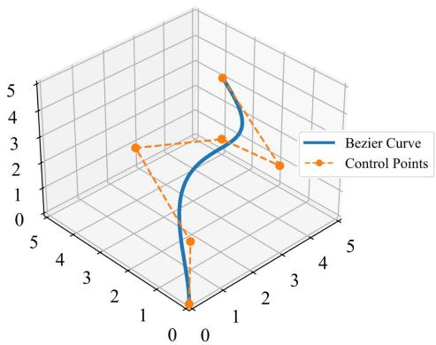  
Fig. 4. Illustration of an exemplary Bézier curve with 6 control points $\mathbf { p } _ { 1 } =$ $[ \bar { 0 , 0 , 0 } ] , \ \mathbf { p } _ { 2 } = [ 1 , 1 , 1 ]$ , where $\mathbf { p } _ { 3 } = [ 2 , 4 , 2 ]$ $\mathbf { p } _ { 4 } = [ 3 , 2 , 3 ]$ $\mathbf { p } _ { 5 } = [ 4 , 1 , 2 ]$ and $\mathbf { p } _ { 6 } = [ 5 , 4 , \bar { 3 } ]$

Specifically, from (4) to (6), we have

$$
\bar {\mathbf {v}} (\bar {t}) = [ \bar {v} _ {x} (\bar {t}), \bar {v} _ {y} (\bar {t}), \bar {v} _ {z} (\bar {t}) ] = \frac {\mathbf {b} (\bar {t} + \Delta_ {\bar {t}}) - \mathbf {b} (\bar {t})}{T \Delta_ {\bar {t}}},\tag{27}
$$

$$
\bar {v} (\bar {t}) = \| \bar {\mathbf {v}} (\bar {t}) \|,\tag{28}
$$

$$
\bar {\mathbf {a}} (\bar {t}) = [ \bar {a} _ {x} (\bar {t}), \bar {a} _ {y} (\bar {t}), \bar {a} _ {z} (\bar {t}) ] = \frac {\bar {\mathbf {v}} (\bar {t} + \Delta_ {\bar {t}}) - \bar {\mathbf {v}} (\bar {t})}{T \Delta_ {\bar {t}}}\tag{29}
$$

for $\bar { t } \in \bar { \mathbf { t } } .$ . Also, from (8), (16), and (17), we have

$$
\bar {E} _ {\mathrm{fly}} = T \Delta_ {\bar {t}} \sum_ {\bar {t} \in \bar {\mathbf {t}}} P _ {\mathrm{fly}} (\mathbf {v} (\bar {t})),\tag{30}
$$

$$
\bar {Q} _ {k} = T \Delta_ {\bar {t}} \sum_ {\bar {t} \in \bar {\mathbf {t}}} \tilde {R} _ {k} (\bar {t}) \mathbf {1} _ {(\tilde {R} _ {k} (\bar {t}) \geq R _ {k} ^ {\mathrm{th}})},\tag{31}
$$

$$
\bar {E} _ {\mathrm{com}} = T \Delta_ {\bar {t}} P _ {\mathrm{com}} \sum_ {k = 1} ^ {K} \sum_ {\bar {t} \in \bar {\mathbf {t}}} \mathbf {1} _ {(\tilde {R} _ {k} (\bar {t}) \geq R _ {k} ^ {\mathrm{th}})}.\tag{32}
$$

It is worthwhile to mention that the number of control points M can be much smaller than the cardinality of $\bar { \mathbf { t } } , \mathrm { i } . \mathbf { e } . , T / \Delta _ { t } + 1$ Hence the proposed trajectory representation based on the Bézier curve can efficiently optimize a continuous UAV trajectory.

## B. Revised Optimization Problem

Since we generate a UAV trajectory through the Bézier curve, the decision variables $\{ \mathbf { q } ( t ) \} _ { t \in [ 0 , T ] }$ for the original optimization problem (19a) and (19b) should be replaced with the control points of the Bézier curve, i.e., $\mathbf { P } = [ \mathbf { p } _ { 1 } , \mathbf { p } _ { 2 } , \ldots , \mathbf { p } _ { M } ]$ . In this work, the control points of the Bézier curve are treated as the decision variables in the optimization problem defined in (33a). As a consequence, (19a) and (19b) can be rewritten as

$$
\min _ {T, \mathbf {P} = [ \mathbf {p} _ {1}, \mathbf {p} _ {2}, \dots , \mathbf {p} _ {M} ]} \left\{\bar {E} _ {\text {fly}} + \bar {E} _ {\text {com}} \right\}\tag{33a}
$$

$$
\begin{array}{l l} s. t. & \mathbf {C 1 : b (0) = q _ {\mathrm{str}}}, \\ & \mathbf {C 2 : b (1) = q _ {\mathrm{end}}}, \\ & \mathbf {C 3 : [ b _ {x} (\bar {t}) , b _ {y} (\bar {t}) ] \in \mathcal {U}   \forall \bar {t} \in \bar {\mathbf {t}}}, \\ & \mathbf {C 4 : b _ {z} (\bar {t}) \in [ f _ {z} (b _ {x} (\bar {t}) , b _ {y} (\bar {t})) + \Delta_ {z} , U _ {z} ]   \forall \bar {t} \in \bar {\mathbf {t}}} \end{array}
$$

$$
\begin{array}{l} \text { C5: } \bar {v} (\bar {t}) \leq v _ {\max} \forall \bar {t} \in \bar {\mathbf {t}}, \\ \text { C6: } | \bar {a} _ {x} (\bar {t}) | \leq a _ {x, \max} \forall \bar {t} \in \bar {\mathbf {t}}, \\ \text { C7: } | \bar {a} _ {y} (\bar {t}) | \leq a _ {y, \max} \forall \bar {t} \in \bar {\mathbf {t}}, \\ \text { C8: } | \bar {a} _ {z} (\bar {t}) | \leq a _ {z, \max} \forall \bar {t} \in \bar {\mathbf {t}}, \\ \text { C9: } \bar {Q} _ {k} \geq Q _ {k} ^ {\text { th }} \forall k \in [ 1: K ], \\ \text { C10: } 0 \leq T \leq T _ {\max}, \end{array}\tag{33b}
$$

Where the relation between P and $\mathbf { b } ( u )$ is given by (25).

Remark 2: Lemma 1 establishes the approximation capability of Bézier curves and transforms the decision variables from an uncountable function space into a finite-dimensional parameter space. However, due to the non-convex objective function and constraints in the proposed problem (33a) and (33b), obtaining the global optimal solution remains highly challenging. Nevertheless, representing the UAV trajectory using Bézier curves enables the computation of high-quality nearoptimal solutions under practical computational constraints, as empirically validated through comparisons with RL baselines.

## IV. OPTIMIZATION VIA MATRIX-BASED DE WITH CONSTRAINT HANDLING

The optimization problem presented in (33a) and (33b) is evidently non-convex, and obtaining its optimal solution in real-time processes may be unattainable. To address this challenge, various global optimization techniques can be considered. Among the diverse methods highlighted in [48], we adopt an ECbased optimization, a popular and promising approach within this field. Inspired by [49], which introduces the matrix-based particle swarm optimizer (MPSO) and matrix-based genetic algorithm (MGA), we propose an MDE-CH algorithm to optimize the model presented in this paper. The proposed MDE-CH algorithm is an extended version of the DE algorithm [50]. The first extension involves a matrix-based representation of candidate solutions and their parameters that is able to offer the advantage of parallelizing and synchronizing multiple solutions within a matrix. The second extension is to provide an efficient method of handling different types of constraints under such matrix-based operations required for the constrained optimization in this paper.

In the following, we explain the detailed description of the proposed MDE-CH algorithm with its four main operations: initialization, mutation, crossover, and selection. Then, we provide how to handle constraints to be satisfied during these matrix-based operations. We introduce the notations used for vector and matrix operations. For a vector a, its ith element is denoted by $\mathbf { a } _ { [ i ] }$ . The element-wise multiplication of two equalsized matrices is denoted by ◦. The $c _ { 1 } \times c _ { 2 }$ all-ones matrix and all-zeros matrix are denoted by $\mathbf { J } _ { c _ { 1 } \times c _ { 2 } }$ and $\mathbf { 0 } _ { c _ { 1 } \times c _ { 2 } }$ , respectively. The transpose operator is given by $( \cdot ) ^ { T }$ . We employ $\left( \cdot \right) \stackrel { * } { < } \left( \cdot \right)$ to perform the element-wise comparison of two equal-sized matrices and yield a Boolean indicator matrix. Specifically, each element in the Boolean matrix takes the value of one if the corresponding element in the left-hand side matrix is smaller than that of the right-hand side matrix; otherwise, it takes the value of zero. In the same manner, we define $( \cdot ) \stackrel { * } { > } ( \cdot )$ and $( \cdot ) \stackrel { * } { = } ( \cdot )$ For the $c _ { 1 } \times c _ { 2 }$ Boolean matrix A, its reverse Boolean matrix is denoted by $\overline { { \mathbf { A } } } = \mathbf { J } _ { c _ { 1 } \times c _ { 2 } } - \mathbf { A }$ . The matrix index operations are given in Table II. Besides, we use $\mathcal { U } ( L _ { 1 } , L _ { 2 } )$ to represent the uniform distribution ranging from $L _ { 1 }$ to $L _ { 2 }$

TABLE II  
MATRIX OPERATIONS USED FOR THE PROPOSED MDE-CH ALGORITHM

<table><tr><td>Operation</td><td>Description</td></tr><tr><td> $\mathbf{A}_{[i,j]}$ </td><td>The element in the  $i$ th row and the  $j$ th column of  $\mathbf{A}$ .</td></tr><tr><td> $\mathbf{A}_{[i,\cdot]}$ </td><td> $\mathbf{A}_{[i,\cdot]} = [\mathbf{A}_{[i,1]}, \mathbf{A}_{[i,2]}, \cdots, \mathbf{A}_{[i,c_1]}].$ </td></tr><tr><td> $\mathbf{A}_{[\cdot,j]}$ </td><td> $\mathbf{A}_{[\cdot,j]} = [\mathbf{A}_{[1,j]}, \mathbf{A}_{[2,j]}, \cdots, \mathbf{A}_{[c_2,j]}]^T.$ </td></tr><tr><td> $\mathbf{A}_{[\mathbf{i},\cdot]}$ </td><td>For  $\mathbf{i} \in \{1,2,\cdots,c_1\}^{\rho_1}$ ,  $\mathbf{A}_{[\mathbf{i},\cdot]} = [\mathbf{A}_{[i_1,\cdot]}^T, \mathbf{A}_{[i_2,\cdot]}^T, \cdots, \mathbf{A}_{[i_{\rho_1},\cdot]}^T]^T$ , where  $\mathbf{i} = [i_1, i_2, \cdots, i_{\rho_1}]$ .</td></tr><tr><td> $\mathbf{A}_{[\cdot,\mathbf{j}]}$ </td><td>For  $\mathbf{j} \in \{1,2,\cdots,c_2\}^{\rho_2}$ ,  $\mathbf{A}_{[\cdot,\mathbf{j}]} = [\mathbf{A}_{[\cdot,j_1]}, \mathbf{A}_{[\cdot,j_2]}, \cdots, \mathbf{A}_{[\cdot,j_{\rho_2}]}],$  where  $\mathbf{j} = [j_1, j_2, \cdots, j_{\rho_2}]$ .</td></tr><tr><td> $\mathbf{A}_{[\mathbf{i},\mathbf{j}]}$ </td><td>For  $\mathbf{i} \in \{1,2,\cdots,c_1\}^\rho$  and  $\mathbf{j} \in \{1,2,\cdots,c_2\}^\rho$ ,  $\mathbf{A}_{[\mathbf{i},\mathbf{j}]} = [\mathbf{A}_{[i_1,j_1]}, \mathbf{A}_{[i_2,j_2]}, \cdots, \mathbf{A}_{[i_\rho,j_\rho]}],$  where  $\mathbf{i} = [i_1, i_2, \cdots, i_\rho]$  and  $\mathbf{j} = [j_1, j_2, \cdots, j_\rho].$ </td></tr></table>

## A. Matrix-Based DE

Population Representation: In MDE, the population is represented by a matrix including optimization parameters. Specifically, the matrix-based population can be given by $\mathbf { X } ^ { g } \in \bar { \mathbb { R } } ^ { N \times D }$ in which each row vector represents an individual and each element in columns corresponds to an optimization parameter, where g is the generation number, N is the number of individuals, and D is the dimension size. Let $\mathbf { U } \in \mathbb { R } ^ { 1 \times D }$ and $\mathbf { L } \in \mathbb { R } ^ { 1 \times D }$ be vectors representing the upper and lower bounds of each dimension, respectively.

For the considered UAV trajectory optimization in Section III-B, the population matrix is presented as

$$
\mathbf {X} ^ {g} = \left[ \begin{array}{c c c c c} \mathbf {p} _ {1, 1} ^ {g} & \mathbf {p} _ {1, 2} ^ {g} & \dots & \mathbf {p} _ {1, M - 2} ^ {g} & T _ {1} ^ {g} \\ \mathbf {p} _ {2, 1} ^ {g} & \mathbf {p} _ {2, 2} ^ {g} & \dots & \mathbf {p} _ {2, M - 2} ^ {g} & T _ {2} ^ {g} \\ \vdots & \vdots & \ddots & \vdots & \vdots \\ \mathbf {p} _ {N, 1} ^ {g} & \mathbf {p} _ {N, 2} ^ {g} & \dots & \mathbf {p} _ {N, M - 2} ^ {g} & T _ {N} ^ {g} \end{array} \right],\tag{34}
$$

where $D = 3 ( M - 2 ) + 1$ . Here, each row vector consists of a set of optimization decision variables in (33a) except $\mathbf { p } _ { 1 }$ and $\mathbf { p } _ { M }$ , which are set as $\mathbf { q } _ { \mathrm { s t r } }$ and $\mathbf { q } _ { \mathrm { e n d } }$ , respectively, to satisfy C1 and C2 in (33b). Moreover, U and L are expressed as

$$
\begin{array}{l} \mathbf {U} = [ U _ {x}, U _ {y}, U _ {z}, U _ {x}, U _ {y}, U _ {z}, \ldots , U _ {x}, U _ {y}, U _ {z}, T _ {\max} ], \\ \mathbf {L} = [ 0, 0, 0, 0, 0, 0, \ldots , 0, 0, 0, 0 ]. \end{array}\tag{35}
$$

Initialization: Let ${ \bf R } _ { N \times D }$ be the $N \times D$ random matrix whose elements follow $\mathcal { U } ( 0 , 1 )$ ). Then the population matrix of the first generation is constructed as

$$
\mathbf {X} ^ {1} = \left[ \mathbf {J} _ {N \times 1} (\mathbf {U} - \mathbf {L}) \right] \circ \mathbf {R} _ {N \times D} + \mathbf {J} _ {N \times 1} \mathbf {L}.\tag{36}
$$

Note that the matrix ${ \bf J } _ { N \times 1 }$ facilitates the reshaping of U and L from dimensions $1 \times D$ to $N \times D$ . After initialization, the elements in $\mathbf { X } ^ { 1 }$ span the range between the upper and lower bounds for each dimension.

Mutation: The aim of the mutation operation is to generate new individuals for exploring uncharted searching areas. Here, we primarily introduce the DE/rand/1 version. In the original

DE, the main parameter is the amplification factor λ, typically ranging from 0 to 2. In MDE, λ should be a matrix derived by

$$
\boldsymbol {\Lambda} = \lambda \mathbf {J} _ {N \times D}.\tag{37}
$$

Then, the donor matrix is generated by

$$
\mathbf {Y} ^ {g} = \mathbf {X} _ {[ \mathbf {r} _ {1}, \cdot ]} ^ {g} + \boldsymbol {\Lambda} \circ \left(\mathbf {X} _ {[ \mathbf {r} _ {2}, \cdot ]} ^ {g} - \mathbf {X} _ {[ \mathbf {r} _ {3}, \cdot ]} ^ {g}\right).\tag{38}
$$

Here, $\mathbf { r } _ { i } \in \{ 1 , 2 , 3 , \ldots , N \} ^ { N }$ is the random permutation vector to shuffle the set of N individuals (row vectors in $\mathbf { X } ^ { g } )$ based on the order in $\mathbf { r } _ { i }$ for $i = { 1 , 2 , 3 }$

Due to addition and subtraction operations in (38), some elements in $\mathbf { Y } ^ { g }$ might exceed their upper bounds or fall below their lower bounds, rendering these individuals as infeasible solutions. Therefore, it is essential to enforce that each element remains within the specified range of the upper and lower bounds. For this purpose, let us first construct two Boolean matrices $\Omega _ { U }$ and $\Omega _ { L }$ as

$$
\begin{array}{l} \boldsymbol {\Omega} _ {U} = \mathbf {Y} ^ {g} \stackrel {*} {<  } \mathbf {J} _ {N \times 1} \mathbf {U}, \\ \boldsymbol {\Omega} _ {L} = \mathbf {Y} ^ {g} \stackrel {*} {<  } \mathbf {J} _ {N \times 1} \mathbf {L}, \end{array}\tag{39}
$$

Note that if the elements in $\mathbf { Y } ^ { g }$ are less than the values in ${ \bf J } _ { N \times 1 } { \bf U }$ , the corresponding elements in $\Omega _ { U }$ become ones; otherwise, they become zeros. Similarly, the elements in $\Omega _ { L }$ are determined. Then, the correction of the out-of-bound values in $\mathbf { Y } ^ { g }$ is performed by updating

$$
\begin{array}{r l} & {\mathbf {Y} ^ {g} \leftarrow \mathbf {Y} ^ {g} \circ \boldsymbol {\Omega} _ {U} + (\mathbf {J} _ {N \times 1} \mathbf {U}) \circ \overline {{\boldsymbol {\Omega}}} _ {U},} \\ & {\mathbf {Y} ^ {g} \leftarrow \mathbf {Y} ^ {g} \circ \overline {{\boldsymbol {\Omega}}} _ {L} + (\mathbf {J} _ {N \times 1} \mathbf {L}) \circ \boldsymbol {\Omega} _ {L},} \end{array}\tag{40}
$$

where $\overline { { \Omega } } _ { U }$ and $\overline { { \Omega } } _ { L }$ are the reverse Boolean matrices of $\Omega _ { U }$ and $\Omega _ { L }$ , respectively.

Crossover: The main parameter for the crossover procedure is the crossover rate $\gamma ,$ which ranges between (0,1). Similar to the amplification factor λ in the mutation procedure, γ should be reshaped from a scalar to a matrix to calculate with the two population matrices $\mathbf { X } ^ { g }$ and $\mathbf { Y } ^ { g }$ , as

$$
\boldsymbol {\Gamma} = \gamma \mathbf {J} _ {N \times D},\tag{41}
$$

where Γ is the $N \times D$ matrix with all elements equal to $\gamma .$ Then, to determine which elements in $\mathbf { Y } ^ { g }$ will be replaced with the corresponding elements in $\mathbf { X } ^ { g }$ , thus generating the final trial matrix $\mathbf { W } ^ { g }$ , we first construct

$$
\boldsymbol {\Theta} = \mathbf {R} _ {N \times D} <   ^ {*} \boldsymbol {\Gamma}.\tag{42}
$$

Furthermore, to ensure that each individual can participate in the crossover procedure, we additionally update some elements in Θ as

$$
\Theta_ {[ \mathbf {a} _ {1}, \mathbf {a} _ {2} ]} \leftarrow \mathbf {J} _ {N \times 1},\tag{43}
$$

where $\mathbf { a } _ { 1 } = \left[ 1 : N \right] ^ { T }$ and $\mathbf { a } _ { 2 }$ is the $N \times 1$ random vector in which each element follows $\mathcal { U } ( 1 , D )$ . Consequently, the trial population matrix $\mathbf { W } ^ { g }$ is derived as

$$
\mathbf {W} ^ {g} = \mathbf {Y} ^ {g} \circ \boldsymbol {\Theta} + \mathbf {X} ^ {g} \circ \overline {{\boldsymbol {\Theta}}},\tag{44}
$$

where $\overline { { \Theta } }$ is the reverse Boolean matrix of Θ.

Selection: The original objective function $\bar { E } _ { \mathrm { f l y } } + \bar { E } _ { \mathrm { c o m } }$ in (19a) is used for the selection procedure. For convenience, the objective function can be re-defined as $\mathbf { f } _ { e } : \mathbb { R } ^ { N \times D }  \mathbb { R } ^ { N \times 1 }$ as the vector-wise function to evaluate the fitness values of $\mathbf { W } ^ { g }$ and Xg as $\mathbf { f } _ { e } ( \mathbf { W } ^ { g } )$ and $\mathbf { f } _ { e } ( \mathbf { X } ^ { g } )$ . Then, we compare $\mathbf { f } _ { e } ( \mathbf { W } ^ { g } )$ and $\mathbf { f } _ { e } ( \mathbf { X } ^ { g } )$ to determine which individual can enter into the next generation by

$$
\mathbf {X} ^ {g + 1} = \mathbf {W} ^ {g} \circ (\boldsymbol {\Omega} _ {E} \mathbf {J} _ {1 \times D}) + \mathbf {X} ^ {g} \circ (\overline {{\boldsymbol {\Omega}}} _ {E} \mathbf {J} _ {1 \times D}),\tag{45}
$$

where

$$
\boldsymbol {\Omega} _ {E} = \mathbf {f} _ {e} (\mathbf {W} ^ {g}) \stackrel {*} {<  } \mathbf {f} _ {e} (\mathbf {X} ^ {g})\tag{46}
$$

and $\overline { { \Omega } } _ { E }$ is the reverse Boolean matrix of $\Omega _ { E }$

## B. Selection Under Constraints

Previously, we introduced a general matrix-based selection procedure. In this subsection, we present detailed selection steps that reflect the set of constraints in (33b).

1) Constraints C1, C2, C3, and C10: The constraints C1 and C2 are always satisfied if $\mathbf { p } _ { 1 } = \mathbf { q } _ { \mathrm { s t r } }$ and $\mathbf { p } _ { M } = \mathbf { q } _ { \mathrm { e n d } }$ because of the characteristics of the Bézier curve. For C3, and C10, we set the lower and upper and bounds as $( 0 , U _ { x } ) , ( 0 , U _ { y } )$ , and $( 0 , T _ { \mathrm { m a x } } )$ in (35) and then the out-of-bound values are corrected during the mutation procedure as in (39) and (40). Hence, the constraints C3 and C10 are satisfied.

2) Constraints C4 to C9: Let us now explain the remaining constraints. For these constraints, we introduce a non-negative violation function and choose the one with a smaller violation value during the selection procedure if both individuals in (45) are infeasible, rather than considering their objective values. For such purpose, denote the violation function of the ith constraint by $C _ { i } ( \mathbf { x } ) \in [ 0 , + \infty )$ for $i \in [ 4 : 9 ]$ when an individual x is given. Then the total violation function is given by

$$
\phi (\mathbf {x}) = \sum_ {i = 4} ^ {9} \omega_ {i} C _ {i} (\mathbf {x}),\tag{47}
$$

where $\{ \omega _ { i } \} _ { i \in [ 4 : 9 ] }$ are weighting coefficients satisfying that $\textstyle \sum _ { i = 4 } ^ { 9 } \omega _ { i } = 1$ with $\omega _ { i } > 0$ for all $i \in [ 4 : 9 ]$

Now, we introduce how to calculate each violation function. For C4, the constraint $b _ { z } ( \bar { t } ) \leq U _ { z }$ is satisfied for all t¯ ∈ ¯t because of (39) and (40) during the mutation procedure as the same manner applied for C3 and C10. Then, to define the violation function for $b _ { z } ( \bar { t } ) \geq f _ { z } ( b _ { x } ( \bar { t } ) , b _ { y } ( \bar { t } ) ) + \Delta _ { z }$ , let

$$
\left\{ \begin{array}{l} \mathbf {b} _ {x} = [ b _ {x} (0), b _ {x} (\Delta_ {\bar {t}}), b _ {x} (2 \Delta_ {\bar {t}}), \ldots , b _ {x} ((n - 1) \Delta_ {\bar {t}}) ], \\ \mathbf {b} _ {y} = [ b _ {y} (0), b _ {y} (\Delta_ {\bar {t}}), b _ {y} (2 \Delta_ {\bar {t}}), \ldots , b _ {y} ((n - 1) \Delta_ {\bar {t}}) ], \\ \mathbf {b} _ {z} = [ b _ {z} (0), b _ {z} (\Delta_ {\bar {t}}), b _ {z} (2 \Delta_ {\bar {t}}), \ldots , b _ {z} ((n - 1) \Delta_ {\bar {t}}) ], \end{array} \right.\tag{48}
$$

and denote the vector-wise ground altitude function as $\mathbf { f } _ { z }$ : $\mathcal { U } ^ { 1 \times n }  \mathbb { R } ^ { 1 \times n }$ . The violation function of C4 is expressed as

$$
\begin{array}{l} C _ {4} = \Big [ \Big ((\mathbf {f} _ {z} (\mathbf {b} _ {x}, \mathbf {b} _ {y}) + \Delta_ {z} \mathbf {J} _ {1 \times n} - \mathbf {b} _ {z}) > ^ {*} \mathbf {0} _ {1 \times n} \Big) \\ \qquad \circ (\mathbf {f} _ {z} (\mathbf {b} _ {x}, \mathbf {b} _ {y}) + \Delta_ {z} \mathbf {J} _ {1 \times n} - \mathbf {b} _ {z}) \Big ] \mathbf {J} _ {n \times 1}. \end{array}\tag{49}
$$

The constraints C5 to C8 are about the UAV’s dynamics. For C5, we represent $\mathbf { v } ^ { * } \in \mathbb { R } ^ { 1 \times ( n - 1 ) }$ as the UAV’s speed along the trajectory according to (28), which is given by

$$
\mathbf {v} ^ {*} = [ \bar {v} (0), \bar {v} (\Delta_ {\bar {t}}), \bar {v} (2 \Delta_ {\bar {t}}), \dots , \bar {v} ((n - 2) \Delta_ {\bar {t}}) ].\tag{50}
$$

Note that the endpoint speed cannot be calculated because the speed calculation uses two adjacent points ${ \bf b } ( \bar { t } )$ and $\mathbf { b } ( \bar { t } + \Delta _ { \bar { t } } )$ Hence, the violation function of C5 is expressed as

$$
\begin{array}{c} C _ {5} = \Big [ \Big (\big (\mathbf {v} ^ {*} - v _ {\max} \mathbf {J} _ {1 \times (n - 1)} \big) \overset {*} {>} \mathbf {0} _ {1 \times (n - 1)} \Big) \\ \circ \big (\mathbf {v} ^ {*} - v _ {\max} \mathbf {J} _ {1 \times (n - 1)} \big) \Big ] \mathbf {J} _ {(n - 1) \times 1}. \end{array}\tag{51}
$$

The constraints C6 to C8 are about acceleration. Let

$$
\left\{ \begin{array}{l} \mathbf {a} _ {x} = [ | \bar {a} _ {x} (0) |, | \bar {a} _ {x} (\Delta_ {\bar {t}}) |, | \bar {a} _ {x} (2 \Delta_ {\bar {t}}) |, \ldots , | \bar {a} _ {x} ((n - 3) \Delta_ {\bar {t}}) | ], \\ \mathbf {a} _ {y} = [ | \bar {a} _ {y} (0) |, | \bar {a} _ {y} (\Delta_ {\bar {t}}) |, | \bar {a} _ {y} (2 \Delta_ {\bar {t}}) |, \ldots , | \bar {a} _ {y} ((n - 3) \Delta_ {\bar {t}}) | ], \\ \mathbf {a} _ {z} = [ | \bar {a} _ {z} (0) |, | \bar {a} _ {z} (\Delta_ {\bar {t}}) |, | \bar {a} _ {z} (2 \Delta_ {\bar {t}}) |, \ldots , | \bar {a} _ {z} ((n - 3) \Delta_ {\bar {t}}) | ]. \end{array} \right.\tag{52}
$$

Then, the violation functions for C6 to C8 are calculated by

$$
\begin{array}{l} C _ {6} = \Big [ \Big (\big (\mathbf {a} _ {x} - a _ {x, \max} \mathbf {J} _ {1 \times (n - 2)} \big) ^ {*} > \mathbf {0} _ {1 \times (n - 2)} \Big) \\ \quad \circ \big (\mathbf {a} _ {x} - a _ {x, \max} \mathbf {J} _ {1 \times (n - 2)} \big) \Big ] \mathbf {J} _ {(n - 2) \times 1}, \\ C _ {7} = \Big [ \Big (\big (\mathbf {a} _ {y} - a _ {y, \max} \mathbf {J} _ {1 \times (n - 2)} \big) ^ {*} > \mathbf {0} _ {1 \times (n - 2)} \Big) \\ \quad \circ \big (\mathbf {a} _ {y} - a _ {y, \max} \mathbf {J} _ {1 \times (n - 2)} \big) \Big ] \mathbf {J} _ {(n - 2) \times 1}, \\ C _ {8} = \Big [ \Big (\big (\mathbf {a} _ {z} - a _ {z, \max} \mathbf {J} _ {1 \times (n - 2)} \big) ^ {*} > \mathbf {0} _ {1 \times (n - 2)} \Big) \\ \quad \circ \big (\mathbf {a} _ {z} - a _ {z, \max} \mathbf {J} _ {1 \times (n - 2)} \big) \Big ] \mathbf {J} _ {(n - 2) \times 1}. \end{array}\tag{53}
$$

(54)

(55)

For C9, denote

$$
\mathbf {Q} = [ \bar {Q} _ {1}, \bar {Q} _ {2}, \bar {Q} _ {3}, \dots , \bar {Q} _ {K} ]\tag{56}
$$

and

$$
\mathbf {Q} ^ {\mathrm{th}} = [ Q _ {1} ^ {\mathrm{th}}, Q _ {2} ^ {\mathrm{th}}, Q _ {3} ^ {\mathrm{th}}, \ldots , Q _ {K} ^ {\mathrm{th}} ].\tag{57}
$$

Then, the violation function of C9 is calculated as

$$
C _ {9} = \left[ \left(\left(\mathbf {Q} ^ {\text { th }} - \mathbf {Q}\right) > ^ {*} \mathbf {0} _ {1 \times K}\right) \circ \left(\mathbf {Q} ^ {\text { th }} - \mathbf {Q}\right) \right] \mathbf {J} _ {K \times 1}.\tag{58}
$$

3) Selection Based on the Violation Function: Let us now explain the modified selection procedure incorporating the total violation function in (47). First, define the $N \times 1$ violation vectors for $\mathbf { X } ^ { g }$ and $\mathbf { W } ^ { g }$ as

$$
\boldsymbol {\Phi} _ {\mathbf {X} ^ {g}} = \left[ \phi (\mathbf {X} _ {[ 1, \cdot ]} ^ {g}), \phi (\mathbf {X} _ {[ 2, \cdot ]} ^ {g}), \dots , \phi (\mathbf {X} _ {[ N, \cdot ]} ^ {g}) \right] ^ {T},\tag{59}
$$

$$
\boldsymbol {\Phi} _ {\mathbf {W} ^ {g}} = \left[ \phi \left(\mathbf {W} _ {[ 1, \cdot ]} ^ {g}\right), \phi \left(\mathbf {W} _ {[ 2, \cdot ]} ^ {g}\right), \dots , \phi \left(\mathbf {W} _ {[ N, \cdot ]} ^ {g}\right) \right] ^ {T}.\tag{60}
$$

The original objective function values will be used for selection if the violation values of both individuals in $\mathbf { X } ^ { g }$ and $\mathbf { W } ^ { g }$ are the same. For such purpose, let

$$
\Omega_ {\phi} = \Phi_ {\mathbf {X} ^ {g}} \stackrel {*} {=} \Phi_ {\mathbf {W} ^ {g}},\tag{61}
$$

to compare the violation values and $\Omega _ { \phi }$ stores the comparison results. Then, from $\Omega _ { \phi }$ , we substitute the corresponding elements in $\Phi _ { \mathbf { X } ^ { g } }$ and $\Phi _ { \mathbf { W } ^ { g } }$ with the objective function values, which is obtained by updating

$$
\boldsymbol {\Phi} _ {\mathbf {X} ^ {g}} \leftarrow \boldsymbol {\Phi} _ {\mathbf {X} ^ {g}} \circ \overline {{\boldsymbol {\Omega}}} _ {\phi} + \mathbf {f} _ {e} (\mathbf {X} ^ {g}) \circ \boldsymbol {\Omega} _ {\phi},
$$

$$
\Phi_ {\mathbf {W} ^ {g}} \leftarrow \Phi_ {\mathbf {W} ^ {g}} \circ \overline {{\Omega}} _ {\phi} + \mathbf {f} _ {e} (\mathbf {W} ^ {g}) \circ \Omega_ {\phi},\tag{62}
$$

where $\overline { { \Omega } } _ { \phi }$ is the reverse Boolean matrices of $\Omega _ { \phi } .$ . Consequently, the $( g + 1 )$ )th population matrix is constructed as

$$
\mathbf {X} ^ {g + 1} = \mathbf {W} ^ {g} \circ (\boldsymbol {\Omega} _ {E ^ {\prime}} \mathbf {J} _ {1 \times D}) + \mathbf {X} ^ {g} \circ (\overline {{\boldsymbol {\Omega}}} _ {E ^ {\prime}} \mathbf {J} _ {1 \times D}),\tag{63}
$$

where

$$
\Omega_ {E ^ {\prime}} = \Phi_ {\mathbf {W} ^ {g}} <   ^ {*} \Phi_ {\mathbf {X} ^ {g}},\tag{64}
$$

and $\overline { { \Omega } } _ { E ^ { \prime } }$ is the reverse Boolean matrix of $\Omega _ { E ^ { \prime } }$

## C. Algorithm Summary

Algorithm 1 summarizes the procedure ofthe proposed MDE-CH for solving the optimization problem in Section III-B. In Algorithm 1, τ is a counter to log the number offeasible solutions after MDE-CH finishes G generations. When $\tau \geq 1$ (meaning that MDE-CH finds at least one feasible solution), the loop of $\mathrm { \tilde { \Delta } w h i l e } \tau = 0 2 0 \mathrm { \tilde { \Delta } ^ { \mathrm { * } } }$ is terminated. The set Ψ stores the index of each feasible solution. When $\tau \geq 1$ , we initialize the optimal objective function value and feasible solution as $f ^ { * } = + \infty$ and $\mathbf { x } ^ { * } = \mathbf { 0 } _ { 1 \times D }$ , respectively. Then, select the optimal solution based on the index in Ψ using the loop of $\mathrm { f o r } j \in \Psi \mathrm { d o }$ . After obtaining the optimal feasible solution, we can construct the UAV trajectory according to (25) and (26).

MDE-CH promotes the search toward the feasible region by ranking infeasible solutions according to their constraint violation function, $\phi ( \mathbf { x } )$ , while always prioritizing feasible solutions over infeasible ones. Consequently, infeasible individuals tend to learn from feasible individuals or from those with smaller constraint violations, guiding the population to evolve progressively toward feasibility.

## D. Time Complexity of MDE-CH

The time complexity of MDE-CH’s initialization, mutation, and crossover is $\mathcal { O } ( N \times D )$ . Because the selection operator includes an additional constraint-handling step, this step has complexity $\mathcal { O } ( N )$ because the number of comparisons is given by N. Hence, the time complexity for basic operations to evolve up to G generations is given by $\mathcal { O } ( G \times ( N \times D + N ) ) =$ $\mathcal { O } ( G \times N \times D )$ . Assuming that the number of iterations for the while loop in Algorithm 1 is given by τ˜, the total time complexity of MDE-CH is $\mathcal { O } ( \tilde { \tau } \times G \times N \times D + \log _ { 2 } N ^ { \prime } )$ , where $N ^ { \prime }$ denotes the number of feasible solutions at the τ˜th iteration. Because $N ^ { \prime } \in [ 1 : N ]$ , we have $\mathcal { O } ( \tilde { \tau } \times G \times N \times D + \log _ { 2 } { N ^ { \prime } } ) =$ $\mathcal { O } ( \tilde { \tau } \times G \times N \times D )$ . Finally, when N and G are chosen sufficiently large, τ˜ equals to one in most simulations, and as a consequence, the time complexity of MDE-CH is approximately $\mathcal { O } ( G \times N \times D )$ . Finally, as noted in [49], the time complexity can be further reduced to $\mathcal { O } ( \frac { G \times N \times D } { \Gamma } )$ by introducing the number of Γ parallel processes.

Algorithm 1: Proposed MDE-CH Optimization.

1: Initialize $\tau = 0$ and $\Psi = \emptyset$.

2: while $\tau = 0$ do

3: Population initialization: Construct $\mathbf{X}^1$ by performing (35) and (36).

4: for $g \in [1 : G]$ do

5: Mutation: Construct $\mathbf{Y}^g$ by performing (37) to (40).

6: crossover: Construct $\mathbf{W}^g$ by performing (41) to (44).

7: Selection: Construct $\mathbf{X}^{g+1}$ by performing the selection procedure in Section IV-B.

8: end for

9: for $i \in [1 : N]$ do

10: if $\phi(\mathbf{X}_{[i,\cdot]}^G) = 0$ then

11: Update $\tau \leftarrow \tau + 1$.

12: Update $\Psi \leftarrow \Psi \cup \{i\}$.

13: end if

14: end for

15: end while

16: Initialize $f^* = +\infty$ and $\mathbf{x}^* = \mathbf{0}_{1 \times D}$.

17: for $j \in \Psi$ do

18: Evaluate the fitness value of $f_e(\mathbf{X}_{[j,\cdot]}^G)$ based on $\bar{E}_{fly} + \bar{E}_{com}$.

19: if $f_e(\mathbf{X}_{[j,\cdot]}^G) &lt; f^*$ then

20: Update $f^* \leftarrow f_e(\mathbf{X}_{[j,\cdot]}^G)$.

21: Update $\mathbf{x}^* \leftarrow \mathbf{X}_{[j,\cdot]}^G$.

22: end if

23: end for

24: Construct $\{\mathbf{b}^*(\bar{t})\}_{\bar{t} \in [0,1]}$ from $\mathbf{x}_{[1]}^*$ to $\mathbf{x}_{[D-1]}^*$ according to (25).

25: Construct $\{\mathbf{q}^*(t)\}_{t \in [1:T^*]}$ from $\{\mathbf{b}^*(\bar{t})\}_{\bar{t} \in [0,1]}$ according to (26), where $T^* = \mathbf{x}_{[D]}^*$.

Output: UAV Trajectory: $\{\mathbf{q}^*(t)\}_{t \in [1:T^*]}$.

Note that as the number of GNs K increases, the trajectory of the UAV becomes more complex in order to satisfy the data-requirement constraints for all $k \in [ 1 : K ]$ as seen in constraint C9 of (19b). Hence, to obtain a feasible solution, the number of control points M used to construct the Bézier curve should increase with K, which corresponds to the dimension size $D .$ Consequently, the time complexity $\mathcal { O } ( \frac { G \times N \times D } { \Gamma } )$ increases linearly with K.

PARAMETERS FOR 3D TERRAIN  
TABLE III

<table><tr><td></td><td> $A_i$ </td><td> $μ_{x_i}$ </td><td> $μ_{y_i}$ </td><td> $σ_{x_i}$ </td><td> $σ_{y_i}$ </td></tr><tr><td>i=1</td><td>150</td><td>200</td><td>500</td><td>90</td><td>90</td></tr><tr><td>i=2</td><td>150</td><td>600</td><td>500</td><td>90</td><td>90</td></tr><tr><td>i=3</td><td>150</td><td>400</td><td>200</td><td>90</td><td>90</td></tr></table>

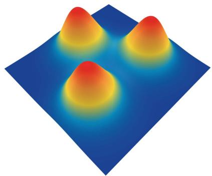  
Fig. 5. 3D terrain generated by three Gaussian sub-functions.

## V. NUMERICAL EVALUATION

In this section, we numerically evaluate the performance of the proposed MDE-CH algorithm. All simulations are run on a MacBook Pro equipped with an Apple M3 Max chip, 36 GB of RAM, and running macOS Sonoma 14.5. Moreover, all codes are developed by Visual Studio Code (VS Code), Python with version 3.9.18, and NumPy with version 1.26.2.

## A. Simulation Environment

1) 3D Terrain Representation: There exist several works studying 3D terrain representation. In [36], [51], 3D terrain has been constructed based on randomly generated Gaussian functions. In [52], functions consisting of sine and cosine have been used to describe the wave landscape. Additionally, in the field of 2D/3D map representation, cylindrical danger zones (or no-fly zones) can be formulated by inequality, such as $\left( x - x _ { c } \right) ^ { 2 } + \left( y - y _ { c } \right) ^ { 2 } \geq r ^ { 2 }$ , which denotes that the trajectory cannot enter the circle region, locating $( x _ { c } , y _ { c } )$ with a radius of r [53].

In this paper, 3D terrain is generated by using a combination of Gaussian functions for numerical evaluation [51], [52], [54]. Specifically, 3D terrain is represented by

$$
f _ {z} (x, y) = \sum_ {i = 1} ^ {I} A _ {i} e ^ {- \left(\frac {(x - \mu_ {x _ {i}}) ^ {2}}{2 \sigma_ {x _ {i}} ^ {2}} + \frac {(y - \mu_ {y _ {i}}) ^ {2}}{2 \sigma_ {y _ {i}} ^ {2}}\right)},\tag{65}
$$

where $f _ { z } ( x , y )$ is the ground altitude, and $\mu _ { x _ { i } } , \mu _ { y _ { i } } , \sigma _ { x _ { i } }$ , and $\sigma _ { y _ { i } }$ are the parameters of each sub-function, $A _ { i }$ is the altitude of sub-functions, and I is the number of sub-functions. It is notable that the real-world landscape can be simulated with (65) to fit the contour map with altitude using methods like the least square method or other functions, such as a neural network [55]. In the simulation, three Gaussian sub-functions, i.e., I 3, are employed with the parameters in Table III and Fig. 5 illustrates the resulting 3D terrain based on the parameters presented in Table III.

TABLE IV MAIN SIMULATION PARAMETERS

<table><tr><td>Notation</td><td>Values</td><td>Description</td></tr><tr><td>M</td><td>13</td><td>Number of control points</td></tr><tr><td>n</td><td>100</td><td>Number of interpolation (n = T/Δt + 1)</td></tr><tr><td>Ux</td><td>800 m</td><td>Maximum bound of the x-axis</td></tr><tr><td>Uy</td><td>800 m</td><td>Maximum bound of the y-axis</td></tr><tr><td>Uz</td><td>122 m</td><td>Maximum bound of the z-axis</td></tr><tr><td>Δz</td><td>0.5 m</td><td>Minimum UAV distance from the ground</td></tr><tr><td>W</td><td>20 Newton</td><td>Aircraft weight</td></tr><tr><td>ρ</td><td>1.225 kg/m3</td><td>Air density</td></tr><tr><td>ζ</td><td>0.4 m</td><td>Rotor radius</td></tr><tr><td>A</td><td>0.503 m2</td><td>Rotor disc area</td></tr><tr><td>Ω</td><td>300 rad/s</td><td>Blade angular velocity</td></tr><tr><td>Utip</td><td>120 m/s</td><td>Tip speed of the rotor blade</td></tr><tr><td>s</td><td>0.05</td><td>Rotor solidity</td></tr><tr><td>d0</td><td>0.6</td><td>Fuselage drag ratio</td></tr><tr><td>l</td><td>0.1</td><td>Induced power correction factor</td></tr><tr><td>v0</td><td>4.03 m/s</td><td>Mean rotor induced velocity in hover</td></tr><tr><td>δ</td><td>0.012</td><td>Profile drag coefficient</td></tr><tr><td>P2</td><td>11.46</td><td>Vertical power coefficient</td></tr><tr><td>vmax</td><td>30 m/s</td><td>Maximum speed</td></tr><tr><td>ai,max</td><td>2 m/s2</td><td>Maximum acceleration</td></tr><tr><td>Tmax</td><td>500 s</td><td>Maximum mission duration</td></tr><tr><td>Rthk</td><td>1 Mbits/s</td><td>Minimum data rate for communication</td></tr><tr><td>Qthk</td><td>40-200 Mbits</td><td>Data requirements for GN k</td></tr><tr><td>Pcom</td><td>5 Watt</td><td>Power consumption for communication</td></tr><tr><td>B</td><td>1 MHz</td><td>Bandwidth</td></tr><tr><td>a</td><td>10</td><td>LoS probability parameter 1</td></tr><tr><td>b</td><td>0.6</td><td>LoS probability parameter 2</td></tr><tr><td>κ</td><td>0.2</td><td>NLoS attenuation factor</td></tr><tr><td>α</td><td>2.3</td><td>Path loss exponent</td></tr><tr><td>γ0</td><td>52.5 dB</td><td>Reference SNR</td></tr><tr><td>p1</td><td>[0,0,100]</td><td>Start point of the UAV trajectory (qstr)</td></tr><tr><td>pM</td><td>[800,800,100]</td><td>End point of the UAV trajectory (qend)</td></tr><tr><td>K</td><td>3</td><td>Number of GNs</td></tr><tr><td>u1</td><td>[200,200,13]</td><td>Position of GN 1</td></tr><tr><td>u2</td><td>[600,200,13]</td><td>Position of GN 2</td></tr><tr><td>u3</td><td>[400,700,2]</td><td>Position of GN 3</td></tr><tr><td>N</td><td>20</td><td>Population size</td></tr><tr><td>D</td><td>34</td><td>Dimension size</td></tr><tr><td>G</td><td>2000</td><td>Maximum number of generations</td></tr><tr><td>λ</td><td>0.1</td><td>Amplification factor</td></tr><tr><td>γ</td><td>0.5</td><td>Crossover rate</td></tr><tr><td>U</td><td>{800}18{122}9{500}</td><td>Upper bounds for individuals</td></tr><tr><td>L</td><td>{0}28</td><td>Lower bounds for individuals</td></tr><tr><td>ωi</td><td>1/6</td><td>Weighting coefficients for violation</td></tr></table>

2) Main Simulation Parameters: Table IV summarizes the main parameters for the Bézier function, 3D network area, UAV characteristics, wireless channel characteristics, sensor deployments including the start and end points of the UAV, and the proposed MDE-CH. Note that the flight altitude ceiling for UAVs is regulated by the Federal Aviation Administration (FAA). According to the latest regulation [56], the maximum flight altitude is 400 feet. Therefore, we set $U _ { z } = 1 2 2$ meters as an upper limit. In particular, we place GN 1 and GN 2 on opposite sides of an unimodal terrain to test the trajectory’s ability to detour around the obstacle. In a realistic sensor-deployment scenario, sufficient spacing must be maintained between sensors; otherwise, excessive overlap wastes sensor resources. Therefore, we place GN 3 far from the first two.

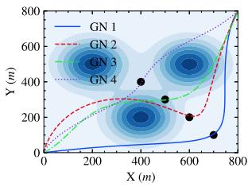  
(a) UAV trajectories comparison under different GN's locations

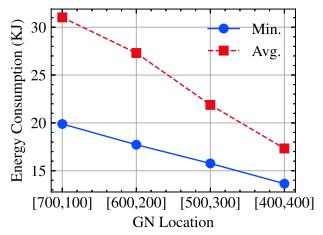  
(b) UAV energy consumption under different GN's locations.  
Fig. 6. Comparison of energy consumption under different GN’s locations.

Obviously, the location of GNs affects the energy consumption. Fig. 6 compares the UAV trajectory and the corresponding energy consumption as the GN’s location varies. It can be observed that the energy consumption decreases as the GN lies closer to the line segment connecting the start and destination points. Nevertheless, the proposed MDE-CH algorithm consistently outperforms conventional EC-based and RL-based optimization methods.

## B. Numerical Results

In the simulation, we assume that the total amount of required data for all GNs is identical, i.e., $Q _ { 1 } ^ { \mathrm { t h } } = Q _ { 2 } ^ { \mathrm { t h } } = Q _ { 3 } ^ { \mathrm { t h } }$ and we uniformly use $Q _ { k } ^ { \mathrm { t h } }$ to denote the required data for all GNs. Similarly, we assume the identical data rate required for successful communication for all GNs, i.e., $R _ { 1 } ^ { \mathrm { t h } } = R _ { 2 } ^ { \mathrm { t h } } = R _ { 3 } ^ { \mathrm { t h } }$ and we uniformly use $R _ { k } ^ { \mathrm { t h } }$ to denote them. Then, we optimize UAV trajectories for $Q _ { k } ^ { \mathrm { t h } } \in \{ 4 0 , 8 0 , 1 2 0 , 1 6 0 , 2 0 0 \}$ Mbits.

1) Optimization Under 3D Terrain: First, we compare the proposed MDE-CH method with and without 3D terrain, i.e., the optimization problem in Section III-B with and without the constraint C4 in (33b). Fig. 7(a) plots UAV trajectories considering 3D terrain, where the black points represent the positions of GNs. It is observed that all UAV trajectories smoothly navigate around the 3D terrain. Moreover, trajectories optimized under the 3D terrain consideration exhibit more significant changes in proximity to GNs compared to those optimized without 3D terrain constraints, as depicted in Fig. 7(b). This is because trajectories generated with no terrain in Fig. 7(b) are prone to go through 3D terrain to reduce energy consumption compared with trajectories considering 3D terrain. Thus, curvatures in UAV trajectories with 3D terrain are larger than those without 3D terrain, which corresponds to the results obtained by solving more complicated optimization problems.

2) UAV Trajectories for Different Data Requirements: Fig. 8(a) illustrates the 2D viewing angle derived from the 3D view shown in Fig. 7(a). Also, Fig. 8(b) and Fig. 8(c) plot the UAV flying speed and the UAV altitude versus time, respectively. All curves in Fig. 8 exhibit spatial and temporal smoothness, demonstrating that the proposed trajectory optimization efficiently ensures continuous UAV trajectories optimized over a continuous domain. Some trajectories in Fig. 8(a) exhibit high curvature regimes near GN 2, particularly those with $Q _ { k } ^ { \mathrm { t h } } = 4 0$ Mbits and $Q _ { k } ^ { \mathrm { t h } } = 1 6 0 ~ \mathrm { M b i t s }$ . These correspond to the regimes where the UAV flying speed decreases to approximately zero as observed in Fig. 8(b). This phenomenon demonstrates the advantage of using the Bézier curve in representing trajectories, aligning well with the physical constraints of UAV flight. Furthermore, the UAV reduces its speed as it approaches each GN to efficiently collect data. Additionally, as shown in Fig. 8(b) and Fig. 8(c), the mission completion time increases with higher data requirements $Q _ { k } ^ { \mathrm { t h } }$ , since both the average UAV speed and altitude are reduced to meet these requirements.

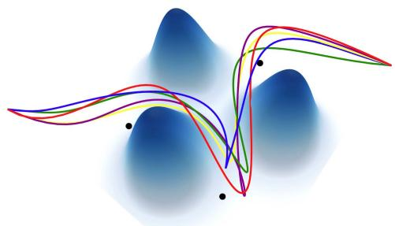

(a) Trajectories with 3D terrain  
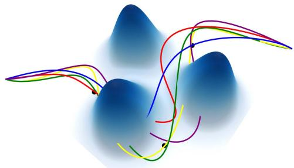  
(b) Trajectories without 3D terrain  
Fig. 7. Optimized UAV trajectories with and without 3D terrain.

Fig. 9 plots instantaneous data rates and the corresponding cumulative received data between the UAV and each GN when $Q _ { k } ^ { \mathrm { t h } } = 4 0$ Mbits and $Q _ { k } ^ { \mathrm { t h } } = 2 0 0$ Mbits, corresponding to the trajectories shown in Fig. 8(a). The black straight line in each Fig. 9(a) and (b) represents the minimum data rate for successful communication, namely $R _ { k } ^ { \mathrm { t h } } = 1$ Mbits/s. The two intersections between $R _ { k } ^ { \mathrm { t h } }$ and $\tilde { R } _ { k } ( t )$ indicate the start and end timings of communication between the UAV and GN k, respectively. In Fig. 9(c) and 9(d), the black line denotes the data requirement of each GN. We can see that the UAV accomplishes the mission of collecting data from each GN. Compared with the conventional fly–hover–fly model [22], [57], [58], our model allows the UAV to gather data while it is moving, providing a more flexible design of UAV trajectories and a more efficient method for data transmission and reception.

3) Convergence Behavior: Fig. 10 shows the convergence behavior of the proposed MDE-CH with respect to the generation number for $Q _ { k } ^ { \mathrm { t h } } \in \{ 4 0 , 8 0 , 1 2 0 , 1 6 0 , 2 0 0 \}$ Mbits. In the simulations, each scenario was executed 50 times to obtain average values of the objective functions and the count of feasible solutions. As seen in Fig. 10(a), the objective function rapidly converges to a stable value as the generation number increases. Recall that the objective function corresponds to the overall energy consumption as seen in (19a). Fig. 10(b) plots the average number of feasible solutions with respect to the generation number. Due to the random generation of initial individuals, only a few are feasible in the early generations. However, as the evolutionary process progresses, the population quickly transitions into the feasible region, with an increasing appearance of feasible individuals. Therefore, the proposed methodology for handling constraints effectively finds feasible solutions for the constrained optimization problem.

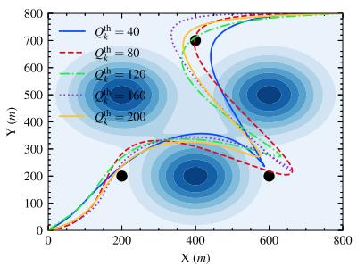  
(a) UAV trajectories with different $Q _ { k } ^ { \mathrm { t h } } ,$

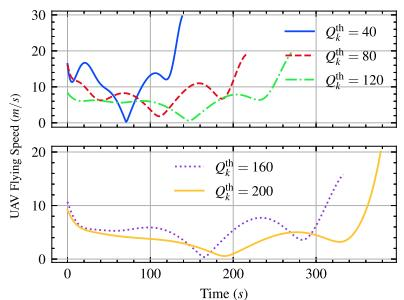  
(b) UAV flying speed versus time.

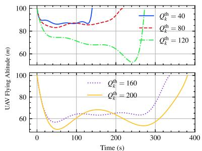  
(c) UAV flying altitude versus time.

Fig. 8. UAV Trajectories, flying speed, and flying altitude for different $Q _ { k } ^ { \mathrm { t h } } .$  
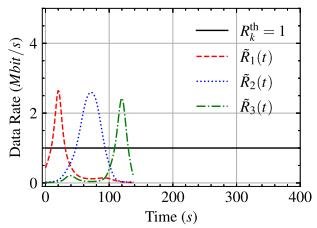  
(a) Data rate over time $Q _ { k } ^ { \mathrm { t h } } = 4 0 .$

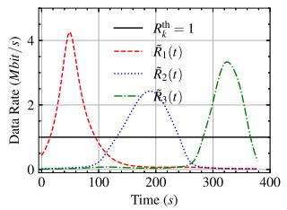  
(b) Data rate over time $Q _ { k } ^ { \mathrm { t h } } = 2 0 0 .$

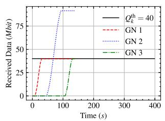

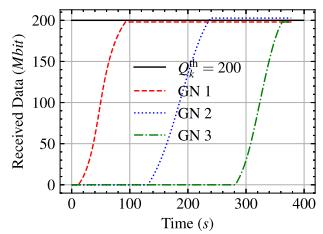  
(c) Cumulative received data over (d) Cumulative received data over time $Q _ { k } ^ { \mathrm { t h } } = 4 0 .$ time $Q _ { k } ^ { \mathrm { t h } } = 2 0 0 .$

Fig. 9. Instantaneous data rates and cumulative received data over time between the UAV and each GN.  
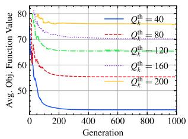

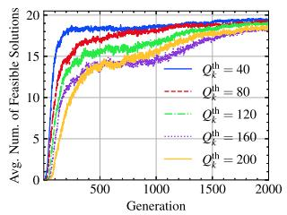  
(a) Average value of objective func- (b) Average number of feasible solutions. tions.  
Fig. 10. Convergence behavior of the proposed MDE-CH with respect to the generation number.

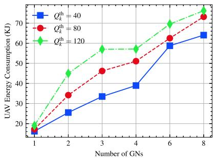  
Fig. 11. Comparison of energy consumption for different numbers of GNs.

4) Energy Consumption for Different Number of GNs: We compare the energy consumption for different numbers of GNs, ranging from 1 to 8 under varying data requirements $Q _ { k } ^ { \mathrm { t h } }$ . Fig. 11 presents the comparison results averaged over ten repeated simulations. In this figure, different curves represent varying amounts of data to be collected, specifically for three cases: $Q _ { k } ^ { \mathrm { t h } } = 4 0$ 80, and 120 Mbits. As the number of GNs increases, the $\mathrm { U A V } _ { \mathrm { \Delta } }$ energy consumption rises across all data requirements $Q _ { k } ^ { \mathrm { t h } }$ . For a fixed number of GNs, the energy consumption is higher when the data requirements $Q _ { k } ^ { \mathrm { t h } }$ increase.

5) UAV Trajectories for Large-Scale Networks: We further test the proposed model and MDE-CH in large-scale networks with 10, 20, and 30 GNs. In this setup, we also increase the number of control points to support more complicated UAV trajectories that satisfy the multiple constraints imposed by each GN. Fig. 12 presents the 2D UAV trajectories for the cases with 10, 20, and 30 GNs. As the number ofGNs increases, the feasible solution space becomes smaller or may even disappear, making it much harder to find a near-optimal feasible solution and requiring greater computational complexity. Nevertheless, by increasing the number of control points, the proposed MDE-CH can efficiently handle these complicated constraints, as shown in Fig. 12.

6) Comparison With the Fly–Hover–Fly Model: We compare our scheme with the fly–hover–fly scheme, as described in [22], [57], [58]. In the fly–hover–fly model, the UAV travels directly from one GN to another at maximum speed, subsequently hovering over the GN until data reception is completed. After the reception, the UAV swiftly moves to the next GN at maximum speed. In the fly–hover–fly scenario, the UAV moves vertically for data reception at each GN. In contrast, our model requires continuous vertical and horizontal navigation of the UAV to circumvent 3D terrain obstacles.

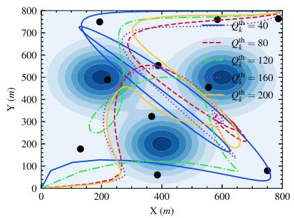  
(a) Trajectories with 10 GNs.

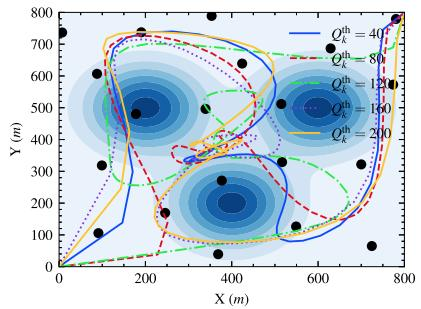  
(b) Trajectories with 20 GNs.

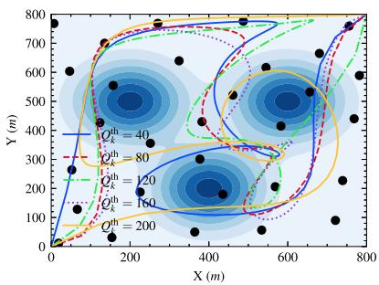  
(c) Trajectories with 30 GNs.

Fig. 12. UAV trajectories for the large number of GNs.  
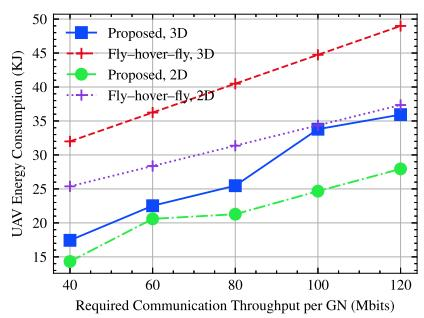  
Fig. 13. Energy consumption for the proposed MDE-CH and fly–hover–fly schemes.

Fig. 13 illustrates the overall energy consumption of the proposed and fly–hover–fly schemes for $Q _ { k } ^ { \mathrm { t h } } \in$ {40, 60, 80, 100, 120} Mbits. In the figure, “Proposed, $3  { \mathrm { D } } ^ {  { \mathsf { \prime } } }$ and “Fly–hover–fly, 3D” denote the proposed scheme and fly–hover– fly scheme considering 3D terrain, respectively. To further compare the performance between the two schemes, we also consider the 2D scenario, i.e., $f _ { z } ( u _ { k , x } , u _ { k , y } ) = 0$ in (1), corresponding to “Proposed, 2D” and “Fly–hover–fly, 2D”. The numerical results demonstrate that the proposed MDE-CH scheme outperforms the fly–hover–fly scheme in both 3D and 2D UAV trajectory optimization scenarios.

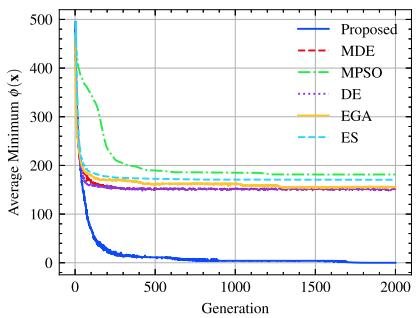  
Fig. 14. The results of the comparison with some EC algorithms.

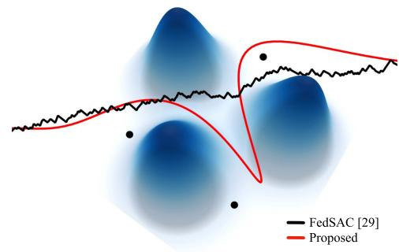  
Fig. 15. Comparison of 3D UAV trajectories generated by the RL-based method.

7) Comparison With Other EC Algorithms: Moreover, we compare the proposed MDE-CH with other EC algorithms, including MDE, MPSO [49], DE [59], elitism genetic algorithm (EGA) [60], and evolution strategy (ES) [61]. We implemented the benchmark algorithms by applying the penalty function method to validate the efficiency of the proposed constraint handling method. The penalty function method transforms the constraints violation value $\phi ( \mathbf { x } )$ into the objective function as

$$
\min _ {\mathbf {x}} f (\mathbf {x}) + \nu \phi^ {2} (\mathbf {x}),\tag{66}
$$

where ν is a coefficient to balance the constraint violation value and the objective function value. In the simulation, we set $\nu = 1$ Fig. 14 illustrates the comparison results obtained by recording the minimum constraint violation value in each generation under $Q _ { k } ^ { \mathrm { t h } } = 2 0 0$ . We repeated the experiment 50 times to obtain the average value. The results demonstrate that the proposed MDE-CH can find feasible solutions as the number of generations increases, while other benchmark algorithms tend to produce solutions that fall outside the feasible region.

## C. Comparison With RL-Based Optimization

1) UAV Trajectory Comparison: In this subsection, we compare the proposed MDE-CH algorithm with the FedSAC algorithm from [29], which applies RL to trajectory optimization. To adapt FedSAC to our problem, we utilize the same action and state spaces used in [29] and retain its reward function, while adding two additional negative terms: one that penalizes terrain collisions and another that limits acceleration. All training hyperparameters are identical to those in [29]. Fig. 15 presents the 3D UAV trajectory comparison, with the data size requirement $Q _ { k } ^ { \mathrm { t h } } = 1 2 0$ Mbits and terrain avoidance enabled. Furthermore, Fig. 16 illustrates the corresponding 2D trajectories, speed, and altitude of the MDE-CH and FedSAC algorithms. As seen in Fig. 16(a), the trajectory generated by MDE-CH is smoother than that produced by the RL-based method. In Fig. 16(b), the RL-based speed profile is discontinuous, complicating practical implementation, whereas MDE-CH yields a smooth speed curve. Regarding altitude (Fig. 16(c)), both methods lower the UAV to increase data rate, but the RL altitude profile exhibits abrupt jumps, while MDE-CH remains smooth.

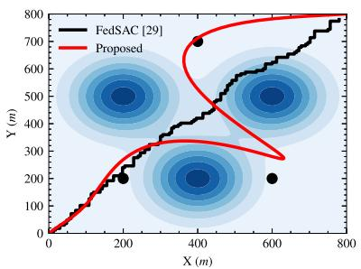  
(a) 2D UAV trajectories

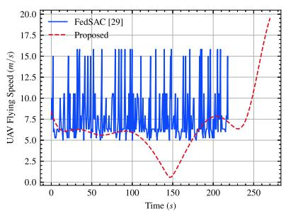  
(b) UAV flying speed versus time.

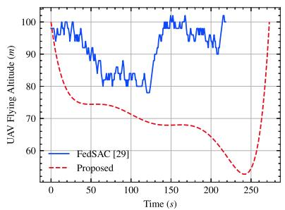  
(c) UAV flying altitude versus time.

Fig. 16. Comparison of UAV trajectories, flying speed, and flying altitude generated by the RL-based method.  
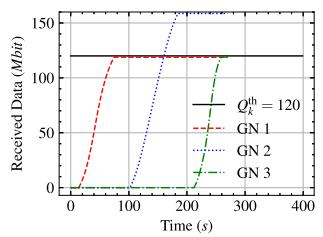

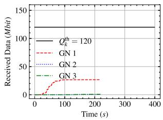  
(a) Received data of the proposed (b) Received data of the RL-based method over time. method over time.  
Fig. 17. Cumulative received data over time under $Q _ { k } ^ { \mathrm { t h } } = 1 2 0 \mathrm { M b i t s } .$

Fig. 17 compares the cumulative data received from each GN when $Q _ { k } ^ { \mathrm { t h } } = 1 2 0$ . As noted in the supplementary material of [29], the UAV’s trajectory tends to favor flying toward the target point rather than remaining close to the GNs to maximize throughput. This observation highlights how difficult it is to balance multiple reward terms in RL.

2) Time Complexity Comparison: The time complexity of FedSAC is $\mathcal { O } ( E _ { \mathrm { R L } } \times N _ { \mathrm { R L } } \times B _ { \mathrm { R L } } \times n _ { \mathrm { R L } } \times m _ { \mathrm { R L } } ^ { 2 } )$ [29], where $E _ { \mathrm { R I } }$ is the number of episodes, N is the number of steps in each episode, B is the number of transitions of a minibatch, and nRL and mRL are the number of layers and the number of neurons in each layer for both the Q-network and the policy network. In simulations, we adapted the same parameters in [29] as $E _ { \mathrm { R L } } = 1 0 0 0 0 0 , N _ { \mathrm { R L } } = 6 0 0 , B _ { \mathrm { R L } } = 2 5 6$ $n _ { \mathrm { R L } } = 3$ , and $m _ { \mathrm { R L } } = 6 4$ . Recall that in Section IV-D, the time complexity of MDE-CH is approximately given by ${ \mathcal { O } } ( G \times N \times$ D). Then, the time complexity of FedSAC is much greater than that of MDE-CH, i.e., 100000 $\times 6 0 0 \times 2 5 6 \times 3 \times 6 4 \approx 1 . 8 9 \times$ $1 0 ^ { 1 4 } \gg 2 0 0 0 \times 2 0 \times 3 4 \approx 1 . 3 6 \times 1 0 ^ { 6 }$ . We further compare the real runtime performance of the two algorithms in the identical hardware environment. We run FedSAC 10 times, and the average runtime of FedSAC is given by 2826.87 seconds. For the proposed MDE-CH, the average runtime is given by 5.92 seconds.

## D. Comparison With SCA-Based Method

In this subsection, the proposed method is compared with an SCA-based method [22], [62], [63]. For convenience, the objective is set to maximize the data rate $\tilde { R } _ { k } ( t )$ in (15), where the LoS probability is fixed to one. Within the considered map, a GN is located at [600, 200], and three cylindrical no-fly zones (NFZs) are located at [200,500], [600, 500], and [400,200], each with a radius of 130 m. In this comparison, the mission time is set to $T = 1 0 0 \mathrm { s }$ and the time interval is $\Delta _ { t } = 1 \mathrm { s }$ . The maximum speed and acceleration of the UAV are set to 30 m/s and $2 \mathrm { m / s ^ { 2 } }$ , respectively. Fig. 18 presents the comparison results in terms of UAV trajectory, flying speed, and altitude. Due to the presence of NFZs in the map, it is difficult to manually construct an initial feasible trajectory for the SCA-based method. Therefore, before applying the SCA optimization, an initial feasible trajectory is generated using the A-star algorithm, as illustrated in Fig. 18(a). As shown in Fig. 18(a), the trajectory obtained by the proposed method is significantly smoother than that generated by the SCA-based method. The speed and altitude profiles in Fig. 18(b) and Fig. 18(c) exhibit similar behavior. The acceleration comparison is shown in Fig. 19. It can be observed that the UAV acceleration obtained by the SCA-based method exhibits significant fluctuations and even violates the feasible acceleration range. This is mainly because the initial trajectory generated by the A-star algorithm contains multiple sharp turns when navigating around obstacles, resulting in abrupt changes in velocity and consequently large acceleration variations, as also reflected in the acceleration curve of the A-star trajectory. When the NFZ constraints are removed and the initial trajectory follows a smooth path with approximately uniform speed, the trajectory obtained by the SCA-based method can satisfy the acceleration constraint, as also the acceleration curve of “SCA, Non-NFZs” illustrated in Fig. 19.

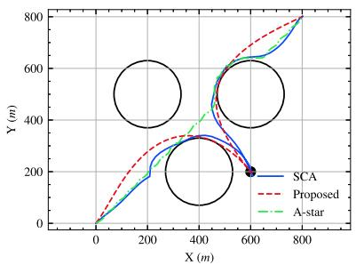  
(a) 2D UAV trajectories

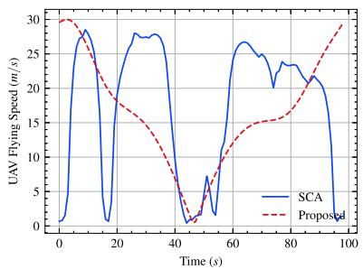  
(b) UAV flying speed versus time.

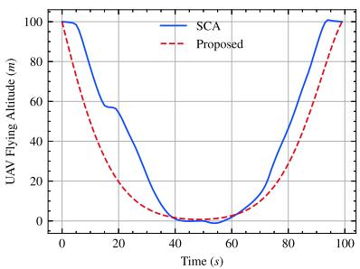  
(c) UAV flying altitude versus time.

Fig. 18. Comparison of UAV trajectories, flying speed, and flying altitude generated by the SCA-based method.  
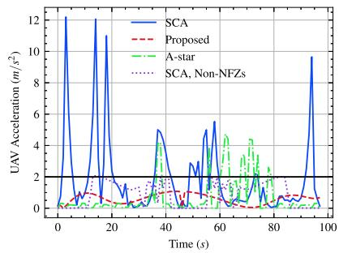  
Fig. 19. Comparison of the acceleration with the SCA-based method.

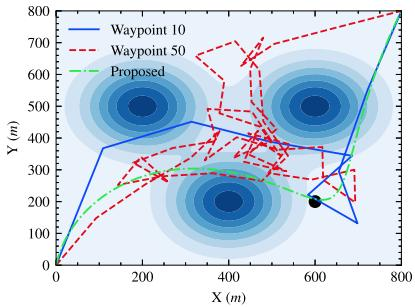  
Fig. 20. Comparison of trajectory represented by Bézier curve and discrete waypoints.

## E. Comparison With Trajectory Represented by Waypoints

In this subsection, the UAV trajectory represented by discrete waypoints is optimized and compared with the trajectory represented by Bézier curves. Fig. 20 illustrates the comparison results, where the number ofwaypoints is set to 10 and 50 and the data requirement $Q _ { k } ^ { \mathrm { t h } } = 1 2 0$ for the GN located at [600, 200, 13]. It can be observed that when the number of waypoints is 10, the waypoint-based trajectory can approximate the trajectory generated by the proposed method. However, as the number of waypoints increases, the optimization problem becomes more difficult to solve. In this simulation, when the number of waypoints continues to increase, it eventually becomes impossible to find a feasible solution.

## VI. CONCLUSION

In this paper, we considered UAV-assisted IoT data collection in which a UAV traverses to collect sensing data from several GNs aimed at minimizing total energy consumption while accounting for the UAV’s physical capabilities, the heterogeneous data demands of GNs, and 3D terrain. We proposed the MDE-CH algorithm, a computation-efficient evolutionary algorithm designed to address non-convex constrained optimization problems with several different types of constraints that can provide a continuous 3D temporal–spatial UAV trajectory capable of efficiently minimizing energy consumption under various practical constraints.

As a future research topic, an integrated framework for optimizing both UAV and low-earth-orbit or very-low-earth-orbit satellite trajectories in sixth-generation non-terrestrial networks could be studied. In particular, the heterogeneous characteristics and requirements of various non-terrestrial communication objects should be appropriately considered. In addition, maximizing the amount ofvalid data collected from IoT devices under a given UAV energy (battery capacity) or time budget, as well as considering UAV attitude control, can be further investigated in future work.

## REFERENCES

[1] Y. Zeng, Q. Wu, and R. Zhang, “Accessing from the sky: A tutorial on UAV communications for 5G and beyond,” Proc. IEEE, vol. 107, no. 12, pp. 2327–2375, Dec. 2019.

[2] Z. Ullah, F. Al-Turjman, and L. Mostarda, “Cognition in UAV-aided 5G and beyond communications: A survey,” IEEE Trans. Cogn. Commun. Netw., vol. 6, no. 3, pp. 872–891, Sep. 2020.

[3] Z. Ma, Z. Zhou, M. Zhao, and K. Zheng, “WinCross: Find the energyefficient crossing window for UAV with joint optimization of path and speed,” in Proc. Int. Conf. Space-Air-Ground Comput., Oct. 2021, pp. 137–142.

[4] G. Geraci et al., “What will the future of UAV cellular communications be? A flight from 5G to 6G,” IEEE Commun. Surv. Tuts., vol. 24, no. 3, pp. 1304–1335, Thirdquarter 2022.

[5] A. Zhang, D. Liu, T. Li, X. Cui, and K. Zheng, “BROAD: Joint beamwidth and path optimization for energy-efficient UAV-assisted data collection,” in Proc. IEEE Wireless Commun. Netw. Conf., Apr. 2024, pp. 1–6.

[6] Y. Song, S. H. Lim, S.-W. Jeon, and S. Baek, “On cooperative achievable rates of UAV assisted cellular networks,” IEEE Trans. Veh. Technol., vol. 69, no. 9, pp. 9882–9895, Sep. 2020.

[7] O. M. Bushnaq, A. Chaaban, and T. Y. Al-Naffouri, “The role of UAV-IoT networks in future wildfire detection,” IEEE Internet Things J., vol. 8, no. 23, pp. 16984–16999, Dec. 2021.

[8] M. Zhao, Z. Ma, Z. Zhou, and K. Zheng, “WSpeed: Drone energy optimization for multiple-package delivery considering weight changes,” in Proc. Int. Conf. Space-Air-Ground Comput., Oct. 2021, pp. 1–6.

[9] Z. Zhou, Z. Ma, M. Zhao, and K. Zheng, “E-Cube: Energy-efficient UAV trajectory scheduling with height and speed optimization,” in Proc. Int. Conf. Space-Air-Ground Comput., Oct. 2021, pp. 12–17.

[10] J. Wu et al., “An adaptive conversion speed Q-learning algorithm for search and rescue UAV path planning in unknown environments,” IEEE Trans. Veh. Technol., vol. 72, no. 12, pp. 15391–15404, Dec. 2023.

[11] M. S. Haroon, S. H. Chae, and S.-W. Jeon, “Outage analysis for multi-radio heterogeneous networks in the presence of aerial jammers,” ICT Exp., vol. 9, no. 6, pp. 1026–1031, Dec. 2023.

[12] H. Guo and J. Liu, “UAV-enhanced intelligent offloading for Internet of Things at the edge,” IEEE Trans. Ind. Informat., vol. 16, no. 4, pp. 2737–2746, Apr. 2020.

[13] H. Hu, K. Xiong, G. Qu, Q. Ni, P. Fan, and K. B. Letaief, “AoI-minimal trajectory planning and data collection in UAV-assisted wireless powered IoT networks,” IEEE Internet Things J., vol. 8, no. 2, pp. 1211–1223, Jan. 2021.

[14] M. Yang, S.-W. Jeon, and D. K. Kim, “Optimal trajectory for curvatureconstrained UAV mobile base stations,” IEEE Wireless Commun. Lett., vol. 9, no. 7, pp. 1056–1059, Jul. 2020.

[15] Z. Na, Y. Liu, J. Shi, C. Liu, and Z. Gao, “UAV-supported clustered NOMA for 6G-enabled Internet of Things: Trajectory planning and resource allocation,” IEEE Internet Things J., vol. 8, no. 20, pp. 15041–15048, Oct. 2021.

[16] M. Samir, S. Sharafeddine, C. M. Assi, T. M. Nguyen, and A. Ghrayeb, “UAV trajectory planning for data collection from time-constrained IoT devices,” IEEE Trans. Wireless Commun., vol. 19, no. 1, pp. 34–46, Jan. 2020.

[17] B. Li, Q. Li, Y. Zeng, Y. Rong, and R. Zhang, “3D trajectory optimization for energy-efficient UAV communication: A control design perspective,” IEEE Trans. Wireless Commun., vol. 21, no. 6, pp. 4579–4593, Jun. 2022.

[18] Y. Wang et al., “Trajectory design for UAV-based Internet of Things data collection: A deep reinforcement learning approach,” IEEE Internet Things J., vol. 9, no. 5, pp. 3899–3912, Mar. 2022.

[19] B. Zhu, E. Bedeer, H. H. Nguyen, R. Barton, and J. Henry, “UAV trajectory planning in wireless sensor networks for energy consumption minimization by deep reinforcement learning,” IEEE Trans. Veh. Technol., vol. 70, no. 9, pp. 9540–9554, Sep. 2021.

[20] S. Li, F. Wu, S. Luo, Z. Fan, J. Chen, and S. Fu, “Dynamic online trajectory planning for a UAV-enabled data collection system,” IEEE Trans. Veh. Technol., vol. 71, no. 12, pp. 13332–13343, Dec. 2022.

[21] H. V. Abeywickrama, B. A. Jayawickrama, Y. He, and E. Dutkiewicz, “Comprehensive energy consumption model for unmanned aerial vehicles, based on empirical studies of battery performance,” IEEE Access, vol. 6, pp. 58383–58394, 2018.

[22] Y. Zeng, J. Xu, and R. Zhang, “Energy minimization for wireless communication with rotary-wing UAV,” IEEE Trans. Wireless Commun., vol. 18, no. 4, pp. 2329–2345, Apr. 2019.

[23] X. Dai, B. Duo, X. Yuan, and W. Tang, “Energy-efficient UAV communications: A generalized propulsion energy consumption model,” IEEE Wireless Commun. Lett., vol. 11, no. 10, pp. 2150–2154, Oct. 2022.

[24] X. Dai, B. Duo, X. Yuan, and M. D. Renzo, “Energy-efficient UAV communications in the presence of wind: 3D modeling and trajectory design,” IEEE Trans. Wireless Commun., vol. 23, no. 3, pp. 1840–1854, Mar. 2024.

[25] H. Mei, K. Yang, Q. Liu, and K. Wang, “3D-trajectory and phase-shift design for RIS-assisted UAV systems using deep reinforcement learning,” IEEE Trans. Veh. Technol., vol. 71, no. 3, pp. 3020–3029, Mar. 2022.

[26] R. Ding, F. Gao, and X. S. Shen, “3D UAV trajectory design and frequency band allocation for energy-efficient and fair communication: A deep reinforcement learning approach,” IEEE Trans. Wireless Commun., vol. 19, no. 12, pp. 7796–7809, Dec. 2020.

[27] H. Lei, H. Ran, I. S. Ansari, K.-H. Park, G. Pan, and M.-S. Alouini, “DDPG-based aerial secure data collection,” IEEE Trans. Commun., vol. 72, no. 8, pp. 5179–5193, Aug. 2024.

[28] X. Fu, X. Huang, Q. Pan, P. Pace, G. Aloi, and G. Fortino, “Cooperative data collection for UAV-assisted maritime IoT based on deep reinforcement learning,” IEEE Trans. Veh. Technol., vol. 73, no. 7, pp. 10333–10349, Jul. 2024.

[29] J. Huang, B. Wu, Q. Duan, L. Dong, and S. Yu, “A fast UAV trajectory planning framework in RIS-assisted communication systems with accelerated learning via multithreading and federating,” IEEE Trans. Mobile Comput., vol. 24, no. 8, pp. 6870–6885, Aug. 2025.

[30] Y. Fan, H. Dong, X. Zhao, and P. Denissenko, “Path-following control of unmanned underwater vehicle based on an improved TD3 deep reinforcement learning,” IEEE Trans. Control Syst. Technol., vol. 32, no. 5, pp. 1904–1919, Sep. 2024.

[31] S. Ibrahim, M. Mostafa, A. Jnadi, H. Salloum, and P. Osinenko, “Comprehensive overview of reward engineering and shaping in advancing reinforcement learning applications,” IEEE Access, vol. 12, pp. 175473–175500, 2024.

[32] Y. Zhou, J. Yang, Z. Guo, Y. Shen, K. Yu, and J. C.-W. Lin, “An indoor blind area-oriented autonomous robotic path planning approach using deep reinforcement learning,” Expert Syst. Appl., vol. 254, Nov. 2024, Art. no. 124277.

[33] M. Xi et al., “A lightweight reinforcement-learning-based real-time pathplanning method for unmanned aerial vehicles,” IEEE Internet Things J., vol. 11, no. 12, pp. 21061–21071, Jun. 2024.

[34] Y. Jiang, X.-X. Xu, M.-Y. Zheng, and Z.-H. Zhan, “Evolutionary computation for unmanned aerial vehicle path planning: A survey,” Artif. Intell. Rev., vol. 57, no. 10, Aug. 2024, Art. no. 267.

[35] L. Sun, J. Wang, L. Wan, K. Li, X. Wang, and Y. Lin, “Human-UAV interaction assisted heterogeneous UAV swarm scheduling for target searching in communication denial environment,” IEEE Trans. Autom. Sci. Eng., vol. 22, pp. 4457–4472, 2025.

[36] C. Li, Q. Zhao, and C. Che, “3D flight path planning for UAV based on improved particle swarm optimization algorithm,” IEEE Access, vol. 13, pp. 36637–36646, 2025.

[37] P.-F. Sun et al., “Tour multi-route planning with matrix-based differential evolution,” IEEE Trans. Intell. Transp. Syst., vol. 25, no. 9, pp. 11753–11767, Sep. 2024.

[38] A. Al-Hourani, S. Kandeepan, and A. Jamalipour, “Modeling air-toground path loss for low altitude platforms in urban environments,” in Proc. IEEE Glob. Commun. Conf., Dec. 2014, pp. 2898–2904.

[39] A. Al-Hourani, S. Kandeepan, and S. Lardner, “Optimal LAP altitude for maximum coverage,” IEEE Wireless Commun. Lett., vol. 3, no. 6, pp. 569–572, Dec. 2014.

[40] A. Goldsmith,Wireless Communications. Cambridge, U.K.: Cambridge Univ. Press, 2005.

[41] O. Arnold, F. Richter, G. Fettweis, and O. Blume, “Power consumption modeling of different base station types in heterogeneous cellular networks,” in Proc. IEEE Future Netw. Mobile Summit, Jun. 2010, pp. 1–8.

[42] K. Khan and D. Lobiyal, “Bézier curves based on Lupa¸s (p,q)-analogue of Bernstein functions in CAGD,” J. Comput. Appl. Math., vol. 317, pp. 458–477, 2017.

[43] Wikipedia Contributors, “Bernstein polynomial,” 2025. Accessed: Jun. 09, 2025. [Online]. Available: https://en.wikipedia.org/wiki/Bernstein\_ polynomial#Bernstein’s\_proof

[44] Wikipedia Contributors, “Stone–Weierstrass theorem,” 2025. Accessed: Jun. 9, 2025. [Online]. Available: https://en.wikipedia.org/wiki/Stone-Weierstrass\_theorem

[45] P. P. Korovkin, Linear Operators and Approximation Theory. New Delhi, India: Hindustan Pub. Corp., 1960.

[46] B. Song, Z. Wang, and L. Zou, “An improved PSO algorithm for smooth path planning of mobile robots using continuous high-degree Bezier curve,” Appl. Soft Comput., vol. 100, Mar. 2021, Art. no. 106960.

[47] T. Chen, Y. Cai, L. Chen, and X. Xu, “Trajectory and velocity planning method of emergency rescue vehicle based on segmented threedimensional quartic Bezier curve,” IEEE Trans. Intell. Transp. Syst., vol. 24, no. 3, pp. 3461–3475, Mar. 2023.

[48] J. Stork, A. E. Eiben, and T. Bartz-Beielstein, “A new taxonomy of global optimization algorithms,” Natural Comput., vol. 21, no. 2, pp. 219–242, Nov. 2020.

[49] Z.-H. Zhan et al., “Matrix-based evolutionary computation,” IEEE Trans. Emerg. Topics Comput. Intell., vol. 6, no. 2, pp. 315–328, Apr. 2022.

[50] W. Gao, G. G. Yen, and S. Liu, “A cluster-based differential evolution with self-adaptive strategy for multimodal optimization,” IEEE Trans. Cybern., vol. 44, no. 8, pp. 1314–1327, Aug. 2014.

[51] R. Kamyar and E. Taheri, “Aircraft optimal terrain/threat-based trajectory planning and control,” J. Guid., Control, Dyn., vol. 37, no. 2, pp. 466–483, Feb. 2014.

[52] I. K. Nikolos, K. P. Valavanis, N. C. Tsourveloudis, and A. N. Kostaras, “Evolutionary algorithm based offline/online path planner for UAV navigation,” IEEE Trans. Syst., Man, Cybern. B. Cybern., vol. 33, no. 6, pp. 898–912, Dec. 2003.

[53] V. Roberge, M. Tarbouchi, and G. Labonté, “Comparison of parallel genetic algorithm and particle swarm optimization for real-time UAV path planning,” IEEE Trans. Ind. Informat., vol. 9, no. 1, pp. 132–141, Feb. 2013.

[54] Y. Choi, Y. Choi, S. Briceno, and D. N. Mavris, “Three-dimensional UAS trajectory optimization for remote sensing in an irregular terrain environment,” in Proc. IEEE Int. Conf. Unmanned Aircr. Syst., Jun. 2018, pp. 1101–1108.

[55] D. Elbrächter, D. Perekrestenko, P. Grohs, and H. Bölcskei, “Deep neural network approximation theory,” IEEE Trans. Inf. Theory, vol. 67, no. 5, pp. 2581–2623, May 2021.

[56] Federal Aviation Administration, “Operating limitations for small unmanned aircraft,” 14 CFR 107.51(b), 2016. [Online]. Available: https: //www.ecfr.gov/current/title-14/part-107#p-107.51(b)

[57] C. Zhong, J. Yao, and J. Xu, “Secure UAV communication with cooperative jamming and trajectory control,” IEEE Commun. Lett., vol. 23, no. 2, pp. 286–289, Feb. 2019.

[58] J. Yao and J. Xu, “Joint 3D maneuver and power adaptation for secure UAV communication with CoMP reception,” IEEE Trans. Wireless Commun., vol. 19, no. 10, pp. 6992–7006, Oct. 2020.

[59] M. F. Ahmad, N. A. M. Isa, W. H. Lim, and K. M. Ang, “Differential evolution: A recent review based on state-of-the-art works,” Alexandria Eng. J., vol. 61, no. 5, pp. 3831–3872, May 2022.

[60] S. Katoch, S. S. Chauhan, and V. Kumar, “A review on genetic algorithm: Past, present, and future,” Multimedia Tools Appl., vol. 80, pp. 8091–8126, Oct. 2021.

[61] H.-G. Beyer and H.-P. Schwefel, “Evolution strategies–A comprehensive introduction,” Natural Comput., vol. 1, pp. 3–52, Mar. 2002.

[62] A. M. Abdelhady, A. Celik, C. Diaz-Vilor, H. Jafarkhani, and A. M. Eltawil, “Laser-empowered UAVs for aerial data aggregation in passive IoT networks,” IEEE Commun. Soc. Mag., vol. 5, pp. 1609–1623, 2024.

[63] A. M. Abdelhady, C. Diaz-Vilor, M. Barzegaran, H. Jafarkhani, and A. M. Eltawil, “Optimization of hybrid laser-battery-powered UAV-assisted backscatter communications,” IEEE Trans. Commun., vol. 73, no. 11, pp. 11690–11706, Nov. 2025.

Pei-Fa Sun received the BS degree in network engineering and the MS degree in computer science from the University of Jinan, Jinan, China, in 2019 and 2022, respectively, and the PhD degree from the Department of Electrical and Electronic Engineering, Hanyang University, Ansan, South Korea. He is currently a postdoctoral associate with Hanyang University. His research interests include UAV communication, trajectory planning, and path planning.

Yujae Song (Member, IEEE) received the PhD degree in electrical engineering from the Korea Advanced Institute of Science and Technology, South Korea, in 2016. He was a visiting scholar in communication systems with the KTH Royal Institute of Technology, Sweden, in 2015. From 2016 to 2022, he was a senior researcher with the Maritime ICT R&D Center, Korea Institute of Ocean Science and Technology. From 2022 to 2023, he was an assistant professor with the Department of Computer Software Engineering, Kumoh National Institute of Technology, Gumi, South

Korea. Since 2023, he has been an assistant professor with the Department of Robotics Engineering, Yeungnam University, Gyeongsan, South Korea. His research interests include the design, analysis, and optimization ofvarious wireless communication systems, including maritime/underwater, beyond 5G, and robot communications. He was recognized as one of the World’s Top 2% Scientists by Elsevier and Scopus in the field of Networking and Telecommunications in 2025.

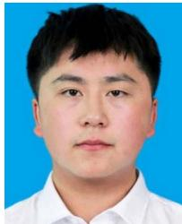

Kangyu Gao received the BS degree from the Department of Information Science and Technology, Harbin Institute of Technology, Weihai, China, in 2022. He is currently working toward the PhD degree with the Department of Electrical and Electronic Engineering, Hanyang University, South Korea. His research interests include 6G wireless communication, optimization algorithm design, and machine learning.

Yukai Wang received the BS degree in engineering from Hanyang University. He is currently working toward the PhD degree with Hanyang University, ERICA Campus, Ansan, South Korea. His research interests include resource allocation in wireless communication systems and the application of intelligent algorithms in next-generation communication systems.

Changjun Zhou (Member, IEEE) received the PhD degree from the Dalian University of Technology, Dalian, China, in 2008. He is currently a distinguished professor of “Shuanglong Scholar” and professor with the School of Computer Science and Technology, Zhejiang Normal University, Jinhua, China. He has authored or coauthored more than 100 peerreviewed papers in prominent journals, including Nature Communications and multiple IEEE Transactions (such as IEEE Transactions on Mobile Computing, IEEE Transactions on Services Computing,

and IEEE Transactions on Emerging Topics in Computational Intelligence), as well as top conferences in the field. His research interests include the intersection of intelligent computing, nature-inspired metaheuristic algorithms, and complex system optimization, with a particular focus on developing computationally efficient and scalable solutions for next-generation wireless networks and cyber-physical systems. His recent work on evolutionary optimization and swarm intelligence has laid foundational methodologies for solving large-scale, multi-objective, and dynamic optimization problems arising in UAV swarm coordination, low-altitude airspace resource management, and intelligent reflecting surface-assisted communications—areas directly aligned with the emerging challenges of 6G-enabled low-altitude economy. He serves on the editorial board of several international journals and regularly contributes to the advancement of bio-inspired computing frameworks for real-world engineering applications.

Sang-Woon Jeon (Senior Member, IEEE) received the BS and MS degrees in electrical engineering from Yonsei University, Seoul, South Korea, in 2003 and 2006, respectively, and the PhD degree in electrical engineering from the Korea Advanced Institute of Science and Technology (KAIST), Daejeon, South Korea, in 2011. From 2013 to 2017, he was an assistant professor with the Department ofInformation and Communication Engineering, Andong National University, Andong, South Korea. From 2011 to 2013, he was a postdoctoral associate with the School of

Computer and Communication Sciences, Ecole Polytechnique Federale de Lausanne, Lausanne, Switzerland. He is currently a professor with the Department of Electrical and Electronic Engineering, Hanyang University, Ansan, South Korea. His research interests include wireless communication, evolutionary computation, and machine learning. Dr. Jeon received the Haedong Young Scholar Award in 2017, sponsored by the Haedong Foundation and presented by the Korea Institute of Communications and Information Science (KICS), Best Paper Award ofIEEE International Conference on Communications in 2015, and Best Thesis Award from the Department of Electrical Engineering at KAIST in 2012.

Jun Zhang (Fellow, IEEE) received the PhD degree in electrical engineering from the City University of Hong Kong in 2002. His research interests include the field of Computational Intelligence (CI), with a strong focus on Evolutionary Computation (EC) and its wide-ranging applications. He is currently an associate editor for IEEE Transactions on Artificial Intelligence, IEEE Transactions on Evolutionary Computation, IEEE Transactions on Cybernetic, and IEEE Transactions on Emerging Topics in Computational Intelligence.