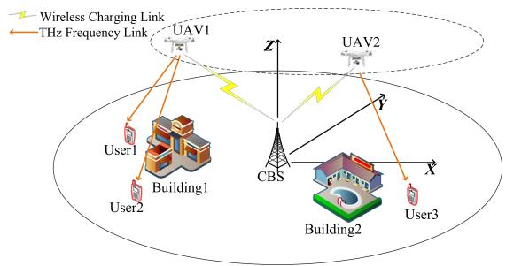
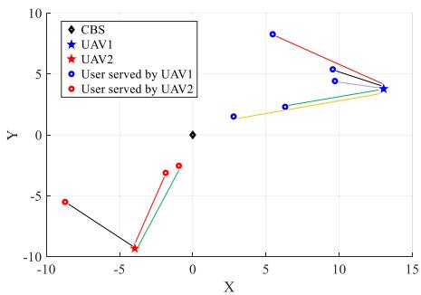
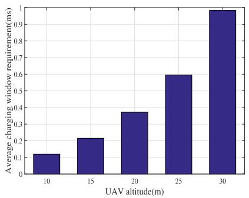
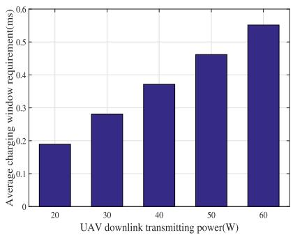
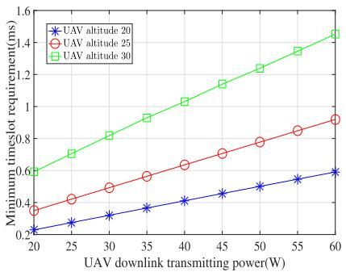
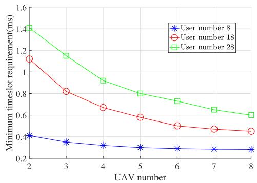
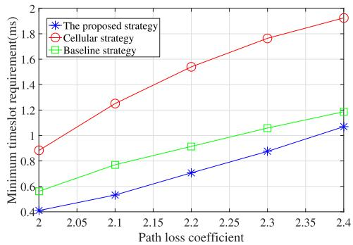

# A Cooperative Recharging-Transmission Strategy in Powered UAV-Aided Terahertz Downlink Networks

Qi Li , Amiya Nayak , Senior Member, IEEE,

Yibo Zhang , Member, IEEE, and F. Richard Yu , Fellow, IEEE

Abstract—Considering that unmanned aerial vehicles (UAVs) with the advantages of flexible deployment and high maneuverability have the limited energy to provide long-term seamless coverage, a cooperative recharging-transmission strategy is studied in this paper for the powered UAV-aided terahertz (THz) downlink networks, where a UAV-to-user THz sub-band association scheme is proposed for the THz frequency transmission to eliminate interference. Based on this, the minimum requirements of the wireless charging window and THz-transmitting window are derived. A minimization problem of minimum timeslot requirement is formulated to jointly optimize UAV placement and UAV-to-user THz sub-band association. The optimization problem is non-convex, and we propose an alternating optimization solution via iteratively solving placement subproblem and association subproblem. Specifically, we resort to the coalescent method of interior point and gradient descent algorithms to optimize UAV placement. The UAV-to-user THz sub-band association is solved as a knapsack problem by the transformation of association matrix. Simulation results validate the solution and demonstrate that the proposed strategy can achieve quasioptimal performance compared with other contrasting strategies.

Index Terms—UAV-aided, THz downlink, recharging-transmission.

## I. INTRODUCTION

Since unmanned aerial vehicles (UAVs) with the remarkable advantages of flexible deployment and maneuverability can be deployed over territorial infrastructures at a reasonably high altitude to avoid being obstructed by physical barriers, UAVs are more likely to establish wireless line-of-sight (LoS) links with favorable channel conditions, and UAV-aided wireless communication has the potential to offer ubiquitous coverage for ground communication infrastructures [1], [2]. The authors in [3] presented a UAV-based amplify-and-forward relay network and optimized UAV location with the goal of maximizing the sum rate, while [4] evaluated the optimal UAV placement using the decode-and-forward strategy. But the above works ignore the limited energy supply of UAV. Considering the limited on-board batteries of UAVs, how to maintain long-term seamless coverage poses a critical challenge [5]. The wireless power transmission network is a significant option for the challenge, and wireless devices are capable of harvesting the energy carried by radio signals as energy supplement [6], [7]. A paradigm of the wireless power transmission network with multiple powered UAVs was presented in [8], where UAV placement and user association were jointly explored to optimize the downlink sum rate. Considering the UAV-aided cooperative communication networks with simultaneous wireless information and power transfer, [9] and [10] studied the UAV placement to maximize the cooperative throughput in the constraint of harvesting efficiency, and simulation results demonstrated that the reasonable UAV location could tackle the tradeoff between energy harvesting efficiency and transmission throughput. According to the above works, UAV location has a nonnegligible impact on the performance of both content transmission and energy charging, but they rarely consider the efficient allocation of the limited spectrum resource. Thus, we would take UAV placement and frequency band association into consideration synthetically.

Furthermore, terahertz (THz) frequency transmission with the abundant spectrum resource ranging from 0.1 THz to 10 THz has emerged as a promising short-distance, high-speed and reliable communication means for the LoS links in the UAV-aided communication network, whose LoS channel model only needs to focus on the free space spreading loss and molecular absorption loss [11]. A UAV-aided communication network operating at THz frequency was explored in [12], where the problem of UAV deployment, power distribution and bandwidth allocation were investigated. The performance of UAVs in THz networks was investigated in [13]. However, there are the inter-symbol interference, inter-cell co-sub-band interference from different UAVs in the same sub-band as well as inter-sub-band interference from the same UAV or different UAVs in the adjacent sub-bands [14], [15], and the above works ignored the THz sub-band association between UAVs and users to eliminate interference.

In this paper, a cooperative recharging-transmission strategy is studied in powered UAV-aided downlink networks, where UAVs harvest energy from wireless charging base station (CBS) and serve the obstructed users through the THz frequency transmission. We propose a UAV-to-user THz sub-band association scheme to eliminate interference in the THz frequency transmission. Besides, the spans of the wireless charging window and THz-transmitting window are derived, and we derive the mathematical expression for minimum timeslot requirement (MTR) to analyze the minimum time required to complete one single transmission. Both UAV placement and UAV-to-user THz sub-band association are of great importance for the network performance. Based on this, a minimization problem of MTR is formulated to jointly optimize UAV placement and UAV-to-user THz sub-band association, and the minimization problem is non-convex. Based on the decomposition ofthe problem into two subproblems for UAV placement and UAV-to-user THz sub-band association, we propose an alternating optimization solution by iteratively solving each subproblem. The UAV placement is optimized by the coalescent method of interior point and gradient descent algorithms, and the THz sub-band association is consided as a knapsack problem by the transformation of association matrix. The effectiveness of the optimization solution is demonstrated by simulation.

## II. SYSTEM MODEL

## A. Network Architecture

As shown in Fig. 1, the powered UAV-aided THz downlink network is a three-tier architecture, serving users in the cell of radius $R _ { c } .$ . In the CBS-tier, CBS is located in the center of the cell. On the one hand, CBS provides energy to UAVs for the flight and wireless transmission. On the other hand, CBS with a global knowledge of the cell state supplies the control coverage, e.g., controlling the UAV-to-user THz sub-band association to reduce interference. In the UAV-tier, there are M UAVs with a fixed and reasonably altitude H to avoid being obstructed by buildings, hovering over the cell and serving users through the THz frequency link [1]. The THz transmission bandwidth of UAV is denoted as $W _ { u }$ . In the user-tier, there are K users, whose receptions of the requested contents from CBS are affected due to the obstruction of physical barriers, and need to obtain the contents from UAVs.

  
Fig. 1. The architecture of the powered UAV-aided THz downlink network. There are three users whose receptions of the requested contents are affected due to the obstruction of physical buildings. UAV1 hovering over the cell forwards the contents to User1 and User2 through the THz frequency link while UAV2 serves User3.

  
Fig. 2. A typical result for UAV-to-user THz sub-band association. The diamond represents the wireless CBS, while the pentagons and circles stand for UAVs and users, respectively. Different THz sub-bands are identified by solid lines with different colors.

In the cell, UAVs follow the save-then-transmit protocol [16], and cooperatively operate in the timeslot mode. Each timeslot is divided into wireless charging window (the duration is denoted as $T _ { c } )$ and THz-transmitting window (the duration is denoted as $T _ { z } )$ . During each timeslot, UAVs first harvest energy from CBS, and then forward the requested contents to users. Besides, a three-dimensional Cartesian coordinate system with CBS located at the origin (0, 0, 0) is considered, where the location of user k is denoted as $( x _ { k } ^ { d } , y _ { k } ^ { d } , 0 )$ . The locations of UAVs for each timeslot are assumed to be fixed, and the instantaneous coordinate of UAV m in the current timeslot is denoted as $( x _ { m } ^ { u } , y _ { m } ^ { u } , H )$ The heights of all UAVs are the same and can be ignored for notational simplicity. The set of all UAVs’ coordinates in the current timeslot can be denoted as $( { \mathcal { X } } , { \mathcal { Y } } ) \triangleq \{ ( x _ { 1 } ^ { u } , y _ { 1 } ^ { u } ) , ( x _ { 2 } ^ { u } , y _ { 2 } ^ { u } ) , . . . , ( x _ { M } ^ { u } , y _ { M } ^ { u } ) \}$

## B. Cooperative Recharging-Transmission Strategy

In the powered UAV-aided THz downlink network, a cooperative recharging-transmission strategy is proposed, where UAVs harvest energy from CBS and cooperatively serve users through the THz frequency transmission.

1) The wireless recharging process: UAVs harvest wireless energy carried by the radio signal from CBS, which is able to efficiently lighten the UAV’s energy burden. The CBS-to-UAV recharging channel is dominated by the LoS link, which can be modeled as follows.

$$
h _ { 0 , m } = \alpha r _ { 0 , m } ^ { - \beta }\tag{1}
$$

where α is the LoS channel power gain at the reference distance (e.g., one meter), $\beta$ is the path loss coefficient, and $r _ { 0 , m }$ is the distance between CBS and the UAV m.

$$
r _ { 0 , m } = \sqrt { \left( x _ { m } ^ { u } \right) ^ { 2 } + \left( y _ { m } ^ { u } \right) ^ { 2 } + H ^ { 2 } }\tag{2}
$$

The total energy of UAV m harvested from CBS in the current timeslot amounts to $T _ { c } P _ { c } h _ { 0 , m }$ , where $P _ { c }$ is the charging power of CBS. Besides, we have $T _ { c } P _ { c } h _ { 0 , m } \geqslant ( T _ { c } + T _ { z } ) P _ { h }$ to ensure the normal flight of UAV m in the current timeslot, where $P _ { h }$ is the hovering power consumption.

2) The THz frequency transmission process of UAV: The THz frequency transmission of UAV focuses on frequency division multiple access for orthogonal sub-band sharing among users, i.e., the THz frequency band is divided into L sub-bands evenly and each user is served on an individual sub-band. It’s assumed that $M L \geqslant K$ and the THz frequency band resource is sufficient to serve all users. A UAV-to-user sub-band association scheme is proposed to eliminate interference in the THz frequency transmission, where a binary variable $\omega _ { m , k , l }$ is defined as the association indicator. $\omega _ { m , k , l } = 1$ indicates that the user k is served by the UAV m on the THz sub-band l, and $\omega _ { m , k , l } = 0$ otherwise.

The inter-symbol interference effect can be eliminated with the high-gain antennas over each sub-band [17]. The inter-cell co-sub-band interference and inter-sub-band interference are considered in the multisub-bands based UAV-aided THz downlink network. $S I N R _ { m , k , l }$ is defined as the Signal to Interference plus Noise Ratio (SINR) at the user k from the UAV m on the THz sub-band l, and formulated as

$$
\begin{array} { l } { { S I N R _ { m , k , l } } } \\ { = \frac { P _ { m , l } G _ { t } G _ { r } h _ { m , k } } { \sum _ { i = 1 , i \ne m } ^ { M } P _ { i , l } h _ { i , k } + \sum _ { i = 1 } ^ { M } \sum _ { j = l - 1 , j \ne 0 , j \ne l } ^ { l + 1 \in \{ 1 , 2 , \dots , L \} } P _ { i , j } h _ { i , k } + n _ { 0 } } } \end{array}\tag{3}
$$

where $G _ { t }$ and $G _ { r }$ denote the antenna gains of UAV and user, $P _ { m , l }$ denotes the downlink transmitting power ofthe UAV m on the sub-band $l , \ h _ { m , k }$ is the THz channel gain between the UAV m and user k, n is the power of complex additive white Gaussian noise. The term $\textstyle \sum _ { i = 1 , i \neq m } ^ { M } P _ { i , l } h _ { i , k }$ stands for the inter-cell co-sub-band interference, while the term $\begin{array} { r } { \sum _ { i = 1 } ^ { M } \sum _ { j = l - 1 , j \ne 0 , j \ne l } ^ { l + 1 \in \{ 1 , 2 , \ldots , L \} } P _ { i , j } h _ { i , k } } \end{array}$ is the inter-sub-band interference.

We consider a simplified THz channel model, which only focuses on the LoS propagation path and the non-LoS (NLoS) propagation path can be neglected due to the appropriate antenna gain [14]. The simplified THz channel is modeled as

$$
h _ { m , k } = L _ { s p r } ( f , r _ { m , k } ) L _ { a b s } ( f , r _ { m , k } )\tag{4}
$$

where $L _ { s p r } ( f , r _ { m , k } )$ and $L _ { a b s } ( f , r _ { m , k } )$ are the free space spreading loss and molecular absorption loss, respectively [11]. f and $r _ { m , k }$ are the inputs of the loss functions, standing for the THz frequency as well as the distance between the UAV m and user k. The value of $r _ { m , k }$ is derived as

$$
r _ { m , k } = \sqrt { \left( x _ { m } ^ { u } - x _ { k } ^ { d } \right) ^ { 2 } + \left( y _ { m } ^ { u } - y _ { k } ^ { d } \right) ^ { 2 } + H ^ { 2 } }\tag{5}
$$

  
(a)

  
(b)

  
(c)  
Fig. 3. The effect of the UAV’s properties on the network performances. (a) UAV altitude vs. average wireless charging window requirement. (b) UAV downlink transmitting power vs. average wireless charging window requirement. (c) UAV downlink transmitting power vs. average MTR under different UAV altitudes.

The mathematical expressions of $L _ { s p r } ( f , r _ { m , k } )$ and $L _ { a b s } ( f , r _ { m , k } )$ are formulated as follows.

$$
L _ { s p r } ( f , r _ { m , k } ) = \left( \frac { c } { 4 \pi f r _ { m , k } } \right) ^ { 2 }\tag{6}
$$

$$
L _ { a b s } ( f , r _ { m , k } ) = e ^ { - k ( f ) r _ { m , k } }\tag{7}
$$

where c is the light speed in free space, and $k ( f )$ stands for the frequency-dependent medium absorption coefficient [18].

In order to ensure the proper functioning of UAVs, each UAV’s hovering capability and THz frequency transmission capability should be powered by the radio signal transmitted from CBS. Thus, the harvested energy of each UAV must be more than the sum of the hovering energy and transmitting energy in each timeslot, and we have

$$
T _ { c } P _ { c } h _ { 0 , m } \geqslant \left( T _ { c } + T _ { z } \right) P _ { h } + T _ { z } \sum _ { l = 1 } ^ { L } P _ { m , l } , \forall m\tag{8}
$$

## III. PERFORMANCE METRICS AND PROBLEM FORMULATION

## A. The Minimum Timeslot Requirement

In order to analyze the minimum time span required to complete one single transmission in such powered UAV-aided THz downlink network, we define the minimum timeslot requirement (MTR) as the minimum sum span of the wireless charging window and THz-transmitting window when users retrieve the requested contents of the unit size.

The span requirement of THz-transmitting window when the UAV m serve the user k on the THz sub-band l can be formulated as

$$
T _ { m , k , l } ^ { z } = \frac { 1 } { R _ { m , k , l } }\tag{9}
$$

where $R _ { m , k , l }$ is the downlink transmitting rate and shown as follows.

$$
\begin{array} { r } { R _ { m , k , l } = \frac { W _ { u } } { L } \mathrm { l o g } _ { 2 } \left( S I N R _ { m , k , l } + 1 \right) } \end{array}\tag{10}
$$

Considering the formula (8), the span requirement of wireless charging window when the UAV m serve the user k on the THz sub-band l is

$$
T _ { m , k , l } ^ { c } = \frac { P _ { h } + \sum _ { l = 1 } ^ { L } P _ { m , l } } { P _ { c } h _ { 0 , m } - P _ { h } } T _ { m , k , l } ^ { z }\tag{11}
$$

which is the extreme case for balancing the UAV’s harvesting energy and THz transmission performance.

In total, the average MTR of the powered UAV-aided THz downlink network is

$$
M T R = \frac { 1 } { K } \sum _ { m = 1 } ^ { M } \sum _ { k = 1 } ^ { K } \sum _ { l = 1 } ^ { L } \omega _ { m , k , l } \left( T _ { m , k , l } ^ { c } + T _ { m , k , l } ^ { z } \right)\tag{12}
$$

## B. Problem Formulation

In the powered UAV-aided THz downlink network, both UAV placement and UAV-to-user THz sub-band association are of great importance for the network performance. The locations of UAVs should be properly decided to tackle the tradeoff between energy harvesting efficiency and THz frequency transmission efficiency. The UAV association for each user and THz sub-band assignment should also be carefully designed since the inter-cell co-sub-band interference and the inter-sub-band interference are non-negligible in the THz frequency transmission. Thus, we focus on the joint optimization for UAV placement and UAV-to-user THz sub-band association to minimize the average MTR, and the problem is formulated as

$$
\operatorname* { m i n } _ { ( \boldsymbol { \mathcal { X } } , \boldsymbol { \mathcal { Y } } ) , \omega } \quad M T R\tag{13a}
$$

$$
\mathrm { s . t . } \quad \sqrt { \left( x _ { m } ^ { u } \right) ^ { 2 } + \left( y _ { m } ^ { u } \right) ^ { 2 } } \leqslant R _ { c } , \forall m\tag{13b}
$$

$$
\sum _ { m = 1 } ^ { M } \sum _ { l = 1 } ^ { L } \omega _ { m , k , l } = 1 , \forall k\tag{13c}
$$

$$
\sum _ { k = 1 } ^ { K } \omega _ { m , k , l } \leqslant 1 , \forall m , l\tag{13d}
$$

$$
\omega _ { m , k , l } \in \{ 0 , 1 \} , \forall m , k , l\tag{13e}
$$

where ω $\triangleq \{ \omega _ { m , k , l } | \forall m , k , l \}$ is the association matrix. The constraint (13b) limits the serving range ofUAVs. The constraint (13c) ensures that each user is served by only one UAV and one single THz frequency subband, while (13d) ensures that each combination of one UAV and one THz sub-band is occupied for serving one user at most. The constraint (13e) specifies the value range of the binary association indicators. It is obvious that the minimization problem (13) is a mixed integer optimization problem with both continuous and discrete variables, and thus is non-convex.

## IV. ALGORITHM DESIGN

In this section, due to the non-convex property of the minimization problem (13), we decompose (13) into two subproblems for UAV placement and UAV-to-user THz sub-band association, and propose an alternating optimization solution via iteratively solving each subproblem. Each of the two optimization variables (UAV’s coordinate set $( \mathcal { X } , \mathcal { Y } )$ and association matrix ω) can be alternatively optimized based on the other given one. The average MTR of the powered UAV-aided

```latex
Algorithm 1: Optimization for UAV Placement.
Input: Iteration1, $\rho ,$ Iteration2.
1: Initialization: Set ite1 <sub>=</sub> 1, randomly set $( x _ { m } ^ { u } , y _ { m } ^ { u } )$
satisfying the constraint (14b).
2: Set $\begin{array} { r } { i t e 2 = 1 , \xi ( i t e 2 ) = \frac { 1 } { i t e 2 } , } \end{array}$ and calculate $\varphi ( i t e 2 )$ shown in
formula (15).
3: For $( x _ { m } ^ { u } , y _ { m } ^ { u } ) \in ( \mathcal { X } , \mathcal { Y } )$ , calculate $\begin{array} { r } { D _ { m } ^ { x } = \frac { \partial \varphi } { \partial x _ { m } ^ { u } } } \end{array}$ and
$\begin{array} { r } { D _ { m } ^ { y } = \frac { \partial \varphi } { \partial y _ { m } ^ { u } } . } \end{array}$
4: For $( x _ { m } ^ { u } , y _ { m } ^ { u } ) \in ( \mathcal { X } , \mathcal { Y } )$ , update
$x _ { m } ^ { u } ( i t e 2 + 1 ) = x _ { m } ^ { u } ( i t e 2 ) - \xi ( i t e 2 ) D _ { m } ^ { x } ,$
$y _ { m } ^ { u } ( i t e 2 + 1 ) = y _ { m } ^ { u } ( i t e 2 ) - \xi ( i t e 2 ) D _ { m } ^ { y } .$
5: $\begin{array} { r } { i t e 2 = i t e 2 + 1 , \xi ( i t e 2 ) = \frac { 1 } { i t e 2 } , } \end{array}$ and calculate $\varphi ( i t e 2 ) .$
6: $\mathrm { I f } | \varphi ( i t e 2 ) - \varphi ( i t e 2 - 1 ) | \leqslant \varepsilon _ { 2 }$ (ε<sub>2</sub> is a small positive
number) or $i t e 2 >$ Iteration2, go on. Otherwise, go back
the step (3).
7: $x _ { m } ^ { t e m p } ( i t e 1 ) = x _ { m } ^ { u } ( e n d ) , y _ { m } ^ { t e m p } ( i t e 1 ) = y _ { m } ^ { u } ( e n d ) .$ , and
$\varphi _ { t e m p } ( i t e 1 ) = \varphi ( e n d )$
8: $i t e 1 = i t e 1 + 1 , \rho = \rho \times C \left( C \right.$ is the attenuation coefficient
of $\rho ) .$
9: For $( x _ { m } ^ { t e m p } , y _ { m } ^ { t e m p } ) \in ( \mathcal { X } , \mathcal { Y } ) ,$ if
$| x _ { m } ^ { t e \bar { m } p } ( i t e 1 ) - x _ { m } ^ { t e m p } ( i t e 1 - 1 ) | \leqslant$
$\varepsilon _ { 1 } \& \& \vert y _ { m } ^ { t e m p } ( i t e 1 ) - y _ { m } ^ { t e m p } ( i t e 1 - 1 ) \vert \leqslant \varepsilon _ { 1 } ( \varepsilon _ { 1 }$ is a small
positive number) or ite1 > Iteration1, go on. Otherwise,
go back the step (2).
10: $\bar { x } _ { m } ^ { o p t } = x _ { m } ^ { t e m p } \bar { ( e n d ) } , y _ { m } ^ { o p t } = y _ { m } ^ { t e m p } ( e n d ) .$ , and
$\varphi _ { o p t } = \varphi _ { t e m p } ( e n d ) .$
Output: $( x _ { m } ^ { o p t } , y _ { m } ^ { o p t } )$ and $\varphi _ { o p t }$ as the optimal solution to (14).
```

THz downlink network can be iteratively decreased until convergence through the solutions to the two subproblems.

## A. UAV Placement

Given the association matrix, the subproblem for UAV placement is formulated as

$$
\operatorname* { m i n } _ { ( \mathcal { X } , \mathcal { Y } ) } \quad M T R\tag{14a}
$$

$$
\mathrm { s . t . } \quad \sqrt { \left( x _ { m } ^ { u } \right) ^ { 2 } + \left( y _ { m } ^ { u } \right) ^ { 2 } } \leqslant R _ { c } , \forall m\tag{14b}
$$

Due to the complexity of (14) in the scenario of multiple UAVs, we resort to the coalescent method of interior point and gradient descent algorithms to optimize UAV locations. The subproblem (14) is firstly transformed into an unconstrained optimization problem through the interior point algorithm, which is shown in (15).

$$
\operatorname* { m i n } _ { ( x , y ) } \varphi = M T R - \rho \sum _ { m = 1 } ^ { M } \left( \sqrt { \left( x _ { m } ^ { u } \right) ^ { 2 } + \left( y _ { m } ^ { u } \right) ^ { 2 } } - R _ { c } \right)\tag{15}
$$

where $\rho$ is the punishment factor when UAV is out of serving range. Then, we can minimize $\varphi$ in (15) through the gradient descent algorithm to optimize $\mathrm { U A V } _ { \mathrm { \Delta } }$ coordinate set $( \mathcal { X } , \mathcal { Y } )$

The details of the solution for the subproblem (14) are summarized in Algorithm 1. The variable ξ(ite2) is the descending factor for gradient descent algorithm and satisfies

$$
\{ \begin{array} { l l } { \displaystyle { \operatorname* { l i m } _ { i \ t e 2  + \infty } \xi ( i t e 2 ) = 0 } } \\ { \displaystyle { \operatorname* { l i m } _ { I t e r a t i o n 2  + \infty } \sum _ { i t e 2 = 1 } ^ { I t e r a t i o n 2 } \xi ( i t e 2 ) = + \infty } } \\ { \displaystyle { \operatorname* { l i m } _ { I t e r a t i o n 2  + \infty } \xi ( i t e 2 ) ^ { 2 } \xi ( i t e 2 ) ^ { 2 } < + \infty } } \end{array}\tag{16}
$$

The punishment factor $\rho$ in the interior point algorithm decays in multiples of C in each iteration.

## B. UAV-to-User THz Sub-Band Association

Given the UAV locations, the subproblem for UAV-to-user THz subband association can be formulated as

$$
\operatorname* { m i n } _ { \omega } \quad \sum _ { m = 1 } ^ { M } \sum _ { k = 1 } ^ { K } \sum _ { l = 1 } ^ { L } \omega _ { m , k , l } \left( T _ { m , k , l } ^ { c } + T _ { m , k , l } ^ { z } \right)\tag{17a}
$$

$$
\mathrm { s . t . } \sum _ { m = 1 } ^ { M } \sum _ { l = 1 } ^ { L } \omega _ { m , k , l } = 1 , \forall k\tag{17b}
$$

$$
\sum _ { k = 1 } ^ { K } \omega _ { m , k , l } \leqslant 1 , \forall m , l\tag{17c}
$$

$$
\omega _ { m , k , l } \in \left\{ 0 , 1 \right\} , \forall m , k , l\tag{17d}
$$

According to the constraints (17b) and (17c), the combination of one UAV and one single THz sub-band can be regarded as a serving unit. Thus, the constraint (17b) means that each user must be served by one single serving unit, and (17c) indicates that each serving unit is occupied for one user at most. Based on this, the association matrix ω can be transformed into a $K \times M L$ decision matrix $[ d _ { i j } ] _ { K \times M L }$ , where $d _ { i j } = 1$ is defined that the j-th serving unit is occupied for the user i and $d _ { i j } = 0$ otherwise. We also have the constraints $\begin{array} { r } { \sum _ { j = 1 } ^ { M L } d _ { i j } = 1 } \end{array}$ and $\textstyle \sum _ { i = 1 } ^ { K } d _ { i j } \leqslant 1$ . The subproblem (17) can be rewritten as a knapsack problem, which is shown as follows. We resort to the Hungarian algorithm to solve the problem (18) and optimize UAV-to-user THz sub-band association.

$$
\operatorname* { m i n } _ { \left[ d _ { i j } \right] _ { K \times M L } } \quad \sum _ { i = 1 } ^ { K } \sum _ { j = 1 } ^ { M L } d _ { i j } T _ { i , j } ^ { s }\tag{18a}
$$

$$
\mathrm { s . t . } \sum _ { j = 1 } ^ { M L } d _ { i j } = 1\tag{18b}
$$

$$
\sum _ { i = 1 } ^ { K } d _ { i j } \leqslant 1\tag{18c}
$$

$$
d _ { i j } \in \{ 0 , 1 \}\tag{18d}
$$

The expression of $T _ { i , j } ^ { s }$ is

$$
T _ { i , j } ^ { s } = T _ { m , k , l } ^ { c } + T _ { m , k , l } ^ { z }\tag{19}
$$

where

$$
\binom { i = k } { j = ( m - 1 ) \times L + l }\tag{20}
$$

## C. Alternating Optimization

Based on the solutions to the two subproblems, an alternating optimization solution is presented to jointly optimize UAV placement and UAV-to-user THz sub-band association, as summarized in Algorithm 2.

## V. PERFORMANCE EVALUATION

## A. Simulation Setup

According to the references [8], [10], the parameter setting for the powered UAV-aided THz downlink network is shown in Table I. Considering that the THz frequency band is evenly divided into L sub-bands, the downlink transmitting power of each UAV on every sub-band is assumed to be the same. Without otherwise specified, we have $P _ { m , l } = 1 6 \mathrm { d } \mathrm { B } ( \forall m , l ) , P _ { c } = 4 0 \mathrm { d }$ B and $P _ { h } = 0 \mathrm { d B }$ . Moreover, the frequency ofTHz carrier is set as $f = 0 . 3 \AA$ 4 THz to avoid path loss peaks, and the THz transmission bandwidth $W _ { u } = 1 0 ~ \mathrm { G H z } ~ [ 1 7 ]$ . To enable the highly directional of THz band, the antenna gains of UAV and user are both set as $G _ { t } = G _ { r } = 2 0 \mathrm { d B i }$ [19]. Since the effect of water vapor molecule on the molecular absorption loss is significantly greater than that of other air molecule, we consider that the frequency-dependent medium absorption coefficient k(f) is only related to the water vapor molecular [18].

Algorithm 2: Alternating Optimization.   
Input: Iteration.   
1: Initialization: Set $i t e = 1$ , randomly set $( x _ { m } ^ { u } , y _ { m } ^ { u } )$ satisfying   
the constraint (13b) and ω satisfying the constraints   
(13c)–(13e).   
2: Calculate $M T R ( i t e )$ shown in formula (12).   
3: Solve the subproblem (14) via the Algorithm 1 and optimize   
UAV placement.   
4: Solve the subproblem (17) via the Hungarian algorithm and   
optimize UAV-to-user THz sub-band association.   
5: $i t e = i t e + 1$ , and calculate $M T R ( i t e )$   
6: If $| M T R ( i t e ) - M T R ( i t e - 1 ) | \leqslant \varepsilon$ (ε is a small positive   
number) or ite $>$ Iteration, go on. Otherwise, go back the   
step (3).   
Output: the UAV locations and association matrix as the optimal   
solution to (13).  
TABLE I

PARAMETER SETTING OF THE NETWORK
<table><tr><td rowspan=1 colspan=1>Parameters</td><td rowspan=1 colspan=1>Values</td><td rowspan=1 colspan=1>Parameters</td><td rowspan=1 colspan=1>Values</td></tr><tr><td rowspan=1 colspan=1> $\overline { { R _ { c } } }$ </td><td rowspan=1 colspan=1>25m</td><td rowspan=1 colspan=1>M</td><td rowspan=1 colspan=1>2</td></tr><tr><td rowspan=1 colspan=1>H</td><td rowspan=1 colspan=1>20m</td><td rowspan=1 colspan=1>K</td><td rowspan=1 colspan=1>8</td></tr><tr><td rowspan=1 colspan=1>L</td><td rowspan=1 colspan=1>5</td><td rowspan=1 colspan=1>n0</td><td rowspan=1 colspan=1>-174dBm/Hz</td></tr><tr><td rowspan=1 colspan=1>α</td><td rowspan=1 colspan=1>1</td><td rowspan=1 colspan=1> $\beta$ </td><td rowspan=1 colspan=1>2</td></tr></table>

## B. Simulation Result and Analysis

When there are two UAVs and eight users in the cell with the center of CBS, the typical result for UAV-to-user THz sub-band association is shown in Fig. 2. The diamond represents the wireless CBS, while the pentagons and circles stand for UAVs and users, respectively. The solid lines represent the THz frequency downlink transmissions. One UAV forwards the requested contents to five users, while the other UAV serves the remaining three users. Obviously, users served by the same UAV retrieve the contents on different THz sub-bands to eliminate interference and increase downlink transmitting rate as well as realizing the purpose of minimizing the average MTR. Due to the quantity limitation of the THz sub-band, there exists interference between the transmissions of two UAVs.

The effect of the UAV’s properties on the downlink network performances is illustrated in Fig. 3. The influence of UAV altitude H on the wireless charging window requirement is two-fold. On the one hand, the downlink transmitting rate shown in formula (10) decreases as H increases, resulting the increasing ofthe THz-transmitting window span as well as the wireless charging window span. On the other hand, the gain of CBS-to-UAV recharging channel $h _ { 0 , m }$ also decreases with H increasing, leading to the increasing of the wireless charging window span as shown in formula (11). Thus, as shown in Fig. 3(a), the average wireless charging window requirement increases with UAV altitude. Fig. 3(b) indicates that the average wireless charging window requirement increases with UAV downlink transmitting power. This is because the charging time increases in multiples of the THz-transmitting time when the UAV transmitting power increases, even if there is a gain in the transmitting time brought by the increasing of the downlink transmitting rate. According to the above analyses, the average MTR increases with UAV altitude and downlink transmitting power, which is shown in Fig. 3(c).

  
Fig. 4. The effect of UAV number on MTR under different user numbers.

  
Fig. 5. Comparison for MTR versus path loss exponent.

As illustrated in Fig. 4, the increasing of UAV number M would lead to the decline of average MTR. That there are more UAVs makes the locations of UAVs serving users closer to them, improving the efficiency of energy harvesting from CBS and reducing unnecessary transmitting loss. Thus, the THz-transmitting window span and wireless charging window span decrease with UAV number. Obviously, when the user number is eight, there is less influence of UAV number on MTR. This is because the user number is too small and fewer UAVs can serve these users. Inversely, the increasing of user number K leads to the increasing of MTR. The increasing of K inevitably results in the dispersion of UAVs, which in turn leads to inefficiencies of the energy harvesting and transmitting processes. Thus, the THz-transmitting window span and wireless charging window span increase with user number.

We compared the proposed strategy with two strategies in Fig. 5. One is the cellular strategy, which is similar to the proposed strategy but the THz frequency transmission mode is replaced by the cellular frequency transmission. The other is a baseline strategy, which is leveraged from an existing work [8]. Obviously, the CBS-to-UAV charging channel get worse with the path loss coefficient β increasing, resulting that the charging time and MTR in the proposed strategy increase. Besides, we can see that the performance of the two contrasting strategies both degrade with a higher value of $\beta$ and the proposed strategy always outperforms the contrasting strategies.

## VI. CONCLUSION

In this paper, a cooperative recharging-transmission strategy in powered UAV-aided downlink networks was studied. We proposed a UAV-to-user THz sub-band association scheme to eliminate interference in the THz frequency transmission. Based on the analysis and derivation of the wireless charging window and THz-transmitting window, a minimization problem of MTR was formulated to jointly optimize UAV placement and UAV-to-user THz sub-band association. We proposed an alternating optimization solution to the optimization problem by iteratively solving each of the subproblems for UAV placement and UAV-to-user THz sub-band association. The effectiveness of the proposed strategy was verified by numerical examples where existing benchmark strategies were compared.

## REFERENCES

[1] Y. Zeng, R. Zhang, and T. J. Lim, “Wireless communications with unmanned aerial vehicles: Opportunities and challenges,” IEEE Commun. Mag., vol. 54, no. 5, pp. 36–42, May 2016.

[2] X. Li, H. Yao, J. Wang, S. Wu, C. Jiang, and Y. Qian, “Rechargeable multi-UAV aided seamless coverage for QoS-guaranteed IoT networks,” IEEE Internet Things J., vol. 6, no. 6, pp. 10902–10914, Dec. 2019.

[3] L. Li, T.-H. Chang, and S. Cai, “UAV positioning and power control for two-way wireless relaying,” IEEE Trans. Wireless Commun., vol. 19, no. 2, pp. 1008–1024, Feb. 2020.

[4] Y. Chen, W. Feng, and G. Zheng, “Optimum placement of UAV as relays,” IEEE Commun. Lett., vol. 22, no. 2, pp. 248–251, Feb. 2018.

[5] J. Lu, S. Wan, X. Chen, Z. Chen, P. Fan, and K. B. Letaief, “Beyond empirical models: Pattern formation driven placement of UAV base stations,” IEEE Trans. Wireless Commun., vol. 17, no. 6, pp. 3641–3655, Jun. 2018.

[6] S. Bi, Y. Zeng, and R. Zhang, “Wireless powered communication networks: An overview,” IEEE Wireless Commun., vol. 23, no. 2, pp. 10–18, Apr. 2016.

[7] J. Wang, C. Jiang, Z. Wei, C. Pan, H. Zhang, and Y. Ren, “Joint UAV hovering altitude and power control for space-air-ground IoT networks,” IEEE Internet Things J., vol. 6, no. 2, pp. 1741–1753, Apr. 2019.

[8] S. Yin, L. Li, and F. R. Yu, “Resource allocation and basestation placement in downlink cellular networks assisted by multiple wireless powered UAVs,” IEEE Trans. Veh. Technol., vol. 69, no. 2, pp. 2171–2184, Feb. 2020.

[9] S. Yin, Y. Zhao, L. Li, and F. R. Yu, “UAV-assisted cooperative communications with power-splitting information and power transfer,” IEEE Trans. Green Commun. Netw., vol. 3, no. 4, pp. 1044–1057, Dec. 2019.

[10] S. Yin, Y. Zhao, L. Li, and F. R. Yu, “UAV-assisted cooperative communications with time-sharing information and power transfer,” IEEE Trans. Veh. Technol., vol. 69, no. 2, pp. 1554–1567, Feb. 2020.

[11] C. Lin and G. Y. Li, “Adaptive beamforming with resource allocation for distance-aware multi-user indoor terahertz communications,” IEEE Trans. Commun., vol. 63, no. 8, pp. 2985–2995, Aug. 2015.

[12] L. Xu et al., “Joint location, bandwidth and power optimization for THzenabled UAV communications,” IEEE Commun. Lett., vol. 25, no. 6, pp. 1984–1988, Jun. 2021.

[13] X. Wang et al., “Performance analysis of terahertz unmanned aerial vehicular networks,” IEEE Trans. Veh. Technol., vol. 69, no. 12, pp. 16330–16335, Dec. 2020.

[14] Y. Zhang, H. Zhang, and K. Long, “Energy efficient resource allocation in cache based terahertz vehicular networks: A mean-field game approach,” IEEE Trans. Veh. Technol., vol. 70, no. 6, pp. 5275–5285, Jun. 2021.

[15] H. Zhang, H. Zhang, W. Liu, K. Long, J. Dong, and V. C. M. Leung, “Energy efficient user clustering, hybrid precoding and power optimization in terahertz MIMO-NOMA systems,” IEEE J. Sel.Areas Commun., vol. 38, no. 9, pp. 2074–2085, Sep. 2020.

[16] S. Luo, R. Zhang, and T. J. Lim, “Optimal save-then-transmit protocol for energy harvesting wireless transmitters,” IEEE Trans. Wireless Commun., vol. 12, no. 3, pp. 1196–1207, Mar. 2013.

[17] C. Han and I. F. Akyildiz, “Distance-aware bandwidth-adaptive resource allocation for wireless systems in the terahertz band,” IEEE Trans. THz Sci. Technol., vol. 6, no. 4, pp. 541–553, Jul. 2016.

[18] J. M. Jornet and I. F. Akyildiz, “Channel modeling and capacity analysis for electromagnetic wireless nanonetworks in the terahertz band,” IEEE Trans. Wireless Commun., vol. 10, no. 10, pp. 3211–3221, Oct. 2011.

[19] H. Sarieddeen, N. Saeed, T. Y. Al-Naffouri, and M.-S. Alouini, “Next generation terahertz communications: A rendezvous of sensing, imaging, and localization,” IEEE Commun. Mag., vol. 58, no. 5, pp. 69–75, May 2020.