# A Novel Deep Q-Learning-Based Air-Assisted Vehicular Caching Scheme for Safe Autonomous Driving

Junling Shi, Liang Zhao , Xingwei Wang , Weiliang Zhao, Ammar Hawbani , and Min Huang , Member, IEEE

Abstract— The safety driving-related content demands of vehicle users increase rapidly, especially with the development of autonomous driving. It is significantly necessary to obtain the safety-related transportation information of an area when vehicles are drove there, whether or not they are controlled by human being. However, vehicular content caching can bring issues in distributed-fashion, such as high response delay and low content response ratio because of the poor traffic condition and the obstructions of buildings. As a consequence, we adopt UAVs (Unmanned Aerial Vehicles) to assist the driving safety-related content caching for vehicles. Besides, since the power energy and the caching storage of UAVs are limited, it is needed to design an optimal caching scheme to guarantee the driving safety-related content demands of vehicle users as well as reduce the energy consumption of UAVs. In this article, we propose a novel deep Q-learning based air-assisted vehicular caching scheme to respond to the driving safety-related content requests of vehicle users. First, a three-layered content response architecture is introduced, where an airship is leveraged to take charge of the scheduling of UAVs to improve the content response. Then, a multi-objective mathematical model is built to describe the specific problem of the proposed scheme. Finally, deep Q-learning is applied to solve the multi-objective problem by learning from the history content requests of vehicle users. Extensive experiments have been conducted which show the proposed scheme outperforms its counterparts in terms of content hit ratio, response delay, being scheduling probability and packet buffering time.

Index Terms— Air-assisted, content caching, deep Q-learning, unmanned aerial vehicles, autonomous driving.

ON APRIL 16, 2020, Elon Musk, the CEO of Tesla, announced that the deployment of Tesla’s Robotaxi will likely be ready by the end of 2020 [1]. It is a sign to declare that an unmanned driving era is probably coming soon. Meanwhile, by 2022, the monthly global mobile data traffic will be 77 exabytes, while the annual traffic will reach almost one zettabyte [2]. The media content demand of vehicle users is a major type of data traffic. In this context, the safety-related information shares the vast majority since the driving safety is always the first thing to concern, no matter human or intelligent vehicles [3]–[6]. However, autonomous driving needs real-time and high precision traffic information to guarantee the driving accuracy. In order to satisfy such content demand efficiently, vehicular content caching methods have been proposed [7]. On one hand, vehicles can obtain their required autonomous driving related traffic information from other vehicles rather than from the original content provider. Such model is able to shorten the content response delay and offer autonomous driving with high real-time traffic information. On the other hand, with vehicular content caching, data transferring is balanced by relieving network congestion and reduce the access pressure of content providers, and therefore improve the autonomous driving on safety level by high precision supporting [8].

## I. INTRODUCTION

However, vehicular caching is facing several significant problems. For one thing, vehicles move subject to traffic conditions. When traffic jam happens, predicted caching vehicles cannot guarantee the content response on time, which affect the data delivery to a certain extent. For another thing, in urban areas, buildings can block the wireless transmission once vehicles move into the blind spot. It can cause an interruption of data transmission [9]–[11] and decrease content response successful ratio. To overcome these challenges, UAVs (Unmanned Aerial Vehicles) can be leveraged to assist the content caching for vehicle users. For cellular communications, UAVs can act as mobile base stations because they can be utilized to establish a wireless connection without any fixed infrastructures. Such utilization provides a completely new caching paradigm for vehicle users [12], [13]. Since UAVs are relatively sparse in the sky, they cannot be blocked by some obstacles easily and are not restricted by traffic conditions.

Therefore, air-assisted vehicular caching is a promising architecture for a content response.

Though air-assisted caching can provide a promising caching environment for vehicle users, caching spaces of UAVs are still relatively small. Therefore, it is impossible for UAVs to cache all the requested content for users in a specific area. When one UAV cannot offer the content for users, another UAV cached the required content should take charge of the content response. To realize such a process, the latter UAV has to receive a piece of scheduling information to be informed to provide the assistance. However, subjected to the limited wireless backhaul and transmission range, communications among UAVs cannot be guaranteed on real-time and high efficiency [14]. Despite some studies have been proposed various routing schemes for FANET (Flying Ad-hoc NETwork), more efforts are still needed to continue providing high-performance message delivery [15]. As a consequence, to avoid the communication issues of UAVs, in this article, we deploy an airship to be responsible for the UAVs scheduling at an overall level. The airship can maintain the communications to UAVs, and thus to ensure the on-time scheduling as well as collect the information from the whole network to obtain an optimal caching scheme.

In fact, the caching scheme should consider the content response ratio, the power energy of UAVs, the limited caching spaces as well as other limited conditions. Although intelligent optimization algorithms are capable of solving such a multi-objective problem, the quality of solution cannot satisfy the complex environment because of the local optimum. Recently, the theory of reinforcement learning provides a normative account of how agents may optimize their control of an environment [16]. Therefore, we propose a reinforcement learning-based UAV caching scheme in the air-assisted caching architecture. In the scheme, UAVs are decided to select cached content when they should control their caching space, power energy as well as the amount of content. Since there are many kinds of reinforcement learning methods, designing a caching scheme for deciding the practical caching issue should select a suitable one. As a variant of the Q-learning algorithm [17], DQN (Deep Q-Network) algorithm [18] can overcome a large number of states based on a convolutional neural network. Therefore, in this article, we get the optimal caching scheme based on DQN and improve it to adapt to our multi-objective problem.

Based on the above considerations, we propose a DQN based air-assisted vehicular caching scheme for safe autonomous driving, and our contributions are summarized as follows.

(1) We propose a three-layered vehicular caching architecture, which involves an airship, UAVs and vehicles. This architecture can provide a real-time UAV scheduling for the content requests, and guarantee an accurate caching assignment. To the best of our knowledge, this work is the first to involve multiple UAVs to provide safe autonomous driving content caching for vehicles.

(2) By the deep analysis of the vehicular caching goals for both users and devices, and comprehensive consideration of the restrictive conditions in the integration of ground and air, we propose a multi-objective model under several limitations.

(3) To effectively adapt DQN in solving our problem, we design a positive reward matrix and a negative reward matrix to represent the different optimal goals. The limited conditions are also integrated into the reward calculation, thus to obtain a final caching scheme adaptively.

The rest of this article is organized as follows. Section 2 reviews related works. Section 3 presents the system framework of the proposed caching scheme. Section 4 presents the optimal objectives and mathematical model. Section 5 describes the devised DQN based caching scheme. Section 6 shows simulations and performance evaluation. Section 7 draws conclusions and discusses the future work.

## II. RELATED WORK

There have been a number of researches on the vehicular caching. Some of the cached content only on vehicles, while some use UAVs to assist vehicular content caching. In [19], a novel framework was proposed to facilitate in-vehicle caching in the vehicular scenario by considering vehicle mobility and vehicle-to-vehicle communication vulnerability. In [20], a novel geocast routing protocol was proposed, which could be used in various intelligent transport system applications. In [21], based on the cloud-based VANET (Vehicular Ad hoc NETwork) architecture and the corresponding content retrieve process, a caching placement scheme considering the caching at the vehicular layer and RSU (Road-Side Unit) layer was proposed. In [22], a new cooperative edge caching architecture for 5G networks was proposed, where mobile edge computing resources were utilized for enhancing edge caching capability. In [23], a joint communication, caching and computing strategy for achieving cost efficiency in vehicular networks was proposed. Although the above caching schemes realized some targets in a vehicular environment, they had not considered any assistance from the air. However, by leveraging UAVs content caching, content response performance can be improved. Moreover, as far as we know, there are no vehicular caching schemes that focus on safe autonomous driving up to now, while we devote to cache the driving safety-related content requested by the vehicles.

Therefore, in recent years, there have been several researches related to air-assisted caching schemes in the vehicle environment. In [24], an air-ground integrated vehicular network architecture was proposed, where the aerial high-altitude platforms pushed contents to vehicles through large-area broadcast, while the ground RSUs provided high-rate unicast services on demand. In [13], a framework of caching UAV-enabled small-cell networks was proposed to offload the data traffic of small-cell base stations. In [25], considering the vehicle mobility and content requests, the problem of proactive content placement, trajectory design, and content delivery for cache-enabled UAV was studied. In [26], a novel scheme for UAV-enabled communications was proposed by utilizing the promising technique of proactive caching at users. In [27], a novel scheme was proposed to guarantee the security of UAV-relayed wireless networks with caching via jointly optimizing the UAV trajectory and time scheduling. In [28], the problem of joint caching and resource allocation was investigated for a network of cache-enabled UAVs that served wireless ground users. Since mobile users move much slower compared to vehicles, caching schemes for smartphone users cannot be reciprocally used ( [27] and [28]). Although some existing air-assisted caching schemes are oriented to vehicle scenarios ( [13], [24], [25]), the above works have not considered the usage of any airships, which can offer many improvements for the caching performances and UAVs scheduling.

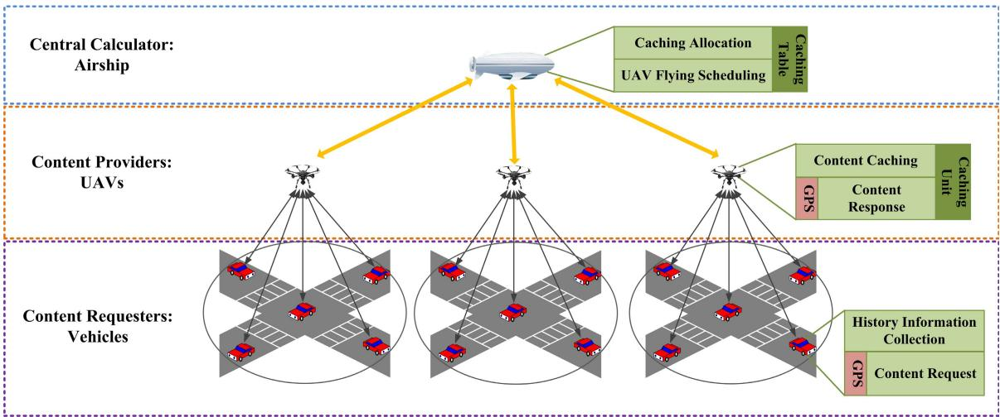  
Fig. 1. The three-layered vehicle caching architecture.

Moreover, there are some existing works applying Q-learning to improve caching schemes. In [29], Q-learning was resorted to perceive the request probability and the statistics of random arrival and departure of mobile users. However, Q-learning was utilized to finish the forecast of the request probability, rather than the core design for the caching scheme. In [30], for improving the effectiveness of caching, a low complexity ε-greedy Q-learning based content caching algorithm which obtained a near-optimal solution was proposed. In [31], the novel approach relied on a hyper-deep Q-network to learn the Q-function in an online fashion was proposed. In [32], the joint resources allocation problem was formulated as an optimization problem, where a DQN approach was used to solve it. In [33], a protocol which stored the data in VANET was proposed and considered long-term outcome by using a reinforcement learning algorithm. Nevertheless, these DQN-based caching methods are not in the context of air-assisted vehicle scenarios. As a consequence, some specific treatments cannot be utilized directly. Different from them, we deeply consider the special conditions in air-assisted vehicle scenarios. On one hand, to overcome the practical strict caching limitations that interrupt the accomplishment of caching actions, DQN is improved by integrating both depth search and breadth search when selecting caching actions. On the other hand, positive rewards are devised to accurately present an optimal caching state, thus to guarantee DQN remembering the good actions and obtaining the final caching policy.

## III. THE THREE-LAYERED VEHICULAR CACHING ARCHITECTURE

The proposed DAVC (Deep Q-learning based Air-assisted Vehicle Caching) architecture consists of three layers. As shown in Fig. 1, the bottom layer is constituted of vehicles, the medium layer is constituted of UAVs while the top layer is constituted by an airship. Each layer has its special responsibility, in which for each role (entity), we will describe its function in detail.

## A. Entities

1) UAVs: as the content providers, UAVs are in charge of providing the content response to the vehicle users (drivers and passengers). They are equipped with caching units. With the limited caching space, a UAV is suggested to cache the safety-related driving content with a high requested probability for the future demand, thus to improve the content response ratio and decrease response delay. For the interaction of the top-medium layer, on one hand, UAVs send the history content requests delivery to the airship; on the other hand, UAVs wait to receive the scheduling orders sent by the airship. For the interaction of the medium-bottom layer, on one hand, UAVs are in charge of receiving the delivered history content requests by vehicles; on the other hand, they are responsible for responding to the content requests of users. Suppose that each UAV takes charge of the content response for the vehicles in a specific region, and this UAV is called the resident UAV for the vehicles in this region.

2) Airship: as the central caching processor, the airship is in charge of making decisions for the caching content of UAVs. In addition, it is responsible for scheduling UAVs if user’s content requests cannot be responded with its resident UAV. Specifically, the airship analyzes the history content requests delivered by UAVs, and then obtains a UAV content caching policy according to DQN (see Section 5 for details). If the resident UAV cannot satisfy the content request within its responsible region, the airship schedules another UAV to respond. In this process, the GPS (Global Position System) information of both UAVs and vehicles are needed.

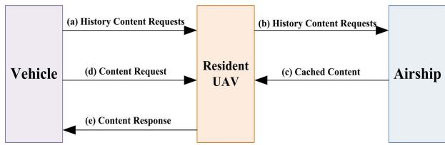  
Fig. 2. Content response via resident UAV.

3) Vehicles: as the content requesters, the main responsibility of vehicles is to collect and do the statistic of the history requests for safety-related driving content of themselves. Then, they deliver the information to the upper layer (their corresponding resident UAVs) periodically.

## B. Assumptions

The proposed architecture is based on three main assumptions, which are the necessary preconditions for the effective working and are described as follows: i) UAVs have a much more smoothly movement environment than vehicles, which makes UAVs have a much faster speed than vehicles. Besides, content requests of users are relatively sparse. Therefore, the scheduling of UAVs does not impact the content response in their original regions. ii) The coverage of UAVs is not overlapped. Moreover, we assume that UAVs can cover the whole range in the scenario, that is, the small space among the coverage circles are ignored. iii) To guarantee the fast content response for safe-related driving, scheduling orders of the airship are generated in advance by analyzing the collected history content requests.

## C. Workflow of Content Response

There are two working patterns in DAVC, one is the content response via resident UAV, and another is that via scheduling UAV. In the former one, the content response of vehicles can be completed by their resident UAVs; while in the latter one, the content response should be finished via other UAVs by scheduling.

The first pattern can be found in Fig. 2. First, vehicles collect the information about their history request for safety-related driving content, and deliver the information to their resident UAVs (a). Then, UAVs deliver the above information further to the airship (b). Next, according to the information, the airship makes content caching decisions and informs resident UAVs to cache the content (c). When the user generates a content request (d), if its resident UAV has the requested content, it will be responded to for this request (e). However, if the resident UAV does not have the requested content, the content response with be completed by scheduling UAVs as the second pattern.

In Fig. 3, first, the airship receives the collected history information and informs the UAV to cache the specific content (a, b and c) just like in Fig. 2. Next, the airship sends the scheduling order to some UAVs to make them be scheduled to the destination regions (d). When the user generates a content request (e) and its resident UAV does not have the requested content, the scheduling UAV will respond to this request (f).

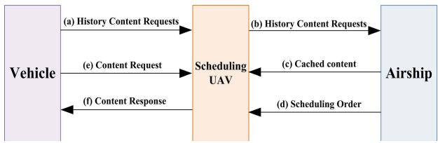  
Fig. 3. Content response via scheduling UAV.

TABLE I  
NOTATIONS
<table><tr><td>Symbol</td><td>Definition</td></tr><tr><td> $N _ { u }$ </td><td>The number of UAVs</td></tr><tr><td> $N _ { c }$ </td><td>The number of different content</td></tr><tr><td> $L _ { i }$ </td><td>The caching upper limit of  $U A V _ { i }$ </td></tr><tr><td> $A _ { i }$ </td><td>The amount of caching content of  $U A V _ { i }$ </td></tr><tr><td> $\theta$ </td><td>Size of each piece of content</td></tr><tr><td> $H _ { i }$ </td><td>The occupied caching space of U AVi</td></tr><tr><td> $R _ { i j }$ </td><td>The number of history receiving requests</td></tr><tr><td> $R _ { i }$ </td><td>of UAVi for content cj Total number of history receiving</td></tr><tr><td> $P _ { i j }$ </td><td>requests of  $U A V _ { i }$  The content request probabilities of  $U A V _ { i }$  for cj</td></tr><tr><td> $S _ { i }$ </td><td>The scheduling probability of  $U A V _ { i }$ </td></tr><tr><td> $S T _ { i }$ </td><td>The scheduled times by the airship of  $U A V _ { i }$ </td></tr><tr><td> $\mathbf { R } _ { i }$ </td><td>The set of requests of  $\dot { U } A V _ { i }$  that  $\stackrel { \star } { U } A V _ { i }$ </td></tr><tr><td></td><td>does not cache the requested content</td></tr><tr><td> $r _ { k j }$   $U \dot { A } V _ { r k }$ </td><td>The request that vehicle  $V _ { k }$  asked for content  $c _ { j }$  The resident UAV of  $V _ { k }$ </td></tr><tr><td> $\mathbf { C } _ { i }$ </td><td>The set of the caching content of  $U A V _ { i }$ </td></tr><tr><td> $N c _ { j }$ </td><td>The number of copies of in all UAVs</td></tr><tr><td> $S T _ { t - t h }$ </td><td> $c _ { j }$ </td></tr><tr><td> $s t _ { t } ( i , j )$ </td><td>The caching state in t-th training step The element of  $S T _ { t - t h }$  corresponding to the</td></tr><tr><td></td><td>caching state of  $c _ { j }$  by  $U A V _ { i }$ </td></tr><tr><td> $\boldsymbol { a } _ { i j }$ </td><td>The caching action of caching  $c _ { j }$  in  $U A V _ { i }$ </td></tr><tr><td> $r \bar { w } ( S T _ { t - t h } , a _ { i j } )$ </td><td>The received reward when</td></tr><tr><td> $r w _ { t , i j } ^ { \prime }$ </td><td>action  $\boldsymbol { a } _ { i j }$  is taken on state  $S T _ { t - t h }$  The positive reward when is be taken</td></tr><tr><td></td><td> $\boldsymbol { a } _ { i j }$  on state STt−th</td></tr></table>

In addition, the critical information in a content request mainly contains: the content identification, the requester identification, its belonging area and the timestamp.

## IV. OPTIMAL OBJECTIVES AND MATHEMATICAL MODEL

Table I lists the frequently used notations in this article. To satisfy the content demands for safety-related driving content of vehicle users, DAVC should increase the content response ratio of users. Besides, considering the limited power of UAVs, their scheduling times should be low, thus can decrease their charging demands. Due to the fact that caching spaces of UAVs are limited, DAVC should consider such restricted conditions when deciding the caching assignment. Moreover, due to the large variety of the requested contents, UAVs cannot cache all the content at the same time (assuming that the total content size is bigger than the total UAV caching space). To cache more varieties of content in the limited caching space, we regulate that one content can only be cached in one UAV, thus to guarantee the content diversity. In fact, the demands of safety-related driving content are highly associated with the geographical locations because the content of an area is only needed when vehicles are drove there. Therefore, it is more reasonable to cache content related to different areas at the corresponding resident UAVs. Overall, the optimal objectives of the proposed caching scheme are, with the limited caching spaces of UAVs and no content redundant, to maximize the content request probabilities and minimize the power consumption of UAVs.

Let $N _ { u }$ represent the number of UAVs, and $N _ { c }$ represent the number of different content, that is, the variety of content. For $U A V _ { i } ,$ let $L _ { i }$ represent its caching upper limit, and $A _ { i }$ represent the amount of its caching content. Here, we assume that each content has the same size and denote the size as $\theta .$ Therefore, we can calculate the occupied caching space of $U A V _ { i }$ , which is represented as $H _ { i }$ as follows

$$
H _ { i } = \theta \cdot A _ { i }\tag{1}
$$

To maximize the future content request probabilities for all vehicle users, we define the request probability of each UAV for each content.

Definition 1 (content request probability): The content request probability of a UAV for a content is the ratio of the number of its history receiving requests for this content to the total history receiving requests for all UAVs of all content.

Let $R _ { i j }$ represent the number of history requests of $U A V _ { i }$ for content $c _ { j }$ , and $R _ { i }$ represent the total number of history receiving requests of $U A V _ { i }$ . Let $P _ { i j }$ represent the content request probabilities of U AVi for $c _ { j }$ , then we have

$$
P _ { i j } = \frac { R _ { i j } } { \sum _ { i = 1 } ^ { N _ { u } } R _ { i } }\tag{2}
$$

As described above, contents in DAVC are not cached redundantly, that is to say, for each content, there is only one copy in all UAVs. Moreover, if a user’s content request cannot be responded by its resident UAV, another UAV with the requested content should be scheduled to fly to respond. Based on this, we propose the following definition, i.e., the scheduling probability of a UAV.

Definition 2 (scheduling probability): The scheduling probability of a UAV is the ratio of its scheduled times by the airship to the total scheduled times of all UAVs. Let $S _ { i }$ represent the scheduling probability of $U A V _ { i } , S T _ { i }$ represent its scheduled times by the airship, and we have

$$
S _ { i } = \mu \cdot \frac { S T _ { i } } { \sum _ { i = 1 } ^ { N _ { u } } S T _ { i } }\tag{3}
$$

Here, $\mu$ is the coefficient to adjust $S _ { i } \mathrm { \ ' } _ { \mathrm { s } }$ value range, thus to restrict the similar value ranges of $P _ { i j }$ and $S _ { i }$ for the positive reward calculation (refer to Eq. (13) in section 5.1.2).

Furthermore, based on the above description, we have concluded that the scheduling process is needed when a vehicle generates a content request but its resident UAV does not cache the requested content. Let $\mathbf { R } _ { i }$ represent the set of such kind of requests of $U A V _ { i } , r _ { k j }$ represent the request that vehicle $V _ { k }$ asked for content $c _ { j } , U A V _ { r k }$ represent the resident UAV of $V _ { k } .$ $\mathbf { C } _ { i }$ represent the set of the caching content of $U A V _ { i }$ , and we have

$$
\mathbf { R } _ { i } = \left\{ r _ { k j } \bigg | c _ { j } \notin \mathbf { C } _ { r k } \land c _ { j } \in \mathbf { C } _ { i } \right\}\tag{4}
$$

Thus we have

$$
S T _ { i } = \left| \mathbf { R } _ { i } \right|\tag{5}
$$

Based on the above assumptions and definitions, we model the following optimal objectives:

$$
m a x \sum _ { i = 1 } ^ { N _ { u } } \sum _ { j = 1 } ^ { N _ { c } } { P _ { i j } }\tag{6}
$$

$$
m i n \sum _ { i = 1 } ^ { N _ { u } } S _ { i }\tag{7}
$$

$$
s . t . \forall i \leq N _ { u } , H _ { i } \leq L _ { i }\tag{8}
$$

$$
\forall j , \quad N c _ { j } \leq 1\tag{9}
$$

Here, $N c _ { j }$ is the number of copies of $c _ { j }$ in all UAVs.

These equations are explained as follows: Eq. (6) means that when the content request probability of all UAVs for the cached content is high, the successful response probability for this content is high. Eq. (7) means that when the scheduling probability of all UAVs is low, the energy consumption of all UAVs is low. Eq. (8) represents that the total size of the cached content in each UAV should be lower than the upper limit of its caching space. Eq. (9) indicates that there is no redundant cache i.e., there is only one copy for each content in all UAVs.

## V. DQN BASED CACHING PLACEMENT ALGORITHM

Based on the optimal objectives and mathematical model, in this section, the DQN based caching placement algorithm is proposed.

In DQN, a convolutional neural network is trained with a variant of the Q-learning algorithm, with stochastic gradient descent to update the weights. Meanwhile, an experience replay mechanism which randomly samples previous transitions is used, and thereby smooths the training distribution over many past behaviors [34]. The core of DQN is a Q-value updating based function. Therefore, the reward matrix should be given at first to support the updating process. Besides, DQN should be adjusted to support the above multi-objective problem. Moreover, due to the fact that there are some subjective conditions in DAVC, these conditions should also be reflected in DQN. In this section, we firstly introduce some adaptive actions when leveraging DQN, and then the pseudo-code of DAVC is presented.

## A. Adaptive Actions of DQN

1) State Update: To simplify the updating process of DQN, we use the following reward function to replace the traditional reward matrix. Let $S T _ { t - t h }$ represent the caching state at the t-th step, and $S T _ { t - t h }$ is an $N _ { u } \ \times \ N _ { c }$ matrix. Let $s t _ { t } ( i , j )$ represent the element of $S T _ { t - t h }$ corresponding to the caching state of $c _ { j }$ by $U A V _ { i }$ , then we have

$$
s t _ { t } ( i , j ) = { \left\{ \begin{array} { l l } { 1 , } & { U A V _ { i } { \mathrm { ~ h a s ~ c a c h e d ~ } } c _ { j } } \\ { 0 , } & { { \mathrm { o t h e r w i s e } } } \end{array} \right. }\tag{10}
$$

Let $a _ { i j }$ represent the caching action that $c _ { j }$ is cached by $U A V _ { i }$ , and we can observe that when an action $a _ { i j }$ is be taken at one caching state, the corresponding $s t _ { t } ( i , j )$ will be set as 1.

For example, if

$$
S T _ { t } = { \left[ \begin{array} { l } { 1 \mathrm { ~ 0 ~ 0 ~ } } \\ { 0 \mathrm { ~ 0 ~ 1 ~ } } \end{array} \right] }
$$

$$
a _ { i j } \ ( i = 1 , j = 2 ) , S T _ { t }
$$

$$
S T _ { t } ^ { \prime } = { \left[ \begin{array} { l l } { 1 } & { 1 } \\ { 0 } & { 0 } & { 1 } \end{array} \right] }
$$

2) Reward Calculation: Let rw $( S T _ { t - t h } , a _ { i j } )$ represent the received reward when action $a _ { i j }$ is taken at state $S T _ { t - t h }$ . Then, the reward function is calculated as follows

$$
\begin{array} { r l } & { r w ( S T _ { t - t h } , a _ { i j } ) } \\ & { = \left\{ r w _ { t , i j } ^ { \prime } , H _ { i } \leq ( L _ { i } - \theta ) \bigwedge \forall k \leq N _ { u } , s t _ { t } ( k , j ) \neq 1 \right. } \\ & { \left. - \delta , H _ { i } > ( L _ { i } - \theta ) \bigvee \exists k \leq N _ { u } , s t _ { t } ( k , j ) = 1 \right. } \end{array}\tag{11}
$$

Here, ${ r w _ { t , i j } ^ { \prime } }$ is the positive reward when $a _ { i j }$ is taken at state $S T _ { t - t h } ,$ and −δ is the negative reward if $a _ { i j }$ will trigger the insufficient caching space at $U A V _ { i }$ (corresponding to Eq. (8)) or content redundant of $c _ { j }$ (corresponding to Eq. (9)). More specifically, if the reserve caching space is insufficient, or another UAV has already cached the content, then the negative reward is δ. Otherwise, the value is the positive reward as $r w _ { t , i j } ^ { \prime } .$

To reflect the multi-objective of DAVC, ${ r w _ { t , i j } ^ { \prime } }$ is calculated by balancing the two aspects (corresponding to Eqs. (6) and (7)). Specifically, let $r w _ { t , i j } ^ { \prime } ( + )$ represent the objective corresponding to Eq. (6), and $r w _ { t , i j } ^ { \prime } ( - )$ represent the objective corresponding to Eq. (7). Then, $r w _ { t , i j } ^ { \prime }$ is calculated as follows

$$
{ r w _ { t , i j } ^ { \prime } = \alpha \cdot r w _ { t , i j } ^ { \prime } ( + ) + ( 1 - \alpha ) r w _ { t , i j } ^ { \prime } ( - ) }\tag{12}
$$

Here, $r w _ { t , i j } ^ { \prime } ( + )$ is equal to the content request probabilities of $U A V _ { i }$ for $c _ { j }$ , and $r w _ { t , i j } ^ { \prime } ( - )$ is equal to the scheduling probability of $U A V _ { i }$ , and we have

$$
\begin{array} { r } { r w _ { t , i j } ^ { \prime } = \alpha \cdot P _ { i j } + ( 1 - \alpha ) S _ { i } } \end{array}\tag{13}
$$

Next, we take a simple example to explain how to obtain the reward value corresponding to a specific action at a specific state. Assume that $N _ { u } = 2 , N _ { c } = 3 , i = 1 , - \delta = - 1 , j = 2$ $L _ { i } = 2 $ , and $\theta = 1$ . If

$$
S T _ { t } = { \left[ \begin{array} { l } { 1 \mathrm { ~ 0 ~ 1 } } \\ { 0 \mathrm { ~ 0 ~ 0 } } \end{array} \right] }
$$

where we can observe that $H _ { 1 } = 2$ and $L _ { i } - \theta = 1$ , thus $H _ { i } > ( L _ { i } - \theta )$ . As a consequence, $r w ( S T _ { t - t h } , a _ { 1 2 } ) = - 1$ . If

$$
S T _ { t } = { \left[ \begin{array} { l } { 1 \mathrm { ~ 0 ~ 0 ~ } } \\ { 0 \mathrm { ~ 1 ~ 0 ~ } } \end{array} \right] }
$$

where we can observe that $\begin{array} { r l r } { s t _ { t } ( 2 , 2 ) } & { { } = } & { 1 . } \end{array}$ Thus, $r w ( S T _ { t - t h } , a _ { 1 2 } ) = - 1$

Assume that $P _ { 1 2 } = 0 . 8 , S _ { i } = 0 . 3 ,$ and $a = 0 . 5 . \ \mathrm { I f }$

$$
S T _ { t } = { \left[ \begin{array} { l } { 1 \mathrm { ~ 0 ~ 0 ~ } } \\ { 0 \mathrm { ~ 0 ~ 1 ~ } } \end{array} \right] }
$$

then

$$
r w ( S T _ { t } , a _ { 1 2 } ) = 0 . 5 \times 0 . 8 + ( 1 - 0 . 5 ) \times 0 . 3 = 0 . 5 5 .
$$

Algorithm 1 DAVC Caching   
Input: History content requests and scheduling information,   
$N _ { c } , N _ { u } , a , L _ { i } ,$ number of iterations T, exploring rate ε,   
parameters of Q-network w and other necessary parameters   
used in Q-network updating.   
Output: content caching policy.   
01: for $i = 1$ to $N _ { u }$   
02: for $j = 1$ to $N _ { c }$   
03: Calculate $P _ { i j }$ by Eq. $( 2 ) ;$   
04: end for   
05: Calculate $S _ { i }$ by Eq. (3);   
06: end for   
07: Initialize all w randomly;   
08: Set $S T _ { t - t h } = 0$ as the first state with uniform processing,   
is-end=false, and $S T _ { b e s t } = S T _ { t - t h } ;$   
09: for $t = 1$ to $T$   
10: while is-end==false   
11: Obtain all Q-values based on Q-network;   
12: Select one action $a _ { i j }$ based on ε-greedy;   
13: Take the action $a _ { i j }$ and get new state $S T _ { ( t + 1 ) - t h }$   
according to $S T _ { t - t h } ^ { ^ { \prime } }$ and $a _ { i j } ;$   
14: Calculate $\bar { r } w ( S T _ { t - t h } , a _ { i j } )$ by Eq. (11);   
15: Judge whether $S T _ { ( t + 1 ) - t h }$ is the end state by Eq. (14);   
16: if $S T _ { ( t + 1 ) - t h }$ is the end state   
17: is-end=true;   
18: else   
19: is-end=false;   
20: end if   
21: Put $( S T _ { t - t h } , a _ { i j } , r w ( S T _ { t - t h } , a _ { i j } ) , S T _ { ( t + 1 ) - t h } ,$ is-end) into   
experience replay set;   
22: $S T _ { t - t h } ^ { - } = S T _ { ( t + 1 ) - t h } ;$   
23: Do the experience replay and gradient descent to update w   
as in [34];   
24: if $S T _ { t - t h } > S T _ { b e s t }$   
25: $S T _ { b e s t } = S T _ { t - t h } ;$   
26: end if   
27: end while   
28: end for   
29: Return $S T _ { b e s t } ;$

3) End State: Finally, the end state of DAVC is described as follows: if all the content has been cached or all the caching spaces of UAVs are up to their limitations, the current state is an end state. Mathematically, for a state $S T _ { t - t h }$ , to judge whether it is the end state, the following condition should be considered

$$
\forall j , \exists i , s t _ { t } ( i , j ) \neq 0 \sqrt { \forall i , \theta \cdot \sum _ { j = 1 } ^ { N _ { c } } s t _ { t } ( i , j ) \geq L _ { i } }\tag{14}
$$

If the above condition is true, then the current state is an end state, and the current episode ends; otherwise, it continues to the next episode.

## B. The Proposed Caching Algorithm

In DAVC, first, based on the history requests for safety-related driving content of vehicle users and the history scheduling information, the content request probabilities of $U A V _ { i }$ for $c _ { j }$ (Eq. (2)) and the scheduling probability of $U A V _ { i }$ (Eq. (3)) can be calculated. Next, $S T _ { t - t h } = 0$ is set as the first state, which means any content caching has happened yet, and then we perform DQN according to the reward calculation by Eq. (11). In each step, the algorithm should judge whether the current step meets the end state condition according to Eq. (14). Finally, with the well-trained parameters of Q-network, we can obtain the final optimal content caching scheme. Some processing of DQN, e.g., experience replay and gradient descent in the parameter updating of Q-network, are not be introduced specifically, and more detailed information can be referred to [34]. The pseudo-code of the DAVC caching algorithm is outlined in Algorithm 1. By evaluating the reward for each caching action, Algorithm 1 can gradually avoid the action with negative reward and select the action with a positive reward. After times of rounds of training, it can obtain the optimal caching policy with a general high reward.

In Algorithm 1, lines 1-6 shows the calculations of the content request probabilities of each UAV for each content and the scheduling probability of each UAV. Lines 7-29 are the parameters training process of DQN and get the final caching scheme based on the trained DQN parameters.

## VI. SIMULATION AND EVALUATIONS

## A. Simulation Setup

1) Simulator and Benchmarks: We develop a Java test platform to process our simulation for DAVC, and all the operations related to the neural network within DQN are tested on the basis of Tensorflow. In the evaluations, we employ the map based on a part of the main streets in Shenyang city, China, in which the map data is input to the platform based on OpenJump. We compare DAVC to five different caching strategies, which are introduced as follows.

When choosing the benchmark, in [35], the system model was investigated of multi-user multi-UAV networks, which is same as the working scenario of DAVC. Besides, [35] designed caching placement at UAVs by taking into account some transmission schemes, while the main work of DAVC is also the content caching scheme. Therefore, we select the caching scheme of [35] as the first benchmark. In [35], the probabilistic caching strategy was applied to the content cache placement, and optimized the cache placement to maximize the system performance. In the probabilistic model, the contents were independently placed in the cache memories of different UAVs, according to the different probabilities. Following Zipf [36] distribution, the request probability of each popular content could be given. The second and third caching strategies are also the comparison strategies mentioned in [35].

The second benchmark is the caching policy that caches the most popular content in all UAVs, which is called MPC1 for short. The third benchmark is the one that caches the content with equal probability, which is called EPC for short. Specially, EPC is improved without redundant content caching. The last counterpart is the improved method based on MPC1, which is named MPC2 for short. Different from MPC1, MPC2 cached the most locally popular content in each UAV. Finally, the last benchmark is the one we devised to overcome the optimal selection handling in DAVC (see section 6.2 for details), which is called Random Best Reward (RBR). RBR obeys the basic content selection rules of DAVC, that is, caching content without redundancy. Besides, it randomly chooses a content placement in one episode. By comparing to the history content placement policy with the best total rewards in each episode, the final policy with the best total rewards can be found in RBR. Moreover, considering the justice between DAVC and RBR, they are run with the same time.

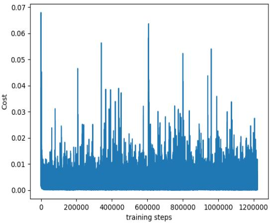  
Fig. 4. One of the cost functions of DAVC training.

2) Comparison Metrics: In our evaluations, we use four performance metrics, including Content Hit Probability (CHP), Average Time Spent (ATS), Being scheduling probability (BSP), and Packet Buffering Time (PBT). The definitions of these metrics are introduced as follows

CHP is defined as the ratio of the number of the content response received by all vehicles to the number of the generated content requests by all vehicles.

BSP is the ratio of the number of the scheduled times of all UAVs to the number of the generated content requests by all vehicles.

ATS represents the value of the system time spent (including scheduling time, transmission time and queueing time) for all content requests divided by the number of the generated content requests by all vehicles.

PBT represents the ratio of the experienced carried time of all packets (including content requests packets and content response packets) by the number of all created packets. It can measure the processing efficiency of a caching scheme. For a caching scheme, the shorter PBT it has, the more efficient its processing policy.

Among these four metrics, BSP and PBT are leveraged to measure the scheduling probability of UAVs and the duration of their buffering time for the content requests. Although these two metrics are not widely leveraged, they can effectively measure the UAV power consumption (by the statistic scheduling times) and the UAV processing efficiency for response content requests (by the statistic buffering time).

3) Parameter Settings: The adopted values of the parameters are listed in Table II. DAVC works in an urban scenario, therefore, the speed of vehicles is set as average 30km/h. ε and the learning rate is set by considering [37]. α is set based on the best performance when simulations have been done. μ is set by analyzing the value ranges of $P _ { i j }$ and Si . δ is set by analyzing the value ranges of rewards.

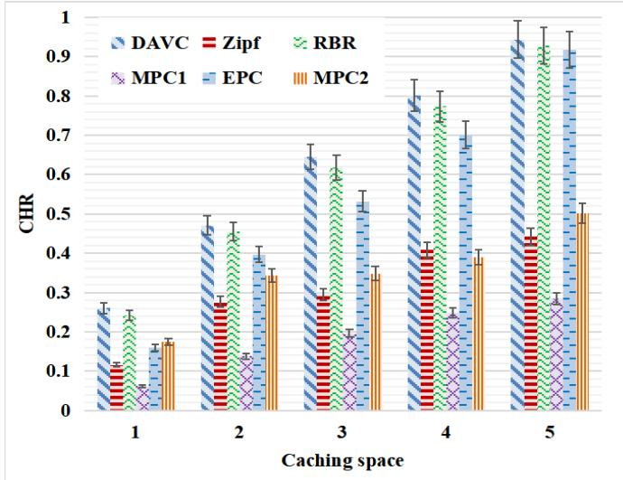  
(a) CHR  
Fig. 5. CHR and BSP of DAVC under varying caching space of UAVs.

TABLE II  
PARAMETER SETTINGS
<table><tr><td>Parameter</td><td>Value</td></tr><tr><td>Learn rate in DQN</td><td>0.01</td></tr><tr><td>α</td><td>0.9</td></tr><tr><td>Moving speed of UAVs</td><td>60km/h</td></tr><tr><td>ε</td><td>0.9</td></tr><tr><td> $T$  Moving speed of vehicles</td><td> $1 0 ^ { 5 }$ </td></tr><tr><td>θ</td><td>30km/h 5M</td></tr><tr><td>Data transmission speed Coverage radius of UAVs</td><td>10Mbps 500m</td></tr><tr><td> $N _ { u }$ </td><td>6</td></tr><tr><td> $N _ { c }$ </td><td>30</td></tr><tr><td>Geographical range</td><td></td></tr><tr><td> $L _ { i }$ </td><td>[3×4]km</td></tr><tr><td></td><td>5 (number of content)</td></tr><tr><td> $\delta$ </td><td>0.01</td></tr><tr><td> $\mu$ </td><td>100</td></tr></table>

## B. Simulation About DQN

According to [37] we know that DQN has a bad convergence. Therefore, as one of the cost functions of DAVC training shown in Fig. 4, DAVC also has a bad convergence. To overcome such circumstances, the final content caching policy is selected with the optimal policy with the highest total rewards. According to the simulation result, almost all the best policies are obtained at the top 20% of the training time, and this can prove the training effectiveness. Besides, to more efficiently manage the replay memories in DQN, we adopt PRB (Prioritized Replay Buffer) [38] in DAVC. In the experience pool of traditional DQN, the training data is selected randomly without priority. However, samples in the experience pool have different training values. To improve such issues, PRB assigned a priority for each sample, sampling according to these priorities.

## C. Comparisons With Benchmarks

The CRP, ATS, BSP and PBT of DAVC, RBR, Zipf, MPC1, MPC2 and EPC under different content caching sizes of UAVs are shown in Fig. 5 and Fig. 6. We analyze each metric of the six caching methods as follows.

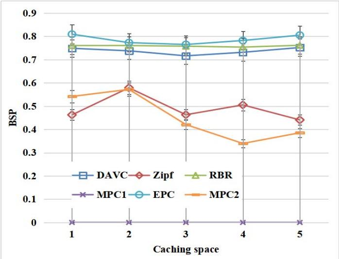  
(b) BSP

1) CHP: from Fig. 5(a), we can observe that DAVC has the highest CHP over all other methods. It is because that DAVC analyzes the history content requests by Algorithm1, and obtains the optimal content caching policy with considering both request probability and scheduling probability. However, Zipf, MPC1, and MPC2 only take the request probability into consideration. When comparing MPC1, MPC2 and Zipf with DAVC, EPC and RBR, we can observe that the former three methods have worse performance than the latter three ones. The reason is that the latter three methods are all without redundant content caching, while the former three are with redundant content caching at different levels. In MPC1, all UAVs cache the same highest requested content, leading to its highest caching redundant among all the comparison policies. In MPC2 and Zipf, UAVs cache several same content if they choose the same popular content, and thus making their caching partly redundant. Such redundance reduces the caching variety of content. More specially, when there is one content caching space of UAVs, MPC2 presents better CHP than EPC, because it caches the most locally popular content in each UAV and the one caching space situation weakens the content variety between these two methods.

When comparing DAVC, RBR and EPC, DAVC achieves the highest CHP, followed by RBR and EPC. Since EPC is an equal caching policy without redundant content caching, its CHP cannot defeat DAVC and RBR, which have considered the designed caching reward. Although RBR considers both the content popularity of content and scheduling probability of UAVs, it cannot adjust its caching policy based on the history caching experience. However, by training the parameters of the neural network in Algorithm1, DAVC can select the action with a good history reward, and avoid selecting the action obtaining the punishment.

2) BSP: in Fig. 5(b), EPC obtains the highest BSP, followed by RBR, DAVC, Zipf, MPC2 and MPC1. Among them, due to the fact that all UAVs employ the same content caching policy in MPC1, MPC1 does not have any scheduling. In other words, high redundant content caching always brings low BSP. Therefore, Zipf and MPC2 exhibit lower BSP than DAVC, RBR and EPC. However, when comparing DAVC with RBR and EPC, since DAVC and RBR have considered the history scheduling probability, they achieve lower BSP than EPC. Besides, DAVC has lower BSP than RBR due to the utilization of the reinforcement learning method, thus to select a more optimal caching policy for UAVs.

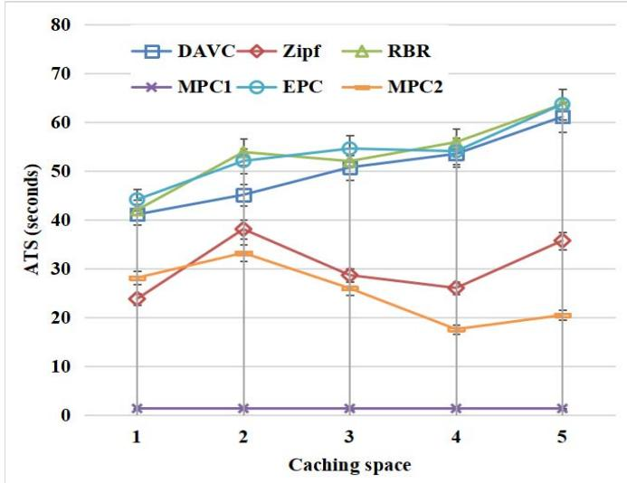  
(a) ATS  
Fig. 6. ATS and PBT of DAVC under varying caching space of UAVs.

3) ATS: From the definition of ATS we know that it has three parts, which are the scheduling time, the transmission time and the queueing time. Among these three periods of time, the scheduling time is its main part because the transmission time is relatively low since the high transmission speed, while content requests of users are relatively sparse. Therefore, ATS of our content caching policy is mainly influenced by BSP. For BSP, its high value always brings long ATS for the system because the scheduled flying duration of all UAVs becomes long when their total scheduling times increase, and therefore impact the ATS to get high. From Fig. 6(a), we can observe that DAVC, EPC and RBR have higher ATS than the other three methods with the similar reason discussed in BSP.

4) PBT: From Fig. 6(b), we can observe that MPC1 has the longest PBT, followed by Zipf, MPC2, EPC, RBR and DAVC. As described above, PBT is a metric that measures the processing efficiency for both content requests and responses. If most of the generated content requests cannot be responded in time, they will be carried by until their life time is ended. Therefore, the low CHP always brings high PBT, and DAVC has the lowest PBT because of its highest CHP. Therefore, it can process the generated packets with high efficiency, and thus guarantee enough buffer space and reduce packet loss.

## VII. CONCLUSION AND FUTURE WORK

To satisfy the content demand for safety-related driving of vehicle users, in this article, we propose a DQN based vehicle caching scheme. In the proposed scheme, UAVs and an airship are used to enhance the content response performance against the limited UAV caching spaces and power energy. Then, a three-layered caching architecture is presented, in which the workflow of the response for safety-related driving content of UAVs in two different scenarios are described. After the description of the workflow, the optimal objectives as well as the limited conditions are mathematically modeled, and DQN is leveraged to solve this optimization problem. Next, with the necessary adaptive adjustment of DQN, the DAVC algorithm is devised. Finally, experiments are performed based on a real map with the generated vehicle moving traces.

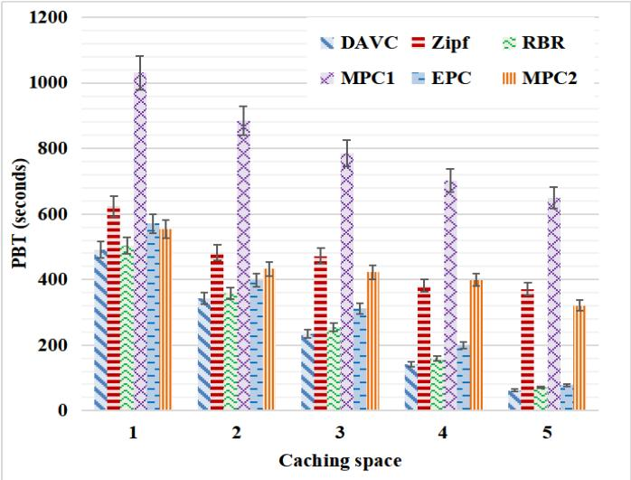  
(b) PBT

There are still some open issues should be conducted. On one hand, in general, the size of high-precision driving safety-related content is relatively huge. When the variety of demand content increases to a significantly large number, DAVC will face a huge challenge. A possible solution is to resolve the demanded content into some segments and optimize the content placement for UAVs by their joint caching. In such a solution, the same segment can be cached only once in all UAVs without redundant, thus further improving the utilization of the caching spaces of UAVs.

On the other hand, as discussed above, FANET cannot guarantee real-time data transmission due to the link interruption. However, depending on FANET, vehicle caching can reduce the scheduling of UAVs compared to the central mode. Therefore, it is meaningful to introduce FANET into DAVC, which is an integration of caching and routing. In this integrated architecture, if resident UAVs cannot response the content demand, content respond system should decide the corresponding actions, that is, to select report the circumstance to the airship and ask for other UAVs for scheduling, or ask for other UAVs to obtain the demand content via hop-by-hop transmission. One of our next works is to design such new caching architecture.

## REFERENCES

[1] Accessed: Apr. 16, 2020. [Online]. Available: http://www.caranddriver. com/news/a32159871/tesla-robo-taxis-still-coming-2020/

[2] CISCO, “Cisco visual networking index: Global mobile data traffic forecast update 2017–2022,” San Jose, CA, USA, White Paper, 2019.

[3] L. Zhao, A. Al-Dubai, A. Y. Zomaya, G. Min, A. Hawbani, and J. Li, “Routing schemes in software-defined vehicular networks: Design, open issues and challenges,” IEEE Intell. Transp. Syst. Mag., early access, Mar. 2020.

[4] N. Kumar, R. Iqbal, S. Misra, and J. J. P. C. Rodrigues, “An intelligent approach for building a secure decentralized public key infrastructure in VANET,” J. Comput. Syst. Sci., vol. 81, no. 6, pp. 1042–1058, Sep. 2015.

[5] N. Kumar, R. Iqbal, S. Misra, and J. J. P. C. Rodrigues, “Bayesian coalition game for contention-aware reliable data forwarding in vehicular mobile cloud,” Future Gener. Comput. Syst., vol. 48, pp. 60–72, Jul. 2015.

[6] C. Wu, S. Ohzahata, Y. Ji, and T. Kato, “Joint fuzzy relays and Network-Coding-Based forwarding for multihop broadcasting in VANETs,” IEEE Trans. Intell. Transp. Syst., vol. 16, no. 3, pp. 1415–1427, Jun. 2015.

[7] Y. Ma, Y. Wu, J. Li, and J. Ge, “APCN: A scalable architecture for balancing accountability and privacy in large-scale content-based networks,” Inf. Sci., vol. 527, pp. 511–532, Jul. 2020.

[8] A. Hawbani, E. Torbosh, W. Xingfu, P. Sincak, L. Zhao, and A. Y. Al-Dubai, “Fuzzy based distributed protocol for vehicle to vehicle communication,” IEEE Trans. Fuzzy Syst., early access, Dec. 3, 2019, doi: 10.1109/TFUZZ.2019.2957254.

[9] C. Zhou, Y. Gu, S. He, and Z. Shi, “A robust and efficient algorithm for coprime array adaptive beamforming,” IEEE Trans. Veh. Technol., vol. 67, no. 2, pp. 1099–1112, Feb. 2018.

[10] C. Zhou, Y. Gu, Z. Shi, and Y. D. Zhang, “Off-grid direction-of-arrival estimation using coprime array interpolation,” IEEE Signal Process. Lett., vol. 25, no. 11, pp. 1710–1714, Nov. 2018.

[11] C. Zhou, Y. Gu, X. Fan, Z. Shi, G. Mao, and Y. D. Zhang, “Directionof-arrival estimation for coprime array via virtual array interpolation,” IEEE Trans. Signal Process., vol. 66, no. 22, pp. 5956–5971, Nov. 2018.

[12] J. Wu, L. Zou, L. Zhao, A. Al-Dubai, L. Mackenzie, and G. Min, “A multi-UAV clustering strategy for reducing insecure communication range,” Comput. Netw., vol. 158, pp. 132–142, Jul. 2019.

[13] N. Zhao et al., “Caching unmanned aerial vehicle-enabled small-cell networks: Employing energy-efficient methods that store and retrieve popular content,” IEEE Veh. Technol. Mag., vol. 14, no. 1, pp. 71–79, Mar. 2019.

[14] W. Zafar and B. Muhammad Khan, “Flying ad-hoc networks: Technological and social implications,” IEEE Technol. Soc. Mag., vol. 35, no. 2, pp. 67–74, Jun. 2016.

[15] J. Jiang and G. Han, “Routing protocols for unmanned aerial vehicles,” IEEE Commun. Mag., vol. 56, no. 1, pp. 58–63, Jan. 2018.

[16] Y. Zuo, Y. Wu, G. Min, and L. Cui, “Learning-based network path planning for traffic engineering,” Future Gener. Comput. Syst., vol. 92, pp. 59–67, Mar. 2019.

[17] C. Wu, S. Ohzahata, and T. Kato, “Flexible, portable, and practicable solution for routing in VANETs: A fuzzy constraint Q-Learning approach,” IEEE Trans. Veh. Technol., vol. 62, no. 9, pp. 4251–4263, Nov. 2013.

[18] V. Mnih et al., “Playing atari with deep reinforcement learning,” 2013, arXiv:1312.5602. [Online]. Available: http://arxiv.org/abs/1312.5602

[19] B. Hu, L. Fang, X. Cheng, and L. Yang, “In-vehicle caching (IV-Cache) via dynamic distributed storage relay (D2SR) in vehicular networks,” IEEE Trans. Veh. Technol., vol. 68, no. 1, pp. 843–855, Jan. 2019.

[20] O. Kaiwartya and S. Kumar, “Enhanced caching for geocast routing in vehicular ad hoc network,” in International Conference on Advanced Computing, Networking, and Informatics. New Delhi, India: Springer, 2014, pp. 213–220.

[21] J. Ma, J. Wang, G. Liu, and P. Fan, “Low latency caching placement policy for cloud-based VANET with both vehicle caches and RSU caches,” in Proc. IEEE Globecom Workshops (GC Wkshps), Singapore, Dec. 2017, pp. 1–6.

[22] K. Zhang, S. Leng, Y. He, S. Maharjan, and Y. Zhang, “Cooperative content caching in 5G networks with mobile edge computing,” IEEE Wireless Commun., vol. 25, no. 3, pp. 80–87, Jun. 2018.

[23] L. T. Tan, R. Q. Hu, and L. Hanzo, “Twin-timescale artificial intelligence aided mobility-aware edge caching and computing in vehicular networks,” IEEE Trans. Veh. Technol., vol. 68, no. 4, pp. 3086–3099, Apr. 2019.

[24] S. Zhang, W. Quan, J. Li, W. Shi, P. Yang, and X. Shen, “Air-ground integrated vehicular network slicing with content pushing and caching,” IEEE J. Sel. Areas Commun., vol. 36, no. 9, pp. 2114–2127, Sep. 2018.

[25] H. Wu, J. Chen, F. Lyu, L. Wang, and X. Shen, “Joint caching and trajectory design for cache-enabled UAV in vehicular networks,” in Proc. 11th Int. Conf. Wireless Commun. Signal Process. (WCSP), Xi’an, China, Oct. 2019, pp. 1–6.

[26] X. Xu, Y. Zeng, Y. L. Guan, and R. Zhang, “Overcoming endurance issue: UAV-enabled communications with proactive caching,” IEEE J. Sel. Areas Commun., vol. 36, no. 6, pp. 1231–1244, Jun. 2018.

[27] F. Cheng, G. Gui, N. Zhao, Y. Chen, J. Tang, and H. Sari, “UAV-relayingassisted secure transmission with caching,” IEEE Trans. Commun., vol. 67, no. 5, pp. 3140–3153, May 2019.

[28] M. Chen, W. Saad, and C. Yin, “Liquid state machine learning for resource allocation in a network of cache-enabled LTE-U UAVs,” in Proc. IEEE Global Commun. Conf. (GLOBECOM), Singapore, Dec. 2017, pp. 1–6.

[29] K. Guo, C. Yang, and T. Liu, “Caching in base station with recommendation via Q-learning,” in Proc. IEEE Wireless Commun. Netw. Conf. (WCNC), San Francisco, CA, USA, Mar. 2017, pp. 1–6.

[30] Z. Yang, Y. Liu, and Y. Chen, “Q-learning for content placement in wireless cooperative caching,” in Proc. IEEE Global Commun. Conf. (GLOBECOM), Abu Dhabi, United Arab Emirates, Dec. 2018, pp. 1–6.

[31] A. Sadeghi, G. Wang, and G. B. Giannakis, “Deep reinforcement learning for adaptive caching in hierarchical content delivery networks,” IEEE Trans. Cognit. Commun. Netw., vol. 5, no. 4, pp. 1024–1033, Dec. 2019.

[32] C. Qiu, H. Yao, F. R. Yu, F. Xu, and C. Zhao, “Deep Q-learning aided networking, caching, and computing resources allocation in softwaredefined satellite-terrestrial networks,” IEEE Trans. Veh. Technol., vol. 68, no. 6, pp. 5871–5883, Jun. 2019.

[33] C. Wu, T. Yoshinaga, Y. Ji, T. Murase, and Y. Zhang, “A reinforcement learning-based data storage scheme for vehicular ad hoc networks,” IEEE Trans. Veh. Technol., vol. 66, no. 7, pp. 6336–6348, Jul. 2017.

[34] V. Mnih et al., “Playing atari with deep reinforcement learning,” 2013, arXiv:1312.5602. [Online]. Available: http://arxiv.org/abs/1312.5602

[35] F. Shi, J. Xia, Z. Na, X. Liu, Y. Ding, and Z. Wang, “Secure probabilistic caching in random multi-user multi-UAV relay networks,” Phys. Commun., vol. 32, pp. 31–40, Feb. 2019.

[36] N. Zhao et al., “Caching UAV assisted secure transmission in hyperdense networks based on interference alignment,” IEEE Trans. Commun., vol. 66, no. 5, pp. 2281–2294, May 2018.

[37] R. S. Sutton, Sutton & Barto Book: Reinforcement Learning: An Introduction. Cambridge, MA, USA: MIT, 1998.

[38] M. Hessel et al., “Rainbow: Combining improvements in deep reinforcement learning,” in Proc. 32nd AAAI Conf. Artif. Intell., Apr. 2018, pp. 17–41.

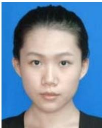  
Junling Shi received the Ph.D. degree in computer application technologies from Northeastern University, Shenyang, China, in 2019. She is currently working with the School of Computer Science, Shenyang Aerospace University. Her research interests include flying ad-hoc networks, mobile social networks, and vehicle ad-hoc networks.

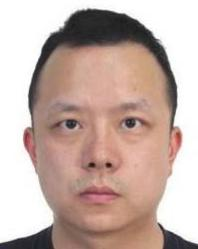

Liang Zhao received the Ph.D. degree from the School of Computing, Edinburgh Napier University, in 2011. He worked as an Associate Senior Researcher with Hitachi, China, a Research and Development Corporation from 2012 to 2014. He is currently an Associate Professor with Shenyang Aerospace University, China. He has published more than 80 articles. His research interests include ITS, VANET, WMN, and SDN. He was a recipient of the Best Paper awards at the IEEE IUCC 2015 and ACM MOMM 2013. He has served as the Chair of several international conferences and workshops, including the 2019 IEEE IUCC (the Program Co-Chair), the 2019 IEEE Scalcom (the Poster/Demo Co-Chair), the IoT-Smart-2015 (the Program Co-Chair), the 2019 AI-driven Network Workshop (the Program Co-Chair), and the NGDN workshop (the Founder). He is/has been a Guest Editor of the IEEE TRANSACTIONS ON NETWORK SCIENCE AND ENGINEERING, the Journal of Computing, and Internet Technology Letters.

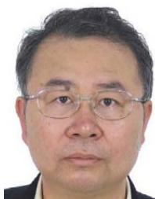

Xingwei Wang received the B.S., M.S., and Ph.D. degrees in computer science from Northeastern University, Shenyang, China, in 1989, 1992, and 1998, respectively. He is currently a Professor with the School of Computer Science and Engineering, Northeastern University. His research interests include future Internet architecture, software-defined networking, and the IoT. He has published more than 90 journal articles, books and book chapters, and refereed conference papers.

Ammar Hawbani received the B.S., M.S., and Ph.D. degrees in computer software and theory from the University of Science and Technology of China (USTC), Hefei, China, in 2009, 2012, and 2016, respectively. He is currently an Associate Professor with the School of Computer Science and Technology, USTC. His research interests include the IoT, WSNs, WBANs, WMNs, VANETs, and SDN.

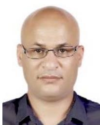

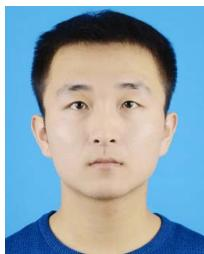

Weiliang Zhao received the M.S. degree in technology of computer application from Shenyang Aerospace University, China. He is currently pursuing the Ph.D. degree with Northeastern University. His research interests mainly include VANETs, SDN, swarm intelligence, and machine learning.

Min Huang (Member, IEEE) received the B.S. degree in automatic instrument, the M.S. degree in systems engineering, and the Ph.D. degree in control theory from Northeastern University, Shenyang, China, in 1990, 1993, and 1999, respectively. She is currently a Professor with the College of Information Science and Engineering, Northeastern University. She has published more than 100 research articles. Her research interests include the modeling and optimization for the logistics and supply chain systems.