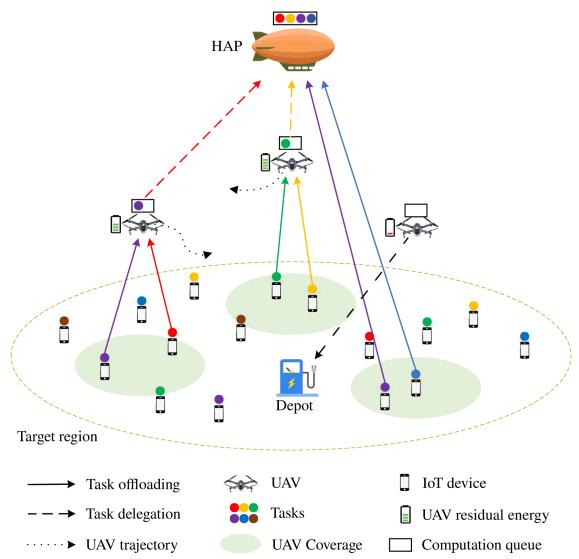
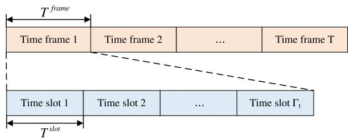
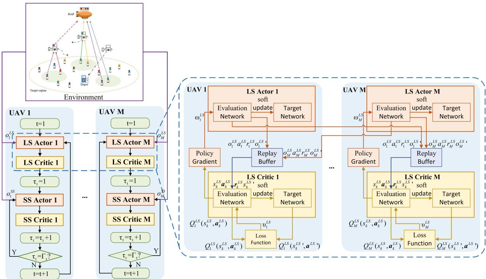
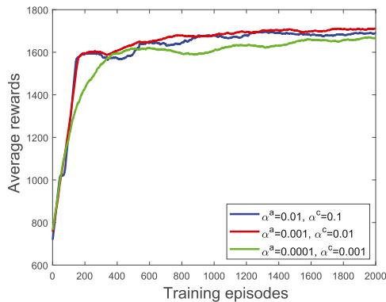
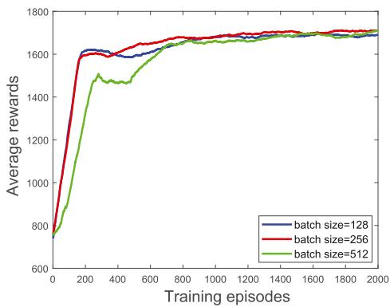
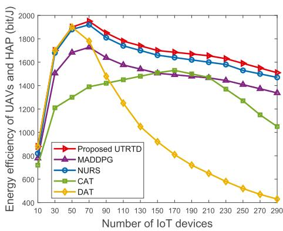
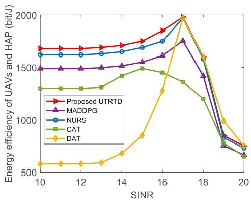
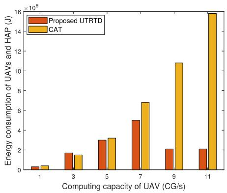
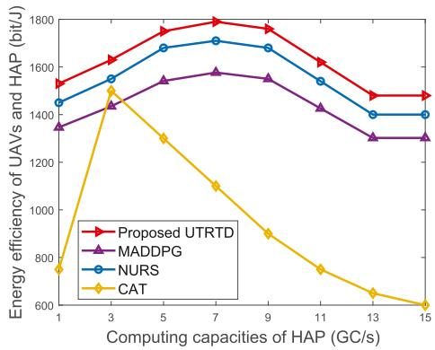
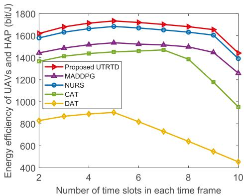

# A Two-Timescale Learning-Based Stochastic Game for Energy-Efficient UAV Trajectory Planning and Replacement in Hierarchical Aerial Computing

Jialiuyuan Li , You Shi , Member, IEEE, Chen Dai , Member, IEEE, Yongjian Fan, Changyan Yi , Senior Member, IEEE, Xiankun Ge, and Jiantao Shi , Senior Member, IEEE

Abstract—The integration of unmanned aerial vehicles (UAVs) and high-altitude platform (HAP) in hierarchical aerial computing presents a promising paradigm for delivering supplementary computational services to mobile IoT devices. Despite the great potential, this system faces the challenge of timescale. Specifically, the dynamic nature of IoT devices and their corresponding task generations may initialize the frequent adjustment of UAVs-HAP task delegation for fullfiling their needs in smalltimescale, but UAVs’ trajectory planning and replacement can only operate in large-timescale because of the severe overhead in highspeed maneuvers, motivating the multi-timescale asynchronous decision making which may further complicate the system. To this end, we propose a two-timescale optimization framework, aiming to maximize the system energy efficiency of the hierarchical aerial computing. We formulate the problem as two coupled multi-agent stochastic games, capturing UAV-HAP interactions and system uncertainties, and prove the existence of a Nash Equilibrium (NE). A reinforcement learning-based algorithm, UAV trajectory planning, replacement, task delegation and resource allocation (UTRTD), is developed to achieve the NE. Simulation results demonstrate the effectiveness and superiority of the proposed UTRTD over counterparts.

Index Terms—UAV, hierarchical aerial computing, energy efficiency, stochastic game, reinforcement learning.

## I. INTRODUCTION

sive demand for processing computation-intensive and delaysensitive tasks. However, the limited computational capabilities of these devices make local task execution infeasible. Mobile edge computing (MEC) [1], [2], [3], [4], [5] addresses this issue by enabling IoT devices to offload tasks to nearby edge servers. Yet, in post-disaster or remote areas, ground-based edge infrastructure is often unavailable, rendering direct offloading impossible. Unmanned aerial vehicles (UAVs) [6], with their high mobility and rapid deployment, provide a flexible solution for delivering emergency MEC services. Meanwhile, the high-altitude platform (HAP) provides extensive coverage and substantial computational capabilities [5]. However, UAVs are constrained by limited number, coverage, computing power and energy, while the long distance between HAP and IoT devices results in significant communication delays. To overcome these limitations, a hierarchical aerial computing system has been proposed, leveraging the collaboration between UAVs and HAP to provide energy-efficient MEC services for IoT devices [7], [8].

  
Fig. 1. Illustrations of the considered hierarchical aerial computing system.

In hierarchical aerial computing systems, UAV trajectory planning, energy replenishment, and task delegation are critical to enabling efficient MEC services through UAV-HAP collaboration. While prior studies have explored cooperative UAV trajectory planning [9], [10], energy replenishment via ground laser charging [11], [12], and task delegation strategies [13], [14], three key challenges remain unresolved. First, unlike static high-altitude platforms (HAPs) that operate at fixed, distant locations, UAVs offer significantly faster service responses to IoT devices due to their agile mobility. However, their constrained computational capabilities and limited coverage necessitate an efficient task delegation framework between UAVs and HAPs [13], [14]. Second, UAVs face stricter energy constraints than HAPs, requiring periodic returns for recharging and subsequent deployment of replacement units from depots. This process may lead to service disruptions, underscoring the need for dynamic resource allocation between UAVs and HAPs based on real-time demand. Third, UAV trajectory planning and replacement are suitable to operate in large-timescale due to the high overhead of UAV trajectory planning and replacement during high-speed maneuvers. Meanwhile, the mobility of IoT devices and their dynamic task generation require the UAV to frequently adjust the task delegation and bandwidth allocation, which are suitable to operate in small-timescale.

Motivated by the above challenges, we formulate a twotimescale [15] joint optimization of UAV trajectory planning, replacement, UAV/HAP selection during replacement, task delegation and bandwidth allocation in the hierarchical aerial computing system. The objective is to maximize the long-term energy efficiency of UAVs and HAP, defined as the data size of tasks fully processed by UAVs and HAP divided by energy consumption of UAVs and HAP. However, solving the joint problem is challenging for several reasons. The dynamic and uncertain task types, along with the mobility of IoT devices, make optimization methods relying on complete information unworkable. Moreover, the decision variables, which are a mix of discrete and continuous ones, are tightly coupled. Therefore, we propose a novel multi-agent deep reinforcement learning (MADRL)-based algorithm for UAV trajectory planning, replacement, task delegation and resource allocation (UTRTD). This paper proposes a long-term energy-efficient framework for UAVs and HAP to enable efficient MEC services for IoT devices. For enhanced clarity, the main contributions of this work are summarized as follows:

To the best of our knowledge, the long-term energy efficiency of UAVs and HAP in hierarchical aerial computing systems remains an underexplored area in the literature. To fill this gap, we formulate a two-timescale joint optimization problem for UAV trajectory planning, replacement, UAV/HAP selection during replacement, task delegation and bandwidth allocation in the hierarchical aerial computing system, aiming at optimizing the long-term energy efficiency of UAVs and HAP.

\- The two-timescale joint optimization problem is reformulated as two coupled multi-agent stochastic games which correspond to large-timescale and small-timescale, respectively. Moreover, the existence of NE is theoretically proved.

\- To obtain the corresponding NEs for the two coupled multi-agent stochastic games, we propose a novel algorithm called UTRTD to achieve long-term optimal strategy. Besides, we analyze the signaling overhead and computational complexity of the UTRTD algorithm.

Extensive simulations are conducted to validate the effectiveness of the proposed algorithm for the hierarchical aerial computing system, and there is 5% percentage improvement over the best baseline through comparisons.

The remainder of this paper is organized as follows: Section II reviews related work and highlights the key innovations of this study. Section III introduces the system model and formulates the two-timescale joint optimization problem. Section IV reformulates the problem as two coupled multi-agent stochastic game framework. Section V proposes the UTRTD algorithm. Section VI presents and analyzes the simulation results. Finally, Section VII concludes the paper.

## II. RELATED WORK

Recently, there has been a notable surge in research focused on UAV energy replenishment, driven by rapid advancements in UAV charging technologies. Several studies have explored scenarios where UAVs return to dedicated charging stations for energy replenishment. For instance, Lv et al. [13] developed an online algorithm utilizing a Lyapunov optimization framework to address the joint challenges of UAV charging scheduling and charging station energy management. Zou et al. [14] proposed a joint method for hierarchically federated learning, community agent-independent stochastic games, and multi-agent dual deep Q-learning, based on a long short-term memory network architecture. Furthermore, several studies have proposed the use of charging stations to enable the wireless in-flight recharging of UAVs. For instance, Zhao et al. [11] developed a pricebased incentive mechanism to maximize total revenue in UAV cooperative computing systems. Hevesli et al. [16] studied a UAV communication network to jointly optimize both the UAV trajectory and the power ofcharging stations. Furthermore, some studies have explored the use of dedicated charging UAVs to provide wireless charging. For instance, Zhu et al. [9] designed the problem of scheduling the flight path and charging process of each UAV to minimize the task time and proposed a deep reinforcement learning (DRL) based scheduling algorithms for single and multiple charging UAVs. Gupta et al. [17] utilized a game-theoretic approach to study the equilibrium problem of deploying the most economical UAV to known locations of UAVs and charging them under market sharing. However, UAV placement has not been investigated in the above works. Furthermore, since UAVs are energy-constrained, have to periodically return for energy replenishment and mandate the re-deployment of substituting UAVs dispatched from the depot, which may cause potential service interruptions, requiring a well-balanced use of UAVs and HAP according to various service demands.

To enhance the energy efficiency of UAVs and HAP for providing MEC services in hierarchical aerial computing systems, the UAV trajectory planning, task delegation and bandwidth allocation have been discussed in existing work. For example, Ansarifard et al. [12] employed a multi-agent deep deterministic policy gradient (MADDPG) approach alongside a federated reinforcement learning (FRL) framework to jointly optimize UAV trajectory, channel access, power allocation, and computational resources. Alam et al. [18] presented an actor based on multi-agent gated recurrent unit and a critic network based on multi-head attention to optimize the flight trajectory, ground device (GD) association, task delegation rate and resource allocation of the UAV, and minimize the task execution delay and energy consumption of the UAV. Li et al. [19] adopted a basic idea of block coordinate descent (BCD) method to solve the joint multi-computing device selection and multi-dimensional resource allocation problem, which solves the challenge of minimizing the overall task delegation delay in the groundair integrated vehicle edge computing (VEC) network. Park et al. [20] designed a resource-based multi-agent proximal policy optimization (RMAPPO) DRL algorithm to solve the problem of minimizing energy consumption and delay of multi-access MEC-driven UAV for sub-THz communication in remote areas. However, the two-timescale joint optimization of UAV trajectory planning, replacement, UAV/HAP selection during replacement, task delegation and bandwidth allocation has not been previously investigated. Furthermore, UAV trajectory planning and replacement are suitable to operate in large-timescale due to the high overhead of UAV trajectory planning and replacement during high-speed maneuvers. Meanwhile, the mobility of IoT devices and their dynamic task generation require UAVs to frequently adjust task delegation and bandwidth allocation, which are suitable to operate in small-timescale.

TABLE I  
COMPARISONS BETWEEN OUR WORK AND THE EXISTING WORKS
<table><tr><td rowspan=1 colspan=1>Researchdirection</td><td rowspan=1 colspan=1>Reference</td><td rowspan=1 colspan=2>UAV trajectoryplanning</td><td rowspan=1 colspan=2>UAVreplacement</td><td rowspan=1 colspan=2>Task delegation</td><td rowspan=1 colspan=1>Method</td></tr><tr><td rowspan=6 colspan=1>UAV energyreplenishent</td><td rowspan=1 colspan=1>[13]</td><td rowspan=1 colspan=2> $\mathbf { \nabla } \times \mathbf { \mu }$ </td><td rowspan=1 colspan=2>X</td><td rowspan=1 colspan=1>X</td><td rowspan=1 colspan=1></td><td rowspan=1 colspan=1>Lyapunov optimization</td></tr><tr><td rowspan=1 colspan=1>[14]</td><td rowspan=1 colspan=2>X</td><td rowspan=1 colspan=2>X</td><td rowspan=1 colspan=1>√</td><td rowspan=1 colspan=1></td><td rowspan=1 colspan=1>MADRL+stochastic game</td></tr><tr><td rowspan=1 colspan=1>[11]</td><td rowspan=1 colspan=2>X</td><td rowspan=1 colspan=2>X</td><td rowspan=1 colspan=1>√</td><td rowspan=1 colspan=1></td><td rowspan=1 colspan=1>DRL</td></tr><tr><td rowspan=1 colspan=1>[16]</td><td rowspan=1 colspan=1>√</td><td rowspan=1 colspan=1></td><td rowspan=1 colspan=2>X</td><td rowspan=1 colspan=1>X</td><td rowspan=1 colspan=1></td><td rowspan=1 colspan=1>BCD</td></tr><tr><td rowspan=1 colspan=1>[9]</td><td rowspan=1 colspan=1>√</td><td rowspan=1 colspan=1></td><td rowspan=1 colspan=2>X</td><td rowspan=1 colspan=1>X</td><td rowspan=1 colspan=1></td><td rowspan=1 colspan=1>DRL</td></tr><tr><td rowspan=1 colspan=1>[17]</td><td rowspan=1 colspan=1>√</td><td rowspan=1 colspan=1></td><td rowspan=1 colspan=2>X</td><td rowspan=1 colspan=1>X</td><td rowspan=1 colspan=1></td><td rowspan=1 colspan=1>Auction mechanism</td></tr><tr><td rowspan=4 colspan=1>Energyefficiency ofUAVs andHAP</td><td rowspan=1 colspan=1>[12]</td><td rowspan=1 colspan=1>√</td><td rowspan=1 colspan=1></td><td rowspan=1 colspan=2>X</td><td rowspan=1 colspan=1>√</td><td rowspan=1 colspan=1></td><td rowspan=1 colspan=1>MADRL+FRL</td></tr><tr><td rowspan=1 colspan=1>[18]</td><td rowspan=1 colspan=1>√</td><td rowspan=1 colspan=1></td><td rowspan=1 colspan=1>X</td><td rowspan=1 colspan=1></td><td rowspan=1 colspan=1>7</td><td rowspan=1 colspan=1></td><td rowspan=1 colspan=1>MADRL</td></tr><tr><td rowspan=1 colspan=1>[19]</td><td rowspan=1 colspan=1>√</td><td rowspan=1 colspan=1></td><td rowspan=1 colspan=2>X</td><td rowspan=1 colspan=1>√</td><td rowspan=1 colspan=1></td><td rowspan=1 colspan=1>BCD</td></tr><tr><td rowspan=1 colspan=1>[20]</td><td rowspan=1 colspan=1>√</td><td rowspan=1 colspan=1></td><td rowspan=1 colspan=1>X</td><td rowspan=1 colspan=1></td><td rowspan=1 colspan=1>√</td><td rowspan=1 colspan=1></td><td rowspan=1 colspan=1>MADRL</td></tr><tr><td rowspan=1 colspan=1>Both</td><td rowspan=1 colspan=1>Our work</td><td rowspan=1 colspan=1>√</td><td rowspan=1 colspan=1></td><td rowspan=1 colspan=2>√</td><td rowspan=1 colspan=1>√</td><td rowspan=1 colspan=1></td><td rowspan=1 colspan=1>MADRL+stochastic game</td></tr></table>

  
Fig. 2. Two-timescale structure of the considered hierarchical aerial computing system.

In summary, we differentiates this paper from prior existing work in the following aspects. First, we formulate a two-timescale joint optimization problem of UAV trajectory planning, replacement, UAV/HAP selection, task delegation, and bandwidth allocation in the hierarchical aerial computing system. Second, the optimization problem is reformulated as two coupled multi-agent stochastic games in two-timescale, respectively, and a novel algorithm is subsequently proposed to determine the NE. Note that, for modeling convenience, we simplify the problem of UAV idleness during the charging process. If this problem is taken into consideration, the UAV replacement may consider additional constraints such as the limited number of UAVs and charging time, which causes the time dimension to dynamically rotate and leads to an exponential increase in complexity. To highlight the contributions of our work, we summarize the key distinctions between our study and existing literature in Table I.

## III. SYSTEM MODEL AND PROBLEM FORMULATION

In this section, we first provide a description of the considered system model, including IoT device mobility and UAV trajectory model, UAV replacement model, and task processing model. Based on these models, we formulate a two-timescale joint optimization problem for UAV trajectory planning, replacement, task delegation, and bandwidth allocation for the considered system. For convenience, we list all important notations in Table II.

## A. Overview

We consider a hierarchical aerial computing system consisting of UAVs and HAP, as shown in Fig. 1, which comprises a group of IoT devices, denoted as N with $| { \mathcal { N } } | = N$ , a group of UAVs, denoted as M with $| { \mathcal { M } } | = M$ , and a HAP. Let $\mathrm { T a s k } _ { c } =$ $\left( D _ { c } , \varepsilon _ { c } , \iota _ { c } \right)$ denote a tuple of the task $c \in { \mathcal { C } } ,$ where C indicates the set of task types. The parameter $D _ { c } \in [ D _ { c } ^ { \operatorname* { m i n } } , D _ { c } ^ { \operatorname* { m a x } } ]$ indicates that the data size of task c follows a uniform distribution, with $D _ { c } ^ { \mathrm { m i n } }$ and $D _ { c } ^ { \mathrm { m a x } }$ representing the minimum and maximum data sizes, respectively. The parameter $\varepsilon _ { c }$ represents the number of CPU cycles required to compute one bit data of task type c. The parameter $\iota _ { c }$ indicates the delay tolerance of task type c. Note that, we consider that each task processing takes place within one time slot and do not span multiple time slots. Meanwhile, the energy efficiency of UAV and HAP includes the unfinished task processing energy, which will increase the energy consumption [17]. If it involves time slots, task flow needs to be considered, as well as task priority scheduling and resource conflict issues. The main focus of this paper is on UAV replacement; therefore, this part has been simplified.

TABLE II LIST OF KEY NOTATIONS
<table><tr><td>Notation</td><td>Definition</td></tr><tr><td>M</td><td>Set of UAVs</td></tr><tr><td> $\mathcal { N }$ </td><td>Set of IoT devices</td></tr><tr><td> $\mathcal { U }$ </td><td>Position set of UAVs</td></tr><tr><td> $\mathcal { T }$ </td><td>Position set of IoT devices</td></tr><tr><td> $\mathcal { C }$ </td><td>Set of the task types</td></tr><tr><td> $_ { \it ( \Delta } U  H$   $\varphi _ { m , n } ^ { - }$ </td><td>Indicator of IoT device n offloading tasks to UAV m</td></tr><tr><td> $_ { i \cap } \ddot { I } \stackrel { \because } {  } \dot { H }$   $\varphi _ { n } ^ { * }$ </td><td>Indicator of IoT device n offloading tasks to the HAP</td></tr><tr><td> $\delta _ { m , n }$ </td><td>Indicator of whether UAV m delegating the task from IoT device n to the HAP</td></tr><tr><td> $\theta _ { m , n , c }$ </td><td>Indicator of task with type c admitted from IoT device n by UAV m to be fully processed</td></tr><tr><td> $\psi _ { m }$ </td><td>Indicator of IoT devices covered by UAV m offload tasks</td></tr><tr><td> $\boldsymbol { v } ^ { r e p l }$ </td><td>to the substituting UAV or HAP Replacement speed of UAV</td></tr><tr><td> $v ^ { t r a j }$ </td><td>Trajectory planning Speed of UAV</td></tr><tr><td> $v _ { m } ^ { r e p l }$ </td><td>Speed of the substituting UAV that replacing UAV m</td></tr><tr><td> $\varepsilon _ { c }$ </td><td>Number of CPU cycles required to compute one bit data of task type c</td></tr><tr><td> $B _ { m } ^ { H }$   ${ \boldsymbol { T } } ^ { O f f l }$ </td><td>HAP&#x27;s bandwidth allocated to UAV m</td></tr><tr><td> $T _ { m , n , c } ^ { \infty , J }$ </td><td>Delay of IoT device n offloading task of type c to UAV m</td></tr><tr><td> $T _ { m , n , c } ^ { U c o m p }$ </td><td>Delay of UAV m computing the task with type c admitted</td></tr><tr><td> $T _ { m , n , c } ^ { d e l e }$ </td><td>from IoT device n Delay of UAV m delegating the task with type c offloaded</td></tr><tr><td></td><td>from IoT device n to the HAP</td></tr><tr><td> $T _ { m , n , c } ^ { H c o m p }$ </td><td>Delay of HAP computing task with type c admitted from IoT device n and delegated by UAV m</td></tr><tr><td> $T _ { m , n , c } ^ { p r o c }$ </td><td>Delay of task with type c admitted from IoT device n by</td></tr><tr><td> $E _ { m } ^ { t r a j }$ </td><td>UAV m to be fully processed</td></tr><tr><td> $\epsilon _ { m }$ </td><td>Energy consumption of UAV m trajectory planning Indicator of whether UAV m need to be replaced</td></tr><tr><td> $\Omega$ </td><td>The ratio of the data size of tasks fully processed to the total</td></tr><tr><td></td><td>energy consumption of UAVs and HAP.</td></tr><tr><td> $E _ { m } ^ { r e p l }$   $\mathrm { \Pi } _ { E } r e t u$ </td><td>Energy consumption of substituting UAV replacing UAV m</td></tr><tr><td> $\stackrel { - } { \phantom { \left. \partial \tilde { U } \right. } } \stackrel { r n } { \left. \partial H \right. }$ </td><td>Energy consumption of UAV m returning to depot</td></tr><tr><td> $\stackrel { \varphi _ { m , n } } { \underset { \substack { \scriptscriptstyle \mathcal { V } \to \mathcal { N } \mathscr { L } _ { 0 } } } { \mathrm { ~ } } }$ </td><td>Indicator of IoT device n offloading tasks to UAV m</td></tr><tr><td> $E _ { m } ^ { d e l \epsilon }$ </td><td>Energy consumption of UAV m delegating tasks to the HAP</td></tr><tr><td></td><td></td></tr><tr><td> $E _ { m } ^ { \tilde { U } c o m p }$ </td><td></td></tr><tr><td> $E ^ { \stackrel { . . . } { H } c o m p }$ </td><td>Energy consumption of UAV m computing tasks Energy consumption of HAP computing tasks</td></tr></table>

Furthermore, we adopt a two-timescale operational framework, which consisted of time frames in large-timescale and time slots in small-timescale. As depicted in Fig. 2, the total time is divided into T time frames which is denoted by $\mathcal { T } = \{ 1 , 2 , . . . , T \}$ , and each time frame is divided into $\tau _ { t }$ time slots which is denoted by $\tau _ { t } = \{ 1 , 2 , . . . , \Gamma _ { t } \}$

Moreover, we outline the two-timescale operational framework of the hierarchical aerial computing system. At the start of each frame, UAVs move in specific directions and at specific speeds for UAV trajectory planning, providing more rapid service responses to IoT devices. Considering the different data size and delay tolerance of different types of tasks, it decided which tasks to delegate to the HAP and allocated bandwidth for each task delegated to the HAP. Meanwhile, UAVs decide whether to return to the depot for energy replenishment and mandates the re-deployment of substituting UAVs dispatched from the depot. At each time slot, IoT devices offload tasks to the UAV with the largest signal-to-interference-plus-noise ratio (SINR) that covers them. Meanwhile, UAVs hover over target regions and admit tasks from associated IoT devices. After admitting all tasks, UAVs process a portion of tasks locally and offload the rest to the HAP, while allocating bandwidth to balance the workload between UAVs and HAP. Note that, if a UAV deviates from its previous position due to trajectory planning, the SINR between the UAV and IoT devices will vary, leading to changes in their offloading association [21]. When a UAV returns to the depot for recharging, the depot will dispatch a replacement UAV, during which time IoT devices may choose to either offload tasks to the HAP or wait for the new UAV’s arrival. Besides, if IoT devices offload tasks directly to the HAP, no waiting delay needs to be considered, but the transmission delay will increase. Conversely, if tasks are offloaded to a replacement UAV, the waiting delay for the UAV’s arrival must be accounted for, though the transmission delay will be lower. Furthermore, the small size of computation results allows us to omit the delays from the HAP to UAVs and from UAVs to the IoT devices.

## B. IoT Device Mobility and UAV Trajectory Model

At each time slot, the IoT devices move, and this movement can be modeled using a Gaussian Markov random motion model [18]. The moving speed and direction of IoT devices at time slot $\tau _ { t }$ of time frame t can be expressed as $v _ { n } ^ { i o t d } ( \tau _ { t } )$ $= \alpha _ { 1 } v _ { n } ^ { i o t d } ( \tau _ { t } ) \ + ( 1 - \alpha _ { 1 } ) \overline { { v } } ^ { i o t d } \ + \sqrt { 1 - \alpha _ { 1 } ^ { 2 } } \Phi$ and $\phi _ { n } ^ { i o t d } ( \tau _ { t } ) =$ $\alpha _ { 2 } \phi _ { n } ^ { i o t d } ( \tau _ { t } ) \ + ( 1 - \alpha _ { 2 } ) \overline { { { \phi } } } ^ { i o t d } \ + \sqrt { 1 - \alpha _ { 2 } ^ { 2 } } \Psi$ , where $\alpha _ { 1 } \in [ 0 , 1 ]$ $\alpha _ { 2 } \in [ 0 , 1 ] , \overline { { v } } ^ { i o t d }$ and $\overline { { \phi } } ^ { i o t d }$ denote the influence of the previous time slot, the current time slot, the average speed and the average direction ofall IoT devices, respectively. Φ and Ψ denote two independent Gaussian random variables, which reflects the randomness of IoT device movement. Thus, the X-axis and Y-axis coordinates of IoT device n at time slot $\tau _ { t }$ are given by $x _ { n } ^ { I } ( \tau _ { t } ) = x _ { n } ^ { I } ( \tau _ { t } - 1 ) + v _ { n } ^ { i o t d } ( \tau _ { t } ) \cos ( \phi _ { n } ^ { i o t d } ( \tau _ { t } - 1 ) ) T ^ { s l o t }$ and $\begin{array} { r l } { y _ { n } ^ { I } ( \tau _ { t } ) } & { = y _ { n } ^ { I } ( \tau _ { t } - 1 ) + v _ { n } ^ { i o t d } \quad ( \tau _ { t } ) \sin ( \phi _ { n } ^ { i o t d } \quad ( \tau _ { t } - 1 ) ) T ^ { s l o t } } \end{array}$ where $T ^ { s l o t }$ indicates the length of time slot.

At each time frame, we assume that UAV m $\in \mathcal { M }$ can adjust its speed $v _ { m } ^ { t r a j } ( t ) \in ( 0 , v ^ { \operatorname* { m a x } } ]$ and flight direction $\phi _ { m } ( t ) \in$ $( - \pi , \pi ]$ during the UAV trajectory planning time $T ^ { t r a j }$ , where $v ^ { \mathrm { m a x } }$ denotes the maximum velocity of the UAV. Let $u ( t ) =$ $\{ \mathcal { U } _ { 1 } ( t ) , \mathcal { U } _ { 2 } ( t ) , . . . , \mathcal { U } _ { M } ( t ) \}$ denote the set of UAVs’ positions at time frame t, which $\begin{array} { r } { \dot { \mathcal U } _ { m } ( t ) = ( x _ { m } ^ { U } ( t ) , y _ { m } ^ { U } ( t ) , H ^ { U } ) } \end{array}$ represents the coordinates of UAVs. Let $H ^ { \dot { U } }$ denote the fixed flight altitude of UAVs. Moreover, the X-axis and Y-axis coordinates of UAV m after trajectory planning at time frame t can be written as $x _ { m } ^ { U } ( t ) = x _ { m } ^ { \bar { U } } ( t - \bar { 1 } \bar { ) } + v _ { m } ^ { t r a j } ( t ) \cos ( \phi _ { m } ( t ) ) T ^ { t r a j }$ , and $y _ { m } ^ { U } ( t ) =$ $y _ { m } ^ { \bar { U } } ( t - 1 ) + v _ { m } ^ { t r a j } ( t ) \sin ( \phi _ { m } ( t ) ) T ^ { t r a j }$

To avoid collisions, the distance between any two UAVs cannot be less than the minimum distance $d ^ { \mathrm { m i n } }$ , which can be expressed as $d _ { m , m ^ { \prime } } ^ { U 2 U } ( t ) \geq d ^ { \operatorname* { m i n } } , t \in \{ 1 , 2 , . . . , T \} . ~ d _ { m , m ^ { \prime } } ^ { U 2 U } ( t )$ indicates the distance between UAV m and UAV $m ^ { \prime } \in \mathcal { M } \backslash \{ m \}$ at time frame t. The energy consumption of UAV m choosing to plan trajectory at time frame t is given by:

$$
\begin{array} { r } { E _ { m } ^ { t r a j } ( t ) = ( 1 - \epsilon _ { m } ( t ) ) P ^ { p r o } ( v _ { m } ^ { t r a j } ( t ) ) T ^ { t r a j } } \\ { + P ^ { p r o } ( 0 ) ( T ^ { f r a m e } - T ^ { r e p l } ( t ) ) , } \end{array}\tag{1}
$$

where $P ^ { p r o }$ and $T ^ { f r a m e }$ indicate the UAV propulsion power [22] and the time frame length, respectively. Note that, when the UAV decides to replace itself with a fully charged UAV, the UAV will directly return to the depot and does not participate in the trajectory planning. $\epsilon _ { m } ( t ) \in \{ 0 , 1 \}$ , and $\epsilon _ { m } ( t ) = 1$ denotes that UAV m needs to be replaced at time frame $t ,$ otherwise $\epsilon _ { m } ( t ) = 0$

## C. UAV Replacement Model

The replacement time UAV m ∈ M is defined as the time it takes for the substituting UAV to fly from the depot to the target location, and it is calculated as $\bar { T _ { m } ^ { r e p l } } ( t ) = \epsilon _ { m } ( t ) d _ { m } ^ { \bar { D } 2 U } ( t ) / v _ { m } ^ { r e p l } ( t )$ , where $d _ { m } ^ { D 2 U } ( t ) =$ $\sqrt { ( x _ { m } ^ { U } ( t ) - x ^ { D } ( t ) ) ^ { 2 } + ( y _ { m } ^ { U } ( t ) - y ^ { D } ( t ) ) ^ { 2 } }$ denotes the distance from the depot to UAV $m _ { ; }$ , and $v _ { m } ^ { r e p l } ( t )$ denotes the speed of the substituting UAV at time frame t. Therefore, the energy consumption of the substituting UAV replacing UAV m is given by:

$$
\begin{array} { r } { E _ { m } ^ { r e p l } ( t ) = \epsilon _ { m } ( t ) P ^ { p r o } ( v _ { m } ^ { r e p l } ( t ) ) T _ { m } ^ { r e p l } ( t ) . } \end{array}\tag{2}
$$

Furthermore, the energy consumption of UAV m returning to the depot can be written as:

$$
E _ { m } ^ { r e t u } ( t ) = \frac { \epsilon _ { m } ( t ) P ^ { p r o } ( v ^ { \mathrm { m i n } } ) d _ { m } ^ { U  D } ( t ) } { v ^ { \mathrm { m i n } } } ,\tag{3}
$$

where $v ^ { \mathrm { m i n } }$ indicates the speed that minimizes the energy consumption of the UAV.

After trajectory planning of UAV m, the IoT devices can choose to either wait for the arrival of the substituting UAV or directly offload the task to the HAP until the substituting UAV arrives at the target area. The variable $\psi ( t ) _ { m } \in \{ 0 , 1 \}$ , where $\psi _ { m } ( t ) = 1$ indicates the IoT devices in the target area of UAV m choose to wait for the arrival of the substituting UAV at time frame $t ,$ and $\psi _ { m } ( t ) = 0$ indicates that the IoT devices in the target area of UAV m choose to directly offload the task to the HAP at time frame t.

## D. Task Processing Model

1) Task Processing on UAVs: At each time slot, we consider that the orthogonal frequency-division multiple access (OFDMA) technology is applied to the communication between UAVs and IoT devices, which each UAV’s available bandwidth $B ^ { U t o t a l }$ is allocated equally to the IoT devices associated with itself. Hence, there is no interference between IoT devices and UAVs. At time slot $\tau _ { t }$ of time frame t, let $\pmb { \mathcal { T } } ( \tau _ { t } ) = \{ \mathcal { T } _ { 1 } ( \tau _ { t } ) , \mathcal { T } _ { 2 } ( \tau _ { t } ) , . . . , \mathcal { T } _ { N } ( \tau _ { t } ) \}$ denote the set of IoT devices’ positions. Here, $\mathcal { T } _ { n } ( \tau _ { t } ) = ( x _ { n } ^ { I } ( \tau _ { t } ) , y _ { n } ^ { I } ( \tau _ { t } ) )$ represents the coordinates of IoT devices at time slot $\tau _ { t }$ . Hence, the achievable rate that IoT device $n$ to UAV m at time slot $\tau _ { t }$ is given by:

$$
\mu _ { m , n } ^ { I  U } ( \tau _ { t } ) = \frac { B ^ { U t o t a l } } { N _ { m } ^ { a s s o } ( \tau _ { t } ) } \log _ { 2 } ( 1 + \frac { p _ { n } ^ { I } N _ { m } ^ { a s s o } ( \tau _ { t } ) } { 1 0 ^ { \frac { \lambda _ { m , n } ( \tau _ { t } ) } { 1 0 } } B ^ { U t o t a l } ( \tau _ { t } ) \chi } )\tag{4}
$$

where $\lambda _ { m , n } ( \tau _ { t } )$ indicates the path loss between IoT device n and UAV m at time slot $\tau _ { t } [ 2 3 ] . { \cal N } _ { m } ^ { a s s o } ( \tau _ { t } )$ denotes the number of IoT devices associated with UAV m at time slot $\tau _ { t } . p _ { n } ^ { I }$ and $\chi$ denote the transmit power of IoT device n and the power spectral density of noise, respectively. Therefore, the delay of IoT device n offloading task with type $c \in { \mathcal { C } }$ to UAV m at time slot $\tau _ { t }$ is

given by:

$$
T _ { m , n , c } ^ { H o f f l } ( \tau _ { t } ) = \frac { \varphi _ { n } ^ { I  H } ( \tau _ { t } ) D _ { c } } { \mu _ { n } ^ { I  H } ( \tau _ { t } ) } ,\tag{5}
$$

where $\varphi _ { n } ^ { I  H } ( \tau _ { t } ) \in \{ 0 , 1 \}$ , where $\varphi _ { n } ^ { I  H } ( \tau _ { t } ) = \cdot$ 1 means that IoT device n offloads tasks to the HAP at time slot $\tau _ { t } ,$ otherwise $\varphi _ { n } ^ { I  H } ( \tau _ { t } ) = 0$ . Since we consider that when a UAV returns to the depot, IoT devices previously offloading tasks to the UAV will instead offload them to the HAP, the variable $\varphi ^ { I  H }$ is fixed. If $\varphi ^ { I  H }$ were to be optimized, it would involve selecting which IoT devices should offload tasks to the HAP. However, the focus of this paper is on UAV replacement and hierarchical aerial computing. To simplify the task offloading model, we treat $\varphi ^ { I  H }$ as a fixed parameter.

Given that the arrival times of tasks to each UAV vary, this paper adopts the first-come-first-served (FCFS) strategy [24] for UAVs. Therefore, the delay of UAV m in computing a task of type c admitted from IoT device n during time slot $\tau _ { t }$ can be expressed as follows:

$$
T _ { m , n , c } ^ { U c o m p } ( \tau _ { t } ) = T _ { m , n , c } ^ { U q u e } ( \tau _ { t } ) + \frac { \varphi _ { m , n } ( \tau _ { t } ) ( 1 - \delta _ { m , n } ( \tau _ { t } ) ) D _ { c } \varepsilon _ { c } } { f ^ { U } } ,\tag{6}
$$

where $f ^ { U }$ indicates the available computing resource of UAV. $T _ { m , n , c } ^ { U q u e } ( \tau _ { t } )$ represents the queuing delay for UAV m to compute the task with type c admitted from IoT device n at time slot $\tau _ { t }$ which indicates the computation delay of the previous task in the computation queue from IoT device n<sup></sup>. $\delta _ { m , n } ( \tau _ { t } ) \in \{ 0 , 1 \}$ and $\delta _ { m , n } ( \tau _ { t } ) = 1$ means that UAV m delegates the task admitted from IoT device n to the HAP at time slot $\tau _ { t }$ , otherwise $\delta _ { m , n } ( \tau _ { t } ) = 0$ . Then we let $E _ { m } ^ { U c o m p } ( \tau _ { t } )$ denote the energy consumption of UAV m computing tasks at time slot $\tau _ { t } .$ which is given by:

$$
E _ { m } ^ { U c o m p } ( \tau _ { t } ) = \xi \sum _ { n = 1 } ^ { N } \sum _ { c = 1 } ^ { C } ( f ^ { U } ) ^ { 2 } \varphi _ { m , n } ^ { I  U } ( \tau _ { t } ) ( 1 - \delta _ { m , n } ( \tau _ { t } ) ) D _ { c } \varepsilon _ { c } ( \tau _ { t } ) ,\tag{7}
$$

where $\xi$ denotes the effective capacitance coefficient.

2) Task Processing on HAP: After admitting tasks from IoT devices, UAVs choose to delegate part of tasks to HAP to alleviate their own workload. The HAP’s available bandwidth B<sup>Htotal</sup> is allocated to each UAV, where the bandwidth allocated to UAV m at time slot $\tau _ { t }$ is denoted by $B _ { m } ^ { H } ( \tau _ { t } )$ . According to [25], [26], [27], the free-space loss model is applied for UAV-to-HAP communication. The free space loss is denoted by $L ^ { s } ( t ) = [ s ^ { l } / ( 4 \pi d _ { m } ^ { U  H } ( \tau _ { t } ) f ^ { U  H } ) ] ^ { 2 }$ , where $f ^ { U \to H }$ indicates the center frequency, and $\dot { d } _ { m } ^ { U \to H } ( \tau _ { t } )$ indicates the distance between UAV $m$ and the HAP at time slot $\tau _ { t } .$ . Note that, the wireless channel model in (8) extends the model in (4) by incorporating the total line loss, Boltzmann’s constant, and the system noise temperature. Additionally, the two models differ in their representation of the antenna power gain within the SINR expression. Thus, the achievable rate of UAV m to the HAP is given by:

$$
\mu _ { m } ^ { U  H } ( \tau _ { t } ) = { \cal B } _ { m } ^ { H } ( \tau _ { t } ) \log _ { 2 } ( 1 + \frac { p _ { m } ^ { U } * G ^ { U  H } L ^ { s } L ^ { I } } { k ^ { B } T ^ { s } { \cal B } _ { m } ^ { H } ( \tau _ { t } ) } ) .\tag{8}
$$

where $p _ { m } ^ { U } , G ^ { U  H }$ and $B _ { m } ^ { H } ( \tau _ { t } )$ indicate the transmit power of UAV m, the antenna power gain of UAV to HAP, and the $\mathrm { H A P } ^ { \prime } \mathrm { s }$ bandwidth allocated to UAV m at time slot $\tau _ { t } ,$ respectively. $L ^ { I }$ $k ^ { B }$ and $T ^ { s }$ indicate the total line loss, Boltzmann’s constant and system noise temperature, respectively. Thus, the delay of UAV m delegating the task with type c offloaded from IoT device n to the HAP at time slot $\tau _ { t }$ is given by:

$$
T _ { m , n , c } ^ { d e l e } ( \tau _ { t } ) = T _ { m , n , c } ^ { d e l q u e } ( \tau _ { t } ) + \frac { \varphi _ { m , n } ( \tau _ { t } ) \delta _ { m , n } ( \tau _ { t } ) D _ { c } } { \mu _ { m } ^ { U  H } ( \tau _ { t } ) } ,\tag{9}
$$

where $\delta _ { m , n } ( \tau _ { t } ) \in \{ 0 , 1 \}$ , and $\delta _ { m , n } ( \tau _ { t } ) = 1$ means that UAV m delegates the task admitted from IoT device n to the HAP at time slot $\tau _ { t } .$ , otherwise $\delta _ { m , n } ( \tau _ { t } ) = 0 . \ T _ { m , n , c } ^ { d e l q u e } ( \tau _ { t } )$ denotes the queuing delay of the task with type c admitted from IoT device $n$ to UAV m waiting to delegated to the HAP at time slot $\tau _ { t }$ which indicates the delegation delay of the previous task from IoT device $n ^ { \prime }$ . Let $E _ { m } ^ { d e l e } { \bar { ( \tau _ { t } ) } }$ denote the energy consumption of UAV m delegating tasks to the HAP at time slot $\tau _ { t }$ , which can be written as:

$$
E _ { m } ^ { d e l e } ( \tau _ { t } ) = \sum _ { n = 1 } ^ { N } \sum _ { c = 1 } ^ { C } p _ { m } ^ { U } T _ { m , n , c } ^ { d e l e } ( \tau _ { t } ) ,\tag{10}
$$

where $p _ { m } ^ { U }$ denotes the transmit power of UAV m. During the time of UAV replacement, after trajectory planning of UAV $m ,$ if the IoT devices in the target coverage area choose to directly offload the task to the HAP at time slot $\tau _ { t }$ , the achievable rate of IoT device n to the HAP can be denoted as $\mu _ { n } ^ { I  H } ( \tau _ { t } )$ , which the expansion is the same as $\mu _ { m } ^ { U \to H } ( \tau _ { t } )$ and it is omitted it for brevity. Thus, the delay of IoT device n offloading task with type $c \in { \mathcal { C } }$ to the HAP at time slot $\tau _ { t }$ is given by:

$$
T _ { m , n , c } ^ { H o f f l } ( \tau _ { t } ) = \frac { \varphi _ { n } ^ { I  H } ( \tau _ { t } ) D _ { c } } { \mu _ { n } ^ { I  H } ( \tau _ { t } ) } ,\tag{11}
$$

where $\varphi _ { n } ^ { I  H } ( \tau _ { t } ) \in \{ 0 , 1 \}$ , where $\varphi _ { n } ^ { I  H } ( \tau _ { t } ) = 1$ means that IoT device n offloads tasks to the HAP at time slot $\tau _ { t } ,$ otherwise $\varphi _ { n } ^ { I  H } ( \tau _ { t } ) = 0$ . The delay of HAP processing the tasks which are delegated from UAVs and offloaded from IoT devices can be written as:

$$
\begin{array} { r l } & { T _ { m , n , c } ^ { H c o m p } ( \tau _ { t } ) = T _ { m , n , c } ^ { H q u e } ( \tau _ { t } ) } \\ & { \phantom { x x x x x x x x x x x x x x x x x x x x x x x x x x x x x x x x x x x x x x x x } } \\ & { \phantom { x x x x x x x x x x x x x x x x x x x x } + \frac { \varphi _ { m , n } ( \tau _ { t } ) D _ { c } \varepsilon _ { c } \sum _ { m = 1 } ^ { M } \sum _ { n = 1 } ^ { N } \delta _ { m , n } ( \tau _ { t } ) } { f ^ { H } } , } \end{array}\tag{12}
$$

where $f ^ { H }$ indicates the available computing resource of HAP. Note that, from a hardware perspective, the onboard computing resources of UAV are limited (such as embedded GPUs), while HAP can be equipped with more powerful computing units. Therefore, the computing frequency of HAP is higher than that of UAV. $T _ { m , n , c } ^ { H q u e } ( \tau _ { t } )$ represents the queuing delay for the HAP to compute the task with type c admitted from IoT device n and delegated by UAV m at time slot $\tau _ { t }$ . Then, let $E _ { m } ^ { H c o m p } ( \tau _ { t } )$

denote the energy consumption of the HAP computing tasks at time slot $\tau _ { t } .$ , which can be written as:

$$
\begin{array} { r l r } {  { E _ { m } ^ { H c o m p } ( \tau _ { t } ) = \xi \sum _ { n = 1 } ^ { N } \sum _ { c = 1 } ^ { C } ( f ^ { H } ) ^ { 2 } ( \varphi _ { n } ^ { I \to H } ( \tau _ { t } ) D _ { c } \varepsilon _ { c } ( \tau _ { t } ) } } \\ & { } & { + \varphi _ { m , n } ^ { U \to H } ( \tau _ { t } ) ( 1 - \delta _ { m , n } ( \tau _ { t } ) ) D _ { c } \varepsilon _ { c } ( \tau _ { t } ) ) . } \end{array}\tag{13}
$$

## E. Problem Formulation

In this paper, we denote Ω(t) as the energy efficiency of UAVs and HAP at time frame t. It is defined as the ratio of the data size of tasks fully processed to the total energy consumption of UAVs and HAP. Thus, Ω(t) can be expressed as (14) shown at the bottom of this page, where $\theta _ { m , n , c } ( \tau _ { t } ) \in \{ 0 , 1 \}$ . Note that $\theta _ { m , n , c } ( \tau _ { t } ) = 1$ indicate the task with type c admitted from IoT device n by UAV m or HAP is fully processed within the delay tolerance and one time slot, otherwise $\theta _ { m , n , c } ( \tau _ { t } ) = 0$ . Thus, $\theta _ { m , n , c } ( \tau _ { t } )$ can be expressed as:

$$
\theta _ { m , n , c } ( \tau _ { t } ) = \left\{ \begin{array} { l l } { { 1 , } } & { { \mathrm { i f } \ T _ { m , n , c } ^ { p r o c } ( \tau _ { t } ) \leq \mathrm { m i n } \{ \iota _ { c } , T ^ { s l o t } \} , } } \\ { { 0 , } } & { { \mathrm { o t h e r w i s e } , } } \end{array} \right.\tag{15}
$$

where $T _ { m , n , c } ^ { p r o c } ( \tau _ { t } )$ represents the delay of task with type c admitted from IoT device n by UAV m or HAP to be fully processed at time slot $\tau _ { t } . T _ { m , n , c } ^ { p r o c } ( \tau _ { t } )$ can be written as:

$$
\begin{array} { r l } & { T _ { m , n , c } ^ { p r o c } ( \tau _ { t } ) = \epsilon _ { m } ( t ) ( 1 - \psi _ { m } ( t ) ) T _ { m , n , c } ^ { H o f f l } ( \tau _ { t } ) } \\ & { \quad \quad \quad + \psi _ { m } ( t ) ( T _ { m , n , c } ^ { U o f f l } ( \tau _ { t } ) + T _ { m , n , c } ^ { d e l e } ( \tau _ { t } ) } \\ & { \quad \quad \quad + T _ { m , n , c } ^ { U c o m p } ( \tau _ { t } ) ) + T _ { m , n , c } ^ { H c o m p } ( \tau _ { t } ) . } \end{array}\tag{16}
$$

Subsequently, we aim to jointly optimize UAV trajectory planning, replacement, UAV/HAP selection during replacement, task delegation and bandwidth allocation, with the objective of maximizing the long-term energy efficiency of UAVs and HAP. Thus, this optimization problem can be formulated as:

$$
[ \mathcal { P } 1 ] : \operatorname* { m a x } _ { \epsilon ( t ) , \psi ( t ) , v ^ { r e p l } ( t ) , \phi ( t ) , T  + \infty } \frac { 1 } { T } \sum _ { t = 1 } ^ { T } \Omega ( t )\tag{17}
$$

$$
\begin{array} { r } { s . t . \ x _ { m } ^ { U } ( t ) \in [ X ^ { l o w } , X ^ { u p } ] , y _ { m } ^ { U } ( t ) \in [ Y ^ { l o w } , Y ^ { u p } ] , \forall m \in \mathcal { M } , } \end{array}\tag{17a}
$$

$$
\begin{array} { r } { d _ { m , m ^ { \prime } } ^ { U 2 U } ( t ) \geq d ^ { \operatorname* { m i n } } , \forall m \in \mathcal { M } , \forall m ^ { \prime } \in \mathcal { M } \backslash \{ m \} , } \end{array}\tag{17b}
$$

$$
\phi _ { m } ( t ) \in ( 1 - \epsilon ) ( - \pi , \pi ] , v _ { m } ^ { t r a j } ( t ) \in ( 0 , ( 1 - \epsilon ) v ^ { \operatorname* { m a x } } ] ,
$$

$$
\forall m \in { \mathcal { M } } ,\tag{17c}
$$

$$
\epsilon _ { m } ( t ) \in \{ 0 , 1 \} , \psi _ { m } ( t ) \in \{ 0 , 1 \} ,
$$

$$
v _ { m } ^ { r e p l } ( t ) \in ( 0 , \epsilon _ { m } ( t ) v ^ { \operatorname* { m a x } } ] , \forall m \in \mathcal { M } ,\tag{17d}
$$

$$
\delta _ { m , n } ( \tau _ { t } ) \in \{ 0 , \varphi _ { m , n } ^ { I  U } ( \tau _ { t } ) \} , \forall m \in \mathcal { M } , \forall n \in \mathcal { N } ,\tag{17e}
$$

$$
\Omega ( t ) = \frac { \sum _ { \substack { m = 1 } } ^ { \Gamma _ { t } } \sum _ { m = 1 } ^ { M } \sum _ { n = 1 } ^ { N } \sum _ { \substack { c = 1 } } ^ { C } D _ { c } \theta _ { m , n , c } ( \tau _ { t } ) } { \sum _ { m = 1 } ^ { M } ( E _ { m } ^ { t r a j } ( t ) + E _ { m } ^ { r e p l } ( t ) + E _ { m } ^ { r e t u } ( t ) + \sum _ { \substack { \tau _ { t } = 1 } } ^ { \Gamma _ { t } } ( E _ { m } ^ { d e l e } ( \tau _ { t } ) + E _ { m } ^ { U c o m p } ( \tau _ { t } ) + E _ { m } ^ { H c o m p } ( \tau _ { t } ) ) } ,\tag{14}
$$

$$
\psi _ { m } ( t ) \in [ 0 , \epsilon ( t ) ] , \forall m \in \mathcal { M } ,\tag{17f}
$$

$$
B _ { m } ^ { H } ( \tau _ { t } ) \geq 0 , \forall m \in \mathcal { M } ,
$$

$$
\sum _ { m = 1 } ^ { M } B _ { m } ^ { U } ( \tau _ { t } ) \leq B ^ { H t o t a l } , \forall m \in \mathcal { M } ,\tag{17g}
$$

(17h)

$$
E _ { m } ^ { r e s i } ( \tau _ { t } ) \geq E _ { m } ^ { r e t u } ( \tau _ { t } ) , \forall m \in \mathcal { M } ,\tag{17i}
$$

Where ${ \phi } ( t ) = \{ \phi _ { 1 } ( t ) , . . . , \phi _ { M } ( t ) \}$ represents a set of flight directions in M dimensions. $v ^ { t r a j } ( t ) { = } \{ v _ { 1 } ^ { t r a j } ( t ) , . . . , v _ { M } ^ { t r a j } ( \bar { t } ) \}$ represents a set of UAV speed in M dimensions. $\boldsymbol { \epsilon } ( t ) \ =$ $\{ \epsilon _ { 1 } ( t ) , . . . , \epsilon _ { M } ( t ) \}$ represents a set of UAV whether need to be replaced in M dimensions. $\pmb { \psi } ( t ) = \{ \psi _ { 1 } ( t ) , . . . , \psi _ { M } ( t ) \}$ represents a set of IoT devices in the target coverage area of UAVs choose to either wait for the arrival ofthe substituting UAV or directly offload the task to the HAP in M dimensions. ${ \boldsymbol { v } } ^ { r e p l } ( t )$ $= \{ v _ { 1 } ^ { r e p l } ( t ) , . . . , v _ { M } ^ { r e p l } ( t ) \}$ represents a set of the flight speed of the replacement UAV in M dimensions. $\pmb { \delta } ( t ) = \{ \delta _ { 1 , 1 } ( t )$ , . . ., $\delta _ { M , N } ( t ) ]$ represents a set of task delegation in $M \times N$ dimensions. $\bar { \mathbf { } } \bar { \mathbf { } } ^ { U } ( t ) = \{ B _ { 1 , 1 } ^ { U } ( t ) , . . . , B _ { M , N } ^ { U } ( t ) \}$ represents a set of UAV bandwidth allocated by the HAP in $M \times N$ dimensions. Constraints (17a) states that the coordinates of the UAV cannot exceed the lower bounds $( X ^ { l o w } , Y ^ { l o w } )$ and the upper bounds $( X ^ { u p } , Y ^ { u p } )$ of the target region. Constraint (17b) states that the distance between UAVs cannot be less than the minimum distance $d ^ { \mathrm { m i n } }$ . Constraint (17c) represents the direction and range of moving distance of the UAV. The constraint (17d) indicates that whether UAVs need to be replaced and IoT devices in the target coverage area of UAVs choose to either wait for the arrival of the substituting UAV or directly offload the task to the HAP are both binary variables. Constraint (17e) indicates that UAV can only delegate tasks admitted from IoT devices to the HAP. Constraint (17f) indicates that the premise of whether IoT devices in the target coverage area of UAVs choose to wait for the arrival of the substituting UAV or directly offload the task to the HAP is UAV replacement. Constraints (17g) and (17h) indicate that the bandwidth allocated by the HAP to each UAV is not less than 0 and the total allocated bandwidth cannot exceed the available bandwidth $B ^ { H t o t a l }$ of HAP. Note that, since we consider that when a UAV choose to directly offload the task to the HAP, IoT devices previously offloading tasks to the UAV will instead offload them to the HAP, the bandwidth $B _ { m } ^ { H }$ is allocated to these IoT devices. For fairness and brevity, we consider bandwidth $B _ { m } ^ { H }$ equally divided among these IoT devices. Constraint (17i) means that the residual energy of the UAV cannot be less than the energy required to return to the charging station.

Addressing optimization problem [P1] poses significant challenges due to several factors: i) the uncertainty of IoT devices generating task requests, which vary dynamically, necessitating an online optimization algorithm; ii) the tight coupling of decision variables $\epsilon ( t )$ and ${ \boldsymbol { v } } ^ { r e p l } ( t )$ in constraint (17d), respectively; and iii) the inclusion of discrete decision variables $( \mathrm { i } . \mathrm { e } . , \epsilon ( t )$ and $\pmb { \delta } ( t ) )$ in constraints (17d) and (17e), respectively. These features classify the joint optimization problem [P1]as an online mixedinteger programming problem, which is NP-hard in nature and is difficult to solve by traditional optimization algorithms. Therefore, to account for the dynamic environmental information, in the subsequent sections, we first reformulate the two-timescale joint optimization problem [P1] into two coupled multi-agent stochastic games. Following this, we propose a novel algorithm to efficiently derive its solution.

## IV. PROBLEM REFORMULATION BASED ON MULTI-AGENT STOCHASTIC GAME

In this section, we reformulate [P1] as two coupled multiagent stochastic games [14], [28] in two-timescale, respectively. The decision variables for tackling the large-timescale optimization problem include UAV trajectory planning direction and speed, UAV replacement, and UAV/HAP selection. The decision variables for tackling the small-timescale optimization problem include task delegation and bandwidth allocation. In addition, in a time frame, the large-timescale decisions will affect the smalltimescale decision, and the small-timescale decisions will affect the large-timescale decisions in the next time frame. Firstly, we analyze the motivation of two-timescale optimization problem and the relationship among multiple UAVs. Subsequently, we formulate two multi-agent stochastic games in large-timescale and small-timescale, respectively. Finally, we characterize the strategic decision-making process of each UAV by two partially observable Markov decision processes (POMDPs).

## A. Game Analysis

In small-timescale, the proposed system needs to frequently adjust task assignment and bandwidth allocation to adapt to dynamic requirements, while in large-timescale, only trajectory planning and replacement decisions can be made. The two influence each other: decisions in large-timescale affect coverage and energy in small-timescale, and the results in small-timescale react to energy efficiency evaluation in large-timescale. Meanwhile, there is a “cooperation-competition” relationship between UAV and HAP: cooperation is embodied in information sharing to improve energy efficiency, and competition is embodied in bandwidth contention. Stochastic games can accurately describe this interaction, and reflect the influence ofmulti-agent strategies through state transition probabilities, joint actions and reward functions. Therefore, the refactoring into coupled stochastic game can not only match the two-timescale asynchronous property, but also model the policy interaction to for the solution.

## B. Game Formulation

In the joint optimization problem $[ { \mathcal { P } } 1 ] _ { : }$ , each UAV’s decisions in the current time frame (or time slot) affect the state of the subsequent time frame (or time slot), which satisfies the Markov property. Therefore, thejoint optimization problem $\left[ \mathcal { P } 1 \right]$ is reformulated two multi-agent stochastic games: large-scale stochastic game (LSG) and small-scale stochastic game (SSG). Firstly, we define LSG as a tuple $\langle \mathcal { U } ^ { L S } , \mathcal { S } ^ { L S } , \mathcal { A } ^ { L S } , \mathbb { P } ^ { L S } , \mathcal { R } ^ { L S } \rangle$ [29]:

1) $\mathcal { U } ^ { L S } = \{ 1 , 2 , . . . , M \}$ represents the set of UAVs.

2) $S ^ { L S }$ represents the set of environment states. At time frame t, the environment state $s ^ { L S } ( t ) \in \mathcal { S } ^ { L S }$ is represented by $s ^ { L S } ( t ) = ( o _ { 1 } ^ { L S } ( t ) , o _ { 2 } ^ { L S } ( t ) , . . . , o _ { M } ^ { L S } ( t ) )$ , which encompasses the observations of environmental information obtained from all UAVs.

3) $\mathcal { A } ^ { L S } = \{ \mathcal { A } _ { 1 } ^ { L S } , \mathcal { A } _ { 2 } ^ { L S } , . . . , \mathcal { A } _ { M } ^ { L S } \}$ represents the set of joint actions, where $\mathcal { A } _ { m } ^ { L S }$ represents to the set of individual actions for UAV m. The individual action $a _ { m } ^ { L S } ( t )$ of UAV $m \in \mathcal { M }$ encompasses the decisions regarding trajectory planning direction, trajectory planning speed, replacement, UAV/HAP selection during replacement, replacement speed, which is given by $a _ { m } ^ { L S } ( t ) = \{ \bar { \phi _ { m } ( t ) } , v _ { m } ^ { t r a j } ( t ) , \bar { \epsilon } _ { m } ( t ) , \bar { \psi _ { m } ( t ) } , v _ { m } ^ { r e p l } ( t ) \}$

$\mathrm { ( 4 ) } \mathbb { P } ^ { L S }$ represents the state transition probabilities. $p _ { s s ^ { \prime } } ^ { L S } ( \pmb { a } ^ { L S } ( t ) )$ ) indicates the probability oftransitioning from state $s ^ { \bar { L } \bar { S } } \ \mathrm { ~ t o ~ } s ^ { \bar { L } \bar { S } ^ { \prime } }$ by executing the joint action $\mathbf { \sigma } _ { \mathbf { } \mathbf { } \mathbf { } \mathbf { } \mathbf { } \mathbf { } \mathbf { } \mathbf { } \mathbf { } \mathbf { } \mathbf { } \mathbf { } \mathbf { } \mathbf { } \mathbf { } \mathbf { } \mathbf { } \mathbf { } \mathbf { } \mathbf { } \mathbf { } \mathbf { } \mathbf { } \mathbf { } \mathbf { } \mathbf { } \mathbf { } \mathbf { } \mathbf { } \mathbf { } \mathbf { } \mathbf { } \mathbf { } \mathbf { } \mathbf { } \mathbf { } \mathbf { } \mathbf { } \mathbf { } \mathbf { } \mathbf { } \mathbf { } \mathbf { } \mathbf { } \mathbf { } \mathbf { } \mathbf { } \mathbf { } \mathbf { } \mathbf { } \mathbf { } \mathbf { } \mathbf { } \mathbf { } \mathbf { } \mathbf { } \mathbf { } \mathbf { } \mathbf { } \mathbf { } \mathbf { } \mathbf { } \mathbf { } \mathbf { } \mathbf { } \mathbf { } \mathbf { } \mathbf { } \mathbf { } \mathbf { } \mathbf { } \mathbf { } \mathbf { } \mathbf { } \mathbf { } \mathbf { } \mathbf { } \mathbf { } \mathbf { } \mathbf { } \mathbf { } \mathbf { } \mathbf { } \mathbf { } \mathbf { } \mathbf { } \mathbf { } \mathbf { } \mathbf { } } \mathbf { } \mathbf { } \mathbf { } \mathbf { } \mathbf { } \mathbf { } \mathbf { } \mathbf { } \mathbf { } \mathbf { } \mathbf { } \mathbf { } \mathbf { } \mathbf { } \mathbf { } \mathbf { } \mathbf { } \mathbf { }  \mathbf { } \mathbf { } \mathbf { } \mathbf { } \mathbf { } \mathbf { } \mathbf { } \mathbf { } \mathbf { } \mathbf { } \mathbf { } \mathbf { } \mathbf { } \mathbf { } \mathbf { } \mathbf { } \mathbf { } \mathbf { } \mathbf { } \mathbf { } \mathbf { } \mathbf { } \mathbf { } \mathbf { } \mathbf { } \mathbf { } \mathbf { } \mathbf { } \mathbf { } \mathbf { } \mathbf { } \mathbf { } \mathbf { } \mathbf { } \mathbf { } \mathbf { } \mathbf { } \mathbf { } \mathbf { } \mathbf { } \mathbf { } \mathbf { } \mathbf { } \mathbf { } \mathbf \mathbf { } \mathbf { } \mathbf { } \mathbf \mathbf { } \mathbf { } \mathbf { } \mathbf \mathbf { } \mathbf { } \mathbf \mathbf { } $ which can be expressed as:

$$
\begin{array} { r l } & { p _ { s ^ { L S } , s ^ { L S ^ { \prime } } } ^ { L S } ( \pmb { a } ^ { L S } ( t ) ) = P r ( s ^ { L S } ( t + 1 ) } \\ & { \qquad = s ^ { L S ^ { \prime } } | s ^ { L S ^ { \prime } } ( t ) = s ^ { L S } , \pmb { a } ^ { L S } ( t ) ) . } \end{array}\tag{18}
$$

5) $\mathcal { R } ^ { L S } = \{ r _ { 1 } ^ { L S } , r _ { 2 } ^ { L S } , . . . , r _ { M } ^ { L S } \}$ represents the reward function, where $r _ { m } ^ { L S } ( t )$ represents the set of immediate reward of UAV $m \in \mathcal { M }$ . The reward of UAV m in the LSG is the energy efficiency of UAV m and HAP. Thus, the immediate reward $r _ { m } ^ { L S } ( t ) \in \mathcal { R } _ { m } ^ { L S } ( t )$ of UAV m at time frame t can be written as (19), shown at the bottom of this page, where ζ indicates a penalty factor.

For LSG, the policy $\pi _ { m } ^ { L S } : S ^ { L S } \longrightarrow { \mathcal { A } } _ { m } ^ { L S }$ represents the mapping from the state set to the action set for UAV m. The expected reward $\mathcal { Q } _ { m } ^ { L S }$ for UAV m depends on the joint policy rather than its individual policy. To address this, we utilize the NE to derive the joint policy, which is defined as follows:

Definition 1: An NE for the LSG is defined as a set of optimal policies, denoted as $\pi ^ { L S * } = \{ \pi _ { 1 } ^ { L S * } , \pi _ { 2 } ^ { L S * } , . . . , \pi _ { M } ^ { L S * } \}$ if and only if no UAV can unilaterally reduce its expected discounted reward $\mathcal { Q } _ { m } ^ { L S }$ by deviating from its current policy [28] $\begin{array} { r } { \mathfrak { i . e . , } \mathscr { Q } _ { m } ^ { L S } \big ( \pi _ { m } ^ { L S * } , \pi _ { \mathcal { M } \backslash \{ m \} } ^ { L S * } \big ) ^ { * } \geq \mathscr { Q } _ { m } ^ { L S } \big ( \overline { { \pi } } _ { m } ^ { L S } , \pi _ { \mathcal { M } \backslash \{ m \} } ^ { L S * } \big ) , \forall \ : \ : \in \ : \mathcal { Q } _ { m } ^ { L S } \ : \forall \ : \Gamma _ { m } \ : \in \ : \overline { { \Omega } } _ { m } ^ { L S * } , } \end{array}$ $\mathcal { M } , \forall \pi _ { m } ^ { L S } \in \pi ^ { L S }$

Theorem 1: For the LSG, the optimal policy for UAV m is represented by $\pi _ { m } ^ { L S * }$ , which collectively constitutes the NE $\{ \pi _ { 1 } ^ { L \dot { S } * } , \pi _ { 2 } ^ { L S * } , . . . , \pi _ { M } ^ { L S * } \}$

Proof: According to [30], the existence of a NE in any problem depends on its classification as a multi-period stage game. Consequently, the critical step in proving the existence of an NE lies in framing our problem within such a structure. A stochastic game generalizes the concept of repeated games by incorporating state transition probabilities [31]. Since any repeated game can be decomposed into a series of stage games, the large-timescale problem can be modeled as a stochastic game consisting of multiple stage games, each defined by unique transition probabilities, thereby resembling a multi-period stage game framework [32]. To rigorously define the NE within the context of our problem, we present Definition 2 (formulating the multi-UAV stage game) and Definition 3 (defining the NE) as follows:

Definition 2: A multi-UAV stage game is defined as $( \widetilde { Y } _ { 1 } , \widetilde { Y } _ { 2 } , . . . , \widetilde { Y } _ { M } ) \ [ 3 1 ]$ , where $\widetilde { \boldsymbol { { r } } } _ { m }$ denotes the reward for UAV $m \in \mathcal { M }$ over the joint action space. Consequently, $\widetilde { Y } _ { m _ { * } }$ can be expressed as follows, in accordance with [31]: $\bar { \Upsilon } _ { m } =$ $\{ r _ { m } ( t ) ( a _ { 1 } ( t ) , a _ { 2 } ( t ) , . . . , a _ { M } ( t ) ) | a _ { m } ( t ) \in \mathcal { A } _ { m } \}$

Definition 3: Let $\vartheta _ { - m }$ represent the product of policies of all UAVs $m \in { \mathcal { M } } .$ , defined as $\vartheta _ { - m } \equiv \pi _ { 1 } , . . . , \pi _ { m - 1 } \cdot$ $\pi _ { m + 1 } , . . . , \pi _ { M } .$ . Consequently, in the multi-UAV stage game $( \widetilde { Y } _ { 1 } , \widetilde { Y } _ { 2 } , . . . , \widetilde { Y } _ { M } )$ , the NE is characterized by a joint policy $\left\{ \pi _ { 1 } , \pi _ { 2 } , . . . , \pi _ { M } \right\}$ , which satisfies the inequality [31]: $\pi _ { m } \vartheta _ { - m } \widetilde { T } _ { m } \geq \pi _ { m } \vartheta _ { - m } \widetilde { T } _ { m } , \forall m \in \mathcal { M } , \forall \pi _ { m } \in \pi _ { m }$

In Definition 3, the NE is characterized by a set of policies $\left\{ \pi _ { 1 } , \pi _ { 2 } , \ldots , \pi _ { M } \right\}$ , where each policy $\pi _ { m }$ for UAV $m \in \mathcal { M }$ is designed to maximize its corresponding utility function. This leads to the inequality $\pi _ { m } ^ { * } \vartheta _ { - m } ^ { * } \widetilde { Y } _ { m } \geq \bar { \pi _ { m } } \vartheta _ { - m } ^ { * } \widetilde { Y } _ { m }$ , which confirms that $\left\{ \pi _ { 1 } ^ { * } , \pi _ { 2 } ^ { * } , \ldots , \pi _ { M } ^ { * } \right\}$ constitutes the NE, with $\pi _ { m } ^ { * }$ representing the optimal policy for $\mathrm { U A V } \ m \in { \mathcal { M } }$ . Furthermore, our utility function, formulated as the expected discounted reward function, guarantees that at the NE, each UAV $m \in \mathcal { M }$ adheres to its NE strategy without any incentive for unilateral deviation, thus preserving its utility and reward [28]. This concludes the proof of Theorem 1. -

Subsequently, we define SSG as a tuple $\langle \mathcal { U } ^ { S S } , \mathcal { S } ^ { \hat { S } S } , \mathcal { A } ^ { \bar { S } S } , \mathbb { P } ^ { S S } , \mathcal { R } ^ { S S } \rangle [ 2 9 ] \colon$

$1 ) \mathcal { U } ^ { S S } = \{ 1 , 2 , . . . , M \}$ represents the set of UAVs.

2) $s ^ { S S }$ represents the set of environment states. At time slot $\tau _ { t } ,$ the environment state $s ^ { S S } ( \tau _ { t } ) \in \mathcal { S } ^ { S S }$ is represented by $s ^ { S S } ( \tau _ { t } ) = ( o _ { 1 } ^ { S S } ( \tau _ { t } ) , o _ { 2 } ^ { S S } ( \tau _ { t } ) , . . . , o _ { M } ^ { \bar { S } S } ( \tau _ { t } ) )$ , which contains observations of environmental information from all UAVs.

$\mathfrak { Z } ) \ : \mathcal { A } ^ { S S } = \{ \mathcal { A } _ { 1 } ^ { S S } , \mathcal { A } _ { 2 } ^ { S S } , \ldots , \mathcal { A } _ { M } ^ { S S } \}$ represents the set of joint actions, where $\mathcal { \bar { A } } _ { m } ^ { S S }$ represents the set of individual actions for UAV m. The individual action $a _ { m } ^ { S S } ( \tau _ { t } )$ involves decisions that delegate tasks to the HAP and allocate bandwidth to UAVs, which is given by $a _ { m } ^ { S S } ( \tau _ { t } ) = \{ \delta _ { m , n } ( \tau _ { t } ) , B _ { m } ^ { U } ( \tau _ { t } ) \} , \forall n \in$ $\mathcal { N } _ { m } ^ { a s s o } ( \tau _ { t } ) _ {  }$

4) P<sup>SS</sup> represents the state transition probabilities. $p _ { s s ^ { \prime } } ^ { S S } ( \pmb { a } ^ { S S } ( \tau _ { t } ) )$ indicates the probability of transitioning from state $s ^ { S S } \mathrm { \Delta t o \ } s ^ { S S ^ { \prime } }$ by executing the joint action $\pmb { a } ^ { S S } ( \tau _ { t } ) \in \mathcal { A } ^ { S S }$ which can be written as:

$$
\begin{array} { r } { p _ { s ^ { S S } , s ^ { S S ^ { \prime } } } ^ { S S } ( { \pmb a } ^ { S S } ( \tau _ { t } ) ) = P r ( s ^ { S S } ( \tau _ { t } + 1 ) = s ^ { S S ^ { \prime } } | s ^ { S S ^ { \prime } } ( \tau _ { t } ) } \\ { = s ^ { S S } , { \pmb a } ^ { S S } ( \tau _ { t } ) ) . \qquad ( } \end{array}\tag{20}
$$

5) $\mathcal { R } ^ { S S } = \{ r _ { 1 } ^ { S S } , r _ { 2 } ^ { S S } , . . . , r _ { M } ^ { S S } \}$ represents the reward function, where $r _ { m } ^ { S S }$ represents the set of immediate reward of UAV $m \in \mathcal { M }$ . The reward of UAV m in the SSG consists of the bits for completing the task as well as the task delegation and

$$
\begin{array} { r } { r _ { m } ^ { L S } ( t ) = \left\{ \begin{array} { l l } { - \zeta , \mathrm { i f ~ c o n s t r a i n t s ~ } ( 1 7 \mathrm { a } ) \mathrm { ~ o r ~ } ( 1 7 \mathrm { i } ) \mathrm { ~ i s ~ v i o l a t e d } , } \\ { \qquad \quad \frac { \sum _ { \tau _ { i } = 1 } ^ { \tau _ { i } } \sum _ { n = 1 } ^ { \tau _ { i } } \sum _ { c = 1 } ^ { \tau _ { c } } D _ { c } \theta _ { m , n , c } ( \tau _ { t } ) } { E _ { m } ^ { t r a j } ( t ) + \epsilon _ { m } ( t ) E _ { m } ^ { \mathrm { r e s } \mu } ( t ) + \epsilon _ { m } ( t ) E _ { m } ^ { \mathrm { r e s t u } } ( t ) + \sum _ { \tau _ { i } = 1 } ^ { \tau _ { t } } ( E _ { m } ^ { d e l e } ( \tau _ { t } ) + E _ { m } ^ { U c o n s p } ( \tau _ { t } ) + E _ { m } ^ { H \mathrm { c o n s p } } ( \tau _ { t } ) ) } , \mathrm { ~ o t h e r w i s e } , } \end{array} \right. } \end{array}\tag{19}
$$

computation energy consumption of UAV m and the HAP. Therefore, the immediate reward $r _ { m } ^ { S S } ( t ) \in \mathcal { R } _ { m } ^ { S S }$ of UAV m at time slot $\tau _ { t }$ can be written as:

$$
\begin{array} { r l } & { r _ { m } ^ { S S } ( \tau _ { t } ) = } \\ & { ~ \left\{ \begin{array} { l l } { - \zeta , \mathrm { i f ~ c o n s t r a i n t s } \left( 1 7 \mathrm { h } \right) \mathrm { o r } \left( 1 7 \mathrm { i } \right) \mathrm { i s ~ v i o l a t e d } , } \\ { ~ \displaystyle \sum _ { n \in \mathcal { N } _ { m } ^ { a s s o } } \sum _ { c = 1 } ^ { C } \theta _ { m , n , c } \bigl ( \tau _ { t } \bigr ) D _ { c } } \\ { \frac { E ^ { d e l e } \bigl ( \tau _ { t } \bigr ) + E _ { m } ^ { U c o m p } \bigl ( \tau _ { t } \bigr ) + E _ { m } ^ { H c o m p } \bigl ( \tau _ { t } \bigr ) } { E _ { m } ^ { d e l e } \bigl ( \tau _ { t } \bigr ) + E _ { m } ^ { U c o m p } \bigl ( \tau _ { t } \bigr ) + E _ { m } ^ { H c o m p } \bigl ( \tau _ { t } \bigr ) } , } \end{array} \right. \mathrm { o t h e r w i s e } , } \end{array}\tag{21}
$$

Ifbandwidth $B _ { m } ^ { H }$ does not satisfy the constraints (17h) and (17i), the value of reward function $r _ { m } ^ { S \bar { S } }$ will become punishment ζ.

Additionally, the characterization of the NE in the SSG closely mirrors that in the LSG. For conciseness, these details are omitted in this paper.

Theorem 2: For the joint optimization problem [P1], the optimal policy for UAV m is denoted by $\pi _ { m } ^ { P 1 * } = \{ \pi _ { m } ^ { L S * } , \pi _ { m } ^ { S S * } \}$ forming the NE $\{ \pi _ { 1 } ^ { P 1 * } , \pi _ { 2 } ^ { P 1 * } , . . . , \pi _ { M } ^ { P 1 * } \}$

Proof: According to Theorem 1, both the LSG and SSG possess NE points for individual UAVs across any given state. Moreover, the LSG and SSG are inherently interdependent. Specifically, the joint action $\pmb { a } ^ { L S } ( t ) \in \mathcal { A } ^ { L S }$ influences the associations between UAVs and IoT devices, as well as the residual energy of UAVs in the first time slot of state $s ^ { S S } ( \tau _ { t } ) \in \mathcal { S } ^ { S S }$ Similarly, the joint action $\pmb { a } ^ { S S } ( \tau _ { t } ) \in \mathcal { A } ^ { S S }$ , which determines task delegation and bandwidth allocation decisions, affects the residual energy of UAVs in the next time slot of state $s ^ { S S } ( \tau _ { t } + 1 ) \in \bar { S ^ { S S } }$ . Furthermore, the joint action $\mathbf { \pmb { a } } ^ { S S } ( \tau _ { t } ) \in$ $\mathcal { A } ^ { S S }$ also impacts the residual energy of UAVs in the subsequent time frame of state $s ^ { L S } ( t + 1 ) \stackrel { \textstyle \sim } { \in } S ^ { L S }$ . Consequently, the optimal policies of the LSG and SSG collectively define the optimal policy for [P1], and their respective NE points jointly establish the NE point of [P1]. This completes the proof of Theorem 2. -

To reduce communication overhead among UAVs, in both the LSG and SSG, each UAV determines its actions based on its individual policies and observations of the current environmental information. This decision-making process can be effectively modeled as two POMDPs [33].

POMDP for each UAV in the LSG: To develop an optimal strategy for UAV trajectory planning and replacement in the LSG, the decision-making problem for each UAV $m \in \mathcal { M }$ is modeled as a partially observable Markov decision process (POMDP) defined by the tuple $( S ^ { L S } , mathcal { O } _ { m } ^ { L S } , \mathcal { A } _ { m } ^ { L S } , \mathcal { R } _ { m } ^ { L S } , \mathbb { P } ^ { L S } )$ The state space $S ^ { \bar { L ^ { S } } }$ includes UAV positions, energy levels, and depot locations, while the action space $\mathcal { A } _ { m } ^ { L S }$ covers movement and replacement decisions. The reward function $\mathcal { R } _ { m } ^ { L S }$ evaluates energy efficiency and coverage, and the transition dynamics $\mathbb { P } ^ { L \breve { S } }$ model state evolution. The observation $o _ { m } ^ { L S } ( t ) \bar { \in } \mathcal { O } _ { m } ^ { L S }$ for UAV m at time t comprises its residual energy $E _ { m } ^ { \mathrm { r e s i } } ( t )$ , depot location $U ^ { \mathrm { d e p o t } }$ , positions of all UAVs $u ( t )$ , and IoT device locations $\pmb { \mathcal { I } } ( t )$ , formally expressed as $o _ { m } ^ { L S } ( t ) = \{ E _ { m } ^ { \mathrm { r e s i } } ( t ) , U ^ { \mathrm { d e p o t } } , \mathcal { U } ( t ) , \mathcal { T } ( t ) \}$

POMDP for each UAV in the SSG: For task delegation and bandwidth allocation in the SSG, each UAV m ∈ M follows a POMDP $( S ^ { S S } , mathcal { O } _ { m } ^ { S S } , \mathcal { A } _ { m } ^ { S S } , \mathcal { R } _ { m } ^ { S S } , \mathbb { P } ^ { S S } )$ , where $s ^ { S S }$ captures computational resources and task queues, $\mathcal { A } _ { m } ^ { S S }$ includes task offloading and bandwidth allocation actions, and $\mathcal { R } _ { m } ^ { S S }$ optimizes latency and energy trade-offs. The observation $o _ { m } ^ { \bar { S S } } ( \tau _ { t } ) \in \mathcal { O } _ { m } ^ { S S }$ at time slot $\tau _ { t }$ consists of the UAV’s residual energy $E _ { m } ^ { \mathrm { r e s i } } ( \tau _ { t } )$ , associated IoT devices $N _ { m } ^ { \mathrm { a s s o } } ( \tau _ { t } )$ , computing capacities $f ^ { U } ~ \mathrm { ( U A V ) }$ and $f ^ { H } \ \mathrm { ( H A P ) }$ and task types Task $\mathbf { \nabla } _ { c } ( \tau _ { t } )$ for all devices $c \in { \mathcal { C } } .$ , represented as $o _ { m } ^ { S S } ( \tau _ { t } ) = \{ E _ { m } ^ { \mathrm { r e s i } } ( \tau _ { t } ) , \dot { N _ { m } ^ { \mathrm { a s s o } } } ( \tau _ { t } ) , f ^ { U } , f ^ { H } , \mathrm { T a s k } _ { c } ( \tau _ { t } ) \}$

## V. MULTI-AGENT DEEP REINFORCEMENT LEARNING FOR UAV TRAJECTORY PLANNING, REPLACEMENT, TASK DELEGATION AND BANDWIDTH ALLOCATION

The traditional optimization algorithm is difficult to solve the NE of the game, mainly because the dynamic uncertainty of the system and the complexity of the two-timescale problem are beyond its scope of application. The mobility of IoT devices and the randomness of tasks lead to the dynamic changes of environment states, which invalidates the assumption of complete information that traditional optimization relies on. The NE solution needs global state information, which is difficult to meet in dynamic environments. In addition, the problem involves both discrete variables (e.g., UAV replacement), continuous variables (e.g., trajectory velocity) and coupling constraints (e.g., bandwidth upper bound), so it is difficult for traditional methods to efficiently deal with complex optimization of such mixed variables. Fortunately, DRL [34], [35], [36] enables adaptive learning through environmental interaction. While centralized execution faces scalability issues with UAVs, distributed execution improves responsiveness. MADDPG algorithm [37], [38], [39], [40] extends deep deterministic policy gradient (DDPG) algorithm for multi-agent systems, combining distributed execution with centralized training. Each agent uses an actor-critic framework: the actor selects actions based on local observations, while the critic evaluates global states and actions, updating Q-values via temporal difference (TD) learning and policy gradients. Experience replay and batch training enhance convergence. Therefore, we propose an algorithm, named UTRTD, which is based on MADDPG.

Due to the constrained computational capabilities of UAVs and the resource-intensive nature of DNN training, our UTRTD algorithm adopts an offline pre-training strategy on a remote server. Once trained, the server deploys optimized policies to UAVs, allowing them to perform real-time decision-making without onboard model training. As a case study, consider a UAV deployed for disaster area monitoring, where it must assess environmental parameters (e.g., hazardous gas levels or temperature variations). Here, the neural network is pre-trained offline using historical datasets and simulated environments. After convergence, the server transmits both the trained model and derived optimal policies to the UAV—either as parameterized models or predefined decision rules. After receiving these optimal policies, the UAV autonomously executes optimal actions in dynamic environments, eliminating the need for computationally expensive online training. This paradigm significantly alleviates onboard processing demands while ensuring high operational efficiency. As depicted in Fig. 3, in the proposed

  
Fig. 3. An illustration of the proposed UTRTD algorithm.

UTRTD algorithm, each UAV is equipped with a large-scale actor network, a small-scale actor network, a large-scale critic network, and a small-scale critic network. Specifically, at time frame t, UAV $m \in \mathcal { M }$ initially selects action $a _ { m } ^ { L S } ( t )$ independently based on its observation $o _ { m } ^ { L S } ( t )$ and strategy $\because \pi _ { m } ^ { L S } ( t )$ in large-scale actor. Subsequently, for each time slot $\tau _ { t } \in \Gamma$ , UAV m selects action $a _ { m } ^ { S S } ( \tau _ { t } )$ independently based on its observation $o _ { m } ^ { S S } ( \tau _ { t } )$ and strategy $\pi _ { m } ^ { S S } ( \tau _ { t } )$ . Observation ofthe residual energy of the UAV m over a large-scale, the location of the depot, and the positions of all UAVs and IoT devices affects the action selection in the actor network, including UAV replacement, UAV trajectory planning speed and direction, and UAV/HAP offloading selection. Meanwhile, observation of the small-scale space of the UAV m’s residual energy, its associations with IoT devices, the computing power of the UAV and the HAP, and the task types of IoT devices affects the action selection in the actor network, including task delegation and bandwidth allocation. Executing these actions will affect the Q-value calculation in the critic network.

## A. Distributed Execution Stage

At each iteration of the UTRTD algorithm, the large-scale actor and small-scale actor networks of each UAV determine actions based on their observations and policies. It is important to note that when all UAVs simultaneously update their actions for a specific actor network, no UAV has prior knowledge of the actions chosen by others. For instance, consider the large-scale actor network of UAV $m \in { \mathcal { M } } ;$ : based on the observation $o _ { m } ^ { L S }$ and policy $\pi _ { m } ^ { L S }$ from the environment, the large-scale actor evaluation network independently selects and executes action $a _ { m } ^ { L S }$ . Once all UAVs execute their selected actions in the large-scale actor network, the current state $s ^ { L S }$ the action set $\pmb { a } ^ { L S } = \{ a _ { 1 } ^ { L S } , a _ { 2 } ^ { L S } , \dots , a _ { M } ^ { L S } \}$ , and the reward set $\pmb { r } ^ { L S } = \{ r _ { 1 } ^ { L S } , r _ { 2 } ^ { L S } , \ldots , r _ { M } ^ { L S } \}$ are obtained, and the environment transitions to the next state $s ^ { L S ^ { \prime } }$ . Subsequently, the tuple $( s ^ { L S } , \pmb { a } ^ { L S } , r ^ { L S } , s ^ { L S ^ { \prime } } )$ is stored in each UAV’s experience replay buffer $D ^ { L S }$ to update the parameters of the UT actor network and UT critic network.

## B. Centralized Training Stage

At each iteration of the UTRTD algorithm, each UAV samples a mini-batch from the experience replay buffers of the largescale and small-scale networks. For instance, in the case of the large-scale networks, the mini-batch consists of the $k { \mathrm { - t h ~ } } ( k \in$ $\mathbb { N } ^ { + } )$ random sample $( s _ { k } ^ { L S } , \pmb { a } _ { k } ^ { L S } , r _ { k } ^ { L S } , s _ { k } ^ { L S ^ { \prime } } )$ , which is utilized to update both the large-scale actor evaluation network and the large-scale critic evaluation network.

For the large-scale actor evaluation network of UAV m ∈ M, the policy gradient is updated using the deterministic policy gradient method can be written as:

$$
\begin{array} { r l } & { \nabla _ { \omega _ { m } ^ { L S } } J ( \omega _ { m } ^ { L S } ) = \mathbb { E } _ { s ^ { L S } , a ^ { L S } \sim D ^ { L S } } \left[ \nabla _ { \omega _ { m } ^ { L S } } \cdot \log \pi _ { m } ^ { L S } \right. } \\ & { \left. \left( a _ { m , k } ^ { L S } \right) \cdot \mathcal { Q } _ { m } ^ { L S } \left( s _ { k } ^ { L S } , a _ { k } ^ { L S } \right) \vert _ { a _ { m , k } ^ { L S } = \pi _ { m } ^ { L S } \left( o _ { m , k } ^ { L S } \right) } \right] , } \end{array}\tag{22}
$$

where $\omega _ { m } ^ { L S }$ denotes the parameters of the large-scale actor evaluation network for UAV m. The expected reward function $\mathcal { Q } _ { m } ^ { L S } \big ( s _ { k } ^ { L S } , \pmb { a } _ { k } ^ { L S } \big )$ is defined as the reward obtained when UAV m executes action $a _ { m , k } ^ { L S } \in \mathcal { A } _ { m } ^ { L S }$ in state $s _ { k } ^ { L S } \in S ^ { L S }$ under the policy $\pi _ { m } ^ { L S }$ for the random sample $( s _ { k } ^ { L S } , \pmb { a } _ { k } ^ { L S } , r _ { k } ^ { L S } , s _ { k } ^ { L S ^ { \prime } } )$ , which can be written as:

$$
\mathcal { Q } _ { m } ^ { L S } ( s _ { k } ^ { L S } , \pmb { a } _ { k } ^ { L S } ) = r _ { m } ^ { L S } + \sigma \mathbb { E } [ \mathcal { Q } _ { m } ^ { L S } ( s _ { k } ^ { L S ^ { \prime } } , \pmb { a } _ { k } ^ { L S ^ { \prime } } ) ] ,\tag{23}
$$

where $\sigma$ represents the discount factor, and $\mathcal { Q } _ { m } ^ { L S } ( s _ { k } ^ { L S ^ { \prime } } , \pmb { a } _ { k } ^ { L S ^ { \prime } } )$ denotes the Q function evaluated at the next state.

```perl
Algorithm 1: UTRTD.
1 for m = 1 to M do
2 Initialize the parameters of evaluation networks $\omega _ { m } ^ { L S } , v _ { m } ^ { L S }$
$\omega _ { m } ^ { S S }$ and $\upsilon _ { m } ^ { \dot { S } S } ,$ , the target networks with parameters
$\omega _ {  \sim ^ { \prime } } ^ { \prime \tilde { L } S ^ { \prime } } = \omega _ {  } ^ { \tilde { L } S } , \omega _ { m } ^ { S S ^ { \prime } } = \omega _ { m } ^ { S S } , \upsilon _ { m } ^ { L S ^ { \prime } } = \upsilon _ { m } ^ { \tilde { L } S }$ and
$\upsilon _ { m } ^ { S S ^ { \prime } } = \upsilon _ { m } ^ { S S } ;$
3 Initialize the replay buffers $D ^ { L S }$ and $D ^ { S S } ;$
4 for $l = 1$ to lmax do
5 while $t = 1$ to T do
6 for $m = 1 \ t o \ M$ do
7 Obtain the large-timescale observation $o _ { m } ^ { L S } ( t ) ;$
8 Select and execute $a _ { m } ^ { L S } ( t )$ according to
$\pi _ { m } ^ { L S } ( o _ { m } ^ { L S } ( t ) ) ;$
9 Observe reward $\mathbf { \boldsymbol { r } } ^ { L S } ( t )$ and next state $s ^ { L S } ( t + 1 ) ;$
10 Store $( s ^ { L S } ( t ) , { \pmb a } ^ { L S } ( \acute { t } ) , { \pmb r } ^ { L S } ( t ) , s ^ { L S } ( t + 1 ) )$ in replay
buffer $D ^ { L S } \colon$
11 $\begin{array} { r } { s ^ { L S } ( t ) \longleftarrow s ^ { L S } ( t + 1 ) ; } \end{array}$
12 for $\dot { m } = 1$ to $\mathcal { M }$ do
13 Sample a random mini-batch $( s _ { k } ^ { L S } , \pmb { a } _ { k } ^ { L S } , r _ { k } ^ { L S } , s _ { k } ^ { L S * } )$
of k-th sample from $D ^ { L S } ;$
14 Update the evaluation networks of large-scale actor
and large-scale critic;
15 Update target network parameter with updating rate $\beta \colon$
16 $\omega _ { m } ^ { \mathbf { \hat { L } } S * } \longleftarrow \beta \omega _ { m } ^ { L S } + ( \mathbf { \hat { l } } - \beta ) \omega _ { m } ^ { L S * } ; \upsilon _ { m } ^ { L \hat { S } * } \longleftarrow$
$\ddot { \beta } v _ { m } ^ { L S } + ( 1 - \stackrel { \cdots } { \beta } ) v _ { m } ^ { L S * } ;$
17 while $\tau _ { t } = 1$ to $\Gamma _ { t }$ do
18 for $m = 1$ to M do
19 Obtain the small-timescale observation $o _ { m } ^ { S S } ( \tau _ { t } ) ;$
20 Select and execute $a _ { m } ^ { S S } ( \tau _ { t } )$ according to
$\pi _ { m } ^ { S S } ( o _ { m } ^ { S S } ) ;$
21 Observe reward $\mathbf { \eta } _ { r } ^ { S S } ( \tau _ { t } )$ and next state $s ^ { S S } ( \tau _ { t } + 1 ) ;$
22 Store $( s ^ { S S } ( \tau _ { t } ) , \mathbf { \vec { \mathbf { \psi } } } _ { \mathbf { \vec { \mathbf { \psi } } } } ^ { S S } ( \tau _ { t } ) , \mathbf { \vec { \mathbf { \psi } } } ^ { S S } ( \tau _ { t } ) , s ^ { S S } ( \tau _ { t } + \vec { \mathbf { \psi } } ) )$ in
replay buffer ${ \dot { D } } ^ { S S } ;$
23 $\mathit { s } ^ { S \hat { S } } ( \bar { \tau _ { t } } ) \longleftarrow \mathit { s } ^ { S S } ( \tau _ { t } + 1 ) ;$
24 for m = 1 to M do
25 Sample a random mini-batch
$( s _ { k _ { \ast } } ^ { \dot { S } S } , { \pmb a } _ { k } ^ { S S } , r _ { k } ^ { S S } , s _ { k } ^ { S S \ast } )$ of k-th sample from
$\dot { D } ^ { \tilde { S } S ; }$
26 Update the evaluation networks of small-scale
actor and small-scale critic;
27 Update target network parameter with updating
rate $\beta \colon$
28 $\omega _ { m } ^ { S S * }   \beta \omega _ { m } ^ { S S } + \ O ( 1 - \beta ) \omega _ { m } ^ { S S * } ; \upsilon _ { m } ^ { S S * } +$
$\beta v _ { m } ^ { S S } + ( 1 - \beta ) v _ { m } ^ { S S * } ;$
```

For the large-scale critic evaluation network of UAV m, the Q function $\bar { Q } _ { m } ^ { L S }$ is updated by minimizing the loss function $\bar { L ( v _ { m } ^ { L S } ) }$ , expressed as:

$$
L ( v _ { m } ^ { L S } ) = \mathbb { E } _ { s _ { k } ^ { L S } , a _ { k } ^ { L S } , \boldsymbol { r } _ { k } ^ { L S } , s _ { k } ^ { L S ^ { \prime } } } [ ( Q _ { m } ^ { L S } ( s _ { k } ^ { L S } , \pmb { a } _ { k } ^ { L S } ) - y ) ^ { 2 } ] ,\tag{24}
$$

where $y = r _ { m , k } ^ { L S } + \sigma \mathcal { Q } _ { m } ^ { L S * } ( s _ { k } ^ { L S * } , { \pmb a } ^ { L S * } ) | _ { a _ { m } ^ { L S * } = \pi _ { m } ^ { L S * } \left( o _ { m } ^ { L S * } \right) }$ represents the target Q-value, and $\upsilon _ { m } ^ { L S }$ denotes the parameters of the large-scale critic evaluation network for $\mathrm { U A V } \ m$

For updating the LS target network parameters $\omega _ { m } ^ { L S * }$ and $v _ { m } ^ { L S * }$ of $\mathrm { U A V } \ m$ , the UTRTD algorithm employs a soft update mechanism. This mechanism ensures gradual parameter updates at each learning step, thereby improving learning stability. Moreover, the small-scale actor and small-scale critic follow analogous configurations to the large-scale actor and large-scale critic, and their details are omitted here for brevity. A complete description of the UTRTD algorithm is provided in Algorithm 1.

## C. Practical Implementation Issues

1) Signaling Overhead: The proposed UTRTD algorithm enables UAVs to make autonomous decisions based on local observations, with each UAV gathering data from IoT devices and the HAP through dedicated control channels, where the observation size (including UAV/IoT positions) is minimal compared to offloaded tasks, significantly reducing signaling overhead [41], [42]. For coordinated operation, a central controller facilitates information exchange through a dedicated high-speed channel (more than 70 Mbps [2], [43]) that transmits only Q-values, ensuring real-time updates while maintaining UAV autonomy and avoiding decision delays, with similar implementations discussed in [21], [44].

2) Computational Complexity: The computational complexity of the proposed UTRTD algorithm is determined by four key factors: the maximum iteration counter $l ^ { \mathrm { m a x } }$ , the number of time frames $T _ { \ast }$ , the number of time slots $\tau _ { t } .$ , the number of UAVs M, and the configurations of the actor network (number of input nodes $N ^ { A i }$ , output nodes $N ^ { A o }$ , and layers $N ^ { A l } )$ and critic network (number of input nodes $N ^ { C i }$ , output nodes $N ^ { C o }$ , and layers $N ^ { C l } )$ [24], [45]. Specifically, the computational complexity in large-timescale can be expressed as $\hat { T M } ( N ^ { A i } N ^ { A o } \hat { N ^ { A l } } + \mathrm { \bar { ~ } } N ^ { C i } N ^ { \check { C } o } N ^ { C l } )$ . Meanwhile, the computational complexity in small-timescale can be expressed as $\dot { \tau } _ { t } M ( N ^ { A i } N ^ { A o } \dot { N } ^ { A l } \dot { + } N ^ { C i } N ^ { C o } N ^ { C l } )$ . Consequently, the computational complexity of Algorithm 1 can be expressed as $\mathcal { O } ( l ^ { \mathrm { { m a x } } } T \tau _ { t } M ( \hat { N } ^ { A i } \hat { N } ^ { A o } N ^ { A l } \bar { + } N ^ { C i } N ^ { C o } N ^ { C l } ) )$

## VI. SIMULATION RESULTS

## A. Simulation Setup and Parameters

The simulation parameter values are detailed in Table III, with the propulsion power model following the formulation in [46]. Similar configurations have been adopted in previous studies, such as [21], [47], [48], where parameter values may vary based on the specific scenario. For the two-timescale networks, the actor and critic architectures consist of four fully connected layers: an input layer, two hidden layers, and an output layer. The layer dimensions of actor network and critic network are configured as (64, 64, 32, 32) and (256, 256, 128, 64), respectively [49].

## B. Performance of the Proposed UTRTD Algorithm

Fig. 4 illustrates the convergence performance of the UTRTD algorithm with three learning rates. According to Theorem 2, the proposed two-timescale optimization problem has a NE, and the NE must converge. In the proposed UTRTD algorithm, the critic network’s learning rate is deliberately set higher than that of the actor network to accelerate learning and guide updates to the actor network [51]. It is evident that with $\alpha ^ { a } = 0 . 0 0 1$ and $\alpha ^ { c } = 0 . 0 1$ , the UTRTD algorithm achieves convergence after 200 training episodes. The average reward represents the average energy efficiency of UAVs and HAP, which is computed jointly across all agents. The highest average rewards are at $\alpha ^ { a } = 0 . 0 0 1$ and $\alpha ^ { c } = 0 . 0 1$ compared to other benchmarks. This outcome arises because at $\alpha ^ { a } = 0 . 0 0 0 1$ and $\alpha ^ { c } = 0 . 0 0 1$ , the algorithm exhibits slower update rates for both actor and critic networks, necessitating more iterations to converge and often leading to convergence towards local optima rather than the global optimum. Conversely, setting $\alpha ^ { a } = 0 . 0 1$ and $\alpha ^ { c } = 0 . 1$ 1 causes both networks to undergo larger update steps, therefore the gradient may oscillate back and forth around the minimum.

TABLE III SIMULATION PARAMETERS
<table><tr><td>Parameter</td><td>Value</td></tr><tr><td>Target region size</td><td> $1 0 0 0 0 m \times 1 0 0 0 0 m$ </td></tr><tr><td>Maximum speed of UAV vmax [50]</td><td> $3 0 m / s$ </td></tr><tr><td>Length of time frame  $T ^ { f r a m e }$ </td><td>1300 s</td></tr><tr><td>Length of trajectory planning time  $T ^ { t r a j }$  Task size  $D _ { c } ^ { \phantom { \dagger } }$ </td><td>50 s [10, 100] M B [8]</td></tr><tr><td>Number of UAVs M</td><td>3</td></tr><tr><td>Bandwidth of UAV  $B ^ { U t o t a l }$ </td><td> $2 0 ~ M B / s$ </td></tr><tr><td>Bandwidth of HAP  $B ^ { H t o t a l }$ </td><td> $2 0 \ : M B / s$ </td></tr><tr><td>Number of time slots in a time frame</td><td>5</td></tr><tr><td>Task delay tolerance  $\iota _ { c } ~ [ 2 4 ]$ </td><td> $[ 1 0 , 2 0 0 ] s$ </td></tr><tr><td>Length of time slot  $T ^ { s l o t }$ </td><td>250 s</td></tr><tr><td>Number of CPU cycles required  $\varepsilon _ { c }$ </td><td>[200, 300] cycles/bit</td></tr><tr><td>Number of IoT devices N</td><td>150</td></tr><tr><td>Effective capacitance coefficient ξ [24] Power spectral density of noise ∞ [21]</td><td> $1 0 ^ { - 1 7 }$ </td></tr><tr><td>Penalty factor</td><td> $- 1 7 4 d B m / H z$ </td></tr><tr><td> $\zeta$ </td><td> $- 1 0$ </td></tr><tr><td>SINR threshold</td><td>15</td></tr><tr><td>Carrier frequency  $f ^ { c }$ </td><td> $3 \ : G H z$ </td></tr><tr><td>Computing capacity of UAV  $f ^ { U t o t a l }$ </td><td> $5 G C / s$ </td></tr><tr><td>Discount factor σ Altitude of UAV  $H ^ { U }$ </td><td>0.95</td></tr><tr><td>Experience replay buffer  $D$ </td><td>400 m</td></tr><tr><td>Computing capacity of HAP  $f ^ { H t o t a l }$ </td><td>10⁶  $1 0 G C / s$ </td></tr><tr><td>Soft updating rate  $\dot { \boldsymbol { \beta } }$ </td><td>0.01</td></tr><tr><td>Altitude of HAP  $\dot { H } ^ { H }$ </td><td>20000 m</td></tr><tr><td>Number of task types  $C$ </td><td></td></tr><tr><td></td><td>10</td></tr><tr><td>Transmit power of  $\mathrm { U A V } ~ p ^ { U }$ </td><td> $1 0 W$ </td></tr><tr><td>Learning rate  $\alpha ^ { a } / \alpha ^ { c }$ </td><td> $0 . 0 0 1 / 0 . 0 1$ </td></tr></table>

  
Fig. 4. Convergence performance of the UTRTD algorithm under different learning rates.

Fig. 5 illustrates the convergence performance of the UTRTD algorithm under three different batch sizes. The results show that the highest average reward is achieved with a batch size of 256. This is attributed to the fact that smaller batch sizes introduce greater gradient randomness, prolonging the time required to converge to the optimal value. Conversely, excessively large batch sizes tend to cause the model to converge to local optima, limiting its ability to explore the global solution space.

  
Fig. 5. Convergence performance of the UTRTD algorithm under different batch sizes.

  
Fig. 6. Comparison of energy efficiency of UAVs and HAP under varying number of IoT devices.

## C. Comparisons With Different Task Delegation and Computation Strategies

For performance evaluation, we compare the proposed UTRTD algorithm against four bench-mark strategies: 1) MAD-DPG [52], where each intelligent agent corresponds to an actor network and a critic network, synchronously optimizing the variables of both large-timescale and small-timescale; 1) No UAV replacement scheduling (NURS) strategy [24], where UAVs return to the depot before energy depletion while replacement UAVs are dispatched to maintain service continuity; 2) UAV computing all tasks (CAT) strategy [53], where all IoT tasks are processed locally by UAVs without HAP offloading; and 3) UAV delegating all tasks (DAT) strategy [54], where all computational tasks are offloaded to the HAP without local UAV processing.

Fig. 6 demonstrates the energy efficiency of UAVs and HAP under varying numbers of IoT devices for the NURS, CAT, DAT strategies, and the proposed UTRTD algorithm. It is observed that in the MADDPG, NURS, CAT, DAT, and UTRTD strategies, the energy efficiency of UAVs initially rises and then declines. This initial increase is attributed to the growing number of tasks requiring processing as the IoT device count increases. However, as the number of IoT devices continues to rise, the bandwidth allocated by the UAV to each device decreases, leading to longer time to offload tasks. Consequently, some tasks cannot be processed and completed within the acceptable delay threshold. The proposed UTRTD algorithm outperforms the NURS, CAT, and DAT strategies due to several key advantages: 1) The MADDPG algorithm synchronously optimizes the variables of both large-timescale and small-timescale instead of optimizing the variables asynchronously in large-timescale and small-timescale, respectively. 2) The NURS strategy fails to optimize the timing for UAVs to return to the depot, resulting in higher energy consumption during depot returns; 3) The CAT strategy lacks the support of HAP for task computation, limiting its efficiency; 4) The DAT strategy relies solely on HAP for computation, leading to higher transmission delays compared to the UTRTD algorithm, which leverages both UAV and HAP resources for balanced task processing.

  
Fig. 7. Comparison of energy efficiency of UAVs and HAP under varying SINR levels.

Fig. 7 examines the energy efficiency of UAVs and HAP under varying SINR levels for the MADDPG, NURS, CAT, DAT strategies, and the proposed UTRTD algorithm. It is observed that the energy efficiency of UAVs initially increases and then decreases as the SINR rises. The initial increase in energy efficiency occurs because the number of IoT devices covered by UAVs decreases, allowing for greater bandwidth allocation to each device. The subsequent decline in energy efficiency is due to the excessively small number ofIoT devices covered by UAVs, leading to underutilization of the computing resources of both UAVs and HAP. Additionally, the results confirm that the proposed UTRTD algorithm consistently surpasses the MADDPG, NURS, CAT, and DAT strategies, consistent with the trends observed in Fig. 6.

Fig. 8 illustrates the energy consumption of UAVs and HAP under varying computing capacities of UAVs for the CAT strategy and the proposed UTRTD algorithm. It is observed that in the UTRTD algorithm, the energy consumption of UAVs and HAP initially increases, then decreases, and eventually stabilizes as the computing capacity of UAVs grows. The initial increase occurs because higher computing capacity enables UAVs to perform more computations, leading to greater energy consumption. However, as the computing capacity further increases, the high energy consumption prompts UAVs to offload all tasks from IoT devices to the HAP, reducing their own energy usage and stabilizing overall consumption. In contrast, under the CAT strategy, where tasks are exclusively processed by UAVs, the energy consumption of both UAVs and HAP rises continuously with increasing computing capacity, as there is no delegation mechanism to mitigate energy usage.

  
Fig. 8. Comparison of energy comsumption of UAVs and HAP under varying computing capacities of UAV.

  
Fig. 9. Comparison of energy efficiency of UAVs and HAP under varying computing capacities of HAP.

Fig. 9 presents the energy efficiency of UAVs and HAP under varying computing capacities ofHAP for the MADDPG, NURS, DAT strategies, and the proposed UTRTD algorithm. The results show that the energy efficiency initially increases and then decreases, eventually stabilizing as the computing capacity of the HAP grows. The initial improvement in energy efficiency is due to the HAP’s ability to process more tasks with higher computing capacity. However, once UAVs and HAP can fully handle all tasks, further increases in computing capacity lead to diminishing returns, causing energy efficiency to decline and stabilize. Additionally, the proposed UTRTD algorithm consistently outperforms the MADDPG, NURS and DAT strategies, aligning with the trends observed in Fig. 6.

Fig. 10 examines the energy efficiency of UAVs and HAP under varying numbers of time slots for the MADDPG, NURS, CAT, DAT strategies, and the proposed UTRTD algorithm. It is evident that the energy efficiency in all three strategies and the UTRTD algorithm initially increases and then decreases as the number of time slots grows. This is because more time slots allow for the generation of more tasks, which enables the UAVs and the HAP to process more tasks initially. However, as the number of time slots continues to increase, the duration of each slot becomes shorter, making it increasingly difficult to fully process all tasks in the allocated time. Furthermore, the UTRTD algorithm demonstrates superior performance compared to the MADDPG, NURS, CAT, and DAT strategies, consistent with the findings discussed in Fig. 6.

  
Fig. 10. Comparison of energy efficiency of UAVs and HAP under varying number of time slots.

## VII. CONCLUSION

This paper have optimized the long-term energy efficiency of UAVs and HAP in a hierarchical aerial computing system by formulating a two-timescale joint optimization problem for UAV trajectory planning, replacement, task delegation, and bandwidth allocation. Addressing system dynamics and uncertainties, we have reformulated the problem as two coupled multi-agent stochastic games, proving the existence ofa NE. The UTRTD, a novel MADRL algorithm, has been proposed to solve these games and achieve the NE. Simulation results have been presented to validate the effectiveness of the UTRTD algorithm, showing a 5% improvement over the best baseline.

## REFERENCES

[1] M. Zhao, Z. Yang, Z. He, F. Xue, and X. Zhang, “Multi-round Stackelberg game-based pricing and offloading in containerized MEC networks,” IEEE Trans. Green Commun. Netw., vol. 9, no. 1, pp. 191–206, Mar. 2025.

[2] Y. Shi, J. Wang, C. Yi, R. Wang, and B. Chen, “Proactive application deployment for MEC: An adaptive optimization based on imperfect multi-dimensional prediction,” IEEE Trans. Veh. Technol., vol. 74, no. 10, pp. 16374–16390, Oct. 2025.

[3] Y. Liao, L. Liu, and Y. Ma, “Energy- and latency-efficient resource allocation for RIS-assisted UAV-USV cooperative MEC network,” IEEE Trans. Green Commun. Netw., vol. 9, no. 4, pp. 2087–2100, Dec. 2025.

[4] H. Quan, Q. Zhang, and J. Zhao, “Federated learning assisted intelligent IoV mobile edge computing,” IEEE Trans. Green Commun. Netw., vol. 9, no. 1, pp. 228–241, Mar. 2025.

[5] Y. Shi, Y. Yang, C. Yi, B. Chen, and J. Cai, “Toward online reliabilityenhanced microservice deployment with layer sharing in edge computing,” IEEE Internet Things J., vol. 11, no. 13, pp. 23370–23383, Jul. 2024.

[6] J. Li et al., “A reinforcement learning-based stochastic game for energy-efficient UAV swarm-assisted MEC with dynamic clustering and scheduling,” IEEE Trans. Green Commun. Netw., vol. 9, no. 1, pp. 255–270, Mar. 2025.

[7] A. Nabi and S. Moh, “Joint offloading decision, user association, and resource allocation in hierarchical aerial computing: Collaboration of UAVs and HAP,” IEEE Trans. Mobile Comput., vol. 24, no. 8, pp. 7267–7282, Aug. 2025.

[8] Y. Chen, K. Li, Y. Wu, J. Huang, and L. Zhao, “Energy efficient task offloading and resource allocation in air-ground integrated MEC systems: A distributed online approach,” IEEE Trans. Mobile Comput., vol. 23, no. 8, pp. 8129–8142, Aug. 2024.

[9] K. Zhu et al., “Aerial refueling: Scheduling wireless energy charging for UAV enabled data collection,” IEEE Trans. Green Commun. Netw., vol. 6, no. 3, pp. 1494–1510, Sep. 2022.

[10] J. Li, C. Yi, J. Chen, K. Zhu, and J. Cai, “Joint trajectory planning, application placement, and energy renewal for UAV-assisted MEC: A triple-learner-based approach,” IEEE Internet Things J., vol. 10, no. 15, pp. 13622–13636, Aug. 2023.

[11] L. Zhao, Y. Yao, H. Zhou, H. Wang, and V. Leung, “TD3-based collaborative computation offloading and charging scheduling in multi-UAVassisted MEC networks,” in Proc. IEEE Wireless Commun. Netw. Conf., 2024, pp. 1–6.

[12] M. Ansarifard, N. Mokari, R. Javan, H. Saeedi, and A. Jorswieck, “AIbased radio and computing resource allocation and path planning in NOMA NTNs: AoI minimization under CSI uncertainty,” IEEE Trans. Veh. Technol., vol. 73, no. 10, pp. 14874–14887, Oct. 2024.

[13] L. Lv et al., “Contract and Lyapunov optimization-based load scheduling and energy management for UAV charging stations,” IEEE Trans. Green Commun. Netw., vol. 5, no. 3, pp. 1381–1394, Sep. 2021.

[14] L. Zou, M. S. Munir, Y. K. Tun, S. S. Hassan, P. S. Aung, and C. S. Hong, “When hierarchical federated learning meets Stochastic game: Toward an intelligent UAV charging in urban prosumers,” IEEE Internet Things J., vol. 10, no. 12, pp. 10438–10461, Jun. 2023.

[15] Y. Shi, C. Yi, R. Wang, Q. Wu, B. Chen, and J. Cai, “Service migration or task rerouting: A two-timescale online resource optimization for MEC,” IEEE Trans. Wireless Commun., vol. 23, no. 2, pp. 1503–1519, Feb. 2024.

[16] M. Hevesli, M. Seid, A. Erbad, and M. Abdallah, “Multi-agent DRL for queue-aware task offloading in hierarchical MEC-enabled air-ground networks,” IEEE Trans. Cogn. Commun. Netw., vol. 12, pp. 217–236, 2026.

[17] A. Gupta, S. Ghosh, and M. Bhatnagar, “Pricing based scheme for UAVenabled wireless energy transfer,” IEEE Trans. Veh. Technol., vol. 71, no. 12, pp. 13198–13209, Dec. 2022.

[18] M. Alam and S. Moh, “Joint optimization of trajectory control, task offloading, and resource allocation in air-ground integrated networks,” IEEE Internet Things J., vol. 11, no. 13, pp. 24273–24288, Jul. 2024.

[19] S. Li et al., “Joint computation offloading and multidimensional resource allocation in air–ground integrated vehicular edge computing network,” IEEE Internet Things J., vol. 11, no. 20, pp. 32687–32700, Oct. 2024.

[20] Y. Park, S. Hassan, Y. Tun, Z. Han, and C. Hong, “Joint trajectory and resource optimization of MEC-assisted UAVs in Sub-THz networks: A resources-based multi-agent proximal policy optimization DRL with attention mechanism,” IEEETrans. Veh. Technol., vol. 73, no. 2, pp. 2003–2016, Feb. 2024.

[21] C. Zhao, J. Liu, M. Sheng, W. Teng, Y. Zheng, and J. Li, “Multi-UAV trajectory planning for energy-efficient content coverage: A decentralized learning-based approach,” IEEE J. Sel. Areas Commun., vol. 39, no. 10, pp. 3193–3207, Oct. 2021.

[22] Y. Zeng, J. Xu, and R. Zhang, “Energy minimization for wireless communication with rotary-wing UAV,” IEEE Trans. Wireless Commun., vol. 18, no. 4, pp. 2329–2345, Apr. 2019.

[23] K. Wang, X. Zhang, L. Duan, and J. Tie, “Multi-UAV cooperative trajectory for servicing dynamic demands and charging battery,” IEEE Trans. Mobile Comput., vol. 22, no. 3, pp. 1599–1614, Mar. 2023.

[24] S. Zhang, A. Liu, C. Han, X. Liang, X. Xu, and G. Wang, “Multiagent reinforcement learning-based orbital edge offloading in SAGIN supporting internet of remote things,” IEEE Internet Things J., vol. 10, no. 23, pp. 20472–20483, Dec. 2023.

[25] S. D. Okegbile, J. Cai, H. Zheng, J. Chen, and C. Yi, “Differentially private federated multi-task learning framework for enhancing human-to-virtual connectivity in human digital twin,” IEEE J. Sel. Areas Commun., vol. 41, no. 11, pp. 3533–3547, Nov. 2023.

[26] H. Shen, Q. Ye, W. Zhuang, W. Shi, G. Bai, and G. Yang, “Drone-smallcell-assisted resource slicing for 5G uplink radio access networks,” IEEE Trans. Veh. Technol., vol. 70, no. 7, pp. 7071–7086, Jul. 2021.

[27] V. Niazmand and Q. Ye, “Joint task offloading, dnn pruning, and computing resource allocation for fault detection with dynamic constraints in industrial IoT,” IEEE Trans. Cogn. Commun. Netw., vol. 11, no. 5, pp. 3486–3501, Oct. 2025.

[28] J. Zheng, Y. Cai, L. N., Y. Xu, and X. Shen, “Stochastic game-theoretic spectrum access in distributed and dynamic environment,” IEEE Trans. Veh. Technol., vol. 64, no. 10, pp. 4807–4820, Oct. 2015.

[29] X. Hu, K. Wong, K. Yang, and Z. Zheng, “UAV-assisted relaying and edge computing: Scheduling and trajectory optimization,” IEEE Trans. Wireless Commun., vol. 18, no. 10, pp. 4738–4752, Oct. 2019.

[30] M. S. Munir, S. F. Abedin, N. H. Tran, Z. Han, E. -N. Huh and C. S. Hong, “Risk-aware energy scheduling for edge computing with microgrid: A multi-agent deep reinforcement learning approach,” IEEE Trans. Netw. Service Manag., vol. 18, no. 3, pp. 3476–3497, Sep. 2021.

[31] J. Hu and M. P. Wellman, “Nash Q-learning for general-sum stochastic games,” J. Mach. Learn. Res., vol. 4, pp. 1039–1069, 2003.

[32] M. Makris and L. Renou, “Information design in multi-stage games,” Theor. Econ., vol. 18, no. 4, pp. 1475–1509, 2023.

[33] B. Shi, Z. Chen, and Z. Xu, “A deep reinforcement learning based approach for optimizing trajectory and frequency in energy constrained multi-UAV assisted MEC system,” IEEE Trans. Netw. Service Manag., vol. 23, pp. 317–328, 2026.

[34] H. Peng and X. Shen, “Deep reinforcement learning based resource management for multi-access edge computing in vehicular networks,” IEEE Trans. Netw. Sci. Eng., vol. 7, no. 4, pp. 2416–2428, Oct.–Dec. 2020.

[35] J. Chen, C. Yi, R. Wang, K. Zhu, and J. Cai, “Learning aided joint sensor activation and mobile charging vehicle scheduling for energy-efficient WRSN-based industrial IoT,” IEEE Trans. Veh. Technol., vol. 72, no. 4, pp. 5064–5078, Apr. 2023.

[36] Q. Ye, W. Zhuang, S. Zhang, A.-L. Jin, X. Shen, and X. Li, “Dynamic radio resource slicing for a two-tier heterogeneous wireless network,” IEEE Trans. Veh. Technol., vol. 67, no. 10, pp. 9896–9910, Oct. 2018.

[37] H. Sun, Y. Zhou, H. Zhang, L. Ale, H. Dai, and N. Zhang, “Joint optimization of caching, computing, and trajectory planning in aerial mobile edge computing networks: An MADDPG approach,” IEEE Internet Things J., vol. 11, no. 24, pp. 40996–41007, Dec. 2024.

[38] X. Li et al., “Multi-agent DRL for resource allocation and cache design in terrestrial-satellite networks,” IEEE Trans. Wireless Commun., vol. 22, no. 8, pp. 5031–5042, Aug. 2023.

[39] J. Wu, D. Li, Y. Yu, L. Gao, J. Wu, and G. Han, “An attention mechanism and adaptive accuracy triple-dependent MADDPG formation control method for hybrid UAVs,” IEEE Trans. Intell. Transp. Syst., vol. 25, no. 9, pp. 11648–11663, Sep. 2024.

[40] Q. Ye, W. Shi, K. Qu, H. He, W. Zhuang, and X. Shen, “Joint RAN slicing and computation offloading for autonomous vehicular networks: A learning-assisted hierarchical approach,” IEEE Open J. Veh. Technol., vol. 2, pp. 272–288, 2021.

[41] C. Dai, K. Zhu, and E. Hossain, “Multi-agent deep reinforcement learning for joint decoupled user association and trajectory design in full-duplex multi-UAV networks,” IEEE Trans. Mobile Comput., vol. 22, no. 10, pp. 6056–6070, Oct. 2023.

[42] Q. Ye, J. Li, K. Qu, W. Zhuang, X. S. Shen, and X. Li, “End-to-end quality ofservice in 5G networks: Examining the effectiveness ofa network slicing framework,” IEEE Veh. Technol. Mag., vol. 13, no. 2, pp. 65–74, Jun. 2018.

[43] A. Mahmood, T. Vu, S. Chatzinotas, and B. Ottersten, “Joint optimization of 3D placement and radio resource allocation for per-UAV sum rate maximization,” IEEE Trans. Veh. Technol., vol. 72, no. 10, pp. 13094–13105, Oct. 2023.

[44] Y. Yang et al., “Dynamic human digital twin deployment at the edge for task execution: A two-timescale accuracy-aware online optimization,” IEEE Trans. Mobile Comput., vol. 23, no. 12, pp. 12262–12279, Dec. 2024.

[45] C. Yi, J. Cai, and Z. Su, “A multi-user mobile computation offloading and transmission scheduling mechanism for delay-sensitive applications,” IEEE Trans. Mobile Comput., vol. 19, no. 1, pp. 29–43, Jan. 2020.

[46] J. Zhang et al., “FLPurifier: Backdoor defense in federated learning via decoupled contrastive training,” IEEE Trans. Inf. Forensics Secur., vol. 19, pp. 4752–4766, 2024.

[47] B. Liu, Y. Wan, F. Zhou, Q. Wu, and R. Hu, “Resource allocation and trajectory design for MISO UAV-assisted MEC networks,” IEEE Trans. Veh. Technol., vol. 71, no. 5, pp. 4933–4948, May 2022.

[48] H. Cao and J. Cai, “Distributed multiuser computation offloading for cloudlet-based mobile cloud computing: A game-theoretic machine learning approach,” IEEE Trans. Veh. Technol., vol. 67, no. 1, pp. 752–764, Jan. 2018.

[49] J. Zhang et al., “BadCleaner: Defending backdoor attacks in federated learning via attention-based multi-teacher distillation,” IEEE Trans. Dependable Secure Comput., vol. 21, no. 5, pp. 4559–4573, Sep./Oct. 2024.

[50] W. Liu, B. Li, W. Xie, Y. Dai, and Z. Fei, “Energy efficient computation offloading in aerial edge networks with multi-agent cooperation,” IEEE Trans. Wireless Commun., vol. 22, no. 9, pp. 5725–5739, Sep. 2023.

[51] Y. Wang, W. Fang, Y. Ding, and N. Xiong, “Computation offloading optimization for UAV-assisted mobile edge computing: A deep deterministic policy gradient approach,” Wireless Netw., vol. 27, no. 4, pp. 2991–3006, 2021.

[52] W. Zhang, L. Tan, T. Huang, X. Huang, M. Huang, and G. Zhang, “Resource allocation and trajectory optimization in multi-UAV collaborative vehicular networks: An extended multiagent DRL approach,” IEEE Internet Things J., vol. 12, no. 8, pp. 9391–9404, Apr. 2025.

[53] N. Cheng et al., “Space/aerial-assisted computing offloading for IoT applications: A learning-based approach,” IEEE J. Sel. Areas Commun., vol. 37, no. 5, pp. 1117–1129, May 2019.

[54] S. Yu, X. Gong, Q. Shi, X. Wang, and C. Xu, “EC-SAGINs: Edgecomputing-enhanced space–air–ground-integrated networks for Internet of Vehicles,” IEEE Internet Things J., vol. 9, no. 8, pp. 5742–5754, Apr. 2022.