# Aerial Refueling: Scheduling Wireless Energy Charging for UAV Enabled Data Collection

Kun Zhu , Member, IEEE, Jia Yang, Yang Zhang , Member, IEEE, Jiangtian Nie , Member, IEEE, Wei Yang Bryan Lim , Hongliang Zhang , Member, IEEE, and Zehui Xiong , Member, IEEE

Abstract—The working scope and working time of small size unmanned aerial vehicles (UAVs) are limited because of the limited battery capacity. In this work, inspired by aerial refueling for aircrafts, we propose a wireless power transmission (WPT) scheme by categorizing the UAVs into charging UAV (CUAV) and mission UAV (MUAV) for charging UAVs without interrupting the mission. In the proposed aerial refueling scheme, mission UAVs (MUAV) can be recharged by charging UAVs on the fly and operate in a perpetual manner. The feasibility of aerially wireless charging for small UAVs is firstly discussed and evaluated. Then we consider a practical application scenario of multiple MUAVs for collecting data from several points of interest, where the MUAVs are recharged by CUAVs. Accordingly, the issue of scheduling the flying path and charging process of each CUAV to minimize the mission time arises. Deep reinforcement learning (DRL) based algorithms for scheduling both single and multiple CUAVs are proposed and deployed. Extensive simulation evaluations demonstrate that, by applying the proposed aerial refueling scheme, CUAVs can explore and optimize the scheduling strategies, thereby improving the system performance in terms of mission completion and charging efficiency.

Index Terms—UAV energy management, wireless charging, deep reinforcement learning.

## I. INTRODUCTION

low budget, flexibility in deployment, remote and unmanned control, as well as high mobility. Modern UAVs are able to carry specific devices to support communications and networking missions, extending conventional mutually isolated ground-based networking systems to multi-dimensional communication networks covering ground devices [2], [3], bridging spatial/aerial communication stations [4], [5], as well as utilizing edge-cloud services [6].

Most small size UAVs are powered by electricity with equipped battery. However, a major challenge for more wide applications of such UAVs is the limited battery capacity which supports only short working and flight time. For example, operating time of most battery-driven UAVs ranges from tens of minutes to an hour. Energy supply is required to be delicately planned with energy efficiency optimization designs [7] or mission offloading [8]. If a mission exhausts the UAV battery, the UAV must land for recharging, or another UAV has to be dispatched to take over the mission. It is inevitable that the mission is eventually interrupted with postponed completion time.

To extensively increase the operation time of a battery-driven UAV, an intuitive method is to equip the UAV with a battery of larger capacity, which, however, will also significantly increase weight and size of the UAV. To overcome the aforementioned issue, online replenishing energy for a selected set of UAVs, e.g., mission UAVs (MUAV), becomes a promising option. For recharging UAVs during the mission, ground station based wireless charging schemes have been proposed, which can be categorized into two types, i.e., near field charging and far field charging. With near field charging, a UAV needs to land on the ground charging station to be charged through inductive coupling or magnetic resonance coupling [9], [10]. Far field charging is usually performed by laser beam [11], [12], where UAVs hover around ground charging stations and can be charged by aligned laser beams from the ground stations. Existing ground charging station based solutions can prolong the working time of UAVs, however, issues of energy efficiency still exist. Firstly, ground stations are pre-deployed in certain locations in a fixed manner, resulting in additional cost when the UAV application scenario or the environment is dynamic. Secondly, the UAVs may need to suspend or terminate their ongoing missions when being charged, and physically move to the charging station to replenish energy, causing additional time and energy consumption.

Inspired by the concept of aerial refueling, a novel concept of aerially charging UAVs with missions via wireless power transmission is proposed in this work, aiming at charging the UAVs without interrupting the mission [1]. UAVs with missions to complete are denoted as mission UAVs (MUAVs), where missions usually involve data communication (e.g., hovering for data relaying [13]) and computing (e.g., serving as edge computing nodes [14]). A mission UAV can be wirelessly recharged on the fly by another UAV, namely a charging UAV (CUAV). Recent development of wireless charging techniques potentially enables our proposed design. For example, existing magnetic resonance coupling based charging platforms provide charging for portable devices, RF antenna array patches were designed in [15], distributed laser charging (DLC) system was designed in [16], which could be used for our purpose. Several benefits can be achieved through aerially charging UAVs. Firstly, the use of charging UAVs instead of (or in complement with) ground charging stations could significantly increase the flexibility as well as lower the cost incurred by charging station deployment. Secondly, with the advantages of wireless charging and the high mobility of UAV, MUAVs in the system can be charged on demand whenever they are moving or hovering. Thirdly, as MUAV energy can be replenished in an online manner by CUAVs, MUAVs can keep performing missions without being interrupted for charging at a ground charging platform.

In the proposed aerially UAV charging scheme, we discuss smart city as a typical application scenario where multiple MUAVs are employed for data collecting from particular points of interest (PoIs). Different from existing works which typically use fixed location ground charging stations [9], we consider the cases of employing one and multiple CUAVs to charge the MUAVs for extending the working time. The MUAVs collect data according to their mission plans which include traveling path and connection duration at each PoI. We assume that the energy capacity of each MUAV is not sufficient to finish the mission, which is also the case that the MUAV operates continually on certain tasks. Instead of flying to a fixed ground charging station or platform for recharging, CUAVs are dispatched to replenish energy for the MUAVs in the proposed scheme. Accordingly, one of the most critical issues in the proposed UAV system is how to schedule the charging arrangement to minimize the mission time arises. In this work, a single UAV scheduling problem is formulated as a Markov decision process. A Deep Deterministic Policy Gradient (DDPG) [17] based algorithm is used to solve the problem. Furthermore, a multiple CUAVs charging scenario is studied, where the charging problem is formulated as a Markov game [18], for which a Multi-Agent Deep Deterministic Policy Gradient (MADDPG) [19] based algorithm is proposed for scheduling the CUAVs. The CUAVs continue to explore and optimize the scheduling strategies to minimize the entire mission time of MUAVs, thereby improving the working efficiency in general.

Main contributions are summarized as follows.

As inspired by aerial refueling, the concept of charging UAV (CUAV) and mission UAV (MUAV) are proposed for improving the wireless energy charging efficiency of the system, and extending the data collection time of MUAVs.

Based on parameters of actual commercial UAV products, feasibility of UAV wireless energy charging is analyzed and validated.

Deep reinforcement learning based algorithms are applied to solve the Markov decision process and the Markov game formulated in both single- and multiple-CUAV optimal energy charging cases, respectively.

Comprehensive evaluations show that the proposed wireless energy refueling for mission UAVs efficiently supports the UAVs to finish their missions on the fly without landing for recharge.

The remaining parts of the paper are organized as follows. Section II reviews existing studies on wireless energy charging for UAVs. In Section III, feasibility of aerially charging for the MUAVs by wireless power transmission is analyzed. Section IV discusses a single CUAV charging scenario. An energy charging scenario for multiple CUAVs is analyzed in Section V. Section VI provide simulation results and performance analysis as experimental studies. Finally, Section VII concludes the work.

## II. RELATED WORK

## A. Near Field Wireless Charging

Near field charging scheme means that devices should be physically in contact with the charger during the charging process. Existing near field wireless charging applications are mainly based on inductive coupling or magnetic resonant coupling. Both of the coupling-based WPT techniques are based on the electromagnetic induction principle. For magnetic resonant coupling, resonant circuits are used to enhance the efficiency of power transmission.

Magnetic coupling allows loose alignment between charger and receiver and non-line-of-sight charging for different devices simultaneously on different power [20]. Wireless charging platforms are expected to provide higher charging power and efficiency in the future. For example, dynamic wireless charging system based on integrated magnetic coupler is designed for charging electric vehicles in [21], where experimental results show that vehicles can be charged at the power level of 12kW, with the maximum efficiency reaching 92.3%. Paper [22] proposed a 13.56MHz wireless power transfer system with 1X/2X reconfigurable resonant regulated rectifiers and wireless power control for biomedical implants. The experimentally measured maximum received power is 102 mW and receiver efficiency is 92.6%.

However, coupling-based WPT techniques require a short charging distance. There are strict restrictions on the location and orientation of charging target. Thus, the coupling-based wireless charging is widely used on near field platforms. The near field charging platform on the ground has been proposed for charging UAVs. A magnetic field based system was designed to provide enough power to charge UAV at a high efficiency in [23]. Junaid et al. [9] designed a wireless charging platform for UAVs. A mechanism for autonomously navigating the UAV to land on the charging platform by using a UAV charging controlling and navigating system with a high-precision position sensor and controlling algorithm running on the ground station. Experiments demonstrated that the proposed solution achieves an average transmission efficiency greater than 50%. Choi et al. [24] proposed a fully automatic charging platform for charging UAVs. The charging platform detected the UAV with ultrasonic sensors, then scanned UAV’s center coordinates with laser sensors to accurately position the UAV’s charging coil. Experiments shown that the accuracy of the center coordinates is about 2mm. Wang and Ma [10] designed a smart wireless charging platform using solar energy. The energy of the charging platform is supplemented by solar energy. Thus, the charging platform does not need to be connected to the grid. It can be installed with greater flexibility.

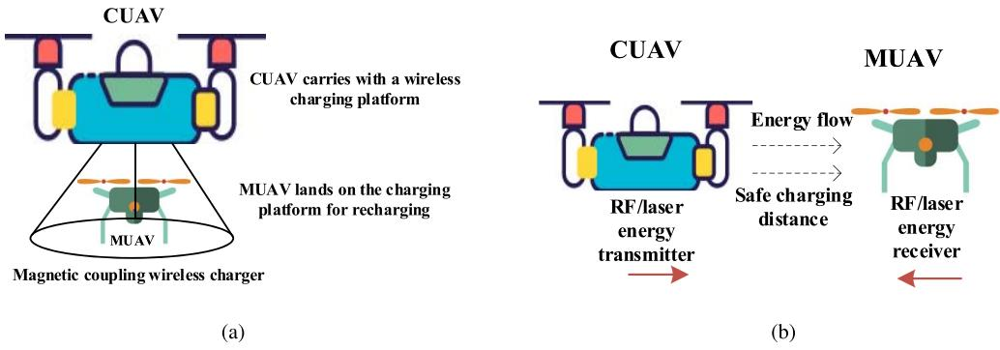  
Fig. 1. CUAV wireless charging method: (a) Near field charging, (b) Far field charging.

The charging platform needs to be deployed in a special location in advance. The deployment location needs to comprehensively consider the environment and charging requirements. Thus, deploying fixed charging platform lacks flexibility. Mobile wireless charging platform was proposed to solve the problem. Yu [25] et al. proposed to use an unmanned grounded vehicle equipped with a coupled wireless charging platform as a mobile charging station to charge the UAV. Unmanned grounded vehicles can act as mobile or stationary charging platforms to assist the UAV to visit a set of nodes.

The aerial near field charging platform is shown in Figure 1(a). The developments of near field charging technologies benefit the aerial charging platform. The promote of wireless charging power will decrease charging time and the promote of charging efficiency will save charging energy.

## B. Far Field Wireless Charging

Far field wireless charging, as shown in Figure 1(b), includes the cases that the hovering MUAV is charged by the hovering CUAV in a distance. The MUAV is charged via RF or laser wireless power transmission during flight.

Radio frequency (RF), as an AC electromagnetic signal carrying energy, is able to be converted into current directly by RF energy harvesting techniques and devices, i.e., energy harvesters. Energy collected can be charged as battery power or used directly to extend the working time of UAVs. From the perspective of theoretical analysis, the closed form mathematical characterization of the energy conversion efficiency and maximum output power of the energy harvesting circuit is provided in [26]. For point-to-point transmission, beamforming transmits electromagnetic waves, called energy beamforming [27], which can improve power transmission efficiency. Microwave is advocated to transfer energy and information simultaneously. The amplitude and phase of microwaves are used to modulate information, while their radiation and vibration are used to carry energy. This concept is defined as simultaneous wireless information and power transmission (SWIPT) [27]. In order to support SWIPT, smart antenna has been developed and deployed at the receiver to achieve a good balance between system performance and complexity. designed a charging device, realized RF long-distance charging has been designed and implemented as a device in [15]. Pandiyan et al. [28] proposed to equip UAVs and embedded devices with subsystems to facilitate WPT, which allows the UAV works as energy provider and data collection agent. The UAV can provide RF power for devices in inaccessible locations.

Laser beams carry with high radiant energy. Because of its advantage of small divergence, there is little attenuation during the laser transmission in clear air. The charging system includes the laser transmitter and the photovoltaic-cell (PVcell) as receiver. Distributed laser charging (DLC) system and laser wireless transmission efficiency was presented in [16]. The system can charge the portable devices and UAVs via DLC transmitters. James et al. [29] used a 976 nm laser to remotely power a 190 mg insect-scale aerial robot. The robot is manufactured using commercially available components and circuit fabrication techniques based on fast turnaround lasers and integrates a complete power electronics assembly. The onboard electronics used to supply power include a lightweight boost converter capable of generating high voltage, regulated by a micro-controller that performs feedback control.

Far field wireless charging has been used for UAV charging. Achtelik et al. [11] used lasers emitted from the ground to charge the UAVs in the air. The UAVs carries a solar panel for receiving laser energy, and the laser charging vehicle on the ground locates and tracks the UAV. In the simulation experiment, it is proved that the laser charging vehicle continuously tracked and provided stable charging for the UAV for more than 12 hours. Chen et al. [12] used ground charging piles to charge UAVs on the sea through laser beams. The UAVs collected data from a set of buoy sensors far from the coast. The UAVs performing data collection can be charged via laser charging piles on the coast.

For far field wireless charging, transmission loss in the air cannot be ignored. The CUAV and MUAV should keep a safe charging distance. However, the increase of charging distance will increase the energy transmission loss. Thus, higher charging power and energy transmission efficiency is required. The developments of far field charging technologies will benefit the UAV aerial far field wireless charging.

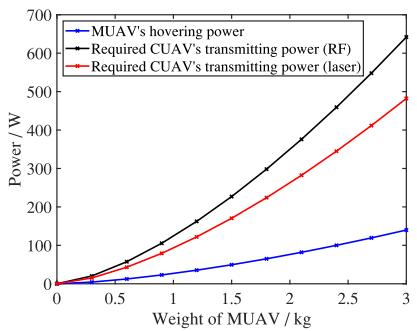  
(a)

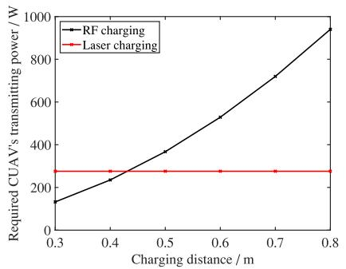  
(b)

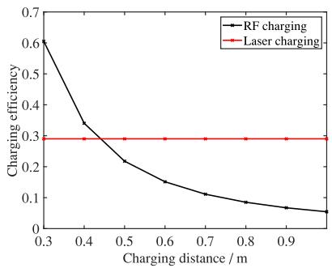  
(c)  
Fig. 2. Analysis results of (a) Relationship between UAV hovering power and weight, (b) The relationship between the charging distance and the launch power of the charging UAV, and (c) Relationship between charging distance and energy conversion efficiency.

## III. FEASIBILITY OF WIRELESS POWER TRANSFER FOR AERIALLY CHARGING

In this section, wireless power transfer (WPT) techniques are verified to provide enough power for charging the UAVs efficiently. The feasibility and efficiency of charging MUAVs with both near field charging and far field charging are validated.

The energy consumption of MUAV during mission is studied for evaluations on aerial charging performance. It is an intuitive assumption that the UAV is in a hovering state when performing a mission. The power consumption model [30] is as follows:

$$
P = T \times v _ { i } = { \frac { T ^ { \frac { 3 } { 2 } } } { \sqrt { 2 \rho N A } } } ,\tag{1}
$$

where T represents the thrust that keeps the UAV stationary, regardless of air resistance, which is approximately equal to the gravity of the UAV. The parameter $v _ { i }$ represents the wind speed relative to the UAV, which is derived from N rotors of area A.

The hovering power is shown in Figure 2(a). The charging parameters are shown in Table II. As the related work of near field wireless charging shown in Section II, the charging efficiency reaches 90%. Fixed near field wireless charging platform studied for charging UAVs with enough power and efficiency. Thus, it is feasible that the UAV can be charged by the near field wireless charger of CUAV.

RF energy transmission is derived from the Friis transmission equation: Based on Friis transmission equation, the RF energy transmission can be derived as follows:

$$
P _ { r } = P _ { t } \frac { A _ { e t } A _ { e r } } { r ^ { 2 } \lambda ^ { 2 } } ,\tag{2}
$$

where $P _ { r }$ is the received power by the receiving antenna, and $P _ { t }$ is denoted as the transmit power of the transmitting antenna. The parameter $A _ { e t }$ and $A _ { e r }$ represents the effective apertures, r is the distance between the two antennas, and λ is the wavelength of the electromagnetic wave. An omni-directional antenna radiates energy in all directions. Directional antennas are usually used, and the electromagnetic waves sent and received by the directional antennas are stronger in one or more specific directions. The purpose of using directional antenna is to improve the efficiency of radiated power. Directionality means different radiating or receiving capabilities for different spatial directions.

Considering the Ohmic loss of the antenna, the antenna gain G is used to describe directionality, which is closer to reality. The gain is proportional to the directionality, and the scale factor depends on the antenna design. Therefore, the above formula is converted to:

$$
P _ { r } = P _ { t } \frac { G _ { t } G _ { r } \lambda ^ { 2 } } { \left( 4 \pi r \right) ^ { 2 } } .\tag{3}
$$

The data analysis parameters are shown in Table I. The relation between the total weight of the MUAV and UAV’s power is shown in Figure 2(a). The CUAV’s transmitting power is the power emitted from the transmitting antenna. The transmitting power provides the receiving power of receiving power which equals to the hovering power of the MUAV when charging distance d is 0.5m. Hovering power of MUAV and transmitting power of CUAV increase with the increment of MUAV’s weight.

Figure 2(b) shows the required transmitting power when the receiving power of the mission UAV is 80W. Charging distance is the distance between the transmitter of the CUAV and the receiver of the MUAV. As depicted in Figure 2(c), the energy conversion efficiency of RF charging decreases as the charging distance increases. Suppose that the charging distance is 0.5m, the charging power of the MUAV is 80W, the RF charging efficiency is 21.7%. Experiments conducted in [31] have compared the efficiency of the new Witricity [32] and conventional inductive magnetic coupling. The results show that when the charging distance is over 6cm, the inductive magnetic coupling efficiency becomes lower than 10%. When the distance exceeds 20cm, the charging efficiency of Witricity falls below 10%. For higher charging efficiency, charging distance should be less than 1m in RF-based charging scheme. With limited charging power, RF charging is usually employed for charging devices which are driven by low energy, e.g., miniature UAVs and nano drones.

For RF energy charging, coupling based charging platform can provide adequate power supply to efficiently charge smallsized UAVs. For UAV-to-UAV charging schemes with near field charging techniques, as is shown in Figure 1(a), the CUAV carries a charging platform, on which MUAVs can land for recharging. Generally large-sized UAVs should be deployed as CUAVs, and small-sized UAVs should be used for data collection. Moreover, charging interface matching and UAV collision issues during charging processes should also be considered.

TABLE I PARAMETERS IN DATA ANALYSIS
<table><tr><td rowspan=1 colspan=1>Air density ρ / kg/m2</td><td rowspan=1 colspan=1>1.293</td></tr><tr><td rowspan=1 colspan=1>Gravitational acceleration $\overline { { \textnormal { g } / \ m / s ^ { 2 } } }$ </td><td rowspan=1 colspan=1>9.8</td></tr><tr><td rowspan=1 colspan=1>The speed of light $\overline { { c \mathrm { ~ } / \mathrm { ~ } m / s } }$ </td><td rowspan=1 colspan=1> $3 \times 1 0 ^ { 8 }$ </td></tr><tr><td rowspan=1 colspan=1>RF microwave signal frequency f / M hz</td><td rowspan=1 colspan=1>915</td></tr><tr><td rowspan=1 colspan=1>Antenna gain of transmit antenna $\overline { { G _ { t } \mathrm { ~ } / \mathrm { ~ } d B } }$ </td><td rowspan=1 colspan=1>8</td></tr><tr><td rowspan=1 colspan=1>Antenna gain of receiving antenna $\overline { { G _ { r } \mathrm { ~ } / \mathrm { ~ } d B } }$ </td><td rowspan=1 colspan=1>10</td></tr><tr><td rowspan=1 colspan=1>The number of rotors N</td><td rowspan=1 colspan=1>4</td></tr><tr><td rowspan=1 colspan=1>Area of each rotor $\overline { { A \mathrm { ~ } / \mathrm { ~ } m ^ { 2 } } }$ </td><td rowspan=1 colspan=1>0.1257</td></tr><tr><td rowspan=1 colspan=1>Charging power / W</td><td rowspan=1 colspan=1>80</td></tr><tr><td rowspan=1 colspan=1>QCW Stacked Array with &#x27;Fast Axis Collimation&#x27;(25 °C)</td><td rowspan=1 colspan=1>QD-Qxyzz-BSSO</td></tr><tr><td rowspan=1 colspan=1>Number of Diode bars / µm</td><td rowspan=1 colspan=1>400 to 2000</td></tr><tr><td rowspan=1 colspan=1>Emitting area /mm2</td><td rowspan=1 colspan=1>10 x (zz &quot;C 1)* pitch</td></tr><tr><td rowspan=1 colspan=1>QCW Optical Power per Diode Bar /W</td><td rowspan=1 colspan=1>up to 10000</td></tr><tr><td rowspan=1 colspan=1>Operating current / A @ 100W / bar</td><td rowspan=1 colspan=1>95A Typical - 115A Max</td></tr><tr><td rowspan=1 colspan=1>Operating current / A @ 200W / bar</td><td rowspan=1 colspan=1>185A Typical - 215A Max</td></tr><tr><td rowspan=1 colspan=1>Operating current / A @ 400W / bar</td><td rowspan=1 colspan=1>370A Typical - 390A Max</td></tr><tr><td rowspan=1 colspan=1>Operating voltage / V</td><td rowspan=1 colspan=1>&lt; 2V / bar</td></tr><tr><td rowspan=1 colspan=1>Total efficiency</td><td rowspan=1 colspan=1>58% @ 808 nm, 65% @ 940/980 nm</td></tr><tr><td rowspan=1 colspan=1>Laser wavelength /nm</td><td rowspan=1 colspan=1>790 to 980</td></tr></table>

TABLE II

PARAMETERS OF DJI UAVS IN EXPERIMENTS
<table><tr><td rowspan=1 colspan=1>UAV</td><td rowspan=1 colspan=1>MAVIC 2 Pro</td><td rowspan=1 colspan=1>Phantom 4 ProV2.0</td><td rowspan=1 colspan=1>MATRICE 100(TB48D battery)</td></tr><tr><td rowspan=1 colspan=1>Weight/kg</td><td rowspan=1 colspan=1>0.907</td><td rowspan=1 colspan=1>1.375</td><td rowspan=1 colspan=1>2.431</td></tr><tr><td rowspan=1 colspan=1>Hovering time/min</td><td rowspan=1 colspan=1>29</td><td rowspan=1 colspan=1>30</td><td rowspan=1 colspan=1>28</td></tr><tr><td rowspan=1 colspan=1>Battery capacity/mAh</td><td rowspan=1 colspan=1>3850</td><td rowspan=1 colspan=1>5870</td><td rowspan=1 colspan=1>5700</td></tr><tr><td rowspan=1 colspan=1>Battery output voltage/V</td><td rowspan=1 colspan=1>15.4</td><td rowspan=1 colspan=1>15.2</td><td rowspan=1 colspan=1>22.8</td></tr><tr><td rowspan=1 colspan=1>Battery energy (calculated by battery capacity andoutput voltage)/W h</td><td rowspan=1 colspan=1>59.29</td><td rowspan=1 colspan=1>89.224</td><td rowspan=1 colspan=1>129.96</td></tr><tr><td rowspan=1 colspan=1>Maximum charging power/W</td><td rowspan=1 colspan=1>80</td><td rowspan=1 colspan=1>160</td><td rowspan=1 colspan=1>180</td></tr><tr><td rowspan=1 colspan=1>Working power (calculated by hovering time andbattery energy)/W</td><td rowspan=1 colspan=1>122.67</td><td rowspan=1 colspan=1>178.448</td><td rowspan=1 colspan=1>278.49</td></tr></table>

Laser charging power $P _ { r }$ is shown as follow:

$$
P _ { r } = P _ { t } \eta _ { e l } \eta _ { t } \eta _ { l e }\tag{4}
$$

where $P _ { t }$ is the working power of laser transmitter. Laser charging efficiency over the air consist of the product of three components, which are electricity-to-laser conversion efficiency of transmitter $\eta _ { e l } ,$ , transmission efficiencyηt, and laser-to-electricity conversion efficiency of receiver $\eta _ { e l }$ . Due to the harm of laser exposure and transmission loss of laser energy, depending on charging distance and air quality, short charging distance is more practical for laser transmission. In this case, according to the numerical evaluation in [16], transmission efficiency is close to 100% and laser-to-electricity conversion efficiency is about 50% if the laser wavelength is 810nm. Computed by the simulated efficiency and parameters of a laser transmitter [33] shown in Table I, the charging efficiency is 29% and the charging power is 116W when the working power of laser transmitter is 400W. As analyzed, transmitting power of laser transmitters is sufficient for charging mainstream commercial battery-powered UAVs. With the advantage of low transmission loss of laser in the air, an MUAV can be charged from several meters away by a CUAV. The MUAV and the CUAV are less likely to collide with the charging distance, compared with the situation in near field charging. As a result, secure and efficient charging for MUAV can be simultaneously realized with laser power transmission.

Based on the aforementioned analysis outcome and energy metrics of mainstream DJI UAVs shown in Table II, off-theshelf UAV products are able to be recharged on the fly by RF and laser wireless charging methods with adequate power supply. We assumed that the missions being executed on the MUAVs are already locally optimized, e.g., as in [34], such that improving energy supply will further optimize the mission time by avoiding energy supply interruptions. On the energy source side, charging systems and charging equipment such as power transmitter, receiver and energy transformer with higher energy transformation efficiency can be designed and continuously upgraded for promoting the charging power and charging efficiency. As a result, it is feasible to design optimal wireless charging schemes for typical UAV data collection scenarios.

## IV. SINGLE CUAV CHARGING SCHEDULING

## A. System Description and Modeling

In the single CUAV charging scenario, one CUAV is scheduled to charge several MUAVs, as shown in Figure 3. Several MUAVs are dispatched to sense and collect data from multiple

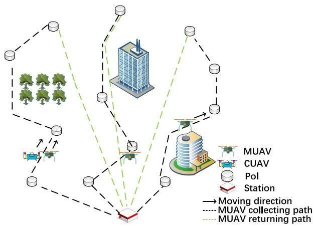  
Fig. 3. Data collection scenario with single CUAV.

PoIs along their traveling paths, which can be pre-determined and pre-scheduled independently by any path planning and scheduling algorithms [35], [36], and sequence of access PoIs. The MUAVs are able to keep collecting data from the corresponding PoIs while being charged by the CUAV. The environment contains blocks and boundary indicating obstacles existing in actual system scenarios, such as trees, buildings, no-fly zones. The CUAV should avoid the blocks and environment boundary while moving.

As battery capacity of each MUAV is not sufficient for accomplishing the data collection mission, energy stored by the MUAVs may be exhausted during the mission execution time. The CUAV is deployed into the system to tackle the possible energy shortage of the MUAVs by wireless energy charging as proposed. Note that, for comparison and evaluation, energy charging with ground charging nodes is also considered to replenish the MUAVs, such as charging stations, fixed charging platforms, and mobile charging vehicles. In this case, if the remaining energy of an MUAV is below the safety threshold, the MUAV has to physically access the ground charging nodes. The charging process at the ground station consumes additional time and energy, leading to extra mission time and lower working efficiency. In this work, we consider that the MUAVs can be charged by CUAVs during the working time by wireless charging to improve energy efficiency.

The mission of the MUAVs in our scenario is collecting data from the PoIs. The collection sequence of PoIs and flying trajectories of each MUAV is scheduled in advance. The MUAVs take an action between traveling to the next node and hovering to collect data. The objective of CUAV is to schedule the traveling path and charging time to replenish MUAVs on time, and minimize the total time used for MUAVs to finish the mission.

The CUAV is scheduled to charge the MUAVs. The set of MUAVs are denoted as $M = \{ M _ { i } | i = 1 , 2 , \dots , n \}$ . Each MUAV has assigned the mission to collect data by traversing a pre-planed path. The UAV traverse area is considered to be two dimensional (2D) with fixed border. A set of blocks $B = \{ B _ { i } | i = 1 , 2 , \ldots , n \} . \ P = \{ P _ { i } | i = 1 , 2 , \ldots , n \}$ represents the set of PoIs for collecting data. The time duration for collecting required data at PoI $P _ { i }$ is denoted as $D t ( P _ { i } )$ $M _ { i } ^ { t }$ denotes the action of MUAV $M _ { i }$ at the beginning of time t, which is moving in the direction (two-dimensional vector) of $\theta _ { M _ { 1 } } ^ { t }$ with velocity $\nu ,$ or hovering at the location of PoI to collect data. The action of CUAV at time slot t is denoted as $C ^ { t }$ , which is selected between moving in the direction of $\theta _ { C ^ { t } }$ with velocity v and charging an adjacent MUAV. The CUAV moves or hovers together with the target MUAV during the whole charging process. To simplify the model, the MUAV and CUAV move with a constant velocity v and a constant moving distance l in each time slot. If the distance between a UAV to a target location is less than l, we can roughly assume that the UAV can reach the target location. As aforementioned, we know that the charging distance should be as short as possible for higher energy transfer efficiency. Practically, the charging distance is less than 1m, such that the two UAVs can be treated as a single UAV in the particular location.

## B. Problem Formulation

The optimization problem of efficient wireless charging is scheduling the CUAV to charge MUAVs on time. The system operation process is assumed to be time slot based. As each time slot begins, the CUAV determines either an action of either charging or moving based on the system states observed. By taking a charging action, the CUAV selects a charging target MUAV. A direction for moving should be decided when the moving action is taken. The control of CUAV is modeled as a Markov decision process (MDP) $M = ( S , A , P , R , \gamma )$ including the following problem formulation details.

State Space: To get ready for charging the MUAVs, the CUAV observes and tracks the existing active MUAVs in the system. The CUAV takes actions based on the observed states, defined as follows. The state space S of the CUAV is an infinite set including possible states during the charging process. The state at time slot t is $S ^ { t }$ . Each state consists of all the current locations (two dimensional coordinates) of the MUAVs, remaining energy of the MUAV, accumulated energy charged to MUAVs, and the working status state of the CUAV which includes the charging status and moving status.

Action Space: Action space includes all the possible actions that CUAV could take during the process of wireless energy charging. The action taken by the CUAV at time slot t is represented by $A ^ { t }$ . Each action of CUAV contains the moving direction (a two dimensional vector) and the charging target. The action space of moving direction is continuous, with the moving distance set as a constant. The charging target is the next MUAV that the CUAV determines to charge. The CUAV decides to charge each MUAV at a certain probability drawn from the proposed Deep Deterministic Policy Gradient (DDPG) based decision making algorithm.

Transition Probability: State transition probability is defined as the probability of the next possible state $S ^ { t + \mathrm { i } }$ given the CUAV takes a particular action $A ^ { t }$ in the current state $S ^ { t }$ , i.e., $P : S ^ { t } \times A ^ { t } \stackrel { \cdot } {  } S ^ { t + 1 }$ . Different actions made by the CUAV changes the CUAV state in different ways, e.g., both the location and energy states will change when an action of moving to another location is taken. In a deep reinforcement learning based optimization, transition probability values at different states are calculated based on all the collected historical data of state transitions observed by the CUAV.

Reward Function: The data collection mission completes when all the data is collected and the MUAVs have returned to the station. The mission completion time of MUAV $M _ { i }$ is $T _ { i }$

$$
T _ { i } = T m _ { i } + T c _ { i } + T w _ { i } ,\tag{5}
$$

where $T m _ { i }$ denotes the total time spent on moving to the PoIs. $T { c } _ { i }$ is the time spent on collecting data from all the PoIs. $T w _ { i }$ denotes the total time that the MUAV spends on waiting to be charged by the CUAV. As the MUAV will stop working and waiting to be recharged if the energy level falls below a particular threshold, the charging scheduling policy can shorten $T w _ { i }$ if the MUAV can be scheduled to be recharged on time. The optimization objective of the CUAV is to minimize the average mission completion time of all the MUAVs, as follows:

$$
\operatorname* { m i n } { \frac { \sum _ { i = 1 } ^ { n } { T _ { i } } } { n } } .\tag{6}
$$

The reward function $S ^ { t } \times A ^ { t } \to \mathbb { R } ^ { t + 1 }$ denotes the reward of the CUAV if it takes action $C ^ { t }$ and its state transforms from $S ^ { t }$ to $S ^ { t + 1 }$ at time t. In our problem, we aim to minimize the mission completion time. The traveling path and PoI connection sequence are pre-planned, if the MUAVs can be charged by CUAVs on time (keep energy state above a threshold), they will continue working, and the mission time will be reduced. To schedule the agent to correctly select target and move in directions correctly, the reward of CUAV at time t is defined as follows:

$$
\boldsymbol { r } ^ { t } = \boldsymbol { R } \boldsymbol { c } ^ { t } + \boldsymbol { R } \boldsymbol { m } ^ { t } - \boldsymbol { P } _ { l } - \boldsymbol { P } _ { b } .\tag{7}
$$

The term $R c ^ { t }$ is a reward component indicating the profit obtained by successfully charging an MUAV during the time slot $t ,$ defined as follows:

$$
\begin{array} { r } { R c ^ { t } = \left\{ \begin{array} { l l } { ( E ^ { t } + R c ) \times f _ { t } , \mathrm { c h a r g i n g ~ a ~ M U A V } ; } \\ { 0 , \qquad \mathrm { n o t ~ c h a r g i n g ~ o r } \ E c _ { i } ^ { t } \geq E m _ { i } . } \end{array} \right. } \end{array}\tag{8}
$$

The reward $R c ^ { t }$ equals zero if the CUAV chooses not to charge an MUAV. A positive reward will be incurred when CUAV charges an MUAV. The component $E ^ { t }$ in $R c ^ { t }$ is a variable indicating the charging amount of energy from the CUAV to the MUAV. Rc is a positive offset indicating a basic reward to encourage the actions of energy charging by the CUAV, regardless of the charging results.

The factor $f _ { t }$ indicates the fairness impacts to the CUAV reward. The CUAV will receive more reward given that the MUAVs are charged fairly. The energy charging fairness is derivated as follows. $\bar { E r ^ { t } } = \{ \bar { E r _ { 1 } ^ { t } } , \bar { E r _ { 2 } ^ { t } } \cdot \cdot \cdot \bar { E r _ { n } ^ { t } } \}$ denotes the remaining energy of the MUAVs at time t. $\begin{array} { r l } { E m } & { { } = } \end{array}$ $\{ E m _ { 1 } , E m _ { 2 } \cdot \cdot \cdot E m _ { n } \}$ is the set of the estimated minimum required charging amount of energy for MUAVs to finishing corresponding missions. $E c ^ { t } = \{ \hat { E } c _ { 1 } ^ { t } , E c _ { 2 } ^ { t } \cdot \cdot \cdot E c _ { n } ^ { t } \}$ denotes the accumulated energy charged to the MUAVs from time step 1 to t. The fairness factor $f _ { t }$ is derived by using Jain’s fairness index [37], as follows:

$$
\begin{array} { r } { f _ { t } = w _ { f } f c _ { t } + \big ( 1 - w _ { f } \big ) f r _ { t } , } \end{array}\tag{9}
$$

$$
\begin{array} { r l } & { f c _ { t } = \frac { \left( \sum _ { i = 1 } ^ { n } \operatorname* { m i n } \left( \frac { E c _ { i } ^ { t } } { E m _ { i } } , 1 \right) \right) ^ { 2 } } { n \times \sum _ { i = 1 } ^ { n } \operatorname* { m i n } \left( \frac { E c _ { i } ^ { t } } { E m _ { i } } , 1 \right) ^ { 2 } } , } \\ & { f r _ { t } = \frac { \left( \sum _ { i = 1 } ^ { n } E r _ { i } ^ { t } \right) ^ { 2 } } { n \times \sum _ { i = 1 } ^ { n } E r _ { i } ^ { t 2 } } } \end{array}\tag{10}
$$

(11)

where the factor $f { c } _ { t }$ is an indicator of measuring whether MUAVs are charged fairly. The factor $f r _ { t }$ shows whether the CUAV charges MUAVs with low remaining energy. wf is a weight which can be adjusted for fairer charging capacity or fairer remaining energy. The CUAV will obtain higher reward given all MUAVs are recharged fairly.

Note that in (8), the CUAV should not be encouraged to charge those MUAVs with enough energy for executing missions to avoid energy waste. The reward $R c ^ { t }$ is set to be zero if the CUAV charges MUAV $M _ { i }$ in the case that $E c _ { i } ^ { t }$ is larger than $E m _ { i }$

The term $R m ^ { t }$ in (8) represents the reward to encourage the CUAV to move and approach the target MUAV which requires energy charging. We consider $R m ^ { \overline { { t } } }$ to be negatively correlated to the remaining energy level of the target MUAV, $\mathrm { i . e . } ,$ , an MUAV with less energy remained has the high priority to be charged. $R m ^ { t }$ also becomes lower as well as the relative distance between the CUAV and the target MUAV is high, i.e., higher cost will be incurred to the CUAV to charge an MUAV in a longer distance. Based on the aforementioned analysis, $R m ^ { t }$ is formulated as follows:

$$
\begin{array} { r } { R m ^ { t } = \left\{ \begin{array} { l l } { w _ { d } D ( i ) ^ { t } + w _ { e } E r _ { i } ^ { t } , \mathrm { m o v i n g ~ t o ~ a ~ M U A V } ; } \\ { 0 , \qquad \mathrm { c h a r g i n g ~ a ~ M U A V } } \end{array} \right. } \end{array}\tag{12}
$$

where $D ( i ) ^ { t }$ is the Euclidean distance between the CUAV and MUAV $M _ { i }$ , and $E r _ { i } ^ { t }$ is the amount of remaining energy of $M _ { i }$ at time $t , w _ { d }$ and $w _ { e }$ are negative coefficients. When the CUAV is charging an MUAV, $R \bar { m } ^ { t }$ is set to be zero.

There are also two terms indicating punishment caused to the CUAV as in (7). $P _ { l }$ denotes the punishment (i.e., negative valued reward) for the CUAV if the CUAV has failed to keep the remaining energy of any MUAV above the safety threshold $E _ { t h } . \ P _ { l }$ is defined as follow:

$$
P _ { l } = \left\{ \begin{array} { l l } { R c ^ { t } , } & { E c _ { i } ^ { t } < E m _ { i } \ \mathrm { a n d } \ E r _ { i } ^ { t } > E a ^ { t } } \\ { \ } & { \mathrm { a n d } \exists M _ { i } \in M , E r _ { i } ^ { t } < E _ { t h } } \\ { R c ^ { t } + p , } & { E c _ { i } ^ { t } \geq E m _ { i } } \\ { \ } & { \mathrm { a n d } \exists M _ { i } \in M , E r _ { i } ^ { t } < E _ { t h } } \\ { p , } & { \mathrm { C U A V ~ i s ~ n o t ~ c h a r g i n g } } \\ { \ } & { \mathrm { a n d } \exists M _ { i } \in M , E r _ { i } ^ { t } < E _ { t h } } \\ { 0 , } & { \mathrm { o t h e r w i s e } . } \end{array} \right.\tag{13}
$$

In (13), $E a ^ { t }$ is the average remaining energy of all MUAVs at time t. $P _ { l }$ results in a negative value as a punishment to the reward if the remaining energy Er of any MUAV falls below the threshold $E _ { t h }$ for mission. If the remaining energy of $M _ { i }$ is greater than the average remaining energy of all MUAVs (i.e., $\bar { E } r _ { i } ^ { t } > E a ^ { t } )$ , the punishment is set as $- R c ^ { t }$ . As $E ^ { t }$ is the successfully charged amount of energy from the CUAV to the target MUAV at time $t ,$ if the MUAV $M _ { i }$ already has enough energy for the mission $( \mathrm { i . e . , ~ } E c _ { i } ^ { t } \geq E m _ { i } )$ ), the punishment is set $\mathrm { a s } - R c ^ { t } + p$ , where $p$ is a constant positive value to urge the CUAV to stop charging. The charging reward $R c ^ { t }$ will also be forfeited in this case. When the CUAV is not charging (e.g., on the move), punishment also exists to urge the CUAV to find a target to charge as soon as possible. It should be noted that, $P _ { l }$ equals to zero if no MUAV is in low a power state in the system.

$P _ { b }$ is the punishment if the CUAV flies out of the boundary or hits a block (such as trees, buildings, no-fly zones) in the environment. The increase of $P _ { b }$ can decrease the probability of hitting a block. However, it will increase the convergence difficulty. In our experiment, the value of $P _ { b }$ is about 2 times of the reward CUAV charging one MUAV (no punishment) at one timeslot. It should be adjusted according to the experiment result. If the algorithm is hard to converge, the value should be decreased. If the CUAV hits the block, the value should be increased.

Discount Factor: $\gamma \in [ 0 , 1 ]$ is defined as a discount factor which determines how much the future reward influence the current immediate reward.

## C. Optimizing Energy Charging With Deep Deterministic Policy Gradient

In our scenario, the environment of CUAV charging is dynamic. The MUAVs’ energy and locations change when performing data collection missions. The charging actions of CUAV will directly influence the MUAVs’ energy and mission state. Traditional optimizing algorithms are not good solutions to solve the dynamic problem. Reinforcement learning algorithms have been used for scheduling UAVs to perform specific missions [39], [40], which can even be implemented in a distributed manner with in-edge and on-device intelligence [41]. Deep Q Network (DQN) [42] is a widely-used reinforcement learning algorithm for large action spaces and system scenarios with uncertainties. In our model, CUAV’s action includes the moving direction of CUAV and the moving direction is continuous. DQN is not suitable for solving the problem with continuous action space.

Deep Deterministic Policy Gradient (DDPG) is a typical policy-based reinforcement learning algorithm that learn policies in continuous action space. The optimization of energy charging is to achieve the CUAV charging policy that yields the highest overall reward to the CUAV. A policy-based optimization algorithm updates the CUAV charging policy directly. which is defined as the probability distribution of actions given any states observed. Reinforcement learning based techniques have been widely applied for solving agent decision making problems in highly dynamic communication systems, e.g., trajectory design for efficient UAV transmission [38] MDP or similar problems. DDPG introduce deep neural network and actor-critic for efficiently solving the optimal charging problem of the system.

CUAV observes and inputs system states into a structure of neural networks, which operates as an approximator for the Q function and actor. In DDPG, the actor $\mu ( s | \theta ^ { \mu } )$ is a neural network to generate the actions of the CUAV based on observation. The critic $Q ( s , a | \theta ^ { Q } )$ is an approximated deep neural network that generates the estimated Q value of CUAV’s action. The neural networks are updated by minimizing the loss L:

$$
L = \frac { 1 } { N } \sum _ { t } \Bigl ( y ^ { t } - Q \Bigl ( s _ { t } , a _ { t } | \theta ^ { Q } \Bigr ) \Bigr ) ^ { 2 } ,\tag{14}
$$

$$
y ^ { t } = r _ { t } + \gamma Q ^ { \prime } \Big ( s _ { t + 1 } , \mu ^ { \prime } \Big ( s _ { t + 1 } | \theta ^ { \mu ^ { \prime } } \Big ) \Big ) .\tag{15}
$$

The policy gradient $j$ is optimized along with the neural network parameters θ:

$$
\begin{array} { c } { { \nabla J _ { \theta ^ { \mu } } = \mathbb { E } _ { s \sim \rho ^ { \beta } } \Big [ \nabla _ { a } Q ( s , a | \theta ^ { Q } ) | s = s _ { t } , } } \\ { { a = \mu ( s _ { t } ) \nabla _ { \theta ^ { \mu } } \mu ( s | \theta ^ { \mu } ) | s = s _ { t } \Big ] . } } \end{array}\tag{16}
$$

Both the actor and critic use a target network to improves learning stability. The parameters of target networks update slower than the actor and critic:

$$
\begin{array} { r } { \theta ^ { Q ^ { \prime } }  \tau \theta ^ { Q } + ( 1 - \tau ) \theta ^ { Q ^ { \prime } } , } \\ { \theta ^ { \mu ^ { \prime } }  \tau \theta ^ { \mu } + ( 1 - \tau ) \theta ^ { \mu ^ { \prime } } , } \end{array}\tag{17}
$$

where $\tau$ is set to 0.01.

DDPG is an offline algorithm. The online algorithm will directly update the policy during the training process (don’t save past experience). The offline algorithm updates the policy by historical experience records. In our algorithm, the CUAV saved the records in the its replay buffer for updating. Each record contains the state of the CUAV, the action performed, the reward obtained and the next state. The actor and critic are updated by the experience records sampled from the replay buffer.

Noise is used for enhancing policy exploration during the training process in DRL. An action noise can be added to the action for exploring better actions to potentially achieve higher rewards. Conventionally, the OU action noise is employed to generate a sequential correlation exploration in DDPG, which is computed by the Ornstein-Uhlenbeck process [43]. Action noise generated through a random process is constantly changing. If the input state remains the same at different time, the output actions are different. The action space noise is completely independent of the current state.

Different from action noise, parameter space noise perturbs the neural network by adding Gaussian noise to the parameters in the neural network. In this way, the perturbed actor network will generate exploration actions. The value of adaptive parameter space noise [44] is scaled according to the current actor. The specific method is to define the distance between perturbed and non-perturbed policies in the action space, and then adaptively increase or decrease the parameter space noise according to whether the parameter space noise is below or above a certain threshold. The time-varying scale $\sigma _ { k }$ is used for adapting the scale of the noise over time:

$$
\sigma _ { k + 1 } = { \left\{ \begin{array} { l l } { \alpha \sigma _ { k } , } & { { \mathrm { i f ~ } } d ( \pi , { \widetilde { \pi } } ) < \delta } \\ { { \frac { 1 } { \alpha } } \sigma _ { k } , } & { { \mathrm { o t h e r w i s e } } , } \end{array} \right. }\tag{18}
$$

where $d ( \pi , \widetilde { \pi } )$ denotes the action distance between policy of actor and perturbed actor. α is used to rescale σ. δ is the threshold. Action distance is shown as follow:

$$
d ( \pi , \widetilde { \pi } ) = \sqrt { \frac { 1 } { N } \sum _ { i = 1 } ^ { N } \mathbb { E } _ { s } \Big [ ( \pi ( s ) _ { i } - \widetilde { \pi } ( s ) _ { i } ) ^ { 2 } \Big ] }\tag{19}
$$

Algorithm 1 DDPG With Adaptive Parameter Space Noise   
Randomly initialize critic network $Q$ and actor network   
$\mu ( s | \theta ^ { \mu ^ { \prime } } )$   
Initialize target network $Q ^ { \prime }$ and $\mu ^ { \prime } ,$ set parameters of   
perturbed actor $\mu _ { \theta } ^ { p }$ with the copy of actor’s initial parameters   
Initialize replay buffer R   
for episode = 1 to M do   
Receive initial state $s _ { 1 }$   
for step t = 1 to maximum episode length do   
Select action by perturbed actor $a _ { t } ~ = ~ \mu _ { \theta } ^ { p } ( s _ { t } )$ , the   
CUAV take actions $a _ { t }$ , and get the new state st+1   
Receive reward $r _ { t } .$ , store $\left( { { s _ { t } } , { a _ { t } } , { r _ { t } } , { s _ { t + 1 } } } \right)$ in replay   
buffer   
Sample a random minibatch of N samples   
$( s _ { i } , a _ { i } , r _ { i } , s _ { i + 1 } )$ form reply buffer   
Compute action distance $d ( \pi , \widetilde { \pi } )$ and scale $\sigma ,$   
Set $y ^ { i } = r _ { i } + \gamma Q ^ { \prime } ( s _ { i + 1 } , \mu ^ { \prime } ( s _ { i + 1 } | \theta ^ { \mu ^ { \prime } } ) )$   
Update critic by minimizing the loss $\begin{array} { r } { \dot { L } = \frac { 1 } { N } \sum _ { i } ( y ^ { i } - } \end{array}$   
$Q ( s _ { i } , a i | \theta ^ { Q } ) ) ^ { 2 }$   
Update actor using the sampled policy gradient:   
$\bar { \nabla _ { \boldsymbol { \theta } ^ { \mu } } } J$ ≈ $\begin{array} { r } { \frac { 1 } { N } \sum _ { i } \dot { \nabla _ { a } } Q \dot { ( s , a | \dot { \theta } ^ { Q } ) } | _ { s = s _ { i } , a = \mu ( s _ { i } ) } } \end{array}$   
$\nabla _ { \theta ^ { \mu } } \mu ( s | \theta ^ { \mu } ) | s _ { i }$   
Update target networks for CUAV:   
$\theta ^ { \dot { Q } ^ { \prime } }  \tau \theta ^ { \check { Q } } + ( 1 - \tau ) \theta ^ { Q ^ { \prime } } , \theta ^ { \mu ^ { \prime } }  \tau \theta ^ { \mu } + ( 1 - \tau ) \theta ^ { \mu ^ { \prime } } \nonumber$   
Update perturbed actor parameters $\widetilde { \pi }  \pi + \mathcal { N } ( 0 , \sigma ^ { 2 } )$   
end for   
end for

where E is estimated by a sampled mini batch of experience from replay buffer. The algorithm of training CUAV is shown as in Algorithm 1.

## V. MULTIPLE CUAVS CHARGING SCHEDULING

## A. Scenario and System Model

As one single CUAV may only provide limited amount of energy and cover a certain number of MUAVs in the system, in a system scenarios where MUAVs have more intense missions, e.g., more data to collect, multiple CUAVs have to be deployed to provide sufficient energy for multiple MUAVs. In this case, multiple CUAVs have be to scheduled simultaneously, with cooperation behaviors and interactions among the CUAVs to charge MUAVs efficiently, resulting in a more complicated system scenario. The moving trajectory, the sequence of MUAV charging, and the charging time of each CUAV should be coordinated with other CUAVs for the overall system charging performance and schedules. The charging scenario with multiple CUAVs is shown in Figure 4.

More than one CUAVs are considered in the proposed multiple CUAVs system scenario. $C = \{ C _ { i } | i = 1 , 2 , \ldots , n \}$ denotes the set of all CUAVs. The action taken by the CUAV indexed i at time slot t is denoted as $C _ { i } ^ { t }$ . The CUAV $C _ { i }$ moves in the direction of $\theta _ { C _ { i } } ^ { t }$ with the constant velocity v when approaching an MUAV for charging. We assume that the charging between CUAVs and MUAVs is a one to one process. The number n of deployed CUAVs affects the mission time and number of all the MUAVs. If the required mission time of MUAVs increases because of heavier task load, or the number of MUAVs increases, more charging efforts should be required from the CUAVs. In this case, more CUAVs need to be deployed to prevent the early energy exhaustion of MUAVs.

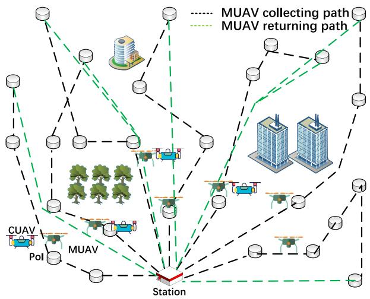  
Fig. 4. Data collection scenario with multiple CUAVs.

## B. Problem Formulation

Multiple CUAVs make decisions independently at the same time. The environment is influenced by the joint action of the CUAVs and the charging performance is decided by the joint policy of all CUAVs’ policies. As a result, the CUAVs will interact with each other when charging MUAVs. Different from the single CUAV case, decisions made by each CUAV in the multiple CUAV case is influenced by actions of other CUAVs, by means of reward influenced by other CUAVs. As fairness charging affects the reward of each CUAV, the reward of a CUAV can be promoted when other CUAVs make charging decisions to replenish the MUAVs in the system fairly. Otherwise, the reward of each CUAV decreases if other CUAVs takes bad charging policies, e.g., when the MUAVs are unfairly charged, leading to fast battery draining and mission failures. To deal with the CUAV interactions, a Markov game [18] is applied as an extension of MDP for solving the multi-agent optimization. The joint policy of CUAVs should be optimized simultaneously for better overall charging performance. The control problem of multiple UAVs is modeled as a Markov game which is formally defined as $M = ( S , A , T , R , O , \gamma )$ , explained as follows.

State Space: Similar to the definition of state space in the single CUAV case. Each state of the system at time slot t is denoted as $S ^ { t } { } _ { ; }$ , including all the locations of CUAVs and MUAVs, the remaining energy levels of MUAVs, accumulated energy charged to MUAVs, and indicators showing that the MUAVs are moving or collecting data.

Observation: In the single CUAV scenario, it is reasonable that the CUAV is able to directly obtain all the system states as the MUAVs who are receiving energy from the CUAV tend to reveal their information to the CUAV. However, In the scenario with multiple CUAVs, as other CUAVs are independent system participants, uncertainties may exist when a particular CUAV obtain states from other CUAVs. As a result, observation form the perspective of each CUAV should be used for making decisions instead of system state. $O ^ { t } = \{ O _ { 1 } ^ { t } , O _ { 2 } ^ { t } , . . . , O _ { n } ^ { t } \}$ is the set of observations of all CUAVs as agents at time t. In the scenario with multiple CUAVs, an observation includes remaining energy levels of MUAVs, accumulated energy charged to MUAVs, and location information of all the CUAVs and MUAVs. The state of environment changes with the joint actions of all CUAVs take their own actions after observing the environment.

Action Space: Action space A includes the actions of all the CUAVs. The set of actions of all the CUAVs at time slot t is denoted as $A ^ { t } = \{ A _ { 1 } ^ { t } , A _ { 2 } ^ { t } , . . . , A _ { n } ^ { t } \}$ . Similar to the single CUAV case, Each CUAV decides the moving direction (a two dimensional vector) and the charging target MUAV.

State Transition Function: State transition function $T : S ^ { t } \times$ $A _ { 1 } ^ { t } \times A _ { 2 } ^ { t } \cdot \cdot \cdot \times A _ { n } ^ { t } \to S ^ { t + 1 }$ generates the probability distribution over states $S ^ { t + 1 }$ at time $t + 1$ based on the current state and CUAV actions. Each CUAV takes an action which is the output of the proposed learning-based actor network, after inputting the current observation.

Reward Function: Reward function $S _ { i } ^ { t } \times A _ { i } ^ { t } \  \ \mathbb { R } _ { i } ^ { t + 1 }$ denotes the reward of the CUAV $C _ { i }$ at time slot t, given that the CUAV observes a system state $S _ { i } ^ { t }$ and takes an action $A _ { i } ^ { t } .$ In the scenario of multiple CUAVs, we aim to minimize the average mission completion time of all the MUAVs. The traveling path and PoI connection sequence are pre-planned and known. If the MUAVs are successfully charged by CUAVs on time (i.e., keeping energy state above a threshold), the MUAVs will continue in operation. The mission completion time will not significantly increase if the MUAVs are replenished with energy on time. The reward function is defined to encourage the CUAVs as agents to carefully schedule the charging targets and moving directions. The reward function of the CUAV $C _ { i }$ at time t is formulated as follows:

$$
\boldsymbol { r } _ { i } ^ { t } = R \boldsymbol { c } _ { i } ^ { t } + R \boldsymbol { m } _ { i } ^ { t } - P _ { l } - P _ { b }\tag{20}
$$

where $R c _ { i } ^ { t }$ denotes CUAV $C _ { i } ^ { \phantom { } , } \mathrm { s }$ reward from charging an MUAV at time $t . ~ R m _ { i } ^ { t }$ represents the reward while the CUAV is moving to a charging target. $P _ { l }$ denotes the punishment for CUAV if any MUAV’s remaining energy is below the low power threshold $E _ { t h }$ . The punishment $P _ { l }$ is defined as in (13). $P _ { b }$ is the punishment if the CUAV hits a block or boundary. Note that the reward of any particular CUAV is influenced by the behaviors of all the CUAVs. For example, given other CUAVs fail to supply energy to MUAVs on time, the CUAV will receive less reward as the punishment component $P _ { l }$ is activated by other CUAVs.

Similar to the single CUAV scenario, $R c _ { i } ^ { t }$ is defined as follows:

$$
\begin{array} { r } { R c _ { i } ^ { t } = \left\{ \begin{array} { l l } { ( E _ { i } ^ { t } + R c ) \times f _ { t } , } & { \mathrm { c h a r g i n g ~ a ~ M U A V } ; } \\ { 0 , } & { \mathrm { n o t ~ c h a r g i n g } } \end{array} \right. } \end{array}\tag{21}
$$

where $E _ { i } ^ { t }$ the charging capacity of the CUAV $C _ { i }$ when the CUAV is charging an MUAV during time slot t. Rc is a positive offset indicating a basic reward to encourage charging actions. The fairness factor $f _ { t }$ is defined as in (9). In the scenario with multiple CUAVs, MUAVs can be charged by different CUAVs. The charging fairness index $f _ { t }$ is therefore decided by the charging actions of all the CUAVs. The fairness factor $f _ { t }$ with respect to a particular CUAV increases even if the MUAVs are charged fairly by other CUAVs. In this case, the joint policies of CUAVs should be optimized to collaboratively charge the MUAVs to achieve the optimized system performance.

$R m _ { i } ^ { t }$ is a term encouraging the CUAV $A _ { i }$ to move close to a target MUAV, which is based on the charging target’s energy and relative location of the charging target and the CUAV.

$$
\begin{array} { r } { R m _ { i } ^ { t } = \left\{ \begin{array} { l l } { w _ { d } D ( i , j ) ^ { t } + w _ { e } E r _ { j } ^ { t } , } & { \mathrm { m o v i n g ~ t o ~ M U A V } ~ M _ { j } } \\ { 0 , } & { \mathrm { c h a r g i n g ~ a ~ M U A V } } \end{array} \right. } \end{array}\tag{22}
$$

where $D ( i , j ) ^ { t }$ is Euclidean distance between CUAV $C _ { i }$ and MUAV $M _ { j }$ and $E r _ { j } ^ { t }$ is remaining energy of $M _ { j }$ at time $t , \ w _ { d }$ and $w _ { e }$ are negative coefficients to adjust $R m _ { i } ^ { t }$

## C. Solving the Markov Game With MADDPG

In our analyzed scenario, actions of one CUAV have potential impacts on the actions of other CUAVs. The MUAV charging effect is determined by all the CUAVs. The charging fairness is determined by the policies of all the CUAVs. The joint policies of all the CUAVs and policy of each CUAV should be optimized at the same time. What’s more, single agent reinforcement learning cannot be applied in multi-agent problems directly, because the actions of other agent bring uncertain factors. It will lead to that the optimized policy is unstable.

To solve the Markov game where multiple CUAVs interact with each other to provide jointly optimized charging services to MUAVs, Multi-Agent Deep Deterministic Policy Gradient (MADDPG) [19] can be applied as a method to generate optimal policies for multi-agent cooperation or competition problems. A scheduling algorithm based on MADDPG is proposed for the case of scheduling charging policies of multiple CUAVs.

MADDPG provides a decentralized executing and centralized training framework that allows CUAVs to use information from other CUAVs for training, but not for testing. MADDPG can be applied in cooperative scenarios by extending the actor-critic policy gradient methods where the critic is augmented with extra information about the policies of other CUAVs. Each CUAV has a critic, where the critic’s training process uses additional information about other CUAV’s policies. Other CUAVs’ information can be used for critic to learn approximate policies of other CUAVs, which can solve the problem that the optimized policy is unstable. However, the training of the actor still only uses CUAV’s own information. The policies of $n \operatorname { C U A V s } \ \pi = \{ \pi _ { 1 } , \pi _ { 2 } , . . . , \pi _ { n } \}$ is parameterized by $\boldsymbol { \theta } = \{ \theta _ { 1 } , \theta _ { 2 } , \dots , \theta _ { n } \}$ . The gradient of the expected return for agent is:

$$
\begin{array} { r l r } & { } & { \nabla _ { \theta _ { i } } J ( \theta _ { i } ) = \mathbb E _ { s \sim \rho ^ { \mu } , a _ { i } \sim \pi _ { i } } \big [ \nabla _ { \theta _ { i } } \log \pi _ { i } ( a _ { i } | o _ { i } ) Q _ { i } ^ { \pi } } \\ & { } & { ( x , a _ { 1 } , a _ { 2 } , \ldots , a _ { n } ) \big ] , } \end{array}\tag{23}
$$

where $Q _ { i } ^ { \pi } ( x , a _ { 1 } , a _ { 2 } , . . . , a _ { n } )$ is the centralized action-value function. $a _ { 1 } , a _ { 2 } , \ldots , a _ { n }$ is the action of all the n CUAVs and $x$ is the set of all the observations of the CUAVs. The $Q ^ { \pi }$ of each CUAV is learned separately and the reward can be set according to competitive or cooperative scenario.

The gradient can be extended to deterministic policies and the policy parameter θ can be replaced by the action function $\mu . \mathrm { { \ S o } }$ , the gradient can be converted to:

$$
\begin{array} { r } { \nabla _ { \theta _ { i } } J ( \mu _ { i } ) = \mathbb { E } _ { x , a \sim \mathcal { D } } \Big [ \nabla _ { \theta _ { i } } \mu _ { i } ( a _ { i } | o _ { i } ) \nabla _ { a _ { i } } Q _ { i } ^ { \mu } \qquad } \\ { ( x , a _ { 1 } , a _ { 2 } , \ldots , a _ { n } ) | _ { a _ { i } = \mu _ { i } ( o _ { i } ) } \Big ] , } \end{array}\tag{24}
$$

where D is the experience replay buffer which contains data from past decision making steps of the CUAVs during the training, where past steps taken by the CUAVs in the environment are saved as a tuple $( x , x ^ { \prime } , o _ { 1 } , o _ { 2 } , \ldots , o _ { n } , r _ { 1 } , r _ { 2 } , \ldots , r _ { n } )$ $Q _ { i } ^ { \mu }$ is updated by loss:

$$
\begin{array} { r } { \mathcal { L } ( \theta _ { i } ) = \mathbb { E } _ { x , a , r , x ^ { \prime } } \Big [ \big ( Q _ { i } ^ { \mu } ( x , a _ { 1 } , a _ { 2 } , \ldots , a _ { n } ) - y \big ) ^ { 2 } \Big ] , } \\ { y = r _ { i } + \gamma Q _ { i } ^ { \mu ^ { \prime } } \big ( x ^ { \prime } , a _ { 1 } ^ { \prime } , a _ { 2 } ^ { \prime } , \ldots , a _ { n } ^ { \prime } \big ) | _ { a _ { j } ^ { \prime } = \mu _ { j } ^ { \prime } ( o _ { j } ) } , } \end{array}\tag{25}
$$

where $\mu ^ { \prime } = \{ \mu _ { \theta _ { 1 } } ^ { \prime } , \mu _ { \theta _ { 2 } } ^ { \prime } , \dots , \mu _ { \theta _ { n } } ^ { \prime } \}$ is the target policies and $\theta ^ { \prime }$ is the its policy parameter.

Considering the problem that the agents’ changing policies contribute to the unfixed environment, the algorithm proposes to train a collection of K different sub-policies.

$$
\begin{array} { r l } & { \nabla _ { \theta _ { i } ^ { k } } J _ { e } ( \mu _ { i } ) } \\ & { \phantom { = } = \frac { 1 } { K } \mathbb { E } _ { x , a \sim \mathcal { D } _ { i } ^ { ( k ) } } \biggl [ \nabla _ { \theta _ { i } ^ { ( k ) } } \mu _ { i } ^ { ( k ) } ( a _ { i } | o _ { i } ) \nabla _ { a _ { i } } Q ^ { \mu ^ { i } } } \\ & { \phantom { = } \left( x , a _ { 1 } , \dots , a _ { n } \right) \big | _ { a _ { i } = \mu _ { i } ^ { ( k ) } ( o _ { i } ) } \biggr ] , } \end{array}\tag{26}
$$

where policy $\mu _ { i }$ is an ensemble of K different sub-policies with sub-policy k denoted by $\mu _ { i } ^ { ( k ) } . ~ { \mathcal { D } } _ { i } ^ { ( k ) }$ is the experience replay buffer of sub-policy $\mu _ { i } ^ { ( k ) }$

The adaptive parameter space noise can be used in multiagent algorithm. The actor network of CUAV is perturbed by space noise for outputting exploration actions. The multi CUAVs’ charging policies are optimized by Algorithm 2.

## VI. EXPERIMENTS AND ANALYSIS

## A. Experiment Setting

In the simulation study, the data collection environment is set as a two-dimensional square surface. Several static blocks are randomly generated in the environment. The data collection mission starts when both CUAVs and MUAVs leave the station. Each training episode of the optimization algorithm starts when the CUAVs and MUAVs (with full energy) start working, and ends when all the MUAVs return to the station (after finishing their missions) or the step length reaches a preset limitation value. In the settings of DDPG and MADDPG methods, actor and critic neural networks have 2 hidden layers with 64 neurons in each hidden layer. In our problem, movement direction action space is continuous and the charging action space is discrete. Output values of the actor network are transformed to CUAV’s actions. For discrete charging action, a set of output nodes are used to compute the probability of choosing each charging action by softmax. The CUAV takes the charging action with highest probability. For continuous moving direction, probability of the CUAV fly to 4 directions are computed by the output values of 4 nodes by softmax. The moving direction (2-d vector) is the difference value of the probability of moving to opposite directions (2 group of opposite directions). The experience replay buffer size holds up to 600,000 records for updating the weights, with 1024 records sampled from the buffer for each round of updates. The learning rate and discount factor are set as $\alpha = 0 . 0 1$ and $\gamma \ : = \ : 0 . 9 5$ , respectively. The algorithm ends after 60,000 episodes of training.

Algorithm 2 MADDPG With Adaptive Parameter Space   
Noise   
Randomly initialize critic network $Q$ and actor $\mu$   
Initialize target network $Q ^ { \prime }$ and $\mu ^ { \prime } ,$ set parameters of per  
turbed actors $\mu ^ { p }$ with the copy of actor’s initial parameters   
Initialize replay buffer $R$   
for episode = 1 to M do   
Receive initial state $x$   
for step $t = 1$ to maximum episode length do   
for each CUAV i, select action by perturbed actor ${ a } _ { i } =$   
$\mu _ { \theta _ { i } ^ { p } } ( o _ { i } ^ { t } )$   
The CUAVs take actions $a = ( a _ { 1 } , a _ { 2 } , \ldots , a _ { n } )$ , and get   
the new state $x ^ { \prime }$   
for each CUAV i, receive new observation $o _ { i } ^ { t + 1 }$ and   
reward $r _ { i } ,$ store $( o _ { i } ^ { t } , a _ { i } , r _ { i } , o _ { i } ^ { t + 1 } )$ in replay buffer   
$x \gets x ^ { \prime }$   
if t mod update rate = 0 then   
for $\mathbf { C U A V } \ i = 1$ to n do   
Sample S samples form reply buffer   
Compute action distance $d ( \pi , \widetilde { \pi } )$ and scale $\sigma ,$   
Set $y ^ { j }$ 二 $r _ { i } ^ { j } \quad \mathrm { ~ + ~ }$   
$\gamma Q _ { i } ^ { \mu ^ { \prime } } ( x ^ { \prime j } , a _ { 1 } ^ { \prime } , a _ { 2 } ^ { \prime } , \ldots , a _ { n } ^ { \prime } ) | _ { a _ { k } = \mu _ { k } ^ { \prime } ( o _ { k } ^ { j } ) } )$   
Update critic by minimizing the loss $L ( \theta _ { i } ) =$   
$\begin{array} { r } { \bar { \frac { 1 } { S } } \sum _ { j } w _ { j } \cdot ( y ^ { j } - Q _ { i } ^ { \mu } ( x ^ { j } , a _ { 1 } ^ { j } , a _ { 2 } ^ { j } , \dots , a _ { n } ^ { j } ) ) ^ { 2 } } \end{array}$   
Update actor using the sampled policy gradient:   
$\begin{array} { r } { \bar { \nabla _ { \theta _ { i } } } J \approx \frac { 1 } { S } \sum _ { j } \bar { \nabla _ { \theta _ { i } } } \mu _ { i } ( o _ { i } ^ { j } ) \bar { \nabla _ { a _ { i } } } Q _ { i } ^ { \mu } ( x ^ { j } , a _ { 1 } ^ { j } , a _ { 2 } ^ { j } , \ldots , } \end{array}$   
$\underset { { \bf \cdots } { \bf \cdots } } { a _ { i } } \cdot \cdot \cdot ,  \frac { a _ { n } ^ { j } } { \partial a _ { n } } ) | _ { a _ { i } = \mu _ { i } ( o _ { i } ^ { j } ) }$   
end for   
Update target networks for each CUAV $i \colon \theta _ { i } ^ { \prime } \gets$   
$\tau \theta _ { i } + ( 1 - \tau ) \theta _ { i } ^ { \prime }$   
update perturbed actor parameters ${ \widetilde { \pi } } \gets \pi { + } \mathcal { N } ( 0 , \sigma ^ { 2 } )$   
end if   
end for   
end for

With the features of long charging distance and high charging efficiency, laser charging was considered as an example scenario in the simulation studies. The charging power of CUAV is 120W, and the working power of each MUAV is 80W. In (12), factor $w _ { d } = - 1$ and factor $w _ { e } = - 1 . 3 3$ . The selection of the factor $w _ { f }$ have influence on the trained policy, which is shown in Table III. The smaller mission completion time means better policy. In this paper, the wf in (9) is set as 0.4.

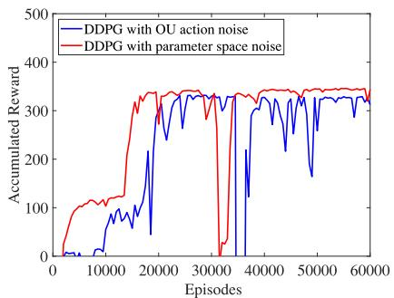  
(a)

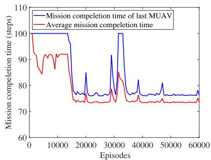  
(b)

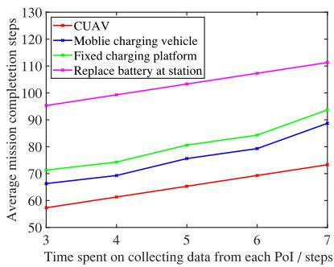  
(c)  
Fig. 5. Analysis results of (a) Accumulated reward, (b) Mission completion steps, (c) Comparison of 4 recharging methods.

TABLE III  
THE INFLUENCE OF THE SELECTION OF wf
<table><tr><td rowspan=1 colspan=1>wf</td><td rowspan=1 colspan=1>0.2</td><td rowspan=1 colspan=1>0.3</td><td rowspan=1 colspan=1>0.4</td><td rowspan=1 colspan=1>0.5</td><td rowspan=1 colspan=1>0.6</td></tr><tr><td rowspan=1 colspan=1>Mission completiontime (Last MUAV)</td><td rowspan=1 colspan=1>98.85</td><td rowspan=1 colspan=1>96.39</td><td rowspan=1 colspan=1>96.33</td><td rowspan=1 colspan=1>102.45</td><td rowspan=1 colspan=1>123.62</td></tr><tr><td rowspan=1 colspan=1>Average Missioncompletion time</td><td rowspan=1 colspan=1>92.51</td><td rowspan=1 colspan=1>92.07</td><td rowspan=1 colspan=1>92.08</td><td rowspan=1 colspan=1>94.29</td><td rowspan=1 colspan=1>99.01</td></tr></table>

## B. Single CUAV Charging Scenarios

We firstly study the simple scenario which schedules only 1 CUAV to charge 3 MUAVs, as shown in Figure 3. After the CUAV and MUAVs departing from the station, the scheduling optimization algorithm starts to execute. As aforementioned, the energy capacity of each MUAV is not sufficient for completing a whole mission, MUAVs can only finish the data collection missions without being interrupted by receiving energy from the CUAV on scheduled time. Both types of UAVs will return to the original site after their missions are accomplished.

The CUAV scheduling problem is formulated and solved by the DDPG algorithm. The accumulated reward of training is shown in Figure 5(a). The accumulated reward increases with the training process. The algorithm with adaptive parameter noise shows better performance in terms of higher reward and faster convergence rate. The completion steps are shown in Figure 5(b). The maximum energy the CUAVs can provide. length is set as 100 steps. Note that the mission completion time for each different MUAV is different. The red curve in Figure 5(b) demonstrates the average mission completion time of all the MUAVs, and the blue curve is the mission completion time of the last MUAV. As aforementioned, if the MUAVs are charged on time before energy exhaustion, the missions will not be interrupted because of energy shortage. The completion time should be significantly reduced. The smaller steps mean better policy, because there are fewer mission interruptions and less waiting time during the charging process, as the MUAV executing a mission will wait for being charged by CUAV if energy has drained. The mission completion steps drop with improved policy after learning by the training process.

The most prominent advantage of charging MUAVs by CUAV is that the MUAVs can be charged while performing missions. The time spent on returning to ground charging stations can be saved. We compare the proposed charging scheme with three baseline charging methods including: (1) flying back to the charging station and replace UAV battery, (2) charging at a nearby fixed charging platform (with 2 preset fixed charging platforms), and (3) charging by a mobile unmanned charging vehicle where the ground vehicle moves close to the MUAVs for MUAVs to land and recharge. The charging platform and charging vehicle charge the MUAVs with near field wireless charging techniques using the same power output as the wireless energy charging CUAV. The comparison is shown in Figure 5(c), mission time can be saved if MUAVs are recharged by CUAV while performing missions.

The CUAV charging mission and traveling trajectory are shown in Figure 6(a). The red dotted trace is the trajectory of CUAV during charging mission and the red arrows indicate the CUAV moving directions. The blue dotted traces are the trajectories of MUAVs during data collection missions. The blue arrows are the moving directions of the MUAVs. The MUAVs and CUAV have the same moving directions and similar trajectories at charging. The CUAV charges MUAV1 at first. Then, MUAV2 and MUAV3 are charged. The CUAV charges MUAV2 and returns to the ground UAV station at the end of the charging process. None of the MUAVs are observed to have terminated their missions out of energy exhaustion during the mission process.

## C. Multiple UAVs Charging Scenario

The simulated charging scenario of optimal scheduling multiple CUAVs charging is shown in Figure 4. MADDPG based algorithm is used for generating the optimized charging policies the of the CUAVs.

Compared with the single CUAV charging scenario, there are more MUAVs to be charged. Multiple CUAVs are dispatched together to prevent the energy exhaustion of the MUAVs. The number of required CUAVs are pre-determined by the amount, traveling path length, and data collection time of the MUAVs. In the simulation study, 3 CUAVs are considered. For each MUAV, the data collection mission time at each PoI spends 5 steps. The trajectories of all the CUAVs and MUAVs are shown in Figure 6(b). The arrows dhow the UAV moving directions. As shown in the figure, CUAV1 charges MUAV1 and MUAV4; CUAV2 charges MUAV3, MUAV2 and MUAV7; and CUAV3 charges MUAV6, MUAV5 and MUAV2.

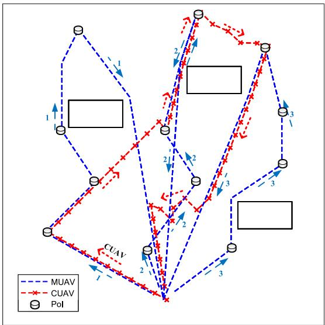  
(a)

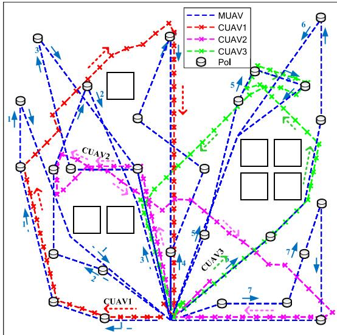  
(b)

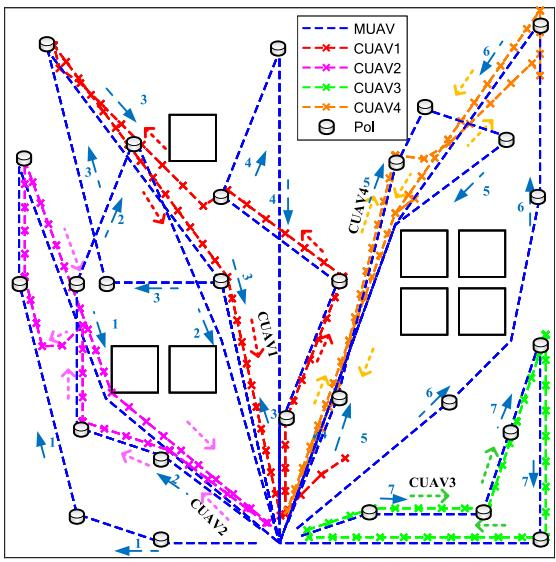  
(c)

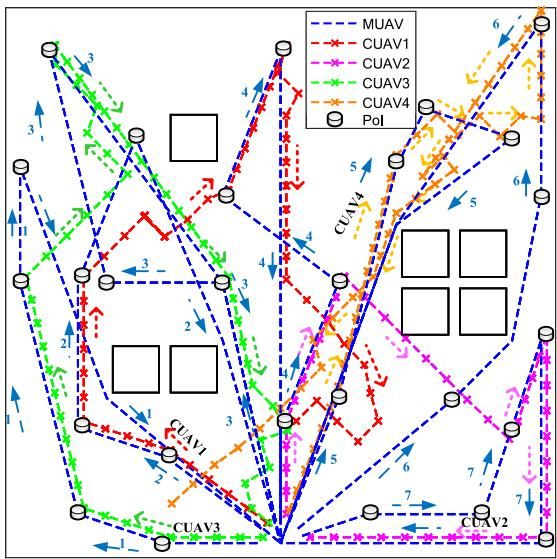  
(d)  
Fig. 6. (a) Trajectory of UAVs (single CUAV scenario), (b)Trajectory of UAVs (3 CUAVs and 7 MUAVs), (c) Trajectory of UAVs (4 CUAVs and 7 MUAVs 10 steps are spent on collecting data from each PoI), (d) Trajectory of UAVs (4 CUAVs and 7 MUAVs, 12 steps are spent on collecting data from each PoI).

More CUAVs have to be scheduled to provide enough charging energy for charging MUAVs in scenarios where more data has to be collected form PoIs. The time spent on collecting data at each PoI is set as 10 steps. 4 CUAVs are scheduled for recharging the MUAVs. The maximal episode length is set as 130 steps. We compared three algorithms: MADDPG with OU noise and MADDPG with adaptive parameter space noise and DDPG. The accumulated reward during training is shown in Figure 7(a). The policy learned by MADDPG with adaptive parameter space noise have better performance in accumulated reward and convergence speed. With the CUAVs policies optimized, the charged power amount and charging efficiency both increase on the premise of ensuring fair and timely charging to all MUAVs, which is shown in Table IV. The charging efficiency is the ratio of the energy that MUAV charged by CUAVs during mission to maximum available energy to MUAVs (The maximum charging energy the CUAVs can provide during mission time). The average mission completion time of the policies trained by two algorithms is shown in Figure 7(b). The policy trained by the algorithm with adaptive parameter noise has smaller mission completion steps. The average mission completion time of all MUAVs and mission completion time of the last MUAV is shown in Figure 7(c). The noise is used to generate exploration action which deviates from the expected action. Thus, the deflected exploration actions may affect the missions of MUAV and delay the MUAVs’ mission completion time, which lead to the increasing volatility of the curves. In Figure 7(d). We compare the proposed charging scheme with two baseline charging methods including: (1) charging at a nearby fixed charging platform (with 3 preset fixed charging platforms) and (2) charging by a mobile unmanned charging vehicle where the ground vehicle moves close to the MUAVs for MUAVs to land and recharge. The charging platform and charging vehicle charge the MUAVs with near field wireless charging techniques using the same power output as the wireless energy charging CUAV. The proposed CUAV charging scheme can shorten the mission completion time of MUAVs.

TABLE IV  
THE CHARGING EFFICIENCY DURING TRAINING
<table><tr><td rowspan=1 colspan=1>Episodes</td><td rowspan=1 colspan=1>5000</td><td rowspan=1 colspan=1>10000</td><td rowspan=1 colspan=1>15000</td><td rowspan=1 colspan=1>20000</td><td rowspan=1 colspan=1>30000</td><td rowspan=1 colspan=1>60000</td></tr><tr><td rowspan=1 colspan=1>Chargingefficiency</td><td rowspan=1 colspan=1>0.432</td><td rowspan=1 colspan=1>0.491</td><td rowspan=1 colspan=1>0.584</td><td rowspan=1 colspan=1>0.726</td><td rowspan=1 colspan=1>0.766</td><td rowspan=1 colspan=1>0.762</td></tr></table>

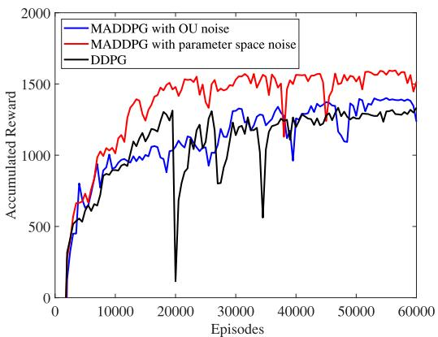  
(a)

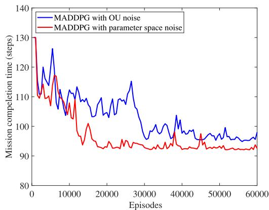  
(b)

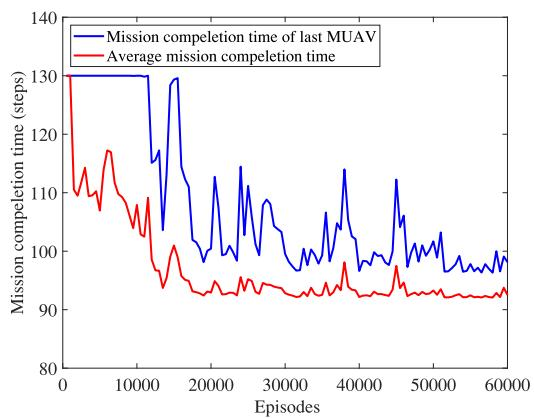  
(c)

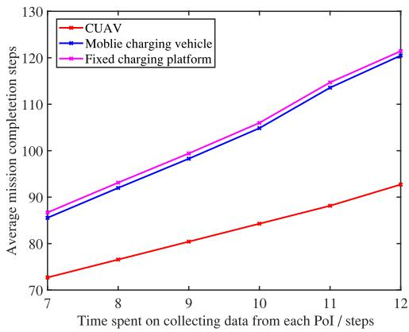  
(d)

Fig. 7. Analysis results of (a) Accumulated reward, (b) Mission completion steps,(c) Mission completion steps, (d) Comparison of 3 recharging methods.  
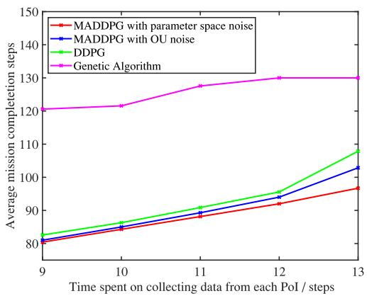  
(a)

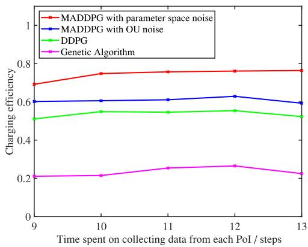  
(b)  
Fig. 8. Comparison of difference algorithms (a) Average mission completion time, (b) Charging efficiency, (c) Mission completion steps.

We compared the Multi CUAV charging policy optimization algorithm with DDPG and genetic algorithm. Average mission completion time is compared in Figure 8(a) and charging efficiency is compared in Figure 8(b). The MADDPG-based algorithms show better performance. Our studied problem involves dynamic environment, CUAVs’ complex charging action (choice of charging target) and strict optimizing on October 26,2026 at 07:34:31 UTC from IEEE Xplore. Restrictions apply.

objective (fair charging and minimize mission completion time). Though the model was simplified when using genetic algorithm, the algorithm didn’t show good performance. As is shown in figures, the mission completion time increases and charging efficiency drops when time spent on each PoI is 13. Because that the increasing charging requirement from MUAVs makes the CUAVs cannot provide enough energy to all MUAVs on time.

Figure 6(c) shows the trajectories of CUAVs in the experiment that each MUAV at a corresponding PoI spent 10 steps in terms of time. The blue dotted trace and blue arrows are the moving trajectories and moving directions of MUAV. The moving trajectories and directions of CUAVs are marked with different colors. MUAV7 has the longest data collection mission time (need to collect data from 5 PoIs). CUAV3 keeps charging MUAV7 until the mission ends. In this case, the reward loss caused by moving can be reduced. CUAV1 charges the MUAV4 and MUAV3; CUAV2 charges the MUAV2 and MUAV1; and CUAV4 charges the MUAV5 and MUAV6. Figure 6(d) shows the trajectories of CUAVs in the experiment that MUAV’s time spent on collecting data at each PoI is 12 steps. In this case, one CUAV should not keep charging MUAV7 to avoid low fairness in charging, although MUAV7 has the longest data collection mission time, because there are more charging demands from other MUAVs. As is shown in Figure 6(d), CUAV1 charges the MUAV2 and MUAV4; CUAV2 charges the MUAV4 and MUAV7; CUAV3 charges the MUAV1 and MUAV3; and CUAV4 charges the MUAV5 and MUAV6. None of the MUAVs are observed to have terminated their missions out of energy exhaustion during the mission process.

## VII. CONCLUSION

In this work, we have proposed the scheme of aerially replenishing MUAVs by CUAVs in a wireless charging manner. Feasibility and effectiveness of the proposed wireless charging scenario and scheme are analyzed. We have investigated the optimized scheduling problem of CUAV wireless energy charging to minimize the mission time of the MUAVs, where both scenarios of single CUAV and multiple CUAVs have been discussed. Reinforcement learning-based algorithms have been proposed to solve the proposed optimization problems. Simulation results have shown that MUAV mission completion time can be significantly accelerated compared with the scenarios with fixed ground-based charging facilities for replenishing the MUAVs.

## REFERENCES

[1] J. Yang, K. Zhu, X. Zhu, and J. Wang, “Learning-based aerial charging scheduling for UAV-based data collection,” in Proc. Int. Conf. Wireless Algorithms Syst. Appl. (WASA), Nanjing, China, 2021, pp. 600–611.

[2] S. Zhang, H. Zhang, B. Di, and L. Song, “Cellular UAV-to-X communications: Design and optimization for multi-UAV networks,” IEEE Trans. Wireless Commun., vol. 18, no. 2, pp. 1346–1359, Feb. 2019.

[3] X. Li, H. Yao, J. Wang, X. Xu, C. Jiang, and L. Hanzo, “A near-optimal UAV-aided radio coverage strategy for dense Urban areas,” IEEE Trans. Veh. Technol., vol. 68, no. 9, pp. 9098–9109, Sep. 2019.

[4] J. Wang, C. Jiang, Z. Wei, C. Pan, H. Zhang, and Y. Ren, “Joint UAV hovering altitude and power control for space-air-ground IoT networks,” IEEE Internet Things J., vol. 6, no. 2, pp. 1741–1753, Apr. 2019.

[5] R. Xie, Q. Tang, Q. Wang, X. Liu, F. R. Yu, and T. Huang, “Satellite-terrestrial integrated edge computing networks: Architecture, challenges, and open issues,” IEEE Netw., vol. 34, no. 3, pp. 224–231, May/Jun. 2020.

[6] F. Luo, C. Jiang, S. Yu, J. Wang, Y. Li, and Y. Ren, “Stability of cloudbased UAV systems supporting big data acquisition and processing,” IEEE Trans. Cloud Comput., vol. 7, no. 3, pp. 866–877, Jul.–Sep. 2019.

[7] X. Li, H. Yao, J. Wang, S. Wu, C. Jiang, and Y. Qian, “Rechargeable multi-UAV aided seamless coverage for QoS-guaranteed IoT networks,” IEEE Internet Things J., vol. 6, no. 6, pp. 10902–10914, Dec. 2019.

[8] L. Zhang, B. Cao, Y. Li, M. Peng, and G. Feng, “A multi-stage stochastic programming-based offloading policy for fog enabled IoT-eHealth,” IEEE J. Sel. Areas Commun., vol. 39, no. 2, pp. 411–425, Feb. 2021.

[9] A. B. Junaid, Y. Lee, and Y. Kim, “Design and implementation of autonomous wireless charging station for rotary-wing UAVs,” Aerosp. Sci. Technol., vol. 54, pp. 253–266, Jul. 2016.

[10] C. Wang and Z. Ma, “Design of wireless power transfer device for UAV,” in Proc. IEEE Int. Conf. Mechatron. Autom. Harbin, 2016, pp. 1–6.

[11] M. C. Achtelik, J. Stumpf, D. Gurdan, and K. Doth, “Design of a flexible high performance quadcopter platform breaking the MAV endurance record with laser power beaming,” in Proc. IEEE/RSJ Int. Conf. Intell. Robots Syst., 2011, pp. 5166–5172.

[12] W. Chen, S. Zhao, Q. Shi, and R. Zhang, “Resonant beam chargingpowered UAV-assisted sensing data collection,” IEEE Trans. Veh. Technol., vol. 69, no. 1, pp. 1086–1090, Jan. 2020.

[13] A. Ranjha, G. Kaddoum, and K. Dev, “Facilitating URLLC in UAVassisted Relay Systems with multiple-mobile Robots for 6G networks: A prospective of agriculture 4.0,” IEEE Trans. Ind. Informat., early access, Nov. 30, 2021, doi: 10.1109/TII.2021.3131608.

[14] L. Yang, H. Yao, J. Wang, C. Jiang, A. Benslimane, and Y. Liu, “Multi-UAV-enabled load-balance mobile-edge computing for IoT networks,” IEEE Internet Things J., vol. 7, no. 8, pp. 6898–6908, Aug. 2020.

[15] K. Li, K. See, W. Koh, and J. Zhang, “Design of 2.45 GHz microwave wireless power transfer system for battery charging applications,” in Proc. Progr. Electromagn. Res. Symp. Fall (PIERS - FALL), Singapore, 2017, pp. 1–7.

[16] Q. Zhang, W. Fang, Q. Liu, J. Wu, P. Xia, and L. Yang, “Distributed laser charging: A wireless power transfer approach,” IEEE Internet Things J., vol. 5, no. 5, pp. 3853–3864, Oct. 2018.

[17] T. P. Lillicrap et al., “Continuous control with deep reinforcement learning,” 2015, arXiv:1509.02971.

[18] M. L. Littman, “Markov games as a framework for multi-agent reinforcement learning,” in Proc. 11th Int. Conf. Mach. Learn., vol. 157, 1994, pp. 157–163.

[19] R. Lowe, Y. Wu, A. Tamar, J. Harb, O. P. Abbeel, and I. Mordatch, “Multi-agent actor-critic for mixed cooperative-competitive environments,” in Proc. 31st Int. Conf. Neural Inf. Process. Syst., Dec. 2017, pp. 6379–6390.

[20] X. Lu, P. Wang, D. Niyato, D. I. Kim, and Z. Han, “Wireless charging technologies: Fundamentals, standards, and network applications,” IEEE Commun. Surveys Tuts., vol. 18, no. 2, pp. 1413–1452, 2nd Quart., 2016.

[21] X. Li, C.-Y. Tsui, and W.-H. Ki, “A 13.56 MHz wireless power transfer system with reconfigurable resonant regulating rectifier and wireless power control for implantable medical devices,” IEEE J. Solid-State Circuits, vol. 50, no. 4, pp. 978–989, Apr. 2015.

[22] K. Shi, C. Tang, H. Long, X. Lv, Z. Wang, and X. Li, “Power fluctuation suppression method for EV dynamic wireless charging system based on integrated magnetic coupler,” IEEE Trans. Power Electron., vol. 37, no. 1, pp. 1118–1131, Jan. 2022.

[23] D. Ke, C. Liu, C. Jiang, and F. Zhao, “Design of an effective wireless air charging system for electric unmanned aerial vehicles,” in Proc. IECON 43rd Annu. Conf. IEEE Ind. Electron. Soc., 2017, pp. 6949–6954.

[24] C. H. Choi, H. J. Jang, S. G. Lim, H. C. Lim, S. H. Cho, and I. Gaponov, “Automatic wireless drone charging station creating essential environment for continuous drone operation,” in Proc. Int. Conf. Control Autom. Inf. Sci. (ICCAIS), 2016, pp. 132–136.

[25] K. Yu, A. K. Budhiraja, and P. Tokekar, “Algorithms for routing of unmanned aerial vehicles with mobile recharging stations,” in Proc. IEEE Int. Conf. Robot. Autom. (ICRA), 2018, pp. 5720–5725.

[26] C. R. Valenta, M. M. Morys, and G. D. Durgin, “Theoretical energy-conversion efficiency for energy-harvesting circuits under poweroptimized waveform excitation,” IEEE Trans. Microw. Theory Techn., vol. 63, no. 5, pp. 1758–1767, May 2015.

[27] R. Zhang and C. K. Ho, “MIMO broadcasting for simultaneous wireless information and power transfer,” IEEE Trans. Wireless Commun., vol. 12, no. 5, pp. 1989–2001, May 2013.

[28] A. Y. S. Pandiyan, D. E. Boyle, M. E. Kiziroglou, S. W. Wright, and E. M. Yeatman, “Optimal dynamic recharge scheduling for two-stage wireless power transfer,” IEEE Trans. Ind. Informat., vol. 17, no. 8, pp. 5719–5729, Aug. 2021.

[29] J. James, V. Iyer, Y. Chukewad, S. Gollakota, and S. B. Fuller, “Liftoff of a 190 mg laser-powered aerial vehicle: The lightest wireless robot to fly,” in Proc. IEEE Int. Conf. Robot. Autom. (ICRA), 2018, pp. 3587–3594.

[30] U. Demir, M. Ç. ˙Ipek, C. Toker, and Ö. Ekici, “Energy-efficient rotarywing UAV deployment under flight dynamics and qos constraints,” in Proc. IEEE Int. Black Sea Conf. Commun. Netw. (BlackSeaCom), Sochi, Russia, 2019, pp. 1–5.

[31] S. L. Ho, J. Wang, W. N. Fu, and M. Sun, “A comparative study between novel Witricity and traditional inductive magnetic coupling in wireless charging,” IEEE Trans. Magn., vol. 47, no. 5, pp. 1522–1525, May 2011.

[32] A. Kurs, A. Karalis, R. Moffatt, J. D. Joannopoulos, P. Fisher, and M. Soljacic, “Wireless power transfer via strongly coupled magnetic resonances,” Science, vol. 317, pp. 83–86, Jul. 2007.

[33] “QCW Stacked Array With Fast Axis Collimation.” [Online]. Available: https://www.laserdiodesource.com/files/pdfs/laserdiodesource\_com/ product-966/808nm\_500W\_stack\_Quantel\_Laser\_Diodes-1416380890. pdf (Accessed: Jan. 8, 2018).

[34] Q.-V. Pham, M. Zeng, R. Ruby, T. Huynh-The, and W.-J. Hwang, “UAV communications for sustainable federated learning,” IEEE Trans. Veh. Technol., vol. 70, no. 4, pp. 3944–3948, Apr. 2021.

[35] P. K. Selvam, G. Raja, V. Rajagopal, K. Dev, and S. Knorr, “Collisionfree path planning for UAVs using efficient artificial potential field algorithm,” in Proc. IEEE 93rd Veh. Technol. Conf. (VTC2021), 2021, pp. 1–5.

[36] P. Yang, K. Tang, J. A. Lozano, and X. Cao, “Path planning for single unmanned aerial vehicle by separately evolving waypoints,” IEEE Trans. Robot., vol. 31, no. 5, pp. 1130–1146, Oct. 2015.

[37] A. B. Sediq, R. H. Gohary, R. Schoenen, and H. Yanikomeroglu, “Optimal tradeoff between sum-rate efficiency and Jain’s fairness index in resource allocation,” IEEE Trans. Wireless Commun., vol. 12, no. 7, pp. 3496–3509, Jul. 2013.

[38] S. Zhang, H. Zhang, and L. Song, “Beyond D2D: Full dimension UAV-to-everything communications in 6G,” IEEE Trans. Veh. Technol., vol. 69, no. 6, pp. 6592–6602, Jun. 2020.

[39] A. Ferdowsi, M. A. Abd-Elmagid, W. Saad, and H. S. Dhillon, “Neural combinatorial deep reinforcement learning for age-optimal joint trajectory and scheduling design in UAV-assisted networks,” IEEE J. Sel. Areas Commun., vol. 39, no. 5, pp. 1250–1265, May 2021.

[40] S. Fu et al., “Energy-efficient UAV-enabled data collection via wireless charging: A reinforcement learning approach,” IEEE Internet Things J., vol. 8, no. 12, pp. 10209–10219, Jun. 2021.

[41] S. B. Prathiba, G. Raja, S. Anbalagan, K. Dev, S. Gurumoorthy, and A. P. Sankaran, “Federated learning empowered computation offloading and resource management in 6G-V2X,” IEEE Trans. Netw. Sci. Eng., early access, Aug. 10, 2021, doi: 10.1109/TNSE.2021.3103124.

[42] V. Mnih et al., “Human-level control through deep reinforcement learning,” Nature, vol. 518, no. 7540, p. 529, 2015.

[43] G. E. Uhlenbeck and L. S. Ornstein, “On the theory of the brownian motion,” Phys. Rev., vol. 36, no. 5, pp. 823–841, 1930.

[44] M. Plappert et al., “Parameter space noise for exploration,” 2017, arXiv:1706.01905.

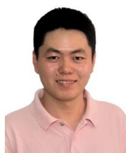

Kun Zhu (Member, IEEE) received the Ph.D. degree from the School of Computer Engineering, Nanyang Technological University, Singapore, in 2012. He was a Research Fellow with Wireless Communications Networks and Services Research Group, University of Manitoba, Canada, from 2012 to 2015. He is currently a Professor with the College of Computer Science and Technology, Nanjing University of Aeronautics and Astronautics, China. He is also a Jiangsu Specially Appointed Professor. He has published more than seventy technical papers

and has served as TPC for several conferences. His research interests include resource allocation in 5G, wireless virtualization, and self-organizing networks. He won several research awards, including the IEEE WCNC 2019 Best paper awards and the ACM China Rising Star Chapter Award.

Jia Yang received the B.S. degree in computer science and technology from Nantong University, in 2019. He is currently pursuing the master’s degree with the College of Computer Science and Technology, Nanjing University of Aeronautics and Astronautics, Nanjing, China. His research interests include UAV mission scheduling and reinforcement learning algorithms.

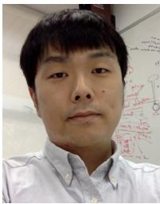

Yang Zhang (Member, IEEE) received B. Eng., B. Eng. (Minor), and M. Eng. degrees from the Beijing University of Aeronautics and Astronautics (Beihang Univ.) in 2008, 2010, and 2011, respectively, and the Ph.D. degree in computer engineering from Nanyang Technological University, Singapore, in 2015. He is currently an Associate Professor with the College of Computer Science and Technology, Nanjing University of Aeronautics and Astronautics, Nanjing, China. He is also with the Key Laboratory of Transportation Internet of

Things, Wuhan University of Technology, China. He is an Associate Editor of EURASIP Journal on Wireless Communications and Networking and a Technical Committee Member of Computer Communications.

Jiangtian Nie (Member, IEEE) received the B.Eng. degree in electronics and information engineering from the Huazhong University of Science and Technology, Wuhan, China, and the Ph.D. degree with ERI@N in the Interdisciplinary Graduate School, Nanyang Technological University (NTU), Singapore. She is currently a Research Fellow with NTU. Her research interests include network economics, game theory, crowd sensing, and learning. She serves as the Editor for Computer Networks, Computer Communications, Physical

Communication, and EURASIP Journal on Wireless Communications and Networking.

Wei Yang Bryan Lim received the graduation degree (two First-Class Hons.) in economics and business administration (finance) from the National University of Singapore. He is currently pursuing the Ph.D. degree (Alibaba Talent Programme) with the Alibaba-NTU Joint Research Institute, Nanyang Technological University, Singapore. He has won the five Best Paper Awards, including in the IEEE Wireless Communications and Networking Conference and the IEEE ComSoc SPCC Best Paper Award. He regularly serves as a reviewer in leading

journals and flagship conferences and is currently a Review Board Member of the IEEE TRANSACTIONS ON PARALLEL AND DISTRIBUTED SYSTEMS and the assistant to the Editor-in-Chief of the IEEE COMMUNICATIONS SURVEYS AND TUTORIALS.

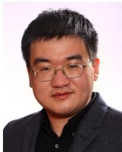

Hongliang Zhang (Member, IEEE) received the B.S. and Ph.D. degrees from the School of Electrical Engineering and Computer Science, Peking University, in 2014 and 2019, respectively. He was a Postdoctoral Fellow with the Electrical and Computer Engineering Department, University of Houston, Texas. He is currently a Postdoctoral Associate with the Department of Electrical and Computer Engineering, Princeton University, New Jersey. His current research interest includes reconfigurable intelligent surfaces, aerial access networks,

optimization theory, and game theory. He received the best doctoral thesis award from Chinese Institute of Electronics in 2019. He is an Exemplary Reviewer for IEEE TRANSACTIONS ON COMMUNICATIONS in 2020. He is also the recipient of 2021 IEEE Comsoc Heinrich Hertz Award for Best Communications Letters and the 2021 IEEE ComSoc Asia-Pacific Outstanding Paper Award. He has served as a TPC Member for many IEEE conferences, such as Globecom, ICC, and WCNC. He is currently an Editor for IEEE COMMUNICATIONS LETTERS, IET Communications, and Frontiers in Signal Processing. He has also served as a Guest Editor for several journals, such as IEEE INTERNET OF THINGS JOURNAL and JOURNAL OF COMMUNICATIONS AND NETWORKS.

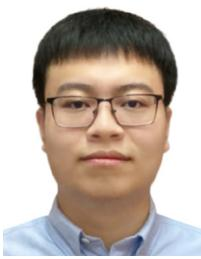

Zehui Xiong (Member, IEEE) received the Ph.D. degree from Nanyang Technological University, Singapore. He was a Researcher with Alibaba-NTU Singapore Joint Research Institute, Singapore. He is currently an Assistant Professor with the Pillar of Information Systems Technology and Design, Singapore University of Technology and Design. He was the Visiting Scholar with Princeton University and the University of Waterloo. He has published more than 150 research papers in leading journals and flagship conferences and many of them are

ESI Highly Cited Papers. His research interests include wireless communications, network games and economics, blockchain, and edge intelligence. He is the recipient of IEEE TCSC Early Career Researcher Award for Excellence in Scalable Computing, IEEE TEMS Technical Committee on Blockchain and Distributed Ledger Technologies Early Career Award, IEEE CSIM Technical Committee Best Journal Paper Award, IEEE SPCC Technical Committee Best Paper Award, IEEE VTS Singapore Best Paper Award, Chinese Government Award for Outstanding Students Abroad, and NTU SCSE Best Ph.D. Thesis Runner-Up Award. He has won over 10 Best Paper Awards in international conferences and is listed in the World’s Top 2% Scientists identified by Stanford University. He is now serving as an Editor or a Guest Editor for many leading journals, including IEEE JOURNAL ON SELECTED AREAS IN COMMUNICATIONS, IEEE TRANSACTIONS ON VEHICULAR TECHNOLOGY, IEEE INTERNET OF THINGS JOURNAL, IEEE TRANSACTIONS ON COGNITIVE COMMUNICATIONS AND NETWORKING, IEEE TRANSACTIONS ON NETWORK SCIENCE AND ENGINEERING, International Surgery Journal, and JAS. He is the Founding Vice Chair of Special Interest Group on Wireless Blockchain Networks in IEEE Cognitive Networks Technical Committee.