# Age of Information Minimization in UAV-Enabled IoT Networks via Federated Reinforcement Learningl

Xuhui Zhang , Graduate Student Member, IEEE, Huijun Xing , Graduate Student Member, IEEE, Yanyan Shen , Member, IEEE, Jie Xu , Fellow, IEEE, and Shuguang Cui , Fellow, IEEE

Abstract—This paper studies the unmanned-aerial-vehicle (UAV)-enabled data collection for Internet-of-things (IoT) networks, in which multiple UAVs are dispatched to collect data over their correspondingly designated areas. In particular, we consider that the UAVs need to collect data in a timely manner. We further consider a practical segmented channel model, in which the air-to-ground wireless channel is assumed to follow Rayleigh or Rician fading when the corresponding line-of-sight (LoS) link is blocked or unblocked, respectively. Under this setup, we minimize the average Age-of-Information (AoI) for the IoT devices, by jointly optimizing the UAV trajectory, the collection scheduling, and the completion time. Since the problem is nonconvex, and the dimension of optimization variables varies w.r.t. the completion time that needs to be optimized, the conventional methods are not applicable for efficiently solving the problem. To address this issue, we first propose a deep-reinforcement-learning (DRL) based algorithm to solve this problem in the special case with single UAV, and then exploit federated learning over multiple UAVs to efficiently train the model in a collaborative manner while preserving the data privacy. Numerical results verify that

Received 18 June 2023; revised 6 February 2024, 8 September 2024, and 10 February 2025; accepted 14 April 2025. Date of publication 29 April 2025; date of current version 15 September 2025. This work was supported in part by the National Natural Science Foundation of China under Grant 62293482, in part by the Basic Research Project of Hetao Shenzhen-Hong Kong S&T Cooperation Zone under Grant HZQB-KCZYZ-2021067, in part by Shenzhen Outstanding Talents Training Fund under Grant 202002, in part by Guangdong Research Projects under Grant 2017ZT07X152 and Grant 019CX01X104, in part by Guangdong Provincial Key Laboratory of Future Networks of Intelligence under Grant 2022B1212010001, in part by Shenzhen Key Laboratory of Big Data and Artificial Intelligence under Grant ZDSYS201707251409055, and in part by Shenzhen Science and Technology Program under Grant JCYJ20220818101607015 and Grant JCYJ20241202124934046. The associate editor coordinating the review of this article and approving it for publication was H. Yang. (Xuhui Zhang and Huijun Xing contributed equally to this work.) (Corresponding authors: Shuguang Cui; Yanyan Shen.)

Xuhui Zhang is with Shenzhen Future Network of Intelligence Institute (FNii-Shenzhen), the School of Science and Engineering (SSE), and the Guangdong Provincial Key Laboratory of Future Networks of Intelligence, The Chinese University of Hong Kong, Shenzhen, Guangdong 518172, China (e-mail: xu.hui.zhang@foxmail.com).

Huijun Xing is with the Department of Electrical and Electronic Engineering, Imperial College London, SW7 2AZ London, U.K. (e-mail: huijunxing@link.cuhk.edu.cn).

Yanyan Shen is with Shenzhen Institute of Advanced Technology, Chinese Academy of Sciences, Shenzhen, Guangdong 518055, China, and also with the Faculty of Computer Science and Control Engineering, Shenzhen University of Advanced Technology, Shenzhen, Guangdong 518055, China (e-mail: yy.shen@siat.ac.cn).

Jie Xu and Shuguang Cui are with the SSE, the FNii-Shenzhen, and the Guangdong Provincial Key Laboratory of Future Networks of Intelligence, The Chinese University of Hong Kong, Shenzhen, Guangdong 518172, China (e-mail: xujie@cuhk.edu.cn; shuguangcui@cuhk.edu.cn).

Digital Object Identifier 10.1109/TWC.2025.3563426 the proposed methods achieve significantly better performance than benchmarks in terms of the AoI, energy consumption, and completion time.

Index Terms—Age of information (AoI), data collection, Internet of Things, UAV communication, reinforcement learning, federated learning.

## I. INTRODUCTION

HE emergence of beyond fifth-generation (B5G) and sixth-generation (6G) communication networks, which are part of the era of the Internet of everything, has led to the widespread use of billions of Internet of things (IoTs) devices in different fields for, e.g., monitoring road condition and accidents, and collecting body information. In order to enable advanced IoT applications, these low-power and storage-limited IoT devices need to share their sensed data to the fusion center for further processing. Conventionally, the fusion centers are deployed at fixed locations, and multihop data relaying is generally needed for collecting data from a large number of distributed IoT devices [1], which is less efficient when the network size and the number of IoT devices become large. Motivated by its wide applications in military, industry, and civilian, unmanned aerial vehicles (UAVs), also known as drones, have emerged as a promising solution to resolve the data collection problem. In particular, thanks to the mobility, flexibility, scalability, and controllability, the UAVs can be employed as flying aerial fusion centers, which can fly around different locations in the sky to collect data from IoT devices [2]. The UAV-assisted data collection is expected to achieve more robust and efficient data collection as compared to the conventional designs with fixed fusion centers [3].

In UAV-enabled data collection, data freshness is becoming an increasingly important issue in order to support various real-time applications for big data analytics, resource allocation, and decision making. In such case, the conventionally adopted data collection metrics like the transmission latency may not be appropriate for representing the information freshness, as they normally ignore the time when the sensed information is generated. As such, a new performance metric called the age of information (AoI) has been proposed [4]. Compared with the former performance evaluation metrics, AoI corresponds to the time difference between the current time and the data generation time, which properly characterizes the information freshness.

Optimizing the AoI in UAV-enabled data collection systems in time-varing environment is a challenging task due to the involvement of a large amount of system parameters, which is thus difficult to be optimized by traditional methods. Therefore, artificial intelligence (AI) has been considered as a key enabling technology to deal with such problems [5]. Specifically, in conventional optimization based methods, the system model needs to know the accurate global parameters, which is not practical in a large-scale distributed communication system. By contrast, the introduced AI techniques can solve the problems through general system information and a small amount of computations. For example, reinforcement learning (RL) is a powerful tool for deriving an optimized policy to manage resource allocation in wireless communications without global information [6]. In a complex and changing system, the agents of the RL algorithm adjust their strategies in a timely manner and make decisions on the resource allocations in real time. This is particularly valuable in UAV-enabled data collection systems with time-varying environments and resource allocation policy.

In addition, federated learning (FL) is recognized as an efficient approach to help enhance the training efficiency of Deep RL (DRL) by using data from multiple UAVs while perserving the data security and privacy. The emerging FL technique allows agents only to share their parameters of neural networks rather than the complete training data to a global server for centralized training, and the global server coordinates with all agents to jointly achieve high training efficiency while preserving the data privacy and security [7]. The distributed training model makes full use of the computing power of all agent devices to jointly explore the potential of each training dataset that is otherwise independent. As such, federated learning improves performance and accelerates training convergence while safeguarding data privacy, which offers an irreplaceable method for optimization problems, and provides more substantial benefits for multi-agent computation. Although additional communication overhead is produced, the benefits of the data diversity from federated learning are more evident, especially by avoiding the risks associated with direct data transmission.

As a novel topic, combining reinforcement learning with federated learning at the deep learning level could significantly improve the system performance in B5G and 6G networks [8]. To our best knowledge, there is no prior work studying the use of FL combination with DRL in AoI minimization in UAV-enabled data collection networks with practical urban environments. This motivates our work to investigate the resource allocation and UAV trajectory design to optimize the AoI value of all IoT devices in the UAV-enabled data collection systems by exploiting the combination of FL and DRL.

This paper proposes an efficient multi-UAV-assisted approach in practical urban environment, by assuming Rayleigh and Rician fading channels if the line-of-sight (LoS) links are blocked and unblocked [9], [10], respectively. To optimize the system performance, an average AoI minimization problem is formulated with joint consideration of UAV trajectory, time allocation, data collection scheduling, and the mission completion time. Due to the non-convexity of the considered problem, and the dimension of optimization variables varies w.r.t. the completion time that needs to be optimized, the conventional methods are not suitable for efficiently solving the problem [11], [12], [13]. As a result, we propose two novel learning-based algorithms to solve the problem effectively, in single-agent level, and multi-agent level, respectively. The main contributions of this paper are summarized as follows

• A UAV-enabled IoT system is designed to present robust and effective data collection, in which multiple UAVs are dispatched to collect data over correspondingly designated areas, with the consideration of a practical AoI model, which provides a more suitable description of the freshness of collected data.  
• An average AoI minimization problem is formulated. By exploring the characteristics of the problem and the relationship of the variables, a DRL based AoI-aware Data Collection (DADC) algorithm is proposed to tackle this problem in the special case with a single UAV.  
• A federated learning structure, named Federated-DADC (F-DADC) algorithm, is further proposed for the multiple UAVs to improve the data privacy, security, and learning efficiency in a collaborative manner.  
• Extensive numerical results demonstrate that the proposed F-DADC algorithm outperforms other benchmarks in terms of the average AoI, energy consumption, and completion time of the data collection task.

The remainder of this paper is organized as follows. Section II reviews related works. Section III describes the design of UAV-enabled IoT data collection system and then formulates the average AoI minimization problem. Section IV provides the solution to the formulated problem by using the proposed F-DADC algorithm. Section V presents numerical results. And finally, Section VI concludes the paper.

## II. RELATED WORKS

## A. UAV-Enabled Data Collection

Due to the portability and mobility of the UAV systems, researchers have begun to focus on UAV-enabled data collection. The UAV trajectory design during the collection process is particularly important for enhancing the efficiency and reduce the operational expense. Furthermore, the unique controllable mobility of UAVs makes the UAV-enabled data collection problem different from the conventional data collection counterparts without UAVs.

Several studies have explored this area. For instance, the work [14] aims to maximize the minimum data collection rate in an IoT network with multiple UAVs, by jointly optimizing the trajectory of the UAVs and the time allocation of IoT devices. In [15], the authors propose a UAV-enabled wireless sensor network, where a UAV collects data from sensors in the network. They formulate an optimization problem to maximize the minimum residual energy of all IoT sensors, by designing an optimal trajectory of the UAV. Similarly, in [16], an efficient optimization for embedded relay-assisted UAVs in IoT wireless sensor networks is proposed to minimize the task completion time. The work [17] studies a UAV-enabled backscatter communication network, with the objective of maximizing the energy efficiency. Besides, a similar system model from [17] is studied in [18], where the total energy efficiency is maximized by optimizing the trajectory of the UAV, the scheduling of the IoT devices, and the power control of the carrier emitters. In [19], the authors propose the UAV-enabled wireless powered communications to realize the data collection from low-power IoT devices in a sustainable manner.

However, the above optimization problems only simply employing the total time consumption or delay in the collection process as the performance measure, without considering the specific details of the collection task, such as the additional time cost during flight and transmission. Such an assumption oversimplifies the problem, and thus making its practical applications limited.

## B. AoI-Aware Collection System

The proposed definition of AoI allows tasks to be further sliced and diced in detail, with multiple specific time slots being introduced into the data collection of UAV systems.

The work [20] proposes an average AoI minimization problem in UAV-enabled backscatter IoT systems, by jointly optimizing the trajectory, the transmission power, and data collection time of the UAV. The authors in [21] consider that UAVs act as sensors for multiple sensing tasks and transmit the data to the base station (BS), while evaluating the AoI of the UAV. In [22], a cellular Internet of UAVs is studied, where the sensed data can be sent to the BS or to the UAVs. They jointly optimize the trajectory of the UAVs to minimize the average AoI. The authors in [23] investigate the UAV-assisted wireless powered IoT system, where the UAV collects data from IoT devices according to a defined trajectory to minimize the average AoI of IoT devices. The work [24] studies the age-optimal data collection problem in UAV-enabled wireless sensor networks. They propose a joint IoT association and trajectory design strategy to minimize the maximum AoI among all the IoT devices. Another UAVenabled data collection problem is studied in [25] to minimize the maximal AoI and average AoI of the IoT nodes by finding the sensor node association and trajectory planning policy in an iterative manner. The authors in [26] investigate the role of a UAV as a mobile relay to minimize the average peak AoI for a source-to-destination pair. They find the optimal solutions of the UAV’s trajectory as well as energy and service time allocations.

The introduction of AoI enhances the simulation of real situations, which is beneficial to reduce the energy consumption overhead of UAVs and the time latency of the data collection processes. But traditional computational methods still suffer from tedious computation and slow convergence.

## C. Machine Learning Assisted UAV Network

Machine learning has demonstrated high efficiency in the era of big data processing. Unlike traditional optimization methods that struggle to reduce data dimensionality and linearize data, machine learning is able to directly explore the potential within data to obtain better performance.

Various studies have proposed machine learning-based approaches for UAV-enabled data collection [9], [10], [27], [28], [29]. A UAV-assisted vehicular network is proposed in [27], where sensors on vehicles generate time sensitive data streams, and UAVs are utilized to process the data while maintaining a minimum AoI. The study aims to jointly optimize the UAV trajectories and resource allocation policies to keep the information fresh under minimum throughput constraints. To ensure the long-term freshness requirements of situation awareness, another study [28] presents a novel multi-agent DRL algorithm with global-local rewards to derive UAVs’ dynamic trajectory planning as well as proper data offloading decision. Additionally, the authors in [9] investigate an UAVassisted IoT system, where the UAV’s trajectory is designed to minimize data collection completion time by an efficient DRL algorithm and a pre-defined notation that represents the state information. A multi-agent Deep Reinforcement Learning (DRL)-based algorithm with centralized learning and decentralized execution is utilized in [29], where total average AoI is minimized with various constraints of the UAVs, including kinematic, energy, trajectory, and collision avoidance. In [10], the authors utilize a reconfigurable intelligent surface (RIS) to assist the UAV in mitigating signal propagation impairments. The formulated optimization problem aims at minimizing the AoI of IoT devices by jointly optimizing the UAV trajectory, the scheduling of IoT devices, and the reflective beamforming of RIS.

However, in real urban situation, users or IoT devices are often served by different operators. Thus, the detailed information of the users and operators cannot be shared with each other, although large-scale machine learning methods often require shared parameters and information.

## D. Federated Learning Empowered User Privacy

Due to user and operator’s privacy concerns, secure machine learning approaches are another important aspect to enhance information security during communication. As a result, FL is introduced to UAV networks in prior works such as [30], [31], [32], and [33].

In [30], the proposed federated approach achieves better performance in terms of data freshness and system stability in UAV-assisted mobile edge computing (MEC) systems. Another FL study [31] considers the sum power minimization problem by jointly optimizing resource allocation, user association, and power control in a mobile edge computing system with multiple UAVs. In [32], a UAV-assisted energy harvestingbased network is proposed to enable FL tasks. The aim is to maximize the long-term FL performance considering the limited resources in the network, such as harvested energy, bandwidth resources, and UAV’s energy budget. A resource allocation algorithm for the UAV networks based on the multi-agent collaborative environment learning is proposed in [33], where a multi-agent reinforcement learning method is designed for solving the network utility optimization problem with combination of FL. In [34], an energy efficient spaceair-ground integrated edge computing network is proposed. To find the optimal offloading policy, a federated reinforcement learning-based method is introduced.

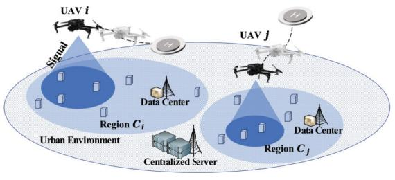

flowchart

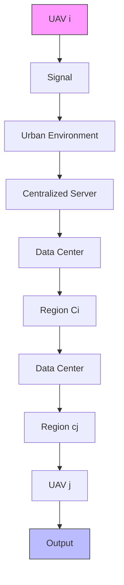

Fig. 1. The UAV-enabled IoT network model.

## E. Our Contributions

To the best of our knowledge, how to exploit federated learning for AoI-aware UAV-enabled data collection systems in urban environment has not been studied in the literature yet. The concept of AoI model is introduced as a metric to quantify the freshness of the collected information, while the federated reinforcement learning techniques are employed to enhance the efficiency and data privacy in reinforcement learning process.

## III. SYSTEM MODEL AND PROBLEM FORMULATION

As shown in Fig. 1, in order to promote the inter-region machine learning applications in a modern metropolis, we consider a multi-UAV-aided IoT data collection system in an inter-region environment. The system consists of N UAVs, which are denoted by a set $\mathcal { N } = \{ 1 , 2 , \cdots , N \}$ . Each UAV is equipped with a single antenna and the n-th UAV is responsible for serving one certain region denoted as $C _ { n } . ^ { 1 }$ There are K IoT devices, and the set of all devices is denoted by $\mathcal { K } = \{ 1 , \cdots , K \}$ $\begin{array} { r } { \bar { K } = \frac { \bar { K } } { N } } \end{array}$ groups, and the n-th group is located in the region $C _ { n }$ that is associated with the n-th UAV. Let $\lambda _ { k , n } = \{ 0 , 1 \}$ denote the pre-defined association between the n-th UAV and the k-th IoT device. It is assumed that each IoT device is associated with $\begin{array} { r } { \sum _ { n = 1 } ^ { N } \lambda _ { k , n } = 1 } \end{array}$ should be satisfied. At each region, one data control center is deployed for mission data storage, and local machine learning, while a centralized server is deployed in the whole region for global machine learning and model broadcasting.2

Assume that the block of interest consists of T time slots, for which the set of slots is denoted as $\mathcal { T } = \{ 1 , 2 , \cdots , T \}$ . The time duration of each slot is ς seconds. In the considered UAV-enabled IoT network system, all the UAVs need to finish the task within this block. In every block, each IoT

1Note that we consider the administrative scope of a metropolis to be composed of different regions, each with a different regulatory regime, which is common for modern metro areas. The deployed UAVs belong to different operating companies and work in their respective jurisdictions. Meanwhile, the considered serving model is also suitable for collaborative data collection management among different cities. Our works focus on collaborative machine learning among different operating entities with privacy-intensive data.

2Note that the federated learning is implemented on the centralized server and each local region data center. The centralized server and each local data center are assumed to be connected through a fibre-optical transmission system. As a result, the overhead of the implementation of federated learning, i.e., the network model parameter inferences, encryptions and offloading from the data center to the centralized server, and the aggregated network model parameter broadcasting from the centralized server to each data center, is beyond the scope of this paper. Once the federated training is completed, the testing procedure runs quickly and has low complexity.

device is fixed, and the fixed location of k-th IoT device is denoted as ${ \mathbf { } } { \mathbf { } } u _ { k } ~ = ~ \{ i _ { k } ^ { \top } , 0 \}$ , where $i _ { k } = \{ i _ { k } ^ { x } , i _ { k } ^ { y } \} ^ { \top }$ , iy}T denotes its two-dimensional (2D) Cartesian coordinate. The location of each data center and the centralized server are fixed, let ${ \pmb u } _ { n } = \{ { \pmb i } _ { n } ^ { \top } , H _ { n } \}$ denote the data center $D _ { C _ { n } }$ associated with the n-th UAV, where $\boldsymbol { i } _ { n } = \{ i _ { n } ^ { x } , i _ { n } ^ { y } \} ^ { \intercal }$ denotes the 2D coordinate, and $H _ { n }$ denotes the height of the data center. Each UAV takes charge of one airspace within a geographical region of $D \times D \mathrm { k m } ^ { \mathrm { \overline { { 2 } } } }$ , and needs to finish the data collection task in each block with an optimized trajectory. Thus, the location of the n-th UAV in time slot t can be given by $\mathbf { q } _ { n , t } = \{ \mathbf { w } _ { n , t } ^ { \top } , H _ { n , t } \}$ , $\mathbf { \Delta } \mathbf { w } _ { n , t } = \{ w _ { n , t } ^ { x } , w _ { n , t } ^ { y } \} ^ { \top }$ n-th UAV, and $H _ { n , t }$ is the flying altitude of the n-th UAV.

The data collection mission of each UAV is to collect the data from its respectively associated IoT devices in one time block as quickly as possible, offload the collected data and system state information to the associated data center in each time slot, and all IoT devices need to be collected at least once in one time block. If the data collection policy is optimized by the control center, the complete time slot of the n-th UAV decided by the control center is shorter than (or equal to) the number of time slots in a block. The number of time slots that the UAV needs to complete the mission is denoted as $\tau _ { n } ,$ which is an integer variable. The initial value of $\tau _ { n }$ is set to T, and satisfies $\tau _ { n } \leq T$ when the value is optimized by the system. In contrast, if the data collection mission of the n-th UAV cannot finish within the time block, the mission will fail, and the current $\tau _ { n }$ is set as T. When the task is completed, or the current time slot reaches the upper limit T, the UAV may stop the data collection workload and fly to the initialized position coordinated by the associated data center for the next collection mission3.

## A. UAV Mobility Model

In time slot t, the n-th UAV divides it into two sub-slots with controllable durations $t _ { n , t } ^ { \mathrm { f i y } }$ and thov $t _ { n , t } ^ { \mathrm { h o v } }$ to control the trajectory, i.e., it flies to a certain position in the first sub-slot with duration $t _ { n , t } ^ { \mathrm { f i y } }$ , then hovers in the second sub-slot with duration $t _ { n , t } ^ { \mathrm { h o v } }$ to collect data from IoT devices, respectively, where we have $t _ { n , t } ^ { \mathrm { f i y } } + t _ { n , t } ^ { \mathrm { h o v } } = \varsigma$ . In the flying allocation $t _ { n , t } ^ { \mathrm { f i y } }$ , it is assumed that the UAV keeps a fixed flying height during one time block, thus the movement of the UAV between two time slots are only related to the horizontal location of the UAV, i.e., for the n-th UAV in time slot t + 1, the 2D location $\boldsymbol { w } _ { n , t + 1 } = \{ w _ { n , t + 1 } ^ { x } , w _ { n , t + 1 } ^ { y } \} ^ { \intercal }$

$$
w _ {n, t + 1} ^ {x} = w _ {n, t} ^ {x} + d _ {n, t} \cos (\varpi_ {n, t}), \tag {1}
$$

$$
w _ {n, t + 1} ^ {y} = w _ {n, t} ^ {y} + d _ {n, t} \sin (\varpi_ {n, t}), \tag {2}
$$

where $d _ { n , t }$ denotes the flying distance between time slots t and $t + 1 , \varpi _ { n , t }$ denotes the direction of the n-th UAV with respect to the x-axis in the 2D coordinates. Due to urban

3In this work, we focus on the optimization of the UAV trajectory and IoT device scheduling during the mission time. Hence, the after-mission matters, i.e., the UAV may fly back to the initialized positions coordinated by the associated data center, are beyond the scope of this paper.

airspace restrictions, a maximum velocity $V _ { \mathrm { m a x } }$ for all UAVs is allocated, which satisfies the following condition

$$
v _ {n, t} = \frac {\| \boldsymbol {w} _ {n , t + 1} - \boldsymbol {w} _ {n , t} \|}{t _ {n , t} ^ {\text { fly }}} \leq V _ {\max}, \quad \forall n, \forall t. \tag {3}
$$

In order to avoid strong inter-UAV interference, the flying and hovering locations of all UAVs should satisfy the constraint as $D _ { \mathrm { U } } \le \parallel \mathbf { q } _ { n , t } - \mathbf { q } _ { j , t } \parallel , \ \forall n , j \in \mathcal { N } , \ n \neq j , \forall t$ , where $D _ { \mathrm { { U } } }$ is a constant value that determines the minimum distance of two UAVs for collision avoidance.

The rotary-wing UAV is considered in the studied system. Following the work [35], the propulsion energy of the n-th UAV with respect to the velocity can be expressed as

$$
\begin{array}{l} P _ {n} ^ {\mathrm{Pro}} (v _ {n, t}) = P _ {0} \left(1 + \frac {3 v _ {n , t} ^ {2}}{U _ {\mathrm{tip}} ^ {2}}\right) + \frac {1}{2} d _ {0} s _ {0} \varrho_ {0} A v _ {n, t} ^ {3} \\ + P _ {1} \left(\sqrt {1 + \frac {v _ {n , t} ^ {4}}{4 v _ {0} ^ {4}}} - \frac {v _ {n , t} ^ {2}}{2 v _ {0} ^ {2}}\right) ^ {\frac {1}{2}}, \tag {4} \\ \end{array}
$$

where $P _ { 0 }$ and $P _ { 1 }$ denote the constant power of the UAV to maintain hovering, $U _ { \mathrm { t i p } }$ denotes the tip speed of rotor blade, $v _ { 0 }$ denotes the mean rotor induced velocity in hover, and $d _ { 0 }$ , $s _ { 0 } , \varrho _ { 0 }$ , and A denote the fuselage drag ratio, rotor solidity, air density, and rotor disc area, respectively.

To this end, the mobility energy consumption of the n-th UAV in time slot t can be calculated by

$$
e _ {n, t} = t _ {n, t} ^ {\text { fly }} P _ {n} ^ {\text { Pro }} (v _ {n, t}) + t _ {n, t} ^ {\text { hov }} P _ {n} ^ {\text { Hov }}, \tag {5}
$$

where $P _ { n } ^ { \mathrm { H o v } }$ denotes the total constant power of the UAV to maintain hovering state.

## B. Data Transmission Model

We consider a practical segmented air-to-ground channel based on whether there exists the LoS links between the UAV and the IoT devices simulated by digital-twin [36]. In particular, as shown in Fig. 2, we construct a virtual digital-twin urban environment, including obstacles (e.g., buildings, towers), and streets. We assume that there are O obstacles located in the considered metropolis, denoted as $\mathcal { O } = \{ 1 , \cdots , O \}$ . Let $B _ { o }$ denote the position set of o-th obstacle, where the positions within this obstacle are denoted as $\pmb { b _ { o } } \triangleq \{ x _ { o } , y _ { o } , H _ { o } \}$ , where $\boldsymbol { x } _ { o } \in [ x _ { o } ^ { 1 } , x _ { o } ^ { 2 } ]$ ] and $y _ { o } \in [ y _ { o } ^ { 1 } , y _ { o } ^ { 2 } ]$ are the plane coordinate range of the obstacle, and $H _ { o }$ is the height of the obstacle.

Let ${ \vec { \pmb q } } _ { n , k , t } \triangleq { \pmb u } _ { k } - { \pmb q } _ { n , t }$ denote the wireless link vector between the k-th IoT device and the n-th UAV, and $\mathcal { Q } _ { n , k , t }$ denote the set composed of all positions on the wireless link vector $\vec { \pmb q } _ { n , k , t } , \mathrm { i . e . , ~ } \vec { \pmb q } _ { n , k , t } \in \mathcal { Q } _ { n , k , t }$ . If the wireless link is blocked by obstacles, i.e., $\mathcal { Q } _ { n , k , t } \bigcap \mathcal { B } _ { o } \neq \emptyset , \forall o \in \mathcal { O } _ { \mathrm { ~ } }$ , then the link between the k-th IoT device and the n-th UAV is a non-LoS (N-LoS) link. Otherwise, the link is a LoS link.

Hence, the channel gain from the k-th IoT device to the n-th UAV in time slot t can be evaluated by two parts, i.e., the LoS part and the N-LoS part, respectively, which can be written as

$$
g _ {n, k, t} \left(\boldsymbol {q} _ {n, t}\right) = \left\{ \begin{array}{l l} c l g _ {n, k, t} ^ {\mathrm{N} - \text { LoS }} & \text { if } \mathcal {Q} _ {n, k, t} \bigcap \mathcal {B} _ {o} \neq \varnothing , \forall o \in \mathcal {O} \\ g _ {n, k, t} ^ {\text { LoS }} & \text { otherwise. } \end{array} \right. \tag {6}
$$

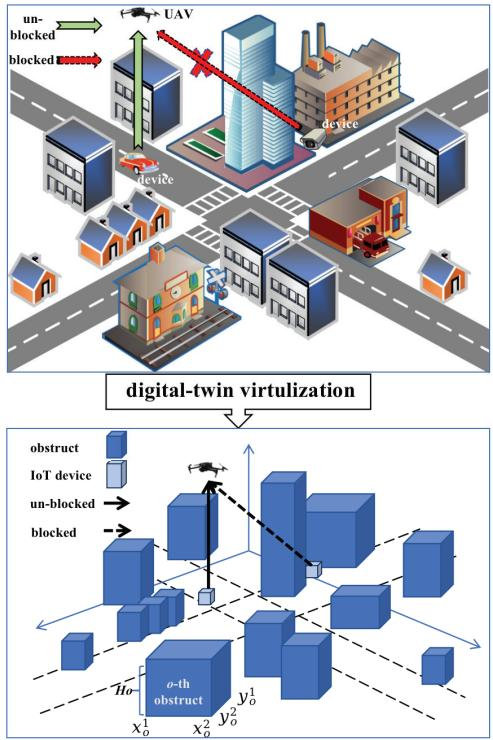

flowchart

```mermaid
graph TD
  A["Un-blocked UAV"] --> B["Device"]
  C["Un-blocked blocked UAV"] --> B
  D["Device"] --> E["Robot"]
  F["Device"] --> G["Robot"]
  H["Device"] --> I["Robot"]
  J["Device"] --> K["Robot"]
  L["Device"] --> M["Robot"]
  N["Device"] --> O["Robot"]
  P["Device"] --> Q["Robot"]
  R["Device"] --> S["Robot"]
  T["Device"] --> U["Robot"]
  V["Device"] --> W["Robot"]
  X["Device"] --> Y["Robot"]
  Z["Device"] --> AA["Robot"]
  AB["O-th obstacle"] --> AC["Ho"]
  AD["IoT device"] --> AE["xo¹"]
  AF["oth obstacle"] --> AG["yo²"]
  AH["Obstruct"] --> AI["Robot"]
  AJ["IoT device"] --> AK["xo²"]
  AL["Un-blocked blocked device"] --> AM["xo²"]
  AN["Un-blocked un-blocked device"] --> AO["xo²"]
  AP["Un-blocked device"] --> AQ["xo²"]
  AR["Un-blocked device"] --> AS["xo²"]
  AT["Un-blocked device"] --> AU["xo²"]
  AV["Un-blocked device"] --> AW["xo²"]
  AX["Un-blocked device"] --> AY["xo²"]
  AZ["Un-blocked device"] --> BA["xo²"]
  BB["Un-blocked device"] --> BC["xo²"]
  BD["Un-blocked device"] --> BE["xo²"]
  BF["Un-blocked device"] --> BG["xo²"]
  BH["Un-blocked device"] --> BI["xo²"]
  BJ["Un-blocked device"] --> BK["xo²"]
  BL["Un-blocked device"] --> BM["xo²"]
  BN["Un-blocked device"] --> BO["xo²"]
  BP["Un-blocked device"] --> BQ["xo²"]
  BR["Un-blocked device"] --> BS["xo²"]
  BT["Un-blocked device"] --> BU["xo²"]
  BV["Un-blocked device"] --> BW["xo²"]
  BX["Un-blocked device"] --> BY["xo²"]
  BZ["Un-blocked device"] --> CA["xo²"]
  CB["Un-blocked device"] --> CC["xo²"]
  DD["Un-blocked device"] --> DE["xo²"]
  DF["Un-blocked device"] --> DG["xo²"]
  DH["Un-blocked device"] --> DI["xo²"]
  DJ["Un-blocked device"] --> DK["xo²"]
  DL["Un-blocked device"] --> DM["xo²"]
  DN["Un-blocked device"] --> DO
  DO --> DB["Xo¹"]
  DO --> DC["Yo²"]
  DB --> DD
  DC --> DV["Xo¹"]
  DC --> DW["Yo²"]
```

Fig. 2. The digital-twin virtualization of the urban environment.

The N-LoS link in (6) is modelled as a Rayleigh fading channel, i.e.,

$$
g _ {n, k, t} ^ {\mathrm{N-LoS}} = \xi_ {n, k, t} \tilde {g} _ {n, k, t} ^ {\mathrm{N-LoS}}, \tag {7}
$$

where $\xi _ { n , k , t }$ denotes the path-loss between the k-th IoT device and the n-th UAV in time slot t, and $\tilde { g } _ { n , k , t } ^ { \mathrm { N - L o S } }$ follows the Gaussian distribution, i.e., n,k,t $\tilde { g } _ { n , k , t } ^ { \mathrm { N - L o S } } \sim \mathcal { C N } ( 0 , 1 )$ g˜N−LoS ∼ CN (0, 1).

Besides, the LoS link in (6) is modelled as a Rician fading channel, which can be given by

$$
g _ {n, k, t} ^ {\mathrm{LoS}} = \xi_ {n, k, t} \left(\sqrt {\frac {\kappa_ {\mathrm{R}}}{\kappa_ {\mathrm{R}} + 1}} \tilde {g} _ {n, k, t} ^ {(1)} + \sqrt {\frac {1}{\kappa_ {\mathrm{R}} + 1}} \tilde {g} _ {n, k, t} ^ {(2)}\right), \tag {8}
$$

where $\kappa _ { \mathrm { R } }$ denotes the Rician factor, $\tilde { g } _ { n , k , t } ^ { ( 1 ) }$ is related to the location of the k-th IoT device to the n-th UAV in time slot t, and $\tilde { g } _ { n , k , t } ^ { ( 2 ) }$ is modeled as the Gaussian distribution.

Hence, the received signal to noise ratio (SNR) at the n-th UAV from the k-th IoT device during the data collection at time slot t is given by

$$
\gamma_ {n, k, t} (\boldsymbol {q} _ {n, t}) = \frac {P _ {k} | g _ {n , k , t} (\boldsymbol {q} _ {n , t}) | ^ {2}}{\sigma_ {n , t} ^ {2}}, \tag {9}
$$

where $P _ { k }$ is the transmission power of the k-th IoT device, and $\sigma _ { n , t } ^ { 2 }$ denotes the noise powers at the n-th UAV.

To this end, the transmission rate during the data collection from the k-th IoT device to the n-th UAV is given by

$$
r _ {n, k, t} (\boldsymbol {q} _ {n, t}) = \log_ {2} (1 + \gamma_ {n, k, t} (\boldsymbol {q} _ {n, t})). \tag {10}
$$

Since data centers are deployed at the television tower, the channel gain from the n-th UAV to the associated data center $D _ { C _ { n } }$ is modelled as LoS link, which is given by

$$
g _ {n, t} (\boldsymbol {q} _ {n, t}) = \xi_ {n, t} \left(\sqrt {\frac {\kappa_ {\mathrm{R}}}{\kappa_ {\mathrm{R}} + 1}} \tilde {g} _ {n, t} ^ {(1)} + \sqrt {\frac {1}{\kappa_ {\mathrm{R}} + 1}} \tilde {g} _ {n, t} ^ {(2)}\right), \tag {11}
$$

where $\xi _ { n , t }$ denotes the path-loss between the n-th UAV and the associated data center $D _ { C _ { n } }$ in time slot $t , \tilde { g } _ { n , t } ^ { ( 1 ) }$ is related to the location of the n-th UAV to the associated data center $D _ { C _ { n } }$ in time slot t, and $\tilde { g } _ { n , t } ^ { ( 2 ) }$ is modeled as the Gaussian distribution.

The SNR at the associated data center $D _ { C _ { n } }$ from the n-th UAV is given by

$$
\gamma_ {n, t} (\boldsymbol {q} _ {n, t}) = \frac {P _ {n} | g _ {n , t} (\boldsymbol {q} _ {n , t}) | ^ {2}}{\sigma_ {D _ {C _ {n}} , t} ^ {2}}, \tag {12}
$$

where $P _ { n }$ is the transmission power of the n-th UAV, and $\sigma _ { D _ { C _ { n } } , i } ^ { 2 }$ $D _ { C _ { n } }$

As a result, the transmission rate from the n-th UAV to the associated data center $D _ { C _ { n } }$ can be written as

$$
r _ {n, t} (\boldsymbol {q} _ {n, t}) = \log_ {2} (1 + \gamma_ {n, t} (\boldsymbol {q} _ {n, t})). \tag {13}
$$

## C. AoI and Data Collection Model

The IoT devices are capable of sensing data. After the IoT devices finish data sensing, the UAV will collect the data from the IoT devices. Let $M _ { k }$ denote the number of bits for one sensed data. In order to complete the data collection within the allocated transmission time, the transmission data rate should satisfy the following constraint:

$$
M _ {k} \leq \sum_ {n = 1} ^ {N} \lambda_ {k, n} r _ {n, k, t} (\boldsymbol {q} _ {n, t}) B _ {n} t _ {n, k, t}, \tag {14}
$$

where $B _ { n }$ denotes the bandwidth allocated to the n-th UAV, and $t _ { n , k , t }$ is the scheduled transmission time for the k-th IoT device in time slot t.

It is assumed that one UAV can collect data from multiple IoT devices in one time slot, and the maximum number of IoT devices whose data can be successfully collected by the UAV is denoted as $K _ { \mathrm { m a x } }$ . Following [14] and [37], the IoT devices transmit data to the same UAV sequentially by adopting the time division multiple access (TDMA) protocol, thus the interuser-interference can be neglected. Constrained by the upper schedule limitation, the schedule state is evaluated by a binary notation $S = \{ 0 , 1 \}$ , while $S _ { n , k , t } = 1$ indicates that k-th IoT device is scheduled to transmit and its data can be successful collected by the n-th UAV (i.e., satisfy the transmission rate constraint (14)), otherwise, $S _ { n , k , t } = 0$ . Hence, the schedule state is given by

$$
S _ {n, k, t} = \left\{ \begin{array}{l l} 1, & \text { if   } k \text {-th IoT device is scheduled}, \\ 0, & \text { otherwise. } \end{array} \right. \tag {15}
$$

For the reason of upper schedule limitation, the number of scheduled IoT devices should satisfy the following constraint in time slot t, which is given by

$$
\sum_ {k = 1} ^ {K} S _ {n, k, t} \leq K _ {\max}. \tag {16}
$$

Given the schedule-state, the energy consumption of k-th IoT device in one time block is given by

$$
\sum_ {n = 1} ^ {N} \sum_ {t = 1} ^ {\tau_ {n}} \lambda_ {k, n} S _ {n, k, t} P _ {k} t _ {n, k, t} \leq E _ {\max} ^ {k}, \tag {17}
$$

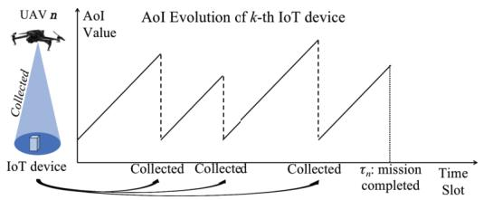

line chart

| Time Slot | AoI Value |
| --------- | --------- |
| Collected 1 | Low       |
| Collected 2 | High      |
| Collected 3 | Low       |
| Collected 4 | High      |
| Collected 5 | Low       |
| Collected 6 | High      |
| Collected 7 | Low       |
| Collected 8 | High      |
| Collected 9 | Low       |
| Collected 10 | High      |
| Collected 11 | Low       |
| Collected 12 | High      |
| Collected 13 | Low       |
| Collected 14 | High      |
| Collected 15 | Low       |
| Collected 16 | High      |
| Collected 17 | Low       |
| Collected 18 | High      |
| Collected 19 | Low       |
| Collected 20 | High      |
| Collected 21 | Low       |
| Collected 22 | High      |
| Collected 23 | Low       |
| Collected 24 | High      |
| Collected 25 | Low       |
| Collected 26 | High      |
| Collected 27 | Low       |
| Collected 28 | High      |
| Collected 29 | Low       |
| Collected 30 | High      |
| Collected 31 | Low       |
| Collected 32 | High      |
| Collected 33 | Low       |
| Collected 34 | High      |
| Collected 35 | Low       |
| Collected 36 | High      |
| Collected 37 | Low       |
| Collected 38 | High      |
| Collected 39 | Low       |
| Collected 40 | High      |
| Collected 41 | Low       |
| Collected 42 | High      |
| Collected 43 | Low       |
| Collected 44 | High      |
| Collected 45 | Low       |
| Collected 46 | High      |
| Collected 47 | Low       |
| Collected 48 | High      |
| Collected 49 | Low       |
| Collected 50 | High      |
| Collected 51 | Low       |
| Collected 52 | High      |
| Collected 53 | Low       |
| Collected 54 | High      |
| Collected 55 | Low       |
| Collected 56 | High      |
| Collected 57 | Low       |
| Collected 58 | High      |
| Collected 59 | Low       |
| Collected 60 | High      |
| Collected 61 | Low       |
| Collected 62 | High      |
| Collected 63 | Low       |
| Collected 64 | High      |
| Collected 65 | Low       |
| Collected 66 | High      |
| Collected 67 | Low       |
| Collected 68 | High      |
| Collected 69 | Low       |
| Collected 70 | High      |
| Collected 71 | Low       |
| Collected 72 | High      |
| Collected 73 | Low       |
| Collected 74 | High      |
| Collected 75 | Low       |
| Collected 76 | High      |
| Collected 77 | Low       |
| Collected 78 | High      |
| Collected 79 | Low       |
| Collected 80 | High      |
| Collected 81 | Low       |
| Collected 82 | High      |
| Collected 83 | Low       |
| Collected 84 | High      |
| Collected 85 | Low       |
| Collected 86 | High      |
| Collected 87 | Low       |
| Collected 88 | High      |
| Collected 89 | Low       |
| Collected 90 | High      |
| Collected 91 | Low       |
| Collected 92 | High      |
| Collected 93 | Low       |
| Collected 94 | High      |
| Collected 95 | Low       |
| Collected 96 | High      |
| Collected 97 | Low       |
| Collected 98 | High      |
| Collected 99 | Low       |
| Collected 100| Low       |

Fig. 3. The AoI evolution of one IoT device example.

$E _ { \mathrm { m a x } } ^ { k }$ denotes the maximum battery capacity of the k-th IoT device at the beginning of one time block. Besides, in each time slot, the transmit power of the k-th IoT device cannot exceed the power bound, i.e., $P _ { k } \le P _ { \operatorname* { m a x } }$

Since the energy is limited at the UAV, the goal of data collection is to ensure that all IoT devices are served as soon as possible. Another binary notation $C = \{ 0 , 1 \}$ is utilized to indicate whether the sensed data of an IoT device has been collected within the time block, which is defined as

$$
C _ {n, k, t} = \left\{ \begin{array}{l l} 1, & \text { if   } S _ {n, k, t} = 1 \text {   or   } C _ {n, k, t - 1} = 1; \\ 0, & \text { otherwise. } \end{array} \right. \tag {18}
$$

In order to ensure that all IoT devices are served by the UAV once in one time block T, the number of served IoT devices should satisfy the following constraint

$$
\sum_ {k = 1} ^ {K} \sum_ {n = 1} ^ {N} \lambda_ {k, n} C _ {n, k, \tau_ {n}} = K. \tag {19}
$$

We employ AoI to describe the data value over time. In particular, the value of the sensed data declines as time elapses, some examples including the traffic light signal, physical indicators of patients, and surveillance video data. A practical AoI model, similar to the works in [10] and [38], is proposed to measure the freshness of the collected data. As shown in Fig 3, where the AoI evolution example for one IoT device is presented. The AoI value $A _ { k , t }$ of the k-th IoT device is updated by

$$
A _ {k, t} = \left\{ \begin{array}{l l} 1, & \text { if   } S _ {n, k, t} = 1, \\ A _ {k, t - 1} + 1, & \text { otherwise }, \end{array} \right. \tag {20}
$$

since the UAV may finish the mission ahead of block duration T at time slot $\tau _ { n }$ if optimization is performed, the final AoI value of each device within one time block is given at slot $\tau _ { n }$ for all UAV to IoT device associations, then the corresponding UAV may stop the current mission to wait next mission.

After the data collection is finished, the UAV offloads the collected data and the system state information (SSI) to the associated data center, where the SSI of the n-th UAV consists of the position of the n-th UAV and the associated IoT devices, the data collection rate from the associated IoT device to the n-th UAV, and the AoI value of the associated IoT device. According to the TDMA policy and the time allocation, the sum of scheduled time for IoT devices and the offloading time of the UAV is assigned as the hovering time of the associated UAV, which is expressed as

$$
\sum_ {k = 1} ^ {K} S _ {n, k, t} t _ {n, k, t} + t _ {n, t} ^ {\text { off }} = t _ {n, t} ^ {\text { hov }}, \tag {21}
$$

where $\begin{array} { r } { t _ { n , t } ^ { \mathrm { o f f } } = \frac { B _ { n } r _ { n , t } ( \pmb { q } _ { n , t } ) } { D _ { n , t } ^ { \mathrm { S S I } } + \sum _ { k = 1 } ^ { K } S _ { n , k , t } M _ { k } } } \end{array}$ is the data offloading time consumption of the n-th UAV, and $D _ { n , t } ^ { \mathrm { S S I } }$ is the SSI data size of the n-th UAV. Besides, the energy consumption of the n-th $e _ { n , t } ^ { \mathrm { o f f } } = \bar { P } _ { n } t _ { n , t } ^ { \mathrm { o f f } }$ . Due to the limited energy resource, during one time block for data collection mission, the UAV should guarantee the following energy constraint

$$
\sum_ {t = 1} ^ {\tau_ {n}} \left(e _ {n, t} + e _ {n, t} ^ {\text { off }}\right) \leq E _ {\max}, \tag {22}
$$

where $E _ { \mathrm { m a x } }$ denotes the maximum battery capacity of the UAV at the beginning of one time block.

## D. Problem Formulation

The average AoI of the IoT devices during one mission time is denoted as $\begin{array} { r c l } { \mathcal { A } } & { \triangleq } & { \frac { 1 } { K } \displaystyle \sum _ { k = 1 } ^ { K } \frac { 1 } { \tau _ { n ( k ) } } \sum _ { t = 1 } ^ { \tau _ { n ( k ) } } A _ { k , t } } \end{array}$ τn(k) , where k=1 $n ( k ) = \arg _ { n } \{ \lambda _ { k , n } = 1 \}$ denotes the association that the $k -$ th IoT device is served by the n-th UAV, hence $\tau _ { n ( k ) }$ is the mission completion time corresponding to the k-th IoT device. The average AoI value measures the average data freshness, which is important to guide the data collection and UAV trajectory design of the considered system.

Our objective is to minimize the average AoI value of all IoT devices during the data collection mission, by jointly optimizing the time allocation of the UAVs, the energy consumption of the UAVs, the trajectory of the UAVs, the data collection scheduling policy of all IoT devices, and the mission completion time of the $\mathrm { U A V s . ~ L e t } ~ T = \{ t _ { n , k , t } , \forall k \in \mathcal { K } , \forall n \in$ $\mathcal { N } , \forall t \in T \} , \varpi = \{ \varpi _ { n , t } , \forall n \in \mathcal { N } , \forall t \in \mathcal { T } \} , d = \{ d _ { n , t } , \forall n \in \mathcal { N } \}$ $\mathcal { N } , \forall t \in \mathcal { T } \} , \ S \ = \ \{ S _ { n , k , t } , \forall k \in \mathcal { K } , \forall n \in \mathcal { N } , \forall t \in \mathcal { T } \}$ , $\tau = \{ \tau _ { n } , \forall n \in \mathcal { N } \}$ , denote the time slot allocation, flying direction of the UAVs, flying distance of the UAVs, scheduling of the IoT devices, and optimized mission completion time, respectively. The AoI optimization problem is formulated as

$$
\min _ {T, \varpi , d, S, \tau} \mathcal {A}
$$

s.t. $C 1 : \sum _ { n = 1 } ^ { N } \lambda _ { k , n } = 1 , \quad \forall k ,$

$C 2 : t _ { n , t } ^ { \mathrm { f i y } } + t _ { n , t } ^ { \mathrm { h o v } } = \varsigma , \quad \forall n , \ : \forall t ,$ tn,t

$C 3 : \tau _ { n } \leq T , \quad \forall n ,$

$C 4 : 0 \leq \varpi _ { n , t } \leq 2 \pi , \quad \forall n , \ \forall t ,$

$C 5 : 0 \leq v _ { n , t } \leq V _ { \operatorname* { m a x } } , \quad \forall n , \forall t ,$

$C 6 : 0 \leq w _ { n , t } ^ { x } \leq D , \quad \forall n , \ \forall t ,$

$C 7 : 0 \leq w _ { n , t } ^ { y } \leq D , \quad \forall n , \ \forall t ,$

$C 8 : D _ { \mathrm { U } } \leq \parallel q _ { n , t } - q _ { j , t } \parallel , \quad \forall n , j \in \mathcal { N } , n \neq j , \ \forall t ,$

$C 9 : \sum _ { t = 1 } ^ { \tau _ { n } } \left( e _ { n , t } + e _ { n , t } ^ { \mathrm { o f f } } \right) \leq E _ { \mathrm { m a x } } , \quad \forall n ,$

$C 1 0 : P _ { k } \leq P _ { \operatorname* { m a x } } , \quad \forall k ,$

$C 1 1 : \sum _ { n = 1 } ^ { N } \sum _ { t = 1 } ^ { \tau _ { n } } \lambda _ { k , n } S _ { n , k , t } P _ { k } t _ { n , k , t } \leq E _ { \operatorname* { m a x } } ^ { k } , \quad \forall k ,$

: X

(23)

where constraint C1 represents the serving state of all IoT devices, C2 represents that the time consumption of flying and hovering should be equal to the time duration, C3 means that the time consumption during one collection mission of the UAVs cannot exceed the maximum time block, C4 represents the flying geometric constraint in direction of the UAVs, C5 denotes the maximum velocity constraint of the UAVs, C6, C7, and C8 limit the flying range of the UAVs in the certain map, C9 shows that the UAV’s energy consumption during the data collection cannot exceed the energy battery limitation, C10 represents that the IoT devices’ power can not exceed the power threshold, C11 means that the IoT devices’ energy consumption for data transmission cannot exceed the energy battery thresholds, C12 denotes that the data transmission time of served IoT devices and data offloading time of the associated UAV cannot exceed the corresponding UAV’s hovering time, C13 denotes the scheduled number of IoT devices cannot exceed the upper-bound of the scheduling capacity of the corresponding UAV, and C14 means that all IoT devices should be collected at the end of the UAV mission collection time. The above optimization problem is a nonconvex problem along with the dimension of optimization variables varies depending on the mission completion time that needs to be optimized, which is a well known NP-hard problem and is not solvable via conventional optimization techniques efficiently. By contrast, DRL is proved to be suitable for solving such problems in such complex environments [6]. Thus, in the following sections, the proposed DADC will be presented in detail.

## IV. PROBLEM SOLUTIONS VIA DEEP FEDERATED REINFORCEMENT LEARNING

In this section, the details of the learning structure will be introduced. To design DRL based algorithm, the average AoI optimization problem is reformulated as a Markov decision process (MDP). An efficient and robust method called DRL for AoI-aware Data Collection (DADC) is proposed to solve the problem in the case with a single agent. Furthermore, a federated learning structure for secure learning in DADC is proposed, called Federated DADC (F-DADC), which is utilized to solve the problem in multi-agent distributed and collaborated level with the concern of data security and privacy.

## A. Reformulation for Learning Structure

Reinforcement learning is designed as an interacting algorithm between the agent and the observed environment, so as to effectively solve an MDP. An MDP consists of the environment-agent state space, the state transition probability, the agent action space, and reward space, and the goal of the agent is to find an optimized policy to maximize the instant reward [39]. Typically, an MDP can be modeled as a tuple, written as $\{ \mathcal { S } , \mathcal { A } , \mathcal { P } , \mathcal { R } \}$ , where S denotes the set of environment states, A denotes the set of agent actions, $\mathcal { P }$ denotes the transition probability from last state to the next state, and R denotes the reward function evaluated by the state and action. The considered problem (23) can be reformulated as an MDP and a decentralized agent model (DAM) is proposed in the following, and the details of the MDP are provided after the DAM.

Decentralized Agent Model: We consider a DAM, where each agent consists of two parts, the UAV and the associated local data center. Hence, the n-th agent associated with region $C _ { n }$ is given by ${ \mathfrak { A } } _ { n } \triangleq \{ U _ { n } , D _ { C _ { n } } \}$ , where $U _ { n }$ is the n-th UAV, and $D _ { C _ { n } }$ is the local data center within region $C _ { n }$ . Notice that the states at different UAVs may differ from each other. The MDP interaction of the DAM is given by the following 6 steps

step 1: $U _ { n }$ observes environment $C _ { n } ,$ gets state $s _ { n }$ from the associated IoT devices;

step $2 \colon U _ { n }$ offloads state $s _ { n }$ with size $D ^ { \mathrm { S S I } }$ to $D _ { C _ { n } }$

step 3: $D _ { C _ { r } }$ decides action $a _ { n }$ based on state $s _ { n } ;$

step 4: $D _ { C _ { n } }$ transmits action $a _ { n }$ to $U _ { n } ;$

step $5 \colon U _ { n }$ executes $a _ { n } ,$ observes reward $r _ { n } ;$

step 6: $U _ { n }$ offloads reward $r _ { n } \ { \mathrm { t o } } \ D _ { C _ { n } } { } ^ { 4 } ;$

Hence, a tuple of current MDP, i.e., $\left\{ s _ { n } , a _ { n } , r _ { n } \right\}$ , is stored at the data center $D _ { C _ { n } }$ for network training.

a) State Space: According to the considered problem (23), the system state space consists of four parts, i.e., the location of the ${ \mathrm { U A V s } } ,$ the location of the IoT devices, the transmission data rate of the UAVs by the IoT devices, and the AoI value of the IoT devices. The system state space can be given by ${ \mathcal { S } } \triangleq \{ Q _ { \mathrm { U A V } } , Q _ { \mathrm { I o T } } , r , A \}$ , where $Q _ { \mathrm { U A V } } = \{ \pmb q _ { n , t } , \forall n \in$ $\mathcal { N } , \forall t \in \mathcal { T } \} , \ Q _ { \mathrm { I o T } } = \{ \pmb { u } _ { k } , \forall k \in \mathcal { K } \} , \ r = \ \{ r _ { n , k , t } , \forall n \in \mathcal { K } \}$ $\mathcal { N } , \forall t \in \mathcal { T } , \forall k \in \mathcal { K } \}$ , and $A = \{ A _ { k , t } , \forall k \in \mathcal { K } , \forall t \in \mathcal { T } \}$ , respectively. Since the transitions from last state to the next state with respect to the transmission data rates from the IoT devices to the UAVs, which include the unknown variables, i.e., the channel state information, thus leading to the unknown characteristic of the transition probability P.  
b) Action Space: In order to minimize the average AoI of all IoT devices, the time allocation, the trajectories, the data scheduling policy, and the mission completion time are jointly optimized. Thus, the agent action space is constituted by these parts, given by ${ \mathcal { A } } \triangleq \{ T , \varpi , d , S \}$ .  
c) Reward: Since the goal of reinforcement learning is to maximize the system reward, while the goal of the studied problem is to minimize the average AoI value. By leveraging the characteristic of RL, the reward function is defined as the average difference AoI value of IoT devices with considerations of two penalty terms [10] ${ \cal F } _ { n , ( 1 ) }$ and ${ \cal F } _ { n , ( 2 ) }$ , where ${ \cal F } _ { n , ( 1 ) }$ denote the penalty if the n-th UAV flies out of the

serviced region,6 and ${ \cal F } _ { n , ( 2 ) }$ denote the penalty if the n-th UAV runs out of energy, respectively. Thus, the reward function is given by

$$
r _ {t} = \frac {1}{K} \sum_ {k \in \mathcal {K}} (A _ {k, t} - A _ {k, t + 1}) - \sum_ {n \in \mathcal {N}} F _ {n, (1)} - \sum_ {n \in \mathcal {N}} F _ {n, (2)}. \tag {24}
$$

If the improper action will lead to the penalty reward, the reward value will be calculated through (24), while the action is not executed.

Motivated by [9], a reward bonus is introduced when all the IoT devices in the region are successfully served by the corresponding UAV in time slot τ decided by the agent, i.e., $r _ { \tau }  r _ { \tau } + B _ { \mathrm { r } } ,$ if (19) is satisfied, where $B _ { \mathrm { r } }$ denotes the bonus reward value. In the meantime the current time slot is assigned as the mission completion time.

## B. Learning for Single Agent

The proposed DADC is leveraged by a progressive singleagent actor-critic deep reinforcement learning method called deep deterministic policy gradient [40], and also introduces the double Q-learning and delayed update rate techniques at the meantime to enhance the performance of the algorithm [41]. The actor-critic architecture that combines double Q-learning network and deterministic policy gradient approach is adopted in DADC algorithm. Several deep neural networks (DNNs) with different parameters are utilized to approximate the actor function and the critic function, respectively. The actor function represents the policy network $\mu ( s | \pmb \theta ^ { \mu } )$ that maps a given state $s \in S$ to a certain action $a \in { \mathcal { A } }$ deterministically, and the critic function represents the Q-value network with double networks $Q ( s , a | \theta ^ { Q _ { i } } ) , i = 1 , 2$ , that evaluate the action determined by the policy, where $\pmb { \theta } ^ { \mu }$ and $\theta ^ { Q _ { i } }$ i denote the neural network parameters of the actor and critic functions.

In the update process of the DADC algorithm, both the actor and critic functions have parallel networks, the online network and the target network. The additional target networks are utilized and the experience replay memory approach is performed to ensure the stability and effectiveness of training when updating the parameters [40]. Let $\mu ^ { - }$ and $Q ^ { - }$ denote the target network in actor and critic function, and $\pmb { \theta } ^ { \mu - }$ and θQi− denote the neural network parameters of the target actor $\pmb { \theta } ^ { Q _ { i } - }$ and critic functions, respectively. As for the critic function, the update is processed by minimizing the loss function

$$
\mathcal {L} (\boldsymbol {\theta} ^ {Q _ {i}}) = \frac {1}{M} \sum_ {m \in \mathcal {M}} (y _ {m} ^ {-} - Q (s _ {m}, a _ {m} \mid \boldsymbol {\theta} ^ {Q _ {i}})) ^ {2}, \tag {25}
$$

where $\mathcal { M } = \{ 1 , \dots , M \}$ denotes the set of one mini-batch sampled from replay memory D, M denotes the batch size of the network. Besides, $y _ { m } ^ { - }$ denotes the target Q-value, given by

$$
y _ {m} ^ {-} = r _ {m} + \gamma \min _ {i} Q ^ {-} (s _ {m + 1}, \mu^ {-} (s _ {m + 1} | \boldsymbol {\theta} ^ {\mu -}) | \boldsymbol {\theta} ^ {Q _ {i} -}). \tag {26}
$$

Algorithm 1 DADC Algorithm for AoI Optimization in $\mathrm { U A V _ { \mathrm { - } } }$ Enabled Data Collection System  
Input: environment state $S^{n} = \{Q_{UAV}^{n}, Q_{IoT}^{n}, r^{n}, A^{n}\}$ ;
Output: agent action $A^{n} = \{T^{n}, \varpi^{n}, d^{n}, S^{n}\}$ ;
Initialize digital virtualized urban environment $C_{n}$ ;
Initialize online critic network Q and online actor network $\mu$ with parameters $\theta^{Q_{i}}$ and $\theta^{\mu}$ ;
Initialize target network $Q^{-}$ and $\mu^{-}$ with parameters $\theta^{Q_{i}^{-}} \leftarrow \theta^{Q_{i}}$ and $\theta^{\mu^{-}} \leftarrow \theta^{\mu}$ ;
Initialize replay memory D;
for episode = 1, ..., E do
    Initialize a random process $N_{add}$ for action exploration;
    Reset environment parameters;
    for t = 1, ..., T do
    Observe the state $s_{t}$ according to the digital virtualized urban environment;
    Select action $a_{t} = \mu(s_{t} \mid \theta^{\mu}) + N_{add}$ according to the current state $s_{t}$ and the actor network;
    Execute action $a_{t}$ ;
    if UAV may fly beyond boundary then
    Back to the last state position and give punish reward $r_{t}$ ;
    else
    Observe the reward $r_{t}$ ;
    end if
    Observe the state $s_{t+1}$ of the next time slot $t + 1$ ;
    Store transition ( $s_{t}, a_{t}, r_{t}, s_{t+1}$ ) in D;
    Sample a random mini-batch of M transitions ( $s_{m}, a_{m}, r_{m}, s_{m+1}$ ) from D;
    Update the critic network by minimizing the loss function (25);
    Update the actor policy using the sampled policy gradient (27);
    Update the target networks through soft-update;
    end for
end for

On the other hand, the actor function updates following the policy gradient of ${ \mathcal { I } } ( \pmb { \theta } ^ { \mu } )$ , which is calculated by

$$
\begin{array}{l} \nabla_ {\boldsymbol {\theta} ^ {\mu}} \mathcal {J} (\boldsymbol {\theta} ^ {\mu}) \approx \frac {1}{M} \sum_ {m \in \mathcal {M}} \left\{\nabla_ {a} Q (s _ {m}, a | \boldsymbol {\theta} ^ {Q}) \right. \\ \left. \times \nabla_ {\boldsymbol {\theta} ^ {\mu}} \mu \left(s _ {m} \mid \boldsymbol {\theta} ^ {\mu}\right) \right| _ {a = \mu \left(s _ {m}\right)} \Bigg \}. \tag {27} \\ \end{array}
$$

In order to prevent the influence of the inaccuracy of the estimation function on the convergence of the algorithm, the update rate of the actor is lower than that of the critic. The target networks for both the actor and critic function update their parameters following the soft-update approach, $\mathrm { i . e . , }$ $\pmb { \theta } ^ { \mu - }  \zeta \pmb { \theta } ^ { \mu } + ( 1 - \zeta ) \pmb { \theta } ^ { \mu - }$ , and $\pmb { \theta } ^ { Q _ { i } - }   \zeta \pmb { \theta } ^ { Q _ { i } } + ( 1 - \zeta ) \pmb { \theta } ^ { Q _ { i } - }$ respectively, where ζ is a small update rate.

Exploration is one major challenge for RL with continuous action spaces. To improve the result of exploration, an independent noise $N _ { \mathrm { a d d } }$ sampled from a certain noise process $\mathcal { N } _ { \mathrm { a d d } }$ is added to the action choice [37], i.e., $x \mid _ { \mu ( s \mid \pmb \theta ^ { \mu } ) } = \mu ( s \mid$ $\pmb { \theta } ^ { \mu } ) + N _ { \mathrm { a d d } }$ . Meanwhile, the actions that are utilized for target critic learning, are smoothed to overcome over-fit by adding clipped noise, i.e., a− |µ(s−|θµ−)= µ(s− | θµ−) + N clippedadd , $a ^ { - } \mid _ { \mu ( s ^ { - } | \pmb \theta ^ { \mu - } ) } = \mu ( s ^ { - } \mid \pmb \theta ^ { \mu - } ) + N _ { \mathrm { a d d } } ^ { \mathrm { c l i p p e d } } ,$ where $N _ { \mathrm { a d d } } ^ { \mathrm { c l i p p e d } }$ is the clipped noise from $N _ { \mathrm { a d d } } \ [ 9 ]$ .

Since the DADC algorithm is designed for the singleagent system, we use $\begin{array} { l l l } { { S ^ { n } } } & { { = } } & { { \{ Q _ { \mathrm { U A V } } ^ { n } , Q _ { \mathrm { I o T } } ^ { n } , r ^ { n } , A ^ { n } \} } } \end{array}$ in state level and ${ \mathcal { A } } ^ { n } = \{ T ^ { n } , \varpi ^ { n } , { \dot { d } } ^ { n } , { \dot { S } } ^ { \ddot { n } } \}$ in action level to present the agent ${ \mathfrak { A } } _ { n } .$ , i.e., the n-th UAV, the data center $D _ { C _ { n } }$ , and the corresponding IoT devices associated by the n-th UAV. The details of the proposed DADC algorithm are presented in Algorithm 1.

## C. Learning by Federated Multi-Agents

It is assumed that each UAV may have its own interest, and therefore, the locations of the associated IoT devices, their communication quality, as well as the collected data from the IoT devices are user-sensitive information and thus cannot be shared with other UAVs. Therefore, in such a multiagent system, user privacy and data security are critical issues. For conventional centralized machine learning systems, each decentralized agent should send the collected data to the data server for central model training, which cannot be deployed in the proposed UAV-enabled data collection system for the concern of the above reasons.

The emerging technology called federated learning is an efficient tool to tackle the privacy and security issues to improve the QoS of the IoT devices. Generally, federated learning consists of two types of elements, the agent that owns data and AI computing capability for local training, while the server aggregates main parameters of DNNs from each agent for global training. In the considered multi-UAV-enabled IoT data collection system, a centralized data control server is introduced as federated server to manage the AI model for all agents, while all agents collect the environment state information, execute the action, and learn by the DADC. Since the communication among the data centers and the centralized server for DNN model aggregation only exist in the training episodes, while the testing episodes of agents represent the actual deployment situation, the energy and time latency for data aggregation to the server are not considered.

In federated averaging based FL methods, such as [42], the data collected by the IoT devices are stored in the serving UAV. For a certain episodes, the agents upload their DNN models to the federated centralized server, then the centralized server will aggregate the models and download the updated models to all data centers according to the updating policy of each agents. Let $E _ { \mathrm { F e d } }$ denote the model updating rate, which satisfies $E _ { \mathrm { F e d } } \ll E _ { \mathrm { m a x } }$ . To this end, the parameters of the actor and critic networks of the agents are updated in the frequency of every $E _ { \mathrm { F e d } }$ episodes, and the updating rule is given by

$$
\left[ \boldsymbol {\theta} _ {1} ^ {\mu}, \boldsymbol {\theta} _ {2} ^ {\mu}, \dots , \boldsymbol {\theta} _ {N} ^ {\mu} \right] \leftarrow \left[ \boldsymbol {\theta} _ {1} ^ {\mu}, \boldsymbol {\theta} _ {2} ^ {\mu}, \dots , \boldsymbol {\theta} _ {N} ^ {\mu} \right] \cdot \mathbf {F} _ {\mu}, \tag {28}
$$

$$
\left[ \boldsymbol {\theta} _ {1} ^ {Q _ {i}}, \boldsymbol {\theta} _ {2} ^ {Q _ {i}}, \dots , \boldsymbol {\theta} _ {N} ^ {Q _ {i}} \right] \leftarrow \left[ \boldsymbol {\theta} _ {1} ^ {Q _ {i}}, \boldsymbol {\theta} _ {2} ^ {Q _ {i}}, \dots , \boldsymbol {\theta} _ {N} ^ {Q _ {i}} \right] \cdot \mathbf {F} _ {Q}, \tag {29}
$$

where $\mathbf { F } _ { Q }$ and $\mathbf { F } _ { \mu }$ denote the federated updating matrices for the global actor and critic networks at the federated data control server, respectively. Similar to [30], the updating matrix for actor network is given by

$$
\mathbf {F} _ {\mu} = \left[ \begin{array}{c c c c} \chi_ {\mu} & \frac {1 - \chi_ {\mu}}{N - 1} & \dots & \frac {1 - \chi_ {\mu}}{N - 1} \\ \frac {1 - \chi_ {\mu}}{N - 1} & \chi_ {\mu} & \dots & \frac {1 - \chi_ {\mu}}{N - 1} \\ \vdots & \vdots & \ddots & \vdots \\ \frac {1 - \chi_ {\mu}}{N - 1} & \frac {1 - \chi_ {\mu}}{N - 1} & \dots & \chi_ {\mu} \end{array} \right], \tag {30}
$$

where $\chi _ { \mu }$ denotes the ratio of the self actor network parameters of the agent to the global federated actor model parameters. The structures of updating matrix $\mathbf { F } _ { Q }$ for critic network is resembled $\mathbf { F } _ { \mu } ,$ , which is given by

$$
\mathbf {F} _ {Q} = \left[ \begin{array}{c c c c} \chi_ {Q} & \frac {1 - \chi_ {Q}}{N - 1} & \dots & \frac {1 - \chi_ {Q}}{N - 1} \\ \frac {1 - \chi_ {Q}}{N - 1} & \chi_ {Q} & \dots & \frac {1 - \chi_ {Q}}{N - 1} \\ \vdots & \vdots & \ddots & \vdots \\ \frac {1 - \chi_ {Q}}{N - 1} & \frac {1 - \chi_ {Q}}{N - 1} & \dots & \chi_ {Q} \end{array} \right], \tag {31}
$$

Algorithm 2 F-DADC With HE  
Input: N agent each with local DMPs $\theta_{n}^{DMP}$ , HE function HE( $\cdot$ ), Number of training episodes E; FL update rate $E_{Fed}$ ;
Output: Broadcasted model parameters $\theta_{agg\_enc}^{DMP}$ ;
Initialize local model parameters $\theta_{n}^{DMP}$ of each agent;
for episode =1 to E and episode mod $E_{Fed} = 0$ do
    for each agent n from 1 to N do
    Encrypt agent n's DMPs $\theta_{n}^{DMP}$ by $\theta_{n_{enc}}^{DMP} \leftarrow \text{HE}(\theta_{n}^{DMP})$ ;
    Aggregate the encrypted DMPs $\theta_{n_{enc}}^{DMP}$ into $\theta_{agg\_enc}^{DMP}$ ;
    end for
    Broadcast $\theta_{agg\_enc}^{DMP}$ to each agent;
    for each agent n from 1 to N do
    Decrypt $\theta_{enc}^{DMP}$ to obtain the global aggregated DMPs $\Delta\theta_{agg\_enc}^{DMP}$ ;
    end for
end for

where χQ denotes the weight ratio value as mentioned above for critic network updating. By introducing the characteristics of federated learning into DADC, a new multi-agent learning algorithm is proposed as F-DADC.

The proposed F-DADC is characterised by its real-time operational capacity and synchronous update framework, which operates online, enabling dynamic adjustments in the UAV trajectory design and data collection scheduling by leveraging continuously updated models. Such a strategy significantly enhances the system’s responsiveness to changing environmental conditions and data requirements, further contributing to accelerated convergence rates and improved efficiency.

FL revolutionizes data privacy and security by allowing DNN model training on distributed datasets without the need for actual data, i.e., the MDP transitions, exchange, contrasting sharply with traditional centralised models. Despite these advantages, the transmission of DNN model parameters (DMPs) updates poses a risk. These updates, susceptible to interception and analysis, could potentially reveal sensitive information such as distribution.

To mitigate this risk, we integrate homomorphic encryption (HE) method [43], [44] into our proposed F-DADC algorithm, as detailed in Algorithm $2 ~ ^ { 7 }$ ,which offers a promising solution. The HE method enables computations on encrypted data, resulting in an encrypted output that, once decrypted, aligns with the results that would have been obtained from the original parameter data. This feature is particularly relevant in FL for encrypting DMPs before transmission, thus preserving DMPs confidentiality.

Implementing HE in FL serves a dual purpose in enhancing security. Firstly, it ensures the privacy of the DNN parameter data of each agent, as only encrypted parameter data is transmitted, with the raw parameter data never leaving the agent’s site. Secondly, it protects the integrity of the model updates during transmission, substantially lowering the risk of parameter data leakage. This added security layer is crucial, especially when the wireless communication channels are prone to eavesdropping, or the model parameters might inadvertently disclose sensitive details about the data.

The details of the proposed F-DADC algorithm are presented in Algorithm 3, and the network workflow of the proposed F-DADC algorithm is shown in Fig. 4.

Algorithm 3 F-DADC Algorithm for AoI Optimization in Multi-UAV-Enabled Data Collection System  
Input: environment state $S = \{S^{n}, \forall n\}$ of each agent;
Output: action $A = \{A^{n}, \forall n\}$ of each agent;
Initialize digital virtualized urban environment of all regions;
Initialize online critic network Q and online actor network $\mu$ with parameters $\theta^{Q_{i}}$ and $\theta^{\mu}$ for all agents;
Initialize target network $Q^{-}$ and $\mu^{-}$ with parameters $\theta^{Q_{i}^{-}} \leftarrow \theta^{Q_{i}}$ and $\theta^{\mu-} \leftarrow \theta^{\mu}$ for all agents;
Initialize replay memory D for all agents;
for episode = 1, ..., E do
    Initialize a random process $N_{add}$ for action exploration;
    Reset environment parameters;
    for t = 1, ..., T do
    for UAV $U_{n}$ , $\forall n \in N$ do
    Observe the state $s_{t}^{n}$ according to the corresponding digital virtualized urban environment;
    Select action $a_{t}^{n} = \mu(s_{t}^{n} \mid \theta_{n}^{\mu}) + N_{add}$ according to the current state $s_{t}^{n}$ and the actor network;
    Execute action $a_{t}^{n}$ ;
    if UAV $U_{n}$ may fly beyond boundary then
    Back to the last state position and give punish reward $r_{t}^{n}$ ;
    else
    Observe the reward $r_{t}^{n}$ ;
    end if
    Observe the state $s_{t+1}^{n}$ of the next time slot $t + 1$ ;
    Store transition ( $s_{t}^{n}, a_{t}^{n}, r_{t}^{n}, s_{t+1}^{n}$ ) in $D_{n}$ ;
    Sample a random mini-batch of M transitions ( $s_{m}, a_{m}, r_{m}, s_{m+1}$ ) from $D_{n}$ ;
    Update the critic network by minimizing the loss function (25);
    Update the actor policy using the sampled policy gradient (27);
    Update the target networks through soft-update;
    end for
end for
if episode mod $E_{Fed} = 0$ then
    Aggregate agent network parameters to the server;
    Update the global actor network through (28), then send to each agent;
    Update the global critic network through (29), then send to each agent;
end if
end for

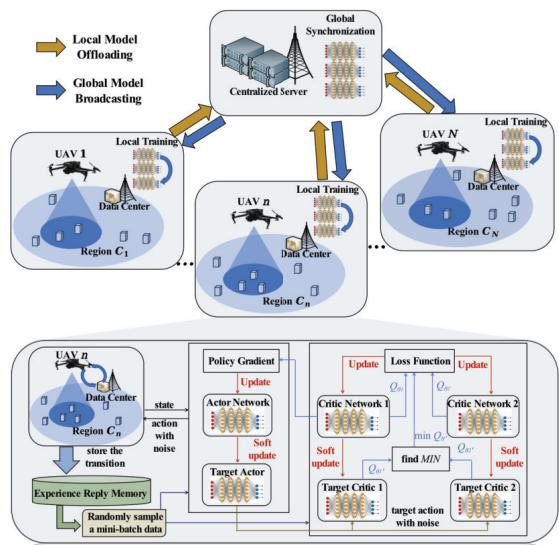

flowchart

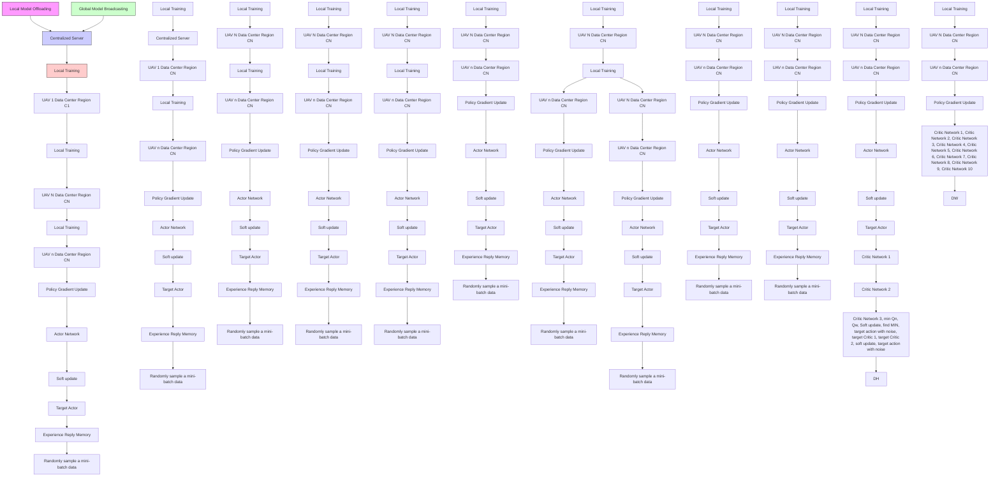

Fig. 4. The network workflow of the proposed F-DADC algorithm.

## D. Algorithm Analysis

a) Convergence Analysis: In Algorithm 1, the network parameters of critic functions are upper bounded following the Arzela-Ascoli theorem [45]. Following theorem 1 by [46], the neural networks are all updated by the gradient descent scheme utilized by the optimizer. The gradient information of functions (25) and (27) can be utilized to program the updating directions of the network parameters. Therefore, the objective loss function can converge to the optimal or near-optimal stage. Therefore, as the objective loss function is converged, the network parameters may converge to stable, which leads to an overall convergence of Algorithm 1.

The convergence of federated learning has been validated. Initially proposed by [42], experimental observations demonstrated the convergence of algorithms on both independently identically distribution (i.i.d.) and non-i.i.d. datasets. However, theoretical validation was lacking in the optimization perspective. Subsequently, convergence in scenarios assuming i.i.d. data was verified by [47], [48], [49], and [50], establishing the convergence of federated learning based on certain assumptions. Later, the convergence of federated learning under non-i.i.d. settings was further substantiated in [51]. This enhanced the analysis of the critical function of the proposed F-DADC convergence without relying on two assumptions: (1) the data being i.i.d., and (2) all devices being active. Considering that the critical function of the proposed F-DADC aligns with the assumptions presented as follows.

Let $F _ { n , \pmb { \theta } ^ { i } \in \pmb { \mathrm { L } } } , \forall n \ \in \ \mathcal { N }$ denote the objective function of each local agent, where ${ \bf L } \triangleq \{ \pmb { \theta } ^ { Q ^ { 1 } } , \pmb { \theta } ^ { Q ^ { 2 } } \}$ denotes the neural network correspondence with the objective function. Hence, for loss functions $F _ { n , \pmb \theta ^ { i } } , \forall n \in \mathcal { N } , \forall \pmb \theta ^ { i } \in \mathbf { L }$ , we have

Assumption 1: $F _ { n , \pmb \theta ^ { i } } , \forall n \in \mathcal { N } , \forall \pmb \theta ^ { i } \in \mathbf { L }$ are all L-smooth, i.e., ∀v and ∀w, we have $F _ { n , \pmb { \theta } ^ { i } } ( \mathbf { v } ) \ \leq \ F _ { n , \pmb { \theta } ^ { i } } ( \mathbf { w } ) + ( \mathbf { v } \ - $ $\begin{array} { r } { \mathbf { w } \mathbf { ) } ^ { T } \nabla F _ { n , \pmb { \theta } ^ { i } } ( \mathbf { w } ) + \frac { L } { 2 } \| \mathbf { v } - \mathbf { w } \| _ { 2 } ^ { 2 } . } \end{array}$ .

Assumption 2: $F _ { n , \theta ^ { i } }$ , ∀n $\in \mathcal { N } .$ , $\forall \pmb { \theta } ^ { i } \in \mathbf { L }$ are all µ-strongly convex, i.e., ∀v and ∀w, we have $F _ { n , \pmb { \theta } ^ { i } } ( \mathbf { v } ) \geq F _ { n , \pmb { \theta } ^ { i } } ( \mathbf { w } ) + ( \mathbf { v } -$ $\begin{array} { r } { \mathbf { w } \mathbf { ) } ^ { T } \nabla F _ { n , \theta ^ { i } } ( \mathbf { w } ) + \frac { \mu } { 2 } \| \mathbf { v } - \mathbf { w } \| _ { 2 } ^ { 2 } . } \end{array}$

Assumption 3: Let $\varphi _ { t } ^ { n }$ be sampled from the n-th agent’s local data uniformly at random. The variance of stochastic gradients in each agent is bounded by ${ \bar { \sigma } } _ { n } ^ { 2 } ,$ , which can be written as $\begin{array} { r } { \mathbb { E } \left\| \nabla F _ { n , \theta ^ { i } } \left( \mathbf { w } _ { t } ^ { n } , \varphi _ { t } ^ { n } \right) - \nabla F _ { n , \theta ^ { i } } \left( \mathbf { w } _ { t } ^ { n } \right) \right\| ^ { 2 } \leq \bar { \sigma } _ { n } ^ { 2 } } \end{array}$ , $\forall n \in \mathcal { N } , \ \forall \pmb { \theta } ^ { i } \in \ddot { \bf L }$ .

Assumption 4: The expected squared norm of stochastic gradients is uniformly bounded by ${ \bar { G } } ^ { 2 } ,$ , which can be written as $\mathbb { E } \left\| \nabla F _ { n , \theta ^ { i } } \left( \mathbf { w } _ { t } ^ { n } , \varphi _ { t } ^ { n } \right) \right\| ^ { 2 } \leq \bar { G } ^ { 2 } , \forall n \in \mathcal { N } , \forall \pmb { \theta } ^ { i } \in \mathbf { L }$ and $\forall t \in \ddot { \mathcal { T } } \backslash \{ T \}$ .

Remark 1: The convergence of the critic function of the proposed F-DADC algorithm can be substantiated. Since local actor and critic functions can converge to stable, which are proved by the theorem 1 in [46], and the global critic function can converge to stable with the above assumptions, the global actor function of the F-DADC algorithm also tends to converge.

In addition, we also derive the AoI lower bound to describe the performance gap between our proposed F-DADC in the simulation section, where the AoI lower bound is given by Proposition 1.

Proposition 1: The lower bound of the average AoI $\mathcal { A } _ { \mathrm { m i n } }$ during one time block is derived by

$$
\mathcal {A} _ {\min} = \frac {K ^ {2} + 3 K N K _ {\max} - N ^ {2} K _ {\max} ^ {2}}{3 K N K _ {\max}}. \tag {32}
$$

Proof: The lower bound of the average AoI $\mathcal { A } _ { \mathrm { m i n } }$ during one time block can be obtained when each UAV can finish the mission by $\bar { K } / K _ { \operatorname* { m a x } }$ time slots. Since the UAV can serve $K _ { \mathrm { m a x } }$ IoT devices in one time slot, we denote $K _ { \mathrm { m a x } }$ as the number of devices in a group, thus there are $\tilde { K } \triangleq \frac { \bar { K } } { K _ { \operatorname* { m a x } } }$ Kmax groups of devices within one region. Each group is served only once until all groups with the region are served by the associated UAV, hence the sum of AoI with one region associated with one certain UAV is increased by $K _ { \operatorname* { m a x } } ( \tilde { K } - t )$ compared to the last time slot. Let ${ \bar { A } } _ { n , t }$ denote the sum of AoI within the region $C _ { n }$ associated with n-th UAV at time slot t. As a result, the sum AoI is a recurrence formula, and is given by

$$
\begin{array}{l} \bar {A} _ {n, t} = K _ {\mathrm{max}} (\tilde {K} - t) + \bar {A} _ {n, t - 1} \\ = K _ {\max} \left(\tilde {K} t - \frac {t + t ^ {2}}{2}\right) + \bar {A} _ {n, 0}, \tag {33} \\ \end{array}
$$

where ${ \bar { A } } _ { n , 0 } \triangleq { \bar { K } }$ is the initial sum of AoI value within the region $C _ { n }$ associated with n-th UAV. By substituting ${ \bar { A } } _ { n , 0 }$ into (33), then we can derive the average AoI within the region $C _ { n }$ associated with the n-th UAV, which is given by

$$
\mathcal {A} _ {n} = \frac {1}{\tilde {K}} \sum_ {t = 1} ^ {\tilde {K}} \bar {A} _ {n, t} = \frac {K _ {\max} (\tilde {K} ^ {2} + 3 \tilde {K} - 1)}{3 \tilde {K}}, \tag {34}
$$

noting that the lower bound is reached when each UAV can finish the mission by the same time, thus the value of overall average AoI is the same as the value of average AoI of one region. By substituting $\begin{array} { r } { \tilde { K } = \frac { \bar { K } } { K _ { \mathrm { m a x } } } } \end{array}$ Kmax and $\begin{array} { r } { \bar { K } = \frac { K } { N } } \end{array}$ into (34), then we can derive (32). 

b) Complexity Analysis: The complexity of the proposed Algorithm 1 primarily depends on the model training of separated neural networks. Let $L _ { a }$ and $L _ { c }$ denote the number of hidden layers of actor and critic networks, respectively, and let $N _ { l } ^ { a }$ and $N _ { l } ^ { c }$ denote the number of neurons in the l-th layer for the actor and critic networks, respectively. Within training and testing process, the input dimension and output dimension of the actor network are $4 \bar { K } + 2$ and $2 \bar { K } + 2 ,$ , respectively, while the input dimension and output dimension of the critic network are $4 \bar { K } + 2$ and 1, respectively. Hence, the training complexity of Algorithm 1 is given by $\begin{array} { r l } {  { \mathcal { O } ( M E T ( ( 4 \bar { K } + 2 ) N _ { 0 } ^ { a } + \sum _ { l = 2 } ^ { L _ { a } - 1 } N _ { l - 1 } ^ { a } N _ { l } ^ { a } + ( 2 \bar { K } + 2 ) N _ { L _ { a } } ^ { a } + } } & { { } } \end{array}$ $( 4 \bar { K } + 2 ) N _ { 0 } ^ { c } + \sum _ { l = 2 } ^ { L _ { c } - 1 } N _ { l - 1 } ^ { c } N _ { l } ^ { c } + N _ { L _ { c } } ^ { c } ) )$ of the Algorithm 2 is related to the number of neurons, and the number of federated aggregations. The complexity of once aggregation on single agent is $\mathcal { O } ( 2 ( N _ { l } ^ { a } + \bar { N _ { l } ^ { c } } ) ^ { 2 } )$ . And the training complexity of the proposed Algorithm 3 is determined by the number of the agents of proposed F-DADC and the complexity of the Algorithm 1 and Algorithm 2, which can be written as $\mathcal { O } ( N M \bar { E } T ( ( 4 \bar { K } + 2 ) N _ { 0 } ^ { a } + \sum _ { l = 2 } ^ { L _ { a } - 1 } N _ { l - 1 } ^ { a } N _ { l } ^ { a } +$ $( 2 \bar { K } + 2 ) N _ { L _ { a } } ^ { a } + ( 4 \bar { K } + 2 ) N _ { 0 } ^ { c } + \sum _ { l = 2 } ^ { L _ { c } - 1 } N _ { l - 1 } ^ { c } N _ { l } ^ { c } + N _ { L _ { c } } ^ { c } ) +$ $N E ( 2 ( N _ { l } ^ { a } + \mathbf { \bar { \Phi } } N _ { l } ^ { c } ) ^ { 2 } ) / E _ { \mathrm { F e d } } )$ .

## V. NUMERICAL RESULTS

In this section, numerical results are presented to verify the proposed F-DADC algorithm. It is assumed that, the system region of interest is 1,000m ×1,000m, and the number of UAVs is $N = 4$ . The maximum time slot is $T = 2 0 0 \varsigma$ seconds in one concerned time block, where the duration of each slot is upper bounded by two seconds. It is assumed that the region is divided into N rectangle mutually disjoint sub-regions, each with the size of 500m ×500m, i.e., $D = 5 0 0 \mathrm { m }$ . Each UAV is responsible for the data collection of IoT devices in one given sub-region. The association between the UAV and the sub-region is pre-given. Each UAV collects data within their sub-region, and serves K¯ IoT devices, where the number of all IoT devices K is taken from the set {20, 40, 60, 80, 100, 120} according to different simulation settings. In addition, in each time slot, a single UAV could serve $K _ { \operatorname* { m a x } } = 5$ IoT devices. For one time block, the maximum battery threshold of the $E _ { n } ^ { \mathrm { m a x } } = 5 \mathbf { K } \mathbf { W } \mathbf { h }$

TABLE I PARAMETER SETTINGS IN THE SYSTEM MODEL

<table><tr><td>Parameters</td><td>Value</td></tr><tr><td>Transmit power of the IoT device,  $P_{k}$ </td><td>10dBm</td></tr><tr><td>Transmit power of the UAV,  $P_{n}$ </td><td>40dBm</td></tr><tr><td>Flight height of the UAV,  $H_{n,t}$ </td><td>100m</td></tr><tr><td>Max flight speed of the UAV,  $V_{\text{max}}$ </td><td>50m/s</td></tr><tr><td>Constant power of the UAV,  $P_{0}, P_{1}$ </td><td>79.86W and 88.62W</td></tr><tr><td>Tip speed of rotor blade of the UAV,  $U$ </td><td>120m/s</td></tr><tr><td>Mean rotor velocity of the UAV,  $v_{0}$ </td><td>4.03m/s</td></tr><tr><td>Fuselage drag ratio of the UAV,  $d_{0}$ </td><td>0.6</td></tr><tr><td>Rotor solidity of the UAV,  $s_{0}$ </td><td>0.05</td></tr><tr><td>Air density of the environment,  $\varrho_{0}$ </td><td>1.225kg/m $^{3}$ </td></tr><tr><td>Rotor disc area of the UAV,  $A$ </td><td>0.503m $^{2}$ </td></tr><tr><td>Path loss in city,  $\xi_{n,k,t}$ </td><td>32.6+36.7log( $d_{n,(k),t}$ )</td></tr><tr><td>Rician factor,  $\kappa_{\text{R}}$ </td><td>15</td></tr><tr><td>Noise power at the UAV,  $\sigma_{n,t}^{2}$ </td><td>-75dBm</td></tr><tr><td>Noise power at the data center,  $\sigma_{DCn}^{2}, t$ </td><td>-75dBm</td></tr><tr><td>System bandwidth of the UAV,  $B_{n}$ </td><td>10 $^{7}$ Hz</td></tr><tr><td>Sensed data to be collected,  $M$ </td><td>2MBits</td></tr></table>

The system model parameters are shown in Table I. The Training and testing are implemented on Python 3.6 with Pytorch neural network toolbox. In the proposed F-DADC, the mini-batch size is 256, the replay memory size is 10, 000, the learning rate of both actor and critic are 0.0001, the discount factor is 0.99, the soft update rate is 0.005, the number of hidden layer of both actor and critic are 3, the activation function is ReLU, and the final output layer of the actor is Tanh, the variance of the action noise is 1, the number of episodes is 6, 000, the bonus of reward is 200, the federated update ratio of both actor and critic are 0.25, and the federated update rate are 50 per episodes.

## A. Evaluation of F-DADC in Training

In this subsection, the training performance of the proposed F-DADC algorithm is evaluated by comparing with the deep deterministic policy gradient (DDPG)-based single agent algorithm [53], the multiple agent DDPG (MADDPG)-based algorithm [54], the twin-delay deep deterministic (TD3) policy gradient-based single agent algorithm [9], and the multiple agent TD3 (MATD3)-based algorithm [55], [56], and federated learning benchmark.

## a) Convergence Comparison with Different Algorithm:

As shown in Fig. 5, and Fig. 6, the accumulated reward versus (v.s.) the training episodes, and the accumulated reward v.s. the training episodes of the four collaborated agents in F-DADC are presented, respectively, where the communication frequency of network parameters of four agents is set as every 50 episodes, and the reward curves in Fig. 5 are smoothed. It is observed that the convergence rate of the proposed F-DADC algorithm is significantly faster than the

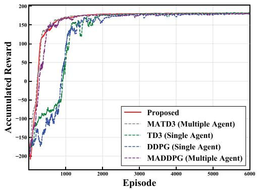

line chart

| Episode | Proposed | MATD3 (Multiple Agent) | TD3 (Single Agent) | DDPG (Single Agent) | MADDPG (Multiple Agent) |
| ------- | -------- | ---------------------- | ------------------ | ------------------- | ----------------------- |
| 0       | -200     | -200                   | -200               | -200                | -200                    |
| 1000    | 150      | 150                    | 150                | 150                 | 150                     |
| 2000    | 175      | 175                    | 175                | 175                 | 175                     |
| 3000    | 180      | 180                    | 180                | 180                 | 180                     |
| 4000    | 185      | 185                    | 185                | 185                 | 185                     |
| 5000    | 190      | 190                    | 190                | 190                 | 190                     |
| 6000    | 195      | 195                    | 195                | 195                 | 195                     |

Fig. 5. The accumulated reward v.s. the training episodes.

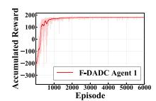  
(a) Agent 1 of F-DADC

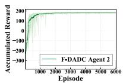  
(b) Agent 2 of F-DADC

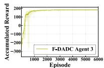  
(c)Agent 3 of F-DADC

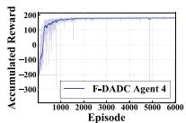  
(d)Agent 4 of F-DADC  
Fig. 6. Training curve of each agent in F-DADC.

DDPG method and the TD3 method. The reason is that the aggregation and distribution of the federated global network model improve the learning efficiency and reduce the possibility of local convergence of single agent. We can observe that the MATD3 converges slightly faster than the proposed F-DADC, but is also caught up by the proposed F-DADC at around 650 episodes. This reason is that, the MATD3 algorithms share global information during training, so their convergence rate is faster than that of federated algorithms, which can be considered as the upper bound of convergence rate. Due to the utilization of appropriate hyperparameters, the proposed F-DADC achieves a convergence rate close to the MATD3 algorithm. Additionally, its convergence rate surpasses that of the MADDPG algorithm, owing to its advanced DNN architecture. From Fig. 6, it is observed that benefiting from federal learning, the four agents all present similar learning efficiency.

b) Convergence Comparison with Federated Benchmarks: Fig. 7 illustrates the influence of different update rates of federated learning on the convergence performance of the proposed F-DADC algorithm, where all data are smoothed to facilitate reading. It is observed that the convergence of the default update rate (50 per episode) outperforms all the other update rates. The reason is that too frequent or too slow update rates may cause the federated server to aggregate models that are trapped in local convergence.

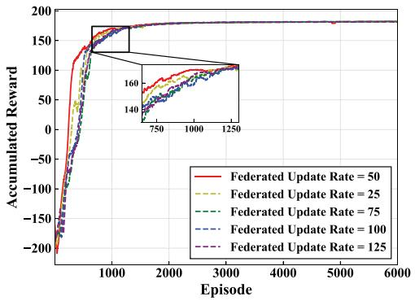

line chart

| Episode | Federated Update Rate = 50 | Federated Update Rate = 25 | Federated Update Rate = 75 | Federated Update Rate = 100 | Federated Update Rate = 125 |
| ------- | -------------------------- | -------------------------- | -------------------------- | --------------------------- | --------------------------- |
| 0       | -200                       | -200                       | -200                       | -200                        | -200                        |
| 1000    | 160                        | 140                        | 140                        | 140                         | 140                         |
| 2000    | 180                        | 160                        | 160                        | 160                         | 160                         |
| 3000    | 180                        | 160                        | 160                        | 160                         | 160                         |
| 4000    | 180                        | 160                        | 160                        | 160                         | 160                         |
| 5000    | 180                        | 160                        | 160                        | 160                         | 160                         |
| 6000    | 180                        | 160                        | 160                        | 160                         | 160                         |

Fig. 7. The different federated update rates in the proposed F-DADC algorithms.

## B. Evaluation of F-DADC in Testing

In this subsection, the testing performance of the proposed F-DADC after the convergence is evaluated. For performance comparison, three benchmarks are considered, which are described in the following: (1) Sequential IoT Searching for Data Collection (SSDC): In this benchmark, the UAV flies to hover on the top of each IoT device by a certain predefined user sequence list, and collects the IoT device’s data one by one according to the user list. (2) Backtracking based IoT Searching for Data Collection (BSDC): Backtracking is a classic search scheme to find the optimal solution step by step. In this benchmark, a backtracking based trajectory searching method is utilized to find the optimal trajectory to optimize the average AoI performance. (3) Greedy Rectangle Searching for Data Collection (GRSDC): In this algorithm, the UAV flies along a rectangular trajectory. At the algorithm level, the GRSDC algorithm greedily searches the flying departure and arriving point, and the flying area, until the algorithm finds an optimal trajectory.

a) AoI Performance Comparison: Since the benchmarks SSDC and BSDC are designed for the single user collection scenario, in the AoI performance evaluation, two complementary benchmarks are introduced to reflect the AoI evolution as the same standards compared with GRSDC and the proposed F-DADC. It is assumed that the UAVs in SSDC and BSDC are capable of collecting data and updating the AoI state for $K _ { \mathrm { m a x } }$ IoT devices in the same hovering time. The two complementary benchmarks are called SSDC-Multi-IoT (SSDC-MI), and BSDC-Multi-IoT (BSDC-MI), respectively. In addition, the AoI lower bound is also presented with the average AoI analysis.

As shown in Fig. 8 and Table II, the average AoI of all IoT devices versus the number of IoT devices is described. It is observed that the proposed F-DADC algorithm achieves the lowest AoI performance compared with others and is closest to the AoI lower bound, i.e., the collected data are the freshest among all the algorithms. The reason is that, the agent of F-DADC not only finds the optimal trajectory to collect data from all served IoT devices, but also takes the AoI state into consideration. As the number of IoT devices increases, the AoI and average AoI of all algorithms tend to rise. The reason is that the increase in the number of IoT devices leads to a longer flight time of the UAV, thus the last update AoI will increase according to the total collection time. However, the AoI growth trend of the proposed F-DADC algorithm is still the weakest, which verifies the robustness of the proposed F-DADC. Besides, the AoI bound is difficult to reach, since the UAV can fly instantly between different groups in the Proposition 1, which is not common in practice. In addition, the average final AoI value per IoT device at the completion time slot is compared in Fig. 9.

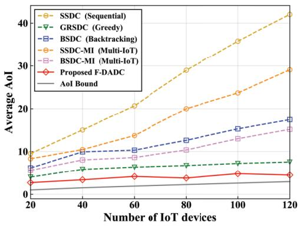

line chart

| Number of IoT devices | SSDC (Sequential) | GRSDC (Greedy) | BSDC (Backtracking) | SSDC-MI (Multi-IoT) | BSDC-MI (Multi-IoT) | Proposed F-DADC | AoI Bound |
| --------------------- | ----------------- | -------------- | ------------------- | ------------------- | ------------------- | ---------------- | --------- |
| 20                    | 10                | 5              | 7                   | 8                   | 6                   | 3              | 1         |
| 40                    | 15                | 6              | 10                  | 10                  | 8                   | 4              | 1         |
| 60                    | 20                | 7              | 12                  | 14                  | 10                  | 4              | 1         |
| 80                    | 25                | 7              | 14                  | 20                  | 12                  | 4              | 1         |
| 100                   | 30                | 7              | 16                  | 24                  | 14                  | 5              | 1         |
| 120                   | 40                | 8              | 18                  | 29                  | 16                  | 5              | 1         |

Fig. 8. The average AoI value v.s. the number of IoT devices in different algorithms.

TABLE II THE AVERAGE AOI VALUE V.S. THE NUMBER OF IOT DEVICES IN DIFFERENT ALGORITHMS

<table><tr><td rowspan="2">Algorithms</td><td colspan="6">Number of IoT devices</td></tr><tr><td>20</td><td>40</td><td>60</td><td>80</td><td>100</td><td>120</td></tr><tr><td>SSDC</td><td>9.53</td><td>15.02</td><td>20.69</td><td>28.98</td><td>35.85</td><td>42.01</td></tr><tr><td>SSDC-MI</td><td>8.31</td><td>10.45</td><td>13.72</td><td>20.01</td><td>23.68</td><td>29.09</td></tr><tr><td>GRSDC</td><td>4.01</td><td>5.83</td><td>6.35</td><td>6.72</td><td>7.21</td><td>7.54</td></tr><tr><td>BSDC</td><td>6.16</td><td>9.92</td><td>10.31</td><td>12.61</td><td>15.28</td><td>17.43</td></tr><tr><td>BSDC-MI</td><td>5.59</td><td>8.03</td><td>8.60</td><td>10.36</td><td>12.98</td><td>15.16</td></tr><tr><td>F-DADC</td><td>2.71</td><td>3.37</td><td>4.14</td><td>3.78</td><td>4.80</td><td>4.48</td></tr><tr><td>AoI Bound</td><td>1.00</td><td>1.50</td><td>1.89</td><td>2.25</td><td>2.60</td><td>2.94</td></tr></table>

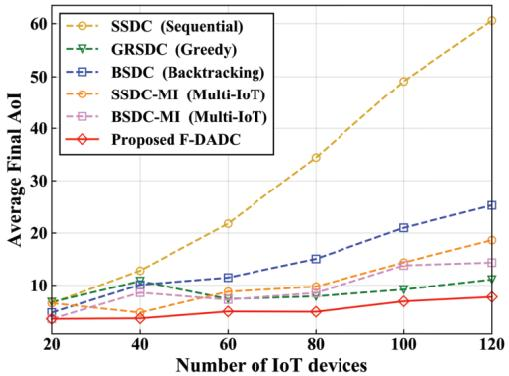

line chart

| Number of IoT devices | SSDC (Sequential) | GRSDC (Greedy) | BSDC (Backtracking) | SSDC-MI (Multi-IoT) | BSDC-MI (Multi-IoT) | Proposed F-DADC |
| --------------------- | ----------------- | -------------- | ------------------- | ------------------- | ------------------- | ---------------- |
| 20                    | 8                 | 7              | 7                   | 7                   | 7                   | 6                |
| 40                    | 12                | 8              | 10                  | 8                   | 9                   | 6                |
| 60                    | 22                | 9              | 11                  | 9                   | 10                  | 7                |
| 80                    | 35                | 10             | 15                  | 10                  | 12                  | 8                |
| 100                   | 50                | 11             | 20                  | 13                  | 14                  | 9                |
| 120                   | 60                | 12             | 25                  | 18                  | 15                  | 10               |

Fig. 9. The final AoI value per IoT device v.s. the number of IoT devices in different algorithms.

Since AoI is a metric w.r.t. the time, the proposed F-DADC algorithm gives a policy to find the optimized AoI performance of all IoT devices, simultaneously reducing the consumption time of data collection tasks. Therefore, the energy consumption and flying distance of the UAVs are optimized in the meantime. Due to the poor capability of multiple IoT device collections, the multi-IoT cases of SSDC and BSDC show similar performances in terms of the consumption time, the energy consumption and flying distance compared to the single-IoT cases. As a result, only single-IoT cases are considered in the subsequent analysis.

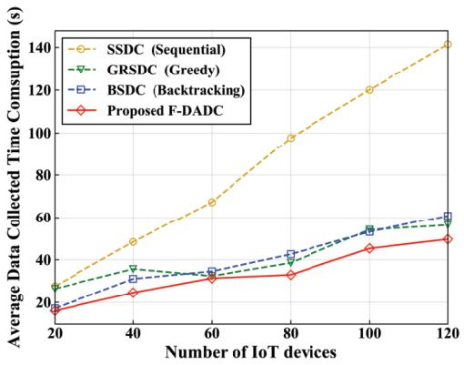

line chart

| Number of IoT devices | SSDC (Sequential) | GRSDC (Greedy) | BSDC (Backtracking) | Proposed F-DADC |
| --------------------- | ----------------- | -------------- | ------------------- | ---------------- |
| 20                    | 30                | 25             | 20                  | 15               |
| 40                    | 50                | 35             | 30                  | 25               |
| 60                    | 70                | 35             | 35                  | 30               |
| 80                    | 100               | 40             | 45                  | 35               |
| 100                   | 120               | 55             | 55                  | 45               |
| 120                   | 140               | 60             | 60                  | 50               |

Fig. 10. The average total data collection time consumption of UAVs v.s. the number of IoT devices in different algorithms.

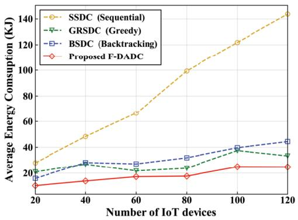

line chart

| Number of IoT devices | SSDC (Sequential) | GRSDC (Greedy) | BSDC (Backtracking) | Proposed F-DADC |
| --------------------- | ----------------- | -------------- | ------------------- | ---------------- |
| 20                    | 25                | 20             | 18                  | 12               |
| 40                    | 50                | 25             | 28                  | 15               |
| 60                    | 70                | 22             | 25                  | 18               |
| 80                    | 100               | 28             | 30                  | 20               |
| 100                   | 120               | 35             | 40                  | 25               |
| 120                   | 140               | 32             | 45                  | 25               |

Fig. 11. The average total energy consumption of UAVs v.s. the number of IoT devices in the different algorithms.

b) Total Collection Time Consumption Comparison: The average total data collection time consumption of single UAV during one time block versus the number of IoT devices is illustrated in Fig. 10. Since the proposed F-DADC converges to an optimal policy by training, it is capable of finding the optimal trajectory, which consists of two parts, i.e., the flying state to derive flying time consumption, and the hovering state for data collection to derive hovering time consumption, with the joint consideration of the collection state of all IoT devices and the AoI state of all IoT devices. Therefore, the total collection time consumption of F-DADC outperforms those of others. The SSDC lacks the ability to adjust the trajectory according to the changing locations of all IoT devices, thus leads to the worst time consumption.  
c) Energy Consumption Comparison: As shown in Fig. 11, the average total energy consumption of single UAV during one time block versus the number of IoT devices is presented. It is observed that the proposed F-DADC algorithm achieves the lowest energy consumption compared with the other benchmarks. The reason is that the introduced agent

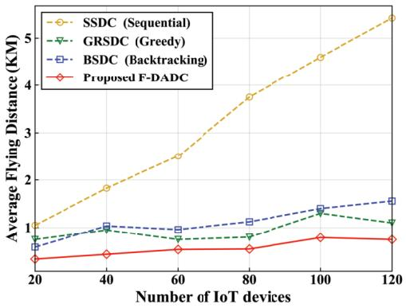

line chart

| Number of IoT devices | SSDC (Sequential) | GRSDC (Greedy) | BSDC (Backtracking) | Proposed F-DADC |
| --------------------- | ----------------- | -------------- | ------------------- | ---------------- |
| 20                    | 1.0               | 0.8            | 0.6                 | 0.4              |
| 40                    | 1.8               | 1.0            | 1.0                 | 0.5              |
| 60                    | 2.5               | 0.9            | 0.9                 | 0.6              |
| 80                    | 3.8               | 0.9            | 1.1                 | 0.7              |
| 100                   | 4.5               | 1.3            | 1.4                 | 0.9              |
| 120                   | 5.5               | 1.1            | 1.6                 | 0.9              |

Fig. 12. The average total flying distance of UAVs v.s. the number of IoT devices in the different algorithms.  
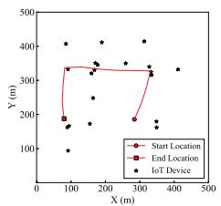

line chart

| X (m) | Start Location (Y (m)) | End Location (Y (m)) | IoT Device (Y (m)) |
|-------|------------------------|----------------------|-------------------|
| 100   | 350                    | 180                  | 400               |
| 200   | 340                    | 340                  | 320               |
| 300   | 180                    | 320                  | 340               |
| 400   | 340                    | 180                  | 320               |

(a) Agent 1 of F-DADC

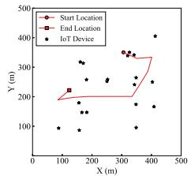

scatterplot

| X (m) | Y (m) | Type          |
|-------|-------|---------------|
| 100   | 200   | Start Location|
| 150   | 220   | End Location   |
| 200   | 300   | IoT Device    |
| 250   | 350   | Start Location|
| 300   | 360   | End Location   |
| 350   | 370   | IoT Device    |
| 400   | 400   | Start Location|
| 450   | 420   | End Location   |

(b) Agent 2 of F-DADC

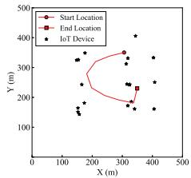

scatterplot

| X (m) | Y (m) | Type          |
|-------|-------|---------------|
| 150   | 150   | IoT Device    |
| 200   | 250   | IoT Device    |
| 250   | 300   | IoT Device    |
| 300   | 350   | Start Location|
| 350   | 250   | End Location  |
| 400   | 300   | IoT Device    |
| 450   | 250   | IoT Device    |
| 500   | 300   | IoT Device    |

(c) Agent 3 of F-DADC

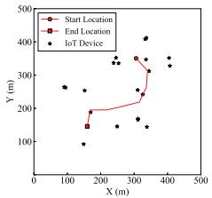

scatterplot

| X (m) | Y (m) | Location Type |
| --- | --- | --- |
| 150 | 130 | End Location |
| 160 | 140 | End Location |
| 170 | 150 | End Location |
| 180 | 160 | End Location |
| 190 | 170 | End Location |
| 200 | 180 | End Location |
| 210 | 190 | End Location |
| 220 | 200 | End Location |
| 230 | 210 | End Location |
| 240 | 220 | End Location |
| 250 | 230 | End Location |
| 260 | 240 | End Location |
| 270 | 250 | End Location |
| 280 | 260 | End Location |
| 290 | 270 | End Location |
| 300 | 280 | End Location |
| 310 | 290 | End Location |
| 320 | 300 | End Location |
| 330 | 310 | End Location |
| 340 | 320 | End Location |
| 350 | 330 | End Location |
| 360 | 340 | End Location |
| 370 | 350 | End Location |
| 380 | 360 | End Location |
| 390 | 370 | End Location |
| 400 | 380 | End Location |
| 410 | 390 | End Location |
| 420 | 400 | End Location |
| 430 | 410 | End Location |
| 440 | 420 | End Location |
| 450 | 430 | End Location |
| 460 | 440 | End Location |
| 470 | 450 | End Location |
| 480 | 460 | End Location |
| 490 | 470 | End Location |
| 500 | 480 | End Location |
| 510 | 490 | Start Location |
| 520 | 500 | Start Location |
| 530 | 510 | Start Location |
| 540 | 520 | Start Location |
| 550 | 530 | Start Location |
| 560 | 540 | Start Location |
| 570 | 550 | Start Location |
| 580 | 560 | Start Location |
| 590 | 570 | Start Location |
| 600 | 580 | Start Location |
| 610 | 590 | Start Location |
| 620 | 600 | Start Location |
| 630 | 610 | Start Location |
| 640 | 620 | Start Location |
| 650 | 630 | Start Location |
| 660 | 640 | Start Location |
| 670 | 650 | Start Location |
| 680 | 660 | Start Location |
| 690 | 670 | Start Location |
| 700 | 680 | Start Location |
| 710 | 690 | Start Location |
| 720 | 700 | Start Location |
| 730 | 710 | Start Location |
| 740 | 720 | Start Location |
| 750 | 730 | Start Location |
| 760 | 740 | Start Location |
| 770 | 750 | Start Location |
| 780 | 760 | Start Location |
| 790 | 770 | Start Location |
| 800 | 780 | Start Location |
| 810 | 790 | Start Location |
| 820 | 800 | Start Location |
| 830 | 810 | Start Location |
| 840 | 820 | Start Location |
| 850 | 830 | Start Location |
| 860 | 840 | Start Location |
| 870 | 850 | Start Location |
| 880 | 860 | Start Location |
| 890 | 870 | Start Location |
| 900 | 880 | Start Location |
| 910 | 890 | Start Location |
| 920 | 900 | Start Location |
| 930 | 910 | Start Location |
| 940 | 920 | Start Location |
| 950 | 930 | Start Location |
| 960 | 940 | Start Location |
| 970 | 950 | Start Location |
| 980 | 960 | Start Location |
| 990 | 970 | Start Location |

(d) Agent 4 of F-DADC  
Fig. 13. Trajectory examples of each agent in F-DADC.

of the algorithm is capable of finding the optimal policy to keep the shortest time control of the data collection, which leads to the optimal energy consumption. The SSDC consumes the longest time since the UAV collects the IoT device’s data by hovering on the top of each IoT device one by one, thus the energy consumption is the largest among all algorithms. Although the BSDC is capable of trajectory design, subject to the backtracking method, it cannot adjust its collection point according to the SNR state and the city environment. The greedy based GRSDC lacks the ability to tradeoff the time slots, thus the performance is worse than the proposed F-DADC algorithm.

d) Total Flying Distance Comparison: As illustrated in Fig. 12, the average total flying distance by single UAV during one time block versus the number of IoT devices is presented. It is observed that the total flying distance of the proposed F-DADC is shortest among the four algorithms. The reason is that the proposed F-DADC algorithm can adjust the policies effectively and robustly when the locations and communication environment changes, and thus obtain the shortest trajectory of the UAVs. In addition, the UAV trajectory of the proposed F-DADC algorithm is illustrated in Fig. 13, it can be seen the trajectories of the four agents are very orderly and efficient, which can cover all the IoT devices in the sub-region to guarantee the data collection.

## VI. CONCLUSION

In this paper, a UAV-enabled data collection system for future IoT networks is considered, where multiple UAVs are dispatched to collect data over a designated and individual area. The primary objective is to minimize the average AoI for all IoT devices by jointly optimizing various factors, including time allocation, UAV trajectories, IoT device scheduling, and the mission completion time, with the considerations of the time limitation, flying region constraints, and the limited battery energy of the UAVs. To tackle this problem, an efficient federated learning and deep reinforcement learning algorithm, which is called F-DADC, is proposed. Extensive numerical results verify that the proposed F-DADC algorithm outperforms other benchmark algorithms at both the convergence performance level and testing performance level. In particular, as for the total AoI value of all IoT devices and the average AoI value per IoT device, the proposed F-DADC algorithm improves by 45.6% and 45.9% compared with greedy benchmark, respectively.

We hope that this paper can provide novel inspiration for the trajectory design and data collection scheduling in UAVenabled IoT networks. Due to the space limitation, some important issues could be further discussed. i) This paper assumed that the UAV-IoT device associations are fixed within one time block. In practice, the dynamic association modeling for such scenario may achieve better collection efficiency and smaller mission completion time. In this case, how to design the dynamic association problem is an interesting problem worth pursuing in the future direction. ii) This paper assumed that each UAV has its own associated serving region, and those regions are not intersect. In fact, there are numerous IoT devices in densely populated urban areas, and deploying multiple UAVs in the same region can improve the QoS of IoT devices. In this case, how to design the multiple-UAV trajectories and data collection scheduling is an important problem in our future work.

## REFERENCES

[1] X. Chen, Y. Cai, Q. Shi, M. Zhao, B. Champagne, and L. Hanzo, “Efficient resource allocation for relay-assisted computation offloading in mobile-edge computing,” IEEE Internet Things J., vol. 7, no. 3, pp. 2452–2468, Mar. 2020.  
[2] Y. Zeng, R. Zhang, and T. J. Lim, “Wireless communications with unmanned aerial vehicles: Opportunities and challenges,” IEEE Commun. Mag., vol. 54, no. 5, pp. 36–42, May 2016.  
[3] C. You and R. Zhang, “3D trajectory optimization in Rician fading for UAV-enabled data harvesting,” IEEE Trans. Wireless Commun., vol. 18, no. 6, pp. 3192–3207, Jun. 2019.  
[4] S. Kaul, R. Yates, and M. Gruteser, “Real-time status: How often should one update?,” in Proc. IEEE Conf. Comput. Commun. (INFOCOM), Orlando, FL, USA, Mar. 2012, pp. 2731–2735.  
[5] Q. Wu et al., “A comprehensive overview on 5G-and-beyond networks with UAVs: From communications to sensing and intelligence,” IEEE J. Sel. Areas Commun., vol. 39, no. 10, pp. 2912–2945, Oct. 2021.  
[6] N. C. Luong et al., “Applications of deep reinforcement learning in communications and networking: A survey,” IEEE Commun. Surveys Tuts., vol. 21, no. 4, pp. 3133–3174, 4th Quart., 2019.  
[7] Z. Yang et al., “AI-driven UAV-NOMA-MEC in next generation wireless networks,” IEEE Wireless Commun., vol. 28, no. 5, pp. 66–73, Oct. 2021.  
[8] F. Li, B. Shen, J. Guo, K.-Y. Lam, G. Wei, and L. Wang, “Dynamic spectrum access for Internet-of-Things based on federated deep reinforcement learning,” IEEE Trans. Veh. Technol., vol. 71, no. 7, pp. 7952–7956, Jul. 2022.  
[9] Y. Wang et al., “Trajectory design for UAV-based Internet of Things data collection: A deep reinforcement learning approach,” IEEE Internet Things J., vol. 9, no. 5, pp. 3899–3912, Mar. 2022.  
[10] X. Fan, M. Liu, Y. Chen, S. Sun, Z. Li, and X. Guo, “RIS-assisted UAV for fresh data collection in 3D urban environments: A deep reinforcement learning approach,” IEEE Trans. Veh. Technol., vol. 72, no. 1, pp. 632–647, Jan. 2023.  
[11] Y. Zou, Y. Xie, C. Zhang, S. Gong, D. T. Hoang, and D. Niyato, “Optimization-driven hierarchical deep reinforcement learning for hybrid relaying communications,” in Proc. IEEE Wireless Commun. Netw. Conf. (WCNC), Seoul, (South) Korea, May 2020, pp. 1–6.  
[12] Y. Gong, Y. Wei, Z. Feng, F. R. Yu, and Y. Zhang, “Resource allocation for integrated sensing and communication in digital twin enabled Internet of Vehicles,” IEEE Trans. Veh. Technol., vol. 72, no. 4, pp. 4510–4524, Apr. 2023.  
[13] W. Liu, Z. Jin, X. Zhang, W. Zang, S. Wang, and Y. Shen, “AoI-aware UAV-enabled marine MEC networks with integrated sensing, computation, and communication,” in Proc. IEEE/CIC Int. Conf. Commun. China, Dalian, China, Aug. 2023, pp. 1–6.  
[14] W. Luo, Y. Shen, B. Yang, S. Wang, and X. Guan, “Joint 3-D trajectory and resource optimization in multi-UAV-enabled IoT networks with wireless power transfer,” IEEE Internet Things J., vol. 8, no. 10, pp. 7833–7848, May 2021.  
[15] J. Baek, S. I. Han, and Y. Han, “Energy-efficient UAV routing for wireless sensor networks,” IEEE Trans. Veh. Technol., vol. 69, no. 2, pp. 1741–1750, Feb. 2020.  
[16] T. Q. Duong, L. D. Nguyen, and L. K. Nguyen, “Practical optimisation of path planning and completion time of data collection for UAV-enabled disaster communications,” in Proc. 15th Int. Wireless Commun. Mobile Comput. Conf. (IWCMC), Tangier, Morocco, Jun. 2019, pp. 372–377.  
[17] G. Yang, R. Dai, and Y.-C. Liang, “Energy-efficient UAV backscatter communication with joint trajectory and resource optimization,” in Proc. IEEE Int. Conf. Commun. (ICC), Shanghai, China, May 2019, pp. 1–6.  
[18] G. Yang, R. Dai, and Y. Liang, “Energy-efficient UAV backscatter communication with joint trajectory design and resource optimization,” IEEE Trans. Wireless Commun., vol. 20, no. 2, pp. 926–941, Feb. 2021.  
[19] L. Xie, J. Xu, and R. Zhang, “Throughput maximization for UAVenabled wireless powered communication networks,” IEEE Internet Things J., vol. 6, no. 2, pp. 1690–1703, Apr. 2019.  
[20] X. Zhang, W. Luo, Y. Shen, and S. Wang, “Average AoI minimization in UAV-assisted IoT backscatter communication systems with updated information,” in Proc. IEEE Ubiquitous Intell. Comput. (UIC), Atlanta, GA, USA, Oct. 2021, pp. 123–130.  
[21] S. Zhang, H. Zhang, Z. Han, H. Vincent Poor, and L. Song, “Age of information in a cellular Internet of UAVs: Sensing and communication trade-off design,” IEEE Trans. Wireless Commun., vol. 19, no. 10, pp. 6578–6592, Oct. 2020.  
[22] F. Wu, H. Zhang, J. Wu, L. Song, Z. Han, and H. V. Poor, “AoI minimization for UAV-to-device underlay communication by multi-agent deep reinforcement learning,” in Proc. IEEE Global Commun. Conf. (GLOBECOM), Dec. 2020, pp. 1–6.  
[23] H. Hu, K. Xiong, G. Qu, Q. Ni, P. Fan, and K. B. Letaief, “AoI-minimal trajectory planning and data collection in UAV-assisted wireless powered IoT networks,” IEEE Internet Things J., vol. 8, no. 2, pp. 1211–1223, Jan. 2021.  
[24] P. Tong, J. Liu, X. Wang, B. Bai, and H. Dai, “UAV-enabled age-optimal data collection in wireless sensor networks,” in Proc. IEEE Int. Conf. Commun. Workshops, Shanghai, China, May 2019, pp. 1–6.  
[25] J. Liu, P. Tong, X. Wang, B. Bai, and H. Dai, “UAV-aided data collection for information freshness in wireless sensor networks,” IEEE Trans. Wireless Commun., vol. 20, no. 4, pp. 2368–2382, Apr. 2021.  
[26] M. A. Abd-Elmagid and H. S. Dhillon, “Average peak age-ofinformation minimization in UAV-assisted IoT networks,” IEEE Trans. Veh. Technol., vol. 68, no. 2, pp. 2003–2008, Feb. 2019.  
[27] M. Samir, C. Assi, S. Sharafeddine, D. Ebrahimi, and A. Ghrayeb, “Age of information aware trajectory planning of UAVs in intelligent transportation systems: A deep learning approach,” IEEE Trans. Veh. Technol., vol. 69, no. 11, pp. 12382–12395, Nov. 2020.  
[28] W. Fan, K. Luo, S. Yu, Z. Zhou, and X. Chen, “AoI-driven fresh situation awareness by UAV swarm: Collaborative DRL-based energy-efficient trajectory control and data processing,” in Proc. IEEE/CIC Int. Conf. Commun. China (ICCC), Chongqing, China, Aug. 2020, pp. 841–846.  
[29] X. Wang, M. Yi, J. Liu, Y. Zhang, M. Wang, and B. Bai, “Cooperative data collection with multiple UAVs for information freshness in the Internet of Things,” IEEE Trans. Commun., vol. 71, no. 5, pp. 2740–2755, May 2023.  
[30] Z. Zhu, S. Wan, P. Fan, and K. B. Letaief, “An edge federated MARL approach for timeliness maintenance in MEC collaboration,” in Proc. IEEE Int. Conf. Commun. Workshops, Montreal, QC, Canada, Jun. 2021, pp. 1–6.  
[31] Y. Nie, J. Zhao, F. Gao, and F. R. Yu, “Semi-distributed resource management in UAV-aided MEC systems: A multi-agent federated reinforcement learning approach,” IEEE Trans. Veh. Technol., vol. 70, no. 12, pp. 13162–13173, Dec. 2021.  
[32] Q. V. Do, Q.-V. Pham, and W.-J. Hwang, “Deep reinforcement learning for energy-efficient federated learning in UAV-enabled wireless powered networks,” IEEE Commun. Lett., vol. 26, no. 1, pp. 99–103, Jan. 2022.  
[33] Z. Dai, Y. Zhang, W. Zhang, X. Luo, and Z. He, “A multi-agent collaborative environment learning method for UAV deployment and resource allocation,” IEEE Trans. Signal Inf. Process. Netw., vol. 8, pp. 120–130, 2022.  
[34] Y. Liu, L. Jiang, Q. Qi, and S. Xie, “Energy-efficient space-air-ground integrated edge computing for Internet of Remote Things: A federated DRL approach,” IEEE Internet Things J., vol. 10, no. 6, pp. 4845–4856, Mar. 2023.  
[35] Y. Zeng, J. Xu, and R. Zhang, “Energy minimization for wireless communication with rotary-wing UAV,” IEEE Trans. Wireless Commun., vol. 18, no. 4, pp. 2329–2345, Apr. 2019.  
[36] A. Al-Hourani, S. Kandeepan, and S. Lardner, “Optimal LAP altitude for maximum coverage,” IEEE Wireless Commun. Lett., vol. 3, no. 6, pp. 569–572, Dec. 2014.  
[37] Y. Xie, Z. Xu, Y. Zhong, J. Xu, S. Gong, and Y. Wang, “Backscatterassisted computation offloading for energy harvesting IoT devices via policy-based deep reinforcement learning,” in Proc. IEEE/CIC Int. Conf. Commun. Workshops China, Aug. 2019, pp. 65–70.  
[38] M. Samir, M. Elhattab, C. Assi, S. Sharafeddine, and A. Ghrayeb, “Optimizing age of information through aerial reconfigurable intelligent surfaces: A deep reinforcement learning approach,” IEEE Trans. Veh. Technol., vol. 70, no. 4, pp. 3978–3983, Apr. 2021.  
[39] R. S. Sutton and A. G. Barto, Reinforcement Learning: An Introduction. Cambridge, MA, USA: MIT Press, 2018.  
[40] T. P. Lillicrap et al., “Continuous control with deep reinforcement learning,” 2015, arXiv:1509.02971.  
[41] S. Fujimoto, H. van Hoof, and D. Meger, “Addressing function approximation error in actor-critic methods,” in Proc. Int. Conf. Mach. Learn., Stockholm, Sweden, Jul. 2018, pp. 1587–1596.  
[42] B. McMahan, E. Moore, D. Ramage, S. Hampson, and B. A. Y. Arcas, “Communication-efficient learning of deep networks from decentralized data,” in Proc. Int. Conf. Artif. Intell. Stat. (AISTATS), Fort Lauderdale, FL, USA, Apr. 2017, pp. 1273–1282.  
[43] P. Paillier, “Public-key cryptosystems based on composite degree residuosity classes,” in Proc. Int. Conf. Theory Appl. Cryptograph. Techn., Prague, Czech Republic, 1999, pp. 223–238.  
[44] A. Acar, H. Aksu, A. S. Uluagac, and M. Conti, “A survey on homomorphic encryption schemes: Theory and implementation,” ACM Comput. Surv., vol. 51, no. 4, pp. 1–35, Jul. 2018.  
[45] P. Billingsley, Convergence of Probability Measures. Hoboken, NJ, USA: Wiley, 2013.  
[46] T. Zhou, M. Xu, D. Qin, X. Nie, X. Li, and C. Li, “Computing offloading based on TD3 algorithm in cache-assisted vehicular NOMA–MEC networks,” Sensors, vol. 23, no. 22, p. 9064, Nov. 2023.  
[47] F. Zhou and G. Cong, “On the convergence properties of a K-step averaging stochastic gradient descent algorithm for nonconvex optimization,” 2017, arXiv:1708.01012.  
[48] S. U. Stich, “Local SGD converges fast and communicates little,” 2018, arXiv:1805.09767.  
[49] J. Wang and G. Joshi, “Cooperative SGD: A unified framework for the design and analysis of local-update SGD algorithms,” J. Mach. Learn. Res., vol. 22, no. 1, pp. 9709–9758, 2021.  
[50] B. E. Woodworth, J. Wang, A. Smith, B. McMahan, and N. Srebro, “Graph Oracle models, lower bounds, and gaps for parallel stochastic optimization,” in Proc. Neural Inf. Proces. Syst. (NIPS), Montreal, QC, Canada, Dec. 2018.  
[51] X. Li, K. Huang, W. Yang, S. Wang, and Z. Zhang, “On the convergence of FedAvg on non-IID data,” in Proc. Int. Conf. Learn. Represent. (ICLR), Addis Ababa, Ethiopia, Apr. 2020, pp. 1–26.  
[52] X. Yuan, S. Hu, W. Ni, X. Wang, and A. Jamalipour, “Deep reinforcement learning-driven reconfigurable intelligent surface-assisted radio surveillance with a fixed-wing UAV,” IEEE Trans. Inf. Forensics Security, vol. 18, pp. 4546–4560, 2023.  
[53] L. Wang, K. Wang, C. Pan, and N. Aslam, “Joint trajectory and passive beamforming design for intelligent reflecting surface-aided UAV communications: A deep reinforcement learning approach,” IEEE Trans. Mobile Comput., vol. 22, no. 11, pp. 6543–6553, Nov. 2023.  
[54] H. Peng and X. Shen, “Multi-agent reinforcement learning based resource management in MEC{-} and UAV-assisted vehicular networks,” IEEE J. Sel. Areas Commun., vol. 39, no. 1, pp. 131–141, Jan. 2021.  
[55] S. Zhou, Y. Cheng, X. Lei, Q. Peng, J. Wang, and S. Li, “Resource allocation in UAV-assisted networks: A clustering-aided reinforcement learning approach,” IEEE Trans. Veh. Technol., vol. 71, no. 11, pp. 12088–12103, Nov. 2022.  
[56] Z. Shao, H. Yang, L. Xiao, W. Su, Y. Chen, and Z. Xiong, “Deep reinforcement learning-based resource management for UAV-assisted mobile edge computing against jamming,” IEEE Trans. Mobile Comput., vol. 23, no. 12, pp. 13358–13374, Dec. 2024.

natural_image

Portrait of a young man wearing glasses (no text or symbols visible)

Xuhui Zhang (Graduate Student Member, IEEE) received the B.Eng. degree in communication engineering from the School of Communication Engineering, Hangdian University (HDU), Hangzhou, China, in 2019, and the M.Eng. degree in electronic and communication engineering from the University of Chinese Academy of Sciences, Beijing, China, in 2022. He is currently pursuing the Ph.D. degree with Shenzhen Future Network of Intelligence Institute (FNii-Shenzhen), School of Science and Engineering, The Chinese University of Hong

Kong, Shenzhen, Guangdong, China. He joined FNii-Shenzhen as a Research Assistant in 2022. His research interests include unmanned aerial vehicle communications, mobile edge computing, and machine learning in communications and networking.

natural_image

Portrait of a man wearing glasses and a suit (no text or symbols visible)

Huijun Xing (Graduate Student Member, IEEE) received the B.Sc. degree in software engineering from Beihang University and the M.Phil. degree in computer and information engineering from The Chinese University of Hong Kong, Shenzhen, Guangdong, China. He is currently pursuing the Ph.D. degree in electrical and electronic engineering with the Imperial College London. His current research interests include deep learning-assisted signal processing, computer vision, and tensor networks.

natural_image

Portrait photo of a woman with short dark hair wearing a blue collared shirt (no text or symbols visible)

Yanyan Shen (Member, IEEE) received the B.Sc. and M.Eng. degrees in electrical engineering from Yanshan University, Qinhuangdao, China, in 2006 and 2009, respectively, and the Ph.D. degree from the Department of Mechanical and Biomedical Engineering, City University of Hong Kong, Hong Kong, SAR, China, in 2012.

From 2013 to 2014, she was a Post-Doctoral Research Fellow with the School of Information and Communication Engineering, Inha University, South Korea. She is currently an Associate Professor with

Shenzhen Institute of Advanced Technology, Chinese Academy of Sciences, Shenzhen, China. Her current research interests include UAV communications, mobile edge computing, and intelligent wireless communications.

natural_image

Portrait of a man wearing glasses and a suit (no text or symbols visible)

Jie Xu (Fellow, IEEE) received the B.E. and Ph.D. degrees from the University of Science and Technology of China in 2007 and 2012, respectively. From 2012 to 2014, he was a Research Fellow with the Department of Electrical and Computer Engineering, National University of Singapore. From 2015 to 2016, he was a Post-Doctoral Research Fellow with the Engineering Systems and Design Pillar, Singapore University of Technology and Design. From 2016 to 2019, he was a Professor with the School of Information Engineering, Guangdong University

of Technology, China. He is currently an Associate Professor (Tenured) with the School of Science and Engineering, Shenzhen Future Network of Intelligence Institute (FNii-Shenzhen), and Guangdong Provincial Key Laboratory of Future Networks of Intelligence, The Chinese University of Hong Kong, Shenzhen, China. His research interests include wireless communications, wireless information and power transfer, UAV communications, edge computing and intelligence, and integrated sensing and communication (ISAC). He was a recipient of the 2017 IEEE Signal Processing Society Young Author Best Paper Award, the IEEE/CIC ICCC 2019 Best Paper Award, the 2019 IEEE Communications Society Asia-Pacific Outstanding Young Researcher Award, and the 2019 Wireless Communications Technical Committee Outstanding Young Researcher Award. He is the Symposium Co-Chair of the IEEE GLOBECOM 2019 Wireless Communications Symposium, the Workshop Co-Chair of several IEEE ICC and GLOBECOM Workshops, the Tutorial Co-Chair of the IEEE/CIC ICCC 2019, the Vice Chair of the IEEE Wireless Communications Technical Committee (WTC), and the Vice Co-Chair of the IEEE Emerging Technology Initiative (ETI) on ISAC. He served or is serving as the Associate Editor-in-Chief for IEEE TRANSACTIONS ON MOBILE COMPUTING; an Editor for IEEE TRANSACTIONS ON WIRELESS COMMUNICATIONS, IEEE TRANSACTIONS ON COMMUNICATIONS, IEEE WIRELESS COMMUNICATIONS LETTERS, and Journal of Communications and Information Networks; an Associate Editor for IEEE ACCESS; and a Guest Editor for IEEE WIRELESS COMMUNICATIONS, IEEE JOURNAL ON SELECTED AREAS IN COMMUNICATIONS, IEEE Internet of Things Magazine, Science China Information Sciences, and China Communications. He is a Distinguished Lecturer of IEEE Communications Society.

natural_image

Portrait of a man wearing glasses and formal attire (no text or symbols visible)

Shuguang Cui (Fellow, IEEE) received the Ph.D. degree in electrical engineering from Stanford University, CA, USA, in 2005. Afterwards, he has been an Assistant Professor, an Associate Professor, a Full Professor, and a Chair Professor in electrical and computer engineering with The University of Arizona, Texas A&M University, UC Davis, and CUHK at Shenzhen, respectively. He was the Executive Dean of the School of Science and Engineering, CUHK, Shenzhen, the Executive Vice Director of Shenzhen Research Institute of Big Data, and the

Director of the Future Network of Intelligence Institute (FNii). His current research interests focus on the merging between AI and communication networks. He was selected as the Thomson Reuters Highly Cited Researcher and listed in the Worlds’ Most Influential Scientific Minds by ScienceWatch in 2014. He was a recipient of the IEEE Signal Processing Society 2012 Best Paper Award. He has served as the general co-chair and the TPC co-chairs for many IEEE conferences. He has also been serving as an Area Editor for IEEE Signal Processing Magazine; and an Associate Editor for IEEE TRANS-ACTIONS ON BIG DATA, IEEE TRANSACTIONS ON SIGNAL PROCESSING, IEEE JOURNAL ON SELECTED AREAS IN COMMUNICATIONS Series on Green Communications and Networking, and IEEE TRANSACTIONS ON WIRELESS COMMUNICATIONS. He has been the elected member of IEEE Signal Processing Society SPCOM Technical Committee (2009–2014) and the elected Chair of IEEE ComSoc Wireless Technical Committee (2017–2018). He is a member of the Steering Committee of IEEE TRANSACTIONS ON BIG DATA and the Chair of the Steering Committee of IEEE TRANSACTIONS ON COGNITIVE COMMUNICATIONS AND NETWORKING. He is also the Vice Chair of the IEEE VT Fellow Evaluation Committee and a member of the IEEE ComSoc Award Committee. He was an IEEE ComSoc Distinguished Lecturer in 2014 and IEEE VT Society Distinguished Lecturer in 2019. In 2020, he won the IEEE ICC Best Paper Award, ICIP Best Paper Finalist, and the IEEE Globecom Best Paper Award. In 2021, he won the IEEE WCNC Best Paper Award. In 2023, he won the IEEE Marconi Best Paper Award, got elected as a fellow of both Canadian Academy of Engineering and the Royal Society of Canada and starts to serve as the Editor-in-Chief for IEEE TRANSACTIONS ON MOBILE COMPUTING.