# An Efficient Docking-Point Deployment and Charging Access Coordination Method for Embodied-Enhanced UAV Networks

Wei Yang , Jiajie Xu , Jie Chen , Xiaolong Xu , Senior Member, IEEE, and Shucun Fu

Abstract—As embodied intelligent agents, uncrewed aerial vehicles (UAVs) support low-altitude urban services, but their endurance is fundamentally constrained by limited onboard battery capacity. Existing solutions in dense urban environments incur high deployment costs, use coarse spatial layouts, and do not scale to large UAV fleets. We instead retrofit existing urban deployable infrastructure (UDI), such as traffic lights, street lamps, and communication base stations, as UAV docking points with charging capability. This UDI-based approach raises two coupled challenges: city-scale docking-point deployment over massive, spatially heterogeneous candidates, and coordinated multi-UAV access under queueing delays and residual-energy safety constraints. We jointly model docking queues, load, and energy consumption, and formulate a multi-objective optimization balancing energy consumption and load. To address these NP-hard deployment and scheduling subproblems, we propose a hierarchical UDI-based docking-point deployment algorithm (HUDD) that generates a scalable docking layout, and a charging access coordination algorithm based on convex relaxation and iterative rounding (CRIR) that coordinates energy-feasible, congestion-aware access for multiple UAVs on the obtained layout. Simulations on realistic urban datasets show that HUDD-CRIR outperforms baseline schemes in terms of energy consumption, response delay, queueing delay, and load distribution.

Index Terms—Embodied intelligence, uncrewed aerial vehicles, docking-point deployment, multi-UAV charging access coordination.

## I. INTRODUCTION

MBODIED intelligence integrates computation, agents, and is emerging as a key paradigm for future cyber–physical systems [1], [2]. Unlike “disembodied” intelligent systems that operate solely in the cloud, embodied agents such as uncrewed aerial vehicles (UAVs), mobile robots, and autonomous vehicles interact directly with the physical environment and continuously close the perception–decision–action loop [3]. Their city-scale deployment imposes stringent requirements on communication and networking infrastructure and calls for the efficient coordination of scarce energy and computing resources, making urban UAV networks a representative and challenging example [4], [5], and [6].

In smart-city scenarios, low-altitude UAV networks are envisioned to support traffic inspection [7], environmental monitoring [8], emergency response [9], and lightweight parcel delivery [10]. In these applications, UAVs act as embodied intelligent agents that autonomously execute tasks and cooperate when needed [11]. However, their endurance is fundamentally constrained by limited onboard battery capacity: flight, hovering, sensing, and communication must all be powered by a small battery pack [12]. Without safe, timely, and scalable mechanisms for energy replenishment, it is difficult to sustain large-scale, long-duration low-altitude services in dense urban areas [13].

To mitigate the above endurance bottleneck, existing solutions based on trajectory planning, dedicated charging/batteryswapping stations, mobile charging platforms, and wireless power transfer [14], [15], [16] have been widely investigated. However, they often entail high deployment cost, coarsegrained spatial coverage, and scale poorly to dense urban scenarios with large UAV fleets. A more scalable direction is to leverage existing urban deployable infrastructure (UDI), such as traffic lights, street lamps, bus shelters, and communication base stations, and retrofit a subset of them into UAV docking nodes with charging capability [17]. This approach reuses existing power and communication resources, aligns with functional zoning and road networks, and offers finer-grained docking locations, thereby forming an energy-replenishment system that tightly couples embodied UAV agents, communication networks, and urban infrastructure. However, this UDI-based vision raises two key challenges: at the infrastructure deployment level, one must solve a combinatorial site-selection problem over a large set of candidate UDIs with highly heterogeneous spatial distributions to determine which ones to upgrade into docking points [18]; at the operational level, multiple UAVs must autonomously and efficiently coordinate their access to shared charging resources under queueing-induced service delays and stringent residual-energy safety constraints [19].

Existing studies on UAV communications, charging infrastructure, and scheduling address the above issues only partially. At the deployment level, prior work mostly focuses on the siting and layout of UAV base stations or dedicated charging stations, typically relying on simplified geometric scenarios or small- to medium-scale networks [15], [20]. As a result, it is difficult to capture the large scale, spatial heterogeneity, and historical load characteristics of real UDI nodes. At the operational level, research on multi-UAV task allocation, routing, and queueing-based scheduling often treats charging facilities as simplified and mutually independent service resources, and rarely couples docking-access decisions tightly with flight and waiting energy consumption and residual-energy safety constraints [21], [22]. Consequently, there is still a lack of an integrated framework that can, at the city scale, plan large-scale UDI-based docking infrastructure and coordinate multi-UAV access to the resulting docking points in an energy-feasible, congestion-aware, and loadbalanced manner.

Motivated by the above limitations, this paper studies docking-point deployment and multi-UAV charging access coordination in low-altitude urban environments. We formulate an integrated model that captures docking-point charging queueing, UAV energy consumption, and docking-point load, and balances UAV energy consumption and load distribution across docking points under energy-feasibility and singleaccess constraints. This joint optimization problem is NP-hard, corresponding to a combinatorial facility-location problem at the infrastructure deployment layer and a generalized assignment problem at the online operational layer, and is therefore difficult to solve directly. To address this challenge, we adopt a hierarchical solution approach. At the upper layer, we design a hierarchical UDI-based UAV docking-point deployment algorithm (HUDD), which exploits geospatial attributes and historical load information to produce a scalable long-term docking layout. At the lower layer, given this layout, we develop a multi-UAV charging access coordination algorithm based on convex relaxation and iterative rounding (CRIR). By solving a convex quadratic program and then applying priority-based iterative rounding, CRIR derives multi-UAV access policies that enforce residual-energy constraints while explicitly accounting for congestion and balancing the load across docking points.

The main contributions of this paper are summarized below:

• We leverage existing UDI facilities by upgrading a selected subset of facilities into UAV docking points with charging capability. We formulate the multi-UAV charging access coordination problem as a constrained multi-objective optimization by jointly modeling docking queueing, docking-point load, and UAV energy consumption.

• We introduce the HUDD algorithm for large-scale UDI docking deployment and the CRIR algorithm for multi-UAV charging access coordination. The proposed framework is jointly modeled but hierarchically solved:

HUDD determines a scalable docking layout from city-scale UDI candidates, and CRIR coordinates charging access on the obtained layout.

• Experiments on real-world urban datasets show that HUDD-CRIR consistently outperforms representative baselines in energy consumption, response delay, queueing delay, and load distribution.

The rest of the article is organized as follows. Section II reviews related work. Section III presents the system model and problem formulation. Section IV presents HUDD and CRIR. Section V provides theoretical analysis, and Section VI reports experimental results. Section VII concludes the paper.

## II. RELATED WORK

## A. Embodied UAV Intelligence

Embodied intelligence for UAVs is progressively shifting aerial agents from passive sensing toward closed-loop interaction in complex three-dimensional environments. This trend raises the need for benchmarks and systems that can evaluate and realize high-level cognition under continuous, ego-centric observations. UrbanVideo-Bench [23] constructs a benchmark from first-person UAV videos collected in real-world cities and simulated urban scenes, and evaluates Video-Large Language Models over embodied tasks such as recall, perception, reasoning, and navigation. Complementarily, system-oriented studies explore how autonomous UAVs can integrate multimodal sensing and decision-making for complex 3D exploration. For example, Hu et al. [24] augment LiDAR with a spectrometer in a virtual UAV exploration platform and design a multi-sensor navigation pipeline, while Kourav et al. [25] discuss generative and agentic models for embodied drone agents, including their roles in instruction grounding and task planning.

Recent studies further extend embodied UAV intelligence toward edge collaboration, multi-agent coordination, and resource-constrained deployment. Zhang et al. [26] investigate large-model evolution for aerial edges through an integrated air–ground edge–cloud framework, where UAV edge nodes collaborate with ground cloud servers under limited wireless bandwidth. In industrial and collaborative scenarios, Zhang et al. [27] present an embodied-intelligencedriven framework for UAV-based power inspection, integrating spatiotemporally aligned multimodal fusion with federated learning to coordinate multiple UAVs. Related studies on multi-edge federated synergy learning further emphasize online service deployment and edge association for resourceconstrained collaborative intelligence [28].

## B. UAV Charging Infrastructure Deployment and Access Coordination

Recent deployment-oriented studies usually model UAV charging nodes as dedicated service facilities that must be planned together with routing, coverage, or service-operation decisions. Vichitkunakorn et al. [20] study the joint location of charging stations and routing of electrically powered drones for automated warehouse stocktaking. They formulate the stocktaking drone routing problem and develop an adaptive large-neighborhood search method to solve it within reasonable computation time. Chen et al. [29] investigate UAV charging-station deployment for drone delivery under stochastic demand. Their two-stage stochastic optimization model jointly determines charging-station locations, the number of deployed drones, task assignment, delivery trajectories, and recharging schedules. Li et al. [30] investigate an integrated fixed automated station (FAS) location and UAV routing problem for urban road-network cruising, where UAVs are allowed to take off and land at different FASs.

Beyond charging-infrastructure deployment, coordinating access to shared or capacity-limited charging resources has also received increasing attention. Qin et al. [31] analyze wireless charging-infrastructure sharing in UAV- and EV-involved networks, where UAVs pay to use EV charging stations, and examine the tradeoffs among UAV performance, EV service quality, and infrastructure cost or profit. Zhao et al. [32] introduce wireless charging stations into multi-UAV-assisted MEC networks and jointly optimize computation offloading, resource allocation, and charging scheduling via a TD3-based deep reinforcement learning approach. Wu et al. [33] formulate the parallel cooperative charging scheduling problem for UAVs, using cooperative charging to reduce total charging cost and parallel scheduling to handle cases where UAV charging demand exceeds the available charging facilities.

Despite this progress, existing studies still leave a gap between infrastructure planning and operational access coordination. Deployment-oriented works mainly focus on newly planned or dedicated charging/service facilities, such as warehouse charging stations, drone delivery charging stations, or fixed automated stations. Access-coordination studies, on the other hand, typically assume that charging resources are already available and focus on sharing, scheduling, or cooperative charging decisions over given facilities. However, these studies do not fully address the requirements of UDI-enabled UAV charging networks. Unlike dedicated charging-station deployment, UDI-based deployment must select docking points from a large number of spatially heterogeneous existing urban facilities. Moreover, the resulting docking layout directly affects online access decisions through flight distance, queueing delay, waiting energy, load distribution, and residual-energy feasibility. This calls for a unified modeling framework that can jointly capture these factors and support integrated optimization at the city scale.

## III. SYSTEM MODEL AND PROBLEM DEFINITION

## A. System Framework

As shown in Fig. 1, the smart-city scenario for the lowaltitude economy is conceptually divided into three layers: the UAV layer, the UDI layer, and the user layer. The UDI layer is composed of existing urban infrastructure facilities such as traffic lights, street lamps, bus shelters, and communication base stations. Provided that structural load-bearing and powersupply requirements are satisfied, these facilities are retrofitted as UAV docking points equipped with charging capability. By providing on-demand battery replenishment to the UAV fleet, these docking points enable the continuous and sustainable operation of low-altitude services. Table I enumerates the primary notations used in this paper. All physical quantities in the system model use SI units: distance in meters (m), time in seconds (s), power in watts (W), and energy in joules (J). Let all UDI facilities form the candidate set $\boldsymbol { \mathcal { U } } =$ $\{ u _ { 1 } , \dotsc , u _ { K } \}$ , where $| U | = K$ . The subset of facilities that are actually deployed as UAV docking points is denoted by $\mathcal { D } =$ $\{ d _ { 1 } , \hdots , d _ { M } \} \subseteq \mathcal { U } ,$ , where $| \mathcal { D } | = M \leq K$ . All UAVs form the set $\mathcal { A } = \{ a _ { 1 } , . . . , a _ { N } \}$ , where $| { \mathcal { A } } | = N$ . The UAV layer comprises a fleet of embodied UAV agents. This fleet provides aerial services for typical low-altitude applications generated by end users, including traffic inspection, monitoring, emergency response, and lightweight delivery. We introduce a binary association variable $Z \ = \ [ z _ { j , i } ] \ \in \ \mathbf { \bar { \{ \sigma } }  \{ 0 , 1 \} ^ { N \times M }$ for all UAV–docking-point pairs $( a _ { j } , d _ { i } )$ with $a _ { j } \in { \mathcal { A } }$ and $d _ { i } \in \mathcal { D }$ defined as

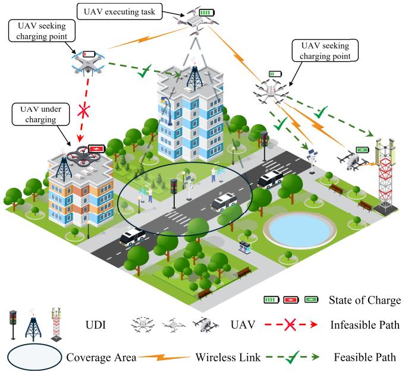  
Fig. 1. Embodied multi-UAV docking over UDI in a smart-city scenario.

TABLE I LIST OF MAIN NOTATIONS
<table><tr><td>Notation</td><td>Description</td></tr><tr><td> $\mathcal { A }$ </td><td>The set of UAVs</td></tr><tr><td> $b _ { \cdot i } ^ { \mathrm { p r e } }$ </td><td>The pre-departure SoC of UAV  $a _ { j }$ </td></tr><tr><td> $b ^ { \mathrm { s a f e } }$ </td><td>The safety SoC threshold</td></tr><tr><td> $b _ { \textrm { \textit { i } i } } ^ { \mathrm { s t a r t } }$ </td><td>The start-of-charging SoC of  $\mathrm { U A V } ~ a _ { j }$  at docking point  $d _ { i }$ </td></tr><tr><td> $b ^ { \mathrm { { f a r } } }$ </td><td>The target SoC threshold</td></tr><tr><td> $\mathcal { D }$ </td><td>The set of UAV docking points</td></tr><tr><td> $\smash { E _ { i , i } ^ { \mathrm { { f l y } } } }$  j, i</td><td>The flight energy consumption of UAV  $a _ { j }$  when selecting</td></tr><tr><td> $E _ { \mathrm { m a x } }$ </td><td>The maximum usable battery energy of a UAV</td></tr><tr><td> $E _ { \scriptscriptstyle i \mathrm { : } \scriptscriptstyle i } ^ { \mathrm { w a i t } }$ </td><td>The waiting energy consumption of UAV  $a _ { j }$  at  $d _ { i }$ </td></tr><tr><td> $\stackrel {  } { \boldsymbol { \mu } _ { \cdot } } . \stackrel {  } { \boldsymbol { \mu } _ { \cdot } } .$  Hi</td><td>The number of UAVs that charge at docking point</td></tr><tr><td> $K$ </td><td>The number of UDI facilities</td></tr><tr><td> $M$ </td><td>The number of docking points</td></tr><tr><td> $N$ </td><td>The number of UAVs</td></tr><tr><td> $P ^ { \mathrm { { f l y } } }$ </td><td>The average flight power of a UAV</td></tr><tr><td> $P _ { i }$ </td><td>The effective charging power at docking point  $d _ { i }$ </td></tr><tr><td> $P ^ { \mathrm { w a i t } }$ </td><td>The average landed-standby power of  $\mathrm { ~ a ~ U A V ~ }$  during waiting  $d _ { i }$ </td></tr><tr><td> $\boldsymbol { \mathcal { Q } } ^ { ( i ) }$ </td><td>The queue of UAVs associated with docking point</td></tr><tr><td> $\scriptstyle { T ^ { \mathrm { { f l y } } } }$   $\boldsymbol { T } _ { i , i } ^ { \mathrm { H y } }$ </td><td>The flight time of  $\mathrm { U A V } ~ a _ { j }$  when selecting  $d _ { i }$ </td></tr><tr><td> $T ^ { \mathrm { w a i t } }$ </td><td>The queueing delay of  $\mathrm { U A V } ~ a _ { j }$  at docking point</td></tr><tr><td> $, j , i$   $\boldsymbol { \mathcal { U } }$ </td><td>The set of UDI facilities</td></tr><tr><td> $v$ </td><td>The cruising speed of  $\mathrm { ~ a ~ U A V }$ </td></tr><tr><td> $\tau _ { \cdot } ^ { \mathrm { c h } }$   $\tau _ { j , i }$ </td><td>The charging duration of UAV  $a _ { j }$  at docking point  $d _ { i }$ </td></tr><tr><td> $( \varphi _ { i } , \lambda _ { i } )$ </td><td>The latitude and longitude of docking point  $d _ { i }$ </td></tr><tr><td> $( \varphi _ { j } , \lambda _ { j } )$ </td><td>The latitude and longitude of UAV  $a _ { j }$ </td></tr></table>

$$
z _ { j , i } = \left\{ \begin{array} { l l } { { 1 , } } & { { \mathrm { i f } \ a _ { j } \ \mathrm { s e l e c t s } \ d _ { i } \ \mathrm { f o r \ c h a r g i n g } , } } \\ { { 0 , } } & { { \mathrm { o t h e r w i s e } , } } \end{array} \right.\tag{1}
$$

and thus $\begin{array} { r } { \sum _ { j = 1 } ^ { N } z _ { j , i } } \end{array}$ i represents the number of UAVs charging at docking point $d _ { i }$

## B. Charging Queueing Model

For each UAV docking point $d _ { i } ,$ , at most one UAV is served for charging at any time, while the other arriving UAVs are landed and parked in a standby area in the vicinity of $d _ { i } ,$ with their propulsion motors turned off. Accordingly, we model each docking point $d _ { i }$ as a non-preemptive single-server $G / G / 1$ queue [34]. Similar $G / G / 1$ abstractions have also been adopted in recent networked-systems studies to capture contention-induced latency [35].

Let $\mathcal { Q } ^ { ( i ) } = \{ q _ { 1 } ^ { ( i ) } , . . . , \dot { q } _ { H _ { i } } ^ { ( i ) } \}$ denote the set of UAVs that select docking point $d _ { i }$ for charging within the considered planning horizon, where $H _ { i } \ = \ \mathsf { \bar { | Q ^ { ( i ) } | } }$ is the total number of such UAVs. The queue element $q _ { h } ^ { ( i ) } ( 1 \leq h \leq H _ { i } )$ corresponds to UAV $a _ { n _ { h } }$ . Let $t _ { n _ { h } , i } ^ { \mathrm { a r r } }$ denote the time when UAV $a _ { n _ { h } }$ arrives at the standby area of $d _ { i }$ . The beginning of each planning horizon is taken as the time origin. For the charging requests considered in the same planning horizon, UAVs are assumed to depart immediately after their requests are observed, and thus their departure times are uniformly set to zero.

Unlike the conventional First-Come-First-Served discipline, this paper adopts a flexible priority-based permutation strategy at each docking point (see Section IV-B on algorithm design for details). Consequently, the actual charging order of all UAVs that choose to access $d _ { i }$ can be represented as a permutation $\sigma _ { i } ( \cdot )$ over the index set $\{ 1 , \ldots , H _ { i } \}$ , where $n _ { \sigma _ { i } ( 1 ) }$ is the first UAV to be charged, $n _ { \sigma _ { i } ( 2 ) }$ is the second, and so on.

Once the charging order $\sigma _ { i } ( \cdot )$ is determined, the corresponding charging start and completion times can be computed via the standard sample-path (event-driven) recursion of a singleserver queue. Specifically, $t _ { j , i } ^ { \mathrm { s t a r t } } , t _ { j , i } ^ { \mathrm { e n d } } , T _ { j , i } ^ { \mathrm { w a i t } }$ , and $\tau _ { j , i } ^ { \mathrm { c h } }$ denote the charging start time, charging completion time, queueing delay, and charging duration of UAV $a _ { j }$ at docking point $d _ { i } ,$ respectively. In this recursion, the waiting time of each UAV is first determined by its arrival time and the completion time of the preceding UAV. Then the waiting energy consumption, the state of charge (SoC) at the start of charging, and the charging duration are computed sequentially. Therefore, the charging duration of the current UAV only affects the completion time of the current UAV and the waiting time of subsequent UAVs, and does not feed back into its own waiting time. For the first UAV in the charging order, if the charging berth is idle upon its arrival, it can start charging immediately, i.e.,

$$
t _ { n _ { \sigma _ { i } ( 1 ) } , i } ^ { \mathrm { s t a r t } } = t _ { n _ { \sigma _ { i } ( 1 ) } , i } ^ { \mathrm { a r r } } , \quad T _ { n _ { \sigma _ { i } ( 1 ) } , i } ^ { \mathrm { w a i t } } = 0 .\tag{2}
$$

After $T _ { n _ { \sigma _ { i } ( 1 ) } , i } ^ { \mathrm { w a i t } }$ is obtained, $\tau _ { n _ { \sigma _ { i } ( 1 ) } , i } ^ { \mathrm { c h } }$ is computed according to the energy consumption model (see Section III-C). The completion time is then given by

$$
t _ { n _ { \sigma _ { i } ( 1 ) } , i } ^ { \mathrm { e n d } } = t _ { n _ { \sigma _ { i } ( 1 ) } , i } ^ { \mathrm { s t a r t } } + \tau _ { n _ { \sigma _ { i } ( 1 ) } , i } ^ { \mathrm { c h } } .\tag{3}
$$

Here, $\tau _ { n _ { \sigma _ { i } ( 1 ) } , i } ^ { \mathrm { c h } }$ denotes the charging duration of UAV $a _ { n _ { \sigma _ { i } ( 1 ) } }$ at docking point $d _ { i }$ .

For the h-th UAV in the charging sequence $( 2 \leq h \leq H _ { i } )$ its charging start time is equal to the maximum of its arrival time at the standby area of docking point $d _ { i }$ and the completion time of the charging operation of the preceding UAV, i.e.,

$$
t _ { n _ { \sigma _ { i } ( h ) } , i } ^ { \mathrm { s t a r t } } = \operatorname* { m a x } \{ t _ { n _ { \sigma _ { i } ( h ) } , i } ^ { \mathrm { a r r } } , t _ { n _ { \sigma _ { i } ( h - 1 ) } , i } ^ { \mathrm { e n d } } \} .\tag{4}
$$

Accordingly, the waiting time of UAV $a _ { n _ { \sigma _ { i } ( h ) } }$ at docking point $d _ { i }$ is defined as

$$
T _ { n _ { \sigma _ { i } ( h ) } , i } ^ { \mathrm { w a i t } } = t _ { n _ { \sigma _ { i } ( h ) } , i } ^ { \mathrm { s t a r t } } - t _ { n _ { \sigma _ { i } ( h ) } , i } ^ { \mathrm { a r r } } .\tag{5}
$$

Given $T _ { n _ { \sigma _ { i } ( h ) } , i } ^ { \mathrm { w a i t } }$ , the waiting energy, start-of-charging SoC, and charging duration $\tau _ { n _ { \sigma _ { i } ( h ) } , i } ^ { \mathrm { c h } }$ are then computed according to the energy consumption model. The completion time is updated as

$$
t _ { n _ { \sigma _ { i } ( h ) } , i } ^ { \mathrm { e n d } } = t _ { n _ { \sigma _ { i } ( h ) } , i } ^ { \mathrm { s t a r t } } + \tau _ { n _ { \sigma _ { i } ( h ) } , i } ^ { \mathrm { c h } } .\tag{6}
$$

For ease of exposition, we denote $T _ { j , i } ^ { \mathrm { w a i t } }$ as the actual waiting time experienced by UAV $a _ { j }$ when selecting docking point $d _ { i }$ , and use it to compute its standby energy consumption accordingly.

## C. Energy Consumption Model

Consider a $\mathrm { U A V } ~ a _ { j } \in { \mathcal { A } }$ that departs from a mission area or a user-side location and selects a docking point $d _ { i } \in \mathcal { D }$ to access. Based on the Haversine formula [36], the great-circle flight distance between them is given by

$$
\begin{array} { l } { \operatorname { d i s t } ( a _ { j } , d _ { i } ) = 2 R \cdot } \\ { \arcsin \left( \sqrt { \sin ^ { 2 } \left( \displaystyle \frac { \varphi _ { i } - \varphi _ { j } } { 2 } \right) + \cos \varphi _ { j } \cos \varphi _ { i } \sin ^ { 2 } \left( \displaystyle \frac { \lambda _ { i } - \lambda _ { j } } { 2 } \right) } \right) , } \end{array}\tag{7}
$$

where $( \varphi _ { j } , \lambda _ { j } )$ and $( \varphi _ { i } , \lambda _ { i } )$ denote the latitude and longitude of the current position of UAV $a _ { j }$ and docking point $d _ { i } ,$ respectively, and R denotes the Earth’s radius.

Accordingly, the flight time required for UAV $a _ { j }$ to travel from its current position to docking point $d _ { i }$ is

$$
T _ { j , i } ^ { \mathrm { f l y } } = \frac { \mathrm { d i s t } ( a _ { j } , d _ { i } ) } { v } ,\tag{8}
$$

where v denotes the cruising speed of the UAV.

Let $E _ { \mathrm { m a x } }$ denote the maximum usable battery energy of a UAV. For any UAV $a _ { j } \in { \mathcal { A } } .$ , let $b _ { j } ^ { \mathrm { p r e } } ~ \in ~ [ 0 , 1 ]$ denote its normalized SoC before heading to docking point $d _ { i } \in \mathcal { D }$ . The available energy at that moment is then given by $b _ { j } ^ { \mathrm { p r e } } E _ { \mathrm { m a x } } .$ Let $P ^ { \mathrm { { f i y } } }$ and $P ^ { \mathrm { w a i t } }$ denote the average power consumption of a UAV in the cruising flight phase and in the landed standby waiting phase near a docking point, respectively. Specifically, Pwait accounts for the low-power consumption of onboard electronics, communication, sensing, state monitoring, and battery management while the UAV is parked with its propulsion system turned off. Given the flight time $T _ { j , i } ^ { \mathrm { f l y } }$ and the queueing delay $T _ { j , i } ^ { \mathrm { w a i t } }$ , for UAV $a _ { j }$ selecting docking point $d _ { i } ,$ the energy consumed in the flight and waiting phases is given, respectively, by

$$
E _ { j , i } ^ { \mathrm { H y } } = P ^ { \mathrm { f i y } } T _ { j , i } ^ { \mathrm { f i y } } ,\tag{9}
$$

$$
E _ { j , i } ^ { \mathrm { w a i t } } = P ^ { \mathrm { w a i t } } T _ { j , i } ^ { \mathrm { w a i t } } .\tag{10}
$$

When UAV $a _ { j }$ starts charging at docking point $d _ { i } ,$ , its SoC is given by

$$
b _ { j , i } ^ { \mathrm { s t a r t } } = \left[ b _ { j } ^ { \mathrm { p r e } } - \frac { E _ { j , i } ^ { \mathrm { f u y } } + E _ { j , i } ^ { \mathrm { w a i t } } } { E _ { \mathrm { m a x } } } \right] ^ { + } ,\tag{11}
$$

where $[ x ] ^ { + } = \operatorname* { m a x } \{ x , 0 \}$ is used to avoid negative values of the SoC. Clearly, a longer flight distance and a longer queueing time both lead to a lower SoC $b _ { j , i } ^ { \mathrm { s t a r t } }$

To ensure energy feasibility and avoid battery depletion during the flight and the subsequent waiting stage at the docking point, we set a safety SoC threshold $b ^ { \mathrm { s a f e } } \in ( 0 , 1 )$ . For any feasible docking decision that assigns UAV $a _ { j }$ to docking point $d _ { i }$ , the following constraint must therefore hold:

$$
\begin{array} { r } { b _ { j } ^ { \mathrm { p r e } } E _ { \mathrm { m a x } } \geq E _ { j , i } ^ { \mathrm { f l y } } + E _ { j , i } ^ { \mathrm { w a i t } } + b ^ { \mathrm { s a f e } } E _ { \mathrm { m a x } } . } \end{array}\tag{12}
$$

If this constraint is violated for a given docking point $d _ { i } .$ , UAV $a _ { j }$ is not allowed to access this node for charging.

After $b _ { j , i } ^ { \mathrm { s t a r t } }$ is obtained, the charging duration of UAV $a _ { j }$ at docking point $d _ { i }$ is expressed as

$$
\tau _ { j , i } ^ { \mathrm { c h } } = \frac { \left( b ^ { \mathrm { t a r } } - b _ { j , i } ^ { \mathrm { s t a r t } } \right) E _ { \mathrm { m a x } } } { P _ { i } } ,\tag{13}
$$

where $b ^ { \mathrm { t a r } } \in \ ( 0 , 1 ]$ denotes the target SoC threshold to be achieved at the end of the charging process, and $P _ { i }$ denotes the effective charging power of docking point $d _ { i }$ after accounting for conversion and line losses.

From the system perspective, the average UAV-side energy consumption across all docking points is defined as

$$
\overline { { E } } = \frac { 1 } { \sum _ { i = 1 } ^ { M } H _ { i } } \sum _ { i = 1 } ^ { M } \sum _ { j = 1 } ^ { N } z _ { j , i } \big ( E _ { j , i } ^ { \mathrm { f l y } } + E _ { j , i } ^ { \mathrm { w a i t } } \big ) .\tag{14}
$$

## D. Docking Load Model

For each docking point $d _ { i } ,$ we define its load as the number of UAVs that access $d _ { i }$ for charging during the observation period, i.e.,

$$
L _ { d _ { i } } = \sum _ { j = 1 } ^ { N } z _ { j , i } , \quad 1 \leq i \leq M ,\tag{15}
$$

where $z _ { j , i } \in \{ 0 , 1 \}$ indicates whether UAV $a _ { j }$ selects docking point $d _ { i }$ for charging.

The average load across all docking points is defined as

$$
\overline { { L } } = \frac { 1 } { M } \sum _ { i = 1 } ^ { M } L _ { d _ { i } } .\tag{16}
$$

Following the standard-deviation-based load-balancing metric in [37], we quantify the degree of load balancing across

docking points by computing the standard deviation of $\{ L _ { d _ { i } } \} _ { i = 1 } ^ { \bar { M } }$ as a dispersion metric, i.e.,

$$
\sigma _ { L } = \sqrt { \frac { 1 } { M } \sum _ { i = 1 } ^ { M } \bigl ( L _ { d _ { i } } - \overline { { L } } \bigr ) ^ { 2 } } .\tag{17}
$$

A smaller $\sigma _ { L }$ means the charging demand is more evenly distributed across docking points, whereas a larger $\sigma _ { L }$ indicates greater imbalance and may trigger hotspots and congestion at heavily loaded docking points. In particular, $\sigma _ { L } = 0$ holds if and only if $L _ { d _ { i } } = \overline { { L } }$ for all i.

## E. Problem Definition

Based on the aforementioned charging queueing, energy consumption, and docking load models, we formulate the multi-UAV charging access coordination problem as a multiobjective optimization problem. The overall system performance is evaluated by a weighted objective function that jointly accounts for the average UAV-side energy consumption E and the load dispersion $\sigma _ { L }$ among docking points. Formally, the problem can be formulated as

$$
\begin{array} { r l } & { \displaystyle \operatorname* { m i n } _ { \boldsymbol { x } \in \Omega } \lambda _ { 1 } \operatorname { n o r m } ( \overline { { E } } ) + \lambda _ { 2 } \operatorname { n o r m } ( \sigma _ { L } ) } \\ & { \displaystyle \mathrm { s . t . } \mathrm { C 1 } \colon \lambda _ { 1 } + \lambda _ { 2 } = 1 , \quad \lambda _ { 1 } , \lambda _ { 2 } > 0 , } \\ & { \quad \mathrm { C 2 } \colon \displaystyle b _ { j } ^ { \mathrm { p r e } } E _ { \operatorname* { m a x } } \geq E _ { j , i } ^ { \mathrm { f l y } } + E _ { j , i } ^ { \mathrm { w a i t } } + b ^ { \mathrm { s a f e } } E _ { \operatorname* { m a x } } , } \\ & { \quad \mathrm { C 3 } \colon \displaystyle \sum _ { i = 1 } ^ { M } z _ { j , i } \leq 1 , \quad \forall a _ { j } \in \mathcal { A } . } \end{array}\tag{18}
$$

where $\chi$ denotes a feasible charging-access schedule for all UAVs over the observation period, Ω denotes the set of all schedules that satisfy the system constraints, and norm(·) denotes a normalization operator. Constraint C1 requires that the weighting coefficients $( \lambda _ { 1 } , \lambda _ { 2 } )$ be strictly positive and sum to one. Constraint C2 is the energy-feasibility constraint for a selected UAV–docking-point pair. It stipulates that if UAV $a _ { j }$ is assigned to docking point $d _ { i } ,$ , its available battery energy must cover both the flight and waiting energy consumption while preserving a safety margin for emergencies. Constraint C3 ensures that each UAV selects at most one docking point for charging. Specifically, if $\textstyle \sum _ { i = 1 } ^ { M } z _ { j , i } \ = \ 1$ UAV $a _ { j }$ is successfully assigned to one docking point; if $\begin{array} { l } { \sum _ { i = 1 } ^ { M } z _ { j , i } ~ = ~ 0 } \end{array}$ , UAV aj is regarded as an access-failure case, which means that no docking point can satisfy its residual-energy safety requirement under the current queueing condition.

## IV. PROPOSED APPROACH

This section first introduces the hierarchical UDI-based UAV docking-point deployment algorithm (HUDD), which selects a subset of existing UDI facilities to serve as UAV docking points. Based on the obtained docking layout, this section then presents a multi-UAV charging access coordination algorithm based on convex relaxation and iterative rounding (CRIR), which determines energy-feasible and congestionaware access decisions.

A. Hierarchical UDI-Based UAV Docking-Point Deployment Algorithm

In response to the massive scale and spatially non-uniform distribution of existing UDI facilities, this subsection presents the HUDD algorithm. HUDD exploits both the geospatial attributes and historical loads of UDIs to select a limited subset of candidates, which are then retrofitted into chargingenabled UAV docking points. The selected docking points support UAV energy replenishment, expand service coverage, and help maintain a balanced network load. The candidate UDI set is denoted by $\mathcal { U } ~ = ~ \{ u _ { 1 } , . . . , u _ { K } \}$ . For any UDI $u _ { i } ~ \in ~ { \mathcal { U } } ,$ its characteristics are jointly represented by its geographical coordinates $( \varphi _ { i } , \lambda _ { i } )$ and its historical load $L _ { i } .$ To keep the distance metric used in clustering consistent with the physical spatial scale, the geographic coordinates are first projected onto a local planar coordinate system before applying K-means. The objective is to select M UDIs from U to serve as docking points. HUDD consists of three key steps.

1) Global Coarse-Grained Spatial Clustering: Given that directly performing combinatorial site selection over a large-scale urban area leads to an exponential growth in computational complexity, this stage adopts a spatial divideand-conquer strategy, which first partitions the UDI set into regions based on geographical locations. Specifically, we project the geographic coordinates of the K candidate UDIs onto a local planar coordinate system. Let $( \varphi _ { 0 } , \lambda _ { 0 } )$ denote the reference point of the considered urban region, e.g., the geographic center of all candidate UDIs. For each UDI $u _ { i } ,$ , its projected coordinate is computed as

$$
x _ { i } = R \cos ( \varphi _ { 0 } ) ( \lambda _ { i } - \lambda _ { 0 } ) , \quad y _ { i } = R ( \varphi _ { i } - \varphi _ { 0 } ) ,\tag{19}
$$

where R denotes the Earth’s radius and all angular quantities are measured in radians. We then construct the projectedcoordinate feature matrix as

$$
\mathbf { C } = \left[ ( x _ { 1 } , y _ { 1 } ) , \ldots , ( x _ { K } , y _ { K } ) \right] ^ { \top } .
$$

Subsequently, we apply the K-means clustering algorithm on the projected-coordinate matrix C to partition the urban area into $k _ { \mathrm { i n i t } }$ spatial macro-clusters. The resulting set of clusters is denoted by $\boldsymbol { S } = \{ S _ { 1 } , \ldots , S _ { k _ { \mathrm { i n i t } } } \}$ , where $S _ { i }$ represents the i-th spatial cluster (i.e., a UDI subset), and $k _ { \mathrm { i n i t } }$ is the predefined number of clusters. Typically, $k _ { \mathrm { i n i t } }$ is set to $k _ { \mathrm { i n i t } } = \alpha M$ , where $\alpha > 0$ is a scaling factor. This choice allows HUDD to preserve the essential urban spatial structure while keeping the subsequent fine-grained siting subproblems sufficiently small, thereby striking a balance between computational efficiency and siting accuracy.

2) Inter-Cluster Load-Aware Docking-Point Quota Allocation: Given that UAV charging demand exhibits significant spatial heterogeneity across different urban functional areas, a purely geography-based uniform deployment of docking points is prone to causing supply–demand mismatch. To address this issue, we design a load-aware docking-point quota allocation mechanism. We first compute the cumulative load $L _ { c }$ of the c-th spatial cluster and the total system load $L _ { \mathrm { t o t } }$ as

$$
L _ { c } = \sum _ { u \in S _ { c } } L _ { u } , \quad L _ { \mathrm { t o t } } = \sum _ { u \in \mathcal { U } } L _ { u } .\tag{20}
$$

Based on the share of each cluster’s load in the total system load, the initial docking-point quota $\tilde { m } _ { c }$ for cluster $S _ { c }$ is determined by

$$
\tilde { m } _ { c } = \operatorname* { m i n } \left( | S _ { c } | , \operatorname* { m a x } \left( 1 , \bigg | \frac { L _ { c } } { L _ { \mathrm { t o t } } } M + 0 . 5 \bigg | \right) \right) .\tag{21}
$$

Since the rounding operation may introduce a discrepancy in the total quota, i.e., $\begin{array} { r } { \Delta = M - \sum _ { c = 1 } ^ { k _ { \mathrm { i n i t } } } \tilde { m } _ { c } \ne 0 } \end{array}$ , a residual adjustment procedure is performed. If $\Delta \ > \ 0$ , additional quotas are assigned, one by one, to the clusters with the largest cumulative load. If $\Delta < 0 .$ quotas are reduced preferentially from clusters with quota larger than one and relatively low load density, until the constraint

$$
\sum _ { c = 1 } ^ { k _ { \mathrm { i n i t } } } m _ { c } = M\tag{22}
$$

is satisfied. The resulting corrected quota set ensures that highload regions are allocated more charging service resources.

3) Intra-Cluster Fine-Grained Siting via Weighted K-Means: After determining the quota $m _ { c }$ for each spatial sub-domain (i.e., macro-cluster), the algorithm enters the fine-grained siting phase to determine specific physical deployment locations within each cluster. We adopt weighted K-means in this step to reduce the average flight distance, while using historical UDI loads as weights so that high-load nodes exert a stronger influence on the centroid locations and docking points are naturally biased toward regions with higher charging demand. In addition, the time complexity of K-means scales approximately linearly with the number of UDI nodes and clusters, making it suitable for city-scale deployment, whereas exact $p \mathrm { - }$ median $/ \ p -$ -center formulations quickly become intractable at this scale.

Specifically, for the c-th spatial cluster $S _ { c } ,$ we construct its local projected-coordinate feature matrix $\mathbf { C } _ { c }$ and the corresponding load weight vector $\mathbf { w } _ { c } ,$ and then apply weighted K-means to partition $S _ { c }$ into $m _ { c }$ micro-clusters $\{ S _ { c } ^ { ( \overline { { 1 } } ) } , \ldots , S _ { c } ^ { ( m _ { c } ) } \}$ with centroids $\{ \mu _ { c } ^ { ( 1 ) } , \ldots , \mu _ { c } ^ { ( m _ { c } ) } \}$

Since docking points must be deployed on physically existing UDI facilities, a virtual-to-physical mapping is required. For the r-th micro-cluster $S _ { c } ^ { ( r ) }$ , the actual UDI node closest to the centroid $\mu _ { c } ^ { ( r ) }$ is selected as the final docking point $u _ { c } ^ { ( r ) } ;$

$$
u _ { c } ^ { ( r ) } = \underset { u \in S _ { c } ^ { ( r ) } } { \arg \operatorname* { m i n } } \left\| \big ( x _ { u } , y _ { u } \big ) - \mu _ { c } ^ { ( r ) } \right\| _ { 2 } .\tag{23}
$$

Consequently, by traversing all macro-clusters and their respective micro-clusters, the final set of deployed docking points is represented as $\mathcal { D } = \{ u _ { c } ^ { ( r ) } \ | \ 1 \le c \le k _ { \mathrm { i n i t } } , 1 \le r \le$ $m _ { c } \}$

The computational overhead primarily stems from two clustering phases. The first clustering phase, global K-means clustering, has a time complexity of $\mathcal { O } ( K \cdot k _ { \mathrm { i n i t } } \cdot I _ { 1 } )$ , where K denotes the total number of UDIs and $I _ { 1 }$ represents the number of iterations in this phase. The second clustering phase, intra-cluster weighted clustering, incurs a total complexity of $\begin{array} { r } { \sum _ { c = 1 } ^ { k _ { \mathrm { i n i t } } } \mathcal { O } ( | S _ { c } | ^ { - } \cdot m _ { c } \cdot I _ { 2 } ) } \end{array}$ , where $I _ { 2 }$ denotes the iterations for the local clustering. Assuming the cluster size $| S _ { c } |$ is approximately $K / k _ { \mathrm { i n i t } }$ and the quota $m _ { c }$ is on the order of

Algorithm 1 Hierarchical UDI-Based UAV Docking-Point   
Deployment Algorithm   
Input: Candidate UDI set U, target number M   
scaling factor α.   
Output: Deployed docking point set D.   
1 Construct matrix C;   
2 Set $k _ { \mathrm { i n i t } } = \alpha M ;$   
3 ${ \cal S }  \mathrm { K }$ -means $( \mathbf { C } , k _ { \mathrm { i n i t } } ) ;$   
4 Calculate $\begin{array} { r } { L _ { \mathrm { t o t } }  \sum _ { u \in \mathcal { U } } L _ { u } ; } \end{array}$   
5 foreach cluster $S _ { c } \in \bar { S }$ do   
6 $\begin{array} { r } { L _ { c }  \sum _ { u \in S _ { c } } L _ { u } ; } \end{array}$   
7 Compute initial quota $\tilde { m } _ { c }$ via Eq. (21);   
8 end   
9 Calculate deviation: $\Delta  M - \textstyle \sum \tilde { m } _ { c } ;$   
10 if $\Delta \neq 0$ then   
11 Obtain final quotas $m _ { c }$ by applying residual   
adjustment strategy to $\tilde { m } _ { c } ;$   
12 else   
13 $m _ { c } \gets \tilde { m } _ { c } ;$   
14 end   
15 Initialize $\mathcal { D }  \emptyset ;$   
16 foreach cluster $S _ { c } \in S$ do   
17 Construct $\mathbf { C } _ { c }$ and $\mathbf { w } _ { c } ;$   
18 $\{ \mu _ { c } ^ { ( r ) } \} _ { r = 1 } ^ { m _ { c } }  \mathrm { W e i g h t e d K M e a n s } ( \mathbf { C } _ { c } , \mathbf { w } _ { c } , m _ { c } ) ;$   
19 for $r \gets 1$ to $m _ { c }$ do   
20 Map centroid to nearest physical UDI using   
Eq. (23);   
21 $\mathcal { D }  \mathcal { D } \cup \{ u _ { c } ^ { ( r ) } \}$   
22 end   
23 end   
24 return $\mathcal { D } ;$

$M / k _ { \mathrm { i n i t } }$ , the overall asymptotic complexity can be upperbounded by $\mathcal { O } ( K \cdot M \cdot I )$ , where $I = \operatorname* { m a x } ( I _ { 1 } , I _ { 2 } )$ . Since the time complexity scales linearly with the UDI scale $K$ and the algorithm is typically executed as an offline task during the network planning stage, it effectively supports intelligent site selection for large-scale urban infrastructure with high scalability. HUDD is summarized in Algorithm 1.

## B. Multi-UAV Charging Access Coordination Algorithm Based on CRIR

After the UAV docking points are determined, we address the generalized assignment problem of coordinating concurrent multi-UAV charging access to these docking points. Let $A = \{ a _ { 1 } , . . . , a _ { N } \}$ denote the set of UAVs and $\mathcal { D } =$ $\{ d _ { 1 } , . . . , d _ { M } \}$ denote the set of docking points. The core challenges of this problem are twofold: first, the queueing delay is strongly coupled with access decisions in a nonlinear manner; second, strict residual energy safety constraints must be satisfied. Given that directly solving this NP-hard problem incurs prohibitively high computational complexity, this paper proposes a two-stage multi-UAV charging access coordination scheme, consisting of convex relaxation-based global soft assignment and a gradient-based priority iterative rounding procedure.

1) Global Soft Assignment via Convex Relaxation: Considering only the flight phase, if

$$
b _ { j } ^ { \mathrm { p r e } } E _ { \mathrm { m a x } } - E _ { j , i } ^ { \mathrm { f l y } } < b ^ { \mathrm { s a f e } } E _ { \mathrm { m a x } }\tag{24}
$$

holds, it implies that UAV $a _ { j }$ cannot physically reach docking point $d _ { i }$ under energy safety constraints. Accordingly, we construct a binary feasibility mask matrix:

$$
F _ { j , i } = { \left\{ \begin{array} { l l } { 1 , } & { { \mathrm { i f ~ } } { \mathrm { p a t h ~ } } ( j , i ) { \mathrm { ~ i s ~ f e a s i b l e } } , } \\ { 0 , } & { { \mathrm { i f ~ } } { \mathrm { p a t h ~ } } ( j , i ) { \mathrm { ~ i s ~ i n f e a s i b l e } } . } \end{array} \right. }\tag{25}
$$

This mask is utilized to penalize infeasible paths in the subsequent optimization.

To capture globally optimal load distribution trends within polynomial time, the algorithm first relaxes the discrete access variables into a continuous domain. We introduce a decision matrix $\begin{array} { r } { P \in \mathbb { R } ^ { N \times M } } \end{array}$ with entries $P _ { j , i } \ge 0$ , where $P _ { j , i }$ represents the fractional preference of $\mathrm { U A V } ~ a _ { j }$ for selecting docking point $d _ { i } .$ A normalization constraint is applied to ensure each UAV is fully assigned:

$$
\sum _ { i = 1 } ^ { M } P _ { j , i } = 1 , \quad \forall j \in \{ 1 , . . . , N \} .\tag{26}
$$

To effectively trade off queueing congestion costs against flight energy consumption, we construct the objective function by leveraging convexity properties commonly used in queueing theory. The following convex problem is a tractable surrogate of the original objective in Eq. (18). It uses normalized flight energy and squared relaxed loads to approximate the energy and load-balancing objectives, while the infeasible-path penalty only suppresses physically infeasible assignments during relaxation. In particular, queueing delay typically exhibits non-linear (approximately quadratic) growth with respect to the system load. Consequently, we formulate the following convex quadratic programming model to derive the globally optimal fractional solution matrix $P ^ { * }$

$$
\begin{array} { r l } & { \displaystyle \underset { \ b { P } } { \operatorname* { m i n } } \ \lambda _ { \mathrm { e } } \sum _ { j = 1 } ^ { N } \sum _ { i = 1 } ^ { M } P _ { j , i } \cdot \bar { E } _ { j , i } ^ { \mathrm { { f l } } } \ + \ \lambda _ { 1 } \displaystyle \sum _ { i = 1 } ^ { M } \left( \sum _ { j = 1 } ^ { N } P _ { j , i } \right) ^ { 2 } } \\ & { \quad + \ \lambda _ { \mathrm { p } } \displaystyle \sum _ { j = 1 } ^ { N } \sum _ { i = 1 } ^ { M } P _ { j , i } \Gamma _ { j , i } } \\ & { \displaystyle \mathrm { s . t . } \sum _ { i = 1 } ^ { M } P _ { j , i } = 1 , \quad \forall j \in \{ 1 , . . . , N \} , } \\ & { \quad \quad \quad \overset { P _ { j , i } \geq 0 , \quad \forall j \in \{ 1 , . . . , N \} , \quad \forall i \in \{ 1 , . . . , M \} } { \Gamma _ { j , i } \geq 0 , \quad \forall j \in \{ 1 , . . . , N \} } } \end{array}\tag{27}
$$

Here, $\bar { E } _ { j , i } ^ { \mathrm { f l y } }$ denotes the normalized flight energy consumption between UAV $a _ { j }$ and docking point $d _ { i }$ . The parameters $\lambda _ { \mathrm { e } } , \lambda _ { \mathrm { l } } , \lambda _ { \mathrm { p } } { \bf \Sigma } > { \bf \Sigma } 0$ are weighting coefficients for energy consumption, load, and infeasible-path penalty, respectively. The first two terms correspond to the energy-consumption and load-balancing objectives in Eq. (18), while the third term is used only to guide the relaxed solution away from infeasible UAV–docking-point pairs. The penalty term $\Gamma _ { j , i }$ is defined as:

$$
\Gamma _ { j , i } = { \left\{ \begin{array} { l l } { 0 , } & { { \mathrm { i f ~ } } F _ { j , i } = 1 , } \\ { \Gamma _ { \operatorname* { m a x } } , } & { { \mathrm { i f ~ } } F _ { j , i } = 0 , } \end{array} \right. }\tag{28}
$$

where $\Gamma _ { \mathrm { m a x } } \gg 1$ is a large constant used to explicitly suppress physically infeasible paths during the optimization.

We employ the Lagrangian dual decomposition to solve this problem and obtain the globally optimal fractional solution matrix $P ^ { * }$

2) Gradient-Based Priority Iterative Rounding: The soft assignment matrix $P ^ { * }$ obtained in the first stage reflects the globally optimal flow tendency under relaxed constraints, but it is still a continuous fractional solution. More critically, the convex optimization model does not explicitly incorporate the waiting energy consumption induced by queueing. To address this issue, we design a gradient-based priority iterative rounding mechanism, which maps the fractional solution into a binary integer solution that satisfies strict energy-safety constraints.

The mechanism maintains the set of unassigned ${ \mathrm { U A V s } } ,$ denoted by ${ \mathcal { A } } _ { \mathrm { u n } }$ (initialized as $\mathcal { A } _ { \mathrm { u n } } = \mathcal { A } )$ , as well as, for each docking point $d _ { i } ,$ its current load counter $L _ { i }$ and charging service release time $T _ { i } ^ { \mathrm { b u s y } }$ . In each iteration of the algorithm, the following key steps are executed in sequence.

a) Step 1: Candidate assignment selection: To prioritize the energy safety of low-SoC UAVs, we construct a composite score matrix SC. Each element $S C _ { j , i }$ jointly captures the global soft-assignment preference and the individual energy urgency:

$$
S C _ { j , i } = P _ { j , i } ^ { * } + \omega _ { \mathrm { s o c } } \cdot \xi _ { j } ,\tag{29}
$$

where $\omega _ { \mathrm { s o c } }$ is a weighting coefficient that controls the impact of energy urgency in the composite score, and $\xi _ { j }$ quantifies the urgency level of UAV ${ a } _ { j } ;$ a lower SoC leads to a larger $\xi _ { j }$ and thus a stronger priority for charging. The algorithm then searches over the decision space and selects the pair with the highest score as the current candidate assignment:

$$
( j ^ { \star } , i ^ { \star } ) = \arg \operatorname* { m a x } _ { a _ { j } \in \mathcal { A } _ { \mathrm { u n } } , 1 \leq i \leq M } S C _ { j , i } .\tag{30}
$$

b) Step 2: Dynamic energy safety verification: We construct a residual-energy constraint that accounts for both flight and waiting energy consumption. The remaining energy of UAV $a _ { j } \star$ after arrival and completion of the waiting phase is given by

$$
E _ { j ^ { \star } , i ^ { \star } } ^ { \mathrm { r e m } } = b _ { j ^ { \star } } ^ { \mathrm { p r e } } E _ { \mathrm { m a x } } - E _ { j ^ { \star } , i ^ { \star } } ^ { \mathrm { f i y } } - E _ { j ^ { \star } , i ^ { \star } } ^ { \mathrm { w a i t } } .\tag{31}
$$

If the following safety-threshold constraint is satisfied:

$$
E _ { j ^ { \star } , i ^ { \star } } ^ { \mathrm { r e m } } \geq b ^ { \mathrm { s a f e } } E _ { \mathrm { m a x } } ,\tag{32}
$$

then the candidate assignment is regarded as feasible in terms of energy; otherwise, it is deemed infeasible.

c) Step 3: Deterministic locking and state update: If the energy check is passed, a deterministic assignment is performed by setting $z _ { j ^ { \star } , i ^ { \star } } \gets 1$ , UAV $a _ { j ^ { \star } }$ is removed from the unassigned set ${ \mathcal { A } } _ { \mathrm { u n } } .$ and the service release time and load counter of the selected docking point are updated as

$$
T _ { i ^ { \star } } ^ { \mathrm { b u s y } } \gets \operatorname* { m a x } \{ T _ { i ^ { \star } } ^ { \mathrm { b u s y } } , ~ T _ { j ^ { \star } , i ^ { \star } } ^ { \mathrm { f l y } } \} + \tau _ { j ^ { \star } , i ^ { \star } } ^ { \mathrm { c h } } ,\tag{33}
$$

$$
L _ { i ^ { \star } } \gets L _ { i ^ { \star } } + 1 .\tag{34}
$$

Algorithm 2 Multi-UAV Charging Access Coordination Algo  
rithm Based on CRIR   
Input: UAV set A, docking point set D.   
Output: Final binary assignment matrix $Z .$   
1 Formulate Convex QP model with queueing   
approximation;   
2 $P ^ { * } $ Solve QP via Lagrangian Dual Decomposition;   
3 Initialize unassigned set ${ \mathcal { A } } _ { \mathrm { u n } } \gets { \mathcal { A } } ,$ assignment $Z  \mathbf { 0 } ;$   
4 Initialize dock status: $L \gets \mathbf { 0 } , \mathbf { T } ^ { \mathrm { b u s y } } \gets \mathbf { 0 } ;$   
5 while $\mathcal { A } _ { u n } \neq \emptyset$ do   
6 Update score matrix SC using Eq. (29) ;   
7 Find $( j ^ { \star } , i ^ { \star } )$ using Eq. (30);   
8 if $S C _ { j ^ { \star } , i ^ { \star } } = - \infty$ then   
9 Keep the corresponding rows of Z as all-zero   
and mark the remaining UAVs in $\mathcal { A } _ { \mathrm { u n } }$ as   
access-failure cases;   
10 break;   
11 end   
12 if $E _ { j ^ { \star } , i ^ { \star } } ^ { \mathrm { r e m } } \geq b ^ { \mathrm { s a f e } } E _ { \mathrm { m a x } }$ then   
13 Set $Z _ { j ^ { \star } , i ^ { \star } } \gets 1$ and remove $a _ { j ^ { \star } }$ from ${ \mathcal { A } } _ { \mathrm { u n } } ;$   
14 Update Tbusy via Eq. (33);   
15 Update $L _ { i ^ { \star } }$ via Eq. (34);   
16 Apply penalty: $P _ { j , i ^ { \star } } ^ { * }$ for $j \in \mathcal { A } _ { \mathrm { u n } }$ using   
Eq. (35);   
17 Re-normalize rows of $P ^ { * } ;$   
18 else   
19 Set $S C _ { j ^ { \star } , i ^ { \star } } \gets - \infty$ and $P _ { j ^ { \star } , i ^ { \star } } ^ { * }  0 ;$   
20 end   
21 end   
22 return Z;

Meanwhile, to dynamically avoid congestion hotspots, an exponential gradient penalty is imposed on the remaining softassignment weights associated with the target docking point $i ^ { \star } \colon$

$$
P _ { j , i ^ { \star } } ^ { * }  P _ { j , i ^ { \star } } ^ { * } \cdot \exp \bigl ( - \beta \cdot ( 2 L _ { i ^ { \star } } + 1 ) \bigr ) , \quad \forall a _ { j } \in \mathcal { A } _ { \mathrm { u n } } ,\tag{35}
$$

where $\beta > 0$ is a penalty factor. The probability matrix $P ^ { * }$ is then row-wise normalized and the score matrix SC is updated accordingly.

The procedure repeats until the unassigned set ${ \mathcal A } _ { \mathrm { u n } }$ is empty, or until all remaining UAVs have no physically feasible candidate assignments. For UAVs that ultimately fail to obtain a feasible access path, their status is marked as access failure. Algorithm 2 details the specific execution steps of the proposed multi-UAV charging access coordination scheme. In the final assignment matrix Z, each successful UAV has exactly one nonzero entry in its corresponding row, whereas an allzero row indicates that the UAV fails to access any docking point because all candidate assignments violate the residualenergy safety constraint.

## V. THEORETICAL ANALYSIS

To establish the mathematical soundness of the proposed two-stage framework, we analyze the convex surrogate objective adopted in CRIR. This surrogate preserves the main design goals of Eq. (18), i.e., reducing UAV-side energy consumption and balancing docking-point loads, while enabling tractable lower-bound and rounding-gap analysis.

Theorem 1: Let $\mathcal { T } _ { \mathrm { s , i n t } } ^ { * }$ be the global optimal objective value of the integer counterpart of the surrogate assignment problem, and let $\mathcal { J } _ { \mathrm { s , c v x } } ^ { * }$ be the optimal value obtained from its convex relaxation. The convex relaxation provides a lower bound for the surrogate integer problem, i.e., $\mathcal { T } _ { \mathrm { s , c v x } } ^ { * } \leq \mathcal { T } _ { \mathrm { s , i n t } } ^ { * }$

Proof: Let $\begin{array} { r l r } { \Omega _ { \mathrm { s , i n t } } } & { { } = } & { \left\{ Z \in \{ 0 , 1 \} ^ { N \times M } \vert \sum _ { i } z _ { j , i } = 1 \right\} } \end{array}$ denote the feasible set of the integer counterpart of the surrogate assignment problem. Similarly, let $\begin{array} { r l } { \Omega _ { \mathrm { s , r e l } } } & { { } = } \end{array}$ $\begin{array} { r } { \left\{ P \in [ 0 , 1 ] ^ { N \times \bar { M } } \vert \sum _ { i } \bar { P _ { j , i } } = 1 \right\} } \end{array}$ denote the feasible set of the corresponding relaxed surrogate problem.

Since the binary set {0, 1} is a subset of the continuous interval [0, 1], it follows that $\Omega _ { \mathrm { s , i n t } } ~ \subset ~ \Omega _ { \mathrm { s , r e l } } .$ . The objective function $\mathcal { I } ( \cdot )$ , constructed as a weighted sum of linear energy costs and convex quadratic congestion costs, is convex over $\Omega _ { \mathrm { s , r e l } }$ . According to optimization theory, minimizing a convex function over a superset $( \Omega _ { \mathrm { s , r e l } } )$ yields a value less than or equal to the minimum over a subset $( \Omega _ { \mathrm { s , i n t } } )$ . Therefore:

$$
\operatorname* { m i n } _ { P \in \Omega _ { \mathrm { s , r e l } } } \mathcal { I } ( P ) \leq \operatorname* { m i n } _ { Z \in \Omega _ { \mathrm { s , i n t } } } \mathcal { I } ( Z ) \implies \mathcal { I } _ { \mathrm { s , c v x } } ^ { * } \leq \mathcal { I } _ { \mathrm { s , i n t } } ^ { * }\tag{36}
$$

This inequality guarantees that $\mathcal { J } _ { \mathrm { s , c v x } } ^ { * }$ serves as a mathematically valid baseline for assessing the performance gap of the proposed algorithm. Thus, the solution derived from the convex relaxation phase serves as a benchmark for evaluating the rounding quality with respect to the surrogate objective. This completes the proof.

A critical concern in heuristic rounding is the potential degradation of solution quality. Here, we derive the upper bound of the error introduced by the Iterative Locking mechanism.

Theorem 2: Let $\hat { Z }$ be the final binary assignment solution obtained from Phase II, and let $P ^ { * }$ be the optimal fractional solution derived from Phase I. With respect to the surrogate objective $\mathcal { I } _ { \mathrm { s } } ( \cdot )$ , the rounding-induced performance gap, denoted as $\Delta \mathcal { T } _ { \mathrm { s } } = \mathcal { T } _ { \mathrm { s } } ( \hat { Z } ) - \mathcal { T } _ { \mathrm { s } } ( P ^ { * } )$ , satisfies the following inequality:

$$
\Delta \mathcal { T } _ { \mathrm { s } } \leq w _ { E } \sum _ { j = 1 } ^ { N } \delta _ { j } ^ { \operatorname* { m a x } } + w _ { L } \left( 2 \| L ^ { * } \| _ { 2 } \| \Delta \| _ { 2 } + \| \Delta \| _ { 2 } ^ { 2 } \right) ,\tag{37}
$$

where $\begin{array} { r } { \delta _ { j } ^ { \operatorname* { m a x } } = \operatorname* { m a x } _ { i } E _ { j , i } - \operatorname* { m i n } _ { i } E _ { j , i } } \end{array}$ represents the maximum energy variation for UAV $j ,$ and $\lVert \Delta \rVert _ { 2 } = \lVert \hat { L } - L ^ { * } \rVert _ { 2 }$ is the Euclidean norm of the load deviation vector.

Proof: The surrogate objective function is defined as $\mathcal { T } _ { \mathrm { s } } ( Z ) = w _ { E } \mathcal { E } ( Z ) + w _ { L } \mathcal { C } ( Z )$ , composed of a linear energyrelated term and a quadratic load-balancing term. To establish the bound, we decompose the total deviation into two distinct components and analyze the error contribution of each separately.

Linear Energy Component. Since the energy cost is a linear function of the assignment variables, the total error can be expressed as the summation of individual assignment deviations. Consider the j-th UAV, and let $i ^ { * }$ denote the specific docking point assigned in the binary solution ${ \hat { Z } } .$ The deviation for this UAV is formulated as:

$$
\Delta E _ { j } = E _ { j , i ^ { * } } - \sum _ { k = 1 } ^ { M } P _ { j , k } ^ { * } E _ { j , k } = \sum _ { k = 1 } ^ { M } P _ { j , k } ^ { * } ( E _ { j , i ^ { * } } - E _ { j , k } ) ,\tag{38}
$$

TABLE II  
MAIN SIMULATION PARAMETER SETTINGS
<table><tr><td>Parameter</td><td>Value</td></tr><tr><td>Safety SoC threshold  $\overline { { b ^ { \mathrm { s a f e } } } }$ </td><td>10%</td></tr><tr><td>Target  $\mathrm { S o C } ~ b ^ { \mathrm { t a r } }$ </td><td>95%</td></tr><tr><td>Maximum usable battery energy  $E _ { \mathrm { m a x } }$ </td><td>300 kJ</td></tr><tr><td>Number of candidate UDIs K</td><td>500</td></tr><tr><td>Number of docking points M</td><td>{40, 45, 50, 55, 60, 65}</td></tr><tr><td>Number of UAVs N</td><td>{100, 125, 150, 175, 200}</td></tr><tr><td>UAV flight power  $P ^ { \mathrm { { f l y } } }$ </td><td>300 W</td></tr><tr><td>UAV landed-standby power Pwait</td><td>30 W</td></tr><tr><td>UAV cruising speed v</td><td>20 m/s</td></tr></table>

where $\scriptstyle \sum _ { k = 1 } ^ { M } P _ { j , k } ^ { * } E _ { j , k }$ represents the expected energy cost under the relaxed assignment distribution. To ensure a robust worst-case bound, we examine the absolute deviation $| \Delta E _ { j } |$ Since $\textstyle \sum _ { k } P _ { j , k } ^ { * } = 1$ , this represents a weighted average deviation. By the properties of convex combinations, the difference between a specific realization $E _ { j , i ^ { * } }$ ∗ and the weighted average cannot exceed the span of the value set. Thus, the deviation is bounded by the difference between the maximum and minimum feasible energy for UAV $j \colon$

$$
| \Delta E _ { j } | \leq \operatorname* { m a x } _ { k } { E _ { j , k } - \operatorname* { m i n } _ { k } { E _ { j , k } } } = \delta _ { j } ^ { \operatorname* { m a x } } .\tag{39}
$$

Summing over all $\mathrm { U A V s } .$ , the total energy gap is bounded by $\delta _ { E } \leq \sum _ { i = 1 } ^ { \overline { { N } } } \delta _ { j } ^ { \operatorname* { m a x } }$

Quadratic Congestion Component. The congestion term is defined by the sum of squared loads, i.e., $\begin{array} { r } { { \mathcal C } ( L ) = \sum _ { i = 1 } ^ { M } L _ { i } ^ { 2 } } \end{array}$ Let $\Delta = \hat { L } - L ^ { * }$ denote the load discrepancy vector between the integer rounding outcome $\hat { L }$ and the fractional optimum $L ^ { * }$ . Instead of using a first-order approximation, we perform an exact algebraic expansion of the quadratic difference to capture the full residual error:

$$
\begin{array} { r l r } {  { \mathcal { C } ( \hat { L } ) - \mathcal { C } ( L ^ { * } ) = \displaystyle \sum _ { i = 1 } ^ { M } ( \hat { L } _ { i } ^ { 2 } - ( L _ { i } ^ { * } ) ^ { 2 } ) } } \\ & { } & { = \displaystyle \sum _ { i = 1 } ^ { M } \big ( ( L _ { i } ^ { * } + \Delta _ { i } ) ^ { 2 } - ( L _ { i } ^ { * } ) ^ { 2 } \big ) } \\ & { } & { = \displaystyle \sum _ { i = 1 } ^ { M } \big ( 2 L _ { i } ^ { * } \Delta _ { i } + \Delta _ { i } ^ { 2 } \big ) } \\ & { } & { = 2 ( L ^ { * } ) ^ { T } \Delta + \| \Delta \| _ { 2 } ^ { 2 } . } \end{array}\tag{40}
$$

The term $( L ^ { * } ) ^ { T } \Delta$ represents the projection of the load deviation onto the optimal fractional load vector. By applying the Cauchy-Schwarz inequality [38], we can bound this inner product as $( L ^ { * } ) ^ { T } \Delta \leq \| \bar { L ^ { * } } \| _ { 2 } \| \Delta \| _ { 2 }$ . Consequently, the congestion deviation is bounded by $2 \bar { | | L ^ { * } | | _ { 2 } } | | \Delta | | _ { 2 } + | | \Delta | | _ { 2 } ^ { 2 }$ . Finally, by synthesizing the bounds derived for both the linear and quadratic components, the total optimality gap is formally bounded by Eq. (37). Hence, we complete the proof.

## VI. EXPERIMENTAL EVALUATION

## A. Experimental Settings

All simulation experiments in this paper are conducted in a Python 3.10 environment. All experiments are carried out on a workstation equipped with an Intel Core i9-12900K

CPU and 64 GB of RAM. The main simulation parameters are summarized in Table II. To evaluate the proposed HUDD deployment algorithm and the CRIR-based multi-UAV charging-access coordination algorithm, we build a simulation environment for urban low-altitude services using a real-world dataset released by Shanghai Telecom [39]. The target service area is set to a 12 km×12 km urban region, and $K = 5 0 0 \mathrm { U D I }$ nodes are sampled from the dataset as candidate infrastructure nodes for docking-point deployment and subsequent multi-UAV charging access coordination.

In the coordination phase, UAV charging requests are generated according to the empirical spatial distribution of historical traffic. Specifically, the historical traffic volume associated with each spatial region is normalized into a request-generation probability. For each simulation instance, the charging request location of each UAV is sampled from this probability distribution, so that high-traffic regions generate requests with higher probability. The exact request coordinates are then randomly perturbed within the selected local region to avoid duplicate locations. The generated requests are regarded as charging demands within the same observation period, and all compared schemes are evaluated using the same request set for fairness.

In the evaluation, the response delay refers to the chargingaccess response delay, defined as the elapsed time from a UAV’s charging request to the start of its charging service, including both the flight time to the selected docking point and the queueing delay before obtaining the charging berth. The queueing delay refers only to the waiting time at the selected docking point after arrival.

## B. Compared Approaches

1) Baselines for Docking-Point Deployment: To evaluate the effectiveness of the proposed HUDD algorithm, the following three deployment strategies are selected as baseline schemes:

Grid: the algorithm first determines the minimal bounding rectangle of all candidate UDIs according to their geographical distribution, and then partitions it into M regular grid cells with equal area. In each cell, the candidate UDI closest to the geometric center is selected as a docking point.

• TopK [39]: the algorithm sorts all candidate UDIs in descending order according to their historical load, and directly selects the top-M UDIs with the highest load as docking points.

• RESP [40]: the algorithm recursively partitions the area into multiple subregions. Within each subregion, it selects a cluster-center candidate UDI as the docking point to balance spatial distribution and local coverage performance.

2) Baselines for Multi-UAV Charging Access Scheduling: To evaluate the effectiveness of the proposed CRIR algorithm, we compare it against the following three baseline scheduling strategies:

• ML: the algorithm follows a minimum-load-first strategy. Each UAV is assigned to the currently smallest-loaded docking point, as long as the assignment is energyfeasible.

• NR [41]: the algorithm adopts a nearest-reachable greedy strategy. Each UAV preferentially selects the geographically closest docking point that satisfies the energy-safety constraint.

• MOGS [42]: the algorithm adopts the Many-to-One Gale–Shapley (MOGS) matching scheme. UAVs sequentially apply to docking points in descending order of preference, and each docking point enforces a quota by tentatively accepting its preferred applicants and rejecting the remaining ones.

## C. Evaluation of the HUDD Algorithm

To assess the effectiveness of HUDD, we fix the number of docking points at M = 50 and compare HUDD against three representative deployment strategies, namely Grid, TopK, and RESP. To isolate the impact of deployment from scheduling, CRIR is used as the unified access coordination policy for all schemes. Therefore, the performance differences in Fig. 2 mainly reflect how different docking layouts affect three coupled factors: UAV relocation distance, local queue buildup, and the resulting load distribution across docking points. The resulting performance trends as the number of UAVs N increases from 100 to 200 are summarized in Fig. 2.

As shown in Fig. 2a, HUDD-CRIR consistently achieves the lowest total energy consumption for all N, and its advantage remains stable under medium-to-high load conditions. For instance, when N = 200, HUDD-CRIR reduces total energy consumption by approximately 20.3%, 19.5%, and 6.5% relative to TopK-CRIR, Grid-CRIR, and RESP-CRIR, respectively. The advantage of HUDD comes from its twolevel deployment logic. The inter-cluster quota allocation prevents docking resources from being uniformly spread over low-demand regions, while the intra-cluster weighted K-means step further moves selected docking points toward demandintensive local areas. As a result, HUDD simultaneously reduces the flight component of energy consumption and weakens queueing-induced waiting energy. In contrast, Grid preserves spatial regularity but ignores demand heterogeneity, so high-demand regions may be under-provisioned. TopK selects high-load UDIs but tends to over-concentrate docking points in a few hotspots, which increases local contention and may force UAVs in surrounding areas to travel farther.

Fig. 2b and Fig. 2c depict the average response delay and the average queueing delay, respectively. As expected, both metrics increase monotonically with N for all schemes. In the medium-to-high load regime $( N ~ \ge ~ 1 2 5 )$ HUDD-CRIR consistently delivers the smallest delay. At N = 200, HUDD-CRIR lowers the average response delay by approximately 10.9%, 6.5%, and 1.5% relative to Grid-CRIR, TopK-CRIR, and RESP-CRIR, respectively; the corresponding reductions in average queueing delay are about 9.17%, 3.75%, and 0.62%. The delay improvement is mainly due to better supply–demand alignment and is amplified by queueing dynamics. As N increases, insufficient docking resources in high-demand regions can quickly lead to persistent queues. Since response delay includes both flight time and queueing delay, HUDD reduces delay by allocating more docking points to high-load regions while preserving spatial coverage, thereby shortening travel distances and mitigating local congestion. This explains why its advantage becomes more evident in the medium-to-high load regime.

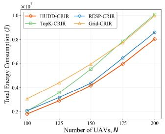  
(a) Total Energy Consumption vs N

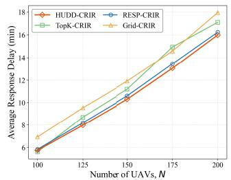  
(b) Average Response Delay vs N

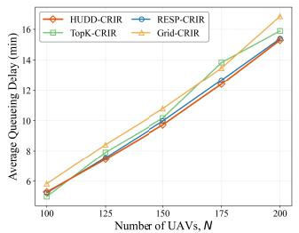  
(c) Average Queueing Delay vs N

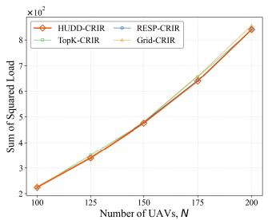  
(d) Sum of Squared Load vs N

Fig. 2. Performance comparison of different deployment strategies as the number of UAVs (N) increases (M = 50).  
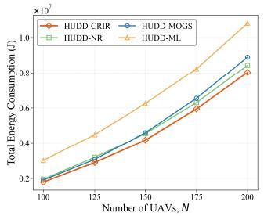  
(a) Total Energy Consumption vs N

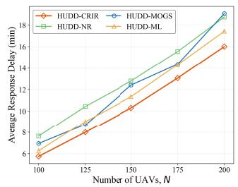  
(b) Average Response Delay vs N

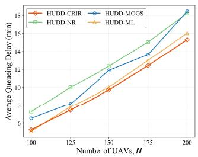  
(c) Average Queueing Delay vs N

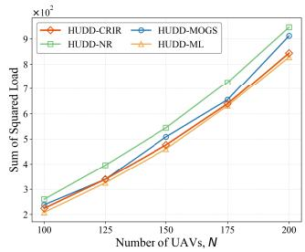  
(d) Sum of Squared Load vs N  
Fig. 3. Performance comparison of different scheduling strategies as the number of UAVs (N) increases (M = 50).

By contrast, Fig. 2d shows comparable sum-of-squared-load values across deployment strategies. This indicates that, under the common CRIR scheduler, the final load distribution is mainly governed by the access coordination policy rather than the deployment layout alone. Therefore, HUDD’s advantage is primarily reflected in providing a spatially better-aligned docking layout, which achieves comparable load balance while reducing flight distance and queueing-induced delay.

Overall, HUDD achieves a more coordinated matching between docking-point locations and spatial demand, leading to stable improvements in total energy consumption and delay-related metrics across a wide range of traffic load. Grid ignores demand heterogeneity and thus suffers from supply–demand mismatch; TopK overly favors hotspots and is more vulnerable to local congestion as N grows; RESP partially captures spatial demand disparities but exhibits less stable performance at finer spatial scales than HUDD. These observations demonstrate that HUDD is particularly suitable for urban UDI scenarios with highly non-uniform demand distributions, and provides a stronger infrastructure layout foundation for subsequent access coordination.

## D. Evaluation of the CRIR-Based Charging Access Coordination Algorithm

We next evaluate the proposed CRIR-based multi-UAV charging access coordination algorithm under the HUDD deployment. We compare CRIR with three baselines, namely NR, MOGS, and ML, from the following two perspectives.

1) Performance Comparison With Increasing Number of UAVs N: Fig. 3 reports the total energy consumption, the average response delay, the average queueing delay, and the sum of squared load as functions of the number of UAVs, with the docking-point budget fixed at M = 50.

As shown in Fig. 3a, CRIR consistently achieves the lowest total energy consumption for all values of N. At $N = 2 0 0 .$ CRIR reduces total energy consumption by approximately 4.9%, 9.8%, and 25.7% compared with NR, MOGS, and ML, respectively. The gain mainly stems from two factors: (i) CRIR explicitly penalizes congestion and thus suppresses excessive queueing and waiting energy; and (ii) its convexrelaxation phase accounts for long-distance access costs and avoids unnecessary detours. In contrast, ML aggressively pursues instantaneous load balancing. Although this helps reduce load dispersion, it often induces longer migrations and, consequently, significantly higher energy consumption. NR, which greedily picks the nearest feasible docking point, also neglects the global energy–congestion trade-off and therefore performs worse than CRIR.

Fig. 3b and Fig. 3c show that both the average response delay and the average queueing delay grow with N for all schemes. In the medium-to-high load regime $( N ~ \ge ~ 1 2 5 )$ CRIR yields the lowest delay on both metrics. This advantage is closely related to CRIR’s congestion-aware assignment mechanism. The squared-load term in the convex-relaxation phase discourages globally imbalanced assignments, while the exponential gradient penalty in iterative rounding further reduces the preference for already loaded docking points. As a result, CRIR suppresses queue build-up and achieves lower queueing delay and response delay under medium-tohigh load. By comparison, NR’s distance-greedy access rule tends to attract many UAVs to the same nearby hotspot nodes;

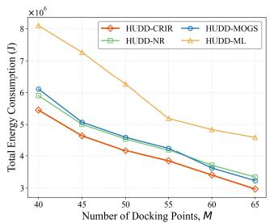  
(a) Total Energy Consumption vs M

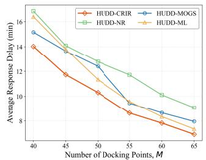  
(b) Average Response Delay vs M

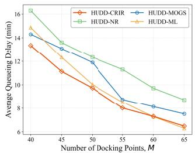  
(c) Average Queueing Delay vs M

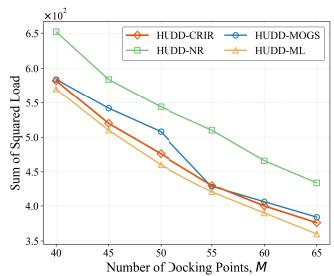  
(d) Sum of Squared Load vs M  
Fig. 4. Performance comparison of different scheduling strategies as the number of docking points (M) increases (N = 150).

MOGS, as a many-to-one matching-based approach, focuses on preference feasibility and quota satisfaction but lacks an explicit mechanism to restrain queueing costs under heavy load, so its delays grow faster than those of CRIR.

Fig. 3d further compares the sum of squared load. ML, as expected, achieves the smallest value on this metric because it always prioritizes the least-loaded docking point. CRIR has a slightly higher sum of squared load than ML, yet it still performs better than NR and MOGS and keeps the load reasonably balanced. Combined with the results in Fig. 3a–3c, this indicates that blindly pursuing load balancing alone does not guarantee lower energy consumption or shorter response delay. A coordinated consideration of flight energy, queueing congestion, and load evolution, as implemented in CRIR, is more effective for improving overall system performance.

2) Performance Comparison With Increasing Number of Docking Points M: To further examine how infrastructure provisioning influences different scheduling strategies, Fig. 4 reports performance as M increases from 40 to 65 with the number of UAVs fixed at N = 150. As M grows, all schemes show lower response delay and queueing delay because more docking points increase the available service capacity and reduce the probability that multiple UAVs compete for the same charging berth. Meanwhile, a denser docking layout shortens the average distance from UAV request locations to feasible docking points, which reduces the flight component of both response delay and energy consumption. However, the improvement is not purely proportional to M, because newly added docking points are useful only when they are spatially close to demand and can effectively absorb traffic from congested nodes.

As shown in Fig. 4a, CRIR maintains the lowest energy consumption across the range of M. For example, when M = 65, CRIR reduces the total energy consumption by about 11.1%, 8.0%, and 35.3% relative to NR, MOGS, and ML, respectively. This demonstrates that CRIR exploits additional docking options more effectively than the baselines. As M increases, the feasible assignment space expands; however, NR may concentrate UAVs at nearby hotspots, ML may introduce excessive detours for load balancing, and MOGS may sacrifice distance optimality for quota-feasible many-to-one matching. By coordinating flight-energy and congestion-pressure considerations, CRIR reduces waiting energy via additional docking points without extra travel costs.

Fig. 4b and Fig. 4c plot the average response delay and average queueing delay as M increases. With more docking points available, CRIR exhibits a pronounced advantage in delay-related metrics. In the resource-abundant case of $M = 6 5$ , CRIR lowers the response delay by about 23.7%, 12.9%, and 5.8% compared with NR, MOGS, and ML, respectively. These results indicate that CRIR not only leverages additional infrastructure resources more efficiently, but also continues to suppress local congestion caused by purely nearest-node dispatching through its global coordination mechanism.

Finally, Fig. 4d compares the sum of squared load as M varies. ML again achieves the lowest sum of squared load due to its explicit minimum-load-first rule. Nevertheless, ML’s advantage in the load metric does not translate into better energy or delay performance, because its minimum-load-first rule may assign UAVs to farther docking points to equalize loads. In contrast, CRIR maintains a balanced load while jointly accounting for access distance and congestion, thereby avoiding excessive migration and suppressing queue buildup. Therefore, CRIR achieves lower energy consumption and shorter response and queueing delays, despite having a slightly higher sum of squared load than ML.

In summary, the baselines exhibit limitations: NR may create hotspot queues due to nearest-node decisions, MOGS emphasizes quota-feasible matching but is less adaptive to evolving congestion, and ML may reduce load imbalance at the cost of longer detours. In contrast, CRIR combines global soft-assignment guidance with iterative congestion-aware refinement, enabling it to avoid both hotspot accumulation and excessive migration. This explains its robust performance across different UAV densities and docking-point budgets.

## VII. CONCLUSION

This paper investigates low-altitude UAV services in smart cities and proposes retrofitting a subset of existing UDI facilities into charging-capable docking points, thereby building an urban energy-replenishment network that supports sustained UAV operation. We establish a unified model that captures energy consumption, queueing delay, and docking-point load, and further develop a hierarchical solution framework consisting of a HUDD-based deployment method and a CRIR-based multi-UAV charging access coordination algorithm. Experimental results show that the proposed framework outperforms multiple baseline methods in terms of energy consumption, response delay, queueing delay, and load distribution. Future work will consider time-varying and stochastic demand and develop adaptive online deployment and scheduling mechanisms under practical communication and airspace constraints.

## REFERENCES

[1] Y. Liu et al., “Aligning cyber space with physical world: A comprehensive survey on embodied AI,” IEEE/ASME Trans. Mechatronics, vol. 30, no. 6, pp. 7253–7274, Dec. 2025.

[2] Y. Qin et al., “MP5: A multi-modal open-ended embodied system in minecraft via active perception,” in Proc. IEEE/CVF Conf. Comput. Vis. Pattern Recognit. (CVPR), Jun. 2024, pp. 16307–16316.

[3] H. Liu, D. Guo, and A. Cangelosi, “Embodied intelligence: A synergy of morphology, action, perception and learning,” ACM Comput. Surveys, vol. 57, no. 7, pp. 1–36, Jul. 2025.

[4] L. Zhou, S. Leng, Y. Liu, Z. Xiong, and T. Q. S. Quek, “Digital twins for low-altitude UAV networks–cooperation and learning,” IEEE Trans. Mobile Comput., vol. 25, no. 4, pp. 4839–4856, Apr. 2026.

[5] X. Cheng, R. Meng, X. Xu, H. Gao, P. Zhang, and D. Niyato, “APEG: Adaptive physical layer authentication with channel extrapolation and generative AI,” IEEE Trans. Inf. Forensics Security, vol. 21, pp. 1257–1272, 2026.

[6] R. Zhang et al., “Generative AI agents with large language model for satellite networks via a mixture of experts transmission,” IEEE J. Sel. Areas Commun., vol. 42, no. 12, pp. 3581–3596, Dec. 2024.

[7] F. Outay, H. A. Mengash, and M. Adnan, “Applications of unmanned aerial vehicle (UAV) in road safety, traffic and highway infrastructure management: Recent advances and challenges,” Transp. Res. A, Policy Pract., vol. 141, pp. 116–129, Nov. 2020.

[8] R. Sharma and R. Arya, “UAV based long range environment monitoring system with industry 5.0 perspectives for smart city infrastructure,” Comput. Ind. Eng., vol. 168, Jun. 2022, Art. no. 108066.

[9] H. Ijaz, R. Ahmad, R. Ahmed, W. Ahmed, Y. Kai, and W. Jun, “A UAV-assisted edge framework for real-time disaster management,” IEEE Trans. Geosci. Remote Sens., vol. 61, 2023, Art. no. 1001013.

[10] A. Li, M. Hansen, and B. Zou, “Traffic management and resource allocation for UAV-based parcel delivery in low-altitude urban space,” Transp. Res. C, Emerg. Technol., vol. 143, Oct. 2022, Art. no. 103808.

[11] Z. Ye, K. Wang, Y. Chen, X. Jiang, and G. Song, “Multi-UAV navigation for partially observable communication coverage by graph reinforcement learning,” IEEE Trans. Mobile Comput., vol. 22, no. 7, pp. 4056–4069, Jul. 2023.

[12] J. Li et al., “Enhancing secrecy energy efficiency in UAV-RIS assisted mobile IoV networks through DRL,” IEEE Trans. Wireless Commun., vol. 25, pp. 2092–2108, 2026, doi: 10.1109/TWC.2025.3594691.

[13] B. Adhikari, A. S. Khwaja, M. Jaseemuddin, A. Anpalagan, and A. Nallanathan, “Energy efficient RIS-assisted UAV networks using twin delayed DDPG technique,” IEEE Trans. Wireless Commun., vol. 23, no. 12, pp. 18423–18439, Dec. 2024.

[14] F. Song, M. Deng, H. Xing, Y. Liu, F. Ye, and Z. Xiao, “Energy-efficient trajectory optimization with wireless charging in UAV-assisted MEC based on multi-objective reinforcement learning,” IEEE Trans. Mobile Comput., vol. 23, no. 12, pp. 10867–10884, Dec. 2024.

[15] H. Huang and A. V. Savkin, “Deployment of charging stations for drone delivery assisted by public transportation vehicles,” IEEE Trans. Intell. Transp. Syst., vol. 23, no. 9, pp. 15043–15054, Sep. 2022.

[16] J. Shi, P. Cong, L. Zhao, X. Wang, S. Wan, and M. Guizani, “A two-stage strategy for UAV-enabled wireless power transfer in unknown environments,” IEEE Trans. Mobile Comput., vol. 23, no. 2, pp. 1785–1802, 2023.

[17] R. Darshan, V. George, D. Soman, N. Prateek, S. Sree, and H. Ashish, “Autonomous recharging of multirotor unmanned aerial vehicles to extend operational time,” Cogent Eng., vol. 12, no. 1, Dec. 2025, Art. no. 2490529.

[18] B. Kirubakaran, O. Vikhrova, S. Andreev, and J. Hosek, “UAV-BS integration with urban infrastructure: An energy efficiency perspective,” IEEE Commun. Mag., vol. 63, no. 3, pp. 100–106, Mar. 2025.

[19] B. Liu, W. Ni, R. P. Liu, Y. J. Guo, and H. Zhu, “Privacy-preserving routing and charging scheduling for cellular-connected unmanned aerial vehicles,” IEEE Trans. Syst., Man, Cybern., Syst., vol. 54, no. 8, pp. 4929–4941, Aug. 2024.

[20] P. Vichitkunakorn, S. Emde, M. Masae, C. H. Glock, and E. H. Grosse, “Locating charging stations and routing drones for efficient automated stocktaking,” Eur. J. Oper. Res., vol. 316, no. 3, pp. 1129–1145, Aug. 2024.

[21] K. Messaoudi, A. Baz, O. Sami Oubbati, A. Rachedi, T. Bendouma, and M. Atiquzzaman, “UGV charging stations for UAV-assisted AoI-aware data collection,” IEEE Trans. Cognit. Commun. Netw., vol. 10, no. 6, pp. 2325–2343, Dec. 2024.

[22] M. Y. Arafat and S. Moh, “JRCS: Joint routing and charging strategy for logistics drones,” IEEE Internet Things J., vol. 9, no. 21, pp. 21751–21764, Nov. 2022.

[23] B. Zhao et al., “UrbanVideo-bench: Benchmarking vision-language models on embodied intelligence with video data in urban spaces,” 2025, arXiv:2503.06157.

[24] Z. Hu et al., “Toward embodied intelligence: An autonomous exploration system for multimodal UAV,” in Proc. Int. Conf. Ubiquitous Commun. (Ucom), Jul. 2024, pp. 444–448.

[25] S. Kourav, K. Verma, and M. Sundararajan, “Artificial intelligence algorithm models for agents of embodiment for drone applications,” in Building Embodied AI Systems: The Agents, the Architecture Principles, Challenges, and Application Domains. Cham, Switzerland: Springer, 2025, pp. 79–101.

[26] S. Zhang et al., “Large models for aerial edges: An edge-cloud model evolution and communication paradigm,” IEEE J. Sel. Areas Commun., vol. 43, no. 1, pp. 21–35, Jan. 2025.

[27] C. Zhang et al., “Embodied intelligence-driven framework for UAV power inspection systems: Federated reinforcement learning for multiagent collaborative optimization,” in Proc. Int. Conf. Intell. Comput. Singapore: Springer, Jul. 2025, pp. 292–301.

[28] S. Fu, F. Dong, X. Xu, D. Shen, M. Bilal, and S. Dustdar, “CODEA: Online container deployment and edge association for multi-edge federated synergy learning,” IEEE Trans. Mobile Comput., pp. 1–18, Apr. 2026, doi: 10.1109/TMC.2026.3684 059.

[29] Z. Chen, Z. Hu, Z. Bao, and W. Xu, “UAV charging station planning and route optimization considering stochastic delivery demand,” IEEE Trans. Transport. Electrific., vol. 10, no. 4, pp. 9328–9341, Dec. 2024.

[30] H. Li, L. Kang, H. Sun, J. Wu, Y. Zhao, and S. Amihere, “Fixed automated stations location and UAVs routing problems in urban road networks: A tailored branch-&-price algorithm,” Transp. Res. A, Policy Pract., vol. 189, Nov. 2024, Art. no. 104201.

[31] Y. Qin, M. A. Kishk, and M.-S. Alouini, “Performance analysis of charging infrastructure sharing in UAV and EV-involved networks,” IEEE Trans. Veh. Technol., vol. 72, no. 3, pp. 3973–3988, Mar. 2023.

[32] L. Zhao, Y. Yao, J. Guo, Q. Zuo, and V. C. M. Leung, “Collaborative computation offloading and wireless charging scheduling in multi-UAV-assisted MEC networks: A TD3-based approach,” Comput. Netw., vol. 251, Sep. 2024, Art. no. 110615.

[33] S. Wu, Y. Yang, H. Dai, L. Liu, F. Xiao, and J. Xu, “Cost-effective parallel cooperative charging scheduling for UAVs,” IEEE Trans. Mobile Comput., vol. 25, no. 7, pp. 11101–11115, Jul. 2026.

[34] D. Gross, Fundamentals of Queueing Theory. Hoboken, NJ, USA: Wiley, 2008.

[35] F. Tut¨ unc ¨ uoglu, S. Jo ¨ silo, and G. D ˇ an, “Online learning for rate-´ adaptive task offloading under latency constraints in serverless edge computing,” IEEE/ACM Trans. Netw., vol. 31, no. 2, pp. 695–709, Apr. 2023.

[36] R. W. Sinnott, “Virtues of the haversine,” Sky Telescope, vol. 68, no. 2, p. 158, 1984.

[37] T. Li, S. Ying, Y. Zhao, and J. Shang, “Batch jobs load balancing scheduling in cloud computing using distributional reinforcement learning,” IEEE Trans. Parallel Distrib. Syst., vol. 35, no. 1, pp. 169–185, Jan. 2024.

[38] R. Bhatia and C. Davis, “A cauchy-schwarz inequality for operators with applications,” Linear Algebra its Appl., vols. 223–224, pp. 119–129, Jul. 1995.

[39] S. Wang, Y. Zhao, J. Xu, J. Yuan, and C.-H. Hsu, “Edge server placement in mobile edge computing,” J. Parallel Distrib. Comput., vol. 127, pp. 160–168, May 2019.

[40] A. A. Vali, S. Azizi, and M. Shojafar, “RESP: A recursive clustering approach for edge server placement in mobile edge computing,” ACM Trans. Internet Technol., vol. 24, no. 3, pp. 1–25, Aug. 2024.

[41] Y. Luo, W. Ding, and B. Zhang, “Optimization of task scheduling and dynamic service strategy for multi-UAV-enabled mobile-edge computing system,” IEEE Trans. Cognit. Commun. Netw., vol. 7, no. 3, pp. 970–984, Sep. 2021.

[42] L. Zhao, S. Li, Z. Tan, A. Hawbani, S. Timotheou, and K. Yu, “A multi-UAV cooperative task scheduling in dynamic environments: Throughput maximization,” IEEE Trans. Comput., vol. 74, no. 2, pp. 442–454, Feb. 2025

2025. Authorized licensed use limited to: GUANGZHOU UNIVERSITY. Downloaded on October 28,2026 at 06:32:57 UTC from IEEE Xplore. Restrictions apply.