# An Interdisciplinary Approach to Optimal Communication and Flight Operation of High-Altitude Long-Endurance Platforms

SIDRAH JAVED , Student Member, IEEE

MOHAMED-SLIM ALOUINI , Fellow, IEEE

King Abdullah University of Science and Technology, Thuwal, Saudi Arabia

ZHIGUO DING , Fellow, IEEE

The University of Manchester, Manchester, U.K.

The Khalifa University, Abu Dhabi, United Arab Emirates

Aerial communication platforms, stratospheric high-altitude platform stations (HAPSs), have the potential to provide/catalyze advanced mobile wireless communication services with their ubiquitous connectivity and ultrawide coverage radius. Recently, the HAPS has gained immense popularity—achieved primarily through selfsufficient energy systems—to render long-endurance characteristics. The photovoltaic cells mounted on the aircraft harvest solar energy during the day, which can be partially used for communication and station keeping, whereas the excess is stored in the rechargeable batteries for the nighttime operation. We carry out an adroit power budgeting to ascertain if the available solar power can simultaneously and efficiently self-sustain the requisite propulsion and communication power expense. We further propose an energy optimum trajectory for station-keeping flight and nonorthogonal multiple access (NOMA) for multicell users, which are served by the directional beams from HAPS communication systems. We design optimal power allocation

Manuscript received 15 March 2023; revised 7 July 2023; accepted 1 August 2023. Date of publication 14 August 2023; date of current version 8 December 2023.

DOI. No. 10.1109/TAES.2023.3304615

Refereeing of this contribution was handled by A. Knopp.

This work was supported by the Office of Sponsored Research at KAUST.

Authors’ addresses: Sidrah Javed and Mohamed-Slim Alouini are with the Computer, Electrical, and Mathematical Science and Engineering Division, King Abdullah University of Science and Technology, Thuwal 23955, Saudi Arabia, E-mail: (slim.alouini@kaust.edu.sa; sidrah.javed@kaust.edu.sa); Zhiguo Ding is with the Department of Electrical and Electronic Engineering, The University of Manchester, M13 9PL Manchester, U.K., and also with Khalifa University, Abu Dhabi 127788, United Arab Emirates, E-mail: (zhiguo.ding@manchester.ac.uk). (Corresponding author: Sidrah Javed.)

for downlink (DL) NOMA users along with the ideal position and speed of flight with the aim to maximize sum data rate during the day and minimize power expenditure during the night, while ensuring the quality of service. Our findings reveal the significance of joint design of communication and aerodynamic parameters for optimum energy utilization and resource allocation.

## I. INTRODUCTION

A new paradigm of wireless communication, the sixthgeneration system, envisions an all-coverage network capable of providing ubiquitous connections for space, air, ground, and underwater. Aerial communications have the potential to address numerous limitations of terrestrial and satellite communications in order to meet the everincreasing communication demands. An aerial network is superior to terrestrial infrastructure with features, such as flexible deployment, short-range line-of-sight (LOS) links, larger coverage area, resilience to certain natural disasters, and many degrees of freedom with controlled mobility [1]. Moreover, high-altitude platform systems (HAPSs) enjoy the advantages, such as favorable channel conditions, almost stationary positions, smaller footprint for higher area throughput, long endurance, reduced round-trip delay, and flexible maintenance/reusability, in relation to satellites. These inherent characteristics enable aerial communication systems to serve unserved or underserved areas by assisting the existing ground and space infrastructure. For instance, they can complement the existing terrestrial networks in bridging the digital divide by connecting the unconnected in less privileged sparsely populated regions or difficult terrains. These floating base stations are particularly useful for effective disaster management and rapid reliefoperation. Moreover, air-based mobile coverage solutions are remedial for dense metropolitan areas, when used as a relay and/or backhaul for the prevailing infrastructures [2]. Similarly, they can act as relays between satellites, substituting ground stations.

The HAPS has emerged as a viable, promising, and versatile candidate for aerial communication due to its unmanned and disaster-resilient operation, long-endurance characteristics, and self-reliance capability. It offers ubiquitous connectivity and ultrawide coverage with low-delay characteristics, higher throughput, and minimal power requirement [3]. The key features of the HAPS include seamless merger with the existing communication infrastructure, no special requirements on the operational spectrum/user equipment (UE), ability to adjust and prioritize capacity or coverage, rapid deployment, flexible maintenance/upgradation, and scaling capabilities [4]. The HAPS can provide universal coverage with dedicated/shared broadband connectivity offering numerous use cases, including greenfield coverage, Internet of Things (IoT), fixed wireless catastrophe management, public/private connectivity, and terrestrial backhaul [5]. The HAPS can also assist maritime networks in numerous sensing applications by offering computation offloading and facilitating secrecy provisioning via hybrid nonorthogonal multiple access (NOMA) and frequency-division multiple access schemes [6].

The concept of HAPS has been developed for last three decades; however, the recent advances in communication technologies, solar panel efficiency, lightweight composite materials, autonomous avionics, and antenna beamforming are the prime enablers behind the HAPS [7], [8]. They are parts of the third-generation partnership project defined nonterrestrial network (NTN) infrastructure for 5G networks and beyond [9]. A solar-powered HAPS is capable of cruising in a station-keeping trajectory for several months because of the favorable conditions in lower stratosphere [3]. The HAPS can be realized as a balloon, airship, or aircraft, according to the required power, use cases, and cargo capabilities [10]. HAPS communication systems can employ any frequency in the allocated spectrum by the International Telecommunication Union (ITU) to serve the unserved areas; however, the coexistence of terrestrial and aerial communication networks operating at same carrier frequency may result in cochannel interference (CCI) and adjacent channel interference. A recent study suggests the use of synchronous time-division duplex between the terrestrial network and the NTN to mitigate such interference [11].

The key technological challenges in the HAPS implementation are spread across the domains of aerodynamics, energy harvesting, and communications. Aerodynamics design should have the following characteristics: lightweight structure, durable and weather resistant model, desired payload capabilities, precise positioning, paradigmatic station-keeping flight trajectory, and reliable unmanned navigation systems for long endurance [5]. Likewise, the self-sustaining HAPS requires proficient solar energy harvesting models for maximum irradiance collection, efficient conversion/storage, and delivery as per the propulsion and communication power requirements. Numerous sensing/monitoring and communication applications demand respective payload carriage capacities for mounted sensors and base stations. Communication frameworks need impeccable link budgeting, sophisticated multiple access techniques, and interference management to serve the users in their broad coverage area. This article is an effort to harmonize and address the aforementioned challenges to meet the expected communication demands.

Numerous contributions have been presented to tackle different challenges of HAPS communication systems, such as trajectory optimization, resource management, performance evaluation, and link/power budgeting [12], [13], [14], [15], [16]. A recent study has suggested the optimal flight trajectory of a solar-powered high-altitude long-endurance aircraft [12]. Another contribution proposed NOMA for effective resource management [13]. One more study employed a steerable adaptive antenna array to continuously serve same cell users during the repetitive flight pattern over its coverage area [15]. Moreover, link budgeting with quadrature phase-shift keying for varying code rates was carried out to minimize error rates and power consumption [16]. However, to the best of authors’ knowledge, there is no contribution for jointly addressing the flight operation and communication aspects in an HAPS communication system. Therefore, we present an interdisciplinary approach involving atmospheric science, aerodynamics, wireless communications, and renewable energy to mutually tackle the previously mentioned challenges for optimal flight and communication operations with effective resource allocation for long endurance.

1) We employ solar position algorithms to quantify the available solar energy for a stratospheric HAPS flying on a certain Julian Day at a given time and location. This enables the calculation of harvested electrical energy after incorporating conversion and storage efficiency of the participating solar panels and storage batteries, respectively.

2) We utilize rigorous mathematical models to estimate the power expenditure of the HAPS. The propulsion and accessory consumption depends upon the HAPS dimensions, trajectory, stratospheric characteristics, and avionics. Similarly, the communication payload power is determined according to the employed transmission equipment, coverage area, service type, access schemes, and the desired link targets.

3) We propose power- and spectrum-efficient NOMAbased multicell communications along with the polygonal beam-steering antenna array [15] to tackle incurred small- and large-scale fading.

4) The daytime allows maximum sun exposure enabling maximum available transmission power to serve numerous cellular/IoT users. On the other side, transmission and flight with minimal energy requirements are the preferred choice during night. Hence, we jointly optimize the flight and communication parameters to maximize sum rate and minimize power consumption during the day and night, respectively, while guarantying the quality of service (QoS).

5) We develop two different iterative algorithms for the daytime operation (DTO) and the nighttime operation (NTO) delivering the closed-form solutions of altitude, airspeed, and power factors.

6) The HAPS continues to cruise in the circular trajectory at the derived altitude with the optimal speed for a given time duration and then transitions to the next state while providing the downlink NOMA (DL-NOMA) service link to the users with optimal power allocation. The cycle repeats everyday to maintain net energy balance greater than zero ensuring ubiquitous connectivity, self-sustenance, and long endurance.

The proposed study is novel due to the interdisciplinary approach to jointly optimize flight and communication parameters, solar-powered self-sustaining flight operation, effective resource allocation using NOMA with frequency reuse, and pragmatically maximizing the sum rate during the day and minimizing power expenditure during the night.

The rest of this article is organized as follows. Section II describes different aspects of the system under consideration, i.e., solar irradiance model, aerodynamics, communication payload, and energy storage. In Section III, we present the sum rate analysis of the users in the service area based upon the adopted propagation model and link budgeting. Next, we formulate the optimization problems to maximize system throughput and minimize power consumption during the DTO and the NTO, respectively. We present the alternate optimization (AO) algorithms to jointly tackle the communication and flight operation in Section IV. Later, insightful numerical analysis is carried out in Section V, to quantify the gains obtained with the proposed scheme. Finally, Section VI concludes this article.

<table><tr><td rowspan=1 colspan=1>True Airspeed</td><td rowspan=1 colspan=1>V</td><td rowspan=1 colspan=1>Altitude</td><td rowspan=1 colspan=1>H</td></tr><tr><td rowspan=1 colspan=1>Trajectory Diameter</td><td rowspan=1 colspan=1>d</td><td rowspan=1 colspan=1>Julian Day Index</td><td rowspan=1 colspan=1>jd</td></tr><tr><td rowspan=1 colspan=1>Solar Elevation Angle</td><td rowspan=1 colspan=1>∈s</td><td rowspan=1 colspan=1>Solar Flux</td><td rowspan=1 colspan=1>I</td></tr><tr><td rowspan=1 colspan=1>Atmospheric Absorption</td><td rowspan=1 colspan=1>f (H, ∈s)</td><td rowspan=1 colspan=1>Date and Time</td><td rowspan=1 colspan=1>dt</td></tr><tr><td rowspan=1 colspan=1>Solar Constant</td><td rowspan=1 colspan=1>Ic</td><td rowspan=1 colspan=1>Extinction parameter</td><td rowspan=1 colspan=1>αext(dt)</td></tr><tr><td rowspan=1 colspan=1>Relative Air Mass</td><td rowspan=1 colspan=1>mR(θ)</td><td rowspan=1 colspan=1>Relative Pressure</td><td rowspan=1 colspan=1>pR(H)</td></tr><tr><td rowspan=1 colspan=1>Pressure at Altitude h</td><td rowspan=1 colspan=1>ph</td><td rowspan=1 colspan=1>Pressure at MSL</td><td rowspan=1 colspan=1>po</td></tr><tr><td rowspan=1 colspan=1>Longitude</td><td rowspan=1 colspan=1>ξ</td><td rowspan=1 colspan=1>Latitude</td><td rowspan=1 colspan=1>X</td></tr><tr><td rowspan=1 colspan=1>Base temperature</td><td rowspan=1 colspan=1>Tb</td><td rowspan=1 colspan=1>Lapse Rate</td><td rowspan=1 colspan=1>Lb</td></tr><tr><td rowspan=1 colspan=1>Universal Gas Constant</td><td rowspan=1 colspan=1>R</td><td rowspan=1 colspan=1>Molar mass</td><td rowspan=1 colspan=1>M</td></tr><tr><td rowspan=1 colspan=1>Daylight Duration</td><td rowspan=1 colspan=1>τ</td><td rowspan=1 colspan=1>Solar Azimuth Angle</td><td rowspan=1 colspan=1>Φ(d)</td></tr><tr><td rowspan=1 colspan=1>Angular Distance of Sun</td><td rowspan=1 colspan=1>Ma(d)</td><td rowspan=1 colspan=1>Angle of Obliquity</td><td rowspan=1 colspan=1>e0</td></tr><tr><td rowspan=1 colspan=1>Solar Energy</td><td rowspan=1 colspan=1>Ea</td><td rowspan=1 colspan=1>Solar Declination Angle</td><td rowspan=1 colspan=1>δ</td></tr><tr><td rowspan=1 colspan=1>Power Conversion Efficiency</td><td rowspan=1 colspan=1>ηs</td><td rowspan=1 colspan=1>Solar Panels Area</td><td rowspan=1 colspan=1>Ap</td></tr><tr><td rowspan=1 colspan=1>Lift Force</td><td rowspan=1 colspan=1>L</td><td rowspan=1 colspan=1>Drag Force</td><td rowspan=1 colspan=1>D</td></tr><tr><td rowspan=1 colspan=1>Weight</td><td rowspan=1 colspan=1>W</td><td rowspan=1 colspan=1>Thrust</td><td rowspan=1 colspan=1>T</td></tr><tr><td rowspan=1 colspan=1>Propeller Efficiency</td><td rowspan=1 colspan=1>ηp</td><td rowspan=1 colspan=1>Engine Efficiency</td><td rowspan=1 colspan=1>ηe</td></tr><tr><td rowspan=1 colspan=1>Air Density</td><td rowspan=1 colspan=1>ρh</td><td rowspan=1 colspan=1>Oswald&#x27;s Efficiency</td><td rowspan=1 colspan=1>e</td></tr><tr><td rowspan=1 colspan=1>Wing Area</td><td rowspan=1 colspan=1>S</td><td rowspan=1 colspan=1>Wing Aspect Ratio</td><td rowspan=1 colspan=1>ARw</td></tr><tr><td rowspan=1 colspan=1>Zero-lift Drag</td><td rowspan=1 colspan=1>CD0</td><td rowspan=1 colspan=1>Banking Angle</td><td rowspan=1 colspan=1>ζ</td></tr><tr><td rowspan=1 colspan=1>Centripetal Force</td><td rowspan=1 colspan=1>C</td><td rowspan=1 colspan=1>Required Power</td><td rowspan=1 colspan=1>Preq</td></tr><tr><td rowspan=1 colspan=1>Accessory Power</td><td rowspan=1 colspan=1>Pacc</td><td rowspan=1 colspan=1>Propulsion Power</td><td rowspan=1 colspan=1>Ppro</td></tr><tr><td rowspan=1 colspan=1>Number of Cells</td><td rowspan=1 colspan=1>M</td><td rowspan=1 colspan=1>Users in mth Cell</td><td rowspan=1 colspan=1>Km</td></tr><tr><td rowspan=1 colspan=1>Power for mth Cell</td><td rowspan=1 colspan=1>Pm</td><td rowspan=1 colspan=1>Allocated Power factor</td><td rowspan=1 colspan=1>αm</td></tr><tr><td rowspan=1 colspan=1>Information Signal</td><td rowspan=1 colspan=1>sm</td><td rowspan=1 colspan=1>Channel Coefficient</td><td rowspan=1 colspan=1>h)m</td></tr><tr><td rowspan=1 colspan=1>Receiver Thermal Noise</td><td rowspan=1 colspan=1>wi</td><td rowspan=1 colspan=1>Neighbor Interfering Cells</td><td rowspan=1 colspan=1>Jm</td></tr><tr><td rowspan=1 colspan=1>Net Power</td><td rowspan=1 colspan=1>Pnet</td><td rowspan=1 colspan=1>Communication Power</td><td rowspan=1 colspan=1>PT</td></tr><tr><td rowspan=1 colspan=1>Battery Energy</td><td rowspan=1 colspan=1>Eb</td><td rowspan=1 colspan=1>Battery Efficiency</td><td rowspan=1 colspan=1>ηb</td></tr><tr><td rowspan=1 colspan=1>Charging Efficiency</td><td rowspan=1 colspan=1>ηc</td><td rowspan=1 colspan=1>Discharging Efficiency</td><td rowspan=1 colspan=1>ηd</td></tr><tr><td rowspan=1 colspan=1>Time Duration</td><td rowspan=1 colspan=1>∆t</td><td rowspan=1 colspan=1>Small Scale Fading</td><td rowspan=1 colspan=1>gim</td></tr><tr><td rowspan=1 colspan=1>Directivity Gain</td><td rowspan=1 colspan=1>Gm</td><td rowspan=1 colspan=1>Path Loss</td><td rowspan=1 colspan=1>Ldm</td></tr><tr><td rowspan=1 colspan=1>Angle of Departure</td><td rowspan=1 colspan=1>θim</td><td rowspan=1 colspan=1>Half Power Beamwidth</td><td rowspan=1 colspan=1>θb</td></tr><tr><td rowspan=1 colspan=1>Main Lobe Gain</td><td rowspan=1 colspan=1>Mb</td><td rowspan=1 colspan=1>Back Lobe Gain</td><td rowspan=1 colspan=1>mb</td></tr><tr><td rowspan=1 colspan=1>Distance of User from HAPS</td><td rowspan=1 colspan=1>dm</td><td rowspan=1 colspan=1>Elevation of HAPS from UE</td><td rowspan=1 colspan=1>ψm</td></tr><tr><td rowspan=1 colspan=1>Carrie Frequency</td><td rowspan=1 colspan=1>fc</td><td rowspan=1 colspan=1>Carrier Wavelength</td><td rowspan=1 colspan=1>λ</td></tr><tr><td rowspan=1 colspan=1>SINR</td><td rowspan=1 colspan=1>γm</td><td rowspan=1 colspan=1>Noise Power</td><td rowspan=1 colspan=1>σ2</td></tr><tr><td rowspan=1 colspan=1>Bandwidth</td><td rowspan=1 colspan=1>B</td><td rowspan=1 colspan=1>Noise Figure</td><td rowspan=1 colspan=1>NF</td></tr><tr><td rowspan=1 colspan=1>Intercell Interference</td><td rowspan=1 colspan=1>Ti</td><td rowspan=1 colspan=1>Data Rate of User l</td><td rowspan=1 colspan=1>Rm</td></tr><tr><td rowspan=1 colspan=1>Sum Rate of mth Cell</td><td rowspan=1 colspan=1>Rm</td><td rowspan=1 colspan=1>Sum Rate</td><td rowspan=1 colspan=1>R</td></tr><tr><td rowspan=1 colspan=1>Time Instance</td><td rowspan=1 colspan=1>n</td><td rowspan=1 colspan=1>Iteration</td><td rowspan=1 colspan=1>i</td></tr><tr><td rowspan=1 colspan=1>Minimal Achievable Rate</td><td rowspan=1 colspan=1>Ωm</td><td rowspan=1 colspan=1>Feed Line Losses</td><td rowspan=1 colspan=1>r</td></tr><tr><td rowspan=1 colspan=1>Stalling Speed</td><td rowspan=1 colspan=1>Vs</td><td rowspan=1 colspan=1>Wing Span</td><td rowspan=1 colspan=1>b</td></tr></table>

In this article, |a| and a∗ represent the absolute and complex conjugates of a scalar complex number a, respectively. The scalar valued $F ( x , y )$ is a function of the independent input variables x and y, whereas $F ^ { * }$ demonstrates the optimized value of the respective function. The exponential and logarithmic functions ofvariable z are denoted by exp(z) and log(z), respectively. The summation of different variables or functions over the index k is illustrated by the $\Sigma _ { k }$ sign. A set is presented as $m \in \{ 1 , 2 , \ldots , M \}$ , where m can take any value ranging from 1 to M. Moreover, the notation $\{ m \ \backslash \ n \}$ indicates any value of m in the described range less n. On the other hand, a piecewise function is represented as $G ( s ) = { \left\{ \begin{array} { l l } { G _ { 1 } ( s ) , } & { A } \\ { G _ { 2 } ( s ) , } & { B } \end{array} \right. }$ , where function G(s) can take the form of $G _ { 1 } ( s )$ when condition A is satisfied or $G _ { 2 } ( s )$ if condition B is true. Furthermore, $x ^ { ( k ) }$ and $\mathbf { p } ^ { ( k ) }$ represent the instance values of the variable x and vector p, respectively, in the kth iteration of an algorithm. The notation $Y [ n ]$ is the value of function Y at time instance n. The terminology ∂P describes the partial derivative of function P with respect to the scalar variable v. The list of notations used in this article is summarized in Table I.

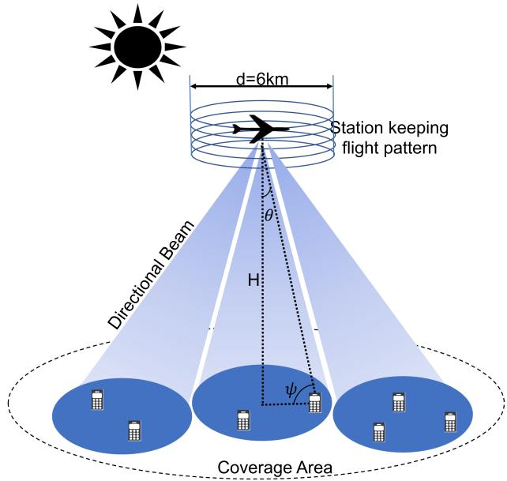  
Fig. 1. UAV-based HAPS multicell communication system.

## II. SYSTEM DESCRIPTION

We consider a typical unmanned HAPS that follows a circular trajectory of diameter d with true airspeed V at an altitude H for station keeping over the desired service area, as shown in Fig. 1. The stratospheric location (between 18 and 24 km) of the HAPS is preferable, because of lower wind speed and suitable air density, to accomplish a stable flight operation. In addition, it enables an ultrawide coverage area with a radius of 60–400 km. The HAPS provides communication services to various users over the fourth-generation long-term evolution or 5G new radio (NR) air interface via service link and backhaul to the gateway through the feeder link [15]. Solar HAPSs are appealing due to their long-endurance characteristics, which can only be achieved if they can harvest more energy than they expend. Solar cells are mounted on the wings and stabilizers to harvest the abundant solar energy during the day for their routine operation, and onboard fuel cells are utilized to store the excess energy for nighttime sustenance. This section describes the solar irradiance, energy storage, aerodynamics, and communication models with the aim to quantify the availability, storage, and consumption of electrical power. The objective is to achieve ubiquitous connectivity with minimal power consumption and enhanced system performance.

## A. Solar Irradiance Model

The long-endurance platform solely depends on the harvested solar power for its flight and communication operations. Thus, it is imperative to adopt an accurate solar irradiance model to quantify the solar flux at the surface of the mounted photovoltaic cells. Solar flux is a measure of light energy that is being radiated at a certain area, given in $\mathrm { { W / m } } ^ { 2 }$ . The amount of solar flux depends on the Julian day index $( j _ { d } )$ and solar elevation angle ( ) at a given time and location [17]. The extraterrestrial radiations undergo attenuation (due to Rayleigh scattering and molecular absorption) while traveling through the atmosphere before falling on the surface. However, the solar radiation intensity is still higher in the stratosphere relative to the Earth’s surface because of less gaseous and water vapor absorption. Interestingly, the stratosphere bears only 0.05% of the amount of water vapor as compared to those on the Earth’s surface [18]. The solar irradiance at an altitude H is adjusted to account for annual variation due to the eccentricity of Earth’s orbit and atmospheric absorption $f ( H , \epsilon _ { s } )$ as [19]

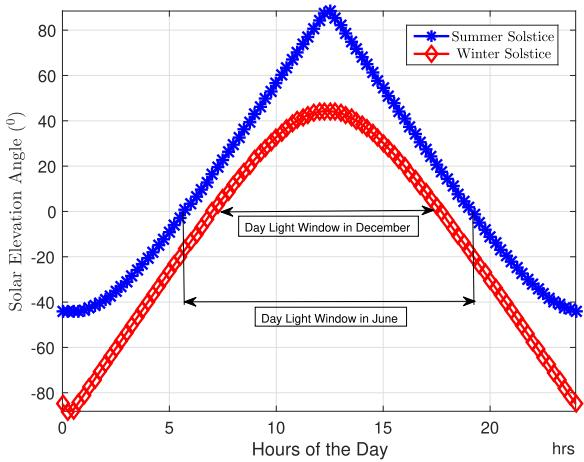  
Fig. 2. Solar elevation angle variation with hours of the day.

$$
I ( H , d t ) = I _ { c } \left( 1 + 0 . 0 3 4 \cos \frac { 2 \pi j _ { d } ( d t ) } { 3 6 5 } \right) f \left( H , \epsilon _ { s } ( d t ) \right)\tag{1}
$$

where $I _ { c }$ is a standard solar constant at zero air mass with value 1367 $\mathrm { W } / \mathrm { m } ^ { 2 }$ defined by American Society for Testing and Materials ASTM E490, $j _ { d }$ is the Julian day, and $f ( H , \epsilon _ { s } )$ is given as

$$
f \left( H , \epsilon _ { s } ( d t ) \right) = \exp { \left( - p _ { \mathrm { R } } ( H ) \mathrm { m } _ { \mathrm { R } } ( 9 0 ^ { \circ } \ - \epsilon _ { s } ( d t ) ) \alpha _ { \mathrm { e x t } } ( d t ) \right) } .\tag{(2}
$$

where the extinction parameter for clear atmosphere $\alpha _ { \mathrm { e x t } } ( d t )$ and relative air mass m (θ ) are taken from [20]. The solar elevation angle $\epsilon _ { s } ( d t )$ is computed for a given longitude $\xi ,$ , latitude $\chi ,$ and date/time $\bar { d t }$ using the solar position algorithm [17]. For this purpose, $\xi$ and $\chi$ are computed from north-position, east-position, and altitude of the HAPS using the WGS84 Earth model. For instance, Fig. 2 demonstrates the solar elevation angles throughout the day on summer solstice (SS) and winter solstice (WS) in the year 2023 over the WGS84 location coordinates (22.3095◦, 39.1047◦). The positive elevation angles represent the position of the sun above the horizon and vice versa. Solar elevation angle is the maximum at noon as anticipated; however, the difference of $4 4 . 2 ^ { \circ }$ between maximum elevations $\epsilon _ { s m }$ of SS and WS is particularly significant for the self-sustaining operation throughout the year. The relative pressure $\begin{array} { r } { p _ { \mathrm { R } } ( \bar { H } ) \dot { = } \frac { p _ { h } } { p _ { 0 } } } \end{array}$ at an altitude H is calculated according to the international standard atmosphere and 1976 U.S.

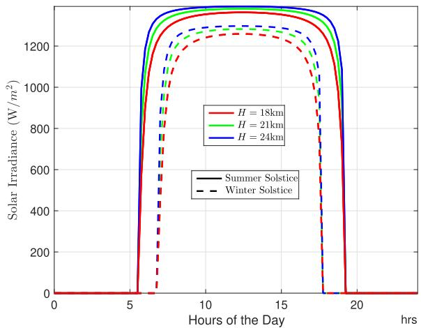  
Fig. 3. Solar flux per unit area versus hours of the day for three different flight altitudes.

Standard Atmosphere [21]

$$
p _ { \mathrm { h } } ( H ) = \left\{ \begin{array} { l l } { p _ { b 1 } \exp \left( \frac { - g M ( H - H _ { b 1 } ) } { R T _ { b } } \right) , } & { 1 1 ~ \mathrm { k m } \leq H \leq 2 0 ~ \mathrm { k m } } \\ { p _ { b 2 } \left( \frac { T _ { b } } { T _ { b } + L _ { b } ( H - H _ { b 2 } ) } \right) ^ { \frac { g M } { R L _ { b } } } , } & { 2 0 ~ \mathrm { k m } \leq H \leq 3 2 ~ \mathrm { k m } } \end{array} \right.\tag{3}
$$

where pressure at mean sea level (MSL) $p _ { 0 }$ is 101 325 $\mathrm { P a } .$ and base altitudes are $H _ { b 1 } = 1 1$ km and $H _ { b 2 } = 2 0$ km with base static pressures $p _ { b 1 } = 2 2 6 3 2 . 0 6$ Pa and $p _ { b 2 } =$ 5474.889 Pa, respectively. Base temperature $T _ { b } \operatorname { i s } 2 1 6 . 6 5 \mathrm { K }$ with base temperature lapse rate $L _ { b } = 1$ K/km, universal gas constant is $R = 8 . 3 1 4 3 2 \mathrm { N } \cdot \mathrm { m } / \mathrm { m o l } \cdot \mathrm { K }$ , gravitational acceleration $g$ is $9 . 8 ~ \mathrm { m } / \mathrm { s } ^ { 2 }$ , and molar mass of Earth’s air M is taken as 0.0289644 kg/mol.

The average available solar irradiance at each hour of the day on SS and WS of the year 2023 at location $( \boldsymbol { \chi } , \boldsymbol { \xi } )$ is presented in Fig. 3. Intuitively, the solar flux is only available during the day hours. It increases with the increasing $\epsilon _ { s }$ reaching its maximum value around noon and then decreases with the decreasing $\epsilon _ { s }$ . The window of daylight hours is relatively smaller for the winter months, i.e., 6.75–17.75 h, as opposed to the summer months, i.e., 5.5–19.25 h, rendering a difference of 2.75 h. Moreover, the figure demonstrates lower solar irradiance levels during the WS as compared to those during the SS with 7.34% percentage reduction at 12.5 h due to the increased extinction factor and decreased elevation angles. We further study the variation of solar irradiance levels with the increasing altitude. We observe a relative decrease of 2.12% in solar irradiance with the altitude changing from 24 to 18 km. Hence, the NTO is limited by the stored power, whereas the DTO can utilize all the surplus power for its payload. Interestingly, the extended daylight hours in summer render a slightly higher power budget for nights as they allow extra energy storage before saturating the batteries. The radiation intensity varies with the varying solar elevation angle throughout the day, while the total solar radiance is dependent on the number of daylight hours between sunrise and sunset. According to Lambert’s cosine law, the instantaneous irradiance I (H, dt ) measured on a plane will vary with respect to the cosine of the angle between the optical axis of the source and normal to the detector

$$
I _ { i } = I _ { m } ( H , d ) \cos \left( \frac { \pi } { 2 } - \epsilon _ { s } ( d t ) \right)\tag{4}
$$

Where $I _ { m } ( H , d )$ is the maximum solar irradiance on a given day at solar noon from (1). Thus, the total solar irradiance per unit area $I _ { \mathrm { T } }$ on a given day and altitude can be estimated by using an approximated elevation angle time series [22]

$$
I _ { \mathrm { T } } ( H , d ) = \frac { I _ { \mathrm { m } } ( H , d ) \tau ( \chi , d ) } { \epsilon _ { \mathrm { s m } } ( d t ) } \left( 1 - \cos ( \epsilon _ { \mathrm { s m } } ( d t ) ) \right)\tag{5}
$$

where the daylight time duration τ at a particular latitude is dependent on the solar azimuth angle $\Phi ( d )$ of the sun and angular distance of the sun $M _ { a } ( d )$ as

$$
\tau ( \chi , d ) = 2 4 \left( 1 - \frac { 1 } { \pi } \cos ^ { - 1 } \left( \frac { \tan ( \chi ) \wp ( e _ { o } , d ) } { \sqrt { 1 - \wp ^ { 2 } ( e _ { o } , d ) } } \right) \right)\tag{6}
$$

with℘ $( e _ { o } , d ) = \sin ( e _ { o } ) \sin ( \Phi ( d ) )$ , where (d) = −1.3411 $+ M _ { a } ( d ) + 0 . 0 3 3 4$ sin $( M _ { a } ( d ) ) + 0 . 0 0 0 3 \sin ( 2 M _ { a } ( d ) )$ and $M _ { a } ( d ) = - 0 . 0 4 1 + 0 . 0 1 7 2 0 2 d$ The Earth is rotating around the tilted axis by an angle of obliquity $e _ { o } =$ $2 3 . 4 4 ^ { \circ } ~ = 0 . 4 0 9 3$ with respect to the ecliptic frame [23]. Moreover, the maximum elevation of the sun $\epsilon _ { \mathrm { s m } }$ on a given day of the year is a function of latitude in radians $\chi _ { r }$ and the declination angle δ. It can be estimated in radians by using the following equation:

$$
\epsilon _ { \mathrm { s m } } ( \chi _ { r } , \delta ) = \pi / 2 + \chi _ { r } - \delta .\tag{7}
$$

Thus, the total available solar energy in kilowatthour harvested by the photovoltaic cells on a given day can be written as a

$$
E _ { \mathrm { a } } ( H , d ) = \eta _ { s } A _ { p } I _ { \mathrm { T } } ( H , d ) { \times } 1 0 ^ { - 3 }\tag{8}
$$

where $\eta _ { s }$ is the power conversion efficiency of solar panels and $A _ { p } = \textstyle \sum _ { s } A$ s is the accumulative solar panel area from s solar panels on the HAPS aircraft. The airspeed of the HAPS is expected to be in the range 12–40 m/s, i.e., 43.2–144 km/h. Thus, it only takes an HAP around 8–26 min (depending upon the speed) to complete the circular trajectory of 6-km diameter. According to Fig. 3, the solar flux variation in this time duration during daylight hours at a given altitude is negligible. Moreover, the quasi-stationarity of the HAPS over a fixed location and tilting solar panels ensure the constant solar flux during the steady circular flight (SCF). Hence, we can assume that the mobility ofHAPS does not influence the harvested energy in (8). Some part of this available energy can be stored in the batteries for the NTO, and the rest can be expended for station keeping and communications. Likewise, the instantaneous available solar power at any time of the day can be written as $P _ { \mathrm { a } } ( H , d t ) = \eta _ { s } A _ { p } I ( H , d t )$

## B. Aerodynamics

In aerodynamics, the steady horizontal flight (SHF) requires a proportional lift force L against the gravitational pull, i.e., weight of aircraft W and a thrust T, to balance out the drag force $D ,$ as shown in Fig. 4(a). This requires a certain propulsion power $P _ { \mathrm { S H F } }$ , which depends on the true airspeed of HAPS V and the required thrust to maintain a steady-level flight at a given altitude [24]

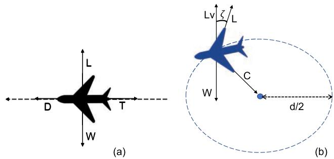  
Fig. 4. Forces acting upon the SHF and the SCF.

$$
P _ { \mathrm { S H F } } = T V / \eta _ { p } \eta _ { e }\tag{9}
$$

where $\eta _ { p }$ and $\eta _ { e }$ are the propeller and engine efficiencies, respectively. The drag is opposed by an equal and opposite thrust as follows:

$$
T = \frac { 1 } { 2 } \rho _ { h } V ^ { 2 } S C _ { D _ { 0 } } + \epsilon \frac { 2 \ W ^ { 2 } } { \rho _ { h } S V ^ { 2 } }\tag{10}
$$

where the first part is against the parasitic drag, while the second term opposes the induced drag [25]. Moreover, S is the total wing area, CD $C _ { D _ { 0 } }$ is the zero-lift drag coefficient, and the coefficient  is equal to $( \pi e A R _ { w } ) ^ { - 1 }$ , with Oswald’s efficiency factor e and wing aspect ratio $A R _ { w }$ . In addition, the air density $\rho _ { h }$ depends on the air pressure $p _ { h }$ and temperature $T _ { p }$ at an altitude H as

$$
\rho _ { h } = \frac { p _ { h } ( H ) } { R _ { \mathrm { s p } } T _ { p } ( H ) }\tag{11}
$$

where $R _ { \mathrm { s p } }$ is the specific gas constant given as $2 8 7 . 0 5 2 \mathrm { J } / \mathrm { \dot { k } g } \cdot \mathrm { K }$ and $T _ { p }$ is constant in Stratosphere I but increases by 1 K for every 1 km increase in the altitude for Stratosphere II, as given

$$
\begin{array} { r } { T _ { p } ( H ) = \left\{ \begin{array} { l l } { T _ { b } , } & { 1 1 \mathrm { ~ k m } \le \mathrm { H } \le 2 0 \mathrm { ~ k m } } \\ { T _ { b } + L _ { b } ( H - H _ { b 2 } ) } & { 2 0 \mathrm { ~ k m } \le \mathrm { H } \le 3 2 \mathrm { ~ k m } } \end{array} \right. . } \end{array}\tag{12}
$$

Expression (9) denotes the power for an SHF. However, we are interested in the SCF at the same altitude for station keeping over a certain area, as demonstrated in Fig. 4(b). This is primarily achieved by a steady flight with a fixed banking angle ζ when the vertical component of the lift force $L _ { v }$ is equal to W . The aircraft load factor is unity for the SHF, but it is given by $L / W = 1 / \cos ( \zeta )$ for the SCF. Thus, the propulsion power required $P _ { \mathrm { S C F } }$ to maintain an SCF at a bank angle ζ is defined as the product of the square of the load factor and the power required for the SHF [22], rendering

$$
P _ { \mathrm { S C F } } = \left( \frac { 1 } { \cos ( \zeta ) } \right) ^ { 2 } P _ { \mathrm { S H F } } .\tag{13}
$$

Furthermore, some additional power is required for the base station payload and avionics named as accessory power $P _ { \mathrm { a c c } } .$ Generally, this power is a constant estimation for a given aircraft with certain payload capabilities. Hence, the total power requirement for such flight can be computed from the sum of both accessory power and propulsion power, i.e.,

$$
P _ { \mathrm { r e q } } = P _ { \mathrm { a c c } } + P _ { \mathrm { p r o } } = P _ { \mathrm { a c c } } + P _ { \mathrm { S C F } } .\tag{14}
$$

In the presented scenario, the propulsion power required is equal to $P _ { \mathrm { S C F } }$

## C. Communication Payload

Ultrawide terrestrial coverage of the HAPS can be achieved by splitting the service area into multiple cells, as shown in Fig. 1. Each cell is served by a highly directional beam allowing frequency reuse in the neighboring cells for efficient spectrum allocation. We adopt a polygonal array structure with a downward facing bottom panel and $M - 1$ side panels facing outward. The design includes a beamformer and an array controller, which are responsible to create the desired beam and steer it in real time, as detailed in [15]. This enables the cell fixation relative to the station-keeping flight pattern for reliable and consistent coverage.

We assume a multicell network, with one center cell and $M - 1$ surrounding cells, to be served by a single HAPS. The network consists of uniformly distributed $K _ { m }$ number of users in the mth cell, where $m \in \{ 1 , 2 , \ldots , M \}$ . In each cell coverage, the channel gain is expected to vary with the distance from the center as well as on the azimuth angle. The strongest channel gain is available at the center of the cell along the boresight direction $\theta = 0$ . However, as the distance varies and/or the azimuth direction deviates from the boresight, the performance can be degraded due to the increased path loss, lower radiation pattern gain, and higher CCI from the neighboring cells. The striking difference in the channel gains of the users in each cell enables us to reap maximum benefits offered by NOMA. Consider the DL-NOMA scenario, where the mth cell is served by a directional beam with superposition coding as1

$$
x _ { m } = \sum _ { k = 1 } ^ { K _ { m } } \sqrt { P _ { m } \alpha _ { k } ^ { m } } s _ { k } ^ { m }\tag{15}
$$

where $P _ { m }$ is the power budget for the mth cell, whereas $\alpha _ { k } ^ { m }$ and $s _ { k } ^ { m }$ are the fraction of power allocated to and intended information signal for the kth user in the mth cell, respectively. It is important to highlight that $\begin{array} { r } { \sum _ { k = 1 } ^ { K _ { m } } \alpha _ { k } ^ { m } = 1 } \end{array}$ , ∀m, in order to limit the power division within given budget. The presented system undergoes two types of interference:

1) intracell interference (IACI) due to NOMA;

2) intercell interference (IECI) due to frequency reuse.

Therefore, using the conventional wireless communication model, the received signal at user l in the mth cell is given by

$$
y _ { l } ^ { m } = \underbrace { h _ { l m } ^ { m } \sqrt { P _ { m } \alpha _ { l } ^ { m } } s _ { l } ^ { m } } _ { \mathrm { D e s i r e d ~ s i g n a l } } + h _ { l m } ^ { m } \underbrace { \sum _ { \stackrel { k _ { m } } { k \neq l } } ^ { K _ { m } } \sqrt { P _ { m } \alpha _ { k } ^ { m } } s _ { k } ^ { m } } _ { \mathrm { I A C I } } +
$$

$$
+ \underbrace { \sum _ { \stackrel { j = 1 } { j \neq m } } ^ { J _ { m } } h _ { l m } ^ { j } \sum _ { k = 1 } ^ { K _ { j } } \sqrt { P _ { j } \alpha _ { k } ^ { j } } s _ { k } ^ { j } + w _ { l } ^ { m } } _ { \mathrm { I E C I } }\tag{16}
$$

where $h _ { l m } ^ { j }$ is the channel gain coefficient between the jth HAPS panel and the lth user in the mth cell and $w _ { l } ^ { m }$ is the receiver thermal noise modeled as a circular symmetric complex Gaussian random variable, i.e., $w _ { l } ^ { m } \sim \mathcal { C } \dot { \mathcal { N } } ( 0 , \sigma _ { l } ^ { 2 } )$ Moreover, $J _ { m }$ is the set of neighboring interfering cells around the mth cell, $\mathrm { e . g . , } J _ { 1 }$ is the set of all $M - 1$ cells surrounding center cell, whereas $J _ { \{ m \backslash 1 \} }$ is the set of three immediate neighbors around the mth edge cell.

Similar to uplink NOMA (UL-NOMA) networks, each user transmits its signal to the HAPS receiver panel. By assuming that downlink–uplink channels are reciprocal and that the HAPS dispatches power allocation coefficients to the users, the received signal at the HAPS for synchronous UL-NOMA can be expressed as

$$
z _ { j } = \sum _ { m = 1 } ^ { M } \sum _ { k = 1 } ^ { K _ { m } } { h _ { k m } ^ { j } \sqrt { P _ { m } \alpha _ { k } ^ { m } } s _ { k } ^ { m } } + v _ { j } ^ { m }\tag{17}
$$

where $z _ { j }$ is the received signal at the jth panel of the HAPS communication system, $P _ { m }$ is the power budget for all users in the mth cell, $\alpha _ { k } ^ { m }$ is the power allocation coefficient of the kth user in the mth cell assigned by the HAPS based on channel reciprocity, and $v _ { j } ^ { m }$ is the thermal noise at the jth panel of the HAPS modeled as $v _ { i } ^ { m } \sim \mathcal { C N } ( 0 , \sigma _ { i } ^ { 2 } )$ . At the HAPS, successive interference cancellation (SIC) iterations are carried out in order to decode the signals of users orderly according to power coefficients of users. In each iteration, the intended user signal experiences both the intercell and residual intracell interference.

## D. Energy Storage

The consistent flight operation of HAPS for long endurance requires the energy storage of the surplus power for the NTO. The electrical energy is stored and drawn from the rechargeable batteries depending on the net power $P _ { \mathrm { n e t } } .$ i.e.,

$$
P _ { \mathrm { n e t } } = P _ { \mathrm { a } } - P _ { \mathrm { r e q } } - P _ { \mathrm { T } }\tag{18}
$$

where $P _ { \mathrm { n e t } }$ is the power remainder from the available solar power $P _ { \mathrm { a } }$ after meeting all the aerodynamic $P _ { \mathrm { r e q } }$ and communication requirements $\begin{array} { r } { P _ { \mathrm { T } } = \sum _ { m } \dot { P _ { m } } } \end{array}$ . The battery energy moves from state $E _ { b } ^ { i - 1 }$ to state $E _ { b } ^ { i }$ either by charging or by discharging as [12]

$$
E _ { b } ^ { i } = E _ { b } ^ { i - 1 } + \eta _ { b } P _ { \mathrm { n e t } } ^ { i } \Delta t\tag{19}
$$

where battery efficiency $\eta _ { b }$ is either charging $\eta _ { c }$ or discharging $\eta _ { d }$ efficiency and is given by

$$
\eta _ { b } = \left\{ \begin{array} { l l } { \eta _ { c } , } & { P _ { \mathrm { n e t } } \geq \mu } \\ { \eta _ { d } , } & { P _ { \mathrm { n e t } } \leq \mu } \end{array} \right.\tag{20}
$$

with $\mu$ being the minimum power required to charge the batteries and $\Delta t$ is the time separation between two battery states when the net power is almost constant.

To summarize, energy budgeting dictates the ability of a certain HAPS to harvest, store, and retrieve the abundant solar energy as electrical energy. This electrical energy is then consumed by the electric motors and propellers for propulsion, avionics, payload, and communication equipment. The aim of this article is to limit the power expenses within power budget for a self-sustaining operation. The next section is dedicated to the communication payload and describes the suitable propagation model for accurate performance analysis.

## III. PROPAGATION MODEL AND LINK BUDGET

The radio signal propagation from the HAPS to the UE undergoes free-space path loss and multipath fading due to the significant distance between them and obstacles around the UE, respectively.2 Therefore, the propagation loss of the adopted system is modeled as a combination of both smalland large-scale fading. Hence, the channel coefficient $h _ { l m } ^ { j }$ can be expressed as follows:

$$
h _ { l m } ^ { j } = \frac { g _ { l m } ^ { j } \sqrt { G _ { m } ^ { j } } } { \sqrt { L ( d _ { l } ^ { m } ) } }\tag{21}
$$

where $g _ { l m } ^ { j }$ is the small-scale fading coefficient between the $j \mathrm { t h }$ transmitting panel and the lth user in the mth cell, $G _ { m } ^ { j }$ is the array gain for the link between the jth panel and the mth cell, and $L ( d _ { l } ^ { m } )$ is the path loss as a function of $d _ { l } ^ { m }$ , i.e., the distance between the HAPS and the lth user in the mth cell. The computation of these parameters is highlighted in the subsequent sections.

## A. Small-Scale Multipath Fading

The received signal comprises both the LOS and nonline-of-sight (NLOS) components pertaining to the HAPS boresight position and independent diffuse multipath reflections from the obstacles. The LOS component is generally deterministic, whereas the envelope of NLOS component is modeled as a Rayleigh random variable. Hence, the aggregate small-scale multipath fading coefficient $g _ { l m } ^ { j }$ is modeled as a Rician distributed random variable [27], [28], [29]

$$
f ( x \mid \nu , \sigma _ { \mathrm { f } } ) = \frac { x } { \sigma _ { \mathrm { f } } ^ { 2 } } \exp \left( \frac { - \left( x ^ { 2 } + \nu ^ { 2 } \right) } { 2 \sigma _ { \mathrm { f } } ^ { 2 } } \right) I _ { 0 } \left( \frac { x \nu } { \sigma _ { \mathrm { f } } ^ { 2 } } \right)\tag{22}
$$

where $I _ { 0 }$ denotes the zeroth-order modified Bessel function of the first kind whose shape parameter is defined by the ratio between the average power of LOS component and the average power associated with NLOS multipath components, $\bar { \mathrm { i } } . \mathrm { e } . , \nu ^ { 2 } / 2 \sigma _ { \mathrm { f } } ^ { 2 }$

## B. Directivity Gain

The communication panels are equipped with antenna arrays, which are responsible for directional beamforming. The sectorial antenna pattern is favorable for the minimal

CCI and yields the following array gain [30]:

$$
G _ { m } ^ { j } \left( \theta _ { l m } ^ { j } \right) = \left\{ \begin{array} { l l } { M _ { b } , } & { | \theta _ { l m } ^ { j } | \leq \theta ^ { b } } \\ { m _ { b } , } & { \mathrm { o t h e r w i s e } } \end{array} \right.\tag{23}
$$

where $\theta _ { l m } ^ { j }$ is the angle of departure and $\theta ^ { b }$ is the half-power beamwidth of the main lobe. Moreover, the directivity gains of main lobe and back lobe are denoted by $M _ { b }$ and $m _ { b } .$ respectively. Evidently, the relation $m _ { b } < < M _ { b }$ holds due to the decreasing antenna gain while moving away from the boresight position in a horizontal direction. Hence, the sectorial antenna pattern reaps the maximal directional gain rendering the minimal IECI to the users in neighboring cells.

## C. Link Budget

The large-scale propagation is characterized as a freespace path loss model with the direct distance $d _ { l } ^ { m }$ between the HAPS and $\mathrm { U E } _ { l } ^ { m }$ as $d _ { l } ^ { m } = H /$ sin $\psi _ { l } ^ { m }$ , where $\psi _ { l } ^ { m }$ is the elevation angle of the HAPS from $\mathrm { { U E } } _ { l } ^ { m }$ . Evidently, the users in the center cell enjoy a larger elevation angle between $\psi _ { c } \leq \psi _ { l } ^ { 1 } \leq \pi / 2$ , whereas the edge cell users are at relatively smaller elevation angles $\psi _ { e } \leq \psi _ { l } ^ { \{ m \backslash 1 \} } \leq \psi _ { c }$ , with $0 \leq \psi _ { e } \leq \psi _ { c } \leq \pi / 2$ , where $\psi _ { c }$ and $\psi _ { e }$ depend upon the radius of center cell and entire coverage area, respectively. We employ the space communication model for the aerial HAPS to compute the received signal path loss $L ( d _ { l } ^ { m } )$ ) as [31]

$$
L ( H , \psi _ { l } ^ { m } ) = \frac { 1 6 \pi ^ { 2 } H ^ { 2 } } { \lambda ^ { 2 } \sin ^ { 2 } ( \psi _ { l } ^ { m } ) } ,\tag{24}
$$

where $\lambda$ is the wavelength corresponding to the carrier frequency. The free-space path loss is computed as the ratio between transmit power and received power. The assumption of isotropic receiver antenna, in the DL-NOMA communication, renders an effective receiver area $\lambda ^ { 2 } / 4 \pi$ , and the received signal intensity is given by the inverse-square law.

## D. Rate Analysis

Consider the DL-NOMA where $K _ { m }$ users are uniformly distributed and ordered as $u _ { 1 } ^ { m } , u _ { 2 } ^ { m } , \ldots , u _ { K _ { n } } ^ { m }$ depending on their decreasing IECI and increasing channel strengths. Given this ordered arrangement and SIC at user $u _ { l } ^ { m }$ , it is capable ofdecoding all users from $u _ { 1 } ^ { m } \tan u _ { l - 1 } ^ { m }$ and subtracting these from the received signal. Thus, it can decode its own signal from the resultant by considering the interference from $u _ { l + 1 } ^ { m }$ to $u _ { K _ { m } } ^ { m }$ as noise. Moreover, the IECI in a given cell is also treated as noise at all users. Therefore, the signal-to-interference noise ratio (SINR) $\gamma$ at user $u _ { l } ^ { m }$ is given by

$$
\gamma _ { l } ^ { m } = \frac { | h _ { l m } ^ { m } | ^ { 2 } P _ { m } \alpha _ { l } ^ { m } } { | h _ { l m } ^ { m } | ^ { 2 } \sum _ { k = l + 1 } ^ { K _ { m } } P _ { m } \alpha _ { k } ^ { m } + \mathcal { T } _ { l } ^ { m } + \sigma ^ { 2 } }\tag{25}
$$

where the noise power is given as $\sigma ^ { 2 } ( \mathrm { d B m } ) = - 1 7 4 +$ 10 log(B) + NF, with NF denoting the noise figure [32], and the IECI power is given by

$$
\mathcal { T } _ { l } ^ { m } = \sum _ { j = 1 \atop j \neq m } ^ { J _ { m } } \sum _ { k = 1 } ^ { K _ { j } } \vert { h } _ { l m } ^ { j } \vert ^ { 2 } P _ { j } \alpha _ { k } ^ { j } = \sum _ { j = 1 \atop j \neq m } ^ { J _ { m } } \vert { h } _ { l m } ^ { j } \vert ^ { 2 } P _ { j } .\tag{26}
$$

8333

Assuming perfect decoding with perfect receiver channel state information and user ordering, the achievable rate of user $u _ { l } ^ { m }$ is

$$
R _ { l } ^ { m } = { \cal B } \log _ { 2 } \left[ 1 + \gamma _ { l } ^ { m } \right] .\tag{27}
$$

The sum rate R of all users in all M cells can be written as $\begin{array} { r } { R = \sum _ { m = 1 } ^ { M } R _ { m } , } \end{array}$ where the sum rate of users in the mth cell is given by $\begin{array} { r } { R _ { m } = \sum _ { l = 1 } ^ { K _ { m } } R _ { l } ^ { m } } \end{array}$ yielding

$$
R = \sum _ { m = 1 } ^ { M } R _ { m } = B \sum _ { m = 1 } ^ { M } \sum _ { l = 1 } ^ { K _ { m } } \log _ { 2 } \left[ 1 + \gamma _ { l } ^ { m } \right] .\tag{28}
$$

$\gamma _ { l } ^ { m }$ in (30) can be expressed using (21) as

$$
\gamma _ { l } ^ { m } = \frac { | g _ { l m } ^ { m } | ^ { 2 } M _ { b } \alpha _ { l } ^ { m } } { | g _ { l m } ^ { m } | ^ { 2 } M _ { b } \sum _ { k = l + 1 } ^ { K _ { m } } \alpha _ { k } ^ { m } + m _ { b } \sum _ { j = 1 } ^ { J _ { m } } \frac { P _ { j } } { P _ { m } } | g _ { l m } ^ { j } | ^ { 2 } + \frac { L ( H , \psi _ { l } ^ { m } ) } { \varrho _ { m } } }\tag{29}
$$

where $\varrho _ { m }$ is the transmit signal-to-noise ratio for the mth cell, $\mathrm { i . e . , } \frac { P _ { m } } { \sigma ^ { 2 } }$ . User experiences high IACI and low IECI due to high directivity gain $M _ { b }$ and low antenna gain mb for the users outside the main lobe, respectively.

For the similar system and user ordering in the UL-NOMA, the SINR for the lth user SIC iteration at the $j \mathrm { t h }$ HAPS panel can be written as

$$
\gamma _ { l } ^ { j } = \frac { | h _ { l m } ^ { j } | ^ { 2 } P _ { m } \alpha _ { l } ^ { m } } { \sum _ { k = l + 1 } ^ { K _ { m } } | h _ { k m } ^ { j } | ^ { 2 } P _ { m } \alpha _ { k } ^ { m } + \sum _ { n = m } ^ { M } \sum _ { k = 1 } ^ { K _ { n } } | h _ { k n } ^ { j } | ^ { 2 } P _ { n } \alpha _ { k } ^ { n } + \sigma ^ { 2 } } .\tag{30}
$$

Moreover, the data rate while receiving the lth user signal can be written as $R _ { l } ^ { m } = \mathrm { B W } \log _ { 2 } ( 1 + \gamma _ { 1 } ^ { \mathrm { j } } )$ , whereas the sum rate of UL-NOMA can be written as

$$
R = \sum _ { m = 1 } ^ { M } \sum _ { k = 1 } ^ { K _ { m } } R _ { l } ^ { m } .\tag{31}
$$

The users can communicate with the HAPS using UL-NOMA as described; however, the focus of this article will be on DL-NOMA. We can now formulate the optimization problem to design optimal power allocation in order to maximize the sum rate of all users within the allocated power budget.

## IV. PROBLEM FORMULATION

This article emphasizes the joint optimization of flight and communication parameters given inevitable power limitations. We aim to design the optimal altitude and unmanned aerial vehicle (UAV) airspeed (in a circular trajectory of fixed radius) for the station-keeping flight along with the optimal power allocation for all the DL-NOMA users in its coverage area. We formulate two different design problems for day and night operation based on their different characteristics.

1) The availability of abundant solar power during the day allows optimal flight and maximum transmission power while storing an essential amount of solar energy for the NTO.

2) The limited stored energy should support the dwell flight for entire night while satisfying a minimum data-rate constraint.

## A. Daytime Operation

The objective of DTO is to maximize the sum rate of all users after storing the adequate energy for nighttime. We divide the daylight period into n equal time intervals (each with almost constant solar flux) and then optimize the power allocation $\alpha [ n ] = \{ \alpha _ { 1 } , \alpha _ { 2 } , \dots , \alpha _ { m } \}$ with $\alpha _ { m } =$ $\{ \alpha _ { 1 } ^ { m } , \overline { { { \alpha } } } _ { 2 } ^ { m } , \dots , \alpha _ { K _ { m } } ^ { m } \}$ , altitude $H [ n ]$ , and airspeed $V [ n ]$ for each interval. The QoS rate constraint (32b) and the sum power constraint (32c) ensure the minimum achievable rate $\Omega _ { m }$ for each user in the mth cell and the transmission within power budget, respectively. Moreover, the boundary constraints on power, altitude, and airspeed are given by (32d), (32h), and (32i), respectively. It is important to highlight that $H _ { \operatorname* { m i n } } , \ H _ { \operatorname* { m a x } }$ , and $V _ { \mathrm { m a x } }$ are constants, but the stalling speed $V _ { \mathrm { s } }$ is a function of aircraft dimensions and altitude as $V _ { \mathrm { s } } = \sqrt { 2 \mathrm { \ W } / \rho _ { h } ( H ) S C _ { \mathrm { L m i n } } }$ . It is the minimum speed $V _ { \mathrm { m i n } }$ at H to maintain a steady-level flight. In addition, the constraint $( 3 2 \mathrm { g } )$ ensures the availability of requisite power stored $P _ { \mathrm { s t } }$ in batteries for the NTO. Finally, (32f) restricts the communication power budget for all cells after accounting the feed line losses ϒ encountered while drawing effective radiated power from the actual transmission power

$$
\mathbf { P 1 } : \operatorname* { m a x i m i z e } _ { \alpha [ n ] , H [ n ] , V [ n ] } \quad \sum _ { m = 1 } ^ { M } \sum _ { l = 1 } ^ { K _ { m } } R _ { l } ^ { m } \left( \alpha [ n ] , H [ n ] \right)\tag{32a}
$$

$$
\mathrm { s u b j e c t ~ t o ~ } R _ { l } ^ { m } \geq \Omega _ { m } \forall l , m\tag{32b}
$$

$$
\sum _ { k = 1 } ^ { K _ { m } } \alpha _ { k } ^ { m } [ n ] = 1 \forall m\tag{32c}
$$

$$
0 \leq \alpha _ { k } ^ { m } [ n ] \leq 1 \forall k , m\tag{32d}
$$

$$
\alpha _ { 1 } ^ { m } [ n ] \geq \alpha _ { 2 } ^ { m } [ n ] \cdot \cdot \cdot \geq \alpha _ { K _ { m } } ^ { m } [ n ]\tag{∀m}
$$

(32e)

$$
\sum _ { m = 1 } ^ { M } P _ { m } [ n ] \leq \Upsilon P _ { \mathrm { T } }\tag{32f}
$$

$$
P _ { \mathrm { n e t } } ( H [ n ] , V [ n ] ) \geq P _ { \mathrm { s t } }
$$

$$
H _ { \operatorname* { m i n } } \leq H [ n ] \leq H _ { \operatorname* { m a x } }\tag{32g}
$$

$$
V _ { \mathrm { m i n } } \leq V [ n ] \leq V _ { \mathrm { m a x } } .\tag{32h}
$$

(32i)

Problem P1 is jointly nonconvex in the given optimization variables, as detailed in Appendix $\operatorname { A } ;$ therefore, we propose AO and solve the convex subproblems (33), (41), and (42) iteratively, as presented in Algorithm 1. We initialize resource allocation by selecting a time and date at instance n and choosing the QoS threshold $\Omega _ { m }$ . Feasible starting altitude and speed are used to compute the required propulsion power $P _ { \mathrm { p r o } } [ n ]$ , which is then subtracted from the available power at that instance $P _ { \mathrm { a } } [ n ]$ along with $P _ { \mathrm { s t } }$ to obtain the transmission power $P _ { \mathrm { T } } [ n ]$ . Then, subproblems P1(a)–P1(c) are solved iteratively using the results of previously solved problems. Next, we update $P _ { \mathrm { T } } [ n ]$ using the renewed $P _ { \mathrm { p r o } } [ n ]$ to find the sum rate R[n]. AO works in an iterative manner till it meets the stopping criteria to furnish the optimum values of α[n], H[n] and $V [ n ]$

For a given flight at altitude H with airspeed V at an instant n, the power allocation problem is given by (33). The transmit power budget is calculated from (18) after deducting $P _ { \mathrm { r e q } } [ n ]$ from the available solar power $P _ { a } [ n ]$ for a

Algorithm 1: Alternate Optimization: DTO.   
1: Initialize $\overline { { R ^ { ( i - 1 ) }  0 , i  1 } }$ , and $\epsilon  \infty$ Set   
tolerance δ   
2: Select a time instance n and QoS thresholds $\Omega _ { m }$   
3: Choose feasible starting points $H [ n ] ^ { ( i - 1 ) }$ and   
$V [ n ] ^ { ( i - 1 ) }$   
4: Compute $P _ { a }$ [n] using $j _ { d } ( n ) , \epsilon _ { s } ( n )$ , and $H [ n ] ^ { ( i - 1 ) }$   
5: Determine $\bar { P _ { \mathrm { p r o } } } [ n ] ^ { ( i - \mathbf { \bar { 1 } } ) }$ using $H [ n ] ^ { ( i - 1 ) }$ and   
$V [ n ] ^ { ( i - 1 ) }$   
6: Evaluate $P _ { \mathrm { T } } [ n ] ^ { ( i - 1 ) }$ by subtracting $P _ { \mathrm { p r o } } [ n ] ^ { ( i - 1 ) }$ in   
(18)   
7: while $\epsilon \geq \delta$ do   
8: Solve P1(a) using $H [ n ] ^ { ( i - 1 ) } , P _ { \mathrm { T } } [ n ] ^ { ( i - 1 ) }$ to get   
$\alpha [ n ] ^ { ( i ) }$   
9: Solve P1(b) using $\alpha [ n ] ^ { ( i ) }$ to obtain $H [ n ] ^ { ( i ) }$   
10: Solve P1(c) using $H [ n ] ^ { ( i ) }$ to obtain $V [ n ] ^ { ( i ) }$   
11: Calculate $P _ { \mathrm { p r o } } [ n ] ^ { ( i ) }$ using $H [ n ] ^ { ( i ) }$ and $\bar { V } [ n ] ^ { ( i ) }$   
12: Find $P _ { \mathrm { T } } [ n ] ^ { ( i ) }$ from $P _ { a } [ n ]$ deducting $P _ { \mathrm { p r o } } [ n ] ^ { ( i ) }$   
and $P _ { \mathrm { s t } }$   
13: Evaluate $R ^ { ( i ) }$ using $\alpha [ n ] ^ { ( i ) } , H [ n ] ^ { ( i ) }$ and $P _ { \mathrm { T } } [ n ] ^ { ( i ) }$   
14: Update  $ \| \boldsymbol { R } ^ { ( i ) } - \boldsymbol { R } ^ { ( i - 1 ) } \|$ and $i \gets i + 1$   
15: end while   
16: $R ^ { * } [ n ]  R [ n ] ^ { ( i ) } , \alpha ^ { * } [ n ]  \alpha [ n ] ^ { ( i ) } ,$   
$H ^ { * } [ n ] \gets H [ n ] ^ { ( i ) } ,$ , and $V ^ { * } [ n ]  V [ n ] ^ { ( i ) }$

fixed $P _ { \mathrm { s t } }$

$$
\begin{array} { r l } {  { \mathrm { ~ \mathbf { P 1 } ( \mathbf { a } ) : ~ \operatorname* { m a x i m i z e } ~ \sum _ { \alpha = 1 } ^ { M } \sum _ { l = 1 } ^ { K _ { m } } R _ { l } ^ { m } ( \alpha [ n ] , H [ n ] ) } } } \\ & { \quad \mathrm { s u b j e c t ~ t o ~ } ( 3 2 \mathbf { b } ) { - } ( 3 2 \mathbf { f } ) . } \end{array}\tag{33a}
$$

(33b)

Interestingly, the optimization problem P1(a) can be solved independently in $\alpha _ { 1 } , \alpha _ { 2 } , \ldots , \alpha _ { m }$ as it is a disjoint problem for all cells, given a fixed altitude and equal power budget, i.e., $P _ { m } [ n ] = \Upsilon P _ { T } / M$ . The elaborated closed-form solution to this problem is presented in [33] as follows.

THEOREM 1 In the considered power allocation problem, the sum rate and minimum power coefficients of users in the mth cell, respectively, are given by

$$
R _ { m } = K _ { m } \Omega _ { m } + B \log _ { 2 } \left[ 1 + \frac { 1 - \sum _ { k = 1 } ^ { K _ { m } } \hat { \alpha } _ { l } ^ { m } } { A _ { K _ { m } } ^ { m } } \right]\tag{34}
$$

$$
\hat { \alpha } _ { l } ^ { m } = \left( 2 ^ { \Omega _ { m } ^ { \prime } } - 1 \right) \left( \sum _ { k = l + 1 } ^ { K _ { m } } \hat { \alpha } _ { k } ^ { m } + A _ { l } ^ { m } \right)\tag{35}
$$

where

$$
A _ { l } ^ { m } = \frac { m _ { b } } { M _ { b } P _ { m } | g _ { l m } ^ { m } | ^ { 2 } } \sum _ { j = 1 } ^ { J _ { m } } P _ { j } | g _ { l m } ^ { j } | ^ { 2 } + \frac { L ( H , \psi _ { l } ^ { m } ) } { \varrho _ { m } M _ { b } | g _ { l m } ^ { m } | ^ { 2 } } .\tag{36}
$$

if the following condition holds:

$$
\left( 2 ^ { \Omega _ { m } ^ { \prime } } - 1 \right) \left( \sum _ { i = 1 } ^ { K _ { m } } 2 ^ { ( i - 1 ) \Omega _ { m } ^ { \prime } } A _ { i } ^ { m } \right) \leq 1 .\tag{37}
$$

The first term of $R _ { m }$ is the QoS thresholds of all users in the mth cell, whereas the second term is the additional rate of

$K _ { m } \thinspace \mathrm { u s e r } ^ { 3 }$ after allocating the remaining power $\textstyle 1 - \sum _ { k = 1 } ^ { K _ { m } } \hat { \alpha } _ { l } ^ { m }$ to it in order to maximize the sum rate. The normalized rate target $\Omega _ { m } ^ { \prime }$ is obtained as $\Omega _ { m } / B$

THEOREM 2 For $\begin{array} { r } { \sum _ { k = 1 } ^ { K _ { m } } \hat { \alpha } _ { l } ^ { m } \ge 1 } \end{array}$ , there exists a user u in $1 \leq$ $u \leq K _ { m }$ , which satisfies the following condition:

$$
\left\{ \begin{array} { l l } { \left( 2 ^ { \Omega _ { m } ^ { \prime } } - 1 \right) \left( \sum _ { i = u + 1 } ^ { K _ { m } } 2 ^ { i - 1 } A _ { i } ^ { m } \right) \leq 1 } \\ { \left( 2 ^ { \Omega _ { m } ^ { \prime } } - 1 \right) \left( \sum _ { i = u } ^ { K _ { m } } 2 ^ { i - 1 } A _ { i } ^ { m } \right) \geq 1 } \end{array} \right.\tag{38}
$$

Hence, the maximum achievable sum rate is given by

$$
R _ { m } = ( K _ { m } - u ) \Omega _ { m } ^ { \prime } + \log _ { 2 } \left[ 1 + \frac { \Delta \alpha } { 1 - \Delta \alpha + A _ { u } ^ { m } } \right]
$$

where

(39)

$$
\Delta \alpha = 1 - \left( 2 ^ { \Omega _ { m } ^ { \prime } } - 1 \right) \left( \sum _ { i = u + 1 } ^ { K _ { m } } 2 ^ { i - 1 } A _ { i } ^ { m } \right) .\tag{40}
$$

The first term of $R _ { m }$ is the QoS thresholds of users from $u + 1$ to $K _ { m } .$ , and the second term is the rate of user u with power α. It signifies that only $u + 1$ to $K _ { m }$ can attain QoS threshold with powers $\hat { \alpha } _ { u + 1 } ^ { m } , \hat { \alpha } _ { u + 2 } ^ { m } , \dots , \hat { \alpha } _ { K _ { m } } ^ { m }$ respectively, using (35). However, the users before (and including) the uth user cannot achieve their target rates. Therefore, the remaining power α is allocated to the uth user. The next optimization problem maximizes the sum rate of all the users with respect to altitude for a given power allocation α[n]

$$
\mathbf { P 1 } ( \mathbf { b } ) : { \mathrm { ~ m a x i m i z e ~ } } \sum _ { m = 1 } ^ { M } \sum _ { l = 1 } ^ { K _ { m } } R _ { l } ^ { m } \left( \alpha [ n ] , H [ n ] \right)\tag{41a}
$$

$$
{ \mathrm { s u b j e c t } } \mathrm { t o } ( 3 2 \mathrm { g } ) , ( 3 2 \mathrm { h } ) .\tag{41b}
$$

This problem is equivalent to minimizing $L ( H , \psi _ { l } ^ { m } )$ subject to (32g) and (32h). Evidently, $L ( H , \psi _ { l } ^ { m } )$ is strictly increasing in $H _ { ; }$ , and the solution is one word, i.e., $H ^ { * } [ n ] = H _ { \operatorname* { m i n } }$ while satisfying (32g)

$$
\mathbf { P 1 } ( \mathbf { c } ) : \operatorname* { m a x i m i z e } _ { V [ n ] } \ \sum _ { m = 1 } ^ { M } \sum _ { l = 1 } ^ { K _ { m } } R _ { l } ^ { m } \left( \alpha [ n ] , H [ n ] \right)\tag{42a}
$$

$$
{ \mathrm { s u b j e c t } } \mathrm { t o } ( 3 2 \mathrm { g } ) , ( 3 2 \mathrm { i } ) .\tag{42b}
$$

This problem optimizes airspeed $V [ n ]$ at a given altitude H[n]. Although the sum rate is not directly affected by the airspeed, it is a function of the available transmission power, which is dictated by the propulsion power. Therefore, in order to provide the large transmission power, it is imperative to choose V[n], which decreases the propulsion power. The solution to such a problem is detailed in Section IV-B.

## B. Nighttime Operation

The nighttime function of the HAPS is largely limited by the stored power in rechargeable batteries. Therefore, we propose a flight that minimizes the power consumption during nighttime and transmission with a fixed power budget. We formulate P2 to minimize the propulsion power requirement with respect to H and V

$$
\mathbf { P 2 } : \operatorname* { m i n i m i z e } _ { H [ n ] , V [ n ] } \quad P _ { \mathrm { p r o } } ( V [ n ] , H [ n ] )\tag{43a}
$$

$$
{ \mathrm { s u b j e c t } } \mathrm { t o } ( 3 2 \mathrm { h } ) , ( 3 2 \mathrm { i } ) .\tag{43b}
$$

Assuming a fixed banking angle for the SCF, problem P2 is jointly nonconvex in optimization variables H and $V .$ Nonetheless, it is convex in both H and $V . ^ { 4 }$ Hence, we breakdown P2 to P2(a) and P2(b) in order to minimize the propulsion power requirement with respect to $V [ n ]$ and H[n], respectively:

$$
\mathbf { P 2 } ( \mathbf { a } ) : \operatorname* { m i n i m i z e } _ { V [ n ] } P _ { \mathrm { p r o } } ( V [ n ] , H [ n ] ) \quad \mathrm { s . t . } \ ( 3 2 \mathrm { i } )\tag{44a}
$$

$$
{ \bf P 2 ( b ) } : \operatorname* { m i n i m i z e } _ { H [ n ] } P _ { \mathrm { p r o } } ( V [ n ] , H [ n ] ) \mathrm { s . t . } ( 3 2 \mathrm { h } ) .\tag{44b}
$$

The propulsion power in (13) is convex and strictly increasing in V. Therefore, we can find the closed-form optimal solution of P2(a) as

$$
V ^ { * } [ n ] = \left\{ { V _ { m } [ n ] } , \quad V _ { s } [ n ] \leq V _ { m } [ n ] \leq V _ { \operatorname* { m a x } } \quad \right.\tag{45}
$$

where $V _ { m } [ n ]$ is derived using the second-order sufficient optimality condition

$$
V _ { m } [ n ] = \sqrt { \frac { 2 \mathrm { \bf ~ W } } { \rho _ { h } [ n ] S } \sqrt { \frac { \epsilon } { 3 C _ { D _ { 0 } } } } } .\tag{46}
$$

Evidently, $V _ { m } [ n ]$ is the global optimal solution of P2(a) if it is in the desired range (32i); otherwise, $V _ { s } [ n ]$ is the local minimum below which steady level flight is not possible. Similarly, $P _ { \mathrm { p r o } }$ is a convex and strictly decreasing function of altitude $\dot { H }$ , enabling us to compute the optimal solution of P2(b) as

$$
H ^ { * } [ n ] = \left\{ H _ { m } [ n ] , \quad H _ { \mathrm { m i n } } \leq H _ { m } [ n ] \leq H _ { \mathrm { m a x } } \right.\tag{47}
$$

where $H _ { m } [ n ]$ is the stationary point and obtained using the second-order sufficient condition

$$
H _ { m } [ n ] = \left\{ \begin{array} { l l } { H _ { b 1 } - \frac { R T _ { b } } { g M } \ln \left( \frac { \varpi [ n ] T _ { b } } { p _ { b 1 } } \right) , } & { \mathrm { S t r a t o s p h e r e - I } } \\ { H _ { b 2 } - \frac { T _ { b } } { L _ { b } } + \frac { 1 } { L _ { b } } \left( \frac { p _ { b 2 } T _ { b } ^ { \frac { g M } { R _ { b } } } } { \varpi [ n ] } \right) ^ { \vartheta } , } & { \mathrm { S t r a t o s p h e r e - I I } } \end{array} \right.\tag{48}
$$

where  $\begin{array} { r } { \dot { \mathbf { \rho } } [ n ] = \frac { 2 W R _ { \mathrm { s p } } } { S V [ n ] ^ { 2 } } \sqrt { \frac { \epsilon } { C _ { D _ { 0 } } } } \mathrm { a n d } \vartheta = \frac { R L _ { b } } { g M + R L _ { b } } } \end{array}$ . We choose either the feasible case or Stratosphere-II if both are feasible. Again, $H _ { m } [ n ]$ is the global solution to P2(b) if it satisfies (32h); otherwise, $H _ { \mathrm { m a x } }$ is the local optimal due to the strictly decreasing nature of $P _ { \mathrm { p r o } }$ . The closed-form optimal solutions of P2(a) and P2(b) are iteratively updated using the AO technique to solve the original problem P2, as detailed in Algorithm 2. It begins by setting tolerance δ and a feasible H at the chosen instance n. Then, we solve P2(a) for a given H[n] to obtain the optimal $V [ n ]$ , which is then used to solve P2(b) to update H[n]. This process repeats iteratively until the convergence criterion is met.

Algorithm 2: Alternate Optimization: NTO.   
1: Initialize $\overline { { P _ { \mathrm { p r o } } ^ { ( i - 1 ) }  0 , i  1 } }$ , and $\epsilon  \infty$   
2: Set tolerance δ and Select a time instance n   
3: Choose feasible starting point $H [ n ] ^ { ( i - 1 ) }$   
4: while $\epsilon \geq \delta$ do   
5: Evaluate $V [ n ] ^ { ( i ) }$ using $H [ n ] ^ { ( i - 1 ) }$ in (45)   
6: Compute $H [ n ] ^ { ( i ) }$ using $\bar { V [ n ] } ^ { ( i ) }$ in (47)   
7: Calculate $P _ { \mathrm { p r o } } ^ { ( i ) }$ using $\bar { H } [ n ] ^ { ( i ) }$ and $V [ n ] ^ { ( i ) }$   
8: Update $\epsilon \doteq \lVert P _ { \mathrm { p r o } } ^ { ( i ) } - P _ { \mathrm { p r o } } ^ { ( i - 1 ) } \rVert$ and $i \gets i + 1$   
9: end while   
10: $P _ { \mathrm { p r o } } ^ { * } [ n ]  P _ { \mathrm { p r o } } [ n ] ^ { ( i ) } , H ^ { * } [ n ]  H [ n ] ^ { ( i ) } ,$   
$V ^ { * } [ n ]  V [ n ] ^ { ( i ) }$

The minimized $P _ { \mathrm { r e q } }$ is deducted from the stored energy yielding a fixed transmission power $P _ { \mathrm { T } }$ for the nighttime communication. Given a requisite $P _ { \mathrm { T } } .$ , we can again use the optimal power allocation strategy to maximize the sum rate within the power budget, as detailed in the solution of P1(a). Table II illustrates the connections between the DTO and the NTO. Both of the optimization problems are coupled with each other as the DTO dictates the power budget for the NTO by storing the excess solar power, whereas the HAPS utilizes this stored power for the NTO. Importantly, they have a converging aim of self-sustainable flight while ensuring QoS communications for DL-NOMA users.

## V. NUMERICAL RESULTS

The numerical results are evaluated for each hour of SS and WS of the year 2023 at a location indicated by $\xi$ and $\chi$ in Table III. Using this information, parameters $j _ { d }$ and $\epsilon _ { s }$ are computed using the Python’s module Pysolar [34].5 The air pressure and air density at an altitude h in (3) and (11), respectively, are approximated with second-degree polynomials using curve fitting for the desired altitude range as ${ \bar { p } } _ { h } ( h ) = 6 0 h ^ { 2 } - 3 2 7 6 . 7 h + 4 7 0 2 2 . 8 \mathrm { ( P a ) }$ and $\bar { \rho } _ { h } =$ (0.95162h2 − 52.29356h $+ 7 5 3 . 3 9 9 2 7 ) \mathrm { x } 1 0 ^ { - 3 } ( \mathrm { k g } / \mathrm { m } ^ { 3 } )$

These approximated $\bar { p } _ { h }$ and normalized $\bar { \rho } _ { h }$ are plotted against the actual $p _ { h }$ and normalized $\rho _ { h }$ for the desired altitude range, as shown in Fig. 5. The fitted curves allow us to use the continuous functions in-place of the piecewise functions in the optimization process. This figure also highlights the atmospheric characteristics of decreasing atmospheric pressure and air density while increasing temperatures with the increasing flight altitudes. These trends are helpful in deciding the optimal station-keeping flight parameters such as altitude and cruise speed with the minimal power consumption.

We assume a station-keeping flight radius in range 2.5 km $\le r \le 4$ km, which guarantees 99.00–99.95% availability over a certain coverage area. Moreover, we presume compound multijunction gallium arsenide (GaAS) solar cells mounted with an efficiency of 39.1% under 1-sun illumination [35]. We consider one center cell and six edge cells [15] with uniformly distributed users at elevation angles defined by the boundaries $\psi _ { e } = \pi / 1 5$ and $\psi _ { c } = \pi / 6$ in the 100-km coverage radius. These choices are based on the required coverage area as well as the channel characteristics, i.e., the LoS link is not available in the region beyond $\psi _ { e } = \pi / 1 5$ resulting in a Rayleigh channel instead of the Rician channel. Moreover, we assume the center cell beam with $\theta ^ { b } = \pi / 2$ and a highly directional beam with $\theta ^ { b } = \pi / 1 5$ for the surrounding edge cells. The 2.1-GHz carrier frequency is preferred for seemless merger with the existing terrestrial network [15].6 The adopted values of numerous simulation parameters are presented in Table III unless specified otherwise.

TABLE III Adopted System Parameters  
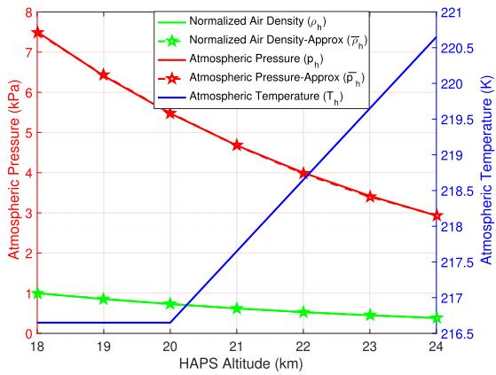  
Fig. 5. Atmospheric pressure and temperature with varying altitude in stratosphere.

TABLE II Connection Between DTO and NTO
<table><tr><td>DTO Abundant Solar Energy</td><td>NTO Limited Solar Energy</td></tr><tr><td>High power budget Sum Rate Maximization Optimize α[n],V[n] and  $H [ n ]$  Constrained by user ordering, power budget and boundary limits Jointly Non-Convex P1 Convex Subproblems P1(a), P1(b) Joint Opt using AO: Algorithm 1 Stores the excess solar power More daylight hours in Summers</td><td>Restricted Power Budget Propulsion Power Minimization Optimize  $V [ n ]$  and H[n] Constrained by boundary limits only Jointly Non-Convex P2 Convex Subproblems P2(a), P2(b) Joint Opt using AO: Algorithm 2 Utilizes the stored power Few night hours in Summers</td></tr><tr><td colspan="2">Few daylight hours in Winters More night hours in Winters Coupled with the aim of self-sustainable flight while ensuring QoS communications to DL NOMA Users</td></tr></table>

The maximum elevation angle on each day of the year is evaluated for four different locations with increasing latitude from the equator, as shown in Fig. 6(a). The distant places from the equator depict lower elevation angles as compared to the closed ones. The unique trend followed by $\epsilon _ { \mathrm { s m } }$ in Malaysia and King Abdullah University of Science and Technology (KAUST) can be explained by knowing the maximum achievable elevation angle, i.e., 90◦. Similarly, Fig. 6(b) highlights the daylight duration on each day of the year. The maximum and minimum daylight duration of around 20 and 4 h are observed in Alaska, respectively. This emphasizes the significance of location parameters and daylight hours while designing the HAPS system. A self-sustaining HAPS should be able to survive with only 4 h of daylight if it has to serve in Alaska. On the other hand, the regions around equator enjoy a consistent daylight duration throughout the year. Eventually, the total solar energy per unit area is illustrated in Fig. 6(c); it is dependent on both $\epsilon _ { \mathrm { s m } }$ and τ . Clearly, the maximum solar energy is available for the regions close to equator; however, the solar energy varies dramatically for the farthest regions. A successful HAPS design should be able to perform its routine tasks with only 1 kWh/m2 during the winters in Northern regions.

<table><tr><td rowspan=1 colspan=1> $\overline { { \xi } }$ </td><td rowspan=1 colspan=1> $\overline { { { 2 ^ { 0 } 1 4 ^ { \prime } 2 . 0 4 " \mathrm { E } } } }$ </td><td rowspan=1 colspan=1> $\overline { { { M , r } } }$ </td><td rowspan=1 colspan=1>7,3km</td></tr><tr><td rowspan=1 colspan=1> $\chi$ </td><td rowspan=1 colspan=1> $\overline { { 5 3 ^ { 0 } \ 2 8 ^ { \circ } \ 0 . 4 8 " N } }$ </td><td rowspan=1 colspan=1> $\overline { { K _ { m } } }$ </td><td rowspan=1 colspan=1>30-3000</td></tr><tr><td rowspan=1 colspan=1> $\overline { { \mathrm { S S } \colon \mathcal { j } _ { d } } }$ </td><td rowspan=1 colspan=1>2460117</td><td rowspan=1 colspan=1> $\overline { { E _ { \mathrm { a c c } } } }$ </td><td rowspan=1 colspan=1>2.3kWh</td></tr><tr><td rowspan=1 colspan=1> ${ \mathrm { W S } } { \mathrm { : ~ } } j _ { d }$ </td><td rowspan=1 colspan=1>2460300</td><td rowspan=1 colspan=1> $S$ </td><td rowspan=1 colspan=1>143m2</td></tr><tr><td rowspan=1 colspan=1> ${ \mathrm { S S } } \colon \alpha _ { \mathrm { e x t } }$ </td><td rowspan=1 colspan=1>0.465</td><td rowspan=1 colspan=1> $\overline { W }$ </td><td rowspan=1 colspan=1>165kg</td></tr><tr><td rowspan=1 colspan=1> $\mathrm { W S } \colon \alpha _ { \mathrm { e x t } }$ </td><td rowspan=1 colspan=1>0.29</td><td rowspan=1 colspan=1> $\underline { { C } } _ { D _ { 0 } }$ </td><td rowspan=1 colspan=1>0.015</td></tr><tr><td rowspan=1 colspan=1> $\overline { { b , A R _ { w } } }$ </td><td rowspan=1 colspan=1>35m, 30</td><td rowspan=1 colspan=1> $C _ { \mathrm { L m a x } }$ </td><td rowspan=1 colspan=1>1.2</td></tr><tr><td rowspan=1 colspan=1> $\overline { { B } }$ </td><td rowspan=1 colspan=1>20MHz</td><td rowspan=1 colspan=1>e</td><td rowspan=1 colspan=1>0.6385</td></tr><tr><td rowspan=1 colspan=1> $\overline { { T _ { n } } }$ </td><td rowspan=1 colspan=1>870</td><td rowspan=1 colspan=1> $\overline { { \delta , \mathrm { N F } } }$ </td><td rowspan=1 colspan=1> $\overline { { 1 e \mathrm { ~ - ~ } 4 , 5 \mathrm { d B } } }$ </td></tr><tr><td rowspan=1 colspan=1> $k _ { B }$ </td><td rowspan=1 colspan=1>1.3800e - 23</td><td rowspan=1 colspan=1> $\overline { { M _ { b } } }$ </td><td rowspan=1 colspan=1>18dBi [32]</td></tr><tr><td rowspan=1 colspan=1> $\Upsilon$ </td><td rowspan=1 colspan=1>10%</td><td rowspan=1 colspan=1> $m _ { b }$ </td><td rowspan=1 colspan=1>-2dBi [32]</td></tr><tr><td rowspan=1 colspan=1> $f _ { c }$ </td><td rowspan=1 colspan=1>2.1GHz</td><td rowspan=1 colspan=1> $\overline { { \sigma _ { f } ^ { 2 } , \Upsilon } }$ </td><td rowspan=1 colspan=1>1,0.1</td></tr><tr><td rowspan=1 colspan=1> $\underline { { \eta _ { p } , \eta _ { e } } }$ </td><td rowspan=1 colspan=1> $\overline { { 0 . 8 5 , 0 . 9 0 } }$ </td><td rowspan=1 colspan=1> $\overline { { G _ { r } } }$ </td><td rowspan=1 colspan=1>1</td></tr><tr><td rowspan=1 colspan=1> $\eta _ { c } , \eta _ { d }$ </td><td rowspan=1 colspan=1>0.93,0.97</td><td rowspan=1 colspan=1> $\eta _ { s }$ </td><td rowspan=1 colspan=1>0.29</td></tr></table>

Next, we evaluate our proposed algorithm for the optimal flight speed and altitude to minimize propulsion power during the night for the case study of seven different candidate HAPSs. Various companies, such as Boeing, Airbus, NASA, and BAE systems, have designed and tested their prototypes for aerial communication from stratosphere. We have opted Zephyr-6, Zephyr-7, Zephyr-S, Zephyr-T, PHASA-35, Odysseus, and Helios aircraft models with wingspan [18.28; 22.5; 25; 33; 35; 74; 75.3] m, total weight (platform and payload mass) [32; 58; 75; 160; 165; 700; 720] kg, wing area [38.9364; 56.25; 76; 133; 143; 175; $1 8 3 . 6 \mathrm { ] m } ^ { 2 }$ , and maximum achievable altitude [18.3; 21.6; 23.2; 24; 21.336; 25.5; 29.5] km, respectively. Pertaining to the lack of information regarding the true airspeed, we assume that $V _ { \mathrm { m i n } } = 1 2 ~ \mathrm { m / s }$ and $V _ { \mathrm { m a x } } = 4 0 ~ \mathrm { m / s }$ whereas $V _ { s }$ varies as per the dimension of each aircraft. Fig. 7(a) illustrates the optimal speed and altitude in three different scenarios, i.e., speed optimization only at a given altitude $( H _ { o } )$ , altitude optimization only at a given airspeed $( V _ { o } )$ , and our proposed algorithm for the joint optimization of HAPS speed and altitude. Interestingly, lighter aircraft (Zephyr) would fly with higher airspeed, whereas heavier aircraft (Helios) would fly with lower airspeed under a speed optimization scenario. However, the optimum result ofjoint optimization is lowest possible airspeed to maintain an SCF in 4-km diameter to reduce propulsion power. On the other hand, the optimum flight altitudes of each aircraft are dependent on their maximum attainable altitude during the NTO, whereas they cruise at lowest possible altitude i.e., 18 km during the DTO to minimize large-scale fading and maximize the sum rate. On the other hand, Fig. 7(b) presents the propulsion power requirement of all aircrafts in individual optimization, joint optimization, and the worst case scenario of unoptimized parameters. Evidently, the flight requires minimum propulsion power for all aircrafts with the joint optimization approach. However, in terms of one parameter optimization, speed optimization is superior to altitude optimization as it renders the lower propulsion power, as shown in Fig. 7(b). The joint optimization render a percentage reduction of88.6759%, 84.8433%, 84.8169%, 79.8841%, 81.6073%, 57.7812%, and 58.5283% in propulsion power requirement as compared to the one with unoptimized flight parameters in respective aircraft models.

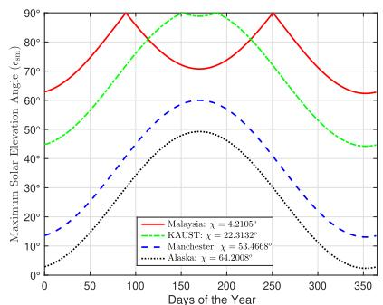

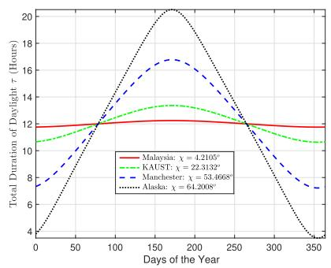

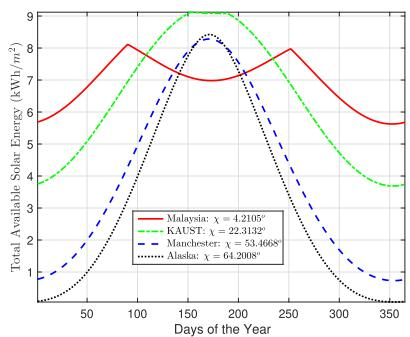

Fig. 6. Maximum elevation angles, total daylight duration, and available solar energy.  
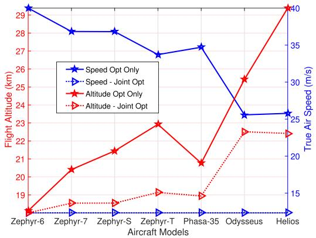

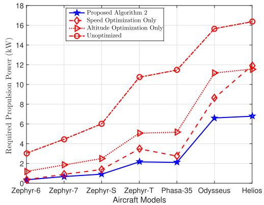  
Fig. 7. Altitude, speed, and propulsion power requirement for different aircraft models.

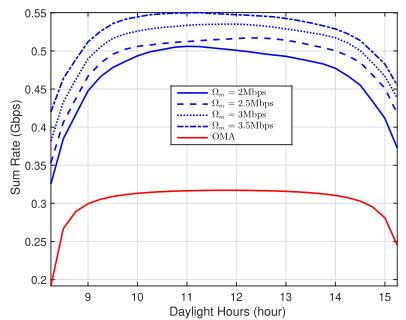

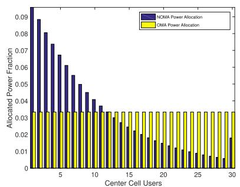

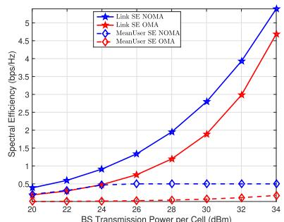  
Fig. 8. Average sum rate, power distribution, and spectral efficiency.

In the next scenario, we present the average sum rate of 210 users in the coverage area of 100-km radius with optimal power allocation in the daylight hours. We assume PHASA-35 flying over Manchester in the worst case, i.e., winter solstice with merely 7 h of daylight. We propose utilizing all the excessive power for wireless transmission after meeting the necessary propulsion, accessory expenses, and storing the requisite energy for the NTO. We break the daylight hours in equal time interval of 15 min as the solar elevation angle is almost constant in this duration. We use the available solar energy values over Manchester and optimal speed, altitude, and propulsion power of PHASA-35 from Figs. 6 and 7, respectively. The average sum rate with the optimal power allocation in NOMA clearly outperforms the orthogonal multiple access (OMA) counterpart with equal power distribution while ensuring four different QoS rate thresholds, as illustrated in Fig. 8(a). Evidently, users can achieve a higher sum rate around noon as compared to the rest of the day pertaining to the higher $P _ { m }$ available at that time. Interestingly, the optimized system renders 69.8340%, 84.3814%, 99.0371%, and 119.0802% relative gain in the average sum rates over the unoptimized system with  = 2, 2.5, 3, or 3.5 Mb/s QoS thresholds, respectively.

The bar chart in Fig. 8(b) demonstrates the power distribution among users in the center cell with NOMA as opposed to the uniform division with OMA. The users with weaker channel strength (edge cell users) are allocated higher fraction of available power budget as compared to the users with stronger channel conditions (center cell users) for a fair distribution enabling every user in the cell to meet QoS threshold. Once all the users are able to meet the target rate, the excessive power is allocated to the strongest user, i.e., u30, which maximizes the overall sum rate, as discussed in Theorem 1. On the other hand, for higher QoS threshold, only few users with stronger channel conditions can achieve the targets, while the weak users experience outage.

Finally, the link spectral efficiency (LSE) and mean user spectral efficiency (MUSE) are illustrated for the similar case of NOMA and OMA (power and bandwidth allocation) for users in the service area of PHASA-35 flying over Manchester on the WS.7 We define LSE as the ratio between sum rate of all the users and total bandwidth, whereas MUSE is the mean of the ratio between the average user rate and bandwidth of all the users in the center cell. We can observe up to 50% and 26.7% percentage improvement in the LSE and the MUSE, respectively, by using NOMA over OMA in Fig. 8(c).

## VI. CONCLUSION

In this article, a self-sustaining long-endurance HAPS was proposed to serve a large coverage area while cruising in a stratospheric station-keeping flight. We presented an interdisciplinary approach to tackle the challenges in solar energy harvesting, aerodynamics, and communications. We further proposed the DL NOMA strategy to serve multicell users from the array panels (mounted underneath the flying base station in HAPS) for efficient resource management. The propagation model and link budgeting involved both the small- and large-scale fading for accurate performance analysis. We formulated different optimization problems for the day and night operations with the objectives to maximize sum rate and minimize power requirements, respectively. We furnished Algorithms 1 and 2 to describe the optimization procedure based on the closed-form solutions of the subproblems. Our findings of the numerical results emphasized the joint design of flight and transmission parameters to maximize sum rate and minimize propulsion power requirement. We achieved up to 84.8% percentage reduction in the required propulsion power of the Zephyr-S, latest successful prototype of Airbus Defence and Space. Moreover, we obtained up to 119.08% and 50% percentage improvement in the average sum rate and spectral efficiency, respectively, using NOMA over OMA counterpart while satisfying QoS thresholds of the users. Thus, stratospheric aerial communication platforms can emerge as the promising candidates for global coverage without requiring any special UE. This research work can be extended to study the performance analysis and parameter optimization for UL-NOMA communication with limited transmission power and omnidirectional antennas. Moreover, the employment of designated higher frequencies for HAPS communication and its applications beyond remote coverage and surveillance could be the possible future directions of this work.

## NONCONVEX OBJECTIVE FUNCTION IN P1

The objective function in the optimization problem P1, i.e., $\begin{array} { r } { f _ { 1 } = \sum _ { m = 1 } ^ { M } \sum _ { l = 1 } ^ { K _ { m } } R _ { l } ^ { m } ( \alpha [ n ] , \hat { H [ n ] } ) } \end{array}$ , is a function of  power allocation coefficients and HAPS altitude. Using (29) and considering a simple case of $M = 1$ and $K = 1$ , we can express

$$
\frac { \partial ^ { 2 } f } { \partial \alpha ^ { 2 } } = \frac { - B } { \ln 2 } \left( \frac { L ( H , \psi _ { l } ^ { m } ) } { | g _ { l m } ^ { m } | ^ { 2 } M _ { b \ell m } } + \alpha \right) ^ { - 2 } \leq 0\tag{49}
$$

and

$$
\frac { \partial ^ { 2 } f } { \partial H ^ { 2 } } = \frac { 2 \Xi B ( \Xi + 3 H ^ { 2 } ) } { \ln ( 2 ) H ^ { 2 } ( \Xi + H ^ { 2 } ) ^ { 2 } } \ge 0\tag{50}
$$

given

$$
\Xi = { \frac { | g _ { l m } ^ { m } | ^ { 2 } M _ { b } \alpha \lambda ^ { 2 } \sin ^ { 2 } ( \psi _ { l } ^ { m } ) } { 1 6 \pi ^ { 2 } \varrho _ { m } } } \geq 0 .\tag{51}
$$

Hence, from (49) and (50), we can see that the objective function is concave in α, whereas it is convex in H. Following these observations on the leading principle determinants, we can conclude that the objective function is jointly nonconvex in these optimization variables. However, it is individually concave and convex in α and H, respectively, proving the convexity of $\mathbf { P 1 } ( \mathbf { a } ) . ^ { 8 }$ Now, consider

$$
\frac { \partial f } { \partial H } = - \frac { 2 \Xi B } { H \ln ( 2 ) \left( \Xi + H ^ { 2 } \right) } \le 0 .\tag{52}
$$

The maximization of a convex function P1(b) in optimization variable H can only be achieved at the lower boundary limit given the monotonically decreasing nature of the objective function (52) for the desired range of altitude.

## APPENDIX B NONCONVEX OBJECTIVE FUNCTION IN P2

The objective function $P _ { \mathrm { p r o p } } ( V , H )$ in P2 can be rewritten as

$$
P _ { \mathrm { p r o p } } = \frac { 1 } { \cos ^ { 2 } ( \zeta ) \eta _ { p } \eta _ { e } } \left( \frac { 1 } { 2 } \rho _ { h } V ^ { 3 } S C _ { D _ { 0 } } + \epsilon \frac { 2 \mathrm { \bf ~ W } ^ { 2 } } { \rho _ { h } S V } \right) .\tag{53}
$$

The Hessian $\nabla ^ { 2 } P _ { \mathrm { p r o p } }$ can be obtained from the partial derivatives as

$$
\nabla ^ { 2 } P _ { \mathrm { p r o p } } = { \left[ \begin{array} { l l } { \partial ^ { 2 } P _ { \mathrm { p r o p } } / \partial V ^ { 2 } } & { \partial ^ { 2 } P _ { \mathrm { p r o p } } / \partial H \partial V } \\ { \partial ^ { 2 } P _ { \mathrm { p r o p } } / \partial H \partial V } & { \partial ^ { 2 } P _ { \mathrm { p r o p } } / \partial H ^ { 2 } } \end{array} \right] }\tag{54}
$$

where

$$
\frac { \partial ^ { 2 } P _ { \mathrm { p r o p } } } { \partial V ^ { 2 } } = \frac { 1 } { \cos ^ { 2 } ( \zeta ) \eta _ { p } \eta _ { e } } \left( 3 \rho _ { h } V S C _ { D _ { 0 } } + \epsilon \frac { 4 \mathrm { \bf ~ W } ^ { 2 } } { \rho _ { h } S V ^ { 3 } } \right)\tag{55}
$$

$$
\frac { \partial ^ { 2 } P _ { \mathrm { p r o p } } } { \partial H ^ { 2 } } = \frac { 1 . 9 \times 1 0 ^ { - 3 } } { \cos ^ { 2 } ( \zeta ) \eta _ { p } \eta _ { e } } \left( \frac { 1 } { 2 } V ^ { 3 } S C _ { D _ { 0 } } + \frac { 2 \epsilon W ^ { 2 } ( 2 - \rho _ { h } ) } { \rho _ { h } ^ { 3 } S V } \right)\tag{56}
$$

and

$$
\frac { \partial ^ { 2 } P _ { \mathrm { p r o p } } } { \partial H \partial V } = \frac { 1 . 9 H - 5 2 . 3 } { \cos ^ { 2 } ( \zeta ) \eta _ { p } \eta _ { e } 1 0 ^ { 3 } } \left( \frac { 3 } { 2 } V ^ { 2 } S C _ { D _ { 0 } } + \epsilon \frac { 2 \mathbf { \delta W } ^ { 2 } } { \rho _ { h } ^ { 2 } S V ^ { 2 } } \right) .\tag{57}
$$

For $\nabla ^ { 2 } P _ { \mathrm { p r o p } } \ : 2 { \times } 2$ symmetric matrix to be positive definite, the trace and determinant of the Hessian matrix both need to be strictly positive. The trace $\mathrm { T r } ( \nabla ^ { 2 } P _ { \mathrm { p r o p } } ) = \partial ^ { 2 } P _ { \mathrm { p r o p } } / \partial V ^ { 2 } +$ $\partial ^ { 2 } P _ { \mathrm { p r o p } } / \dot { \partial } \bar { H } ^ { 2 } \ge 0$ because $\rho _ { h } \le 2$ from the chosen range of altitude. However, the parametric evaluation of the determinant shows that $| \nabla ^ { 2 } P _ { \mathrm { p r o p } } | \leq 0$ . Thus, we can conclude that the matrix $\nabla ^ { 2 } P _ { \mathrm { p r o p } }$ is indefinite, and thus, the objective function is jointly nonconvex in optimization variables V and H. Interestingly, the positive nature ofpartial derivatives $\partial ^ { 2 } P _ { \mathrm { p r o p } } / \partial V ^ { 2 } \geq 0$ and $\partial ^ { \bar { 2 } } P _ { \mathrm { p r o p } } / \partial H ^ { 2 } \geq 0$ in (55) and (56), respectively, proves that the objective function is individually convex in optimization variable V and H proving the convexity of P2(a) and P2(b), respectively.

## APPENDIX C

## CONVERGENCE AND COMPLEXITY OF ALGORITHMS

For the general AO approach as in P1, the optimization is shown to be locally and q-linearly convergent [36]. Now, considering P2 where the objective function is strongly biconvex and satisfies the Kurdyka–Łojasiewicz property, then it is proven in [37] that alternating minimization converges to a first-order stationary point of the objective function.

Algorithm 1 has $K _ { \operatorname* { m a x } } + 2$ optimization variables, where $K _ { \mathrm { m a x } }$ is the maximum number of users in any cell, i.e., $K _ { \operatorname* { m a x } } = \operatorname* { m a x } ( K _ { 1 } , K _ { 2 } , \ldots , K _ { m } )$ . It is because of the fact that P1(a) is a disjoint optimization problem and can be solved independently in $\alpha _ { 1 } \in \mathbb { R } ^ { K _ { 1 } } , \alpha _ { 2 } \in \mathbb { R } ^ { K _ { 2 } } , \ldots , \alpha _ { m } \in \mathbb { R } ^ { K _ { m } }$ using parallel processing. Given the ordered list of users in a cell, the power allocation in P1(a) is of logarithmic complexity, $\mathrm { i . e . , } O ( \log ( K _ { \operatorname* { m a x } } ) )$ . The solution of P1(b) and P1(c) has constant runtime based on the available closed-form solutions. Therefore, the complexity of Algorithm 1 is dominated by P1(a). Now, considering that the number of iterations to converge to a solution is $I _ { \mathrm { i t e r } }$ and we divide the daylight hours into N time instances, then the complexity of Algorithm 1 for a day is given by $O ( I _ { \mathrm { i t e r } } N \log ( K _ { \operatorname* { m a x } } ) )$ . On the other hand, the complexity of P2 according to its convergence to a first-order stationary point and presented closed-form solutions in (45) and (47) is assumed to be constant runtime, which is represented by O(1).

APPENDIX D DERIVATION OF $H _ { m }$ AND $V _ { m }$

The gradient of propulsion power $P _ { \mathrm { p r o } }$ (13) with respect to altitude H is given by

$$
\frac { \partial P _ { \mathrm { r e q } } } { \partial H } = \frac { 1 } { \eta _ { p } \eta _ { e } } \left( \frac { 1 } { 2 } \frac { \partial \rho _ { h } } { \partial H } V ^ { 3 } S C _ { D _ { 0 } } - \epsilon \frac { 2 \mathrm { \bf ~ W } ^ { 2 } } { \rho _ { h } ^ { 2 } S V } \frac { \partial \rho _ { h } } { \partial H } \right) .\tag{58}
$$

Equating (58) to zero yields the following:

$$
\rho _ { h } \left( H ^ { * } \right) = \frac { 2 \mathrm { ~ W ~ } } { S V ^ { 2 } } \sqrt { \frac { \epsilon } { C _ { D _ { 0 } } } } .\tag{59}
$$

We can then obtain the optimum $H _ { m }$ (48) using the piecewise function $\rho _ { h }$ for Stratosphere-I and Stratosphere-II. Similarly, the gradient of propulsion power with respect to airspeed is given as

$$
\frac { \partial P _ { \mathrm { r e q } } } { \partial V } = \frac { 1 } { \eta _ { p } \eta _ { e } } \left( \frac { 3 } { 2 } \rho _ { h } V ^ { 2 } S C _ { D _ { 0 } } - \epsilon \frac { 2 \mathrm { \bf ~ W } ^ { 2 } } { \rho _ { h } S V ^ { 2 } } \right) .\tag{60}
$$

The stationary point obtained by setting (60) to zero renders the optimal $V _ { m }$ in (46).

## REFERENCES

[1] F. Tariq, M. R. Khandaker, K.-K. Wong, M. A. Imran, M. Bennis, and M. Debbah, “A speculative study on 6G,” IEEE Trans. Wireless Commun., vol. 27, no. 4, pp. 118–125, Aug. 2020.

[2] A. Alsharoa and M.-S. Alouini, “Facilitating satellite-airborneterrestrial integration for dynamic and infrastructure-less networks,” 2019, arXiv:1912.03819.

[3] S. Karapantazis and F. Pavlidou, “Broadband communications via high-altitude platforms: A survey,” IEEE Commun. Surv. Tut., vol. 7, no. 1, pp. 2–31, First Quarter 2005.

[4] Y. Shibata, N. Kanazawa, K. Hoshino, Y. Ohta, and A. Nagate, “A study on cell configuration for HAPS mobile communications,” in Proc. IEEE 89th Veh. Technol. Conf., 2019, pp. 1–6.

[5] High Altitude Platform Systems: Towers in the Skies. GSMA, London, U.K., Jun. 2021.

[6] M. Dai, Y. Wu, L. Qian, Z. Su, B. Lin, and N. Chen, “UAV-assisted multi-access computation offloading via hybrid NOMA and FDMA in marine networks,” IEEE Trans. Netw. Sci. Eng., vol. 10, no. 1, pp. 113–127, Jan./Feb. 2023.

[7] G. K. Kurt et al., “A vision and framework for the high altitude platform station (HAPS) networks of the future,” IEEE Commun. Surv. Tut., vol. 23, no. 2, pp. 729–779, Second Quarter 2021.

[8] A. Anjum, S. Javed, M. F. Bhopal, and Z. Zahid, “Terahertz antenna array as a heat blocking structure,” J. Electromagn. Waves Appl., vol. 29, no. 1, pp. 14–25, 2015.

[9] O. Anicho, P. Charlesworth, G. Baicher, and A. Nagar, “Multi-HAPS network implementation within 3GPP’s NTN framework for 5G and beyond,” Int J. Inf. Commun. Technol. Appl., vol. 7, no. 1, pp. 7–12, 2021.

[10] F. A. d’Oliveira, F. C. L. d. Melo, and T. C. Devezas, “High-altitude platforms: Present situation and technology trends,” J. Aerosp. Technol. Manage., vol. 8, pp. 249–262, 2016.

[11] S. Yuan, F. Hsieh, S. Rasool, E. Visotsky, M. Cudak, and A. Ghosh, “Interference analysis of HAPS coexistence on terrestrial mobile networks,” in Proc. IEEE Wireless Commun. Netw., 2022, pp. 2494–2499.

[12] J. Marriott, B. Tezel, Z. Liu, and N. E. Stier-Moses, “Trajectory optimization of solar-powered high-altitude long endurance aircraft,” in Proc. IEEE 6th Int. Conf. Control, Autom. Robot., 2020, pp. 473–481.

[13] M. A. Azzahra and Iskandar, “NOMA signal transmission over millimeter-wave frequency for backbone network in HAPS with MIMO antenna,” in Proc. 13th Int. Conf. Telecommun. Syst., Serv., Appl., 2019, pp. 186–189.

[14] P. Ji, L. Jiang, C. He, Z. Lian, and D. He, “Energy-efficient beamforming for beamspace HAP-NOMA systems,” IEEE Commun. Lett., vol. 25, no. 5, pp. 1678–1681, May 2021.

[15] F. Hsieh, F. Jardel, E. Visotsky, F. Vook, A. Ghosh, and B. Picha, “UAV-based multi-cell HAPS communication: System design and performance evaluation,” in Proc. IEEE Glob. Commun. Conf., 2020, pp. 1–6.

[16] A. Nauman and M. Maqsood, “System design and performance evaluation of high altitude platform: Link budget and power budget,” in Proc. IEEE 19th Int. Conf. Adv. Commun. Technol., 2017, pp. 138–142.

[17] I. Reda and A. Andreas, “Solar position algorithm for solar radiation applications,” Sol. Energy, vol. 76, no. 5, pp. 577–589, 2004.

[18] M. Brizon, “Solar energy generation model for high altitude long endurance platforms,” Master’s Thesis, German Aerospace Center (DLR), Inst. Flight Syst., Braunschweig, Germany, Apr. 2015.

[19] H. Bolandhemmat, B. Thomsen, and J. Marriott, “Energy-optimized trajectory planning for high altitude long endurance (HALE) aircraft,” in Proc. 18th Eur. Control Conf., 2019, pp. 1486–1493.

[20] G. S. Aglietti, S. Redi, A. R. Tatnall, and T. Markvart, “Harnessing high-altitude solar power,” IEEE Trans. Energy Convers., vol. 24, no. 2, pp. 442–451, Jun. 2009.

[21] NOAA, NASA, and U.S. Air Force, US StandardAtmosphere, 1976, vol. 76. Washington, DC, USA: National Oceanic and Atmospheric Administration, 1976.

[22] S. C. Arum, D. Grace, P. D. Mitchell, M. D. Zakaria, and N. Morozs, “Energy management of solar-powered aircraft-based high altitude platform for wireless communications,” Electronics, vol. 9, no. 1, 2020, Art. no. 179.

[23] A. Jenkins, “The Sun’s position in the sky,” Eur. J. Phys., vol. 34, no. 3, 2013, Art. no. 633.

[24] D. Verstraete, M. Coatanea, and P. Hendrick, “Preliminary design of a joined wing HALE UAV,” in Proc. Int. Congr. Aeronaut. Sci., 2008, pp. 14–19.

[25] R. F. Stengel, Flight Dynamics. Princeton, NJ, USA: Princeton Univ. Press, 2015.

[26] F. Hsieh and M. Rybakowski, “Propagation model for high altitude platform systems based on ray tracing simulation,” in Proc. 13th Eur. Conf. Antennas Propag., 2019, pp. 1–5.

[27] J. L. Cuevas-Ru´zz and J. A. Delgado-Penín, “Channel modeling and simulation in HAPS systems,” in Proc. Eur. Wireless, 2004, pp. 24–27.

[28] A. G. Kanatas and A. D. Panagopoulos, Radio Wave Propagation and Channel Modeling for Earth-Space Systems. Boca Raton, FL, USA: CRC, 2017.

[29] A. A. O. Oladipo, “Stratospheric propagation and HAPs channel modeling,” master’s thesis, Dept. Elect. Eng., Blekinge Inst. Technol., Karlskrona, Sweden, 2007.

[30] Y. Sun, Z. Ding, and X. Dai, “On the performance of downlink NOMA in multi-cell mmWave networks,” IEEE Commun. Lett., vol. 22, no. 11, pp. 2366–2369, Nov. 2018.

[31] Space Communication Calculations. Australian Space Academy, Adelaide, SA, Australia, Jan. 2017.

[32] Y. Shibata, N. Kanazawa, M. Konishi, K. Hoshino, Y. Ohta, and A. Nagate, “System design of Gigabit HAPS mobile communications,” IEEE Access, vol. 8, pp. 157995–158007, 2020.

[33] K. Wang, Y. Liu, Z. Ding, A. Nallanathan, and M. Peng, “User association and power allocation for multi-cell non-orthogonal multiple access networks,” IEEE Trans. Wireless Commun., vol. 18, no. 11, pp. 5284–5298, Nov. 2019.

[34] Pysolar 0.7, Brandon Stafford, Melbourne, VIC, Australia, Apr. 2015.

[35] M. Yamaguchi, “High-efficiency GaAs-based solar cells,” in Post-Transition Metals. London, U.K.: IntechOpen, 2020.

[36] J. Bezdek and R. Hathaway, “Convergence of alternating optimization,” Neural, Parallel Sci. Comput., vol. 11, pp. 351–368, 2003.

[37] Y. Xu and W. Yin, “A block coordinate descent method for regularized multiconvex optimization with applications to nonnegativetensor factorization and completion,” SIAM J. Imag. Sci., vol. 6, no. 3, pp. 1758–1789, 2013.

Sidrah Javed (Student Member, IEEE) received the B.E. degree in electrical (telecommunication) engineering from National University of Science and Technology, Islamabad, Pakistan, in 2012, and the Ph.D. degree in electrical and computer engineering from the King Abdullah University of Science and Technology (KAUST), Thuwal, Saudi Arabia, in 2021.

From 2012 to 2015, she was a Research Engineer with National Radio and Telecommunication Corporation, Haripur, Pakistan. She is currently a Research Consultant with the Computer, Electrical and Mathematical Science and Engineering Division, KAUST. Her research interests include signal processing for wireless communication systems especially for hardware and interference constrained communications by employing improper signaling or asymmetric modulation to mitigate them. She is particularly interested in bridging the digital divide and connecting the unconnected parts of the world using state-of-the-art techniques in the upcoming generations of wireless communications.

Mohamed-Slim Alouini (Fellow, IEEE) was born in Tunis, Tunisia. He received the Ph.D. degree in electrical engineering from the California Institute of Technology, Pasadena, CA, USA, in 1998.

He was a Faculty Member with the University of Minnesota, Minneapolis, MN, USA, and Texas A&M University at Qatar, Ar-Rayyan, Qatar. In 2009, he joined the King Abdullah University of Science and Technology, Thuwal, Saudi Arabia, where he is currently the Al-

Khawarizmi Distinguished Professor of Electrical and Computer Engineering.

Dr. Alouini is a Fellow of OPTICA (formerly the Optical Society of America). His current research interests include addressing the technical challenges associated with the uneven distribution, access to, and use of information and communication technologies in rural, low-income, disaster, and/or hard-to-reach areas.

Zhiguo Ding (Fellow, IEEE) received the B.Eng. degree from the Beijing University of Posts and Telecommunications, Beijing, China, in 2000, and the Ph.D. degree from Imperial College London, London, U.K., in 2005, both in electrical engineering.

He is currently a Professor in Communications with Khalifa University, Abu Dhabi, United Arab Emirates, and the University of Manchester, Manchester, U.K. He is an Academic Visitor with Princeton University, Princeton, NJ, USA. His research interests include 6G networks, cooperative and energy harvesting networks, and statistical signal processing.

Dr. Ding is an Area Editor for IEEE TRANSACTIONS ON WIRELESS COMMUNICATIONS and IEEE OPEN JOURNAL OF THE COMMUNICATIONS SOCIETY and an Editor for IEEE TRANSACTIONS ON VEHICULAR TECH-NOLOGY (TVT), Science China Information Sciences, and IEEE COM-MUNICATIONS SURVEYS AND TUTORIALS. He was an Editor for IEEE WIRELESS COMMUNICATION LETTERS, IEEE TRANSACTIONS ON COMMU-NICATIONS, and IEEE COMMUNICATION LETTERS. He is the recipient of the EU Marie Curie Fellowship 2012–2014, the Top IEEE TVT Editor 2017, the IEEE Heinrich Hertz Award 2018, the IEEE Jack Neubauer Memorial Award 2018, the IEEE Best Signal Processing Letter Award 2018, the Friedrich Wilhelm Bessel Research Award 2020, and IEEE SPCC Technical Recognition Award 2021. He is a Distinguished Lecturer of the IEEE Communications Society. He was a Web of Science Highly Cited Researcher in two categories in 2022.