# Automating CSI Measurement with UAVs: from Problem Formulation to Energy-Optimal Solution

Sixu Piao $^{1}$ , Zhongjie Ba $^{1}$ , Lu Su $^{1}$ , Dimitrios Koutsonikolas $^{1}$ , Shi Li $^{1}$ , and Kui Ren $^{1,2}$

$^{1}$ Department of Computer Science and Engineering, State University of New York at Buffalo, USA $^{2}$ Institute of Cyberspace Research, Zhejiang University, P.R. China  
{sixupiao, zba2, lusu, dimitrio, shil, kuiren}@buffalo.edu

Abstract—Indoor localization has been an active research area given the popularity of Location-Based Services. The CSI fingerprinting based approach is one of the most practical and effective approaches since it can provide adequate accuracy with low overhead for users. The key drawback that limits its wide application is the huge amount of human effort required to build the fingerprint map. This paper is the first to explore addressing this limitation by automating CSI map construction using an Unmanned Aerial Vehicle (UAV). Given the limited battery capacity of commodity UAVs, it is extremely important yet challenging to optimize energy efficiency for the UAV during the CSI measurement task. To address this challenge, we formulate an energy optimization problem based on a novel graph model that includes the cost of possible actions for UAVs. We then transform the formulated problem to the classic Generalized Traveling Salesman Problem (GTSP), which can be solved efficiently. We implement the system on an off-the-shelf programmable drone equipped with a CSI measurement module. We achieve great energy efficiency improvement over the conventional coverage path planning algorithm. Meanwhile, accurate indoor localization can be achieved using the CSI data collected by our UAV system.

## I. INTRODUCTION

Channel State Information (CSI) is used to help wireless transmitters adapt transmissions based on channel conditions. It is achieved using a set of PHY layer parameters that can describe the channel properties of a wireless communication link. Recent researches $[1]$ – $[3]$ show that CSI can also enable accurate indoor localization thanks to its ability of providing fine-grained channel information for each subcarrier, which can characterize indoor environment. It is also ready to be deployed on existing Wi-Fi infrastructure without hardware modification. Using fingerprinting-based approaches, we can localize a user's device by matching a CSI fingerprint at the user's current location with a pre-constructed CSI fingerprint map. Despite all the advantages of CSI-enabled localization, there is major barrier for this approach to be widely applied in practice. That is, measuring CSI at a high resolution through war-driving is a very time-consuming and labor-intensive task.

To address this issue, a promising solution is to automate this process using robots. While automated CSI collection can be performed by a ground robot, it has to be programmed to avoid obstacles in the space to be surveyed. This results in two limitations: (i) a detailed layout of the space is required for path planning, which could be dynamic due to the frequent replacement of furniture; (ii) the fingerprint database will inevitably be incomplete, missing data for locations occupied by objects. Therefore, we propose to automate CSI measurement using an Unmanned Aerial Vehicle (UAV), which can be programmed to fly at human height, hence (i) avoiding the need for fine-grained layouts during the motion planning and (ii) obtaining CSI fingerprints from more locations including those occupied by other objects (e.g., above a table).

A critical issue for employing UAVs is the energy consumption, which restricts the amount of work a UAV can do. Most commodity UAVs have a flight duration of less than an hour since the amount of batteries they can carry is limited by their payload. Hence, with limited energy available for UAVs, an energy-optimal strategy for the CSI measurement task is necessary. However, it is extremely challenging to find the most energy-efficient way to build the CSI map. The first reason is that the costs of straight flight and turns are different for UAVs. To make a turn, the UAV needs to decelerate in one direction until hovering, and then accelerate in another direction to a cruise speed. This procedure leads to extra energy cost compared to straight flight. Besides, in an indoor environment, there may be multiple Access Points deployed, and each location may be covered by different subset of them. Current CSI measurement tools $[4]$ introduce another challenge. To obtain a CSI measurement from an AP, a wireless receiver has to first associate with that AP and receive high-throughput packets (unicast 802.11n or 802.11ac frames) from it. In contrast, a receiver can measure RSSI from multiple APs simultaneously. $[5]$ demonstrates measuring RSSI using a drone. However, it is more challenging to measure CSI since the UAV needs to get associated with each AP to measure CSI one by one. Switching between APs introduces extra energy cost because during this period the UAV cannot take any measurements and simply hovering in the air costs energy for UAVs. Therefore, the UAV needs to decide, at each location to be monitored, whether it should keep flying straight, make a turn or hover and switch to another AP. We need an algorithm that gives optimal decision for the UAV during the entire task.

This paper is the first, to our best knowledge, to study the problem of automating CSI measurements using UAVs. First, we design a UAV movement model for CSI measurement. Our model decomposes a UAV motion path into a sequence of three types of actions, namely, flying straight at a uniform speed, making a turn, and switching between APs. We measure the energy cost for each type of action by real-world experiments.

Next, we use the developed UAV energy model to formulate an energy optimization problem based on a novel graph to find optimal decisions for the UAV. We first construct a graph to represent the physical layout of the environment. Each grid in the environment is represented as a vertex. Only physically neighboring vertices are connected by an edge, whose weight is the energy cost for the UAV to move between the two grids. To model the cost of turns, we expand each vertex representing a physical location into four of them, representing four orientations of the UAV. We call each set of four vertices a widget. The weight of edges inside a widget is the cost of changing orientation (i.e., a turn). Vertices in different widgets are connected by directed edges only if they represent the same flying orientation and the direction of the edge follows the orientation they represent. We further expand each widget into multiple widgets representing different APs. Vertices representing the same orientation in different widgets are connected by edges with the cost of switching APs. Our formulated problem can be transformed to a classic problem, i.e., Generalized Traveling Salesman Problem, which can be solved efficiently using an existing solver $[6]$ .

Finally, we implement our system on an off-the-shelf drone equipped with a CSI measurement module. We compare the localization accuracy obtained using CSI data collected by our UAV system and manual war-driving in real-world experiments. The results show that our system can build the CSI fingerprint map with great energy efficiency, reducing human labor cost in war-driving without sacrificing much accuracy.

Our major contributions are summarized as follows:

\- To our best knowledge, this work is the first to study the problem of automating CSI measurements using UAVs. An energy model is designed specifically for the CSI measurement task with UAVs.

\- We propose a novel graph model to characterize the energy optimization problem for UAVs in the CSI measurement task. Our model can generate the optimal sequence of actions from a list of three options for the UAV.

\- We implement the system on a commodity drone. Real-world experiments show that the CSI data collected using our system yield accurate indoor localization results. More importantly, our algorithm can save 37.8% energy for the CSI measurement task compared to conventional coverage path planning algorithm.

## II. RELATED WORKS

## A. WiFi-Based Indoor Localization

Recent research efforts approach indoor localization with the help of infrastructure and mobile devices that provide various kinds of signals, including WiFi, RFID [7], [8], acoustic signal [9], [10], visible light [11]–[13], motion sensor signal and their combinations [14]–[17]. Wi-Fi signal is one of the most convenient ones to use thanks to the pervasive deployment of WiFi infrastructure and WiFi-enabled mobile devices. Therefore, we focus on WiFi-based indoor localization techniques that fall into the following three categories:

Fingerprinting-based approaches: This category of approaches [1]–[3], [18]–[20] are widely used for WiFi-based location estimation because they can make use of commercial off-the-shelf wireless devices and have demonstrated good performance. Fingerprinting based approaches are usually composed of two phases. The first one is the offline training phase, when an RSSI or CSI fingerprint map is built to capture the physical characteristics of the RF environment. Then in the online location estimation phase, the location of a user carrying a mobile device can be estimated by looking up its RSSI or CSI fingerprint in the database. This approach only requires that the users report RSSI or CSI measurements, and does not introduce any modifications to the hardware. Also, the computation during the online phase is simply a pattern matching, which is usually low-cost.

AoA-based approaches: Leveraging antenna arrays in modern APs that support MIMO communication, the angle-of-arrival of a signal arriving at an AP can be calculated from the phase difference between multiple antennas. Then the location of a transmitter can be estimated by triangulation if the AoA of line-of-sight signal is available. This approach has shown improved localization accuracy over fingerprinting-based approach. [21] achieves median localization error of 40 cm by accurately identifying the AoA of direct path using APs with three antennas. [14] seeks help from motion sensors in smartphones to estimate the angle and distance between mobile devices and APs. [15], [22], [23] use specially designed antennas to estimate AoA accurately.

ToF-based approaches: Distance between wireless transmitters and receivers can also be estimated by the Time-of-Flight of the packets. However, due to the timestamp resolution limit (i.e., several nanoseconds) of commercial off-the-shelf WiFi devices, the distance estimation error can not be better than several meters [24]. [25] achieves sub-nanoseconds ToF resolution by emulating a wideband radio using frequency band hopping on commodity WiFi cards. [26] use specially-designed hardware to achieve good ToF estimation accuracy. [27] can estimate ToF accurately when the transmitter and receiver are synchronized.

To summarize, the fingerprinting-based approach does not require extra hardware or firmware update on existing WiFi infrastructure. Any user with a mobile device that can report CSI can localize himself in a building for which a fingerprint map has been built. If we can automate the CSI map construction process using UAVs, fingerprintg-based approach will become much more practical without huge labor cost of war-driving.

## B. UAV Coverage Path Planning

Coverage Path Planning (CPP) in robotics is the task of determining a path that passes over all points of an area of interest while avoiding obstacles. To define full coverage, existing works model the environment in different ways, including landmark-based topology $[28]$ , $[29]$ and grid-based decomposition $[30]$ , $[31]$ . Grid-based decomposition is the most related type for our work since we want to take CSI measurement at a uniform granularity. Related works on grid-based decomposition include Wavefront algorithm [30] and Spanning Tree Coverage Algorithm [31]. Graph-based algorithm [32], [33] has been proposed to represent the environment as a graph and assign a weight to each edge as the cost of robot moving between two vertices. Optimal path can be found by looking for the path with minimum total cost. Different from traditional CPP, in our task, the UAV not only needs to visit every location but also needs to measure CSI for each AP separately. The jobs required at each location can be different. Additionally, the extra cost involved by switching between APs is not related to the physical movement of UAV. Therefore, no existing work was able to solve our problem.

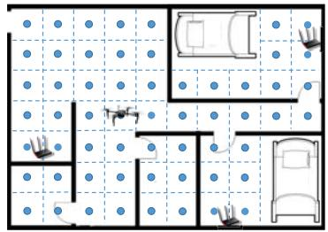

text_image

Floor plan diagram with room labels and drone placement, showing layout of furniture and fixtures

(a) Floor plan

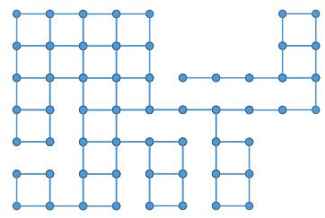

natural_image

Abstract geometric pattern composed of interconnected blue dots forming a maze-like structure (no text or symbols)

(b) Graph representation

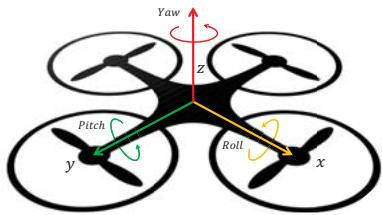

text_image

Yaw
z
Pitch
y
Roll
x

(c) Quadrotor UAV model  
Fig. 1: System Model

## III. SYSTEM MODEL

## A. CSI Measurement

1) CSI Fingerprint Based Indoor Localization: CSI-based fingerprinting approaches [1], [3] are shown to outperform RSSI-based approaches [18] due to the fine-grained channel characteristics contained in CSI. CSI can be obtained using the Intel CSI Tool [4], which divides all the subcarriers into 30 groups and reports a complex number for each group:

$$
H _ {j} = \left| H _ {j} \right| e ^ {i \angle H _ {j}}, j \in 1, \dots , 3 0, \tag {1}
$$

where $|H_{j}|$ is the amplitude and $\angle H_{j}$ is the phase.

Here we use a representative CSI-based localization approach, Fine-grained Indoor Fingerprinting System (FIFS) [1], to illustrate how CSI is used in the localization task. FIFS defines CSI fingerprint as the total power over all subcarriers:

$$
f _ {i} = \sum_ {i = 1} ^ {3 0} | H _ {i} | ^ {2}, \tag {2}
$$

The location is estimated based on Bayesian inference:

$$
P (L _ {i} | F) = \frac {P (L _ {i}) P (F | L _ {i})}{\sum_ {i = 1} ^ {N} P (L _ {i}) P (F | L _ {i})}, \tag {3}
$$

where $L_{i}$ is the 2d coordinate of a reference location $i \in \{1, 2, \dots, N\}$ , $F = [f_1, f_2, \dots, f_K]$ is a vector denoting the CSI fingerprints for a location covered by $K$ APs.

$P(L_{i}|F)$ is the a posteriori probability that fingerprint F is generated from location $L_{i}$ and $P(L_{i})$ is the a priori probability that a user's mobile device shows up at location $L_{i}$ . Assume the a priori probability is uniformly distributed, i.e., $P(L_{i}) = \frac{1}{N}$ , then:

$$
P (L _ {i} | F) = \frac {\frac {1}{N} P (F | L _ {i})}{\sum_ {i = 1} ^ {N} \frac {1}{N} P (F | L _ {i})} = \frac {P (F | L _ {i})}{\sum_ {i = 1} ^ {N} P (F | L _ {i})}. \tag {4}
$$

Therefore, the only factor that determines $P(L_{i}|F)$ is the likelihood $P(F|L_{i})$ . Assume the CSI for different APs are independent, then:

$$
P (F | L _ {i}) = \prod_ {k = 1} ^ {K} P (f _ {k} | L _ {i}), \tag {5}
$$

where the CSI fingerprint for the $k$ th AP $P(f_{k}|L_{i})$ follows Gaussian distribution:

$$
P (f _ {k} | L _ {i}) = \frac {1}{\sqrt {2 \pi \sigma_ {k i}}} e x p \frac {- (f _ {k} - \mu_ {k i}) ^ {2}}{2 \sigma_ {k i}}. \tag {6}
$$

Finally, given a fingerprint generated from the CSI data measured on a device, this device's location is determined by a weighted average of all reference locations.

$$
\hat {L} = \sum_ {i = 1} ^ {N} P (L _ {i} | F) L _ {i}. \tag {7}
$$

Therefore, the data we need to collect for the offline training phase should include the distribution of the CSI fingerprint for each AP at each location: $P(f_{k}|L_{i})$ , characterized by two parameters, i.e., mean $\mu_{ki}$ and standard deviation $\sigma_{ki}$ .

2) UAV-Enabled CSI Measurement: The distribution of the CSI fingerprints can be estimated using the samples collected by the UAV. Thus, the UAV needs to move to each location of interest to measure CSI for all the APs covering this location. For example, as shown in Figure 1a, we divide the region to be measured into equally spaced grids. Then we need to plan a path for the UAV to visit different locations.

RSSI can be measured for multiple APs at the same time. However, to obtain the CSI information for a pair of transmitter (an AP) and receiver (a client), the client needs to connect to the AP to receive high-throughput packets, from which CSI is extracted. Then the wireless adapter on the client will send the extracted CSI for each packet to the MAC layer for a user program to record it. Therefore, to measure CSI from multiple APs at the same grid, the UAV has to get associated with and measure CSI for each AP one by one.

## B. UAV Movement Model

1) UAV Basics: The most typical type of UAV is a quadrotor helicopter with power in three dimensions, i.e., roll, pitch, and yaw, as shown in Figure 1c. Such kind of UAVs can hover in the air, ascend or descend, move in horizontal direction by rolling and pitching and rotate around the vertical axis by yawing. However, UAVs consume energy just to keep themselves in the air against gravity. In contrast, ground robots consume much less energy when they are staying still. This is a key characteristic if we care about the energy consumption when UAVs execute certain tasks. More importantly, energy is more critical for UAVs since they are usually powered by batteries with limited capacity. It is also more dangerous for a UAV to lose power than ground robots since it may cause accidents or even hurt people if they cannot find a safe place to land before using up their batteries. Therefore, it is more challenging and important to design energy-efficient strategies for UAVs to perform any kind of task.

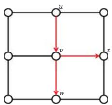

flowchart

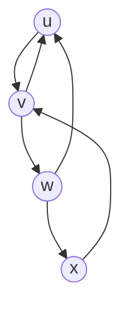

(a) Limitation

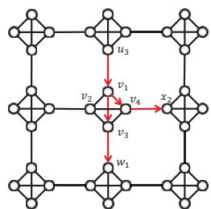

flowchart

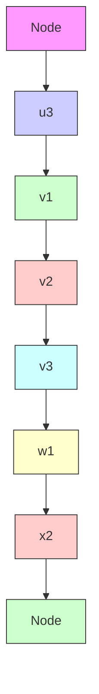

(b) Expansion  
Fig. 2: Initial problem formulation.

2) UAV Energy Model for CSI Measurement Task: Here we discuss the options for a UAV in the CSI measurement task.

Straight Flights. To measure CSI at a grid, the UAV needs to fly across the grid. It is shown that 60 CSI samples at each location are enough for indoor localization [1]. Since 60 samples can be measured in about 0.1 seconds using the Intel CSI Tool [4], the UAV does not need to hover at the center of a grid. Its speed determines the physical location range for the collected samples. The slower the speed is, the closer to each other the samples are. The bottom line is that the location range of samples for different grids should not overlap. For a certain flying speed and grid interval, the energy cost for moving between adjacent grids is a constant denoted by $E_{m}$ .

Making Turns. We assume the drone can only move in four directions, which are on the same horizontal plane and separated by an equal interval of 90 degree. Given the fact that the UAV can move towards any of the four directions no matter which one it is facing, we define a turn for the UAV by a deceleration in one direction until hovering, followed by an acceleration in another direction. During a turn, the UAV does not have to actually spin its body. Hence, there is no difference in the energy cost for the turning of different angles. The extra energy cost for making a turn compared with uniform motion is resulted from the deceleration and acceleration actions. We represent the energy cost for making a turn by $E_{t}$ in this paper.

Switching APs. To switch between two APs, the UAV needs to hover at a position while waiting for establishing the new connection. During this period, the UAV cannot take measurements, which costs an extra portion of energy $E_{s}$ .

## IV. PROBLEM FORMULATION

## A. Design Goal

Now we give the design goal of our system: In a region represented by uniform grids, each of which may be covered by different APs, find a sequence of actions for the UAV, consisting of straight flights, turns and switching between APs, to obtain the CSI fingerprint for each AP at each location with minimum energy cost.

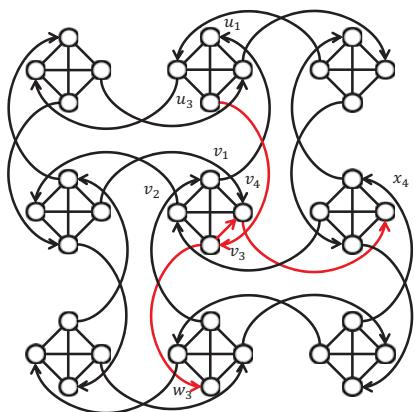

flowchart

```mermaid
graph TD
  A["Node 1"] --> B["Node 2"]
  B --> C["Node 3"]
  C --> D["Node 4"]
  D --> E["Node 5"]
  E --> F["Node 6"]
  F --> G["Node 7"]
  G --> H["Node 8"]
  H --> I["Node 9"]
  I --> J["Node 10"]
  J --> K["Node 11"]
  K --> L["Node 12"]
  L --> M["Node 13"]
  M --> N["Node 14"]
  N --> O["Node 15"]
  O --> P["Node 16"]
  P --> Q["Node 17"]
  Q --> R["Node 18"]
  R --> S["Node 19"]
  S --> T["Node 20"]
  T --> U["Node 21"]
  U --> V["Node 22"]
  V --> W["Node 23"]
  W --> X["Node 24"]
  X --> Y["Node 25"]
  Y --> Z["Node 26"]
  Z --> A
    style A fill:#f9f,stroke:#333
    style B fill:#f9f,stroke:#333
    style C fill:#f9f,stroke:#333
    style D fill:#f9f,stroke:#333
    style E fill:#f9f,stroke:#333
    style F fill:#f9f,stroke:#333
    style G fill:#f9f,stroke:#333
    style H fill:#f9f,stroke:#333
    style I fill:#f9f,stroke:#333
    style J fill:#f9f,stroke:#333
    style K fill:#f9f,stroke:#333
    style L fill:#f9f,stroke:#333
    style M fill:#f9f,stroke:#333
    style N fill:#f9f,stroke:#333
    style O fill:#f9f,stroke:#333
    style P fill:#f9f,stroke:#333
    style Q fill:#f9f,stroke:#333
    style R fill:#f9f,stroke:#333
    style S fill:#f9f,stroke:#333
    style T fill:#f9f,stroke:#333
    style U fill:#f9f,stroke:#333
    style V fill:#f9f,stroke:#333
    style W fill:#f9f,stroke:#333
    style X fill:#f9f,stroke:#333
    style Y fill:#f9f,stroke:#333
    style Z fill:#f9f,stroke:#333
```

Fig. 3: Expanded graph for modeling cost of turns.

## B. Graph Model Overview

To approach this problem, we propose to model the measured region by a graph, in which each vertex represents a grid, and there is an edge between two neighboring grids, as shown in Figure 1b. Then, the UAV needs to visit each of the vertices (corresponding to a particular grid) to measure the CSI fingerprint for each of the APs covering this grid.

As described above, the UAV has three choices of actions, i.e., flying to a neighboring grid at a constant speed, making a turn, and switching between APs. To model these actions, we assign the costs of the actions as the weights of corresponding edges in the graph. Then by finding a walk on the graph, we can obtain a sequence of actions for the UAV to perform. Finally, the minimum energy cost is attained by minimizing the “length” (i.e., the summed weights of the visited edges) of the walk that satisfies our requirements. To achieve this, we shall ensure that the cost of the UAV’s movements be precisely modeled by the weight of edges connecting the vertices corresponding to neighboring grids. This is, surprisingly, a challenging task. We next present the modeling of the costs for turns and hovers $^{1}$ in detail in the following subsections.

## C. Modeling Cost of Turns

As stated above, we want to find a sequence of actions for the UAV with minimum energy cost. Unfortunately, in the original graph shown in Figure 1b, the weight of edges cannot reflect the cost of the UAV's turns. For example, as shown in Figure 2a, the cost of the path from vertex $u$ to vertex $w$ through vertex $v$ is the same as that from vertex $u$ to vertex $x$ through $v$ . However, the second path actually costs more energy since the UAV needs to make a turn at vertex $v$ .

To address this challenge, we propose to expand each vertex into four vertices as shown in Figure 2b. These four vertices form a square with sides that represent the cost of turns by weight $E_{t}$ and diagonals with weight 0, which means that the UAV has no extra cost if it straightly moves through a grid without changing its direction. For example, in Figure 2b, the total cost for path $u_{3} \rightarrow v_{1} \rightarrow v_{3} \rightarrow w_{1}$ equals to $2E_{m}$ , while the total cost for path $u_{3} \rightarrow v_{1} \rightarrow v_{4} \rightarrow x_{2}$ is $2E_{m} + E_{t}$ .

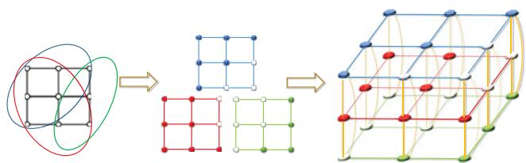

flowchart

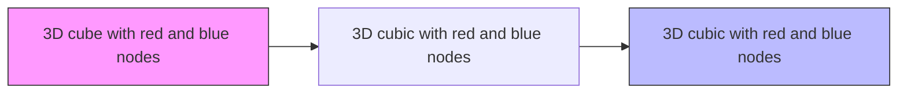

Fig. 4: Expanded graph for modeling multiple APs.

The UAV can also make U-Turns (i.e., 180-degree turns). For example, the UAV can move from grid u to grid v and turn back to grid u along path $u_{3} \rightarrow v_{1} \rightarrow u_{3}$ without any cost for the turn. Hence, we propose to connect two neighboring grids by two directed edges as shown in Figure 3. The weights of diagonal edges in the square are also changed into $E_{t}$ so that the UAV cannot avoid the cost of a turn to perform a 180-degree turn. Consider the case when the UAV needs to go to grid v from grid u and turn back again. Now the shortest path for this action is $u_{3} \rightarrow v_{3} \rightarrow v_{1} \rightarrow u_{1}$ , with a total cost of $2E_{m} + E_{t}$ . Meanwhile, this change does not affect the cost of straight flights and 90-degree turns. The paths corresponding to the paths $u \rightarrow v \rightarrow w$ and $u \rightarrow v \rightarrow x$ in the figure 2a are $u_{3} \rightarrow v_{3} \rightarrow w_{3}$ and $u_{3} \rightarrow v_{3} \rightarrow v_{4} \rightarrow x_{4}$ , respectively.

To summarize, we use 4 vertices to represent a physical grid, with any two of them connected by edges with a weight of $E_{t}$ . Each vertex actually models a different orientation of the UAV. Only vertices representing the same orientation on neighboring grids are connected by directed edges with a cost of $E_{m}$ . And the direction of the edge complies with the orientation these two vertices represent. As a result, a path on this graph can be used to model a sequence of the UAV's moves and turns, with the summed weight equal to the total energy cost.

## D. Modeling Costs of Switching APs

For grids covered by multiple APs, the UAV can hover at a grid to measure all the APs first, then move to other grids. It can also measure some of the APs at a grid first, move to other grids and come back to measure the remaining APs. In the first case, the total energy is dominated by hovering (i.e., $E_{h}$ ) when switching between APs. But the energy of the second strategy is mainly determined by $E_{m}$ and $E_{t}$ for moving between grids. The challenge is that we cannot determine which strategy is better because the relative quantity of $E_{m}$ , $E_{t}$ and $E_{h}$ is affected by the energy model of the UAV and the accuracy and resolution requirement of CSI measurement.

In order to have a universal model for different settings, we further expand the graph in Figure 3 by using different squares to represent different APs. Consider the case when there are 3 APs with different coverage ranges as shown on the left-hand side of Figure 4. For the simplicity of illustration, we show the original graph instead of the expanded one, in which different colors are used to represent different APs. The coverage of each AP can then be represented by a single graph shown in the center of Figure 4. We name a solid circle as a real vertex to represent that the grid is covered by this AP while a virtual vertex denoted by a hollow circle means the opposite. Then we can treat the graph for each AP as a layer and merge them into a single 3D graph, in which different layers are interconnected by edges with a weight of $E_{s}$ as shown on the right-hand side of Figure 4. We can imagine that when the UAV needs to switch to a different AP, it needs to move to a different level in the graph with the cost of $E_{s}$ . Note that after this expansion only real vertices need to be covered by the path because they represent that there is actually an AP covering those grids.

## E. Graph Model of the Problem

Based on the modeling of the cost of different actions, we now give the formal definition of our constructed graph.

Definition 1: The UAV based CSI measurement task can be modeled by the following graph:

$$
G = (V, E),
$$

where V is the set of all vertices, including both real and virtual ones. Each vertex represents the state of the UAV, comprised of its location, orientation and the AP it is connected with. E is a set of edges representing the costs of transition between states. An edge from vertex u to vertex v is defined by a weight: $w_{uv} \in \{E_m, E_t, E_s\}$ , corresponding to the cost of changing UAV's location, orientation and the AP to measure.

By this definition, a cycle on the graph represents a sequence of actions for the UAV, with its length equal to the total energy cost. In the next section, we will present our solution to find the shortest cycle passing all real widgets on the graph.

## V. SOLUTION

In this section, we first formulate an energy optimization problem based on the graph G. Then we equivalently transform our problem to the well-known Generalized Traveling Salesman Problem, which can be solved efficiently using Large Neighborhood Search Heuristic [6].

## A. Definitions

As previously described, we expand each vertex in the original graph into four vertices that form a square widget. The widget is further split into multiple ones in G, each of which corresponds to a pair of grid and AP.

Definition 2: We use $\mathcal{W}_{\eta} \subset V$ to denote the widget representing each grid-AP pair.

Definition 3: The set of all real widgets is defined as:

$$
R = \{\mathcal {W} _ {\eta} | \forall i \in \mathcal {W} _ {\eta}, \text { vertex } i \text { is   real } \}
$$

Definition 4: The set of vetices in a subset of real widgets $S \subset R$ is defined as:

$$
V _ {S} = \{i | i \in \mathcal {W} _ {\eta}, \mathcal {W} _ {\eta} \in S \}
$$

## B. Mathematical Formulation

1) Decision Variables and Objective Function: We use a non-negative integer variable $f_{ij} \in \mathbb{N}$ defined for each pair of vertices $(i,j)$ to denote the number of times the UAV moves from vertex i to vertex j. Then another binary variable $v_{i} \in \{0,1\}$ is used to represent whether a vertex is visited and it is defined for each vertex i as:

$$
v _ {i} = \left\{ \begin{array}{l l} 0 & \text { if } \quad \sum_ {j \in V} f _ {i j} + \sum_ {k \in V} f _ {k i} = 0 \\ 1 & \text { if } \quad \sum_ {j \in V} f _ {i j} + \sum_ {k \in V} f _ {k i} \geq 1 \end{array} \right. \tag {8}
$$

Our objective is to find a cycle passing every real widget with minimum total cost. Since a cycle on the graph can be represented by a sequence of flows between vertices, the total cost of the cycle to be minimized is:

$$
\sum_ {i, j \in V} w _ {i j} f _ {i j}. \tag {9}
$$

2) Constraints: Now we discuss the constraints that the solution of our problem needs to satisfy.

Widget Coverage Constraints. First, we require that every AP is measured at least once at every grid it covers. In other words, each real widget in G must be visited at least once. Therefore, the widget coverage constraint is expressed as:

$$
\sum_ {i \in \mathcal {W} _ {\eta}} v _ {i} \geq 1, \text {   for   all   } \mathcal {W} _ {\eta} \subset R \tag {10}
$$

Flow Conservation Constraints. For every vertex in the graph, the inflow should be the same in volume as the outflow:

$$
\sum_ {i \in V} f _ {i j} = \sum_ {j \in V} f _ {j k}, \text {   for   all   } j \in V / \{s \} \tag {11}
$$

Subtour Elimination Constraints. Given the constraints presented above, we can find a solution that satisfies all of them, for example, as shown in Figure 5a. Here, every widget is visited at least once and the flow at every vertex is valid. Besides, the inflow and outflow for each vertex is exactly the same. However, we observe that this is not a feasible solution since there are two disconnected subtours. This challenge leads to the need for the Subtour Elimination Constraint. Inequality 12 is a Subtour Elimination Constraint for the Traveling Salesman Problem (TSP) which is similar to our problem:

$$
\sum_ {i \in S, j \in V / S} f _ {i j} + f _ {j i} \geq 1, \text {   for   all   } S \subset V, S \neq \emptyset \tag {12}
$$

We adapt this constraint into Widget-Level Subtour Elimination Constraint to make it suitable for our problem:

$$
\sum_ {i \in V _ {S}, j \in V _ {R / S}} f _ {i j} + f _ {j i} \geq 1, \text {   for   all   } S \subset R, S \neq \emptyset \tag {13}
$$

This constraint guarantees that for any cut of all real widgets, there exists a flow between the two subsets of the cut.

## C. Transformation to Generalized TSP

The Widget-Level Subtour Elimination Constraint is introduced previously to exclude subtours from the solution. However, this constraint is still insufficient to give us a feasible solution. Let us study the example shown in Figure 5b. Consider an instance of the Widget-Level Subtour Elimination Constraints when we pick S and R/S. The yellow path connecting the blue widget at the top center and the red widget makes the constraint satisfied. But it is actually not connected with the blue path. The key observation here is that each widget can be visited more than once, during which different vertices inside the same widget could be visited.

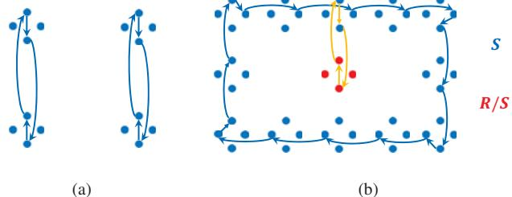  
Fig. 5: Examples of (a) a solution that satisfies Widget Coverage Constraints and Flow Conservation Constraints with subtours (b) a solution that satisfies Widget-Level Subtour Elimination Constraints 13 with subtours.

In order to make the Widget-Level Subtour Elimination Constraints work, we need to require each widget to be visited exactly once instead of at least once. However, for the red widget to be visited, a walk has to pass its only neighbor, i.e., the blue widget on top of it, twice. This results in a contradiction. To solve this problem, we need to eliminate such widgets with only one neighbor. We propose to transform the graph G into a complete graph by assigning the weight between any two vertices, e.g., $v_{i}$ and $v_{j}$ , as the shortest distance from $v_{i}$ to $v_{j}$ on graph G. Then the UAV can find a “short cut” between any two vertices with the total cost unchanged. Now we require exactly one vertex to be visited for each real widget:

$$
\sum_ {i \in \mathcal {W} _ {\eta}} v _ {i} = 1, \text {   for   all   } \mathcal {W} _ {\eta} \subset R \tag {14}
$$

In this way, we ensure that the solution walk passes each real widget once and there always exists a feasible solution. The resulted objective function and constraints now exactly model our Minimum-Energy Motion Planning (MEMP) problem, summarized as follows:

$$
\min \sum_ {i, j \in V} w _ {i j} f _ {i j}, \quad \text { subject   to: } \tag {15}
$$

$$
\sum_ {i \in \mathcal {W} _ {\eta}} v _ {i} = 1 \quad \text { for   all } \mathcal {W} _ {\eta} \subset R \tag {16}
$$

$$
\sum_ {i \in V} f _ {i j} = \sum_ {j \in V} f _ {j k} \quad \text { for   all } j \in V \tag {17}
$$

$$
\sum_ {i \in V _ {S}, j \in V _ {R / S}} f _ {i j} + f _ {j i} \geq 1 \quad \text { for   all } S \subset R, S \neq \emptyset \tag {18}
$$

$$
f _ {i j} \in \mathbb {N}, v _ {i} \in \{0, 1 \} \tag {19}
$$

Finally, we show that our problem is equivalent to Generalized Traveling Salesman Problem (GTSP) [6], defined as:

Definition 5: Given a complete weighted graph $G = (V, E, w)$ on $n$ vertices and a partition of $V$ into $m$ sets $P_V = \{V_1, ..., V_m\}$ , where $V_i \cap V_j = \emptyset$ for all $i \neq j$ and $\cup_{i=1}^m V_i = V$ , find a cycle in $G$ that contains exactly one vertex from each set $V_i, i \in 1, ..., m$ and has minimum length.

The real widgets in MEMP can be treated as the sets $P_V$ in Definition 5. The virtual widgets can be removed from the graph since all the walks passing them have short cuts with equal or less weight in the complete graph. Therefore, our problem can be efficiently solved using Large Neighborhood Search based algorithm $[6]$ for GTSP.

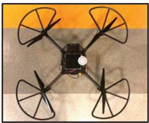

natural_image

Top-down view of a four-bladed drone with four blades, mounted on a central body against an orange background (no text or symbols visible)

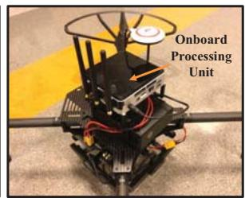

text_image

Onboard
Processing
Unit

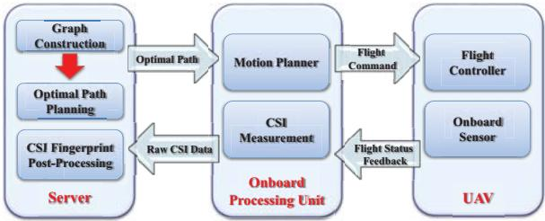

flowchart

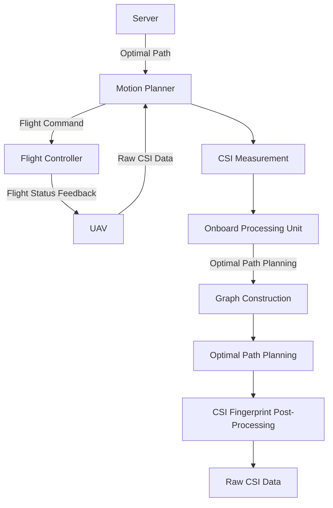

Fig. 6: System Overview.

## VI. SYSTEM IMPLEMENTATION

## A. System Overview

Our system consists of a server, an onboard processing unit and a UAV as shown in Figure 6. It works as follows:

First, the user provides a map of the region to be measured and the predicted coverage of each AP. In the server, we construct a graph representing the UAV's energy model and the CSI measurement task. Then the energy optimization problem is solved to obtain a minimum-energy path for the UAV.

After that, the server sends the optimal path to the onboard processing unit, which processes the path and generates a sequence of commands to be sent to the flight controller on the UAV. The motion planner also reads flight status feedback from the onboard sensor to adjust the succeeding commands. Meanwhile, the CSI measurement module on the onboard processing unit collects CSI data according to the plan.

Finally, all the raw CSI data are sent back to the server after the UAV finishes measuring the whole region. These data will then be further processed to build the fingerprint map to be used for indoor localization.

## B. Implementation Details

We implemente our system on top of an off-the-shelf programmable UAV. The details are given below:

Server: The server is implemented on an Asus laptop, in which a program is developed to construct the graph from the map and AP coverage setting. Then the graph is fed to the GLNS solver $[6]$ to derive the minimum length cycle on the graph. Besides, the server communicates with the onboard processing unit through Wi-Fi to send the planned path and receive CSI measurement data.

UAV and Onboard Processing Unit: We implement the proposed system on a commercialized programmable UAV

TABLE I: Energy Model Parameters

<table><tr><td>Parameter</td><td>Explanation</td><td>Value</td></tr><tr><td>$ E_{m} $</td><td>Energy cost for moving a grid</td><td>1.326 KJ</td></tr><tr><td>$ E_{t} $</td><td>Energy cost for making a turn</td><td>3.415 KJ</td></tr><tr><td>$ E_{s} $</td><td>Energy cost for switching APs</td><td>3.760 KJ</td></tr></table>

TABLE II: Simulation Statistics

<table><tr><td>Model</td><td>Baseline</td><td>S1</td><td>S2</td><td>MEMP</td></tr><tr><td>Energy (KJ)</td><td>1283.72</td><td>1292.52</td><td>823.95</td><td>799.05</td></tr><tr><td>Distance (m)</td><td>340</td><td>346</td><td>858</td><td>798</td></tr><tr><td>No. of turns</td><td>19</td><td>12</td><td>51</td><td>29</td></tr><tr><td>No. of switches</td><td>264</td><td>272</td><td>21</td><td>45</td></tr></table>

DJI Matrice 100 equipped with the DJI Guidance system [34] for positioning and obstacle avoidance in indoor environment. It carries an Intel NUC mini PC which communicates with the flight controller via UART serial communication. Motion planning for the UAV is implemented based on DJI onboard SDK in Robot Operating System (ROS). It takes the planned path as input and generates a sequence of commands for the UAV to execute. The onboard SDK also provides us the energy consumption for the UAV in the form of remaining battery power. Intel CSI Tool [4] is used to measure CSI on the UAV with an Intel 5300 Wi-Fi card. We use the ping command to send packets to an AP at the rate of 1000 packets/sec and CSI can be extracted from the replies sent back at High Throughput bitrates. We can achieve a CSI sample rate of approximately 600 packets/sec.

## VII. EXPERIMENTS

## A. UAV Energy Consumption Measurement

We conduct experiments to measure the three basic component of the energy model in a stadium. The UAV we use can show real-time remaining battery level in mAh on a mobile APP connected to its remote controller. The output voltage of the battery remains constant at 22.2 V. By recording the battery level when the UAV starts and finishes a task, we can compute the total energy consumed during the task by taking the product of the battery difference and the voltage.

We first investigate the effect of speed on energy consumption. We let the drone fly for the same distance of 30 meters at different constant speeds, i.e., 1 m/s, 2 m/s and 3 m/s. The total energy and time costs are shown in Figure 8a. Higher flying speed results in both less energy and time consumption.

To measure the energy consumption for straight flights and turns, we then let the UAV fly at a constant speed of 1 m/s for two different routes with same total distance. The first route is a round trip between two locations with 30 m distance. The second route consists of two round trips between two locations with 15 m distance. The energy consumed in the two routes are 35.12 KJ and 41.95 KJ while the UAV makes two turns and four turns respectively (the total energy consumption of the acceleration to 1 m/s at the beginning and deceleration from 1 m/s to hover at the end is the same as the energy cost by a single turn). Therefore, we derive the cost of a turn as $E_{t} = 3.415KJ$ and the cost of straight flight as 0.663 KJ/m. Last, we measure the energy consumption for hovering as 0.470 KJ/s by letting the UAV hover for 10 minutes.

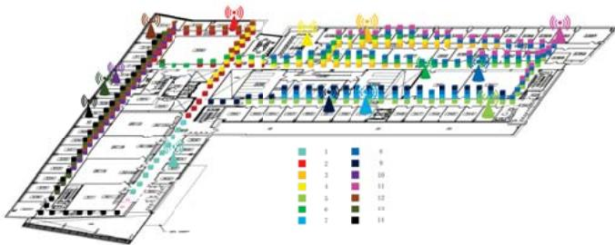

flowchart

Fig. 7: Experiment environment.

We set the grid interval as 2 meters and flying speed as 1 m/s to guarantee localization accuracy. And to switch to another AP, the UAV needs to hover for 8 seconds. Then the energy cost for a switch results from 8 seconds of hovering. The energy model parameters are summarized in Table I.

## B. Minimum-Energy Motion Planning

Now we discuss the effectiveness of our Minimum-Energy Motion Planning algorithm. We apply our algorithm to the environment setting shown in Figure 7. The experiment environment consists of several corridors, which are divided into grids with equal interval of 2 meters. Each grid is covered by different sets of APs specified by the color of the blocks at the grid. We construct a graph according to our design using the location and APs for each grid. The graph is then used as the input for the GTSP solver to generate the solution.

Figure 8b is an illustration of the solution. Only part of it is shown here for presentation clearness. The UAV begins with measuring CSI for AP 12, makes two turns before switching to AP 13 and turns back to measure CSI for AP 13. After that, the UAV measures CSI for AP 6 and AP 3 sequentially.

To show how energy efficient our solution is, we compare the total energy cost of the optimal solution derived by our MEMP algorithm with solutions given by a naive baseline approach, and two simplified versions of our algorithm.

Baseline: We use the conventional coverage path planning algorithm as a baseline approach. In this approach, only the total distance traveled by the UAV is considered. The solution given by this algorithm is the path that covers all the APs with shortest total distance. Other factors that affect the total energy consumption, such as number of turns and number of AP-switches, are not considered.

MEMP without AP-Switching Cost (S1): We consider a simplified version of our model, i.e., without taking into account the cost of switching between APs. In this version, the total energy cost by straight flights and turns is minimized. By comparing the solution given by this model with the baseline approach, we can understand the impact of AP-switching cost on the total cost.

MEMP without Turning Cost (S2): We also study the effect of turning cost. In this strategy, the UAV tries to avoid switching APs while following a relatively short path. But it may take unnecessary turns, which adds to the total cost. The three alternative solutions are all special cases of our MEMP algorithm. Thus, we can find the solution for each one of them using our model by setting both $E_{t}$ and $E_{s}$ to 0, only $E_{s}$ to 0 and only $E_{t}$ to 0 respectively. Then we compute the actual energy cost for each solution using the true costs $E_{m}, E_{t}$ and $E_{s}$ . The energy cost, distance traveled by the UAV, number of turns and number of times it switch between APs for each solution are shown in Table II.

We can see that the baseline solution gives the shortest distance, while simplified version 1 requires the least number of turns and simplified version 2 requires the least number of switching between APs. Our MEMP model gives the minimum energy consumption by finding a perfect balance between distance, number of turns and times of AP switching. It can save 37.8% energy compared with the baseline approach.

Another interesting observation is that the simplified algorithm S1 gives even higher energy cost than the baseline. The reason is that it let the UAV perform 8 more times of AP switching and travel 6 more meters, just to save 7 turns. This reveals the importance of modeling the cost of AP switching since this action actually takes more energy than the other two in this environment setting.

## C. Localization Using CSI Data Measured On UAV

We conduct indoor localization experiment in the environment as shown in Figure 7 to evaluate the effectiveness of the CSI fingerprint map built by our system. We collect training CSI samples at a total of 146 training locations with 2 meter interval using two methods, i.e., conventional manual war-driving and using our UAV system. 1000 CSI samples are collected for each AP at each location. For testing, we manually collect 100 CSI samples for each AP at each one of the 584 testing locations uniformly distributed in the environment with 0.5 meter interval. We implement the localization algorithm as described in section III-A1 and compare the results obtained using two sets of training data.

We use different number of collected training and testing samples to calculate the localization accuracy. We observe that if we use at least 200 training samples and 20 testing samples, the localization results will not improve noticeably even if more samples are used. Therefore, we present our results obtained using 200 training samples and 20 testing samples for each AP at each location in the following paragraph.

Figure 8c shows the cumulative distribution function (CDF) of the distance errors using the CSI data collected both manually and using our system. We observe that there is only a slight difference in localization error. 66.21% of the distance errors are within 2 meters for the training data collected manually, while for our system the percentage is 64.85%. And the mean distance error are 1.71 m and 1.95 m respectively. These results verify the fact that the CSI measured by our system can be used to achieve accurate indoor localization. Note that we use Naive Bayes Algorithm just to show the validity of the CSI data collected by our UAV system. Better accuracy can certainly be achieved by applying pre-processing techniques to the CSI data, which is left as future work.

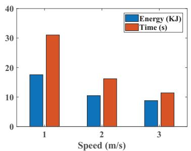

bar chart

| Speed (m/s) | Energy (kJ) | Time (s) |
|---|---|---|
| 1 | 18 | 31 |
| 2 | 10.5 | 16.5 |
| 3 | 9 | 11.5 |

(a) Energy and time vs. flying speed

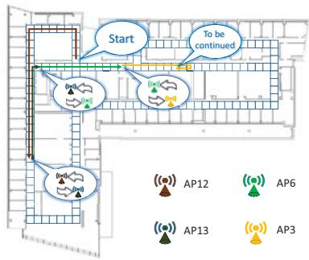

flowchart

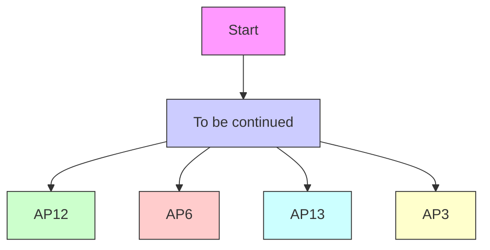

(b) Part of the energy-optimal path

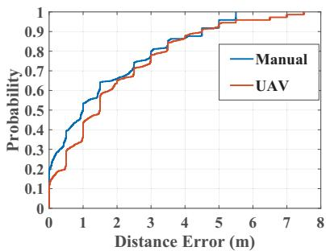

line chart

| Distance Error (m) | Manual | UAV   |
| ------------------ | ------ | ----- |
| 0                  | 0.0    | 0.0   |
| 1                  | 0.4    | 0.3   |
| 2                  | 0.6    | 0.5   |
| 3                  | 0.7    | 0.6   |
| 4                  | 0.8    | 0.7   |
| 5                  | 0.9    | 0.8   |
| 6                  | 0.95   | 0.9   |
| 7                  | 0.98   | 0.95  |
| 8                  | 1.0    | 1.0   |

(c) CDF of Localization Error  
Fig. 8: Experimental results.

## VIII. CONCLUSION

In this paper, we propose to use UAVs to automate CSI map construction, which can largely reduce labor and time cost for CSI-fingerprinting based indoor localization. We design a novel graph model to accommodate the cost of different actions for the UAV during CSI measurement. Then we formulate the Minimum-Energy Motion Planning problem for CSI measurement using UAVs as an optimization problem on the graph. We solve the problem by transforming it to the well-studied Generalized Traveling Salesman Problem, which can be solved efficiently using an existing solver. We implement our system using a commodity drone. We show that our solution can save 37.8% energy compared with conventional coverage planning algorithm. We also show by large scale experiments that accurate indoor localization can be achieved using CSI fingerprint map constructed by our system.

Acknowledgement: This work is supported by National Science Foundation under Grant No. 1421903.

## REFERENCES

[1] J. Xiao, K. Wu, Y. Yi, and L. M. Ni, “Fifs: Fine-grained indoor fingerprinting system,” in IEEE ICCCN, 2012, pp. 1–7.  
[2] K. Wu, J. Xiao, Y. Yi, M. Gao, and L. M. Ni, “Fila: Fine-grained indoor localization,” in IEEE INFOCOM, 2012, pp. 2210–2218.  
[3] X. Wang, X. Wang, and S. Mao, “Cifi: Deep convolutional neural networks for indoor localization with 5 ghz wi-fi,” in IEEE ICC, 2017, pp. 1–6.  
[4] D. Halperin, W. Hu, A. Sheth, and D. Wetherall, “Tool release: Gathering 802.11n traces with channel state information,” ACM SIGCOMM CCR, vol. 41, no. 1, p. 53, Jan. 2011.  
[5] E. Yu, X. Xiong, and X. Zhou, “Automating 3d wireless measurements with drones,” in ACM WiNTECH, 2016, pp. 65–72.  
[6] S. L. Smith and F. Imeson, “GLNS: An effective large neighborhood search heuristic for the generalized traveling salesman problem,” Computers & Operations Research, vol. 87, pp. 1–19, 2017.  
[7] L.-X. Chuo, Z. Luo, D. Sylvester, D. Blaauw, and H.-S. Kim, “Rf-echo: A non-line-of-sight indoor localization system using a low-power active rf reflector asic tag,” in ACM MobiCom, 2017, pp. 222–234.  
[8] L. Shangguan and K. Jamieson, “The design and implementation of a mobile rfid tag sorting robot,” in ACM MobiSys, 2016, pp. 31–42.  
[9] S. P. Tarzia, P. A. Dinda, R. P. Dick, and G. Memik, “Indoor localization without infrastructure using the acoustic background spectrum,” in ACM MobiSys, 2011, pp. 155–168.  
[10] P. Lazik and A. Rowe, “Indoor pseudo-ranging of mobile devices using ultrasonic chirps,” in ACM SenSys, 2012, pp. 99–112.  
[11] C. Zhang and X. Zhang, “Pulsar: Towards ubiquitous visible light localization,” in ACM MobiCom, 2017, pp. 208–221.  
[12] S. Zhu and X. Zhang, “Enabling high-precision visible light localization in today’s buildings,” in ACM MobiSys, 2017, pp. 96–108.  
[13] S. Liu and T. He, “Smartlight: Light-weight 3d indoor localization using a single led lamp,” in ACM SenSys, 2017, pp. 11:1–11:14.  
[14] S. Sen, J. Lee, K.-H. Kim, and P. Congdon, “Avoiding multipath to revive inbuilding wifi localization,” in ACM MobiSys, 2013, pp. 249–262.  
[15] S. Kumar, S. Gil, D. Katabi, and D. Rus, “Accurate indoor localization with zero start-up cost,” in ACM MobiCom, 2014, pp. 483–494.  
[16] K. Liu, X. Liu, and X. Li, “Guoguo: Enabling fine-grained indoor localization via smartphone,” in ACM MobiSys, 2013, pp. 235–248.  
[17] H. Wang, S. Sen, A. Elgohary, M. Farid, M. Youssef, and R. R. Choudhury, “No need to war-drive: Unsupervised indoor localization,” in ACM MobiSys, 2012, pp. 197–210.  
[18] M. Youssef and A. Agrawala, “The horus wlan location determination system,” in ACM MobiSys, 2005, pp. 205–218.  
[19] Z. Yang, C. Wu, and Y. Liu, “Locating in fingerprint space: wireless indoor localization with little human intervention,” in ACM MobiCom, 2012, pp. 269–280.  
[20] S. Sen, B. Radunovic, R. R. Choudhury, and T. Minka, “You are facing the mona lisa: spot localization using phy layer information,” in ACM MobiSys, 2012, pp. 183–196.  
[21] M. Kotaru, K. Joshi, D. Bharadia, and S. Katti, “Spotfi: Decimeter level localization using wifi,” in ACM SIGCOMM Computer Communication Review, vol. 45, no. 4, 2015, pp. 269–282.  
[22] J. Xiong and K. Jamieson, “Arraytrack: A fine-grained indoor location system,” in USENIX NSDI, 2013.  
[23] J. Gjengset, J. Xiong, G. McPhillips, and K. Jamieson, “Phaser: Enabling phased array signal processing on commodity wifi access points,” in ACM MobiCom, 2014, pp. 153–164.  
[24] A. T. Mariakakis, S. Sen, J. Lee, and K.-H. Kim, “Sail: Single access point-based indoor localization,” in ACM MobiSys, 2014, pp. 315–328.  
[25] D. Vasisht, S. Kumar, and D. Katabi, “Decimeter-level localization with a single wifi access point.” in USNIX NSDI, vol. 16, 2016, pp. 165–178.  
[26] J. Xiong, K. Sundaresan, and K. Jamieson, “Tonetrack: Leveraging frequency-agile radios for time-based indoor wireless localization,” in ACM MobiCom, 2015, pp. 537–549.  
[27] Y.-Y. Wang, J.-T. Chen, and W.-H. Fang, “Tst-music for joint doa-delay estimation,” IEEE Transactions on Signal Processing, vol. 49, no. 4, pp. 721–729, 2001.  
[28] S. C. Wong and B. A. MacDonald, “A topological coverage algorithm for mobile robots,” in IEEE IROS, vol. 2, 2003, pp. 1685–1690.  
[29] S. Wong and B. MacDonald, “Complete coverage by mobile robots using slice decomposition based on natural landmarks,” in PRICAI. Springer, 2004, pp. 683–692.  
[30] A. Zelinsky, R. A. Jarvis, J. Byrne, and S. Yuta, “Planning paths of complete coverage of an unstructured environment by a mobile robot,” in IEEE ICAR, vol. 13, 1993, pp. 533–538.  
[31] Y. Gabriely and E. Rimon, “An on-line coverage algorithm of grid environments by a mobile robot,” in IEEE ICRA, 2002.  
[32] A. Xu, C. Viriyasuthee, and I. Rekleitis, “Optimal complete terrain coverage using an unmanned aerial vehicle,” in IEEE ICRA, 2011, pp. 2513–2519.  
[33] J. Modares, F. Ghanei, N. Mastronarde, and K. Dantu, “Ub-anc planner: Energy efficient coverage path planning with multiple drones,” in IEEE ICRA, 2017, pp. 6182–6189.  
[34] G. Zhou, L. Fang, K. Tang, H. Zhang, K. Wang, and K. Yang, “Guidance: A visual sensing platform for robotic applications,” in IEEE CVPR Workshops, 2015, pp. 9–14.