# Balancing Energy Efficiency and Communication Quality in UAV Cargo Delivery Systems

Haixia Peng , Member, IEEE, Jiangling Cao, Dingcheng Yang , Member, IEEE, Chenxi Li , Member, IEEE, Tom H. Luan , Senior Member, IEEE, and Zhou Su , Senior Member, IEEE

Abstract—In this article, we investigate the tradeoff issue between energy efficiency and communication quality in the uncrewed aerial vehicle (UAV) enabled cargo delivery system. For a cellular-connected cargo UAV delivering parcels from the warehouse to each user’s location, minimizing both the energy consumption and expected outage time is essential. However, a tradeoff exists between these two factors, optimizing one aspect is bound to diminished performance in the other. To jointly reduce the UAV’s energy consumption and expected outage time, we formulate an optimization problem with the objective function to minimize the weighted sum of UAV’s energy consumption and expected outage time. With the aid of radio map, a hybrid deep reinforcement learning (HDRL) algorithm, consisting of an improved ant colony optimization algorithm and the dueling double deep Q network algorithm, is proposed to solve the formulated problem. The delivery sequence and the flight trajectory of the UAV are then jointly optimized by solving the problem with the HDRL algorithm. Numerical results demonstrate that the proposed algorithm effectively reduces both energy consumption and outage time, while achieving a performance improvement of approximately 6% to 50% compared to the comparisons. Moreover, the communication quality of the UAV improves with an increased weight factor, yet gives rise to a higher energy consumption.

Index Terms—Cellular-connected cargo uncrewed aerial vehicle (UAV), dueling double deep Q network (D3QN), improved ant colony optimization (IACO), trajectory optimization.

## I. INTRODUCTION

ITH the rapid development of global e-commerce, the logistics industry is facing unprecedented challenges. Factors, such as traffic congestion, rising labor costs, and extended delivery times have rendered traditional logistics models increasingly inadequate in meeting modern consumers’ demands for fast, convenient, and efficient distribution services [1]. As an innovative solution, uncrewed aerial vehicle (UAV) technology has shown great potential in logistics and cargo delivery [2], [3]. First, UAVs can significantly improve the delivery efficiency [4]. Compared to traditional ground transportation methods, UAVs offer the advantage of bypassing traffic congestion, road closures, and similar obstacles, thereby minimizing time inefficiencies in the cargo delivery process. Second, employing UAVs for package delivery can noticeably enhance cost-efficiency in logistics operations [5]. Currently, UAVs are predominantly battery-powered, resulting in lower energy costs compared to gas-powered vehicles, particularly for the delivery of light weight packages. In addition, cargo UAVs reduce dependence on human pilots, therefore lowering labor costs, especially in short-distance and high-frequency delivery operations. Finally, the UAV-enabled cargo delivery is with less impact on the environment, which aligns with the principles of green logistics and sustainable develop ment [6]. Most UAVs are battery-powered, reducing reliance on oil resources and significantly lowering carbon emissions, which are nearly negligible compared to traditional vans and trucks. Moreover, advances in UAV technology, coupled with improved battery endurance and charging efficiency, position UAVs as a more environmentally friendly transportation option, fostering the growth of green logistics. Given the above reason, companies, such as Amazon [7], JD.com [8], and Shunfeng (SF) [9] have leveraged UAVs to package delivery to enhance efficiency. For instance, Amazon’s announced it “Prime Air” program, launched in 2013, aims to deliver small packages within 30 min by deploying UAVs capable of transporting goods directly from warehouses to customers, primarily in urban and suburban areas [10].

## A. Related Works

Many researches have been carried out on traditional UAV cargo delivery systems and made satisfactory achievements. These works can be categorized into three main directions, namely, optimization of communication quality for cargo UAVs, optimization of energy efficiency for cargo UAVs, and joint optimization of communication quality and energy efficiency for cargo UAVs.

1) Optimization of Communication Quality for Cargo UAVs: Patchou et al. employed UAVs for package delivery in response to the unexpected outbreak of the COVID-19 pandemic [11]. In their study, UAV’s trajectory were designed to ensure efficient package delivery and reliable communication links throughout the flight. Similarly, Lau et al. developed a UAV-based medical supply delivery system, wherein the UAV is required to maintain stable communication throughout its flight [12].

2) Optimization of Energy Efficiency for Cargo UAVs: Peng et al. proposed a novel hybrid genetic algorithm to facilitate cooperation between ground logistics vehicles and UAVs, aiming to enhance the UAVs’ energy efficiency [13]. Pan et al. introduced an innovative scheduling framework for logistics UAVs that utilizes public buses to expand delivery range and improve their energy efficiency [14]. Studies [15] and [16] further advanced energy efficiency and service quality through truck-UAV collaborative cargo delivery schemes.

3) Joint Optimization of Communication Quality and Energy Efficiency: In [17], Liu et al. optimized the trajectory of cargo UAV to minimize energy consumption and communication outage time while ensuring timely packages delivery. Furthermore, Cherif et al. [18] and [19] focused on trajectory optimization to reduce energy consumption and enhance communication quality by minimizing the handover rate between the cargo UAV and its associated base station (BS).

While significant researches have explored UAV applications in logistics, prior studies primarily focused on traditional nonnetworked UAVs, which lack real-time communication capabilities with central control systems. This limitation prevents the real-time transmission of critical data, such as flight status, position, and delivery progress, to the control center, which are essential for logistics operations. Moreover, the point-to-point communication mode of nonnetworked UAVs restricts their communication and delivery range to reach the remote or ground control station. To address these limitations, recent studies have employed the cellular-connected UAVs for cargo delivery, leveraging radio maps to optimize performance [20], [21], [22], [23]. In [20], researchers optimizing pick-up and delivery sequence and UAV flight trajectory while ensuring cellular connectivity. In [21], the UAV’s trajectory is optimized to reduce flight energy consumption, and [22] has jointly optimized the pick-up policy and flight trajectory to enhance package value and minimize UAV communication outage time base on deep reinforcement learning (DRL).

## B. Motivation and Contributions

Although some scholars have investigated the application of cellular-connected UAVs in logistics, our investigation reveals that the tradeoff between energy consumption and communication quality in UAV-enabled cargo delivery systems remains unexplored and unresolved. For instance, studies [11] and [12] examined the communication quality of cargo UAVs. Nevertheless, the energy efficiency of the system has not been explored. Similarly, although works [13], [14], [15], [16] focused on optimizing the energy efficiency of UAV-based cargo delivery systems, they did not consider the UAV’s communication performance. In [17], [18], and [19], the authors jointly optimized energy efficiency and communication quality, yet the nonnegligible vertical flight energy consumption of UAV and the impact of UAV speed on energy consumption were not considered. More importantly, these works assumed a single-user delivery scenario, which is unrealistic in practical applications and disregards the influence of delivery sequence on overall system performance. Finally, none of these works explored the inherent tradeoff between energy efficiency and communication quality in cargo UAV systems.

However, investigating the aforementioned tradeoff is crucial for the efficient and balanced design of UAV delivery systems. On the one hand, as most existing cellular BSs are mainly designed for ground equipment users, their antennas are usually tilted downward, leading to small signal coverage in the air. On the other hand, urban areas are characterized by a high density of buildings, which frequently causes the communication channel between the UAV and the BS to alternate between Line-of-Sight (LoS) and Non-LoS (NLoS) conditions during flight [24]. Currently, the prevailing approaches involve trajectory planning for the UAV to ensure communication quality [25], [26], [27], [28]. Nevertheless, this strategy often results increased energy consumption for the UAV. Moreover, as the weight of packages assigned to each user varies, and the flight energy consumption of cargo UAV is load-dependent, optimizing the delivery sequence of cargo UAVs is an effective strategy for minimizing flight energy consumption [29].

To address the abovementioned research gaps, we study the tradeoff between energy consumption and communication quality in UAV-enabled cargo delivery systems. By jointly optimizing the cargo delivery sequence and flight trajectory of the UAV, we aim to achieve a balanced compromise between energy consumption and communication quality under varying weight factor considerations. The main contributions of this article are summarized as follows.

1) We develop a joint optimization framework aimed at minimizing the UAV’s energy consumption and the expected outage time in a cellular-connected cargo delivery system. Our analysis accounts for both horizontal and vertical flight energy consumption, enabling a holistic evaluation of energy efficiency within the system.

2) To address the formulated directed weighted traveling salesman problem (TSP), we introduce an improved ant colony optimization (IACO) algorithm. The proposed algorithm simultaneously optimizes the cargo delivery sequence and the UAV’s flight speed, significantly reducing the UAV’s energy consumption.

3) We construct a radio map to model the signal outage probability for any location within the UAV’s flight area. Leveraging this map, we develop a dueling double deep Q network (D3QN) algorithm to optimize the UAV’s trajectory. This approach ensures minimized energy consumption and outage time, irrespective of the weight factor constraints.

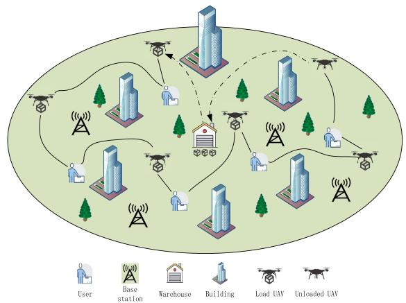  
Fig. 1. Illustration of the cellular-connected UAV for cargo delivery.

## C. Organization and Notations

The rest of this article is organized as follows. Section II presents the system model of UAV-enabled cargo delivery. Section III formulates and preliminarily analyzes the tradeoff optimization problem. In Section IV, we introduce the proposed hybrid DRL (HDRL) algorithm, and utilize it to solve the formulated problem. The simulation results are presented in Section V. Finally, we summarize the conclusions in Section VI.

In this article, scalars are represented by italic letters, while vectors are denoted by bold-face lowercase letters, and matrices are denoted by bold-face uppercase letters. Moreover, $\mathbb { R } ^ { N \times 1 }$ denotes the space of N-dimensional real-valued vector. a represents the Euclidean norm of vector a. For a timedependent function y(t), y˙(t) denotes the first-order derivative with respect to time t.

## II. SYSTEM MODEL OF UAV-ENABLED CARGO DELIVERY

In this article, we consider a delivery scenario for cellularconnected UAV, as shown in Fig. 1. The target cargo UAV needs to carry all the packages from the designated take-off point, i.e., the warehouse, and delivers the package to each user within its service area. Denote $\| { \mathbf { v } ( t ) } \| = \nu ( t ) ~ ( 0 \leq \nu ( t ) \leq$ $V _ { \mathrm { m a x } } )$ as the flight speed of cargo UAV, where $V _ { \mathrm { m a x } }$ is the maximum flight speed. The area served by the given cargo UAV is $L \times L \mathrm { k m } ^ { 2 }$ . The UAV’s flight trajectory is represented by $\mathbf { q } ( t ) = ( x _ { u } ( t ) , y _ { u } ( t ) , H _ { u } ( t ) ) \in \mathbb { R } ^ { 3 \times 1 }$ , adhering to

$$
0 \leq x _ { u } ( t ) \leq L\tag{1}
$$

$$
0 \leq y _ { u } ( t ) \leq L\tag{2}
$$

$$
0 \le H _ { u } ( t ) \le H _ { \operatorname* { m a x } }\tag{3}
$$

where $x _ { u } ( t ) , y _ { u } ( t )$ , and $H _ { u } ( t )$ represent the horizontal, vertical, and altitude of the cargo UAV’s position at time t, respectively. $H _ { \mathrm { m a x } }$ represents the maximum flight altitude.

Users with set ${ \mathcal { K } } = \{ 1 , 2 , \dots , K \}$ are randomly distributed within the service area. Their locations are represented by $\mathcal { Q } =$ $\{ Q _ { 1 } , Q _ { 2 } , \dots , Q _ { K } \}$ , where $Q _ { k } \in \mathcal { Q }$ represents the kth user’s 2-D position $( x _ { k } , y _ { k } )$ . The location of warehouse is represented by $Q _ { 0 } = ( x _ { 0 } , y _ { 0 } )$ . In the considered scenario, assume packages delivered to each user are with different weights, denoted by $\mathcal { W } ~ = ~ \{ W _ { 1 } , W _ { 2 } , \ldots , W _ { K } \}$ , namely, $W _ { k } ~ \in ~ \mathcal { W }$ indicates that the cargo UAV needs to deliver a package weighing $W _ { k }$ Newtons (N) to the kth user. Once all packages are delivered to users, the cargo UAV then returns to the warehouse. The weight of the cargo UAV is $W _ { \mathrm { u a v } }$ . When the cargo UAV takes off from the warehouse, its weight then changes to specify $\begin{array} { r } { W _ { \mathrm { t o t a l } } ~ = ~ W _ { \mathrm { u a v } } + \sum _ { i = 1 } ^ { K } W _ { i } } \end{array}$ . We define the process wherein the cargo UAV transports all packages from the takeoff point, completes the delivery of all assigned packages, and subsequently returns to the warehouse as a complete task, characterized by the total required time T.

## A. Communication Model

During task execution, the cargo UAV must maintain communicating with the ground BSs to transmit critical information, including real-time location and cargo allocation, to the ground operators [30]. Simultaneously, it receives operational instructions from the ground to ensure seamless coordination. According to the 3rd generation partnership project (3GPP) protocol and standard sector technology [31], [32], each BS serves three cellular cells. Denote $\mathcal { G } = \{ 1 , 2 , \ldots , G \}$ as the cellular cell set within the UAV’s legal flying area.

For a given BS, the signal power received by the cargo UAV from cellular cell $g \in { \mathcal { G } }$ at time $t , p _ { g } ( t )$ , can be defined by

$$
p _ { g } ( t ) = \bar { P } _ { g } | h _ { g } ( t ) | ^ { 2 } = \bar { P } _ { g } \beta _ { g } ( \mathbf { q } ( t ) ) G _ { g } ( \mathbf { q } ( t ) ) \tilde { h } _ { g } ( t )\tag{4}
$$

where $\bar { P } _ { g }$ is a constant, with its value determined by the type and configuration of the given BS. $h _ { g } ( t )$ represents the channel gain from cell $g$ to the cargo UAV at time t, which is a function of large-scale channel gain $\beta _ { g } ( \cdot )$ , BS antenna gain $G _ { g } ( \cdot )$ , and small-scale fading $\tilde { h } _ { g } ( t )$

For a given time t during flight, the cargo UAV is allowed to communicate with one of the G cells, and denote the communication association pattern by c(t) [26]. Namely, we have $c ( t ) \in \mathcal { G }$ , indicating the cargo UAV communicates with the c(t)th cellular cell at time t. The signal interference in the environment is sufficiently small compared to the interference originating from other nonassociated cells.1 The signal-tointerference ratio (SIR) received by the cargo UAV from the c(t)th cell then can be calculated by [26]

$$
\mathrm { S I R } ( c ( t ) ) \triangleq \frac { p _ { c ( t ) } ( t ) } { \sum _ { g \neq c ( t ) } p _ { g } ( t ) } .\tag{5}
$$

We define a threshold, denoted as $\lambda _ { \mathrm { t h } }$ . If the SIR of the cargo UAV at time t satisfies $\mathrm { S I R } ( c ( t ) ) \geq \lambda _ { \mathrm { t h } }$ , it is inferred that the cargo UAV can communicate with the ground BSs under

normal conditions, and vice versa. The outage probability, i.e., the probability of disruption of the communication link between the cargo UAV and the BS is then calculated as

$$
P _ { \mathrm { o u t } } ( \mathbf { q } ( t ) , c ( t ) ) = \mathrm { P r } \{ \mathrm { S I R } ( c ( t ) ) < \lambda _ { \mathrm { t h } } \}\tag{6}
$$

where Pr(·) is the probability of the event. To more intuitively reflect the communication quality of the cargo UAV, the outage time [26], representing the cumulative duration of communication link disruptions between the cargo UAV and the BSs throughout a complete task, calculated by

$$
T _ { \mathrm { o u t } } ( \mathbf { q } ( t ) , c ( t ) ) = \int _ { 0 } ^ { T } P _ { \mathrm { o u t } } ( \mathbf { q } ( t ) , c ( t ) ) d t .\tag{7}
$$

## B. Delivery Model for Cargo UAV

Define $\begin{array} { r l r } { \Phi } & { { } = } & { \left\{ \phi _ { 0 } , \phi _ { 1 } , \dots , \phi _ { K } , \phi _ { K + 1 } \right\} } \end{array}$ as the delivery sequence for the cargo UAV, which follows:

$$
\phi _ { 0 } = \phi _ { K + 1 } = 0\tag{8}
$$

$$
\phi _ { k } = m \ \forall m \in { \mathcal { K } } , \exists k \in \{ 1 , 2 , \dotsc , K \}\tag{9}
$$

$$
\phi _ { i } \neq \phi _ { j } , i \neq j \forall i , j \in \{ 1 , 2 , \ldots , K \} .\tag{10}
$$

Equation (8) indicates that the cargo UAV must be positioned at the warehouse location at both the start and end of the task, with the warehouse designated by the label 0. Equation (9) denotes that the kth delivery mission for the cargo UAV is the user with label m. Equation (10) specifies that each user is served once by the cargo UAV during a complete task.

Assume that the UAV flies vertically when it takes off and lands, and flies horizontally once it reaches the altitude of $H _ { \mathrm { m a x } }$ . Define $W ( t )$ as the UAV’s weight at time t. The package unloading time of the cargo UAV is neglected. Let $t _ { \phi _ { k } }$ be the service time of the kth delivery mission, then the UAV’s flight trajectory will be

$$
\begin{array} { r } { \mathbf q \left( t _ { \phi _ { k } } \right) = \left( x _ { \phi _ { k } } , y _ { \phi _ { k } } , 0 \right) \forall k \in \{ 1 , 2 , \ldots , K \} . } \end{array}\tag{11}
$$

The corresponding weight of the UAV can be expressed as

$$
W \big ( t _ { \phi _ { k } } \big ) = W _ { \mathrm { t o t a l } } - \sum _ { n = 1 } ^ { k } W _ { \phi _ { n } } \ \forall k \in { 1 , 2 , \dots , K } .\tag{12}
$$

## C. Energy Consumption Model of Cargo UAV

During the delivery process of the cargo UAV, the energy stored in its battery is primarily allocated to two key functions, providing propulsion for its flight and facilitating data transmission between the cargo UAV and the ground BSs, referred to as propulsion energy and communication energy, respectively. The propulsion energy is propulsion energy to ensure the UAV can successfully deliver packages to designated users and complete the overall task. Meanwhile, the communication energy is primarily employed to enable timely observation of critical information, such as the UAV’s flight status and task progress, by the ground operators. It also ensures the UAV can reliably receive operational instructions from the ground BS. Given the communication energy is much smaller than the propulsion energy, we ignore the communication energy in the whole package delivery process.

In [34], the author has deduced the propulsion power of the rotary-wing UAV with fixed speed and weight in horizontal flight is given by

$$
\begin{array} { r l } & { P _ { \mathrm { h o r } } ( \nu ( t ) , W ( t ) ) = \underbrace { P _ { 0 } \Bigg ( 1 + \frac { 3 \nu ( t ) ^ { 2 } } { U _ { \mathrm { t i p } } ^ { 2 } } \Bigg ) } _ { \mathrm { b l a d e ~ p r o f i l e } } + \underbrace { \frac { 1 } { 2 } d _ { 0 } \rho s A \nu ( t ) ^ { 3 } } _ { \mathrm { p a r a s i t e } } } \\ & { \qquad + \underbrace { P _ { i } \Bigg ( \sqrt { 1 + \frac { \nu ( t ) ^ { 4 } } { 4 \nu _ { 0 } ^ { 4 } } } - \frac { \nu ( t ) ^ { 2 } } { 2 \nu _ { 0 } ^ { 2 } } \Bigg ) ^ { 1 / 2 } } _ { \mathrm { i n d u c e d } } \quad \forall \dot { H } _ { u } ( t ) = 0 } \end{array}\tag{13}
$$

where $U _ { \mathrm { t i p } } , \ d _ { 0 } , \ \rho , \ s ,$ A, and $\nu _ { 0 }$ represent the tip speed of the rotor blade, the fuselage drag ratio, the air density, the rotor solidity, the rotor disc area, and the mean rotor induced velocity in hover, respectively.

Given the time-varying speed and weight of the UAV in the cargo UAV delivery scenario, parameters $P _ { i }$ and $\nu _ { 0 }$ in (13) depend on the real-time weight $W ( t )$ of the cargo UAV, calculated by

$$
P _ { i } = ( 1 + k ) ~ \frac { W ( t ) ^ { 3 / 2 } } { \sqrt { 2 \rho A } }\tag{14}
$$

$$
\nu _ { 0 } = \sqrt { \frac { W ( t ) } { 2 \rho A } } .\tag{15}
$$

In addition to the energy expended by the UAV during horizontal flight, additional energy consumption occurs during its ascent. However, during vertical descent, the UAV operates in autorotation and remains unpowered, resulting in its energy consumption be approximately negligible [35]. The propulsion power of the UAV during its ascent is calculated as [35]

$$
P _ { \mathrm { v e r } } ( H _ { u } ( t ) ) = W ( t ) \dot { H _ { u } } ( t ) \ \forall \dot { H _ { u } } ( t ) > 0 .\tag{16}
$$

Then, the total energy consumption E of the UAV after executing a task is given by

$$
\begin{array} { r } { E ( \{ \Phi , \nu _ { d } ( t ) , \mathbf { q } ( t ) \} ) = \underbrace { \int _ { 0 } ^ { T } P _ { \mathrm { h o r } } ( \nu _ { d } ( t ) , W ( t ) ) d t } _ { E _ { h } } } \\ { + \underbrace { \int _ { 0 } ^ { T } P _ { \mathrm { v e r } } ( H _ { u } ( t ) ) d t } _ { E _ { v } } } \end{array}\tag{17}
$$

where $E _ { h }$ and $E _ { \nu }$ indicate the energy consumption of horizontal flight and vertical flight, respectively.

## III. PROBLEM FORMULATION AND ANALYSIS

To address the tradeoff between energy efficiency and communication quality in UAV cargo delivery systems, the problem to be solved is formulated in this section. Moreover, this section analyzes the relationship between the UAV’s communication quality and the communication scheduling, as well as the UAV’s energy consumption and the flight speed, so as to reduce the complexity of the problem.

## A. Problem Formulation

The primary task of the cargo UAV is to deliver packages from the starting point to all users within the designated service area. Given the presence of multiple users, the UAV’s delivery sequence exhibits significant diversity. It is stipulated that upon reaching the location directly above a ground user (GU), the UAV descends vertically to the GU’s position. After completing the delivery, it ascends vertically to the maximum flight altitude, $H _ { \mathrm { m a x } }$ , and continues its horizontal flight to the next GU’s position. Consequently, this study focuses on optimizing the UAV’s delivery sequence and horizontal flight trajectory at high altitudes to achieve the following two objectives: 1) minimizing the UAV’s total outage time, and 2) minimizing its total energy consumption.

Considering the tradeoff between the above two objectives, a communication factor $\mu$ is utilized to present the focus of the two objectives. Specifically, a larger $\mu$ indicates that the system pays more attention to the UAV’s communication quality, and to its energy consumption otherwise. In addition, given the UAV’s total outage time $T _ { \mathrm { o u t } }$ is much smaller than its total energy consumption $E _ { c }$ , a compensation factor, $\rho ( t )$ is further involved to balance the two objectives [36]. In particular, $\rho ( t )$ is set to the UAV’s flight power at time $t ,$ i.e., $\rho ( t ) \ = \ P _ { \mathrm { h o r } } ( \nu _ { d } ( t ) , W ( t ) )$ . Given that, the following optimization problem is formulated:

$$
\mathrm { P 0 } : \operatorname* { m i n } _ { \substack { \mathbf { q } ( t ) , c ( t ) , \mathbf { v } ( t ) , \Phi } } \quad E ( \{ \Phi , \nu _ { d } ( t ) , \mathbf { q } ( t ) \} )
$$

$$
+ \mu \rho ( t ) T _ { \mathrm { o u t } } ( \{ { \bf q } ( t ) , c ( t ) \} )\tag{18}
$$

$$
\textbf { ( } \dot { \textbf { q } } ( t ) = \mathbf { v } ( t )\tag{18a}
$$

$$
0 \leq \| \mathbf { v } ( t ) \| \leq V _ { \operatorname* { m a x } }\tag{18b}
$$

$$
{ \bf q } ( 0 ) = { \bf q } ( T ) = ( x _ { 0 } , y _ { 0 } , 0 )\tag{18c}
$$

$$
\mathrm { s . t . } \big \{ \big \vert \begin{array} { l } { \mathbf { q } \big ( t _ { \phi _ { k } } \big ) = \big ( x _ { \phi _ { k } } , y _ { \phi _ { k } } , 0 \big ) , \exists t _ { \phi _ { k } } \in [ 0 , T ] \ \forall k \in \mathcal { K } } \end{array}\tag{18d}
$$

$$
0 \leq x _ { u } ( t ) \leq L \ \forall t \in [ 0 , T ]\tag{18e}
$$

$$
0 \le y _ { u } ( t ) \le L \ \forall t \in [ 0 , T ]\tag{18f}
$$

$$
\textbf { \textit { l } } _ { c ( t ) \in \{ 1 , \dots , G \} } \forall t \in [ 0 , T ] .\tag{18g}
$$

The objective function of problem P0 is to minimize the weighted sum of energy consumption and outage time of the UAV. Constraints (18a) and (18b) represent the flight dynamics governing the operation of the cargo UAV. (18c) ensures that the UAV must be located at the warehouse at both the start and end of the task. (18d) specifies that the UAV must visit each user’s location at a specific time to deliver packages. (18e) and (18f) impose restrictions on the $\mathrm { U A V } \mathbf { \hat { s } }$ flight path, ensuring that it remains within the designated service area at all times. (18g) requires that the UAV maintains communication with exactly one BS within the service area at any given time.

## B. Problem Analysis

Obviously, problem P0 is a nonconvex problem, which is intractable with traditional convex optimization methods. Thus, we initially optimize communication scheduling and energy consumption of the cargo UAV to simplify problem P0.

1) Optimization of UAV Communication Scheduling: As the communication schedule c(t) of the cargo UAV defined in Section II-A, $T _ { \mathrm { o u t } }$ in the objective function is a function of $c ( t )$ . To reduce the total outage time, we define the optimal communication scheduling $c ^ { * } ( t )$ of the UAV at time t as the communication between the UAV and all ground BSs with the largest value of SIR, expressed as

$$
\operatorname { S I R } \left( c ^ { * } ( t ) \right) \geq \operatorname { S I R } ( c ( t ) ) \forall c ( t ) \in \{ 1 , 2 , \ldots , G \}\tag{19}
$$

$$
c ^ { * } ( t ) \in \{ 1 , 2 , . . . , G \} .\tag{20}
$$

Once the communication links given by (19) and (20) are established, there will be

$$
\mathrm { P r } \big \{ \mathrm { S I R } \big ( c ^ { * } ( t ) \big ) < \lambda _ { \mathrm { t h } } \big \} < \mathrm { P r } \{ \mathrm { S I R } ( c ( t ) ) < \lambda _ { \mathrm { t h } } \} .\tag{21}
$$

According to (6) and (7), we can easily get

$$
T _ { \mathrm { o u t } } \big ( \big \{ \mathbf { q } ( t ) , c ^ { * } ( t ) \big \} \big ) < T _ { \mathrm { o u t } } ( \{ \mathbf { q } ( t ) , c ( t ) \} ) .\tag{22}
$$

Therefore, it is stipulated that the UAV must communicate with the BS with the largest SIR for a given time, reducing the total outage time of the UAV by communication scheduling. The total outage time of the UAV, $T _ { \mathrm { o u t } } ,$ is then only related to trajectory q(t). Let $T _ { \mathrm { o u t } } ( \mathbf { q } ( t ) )$ be the total outage time of the UAV, namely, $T _ { \mathrm { o u t } } ( { \bf q } ( t ) ) \triangleq T _ { \mathrm { o u t } } ( { \bf q } ( t ) , c ^ { * } ( t ) )$ . Based on (19)–(22), the signal coverage map of the UAV flight area can be derived.

2) Optimization of Energy Consumption: The propulsion energy of the cargo UAV mainly consists of two parts, the horizontal flight energy consumption and the climb flight energy consumption. Equation (13) in Section II-C shows that the horizontal flight power of the UAV is a function of its speed and weight. Among the various components the flight power of a UAV, blade profile power, parasite power, and induced power are influenced by the UAV’s flight speed. However, only induced power is additionally affected by the UAV’s weight. To illustrate these relationships, we plotted the induced power and flight power as functions of the UAV’s flight speed and weight, as presented in Figs. 2 and 3.

From Figs. 2 and 3, it can be observed that for a given UAV weight, there exists an optimal flight speed at which the UAV’s power consumption is minimized [34]. However, if the UAV operates below its maximum speed, the flight time increases. Since energy consumption is the product of power and flight time, this introduces a tradeoff between minimizing power and extending flight time.

To address the aforementioned tradeoff, inspired by the minimum energy speed in [34], a minimum energy consumption speed (MEC-speed), $\nu ^ { * } ( t )$ , is defined, at which the UAV’s energy consumption during flight is minimized. Denote the total horizontal flight distance traveled by a UAV by $d ,$ its total energy consumption of horizontal flight, $E _ { h } ,$ , then can be calculated as

$$
E _ { h } = P _ { \mathrm { h o r } } ( \nu ( t ) , W ( t ) ) \times \frac { d } { \nu ( t ) }\tag{23}
$$

where $d$ is independent of the UAV’s flight speed. As illustrated in Fig. 3, when the weight W(t) remains constant, the power $P _ { \mathrm { h o r } } ( \nu ( t ) , W ( t ) )$ initially decreases and subsequently increases with rising speed $\nu ( t )$ . Conversely, the total flight time $[ d / \nu ( t ) ]$ decreases as v(t) increases. To determine the speed that minimizes the UAV’s horizontal flight energy consumption $E _ { h }$ , the MEC-speed $\nu ^ { * } ( t )$ at time t is defined as

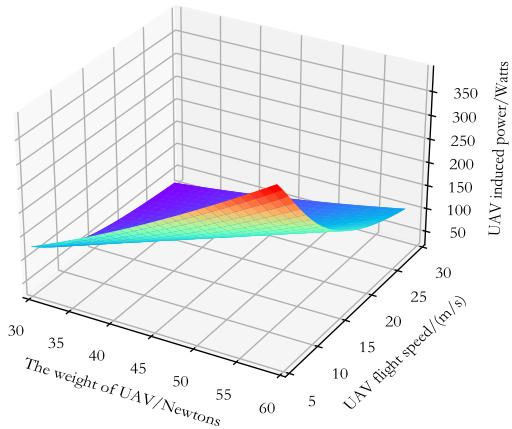  
Fig. 2. Induced power varies with weight and speed.

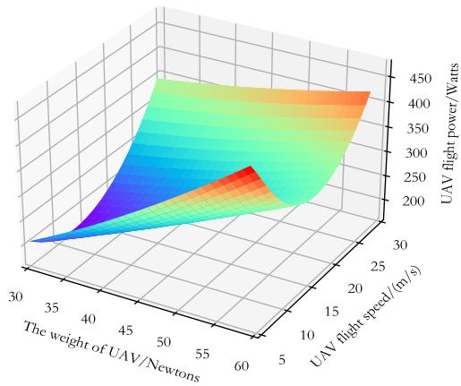  
Fig. 3. Flight power varies with weight and speed.

$$
\nu ^ { * } ( t ) = \arg \operatorname* { m i n } _ { 0 \leq \nu ( t ) \leq V _ { \mathrm { m a x } } } \ \frac { P _ { \mathrm { h o r } } ( \nu ( t ) , W ( t ) ) } { \nu ( t ) } .\tag{24}
$$

Moreover, since the UAV is assumed to fly vertically in the climbing stage, (16) indicates that the vertical energy consumption of the UAV is independent of the flight speed but only related to the climbing height. Therefore, to reduce the UAV’s flight time, the UAV is defaulted to fly at the maximum speed $V _ { \mathrm { m a x } }$ in both the climbing and descending stages. Given that the UAV’s energy consumption is influenced by W(t), which is, in turn, determined by its delivery sequence, the subsequent section focuses on optimizing both the delivery sequence and flight trajectory of the UAV to achieve an effective tradeoff between communication quality and energy efficiency.2

## IV. PROPOSED ALGORITHM

In Section III, a preliminary optimization problem is defined for scheduling communication to minimize total outage time and optimizing flight speed to reduce energy consumption. Accordingly, problem P0 is reformulated as3

$$
\mathrm { P 1 } : \operatorname* { m i n } _ { \mathbf { q } ( t ) , \Phi } \ E ( \{ \Phi , \mathbf { q } ( t ) \} ) + \mu \rho ( t ) T _ { \mathrm { o u t } } ( \{ \mathbf { q } ( t ) \} )\tag{25}
$$

$$
\mathrm { s . t . } \quad \mathrm { ( 1 8 a ) } , \mathrm { ( 1 8 c ) } - \mathrm { ( 1 8 f ) } .\tag{25a}
$$

## A. Overview of ACO

The traditional TSP is commonly solved using the ACO algorithm, which emulates the natural foraging behavior of ants. In their search for food, ants release pheromones along their paths and detect pheromones left by others. The concentration of pheromones reflects the path’s distance, with higher concentrations indicating shorter path distances. Ants tend to choose paths with higher pheromone concentrations with a greater probability and deposit additional pheromones along these paths, reinforcing the concentration through a positive feedback mechanism. Ultimately, this process enables the ants to identify the shortest path.

The first step in solving the TSP with ACO algorithm is creating a distance matrix, $\pmb { \Pi } _ { ( K + 1 ) \times ( K + 1 ) } .$ defined as

$$
\pmb { \Pi } _ { ( K + 1 ) \times ( K + 1 ) } = \left( \begin{array} { c c c c } { { \pi _ { 0 0 } } } & { { \pi _ { 0 1 } } } & { { \cdots } } & { { \pi _ { 0 K } } } \\ { { \pi _ { 1 0 } } } & { { \pi _ { 1 1 } } } & { { \cdots } } & { { \pi _ { 1 K } } } \\ { { \vdots } } & { { \vdots } } & { { \ddots } } & { { \vdots } } \\ { { \pi _ { K 0 } } } & { { \pi _ { K 1 } } } & { { \cdots } } & { { \pi _ { K K } } } \end{array} \right)\tag{26}
$$

where element $\pi _ { i j } \in \pmb { \Pi } \ ( i \neq j )$ represents the distance between user i and user j. Let $D _ { i j }$ denote the Euclidean distance between user i and user j. $\pi _ { i j }$ can be given by

$$
\pi _ { i j } = \left\{ \begin{array} { l l } { { D _ { i j } , } } & { { i \neq j } } \\ { { + \infty , } } & { { i = j . } } \end{array} \right.\tag{27}
$$

In particular, since the self-loops (i.e., ants moving from one node to the same node) are not allowed in UAV logistics systems, $\pi _ { i j }$ with $i = j$ is set to +∞ instead of 0. $\pi _ { i j } =$ +∞ specifies that each user can only access it once to avoid repeated access. With this setting, the ACO algorithm can evade invalid solutions and improve search efficiency. To represent the desired degree of ant transfer from user i to user $j ,$ the heuristic function, $\eta _ { i j } ,$ is defined as

$$
\eta _ { i j } = \left\{ \begin{array} { l l } { \frac { 1 } { D _ { i j } } , i \neq j } \\ { 0 , i = j . } \end{array} \right.\tag{28}
$$

The shorter the distance between user i and user j, denoted as $D _ { i j } ,$ , the larger the value of $\eta _ { i j }$ , resulting in a higher expected probability of the ant transitioning from user i to user j.

The pheromone matrix T is utilized to represent the pheromones between any two users. The initial pheromone matrix, denoted as $\mathbf { T } _ { 0 } ,$ is initialized as a matrix in which all elements are set to 1. The pheromone matrix can be formally expressed as

$$
\begin{array} { r } { { \bf T } _ { ( K + 1 ) \times ( K + 1 ) } = \left( \begin{array} { l l l l } { \tau _ { 0 0 } } & { \tau _ { 0 1 } } & { \cdot \cdot } & { \tau _ { 0 K } } \\ { \tau _ { 1 0 } } & { \tau _ { 1 1 } } & { \cdot \cdot } & { \tau _ { 1 K } } \\ { \vdots } & { \vdots } & { \ddots } & { \vdots } \\ { \tau _ { K 0 } } & { \tau _ { K 1 } } & { \cdot \cdot } & { \tau _ { K K } } \end{array} \right) . } \end{array}\tag{29}
$$

Following each iteration, the pheromone matrix ${ \bf T } _ { n + 1 }$ is updated. During the nth iteration, the pheromone update is governed by the following formula [37]:

$$
\tau _ { i j } ( n + 1 ) = ( 1 - \rho ) \tau _ { i j } ( n ) + \sum _ { m = 1 } ^ { M } \Delta \tau _ { i j } ^ { m } ( n )\tag{30}
$$

where $\rho ~ \in ~ ( 0 , 1 )$ , and (1 − ρ) represents the attenuation of pheromone on the path from user i to user j. M is the total number of ants. $\Delta \tau _ { i j } ^ { m } ( n )$ represents the pheromone concentration left by the mth ant on the path from user i to user j at the nth iteration, which is updated as

$$
\Delta \tau _ { i j } ^ { m } ( n + 1 ) = \left\{ \begin{array} { l l } { \frac { Q } { D _ { m } ^ { n } } , } & { \mathrm { i f ~ t h e ~ } m - \mathrm { t h ~ a n t ~ i s ~ o n ~ t h e ~ p a t h } } \\ { \quad } & { \mathrm { f r o m ~ u s e r s ~ } i \mathrm { ~ t o ~ } j } \\ { 0 , } & { \mathrm { e l s e } } \end{array} \right.\tag{31}
$$

where Q is a constant related to the pheromone, and $D _ { m } ^ { n }$ represents the mth ant’s traveling distance at the nth iteration. Clearly, the distance between user i and user j depends solely on their spatial positions, namely, $D _ { m } ^ { n } = D _ { i , j }$ . Therefore, the probability that the mth ant chooses to transit from user i to user j at the nth iteration can be given by

$$
p _ { i j } ^ { m } ( n ) = \left\{ \begin{array} { l l } { \frac { \left[ \tau _ { i j } ( n ) \right] ^ { \alpha } \left[ \eta _ { i j } \right] ^ { \beta } } { \sum _ { q \in \Psi _ { m } } \left[ \tau _ { i q } ( n ) \right] ^ { \alpha } \left[ \eta _ { i q } \right] ^ { \beta } } , } & { j \in \Psi _ { m } } \\ { 0 , } & { \mathrm { e l s e } } \end{array} \right.\tag{32}
$$

where α is the pheromone heuristic factor, $\beta$ is the expected heuristic factor, and $\Psi _ { m }$ denotes the set of users allowed to be visited by the mth ant. Once the transition probabilities between any two points are determined, the roulette selection algorithm can be employed to probabilistically select a user as the destination.

## B. IACO-Based Delivery Sequence Optimization

As discussed in Sections II-C and III-B, the cargo UAV’s energy consumption depends on its flight speed and weight, which in turn hinges on the delivery sequence. That is, the delivery sequence primally affects the energy consumption, where the delivery sequence optimization problem is expressed as

$$
\mathsf { P 2 } : \operatorname* { m i n } _ { \Phi } \ E ( \{ \Phi , \mathbf { q } ( t ) \} )\tag{33}
$$

$$
\mathrm { s . t . } \quad \mathrm { ( 1 8 a ) } , \mathrm { ( 1 8 c ) } - \mathrm { ( 1 8 f ) } .\tag{33a}
$$

The optimization of UAV delivery sequence shares similar ities with the traditional TSP, as both aim to find an optimal traversal sequence. However, key differences distinguish the UAV delivery problem from the traditional TSP. First, while the starting and ending points in TSP are typically arbitrary, both the starting and ending points in the UAV delivery problem studied here are fixed. Second, traditional methods for solving TSP often begin by constructing a distance matrix, where each element represents the distance between two users. Solutions to TSP using ACO are typically designed to minimize the total path length. In contrast, the UAV logistics system involves additional complexities due to the variable parcel weights associated with different users. As indicated in (13), the UAV’s power consumption increases with its payload weight. Consequently, the delivery sequence determined by ACO to minimize path length may not necessarily minimize energy consumption. To address this challenge, we propose an IACO algorithm to solve the energy-weighted path planning problem in this section.

For the ACO algorithm, it identifies the optimal path based on pheromone concentration, which is directly influenced by the distance between two users. Specifically, shorter distances result in higher pheromones, enabling the ACO algorithm to determine the shortest path. In contrast, the IACO algorithm is designed to identify the path with the lowest energy consumption. Hence, in the IACO algorithm, the parameters governing pheromone concentration are correlated with energy consumption rather than distance in the ACO.

Let $W _ { i j }$ be the weight of the UAV from user i to user j. As indicated by (16), the UAV’s energy consumption in the climbing stage solely depends on its flight height, which is calculated by

$$
E _ { i j } ^ { \mathrm { v e r } } = W _ { i j } \times H _ { \operatorname* { m a x } } , i \ne j .\tag{34}
$$

The total energy consumed by the UAV from user i to user j then can be given by

$$
E _ { i j } = P _ { \mathrm { h o r } } \left( \nu _ { i j } ^ { * } , W _ { i j } \right) \times D _ { i j } + E _ { i j } ^ { \mathrm { v e r } } , i \ne j\tag{35}
$$

where $\nu _ { i j } ^ { * }$ is the MEC-speed of the UAV from user i to user j. The heuristic function of IACO, $\eta _ { i j } ,$ is defined as

$$
\eta _ { i j } = { \left\{ \begin{array} { l l } { { \frac { 1 } { E _ { i j } } } , i \neq j } \\ { 0 , i = j . } \end{array} \right. }\tag{36}
$$

The $\Delta \tau _ { i j } ^ { m }$ of IACO is updated as

$$
\Delta \tau _ { i j } ^ { m } = \left\{ \begin{array} { l l } { \frac { Q } { E _ { m } ^ { n } } , } & { \mathrm { ~ i f ~ t h e ~ } m \mathrm { - t h ~ a n t ~ i s ~ o n ~ t h e ~ p a t h } } \\ { \quad } & { \mathrm { f r o m ~ u s e r s ~ } i \mathrm { ~ t o ~ } j } \\ { 0 , } & { \mathrm { e l s e } } \end{array} \right.\tag{37}
$$

where $E _ { m } ^ { n }$ represents the total energy consumed by the mth ant at the nth iteration. Algorithm 1 outlines the process for determining the delivery sequence that minimizes UAV energy consumption using the IACO algorithm.

## C. DRL-Based Flight Trajectory Optimization

It is important to recognize that if the UAV follows a straight-line flight path, referred to as the straight flight scheme, its energy consumption is significantly reduced. However, this comes at the expense of potentially poor communication quality. Conversely, if the UAV adjusts its trajectory to avoid areas with weak signal coverage, resulting path becomes more circuitous, leading to increased energy consumption. Thus, it is necessary to optimize the UAV’s trajectory to balance energy consumption and communication quality. Given that the optimal delivery sequence has already been determined in Section IV-C, the UAV’s trajectory can be divided into K+1 subtrajectories. The optimization problem for the kth subtrajectory can be formulated as

Algorithm 1 IACO-Based Delivery Sequence Optimization   
1: Initialize: Initialize the number of ants M, pheromone   
heuristic factor $\alpha ,$ expected heuristic factor $\beta ,$ maximum   
number of iterations $N _ { 1 }$ , pheromone volatilization factor   
$\rho$ and $Q ,$ the set of users $\Psi _ { m }$ that the mth ant has not yet   
visited, pheromone matrix $\mathbf { T _ { 0 } } .$ and energy consumption   
matrix -.   
2: for $n = 1$ to $N _ { 1 }$ do   
3: for $m = 1$ to M do   
4: Set the m-th ant’s starting point to $Q _ { 0 } .$   
5: Reset the m-th ant’s initial weight to $W _ { \mathrm { t o t a l } } .$   
6: repeat   
7: Compute $\eta _ { i j }$ based on equations (27), (34), (35),   
and (36).   
8: The m-th ant determines the next user j to visit   
based on equation (32).   
9: Update the set $\Psi _ { m }$ to reflect the users not yet   
visited by the m-th ant and set the current visited   
user i to j, i.e, i ← j.   
10: Update the weight $W _ { i j }$ from user i to user j   
according to equation (12).   
11: until $\Psi _ { m } = \emptyset$   
12: Update the pheromone matrix T according to equa  
tions (30) and (37).   
13: end for   
14: end for   
15: Obtain the optimal delivery sequence $\Phi ^ { * } = $   
$\left\{ \phi _ { 0 } ^ { * } , \phi _ { 1 } ^ { * } , \ldots , \phi _ { K } ^ { * } , \phi _ { K + 1 } ^ { * } \right\}$

$$
\begin{array} { r l } { \mathrm { P 3 } : \displaystyle \operatorname* { m i n } _ { \mathbf { q } _ { k } ( t ) } } & { { } E _ { h } ^ { k } \big ( \mathbf { q } _ { k } ( t ) \big ) + \mu \boldsymbol { \rho } ( t ) T _ { \mathrm { o u t } } ^ { k } \big ( \mathbf { q } _ { k } ( t ) \big ) } \end{array}\tag{38}
$$

$$
H _ { u } ( t ) = H _ { \operatorname* { m a x } }\tag{38a}
$$

$$
{ \bf q } _ { k } ( 0 ) = \left( x _ { \phi _ { k - 1 } } , y _ { \phi _ { k - 1 } } , H _ { \operatorname* { m a x } } \right)\tag{38b}
$$

$$
\mathrm { s . t . } \left\{ \begin{array} { r l } { \mathbf { q } _ { k } ( T _ { k } ) = \left( x _ { \phi _ { k } } , y _ { \phi _ { k } } , H _ { \operatorname* { m a x } } \right) } \end{array} \right.\tag{38c}
$$

$$
0 \leq x _ { u } ^ { k } ( t ) \leq L \ \forall t \in [ 0 , T _ { k } ]\tag{38d}
$$

$$
0 \leq y _ { u } ^ { k } ( t ) \leq L \ \forall t \in [ 0 , T _ { k } ]\tag{38e}
$$

where ${ \bf q } _ { k } ( t )$ represents the UAV’s kth flight trajectory, and $T _ { k }$ is the total horizontal flight time of the kth flight trajectory. $E _ { h } ^ { k } ( \mathbf { q } _ { k } ( t ) )$ and $T _ { \mathrm { o u t } } ^ { k } ( \mathbf { q } _ { k } ( t ) )$ ) are the energy consumption during horizontal flight and the outage time associated with the kth trajectory, respectively. It is evident that the subtrajectories of the UAV are independent of one another. Consequently, the optimal trajectories of the entire flight phase can be determined by independently optimizing each subtrajectory.

As stipulated in Section III-B, the UAV ascends and descends vertically during the climbing and descending phases, with the outage time during these phases being disregarded. Furthermore, in Section IV-B, the delivery sequence was determined, and the energy consumption for the climbing phase was calculated. Consequently, in optimization problem P3, only the energy consumption and outage time during horizontal flight at the maximum flying altitude $H _ { \mathrm { m a x } }$ are considered.

Next, we use the D3QN algorithm to solve problem P3. Prior to applying the D3QN algorithm, it is essential to convert problem P3 to an Markov decision process (MDP) [38]. An MDP provides a mathematical framework that explicitly defines the states and actions of a problem while adhering to the Markov property, wherein the evolution of the future state depends only on the current state and the actions taken. By structuring the problem in this way, the MDP facilitates reinforcement learning (RL) by enabling agents to learn and optimize in complex decision-making scenarios. Subsequently, problem P3 is discretized and represented with MDP.

To solve problem P3, we discretize UAV’s total horizontal flight time, $T _ { k } ,$ into $N _ { k }$ time slots, each with a duration of $\Delta _ { t } ,$ namely, $T _ { k } = N _ { k } \times \Delta _ { t }$ . The variables related to time, including UAV trajectory ${ \bf q } _ { k } ( t )$ , UAV flight speed $\mathbf { v } _ { k } ( t )$ , communication scheduling $c _ { k } ( t )$ , and UAV’s weight $W _ { k } ( t )$ , are then discretized, which are rerepresented by ${ \bf q } _ { k } [ n ]$ , vk[n], $c _ { k } [ n ] .$ , and Wk[n] in nth time slot, respectively. To reduce the error caused by time discretization, $\Delta _ { t }$ should be small enough, such that the UAV’s position and achieved channel gain can approximately maintain constant in each given time slot, i.e.,

$$
\| \mathbf { q } _ { k } [ n + 1 ] - \mathbf { q } _ { k } [ n ] \| \leq \tau ~ \forall n\tag{39}
$$

$$
P _ { \mathrm { o u t } } \bigl ( \mathbf { q } _ { k } [ n + 1 ] \bigr ) = P _ { \mathrm { o u t } } \bigl ( \mathbf { q } _ { k } [ n ] \bigr )\tag{40}
$$

where τ is a parameter approaching 0, i.e., $\tau  0$ . Denote vector $\Delta _ { \mathbf { q } _ { k } [ n ] } = \mathbf { v } _ { k } [ n ] \Delta _ { t }$ as the UAV’s flight direction and displacement in the nth time slot. The discrete UAV trajectory ${ \bf q } _ { k } [ n ]$ then must satisfy the following constraints:

$$
{ \bf q } _ { k } [ n + 1 ] = { \bf q } _ { k } [ n ] + \Delta _ { { \bf q } _ { k } [ n ] } \ \forall n .\tag{41}
$$

Furthermore, $E _ { h } ^ { k } ( \mathbf { q } _ { k } ( t ) )$ and $T _ { \mathrm { o u t } } ^ { k } ( \mathbf { q } _ { k } ( t ) )$ in (41) are re-expressed as

$$
E _ { h } ^ { k } \big ( { \mathbf { q } } _ { k } ( t ) \big ) = \Delta _ { t } \sum _ { n = 1 } ^ { N _ { k } } P _ { \mathrm { h o r } } \big ( \nu _ { d } ^ { * } [ n ] , W _ { k } [ n ] \big )\tag{42}
$$

$$
T _ { \mathrm { o u t } } ^ { k } \big ( \mathbf { { q } } _ { k } ( t ) \big ) = \Delta _ { t } \sum _ { n = 1 } ^ { N _ { k } } { P _ { \mathrm { o u t } } \big ( \mathbf { { q } } _ { k } [ n ] \big ) }\tag{43}
$$

where $\nu _ { d } ^ { * } [ n ]$ is the UAV’s MEC-speed in time slot n. Consequently, problem P3 can be approximated as

$$
\begin{array} { r l } {  { \mathrm { P 4 : } \quad \operatorname* { m i n } _ { \{ \mathbf { q } [ n ] \} _ { n = 1 } ^ { N _ { k } } , N _ { k } } } \ } & { \displaystyle \sum _ { n = 1 } ^ { N _ { k } } P _ { \mathrm { h o r } } \big ( \nu _ { d } ^ { * } [ n ] , W _ { k } [ n ] \big ) } \\ & { + \mu \rho [ n ] \sum _ { n = 1 } ^ { N _ { k } } P _ { \mathrm { o u t } } \big ( \mathbf { q } _ { k } [ n ] \big ) } \end{array}\tag{44}
$$

$$
( 3 9 ) - ( 4 1 )\tag{44a}
$$

$$
H _ { u } [ n ] = H _ { \operatorname* { m a x } }\tag{44b}
$$

$$
{ \bf q } _ { k } [ 1 ] = \left( x _ { \phi _ { k - 1 } } , y _ { \phi _ { k - 1 } } , H _ { \operatorname* { m a x } } \right)\tag{44c}
$$

$$
{ \bf q } _ { k } [ N _ { k } ] = \left( x _ { \phi _ { k } } , y _ { \phi _ { k } } , H _ { \operatorname* { m a x } } \right)\tag{44d}
$$

$$
0 \leq x _ { u } ^ { k } [ n ] \leq L \forall n\tag{44e}
$$

$$
. 0 \leq y _ { u } ^ { k } [ n ] \leq L \forall n .\tag{44f}
$$

ρ[n] defined in Section III-A then is set to the UAV’s flight power in the nth time slot, i.e., $\rho [ n ] = P _ { \mathrm { h o r } } ( \nu _ { d } ^ { * } [ n ]$ $W _ { n } [ n ] )$ Therefore, we can further approximate problem P4 with

$$
\mathsf { P 5 : } \operatorname* { m i n } _ { \{ \mathbf { q } _ { k } [ n ] \} _ { n = 1 } ^ { N _ { k } } , N _ { k } } \quad - N _ { k } - \mu \sum _ { n = 1 } ^ { N _ { k } } P _ { \mathrm { o u t } } ( \mathbf { q } _ { k } [ n ] )\tag{45}
$$

As discussed earlier, to solve problem P5 using D3QN, it is necessary to reformulate it as an MDP. Mathematically, an MDP is defined by a 4-tuple  , , ,  [38]. Here, represents the set of all possible states the agent can be in, with the system being in a specific state within this state space at each time step. denotes the set of all possible actions the agent can take, with each action being selected from the action space associated with the current state. $\mathcal { P }$ describes the transition probability of the agent moving from one state to another after taking an action. Specifically, $P ( s _ { n + 1 } \mid s _ { n } , a _ { n } )$ represents the probability of transitioning to state $s _ { n + 1 } ~ \in ~ S$ after being in state $s _ { n } ~ \in ~ S$ and performing action $a _ { n } \in$ .  represents the immediate reward the agent receives for executing a particular action in a given state, commonly expressed as $r _ { n } ~ = ~ R ( s _ { n + 1 } , a _ { n } , s _ { n } )$ , where $r _ { n }$ is the reward obtained when transitioning to state $s _ { n + 1 }$ after performing action $a _ { n }$ in state $s _ { n } .$ . Based on this formulation, we establish a direct mapping of problem P5 to an MDP  , , ,  as follows.

1) State Space : Since only optimizing the UAV’s trajectory at a fixed altitude, the state space is composed of all its legitimate positions of the UAV within the airspace, denoted as $s _ { n } = ( x _ { u } ^ { k } [ n ] , y _ { u } ^ { k } [ n ] )$ , where $0 \leq x _ { u } ^ { k } [ n ] \leq L$ and $0 \leq y _ { u } ^ { k } [ n ] \leq L \forall n , k . ^ { 4 }$

2) Action Space $\mathcal { A } \mathrm { : }$ The action space contains the sixteen feasible flight directions for the cargo $\mathrm { U A V } , ^ { 5 }$ as shown in Fig. 4.

3) Probability $\mathcal { P } \colon$ The state transition probability is determined by (41).

4) Reward : The reward is set to $\begin{array} { r l r } { r _ { n } } & { { } = } & { - 1 \mathrm { ~ - ~ } } \end{array}$ $\mu P _ { \mathrm { o u t } } ( \mathbf q _ { k } ^ { k + 1 } [ n ] ) . ^ { 6 }$

Given that an MDP represents a sequential decision-making process, actions taken at each state impact not only the current state but also subsequent states. Therefore, the agent (i.e., the cargo UAV) must account for both the immediate reward and the long-term effects of its actions on future states. Accordingly, the agent’s objective is to maximize the cumulative discounted reward, $G _ { n }$ [39], defined as

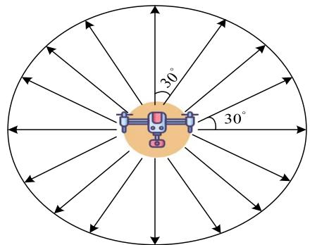  
Fig. 4. Feasible flight directions for the UAV.

$$
G _ { n } = r _ { n + 1 } + \gamma r _ { n + 2 } + \gamma ^ { 2 } r _ { n + 3 } + \cdots = \sum _ { k = 0 } ^ { \infty } \gamma ^ { k } r _ { n + k + 1 }\tag{46}
$$

where $\gamma ~ \in ~ [ 0 , 1 ]$ is a discount factor. Define the action value function as $Q _ { \pi } ( s , a ) = \mathrm { E } _ { \pi } [ G _ { n } \mid s = s _ { n } , a = a _ { n } ] .$ which represents the cumulative expectation achieved from a given state $s _ { n }$ and taking a specific action $a _ { n }$ following policy π . The input of this function is the state-action pair. Unlike classical RL methods, such as Q-learning, the D3QN algorithm employs two neural networks: the Q network and the target network. Denote ζ and $\pmb { \zeta } ^ { \prime }$ as the parameters of these two networks, respectively. The primary distinction between the $Q$ network and the target network lies in their update mechanisms. The $Q$ network is updated during each training iteration, whereas the target network uses a hardcopy update mechanism. Specifically, the parameters of the Q network are periodically copied to the target network to synchronize them. By leveraging deep neural networks (DNNs) to approximate the Q-value function, i.e., $Q _ { ( } s , a ; \pmb { \zeta } ) \approx$ $Q _ { ( } s , a )$ , the D3QN algorithm overcomes the limitations of table-based approaches.

D3QN adopts a hierarchical architecture that decomposes the Q value into the state value and the action advantage. This structure enables efficient learning of the combined stateaction information, enhancing both learning efficiency and generalization capability. Furthermore, the proposed algorithm incorporates experience replay and a multistep learning technique. Experience replay mitigates the variance in neural network parameter updates by preventing consecutive updates with highly correlated data, while multistep learning enhances sample efficiency and stabilizes the training process. The objective of the D3QN algorithm is to minimize the loss function given by [40]

$$
\left( R _ { n : n + N } + \gamma ^ { N } \operatorname* { m a x } _ { a _ { n } ^ { * } \in \mathcal { A } } Q { \big ( } s _ { n + N } , a _ { n } ^ { * } ; \xi ^ { \prime } { \big ) } - Q ( s _ { n } , a _ { n } ; \xi ) \right) ^ { 2 }\tag{47}
$$

where

$$
R _ { n : n + N } = \sum _ { k = 0 } ^ { N - 1 } \gamma ^ { k } r _ { n + k + 1 }\tag{48}
$$

$$
a _ { n } ^ { * } = \arg \operatorname* { m a x } _ { a ^ { \prime } \in \hat { \mathcal { A } } } Q \big ( s _ { n + N } , a ^ { \prime } ; \xi \big ) .\tag{49}
$$

Algorithm 2 D3QN-Based Trajectory Optimization of UAV   
1: Initialize: Initialize the UAV’s maximum flight steps $N _ { \mathrm { u a v } }$   
neural network training episodes $N _ { \mathrm { e p } }$ , tolerable distance   
$D _ { t }$ to reach flight endpoint, initial exploration $\theta _ { 0 } .$ , decay  
ing rate $\alpha ,$ discount factor $\gamma ,$ reward of reaching flight   
endpoint $R _ { \mathrm { e n d } } ,$ punishment for flying out of the boundary   
$R _ { p } ,$ and weight factor $\mu ,$ and set $\theta  \theta _ { 0 }$   
2: for $k = 1$ to $K + 1$ do   
3: Set the flight starting point to $p _ { k - 1 } = ( Q _ { \phi _ { k - 1 } ^ { * } } , H _ { \operatorname* { m a x } } )$   
flight endpoint to $p _ { k } = ( Q _ { \phi _ { k i } ^ { * } } , H _ { \operatorname* { m a x } } ) .$   
4: for $n = 1$ to $N _ { \mathrm { e p } }$ do   
5: if $n _ { \mathrm { e p } }$ is divisible by 5 then   
6: Initialize the state with $\mathbf { q } _ { k } [ 1 ] = p _ { k - 1 }$ and set the   
time step $n \gets 1$   
7: else   
8: Randomly initialize the state $\mathbf { q } _ { k } [ 1 ] \in \mathcal { S }$ and set the   
time step $n \gets 1$   
9: end if   
10: repeat   
11: Select an action $a _ { n } ^ { * }$ from the action space $\mathcal { A }$ using   
the θ-greedy policy. Under this policy, there is   
a probability θ of selecting a random action and   
a probability $1 - \theta$ of selecting the action that   
maximizes the current Q value.   
12: The UAV takes flight actions $a _ { n } ^ { * }$ and obtains a   
new state $\mathbf { q } _ { k } [ n + 1 ]$ . Obtain the empirical outage   
probability $P _ { o u t } ( \mathbf { q } _ { k } [ n + 1 ] )$ and set the reward as   
$r _ { n } = - 1 - \mu P _ { o u t } ( \mathbf { q } _ { k } [ n + 1 ] )$   
13: Transition $( ( x _ { u } ^ { k } [ n ] , \stackrel {  } { y _ { u } ^ { k } } [ n ] ) , a _ { n } ^ { * } , r _ { n } , ( x _ { u } ^ { k } [ n ] , y _ { u } ^ { k } [ n ] ) )$ is   
stored in the experience replay buffer.   
14: Randomly sample N-step transition from the expe  
rience replay buffer to train the neural network.   
15: Set   
$\left\{ R _ { n : n + N } + R _ { \mathrm { e n d } } , { \mathrm { ~ i f ~ } } \| \mathbf { q } _ { k } [ n + N ] - p _ { k - 1 } \| \leq D _ { t } \right.$   
$y _ { n } = \left\{ \begin{array} { l l } { R _ { n : n + N } + R _ { p , \cdot } ^ { \mathrm { ~ \tiny ~ . ~ i f ~ } } { \bf q } _ { k } [ n + N ] \not \in \mathcal { S } } \end{array} \right.$   
$\left\lfloor R _ { n : n + N } + \gamma ^ { N } Q ( s _ { n + N } , a ^ { \prime } ; \zeta ) \right.$ , otherwise.   
16: Update the parameters of neural network $\boldsymbol { \zeta }$ by   
gradient descent method and set $n \gets n + 1$ and   
$\theta  \theta \alpha$   
17: until $\| \mathbf { q } _ { k } [ n ] - p _ { k } \| \leq D _ { t }$ or $\mathbf { q } _ { k } [ n ] \notin { \mathcal { S } }$ or $\mathrm { \Omega } \mathrm { n } \geq N _ { \mathrm { u a v } }$   
18: Update the target network coefficient $\zeta ^ { - } \gets \zeta$ every   
B episodes   
19: end for   
20: end for

To accelerate the convergence, the neural network is pretrained by leveraging the shortest path strategy. The parameter ζ is initialized such that $Q ( s _ { n } , a _ { n } ; \pmb { \zeta } )$ approximates $- \| \mathbf { q } _ { k } [ n +$ $1 ] - p _ { k } \|$ , where $\mathbf { q } _ { k } [ n + 1 ]$ represents the state reached after state ${ \bf q } _ { k } [ n ]$ executes action $a _ { n } .$ . This initialization facilitates rapid and efficient updates to the D3QN following a number of successful episodes. Utilizing the updated network, the UAV’s flight trajectory can be determined from any location within the specified area to $p _ { k } .$ . The detailed trajectory optimization process is outlined in Algorithm 2.

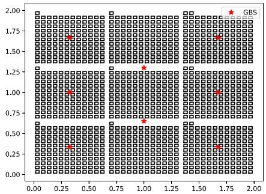

(a)  
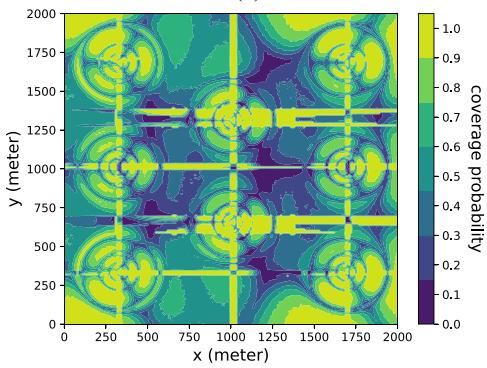  
(b)  
Fig. 5. Illustration of the cargo UAV’s flight environment. (a) 2-D view. (b) Radio map.

## V. SIMULATION RESULT

## A. Simulation Settings

Consider a 2 km × 2 km service area of the cargo UAV, i.e., $L \ = \ 2 .$ , as shown in Fig. 5. The black rectangular boxes in Fig. 5(a) represent buildings and the red five-pointed stars represent cellular BSs. From Fig. 5(b), it is evident that the buildings in the considered area are densely distributed, resulting in a high probability of signal blockage between the UAV and the BSs at high altitude. The parameters related to the environment configuration are defined as: $\alpha _ { b d }$ $= 0 . 3$ , representing the ratio of the total building area to the distribution area; $\beta _ { b d } = 3 0 0$ , indicating 300 buildings per unit area; and $\sigma _ { b d } = 5 0$ , signifying that building heights follow a Rayleigh distribution with variance of 50. Additionally, the maximum building height is constrained to 90 m. The UAV’s maximum flight altitude and the ground BS antenna height are specified as $H _ { \mathrm { m a x } } = 1 0 0$ m and $H _ { G } = 2 5$ m, respectively.

Given the established building model, the channel type (LoS/NLoS links) can be determined by checking whether the communication between the cargo UAV and the ground BSs are blocked by buildings or not. The accurate outage probability of a specific position then is obtained based on the channel type and the distance between the UAV and the ground BSs. Assume there are eight ground BSs in the considered service area and the number of cells is then $G = 2 4$ . The transmitting power and carrier frequency of each cell are set as $P _ { g } = 0 . 1$ Watt and $F _ { c } = 2 ~ \mathrm { G H z }$ , respectively. The radio map of the UAV at 100 m height is shown in Fig. 5(b), which is generated based on the building model and channel model in the considered service area.

TABLE I  
MAIN SIMULATION PARAMETERS
<table><tr><td rowspan=1 colspan=1>Simulation parameter</td><td rowspan=1 colspan=1>Value</td></tr><tr><td rowspan=1 colspan=1>Maximum UAV flight speed $V _ { \mathrm { m a x } }$ </td><td rowspan=1 colspan=1>40 m/s</td></tr><tr><td rowspan=1 colspan=1>The pheromone heuristic factor α</td><td rowspan=1 colspan=1>1</td></tr><tr><td rowspan=1 colspan=1>The expected heuristic factor $\overline { { \beta } }$ </td><td rowspan=1 colspan=1>2</td></tr><tr><td rowspan=1 colspan=1>The pheromone volatile factor ρ</td><td rowspan=1 colspan=1>0.1</td></tr><tr><td rowspan=1 colspan=1>The constant related to the pheromone Q</td><td rowspan=1 colspan=1>1</td></tr><tr><td rowspan=1 colspan=1>The number of ants M</td><td rowspan=1 colspan=1>100</td></tr><tr><td rowspan=1 colspan=1>Maximum number of iterations $\overline { { N _ { 1 } } }$ </td><td rowspan=1 colspan=1>200</td></tr><tr><td rowspan=1 colspan=1>Maximum number of UAV flight steps $\overline { { N _ { \mathrm { u a v } } } }$ </td><td rowspan=1 colspan=1>200</td></tr><tr><td rowspan=1 colspan=1>Maximum number of training $N _ { \mathrm { e p } }$ </td><td rowspan=1 colspan=1>8000</td></tr><tr><td rowspan=1 colspan=1>Initial exploration factor $\theta _ { 0 }$ </td><td rowspan=1 colspan=1>0.6</td></tr><tr><td rowspan=1 colspan=1>Exploration factor decaying rate α</td><td rowspan=1 colspan=1>0.9985</td></tr><tr><td rowspan=1 colspan=1>Time step length $\overline { { \Delta _ { t } } }$ </td><td rowspan=1 colspan=1>0.5 s</td></tr><tr><td rowspan=1 colspan=1>Step coefficient of multi-step learning N</td><td rowspan=1 colspan=1>30</td></tr><tr><td rowspan=1 colspan=1>The tolerated distance before reaching destination $\overline { { R _ { \mathrm { e n d } } } }$ </td><td rowspan=1 colspan=1>10</td></tr><tr><td rowspan=1 colspan=1>Outbound penalty $\overline { { R _ { p } } }$ </td><td rowspan=1 colspan=1>-1000</td></tr><tr><td rowspan=1 colspan=1>The number of signal measurements after a new state R</td><td rowspan=1 colspan=1>1000</td></tr><tr><td rowspan=1 colspan=1>Neural coefficient updating frequency of target network $\overline { { B } }$ </td><td rowspan=1 colspan=1>5</td></tr><tr><td rowspan=1 colspan=1>Learning rate $\overline { { l _ { r } } }$ </td><td rowspan=1 colspan=1>0.001</td></tr></table>

For Algorithm 2, a fully connected artificial neural network (ANN) comprising five hidden layers is utilized. The neuron counts for the first four hidden layers are 512, 256, 128, and 128, respectively. The final hidden layer, termed the “dueling layer,” consists of 17 neurons, which contribute to the Q-values of 16 specific actions via the aggregation layer. The rectified linear unit (ReLU) function is employed as the activation function for all hidden layers, and the Adam optimizer is utilized for optimization. Additional parameters used in the simulation are detailed in Table I.

To demonstrate the superiority of our proposed HDRL algorithm, i.e., IACO+D3QN, the following comparisons are considered.

1) HDRL With Fixed Speed: Similar to the proposed HDRL algorithm, the primary distinction lies in the UAV’s flight speed, which remains fixed under this algorithm. In other words, the UAV does not optimize its flight speed.

2) Distance-Based HDRL: As discussed in Section IV-B, the edge weight in ACO corresponds to the trajectory length. ACO is employed to determine the delivery sequence that minimizes the total flight length. Building on this, D3QN is utilized to further optimize the trajectory.

3) IACO: Unlike the proposed IACO+D3QN, the trajectory generated by the IACO algorithm follows a straight line, corresponding to the scenario where the weight factor μ in the D3QN algorithm is 0.

4) IACO-CS: This variant of the IACO algorithm assumes a constant UAV flight speed.

5) ACO: The ACO algorithm is utilized to determine the trajectory that minimizes the UAV’s total flight distance.

6) D3QN With Reshaped Reward7: The reward function of the D3QN algorithm, $r _ { n }$ , is reshaped ${ \mathrm { t o ~ - } } 1 - \mu P _ { \mathrm { o u t } }$ $( \mathbf { q } _ { k } ^ { k + 1 } [ n ] ) \stackrel { \sim } { - } \kappa \| \bar { \mathbf { q } } _ { k } ^ { k + 1 } [ n ] - p _ { \mathrm { n e a r } } \|$ as in [41] to directly address the optimization problem. Here, κ is the reward reshaping factor, set to 0.001. $p _ { \mathrm { n e a r } }$ denotes the location of the user nearest to the UAV, and its value is updated only after the UAV successfully visits a user.

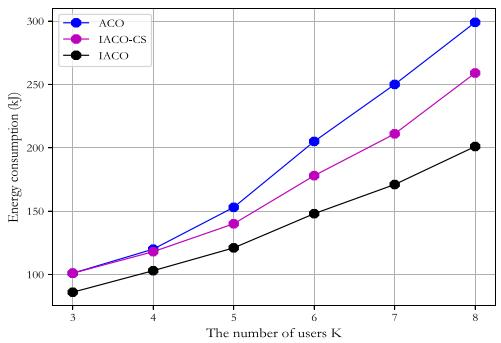  
Fig. 6. UAV’s energy consumption under different algorithms with varying numbers of users.

Without special instructions, the UAV speed for all the compared algorithms except IACO is fixed at 20m/s.

## B. Algorithm 1 Validity Verification

To verify the effectiveness of Algorithm 1, the UAV’s flight energy consumption under different algorithms with varying user numbers is visualized in Fig. 6. As shown in Fig. 6, regardless of the algorithm employed, the UAV’s energy consumption increases with the number of users. This observation can be attributed to a combination of factors. As the number of users increases, the UAV must serve more users, leading to an increase the weight. Additionally, the flight distance also grows, resulting in an increase in energy consumption. From Fig. 6, it can also be observed that the energy consumption under the ACO algorithm is the highest, followed by the IACO-CS algorithm, with the lowest energy consumption achieved by the IACO algorithm. This demonstrates that minimizing flight distance does not necessarily equate to minimizing flight energy consumption. The proposed IACO algorithm improves upon the ACO algorithm by using energy consumption as edge weight instead of trajectory length, leading to lower energy consumption compared to the ACO algorithm. Furthermore, the energy consumption achieved by IACO is lower than that of IACO-CS, confirming that adjusting the UAV’s flight speed can effectively reduces energy consumption. This finding validates the analysis of UAV energy consumption and speed in Section III-B.

It is also evident that when the total number of users is small (K = 3 or K = 4), the energy consumption achieved by our proposed algorithm is not significantly different from that of the traditional ACO algorithm. However, as the number of users increases, the energy consumption achieved by the IACO becomes substantially lower than that of the ACO, with the advantages becoming more pronounced with a larger user base. For example, when K = 4, the energy consumption achieved by IACO-CS is approximately 1.67% lower than that of ACO, and IACO achieves a reduction of around 14%. However, when K = 8, IACO-CS achieves a reduction of approximately 13.38%, and IACO achieves a significant reduction of around 32.78% compared to ACO. These numerical results highlight that the greater the number of users, the more evident the superiority of our proposed algorithm.

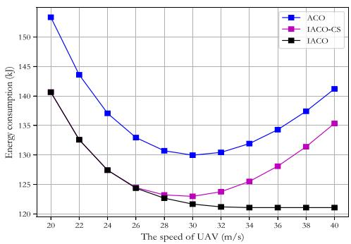  
Fig. 7. UAV’s energy consumption under different algorithms at varying flight speeds.

Fig. 7 shows the UAV’s energy consumption under different algorithms at varying flight speeds. It can be seen that, with the increase of the maximum allowed flight speed of UAV, its energy consumption under both ACO and IACO-CS shows a trend initially decreasing and then increasing, consistent with the conclusion drawn from Fig. 2. Specifically, when the carrying weight is fixed, the UAV’s flight speed exhibits an optimal value (MEC-speed), at which the energy consumption is minimized. However, as the UAV’s maximum allowable flight speed increases, the energy consumption achieved by IACO decreases. This occurs because a higher maximum flight speed allows the UAV greater flexibility in adjusting its enabling it to more effectively select a flight speed closer to the MEC-speed based on its current load.

In summary, the numerical results shown in Figs. 6 and 7 validate significance of the proposed UAV speed optimization and Algorithm 1 in reducing UAV’s energy consumption. Next, we perform ablation experiments to determine the optimal values of the hyperparameters.

## C. Hyperparameter Selection

To validate the appropriateness of the hyperparameter choices in this study, the returns corresponding to different hyperparameters are presented in this section. By comparing the performance under various hyperparameter settings, we identify suitable values for the hyperparameters. Specifically, Fig. 8 shows the return associated with different values of exploration rate $\theta _ { 0 }$ , learning rate $l _ { r } ,$ and action space ${ \mathcal { A } } ,$ thereby verifying the rationality of the selected parameters.

1) Exploration rate $\theta _ { 0 } \colon$ As illustrated in Fig. 8(a), when the exploration rate $\theta _ { 0 }$ is set to 0.1, 0.3, or 0.6, the return tends to converge with the increase of training episodes. For $\theta _ { 0 } \ = \ 0 . 8 ,$ , the return initially decreases with increasing episodes but eventually converges after approximately 1000 episodes. Notably, although convergence is observed across all cases, the largest return is achieved when $\theta _ { 0 } = 0 . 6$ . This is because a moderate exploration rate enables the agent to effectively balance exploration and exploitation, namely, promoting broader exploration in the early stage and gradually leveraging accumulated knowledge to discover an optimal strategy.

Conversely, a low-exploration rate may lead the agent to prematurely converge to suboptimal solutions, thereby reducing adaptability. This is evident in the relatively faster convergence but lower final returns observed for $\theta _ { 0 } = 0 . 1$ 1 and $\theta _ { 0 } = 0 . 3$ . On the other hand, an excessively high exploration rate, such as $\theta _ { 0 } = 0 . 8 ,$ , hinders the agent from effectively utilizing existing knowledge, resulting in unstable learning performance and significant return fluctuation during early training, as reflected in Fig. 8(a). Therefore, $\theta _ { 0 } = 0 . 6$ is identified as the most suitable setting in this context.

2) Learning rate lr: Fig. 8(b) illustrates that a learning rate of 0.001 achieves faster convergence and exhibits greater stability compared to learning rates of 0.1, 0.01, and 0.0001. This is because, during DQN training, an excessively high learning rate may cause the optimization process to overshoot and miss the optimal solution, while an overly low-learning rate can lead the model to become trapped in a local optimal solution. For instance, when the learning rate is set to $l _ { r } = 0 . 1$ , the return does not increase with the number of episodes, indicating a failure to converge. Therefore, a learning rate of $l _ { r } =$ 0.001 is deemed more appropriate for ensuring both convergence and training stability.

3) Action Space : Fig. 8(c) reveals the rewards under different action space sizes. It can be observed that when the number of actions is set to 4, 8, or 16, the rewards eventually converge. Furthermore, as the number of episodes approaches 8000, the agent achieves the highest reward with 16 actions, followed by 8 actions, and the lowest with 4 actions. This indicates that a larger action space generally leads to improved agent performance and higher cumulative rewards. Therefore, the number of discrete actions selected is set to 16, i.e., $| { \cal A } | = 1 6 . ^ { 8 }$

## D. Performance Comparison

Fig. 9 presents the UAV trajectory obtained from different algorithms with varying weight factors. Consider a scenario with five randomly distributed users, i.e., $K = 5 .$ . In Fig. 9, the blue rectangle represents the warehouse, and circles with different colors represent users, where the weight of cargoes associated with each user is 22 N, 16 N, 12 N, 6 N, and 8 N, respectively. The UAV’s weight is 50 N, i.e., $W _ { \mathrm { u a v } } = 5 0$ . It can be seen that, the cargo delivery sequences of the UAV achieved by different algorithms are also different. As given in Table II, the cargo delivery sequence achieved by the ACO algorithm is warehouse → GU 5 → GU 4 → GU 1 → GU 3 → GU 2 → warehouse, by the IACO-CS algorithm is warehouse →

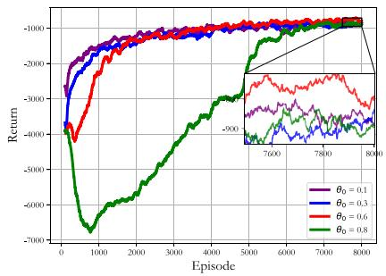  
(a)

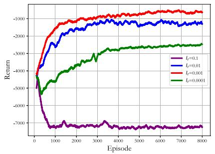

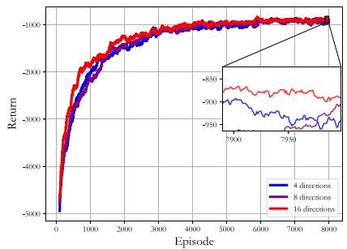  
(b)  
(c)

Fig. 8. Rewards under varying hyperparameter configurations. (a) Exploration rate θ0. (b) Learning rate lr. (c) Action space .  
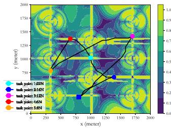  
(a)

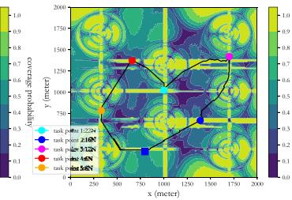  
(b)

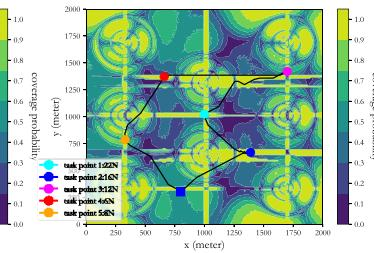  
(c)

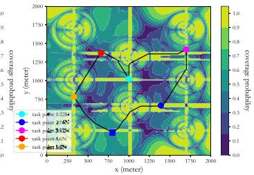  
(d)

Fig. 9. UAV trajectories under different algorithms with μ = 1. (a) D3QN with reshaped reward. (b) Distance-based HDRL. (c) HDRL with fixed speed. (d) HDRL.  
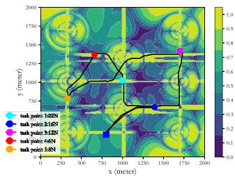  
(a)

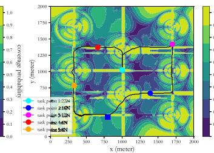  
(b)

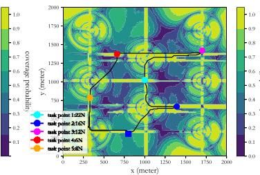  
(c)

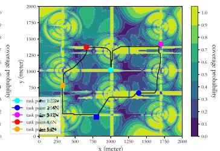  
(d)  
Fig. 10. UAV trajectories under different algorithms with $\mu = 1 0 .$ (a) D3QN with reshaped reward. (b) Distance-based HDRL. (c) HDRL with fixed speed (d) HDRL.

TABLE II  
COMPARISON OF DIFFERENT ALGORITHMS WHEN $\mu = 1 0$
<table><tr><td>Algorithm</td><td colspan="5">Delivery sequence</td><td>Energy consumption/KJ</td><td>Outage time/s</td><td>Outage ratio</td></tr><tr><td>D3QN with reshaped reward</td><td> $0  2  1  4  5  3  0$ </td><td></td><td></td><td>6210</td><td></td><td>172.63</td><td>49.85</td><td>16.05%</td></tr><tr><td>ACO</td><td></td><td> $0 \to 5 \to 4 \to 1 \to 3 \to 2 \to 0$ </td><td></td><td></td><td>4180</td><td>154.23</td><td>99.82</td><td>47.76%</td></tr><tr><td>Distance-based HDRL</td><td></td><td> $0 \to 5 \to 4 \to 1 \to 3 \to 2 \to 0$ </td><td></td><td></td><td>5270</td><td>185.39</td><td>26.73</td><td>10.14%</td></tr><tr><td>IACO-CS</td><td></td><td> $0  2  1  3  4  5  0$ </td><td></td><td></td><td>4450</td><td>141.34</td><td>105.28</td><td>47.32%</td></tr><tr><td>HDRL with fixed speed</td><td></td><td> $0  2  1  3  4  5  0$ </td><td></td><td></td><td>5120</td><td>157.06</td><td>29.36</td><td>11.47%</td></tr><tr><td>IACO</td><td></td><td> $0  2  3  1  4  5  0$ </td><td></td><td></td><td>4180</td><td>121.56</td><td>71.76</td><td>34.33%</td></tr><tr><td>HDRL</td><td></td><td> $0  2  3  1  4  5  0$ </td><td></td><td></td><td>5089.5</td><td>138.72</td><td>23.85</td><td>13.21%</td></tr></table>

GU $2  \mathrm { G U } \ 1  \mathrm { G U } \ 3  \mathrm { G U } \ 4  \mathrm { G U } \ 5  \mathrm { w a r e h o u s e }$ by the IACO algorithm is warehouse → GU 2 → GU 3 → GU $1 \to \mathrm { G U } \ 4 \to \mathrm { G U } \ 5 \to$ warehouse, and by the D3QN with reshaped reward is warehouse → $\mathrm { G U } \ 2  \mathrm { G U } \ 1  \mathrm { G U }$ $4 \to \mathrm { G U } \ 5 \to \mathrm { G U } \ 3 \to$ warehouse.

In Figs. 9 and 10, the black solid line depicts the trajectory after D3QN optimization. To provide a more intuitive illustration of the impact of the weight factor on trajectory optimization, Fig. 10 presents the UAV trajectory for $\mu = 1 0 .$ Compared to the trajectory with $\mu = 1$ in Fig. 9, it can be observed that when $\mu = 1 0 ,$ , the UAV’s trajectory becomes more circuitous, and the communication quality along its path is significantly improved. As shown in Fig. 9, regardless of the algorithm used for determining the delivery sequence, a significant portion of the trajectory after D3QN optimization closely aligns with the trajectory prior to optimization. However, as shown in Fig. 10, the trajectory optimized by D3QN effectively avoids passing through the signal coverage hole. This phenomenon occurs because, when the weight factor μ is small, the UAV’s energy consumption dominates the reward function, i.e., the objective function of the problem P3. To minimize the objective function, the UAV tends to select the flight trajectory with the lowest energy consumption, resulting in an optimized trajectory that remains nearly linear. Conversely, as μ increases, this effect diminishes, and the trajectory becomes more influenced by communication considerations.

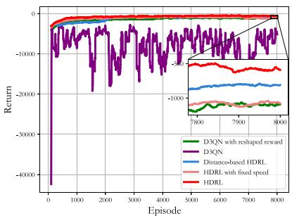  
(a)

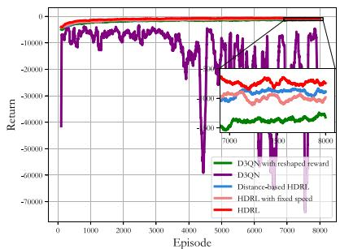  
(b)

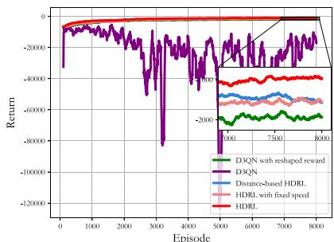  
(c)

Fig. 11. Rewards achieved by different algorithms. (a) $\mu = 3 .$ (b) $\mu = 5 .$ (c) $\mu = 1 0 .$  
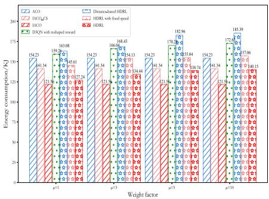  
(a)

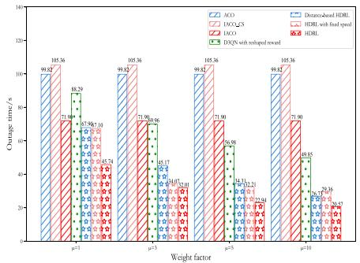  
(b)

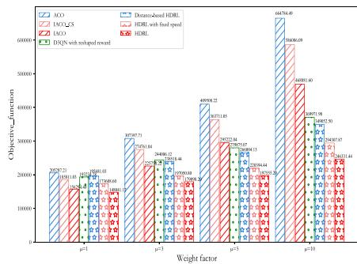  
(c)  
Fig. 12. Performance comparison of algorithms under different weight factors. (a) Energy consumption. (b) Outage time. (c) Objective function.

The comparison between Figs. 9 and 10 preliminarily validates the effectiveness of our proposed Algorithm 2. To further demonstrate the effectiveness of Algorithm 2, the outage time and outage ratio along with the trajectory prior to optimization and the trajectory after optimization are given in Table II. The outage ratio is defined as the total outage time of the UAV divided by its total flight time. As shown in Table II, both the outage time and the outage ratio are significantly reduced for the trajectory optimized using the D3QN algorithm. These numerical results highlight the effectiveness of the proposed Algorithm 2.

Moreover, to validate the convergence of the algorithm, the rewards achieved by different algorithms are presented in Fig. 11. As illustrated, except for the D3QN algorithm, both the proposed algorithm and the benchmark algorithms demonstrate convergence under varying values of μ, with rewards consistently increasing as the number of training episodes grows. Notably, regardless of the weight factor, the proposed algorithm consistently achieves higher rewards compared to the benchmark algorithms, indicating its superior effectiveness in guiding the agent toward more optimal strategies.

Finally, it is necessary to demonstrate that the proposed algorithm, HDRL, outperforms other algorithms in optimizing the weighted sum of energy consumption and outage time of the cargo UAV. To this end, the performance parameters obtained by different algorithms under varying weight factors are visualized, as shown in Fig. 12.

Fig. 12(a) shows the total energy consumption of the UAV under different algorithms. It is evident that, regardless of the weight factor, the IACO algorithm consistently yields the lowest energy consumption, followed by the HDRL algorithm, which aligns with the results presented in Fig. 6 and Table II. Furthermore, by comparing Fig. 12(a) with (b), it can be observed that except for the ACO, IACO-CS, and IACO algorithms, the energy consumption of other methods increase while the outage time decrease as the weight factor grows. This trend is consistent with the design of the reward function described in Algorithm 2. As shown in Fig. 12(c), the objective function values achieved by the proposed HDRL algorithm remain the lowest across all values of μ. Specifically, compared with the algorithms that solely optimize the delivery sequence without optimizing the trajectory, the proposed HDRL improves the performance of the ACO algorithm by approximately 28%–63%, the ACO algorithm by 20%–58%, and the IACO algorithm by 6%– 47%. Additionally, in comparison with the D3QN algorithm with reshaped reward, HDRL achieves a performance gain of approximately 23%–33%. Moreover, compared with Distancebased HDRL and HDRL with fixed speed, the proposed HDRL algorithm improves performance by approximately 25% and 15%, respectively. These simulation results prove the critical role of jointly optimizing the delivery sequence, trajectory, and flight speed in enhancing the energy efficiency and communication quality of UAV cargo delivery systems. They further validate the effectiveness and robustness of the proposed algorithm in addressing the tradeoff between energy consumption and communication quality during UAV flight.

## VI. CONCLUSION

This article investigated the tradeoff between energy efficiency and communication quality in UAV cargo delivery systems by formulating a weighted sum minimization problem, with a weighting factor $\mu$ balancing energy consumption and communication outage time. An HDRL algorithm, combining the IACO and the D3QN, was proposed to optimize communication scheduling, flight speed, delivery sequence, and flight trajectory. Numerical simulations demonstrated the effectiveness and robustness of our proposed IACO+D3QN algorithm, which provides guidance for UAV logistics by addressing the critical tradeoff between energy efficiency and reliable communication. For future work, we will investigate collaboration mechanisms among multiple cargo UAVs in package delivery systems to address the challenges posed by more complex application scenarios.

## REFERENCES

[1] S. Wandelt, S. Wang, C. Zheng, and X. Sun, “Aerial: A meta review and discussion of challenges toward unmanned aerial vehicle operations in logistics, mobility, and monitoring,” IEEE Trans. Intell. Transp. Syst., vol. 25, no. 7, pp. 6276–6289, Jul. 2024.

[2] Y. Zeng, J. Lyu, and R. Zhang, “Cellular-connected UAV: Potential, challenges, and promising technologies,” IEEE Wireless Commun., vol. 26, no. 1, pp. 120–127, Feb. 2019.

[3] X. He, F. He, L. Li, L. Zhang, and G. Xiao, “A route network planning method for urban air delivery,” Transp. Res. E, Logist. Transp. Rev., vol. 166, Oct. 2022, Art. no. 102872.

[4] W. Yoo, E. Yu, and J. Jung, “Drone delivery: Factors affecting the public’s attitude and intention to adopt,” Telematics Inf., vol. 35, no. 6, pp. 1687–1700, Sep. 2018.

[5] M. A. Masmoudi, S. Mancini, R. Baldacci, and Y.-H. Kuo, “Vehicle routing problems with drones equipped with multi-package payload compartments,” Transp. Res. E, Logist. Transp. Rev., vol. 164, Aug. 2022, Art. no. 102757.

[6] S. Meng, X. Guo, D. Li, and G. Liu, “The multi-visit drone routing problem for pickup and delivery services,” Transp. Res. E, Logist. Transp. Rev., vol. 169, Jan. 2023, Art. no. 102990.

[7] H. Huang and A. V. Savkin, “Deployment of charging stations for drone delivery assisted by public transportation vehicles,” IEEE Trans. Intell. Transp. Syst., vol. 23, no. 9, pp. 15043–15054, Sep. 2022.

[8] X. Li, Z. Shen, and W. Wei, “An improved firefly algorithm used to location selection of distribution center for logistics UAV,” in Proc. IEEE/AIAA 38th Digit. Avion. Syst. Conf. (DASC), Sep. 2019, pp. 1–8.

[9] C. Huang, Z. Ming, and H. Huang, “Drone stations-aided beyondbattery-lifetime flight planning for parcel delivery,” IEEE Trans. Autom. Sci. Eng., vol. 20, no. 4, pp. 2294–2304, Oct. 2023.

[10] “Amazon has a new drone for 30-minute urban deliveries.” Accessed: Mar. 2023. [Online]. Available: https://www.axios.com/2022/11/28/amazon-has-a-new-drone-for-30- minute-urban-deliveries

[11] M. Patchou, B. Sliwa, and C. Wietfeld, “Flying robots for safe and efficient parcel delivery within the COVID-19 pandemic,” in Proc. IEEE Int. Syst. Conf. (SysCon), Jan. 2021, pp. 1–7.

[12] Y. H. Lau et al., “Reliable long-range communication for medical cargo UAVs using low-cost, accessible technology,” in Proc. IEEE Int. Humanit. Technol. Conf. (IHTC), Dec. 2021, pp. 1–8.

[13] K. Peng et al., “A hybrid genetic algorithm on routing and scheduling for vehicle-assisted multi-drone parcel delivery,” IEEE Access, vol. 7, pp. 49191–49200, 2019.

[14] Y. Pan, Q. Chen, N. Zhang, Z. Li, T. Zhu, and Q. Han, “Extending delivery range and decelerating battery aging of logistics UAVs using public buses,” IEEE Trans. Mobile Comput., vol. 22, no. 9, pp. 5280–5295, Sep. 2023.

[15] S. Sawadsitang, D. Niyato, P.-S. Tan, and P. Wang, “Joint ground and aerial package delivery services: A stochastic optimization approach,” IEEE Trans. Intell. Transp. Syst., vol. 20, no. 6, pp. 2241–2254, Jun. 2019.

[16] D. Wang, P. Hu, J. Du, P. Zhou, T. Deng, and M. Hu, “Routing and scheduling for hybrid truck-drone collaborative parcel delivery with independent and truck-carried drones,” IEEE Internet Things J., vol. 6, no. 6, pp. 10483–10495, Dec. 2019.

[17] B. Liu, W. Ni, R. P. Liu, Y. J. Guo, and H. Zhu, “Decentralized, privacypreserving routing of cellular-connected unmanned aerial vehicles for joint goods delivery and sensing,” IEEE Trans. Intell. Transp. Syst., vol. 24, no. 9, pp. 9627–9641, Sep. 2023.

[18] N. Cherif, W. Jaafar, H. Yanikomeroglu, and A. Yongacoglu, “RLbased cargo-UAV trajectory planning and cell association for minimum handoffs, disconnectivity, and energy consumption,” IEEE Trans. Veh. Technol., vol. 73, no. 5, pp. 7304–7309, May 2024.

[19] N. Cherif, W. Jaafar, H. Yanikomeroglu, and A. Yongacoglu, “Disconnectivity-aware energy-efficient cargo-UAV trajectory planning with minimum handoffs,” in Proc. IEEE Int. Conf. Commun., Jun. 2021, pp. 1–6.

[20] Y. Chen, D. Yang, L. Xiao, F. Wu, and Y. Xu, “Optimal trajectory design for unmanned aerial vehicle cargo pickup and delivery system based on radio map,” IEEE Trans. Veh. Technol., vol. 73, no. 8, pp. 11706–11718, Aug. 2024.

[21] Z. Deng, F. Wu, Y. Xu, D. Yang, and L. Xiao, “Energy minimization for radio map-based UAV pickup and delivery logistics system,” IEEE Trans. Veh. Technol., vol. 73, no. 11, pp. 17893–17898, Nov. 2024.

[22] B. Duo, A. Kong, Q. Wu, X. Yuan, and Y. Li, “Joint path and pick-up design for connectivity-aware UAV-enabled multi-package delivery,” IEEE Trans. Intell. Transp. Syst., vol. 25, no. 12, pp. 20017–20031, Dec. 2024.

[23] Y. Zeng et al., “A tutorial on environment-aware communications via channel knowledge map for 6G,” IEEE Commun. Surveys Tuts., vol. 26, no. 3, pp. 1478–1519, 3rd Quart., 2024.

[24] Y. Zeng, Q. Wu, and R. Zhang, “Accessing from the sky: A tutorial on UAV communications for 5G and beyond,” Proc. IEEE, vol. 107, no. 12, pp. 2327–2375, Dec. 2019.

[25] Y. Zeng and X. Xu, “Path design for cellular-connected UAV with reinforcement learning,” in Proc. IEEE Global Commun. Conf. (GLOBECOM), May 2019, pp. 1–6.

[26] Y. Zeng, X. Xu, S. Jin, and R. Zhang, “Simultaneous navigation and radio mapping for cellular-connected UAV with deep reinforcement learning,” IEEE Trans. Wireless Commun., vol. 20, no. 7, pp. 4205–4220, Jul. 2021.

[27] H. Xie, D. Yang, L. Xiao, and J. Lyu, “Connectivity-aware 3D UAV path design with deep reinforcement learning,” IEEE Trans. Veh. Technol., vol. 70, no. 12, pp. 13022–13034, Dec. 2021.

[28] P. Li, L. Xie, J. Yao, and J. Xu, “Cellular-connected UAV with adaptive air-to-ground interference cancellation and trajectory optimization,” IEEE Commun. Lett., vol. 26, no. 6, pp. 1368–1372, Jun. 2022, doi: 10.1109/LCOMM.2022.3164905.

[29] J. Cao, L. Xiao, D. Yang, and F. Wu, “Energy consumption and communication quality tradeoff for logistics UAVs: A hybrid deep reinforcement learning approach,” in Proc. IEEE Wireless Commun. Netw. Conf. (WCNC), Mar. 2023, pp. 1–6.

[30] S. Zhu, L. Gui, N. Cheng, F. Sun, and Q. Zhang, “Joint design of access point selection and path planning for UAV-assisted cellular networks,” IEEE Internet Things J., vol. 7, no. 1, pp. 220–233, Jan. 2020.

[31] “Study on 3D channel model for LTE,” 3GPP, Sophia Antipolis, France, Rep. 36.873, Dec. 2017.

[32] “Technical specification group radio access network: study on enhanced LTE support for aerial vehicles,” 3GPP, Sophia Antipolis, France, Rep. 36.777, Dec. 2017.

[33] B. Khamidehi and E. S. Sousa, “Federated learning for cellularconnected UAVs: Radio mapping and path planning,” in Proc. IEEE Global Commun. Conf. (GLOBECOM), Aug. 2020, pp. 1–6.

[34] Y. Zeng, J. Xu, and R. Zhang, “Energy minimization for wireless communication with rotary-wing UAV,” IEEE Trans. Wireless Commun., vol. 18, no. 4, pp. 2329–2345, Apr. 2019.

[35] A. Meng, X. Gao, Y. Zhao, and Z. Yang, “Three-dimensional trajectory optimization for energy-constrained UAV-enabled IoT system in probabilistic LoS channel,” IEEE Internet Things J., vol. 9, no. 2, pp. 1109–1121, Jan. 2022.

[36] C. Zhan and R. Huang, “Energy minimization for data collection in wireless sensor networks with UAV,” in Proc. IEEE Global Commun. Conf. (GLOBECOM), Dec. 2019, pp. 1–6.

[37] B. Li, X. Qi, B. Yu, and L. Liu, “Trajectory planning for UAV based on improved ACO algorithm,” IEEE Access, vol. 8, pp. 2995–3006, 2020.

[38] R. S. Sutton and A. G. Barto, Reinforcement Learning: An Introduction, 2nd ed. Cambridge, MA, USA: MIT Press, 1998.

[39] L. Liu, K. Xiong, J. Cao, Y. Lu, P. Fan, and K. B. Letaief, “Average AoI minimization in UAV-assisted data collection with RF wireless power transfer: A deep reinforcement learning scheme,” IEEE Internet Things J., vol. 9, no. 7, pp. 5216–5228, Apr. 2022.

[40] Y. Wang et al., “Trajectory design for UAV-based Internet of Things data collection: A deep reinforcement learning approach,” IEEE Internet Things J., vol. 9, no. 5, pp. 3899–3912, Mar. 2022.

[41] H. Qie, D. Shi, T. Shen, X. Xu, Y. Li, and L. Wang, “Joint optimization of multi-UAV target assignment and path planning based on multi-agent reinforcement learning,” IEEE Access, vol. 7, pp. 146264–146272, 2019.

  
Haixia Peng (Member, IEEE) received the Ph.D. degrees in computer science and electrical and computer engineering from Northeastern University, Shenyang, China, in 2017, and the University of Waterloo, Waterloo, ON, Canada, in 2021, respectively.

She is currently a Full Professor with the School of Information and Communications Engineering, Xi’an Jiaotong University, Xi’an, China. Her research interests include satellite–terrestrial vehicular networks, ISAC, multiaccess edge computing, resource management, artificial intelligence, and reinforcement learning.

Prof. Peng serves/served as a TPC Member for IEEE VTC-Fall 2016 and 2017, IEEE ICCEREC 2018, IEEE GlobeCom 2016–2024, and IEEE ICC 2017–2024 conferences and serves as Associate Editors for IEEE Internet of Things Magazine and Peer-to-Peer Networking and Applications.

His research interests include UAV communications, machine learning, and intelligent transportation systems.

Jiangling Cao received the M.S. degree in communication engineering from Nanchang University, Nanchang, China, in 2024. He is currently pursuing the Ph.D. degree with the School of Information and Communications Engineering, Xi’an Jiaotong University, Xi’an, China.

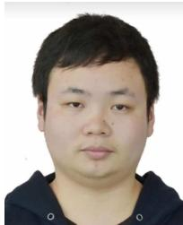

Dingcheng Yang (Member, IEEE) received the B.S. degree in electronic engineering and the Ph.D. degree in space physics from Wuhan University, Wuhan, China, in 2006 and 2012, respectively.

He is currently a Professor with the Information Engineering School, Nanchang University, Nanchang, China. He had published more than 50 papers, including journal papers on IEEE TRANSACTIONS ON VEHICULAR TECHNOLOGY and conference papers, such as IEEE Globecom. His

research interests include cooperation communications, IoT/cyber–physical systems, UAV communications, and wireless resource management.

Chenxi Li (Member, IEEE) received the Ph.D. degree from the School of Telecommunications Engineering, Xidian University, Xi’an, China, in 2021.

From May 2020 to May 2021, she visited the Broadband Communications Research Group, University of Waterloo, Waterloo, ON, Canada. She is currently an Associate Professor with the State Key Laboratory of Integrated Service Networks, Xidian University. Her research interests include the area of wireless communications and networks, with

current emphasis on dynamic spectrum control and covert communication.

  
computing and edge computing.

Tom H. Luan (Senior Member, IEEE) received the Ph.D. degree from the University of Waterloo, Waterloo, ON, Canada, in 2012.

He is currently a Professor with Xi’an Jiaotong University, Xi’an, China. He has authored/coauthored more than 140 journal articles and 90 technical articles in conference proceedings. His research mainly focuses on content distribution and media streaming in vehicular ad hoc networks and peer-to-peer networking and the protocol design and performance evaluation of wireless cloud

Zhou Su (Senior Member, IEEE) received the Ph.D. degree from Waseda University, Tokyo, Japan, in 2003.

His research interests include multimedia communications, wireless communications, and network traffic.

Mr. Su received the Best Paper Award of IEEE ICC2020, IEEE BigdataSE2019, and IEEE CyberSciTech2017. He served as the Track/Symposium Chair for several international conferences, including IEEE VTC, IEEE/CIC ICCC,

and WCSP. He is currently an Associate Editor of IEEE INTERNET OF THINGS JOURNAL, IEEE OPEN JOURNAL OF THE COMPUTER SOCIETY, and IET Communications.