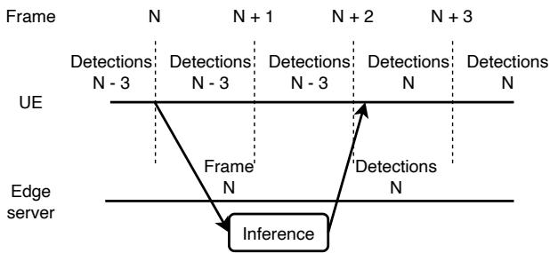
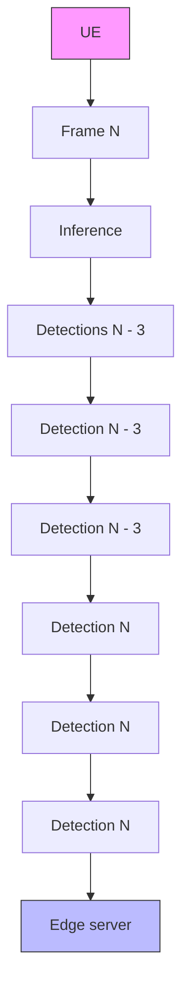
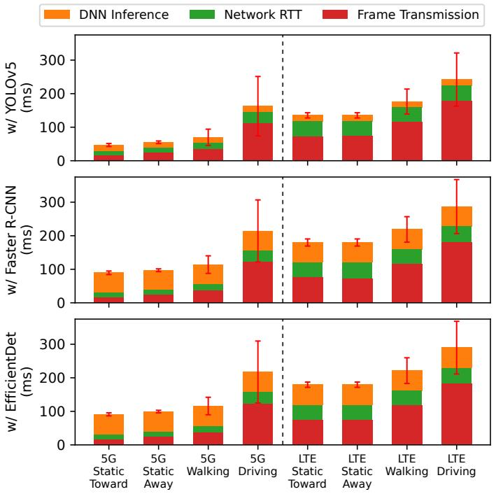
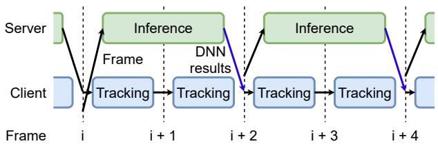
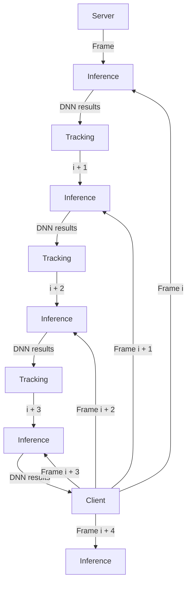
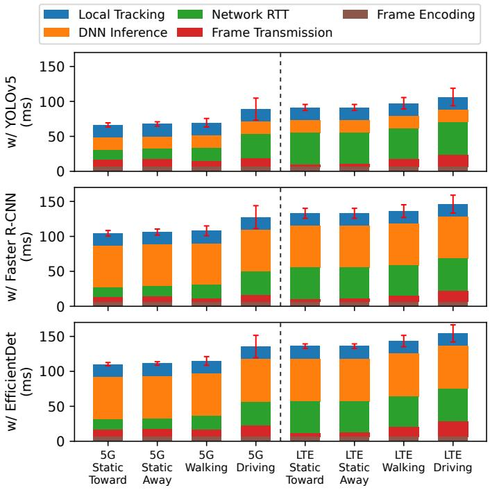

# Can 5G mmWave Enable Edge-Assisted Real-Time Object Detection for Augmented Reality?

Moinak Ghoshal1§, Z. Jonny Kong2§, Qiang Xu2§, Zixiao Lu1, Shivang Aggarwal3, Imran Khan1 Jiayi Meng2, Yuanjie Li4, Y. Charlie Hu2 and Dimitrios Koutsonikolas1

1Northeastern University 2Purdue University 3Hewlett Packard Labs 4Tsinghua University

Abstract—For its stringent QoE requirement, augmented reality (AR) has been widely hailed as a representative of ultra-high bandwidth and ultra-low latency apps that will be enabled by 5G networks/edge clouds. Such a portrait of AR by the telco and cloud industry raises an important research question — can 5G enable latency-critical applications such as (edge-assisted) AR? In this paper, we conduct to our knowledge the first in-depth measurement study of whether 5G mmWave in combination with in-network edge cloud can support the baseline edge-assisted object detection. After we discover 5G mmWave is unlikely to achieve the level of uplink network performance needed to support a baseline edge-assisted object detection implementation in the near future, we quantify the performance benefits in retrofitting app-level optimizations developed in the pre-5G era on top of baseline edge-assisted object detection, as well as the performance benefits from hardware upgrade on the edge. We find that these optimizations can significantly boost object detection performance over both LTE and 5G mmWave; however, the improvement with 5G mmWave over LTE is marginal, and 5G mmWave still fails to provide satisfactory performance in all scenarios under consideration. Overall, we conclude that today’s 5G mmWave deployment is not a deciding factor in enabling edge-assisted object detection.

Index Terms—5G mmWave, augmented reality, edge computing, DNN offloading

## I. INTRODUCTION

Augmented reality (AR) promises unprecedented interactive and immersive experience to users by augmenting physical objects in the real world with computer-generated perceptual information. As such, a complete AR app needs to perform a number of challenging tasks to understand and interact with the physical environment, such as pose estimation, object detection, and depth estimation [1]. Among them, object detection is a fundamental building block of every immersive, interactive AR app and at the same time the most challenging one, since it relies on executing computationally heavy deep neural network (DNN) models to achieve high accuracy. Since executing such heavy DNN models on resource-constrained head-mounts or mobile devices is extremely challenging, edgeassisted AR, which offloads the object detection task to a server in the edge cloud, has become the de facto approach (e.g., [2], [3]).

To provide high-quality, interactive experience,1 edgeassisted AR needs to perform object detection at low latency and high frame rate, which places high uplink bandwidth demand on the wireless network. It is because of this stringent network requirement that AR has been widely viewed as a “killer” app for 5G [4], [5], e.g., in the AT&T/Microsoft alliance as well as the Verizon/AWS alliance when showcasing 5G edge computing solutions [6], [7]. Such a perception projected by the telco and cloud industry naturally raises an important research question: can 5G enable latency-critical applications such as (edge-assisted) AR? The question, however, cannot be easily answered without detailed measurement and analysis in running real AR apps over production 5G networks.

Nonetheless, conducting a measurement study to answer the above research question faces an intricate challenge in the methodology. While eagerly anticipating the arrival of 5G networks, the research community had already intensively studied edge-assisted object detection (e.g., [8], [3], [2], [9], [10], [11]) and developed a host of sophisticated “applicationlevel” optimizations in trying to make edge-assisted AR achieve acceptable performance under the mobile/wireless networks available at the time. In particular, equipped with these sophisticated app-level optimizations, these prior works claimed feasibility of edge-assisted AR in various wireless networks before 5G, including 4G LTE [3], [12], 802.11n [2], and 802.11ac [11].

We argue that running an edge-assisted object detection implementation equipped with such app-level optimizations over a 5G mmWave network will not reveal any new insight other than perhaps affirming that 5G mmWave provides no worse performance than its predecessors. Instead, the right research question to answer and hence measurement methodology to use is to start with a baseline implementation of an edgeassisted object detection implementation, one that would have been naturally written by a developer starting from a local (non-offloading) implementation. In particular, if the network is sufficiently fast, i.e., not a constraint, the most natural way of converting a local object detection implementation to an edge-assisted version is to offload the DNN inference task of every frame to the edge server; if the result comes back within the same frame time, e.g., 33 ms under 30 FPS, the overall behavior (e.g., accuracy) of the object detection task should stay the same as if it were run on the mobile device.

Following the above methodology, in this paper, we first conduct a measurement study of the performance of a representative baseline object detection implementation that offloads frames captured by the camera at 30 FPS over the 5G mmWave network of a leading mobile operator and associated edge cloud (§III) to an edge GPU server running state-of-theart DNN-based object detection models [13], [14], [15]. Our study involves various scenarios (static, walking, driving), user orientations, and diverse video datasets. Our measurement results show that, although today’s mmWave 5G improves the performance of the AR app compared to 4G LTE, it still fails to provide satisfactory accuracy. We estimate that 5G mmWave needs to provide a stable uplink bandwidth of 273-1331 Mbps (depending on the choice of GPU on the server) for the AR app to achieve satisfactory performance in all scenarios, which is unlikely to be achieved in the near future.

Since the network requirements for the AR app to achieve satisfactory performance are unlikely to be met by 5G mmWave networks in the near future, in the second part of our study (§IV), we revisit two well-known app-level optimizations developed in the pre-5G era, frame compression and local tracking, and explore whether 5G mmWave combined with these app-level optimizations offers additional benefits compared to its predecessors, e.g., LTE. We find that these optimizations can significantly boost object detection performance over both LTE and 5G mmWave. Nevertheless, 5G mmWave combined with these two optimizations still fails to provide satisfactory accuracy in all the scenarios under consideration except when the user is static.

Since the application-level optimizations cannot provide satisfactory accuracy in most scenarios, in the third part of our study (§V), we examine the effect of using faster (datacentergrade) GPUs. We find that the combination of faster GPUs with the two app-level optimizations help both LTE and 5G mmWave to achieve satisfactory accuracy in a variety of scenarios. While 5G mmWave achieves satisfactory accuracy in more scenarios than LTE, the improvement is marginal. In addition, 5G mmWave still fails to provide satisfactory accuracy in (the most challenging) driving scenario.

In summary, we conduct to our knowledge the first indepth measurement study of whether the combination of 5G mmWave and edge cloud can support edge-assisted object detection for mobile AR apps. Our results show that 5G mmWave, although providing higher performance than LTE, is not a deciding factor in enabling edge-assisted object detection for mobile AR apps. In contrast, app-level optimizations developed in the pre-5G era and server-side hardware upgrades play more critical roles.

## II. METHODOLOGY

In order to evaluate the performance of the edge-assisted object detection app, one methodology is to directly capture frames from the camera and run the app with the UE connected to the 5G mmWave or LTE network. However, the performance of an object detection app depends on a large number of factors including the underlying network, type of scenes captured by the camera, DNN model, GPU model, etc. Hence, to enable reproducibility and isolate the impact of each factor, we use trace-driven emulation with different network traces and video datasets and replay the same network trace for different video datasets, DNN models, and GPU models. We confirmed that the trace-driven emulation results match closely the results of the actual experiments.

flowchart

Fig. 1. Workflow of the baseline edge-assisted object detection AR app.

TABLE I MEAN AND STANDARD DEVIATION OF THE THROUGHPUT AND RTT, UNDER EACH SCENARIO.

<table><tr><td rowspan="2"></td><td colspan="2">Throughput (Mbps)</td><td colspan="2">RTT (ms)</td></tr><tr><td>LTE</td><td>5G</td><td>LTE</td><td>5G</td></tr><tr><td>Static toward</td><td> $48.34 \pm 3.87$ </td><td> $319.54 \pm 33.64$ </td><td> $32.39 \pm 2.33$ </td><td> $14.24 \pm 0.86$ </td></tr><tr><td>Static away</td><td> $48.34 \pm 3.87$ </td><td> $198.21 \pm 14.68$ </td><td> $32.39 \pm 2.33$ </td><td> $14.68 \pm 1.69$ </td></tr><tr><td>Walking</td><td> $32.52 \pm 6.76$ </td><td> $164.07 \pm 80.85$ </td><td> $33.68 \pm 2.52$ </td><td> $14.76 \pm 3.68$ </td></tr><tr><td>Driving</td><td> $26.15 \pm 8.33$ </td><td> $64.02 \pm 45.58$ </td><td> $34.02 \pm 5.58$ </td><td> $22.72 \pm 3.15$ </td></tr></table>

## A. The AR App

We developed a canonical object detection Android application, which employs a best-effort offloading policy. Its workflow is shown in Fig. 1. When a new camera frame becomes available and no other frame is currently being offloaded, the user equipment (UE) uploads the frame to the edge server over the cellular network, and the server performs DNN inference upon receiving the frame. If the offloading result does not come back in the same frame slot, which is common due to the frame transfer delay over the network and the server DNN inference delay, the UE reuses the latest, albeit stale, result returned by the server to mask the latency, and treats it as the result for the current frame. Therefore, the endto-end offloading latency is critical to the performance of the application, as the application will be able to use more recent inference results when the latency is lower. Since we want to evaluate whether 5G mmWave is fast enough to support edge-assisted object detection without the need for applicationlevel optimizations, the app transfers raw frames between the UE and the edge server. We evaluate the effectiveness of retrofitting application-level optimizations developed pre-5G, including frame compression and local tracking, in §IV.

## B. Network Traces

We collected network traces in downtown Boston using a Samsung S21 phone, which supports 2-CC uplink CA (the state-of-the-art in commercial off-the-shelf UEs). Following the same methodology as in [16], we used nuttcp with the default TCP congestion control, CUBIC, to generate backlogged TCP uplink traffic to measure the uplink throughput, and the ICMP-based ping utility to measure the network RTT at an interval of 100 ms.

TABLE II STATISTICS OF THE VIDEO DATASETS USED IN OUR STUDY. THE AVERAGE OBJECT SIZE IS IN NUMBER OF PIXELS IN A 640X480 FRAME.

<table><tr><td>Dataset</td><td>Number of videos</td><td>Main obj. category</td><td>Avg. # of obj. per frame</td><td>Avg. obj. size $^{1}$ </td></tr><tr><td>MOT17</td><td>6</td><td>Person</td><td>20.38</td><td>3254</td></tr><tr><td>Argoverse</td><td>24</td><td>Car</td><td>12.70</td><td>3919</td></tr></table>

1 Unit in square pixels.

Table I shows the mean and standard deviation of the measured throughput and RTT for each trace. We make the following observations: (1) Facing towards the BS, 5G mmWave achieves the highest throughput of 319.54 Mbps (6x higher than LTE). (2) The throughput of 5G mmWave drops drastically in all other scenarios (when the user faces away from the BS, walks, or is in a car), reaching as low as 64 Mbps (driving scenario). However, the phone still achieves substantially higher throughput over 5G mmWave than over LTE in all scenarios. (3) The RTT over 5G mmWave (14-23 ms) is substantially lower than over LTE (32-34 ms) over all scenarios, but increases substantially under driving.

## C. Video Datasets

In this study, we use two video datasets containing different objects and captured under diverse scenarios, as shown in Table II. The MOT17 dataset [17] is captured with stationary, handheld, or car-mounted cameras, and the majority of objects in the dataset are persons. On the other hand, Argoverse [18] is a driving dataset captured with a camera mounted on top of the car, and thus the field of view of this dataset mainly consists of cars.2 Both datasets are accompanied by humanlabeled bounding boxes as the ground truth.

## D. DNN Models

On the server side, we deployed three popular object detection models: YOLOv5 [13], Faster R-CNN [14], and EfficientDet-D4 [15]. As explained before, both factors – inference accuracy and inference latency – affect the performance of the edge-assisted object detection application. We selected each model and its variant (“Large” variant of YOLOv5, “D4” variant of EfficientDet) such that the three models exhibit a diverse spectrum of accuracy-runtime trade-offs.

Table III compares the accuracy and runtime of the three DNN models. We use the most widely used object detection accuracy metric — mean average precision (mAP) [19] — to evaluate our object detection application. We use the Object Detection Metrics [20] toolkit for mAP score calculation. We observe that EfficientDet is the most accurate model on both datasets, but also has the highest runtime. Faster-RCNN is generally the second-most accurate (except that it gives slightly lower accuracy on the Argoverse dataset than YOLOv5), and its runtime is between EfficientDet and YOLOv5. YOLOv5 has the shortest runtime, but it is also generally the least accurate model.

2Ideally, handheld videos should be tested against static/walking network traces and driving videos against driving network traces. We include all combinations in our evaluation for comprehensiveness.

TABLE III ACCURACY AND RUNTIME OF THE OBJECT DETECTION DNN MODELS USED IN OUR STUDY.

<table><tr><td></td><td>mAP on Argoverse</td><td>mAP on MOT</td><td>Runtime on 2080 Ti</td><td>Runtime on A100</td></tr><tr><td>YOLOv5 (Large)</td><td>37.82 ± 16.84</td><td>50.37 ± 13.77</td><td>17.5 ms</td><td>15.5 ms</td></tr><tr><td>Faster R-CNN</td><td>38.45 ± 16.02</td><td>56.37 ± 10.11</td><td>59.0 ms</td><td>24.9 ms</td></tr><tr><td>EfficientDet (D4)</td><td>42.26 ± 17.50</td><td>59.54 ± 7.72</td><td>60.6 ms</td><td>38.8 ms</td></tr></table>

## E. Criterion for Satisfactory Accuracy

Since our goal is to quantify the impact of the offloading latency on the edge-assisted object detection application, we use the offline mAP score of the most accurate object detection model for each dataset as the reference (i.e., 42.26 for Argoverse, 59.54 for MOT), and consider the offloading performance to be satisfactory if the mAP score of the application with offloading is within 90% (a commonly used threshold [21], [2]) of the reference. 3

## F. Emulation Setup

We connect the UE and the server over 802.11ac, and emulate the uplink bandwidth and latency obtained from our 5G mmWave or LTE traces using the tc tool at a 100 ms granularity. We discard the first second of each trace to remove the effect of TCP slow start.

Apart from the networking component, the rest of the endto-end edge-assisted object detection pipeline is implemented and run on real systems. We implemented the edge-assisted object detection application as an Android app and ran it on a Samsung Galaxy Note20 Ultra 5G phone. We offload to two servers equipped with different GPUs, one with a consumergrade NVIDIA GTX 2080 Ti GPU, and the other with a datacenter-grade NVIDIA A100 GPU. For reproducibility, we offload video frames from the two datasets described in §II-C pre-stored on the phone, rather than frames obtained from the camera. However, we still use Android camera’s native YUV format (12 bits per pixel) for offloading. We chose 640x480 as the offloading resolution, and each frame is 450 KB under the chosen resolution and format. Following the same frame rate as in the datasets, we make a new frame available every 33 ms (30 FPS). We offload each video against each collected trace, i.e., network scenario, and report the mAP score (average ± standrard deviation) for each dataset-scenario combination.

## III. EVALUATION WITH THE BASELINE AR APP

In this section, we evaluate the performance of the baseline AR app described in §II-A over 5G mmWave and LTE. We begin our study using the 2080 Ti GPU. We evaluate the potential benefits from employing a more powerful GPU in the following sections.

## A. Evaluation Results

Table IV lists the end-to-end (E2E) latency and mAP scores under different scenarios. In the case of 5G mmWave, different scenarios have a very different impact on the application

3Translating the achieved mAP to user QoE can only be done via user studies and is out of scope of this work.

TABLE IV EVALUATION WITH 2080 TI GPU AND A SAMSUNG S21 PHONE. MAP SCORES ARE MARKED IN BOLD IF THEY ARE WITHIN 90% OF THE OFFLINE ACCURACY (42.26 FOR ARGOVERSE, 59.54 FOR MOT).

<table><tr><td rowspan="2"></td><td colspan="2">E2E latency</td><td colspan="2">mAPArgoverse</td><td colspan="2">mAPMOT</td></tr><tr><td>LTE</td><td>5G</td><td>LTE</td><td>5G</td><td>LTE</td><td>5G</td></tr><tr><td></td><td colspan="6">YOLOv5</td></tr><tr><td>Static toward</td><td> $135.3 \pm 7.8$ </td><td> $46.9 \pm 4.5$ </td><td> $21.4 \pm 12.3$ </td><td> $33.6 \pm 15.5$ </td><td> $32.2 \pm 13.4$ </td><td> $47.2 \pm 13.2$ </td></tr><tr><td>Static away</td><td> $135.3 \pm 7.8$ </td><td> $55.0 \pm 3.9$ </td><td> $21.4 \pm 12.3$ </td><td> $33.2 \pm 15.4$ </td><td> $32.2 \pm 13.4$ </td><td> $46.7 \pm 13.5$ </td></tr><tr><td>Walking</td><td> $176.5 \pm 37.2$ </td><td> $69.9 \pm 24.4$ </td><td> $17.9 \pm 12.1$ </td><td> $30.2 \pm 15.4$ </td><td> $25.4 \pm 11.3$ </td><td> $42.8 \pm 14.0$ </td></tr><tr><td>Driving</td><td> $241.9 \pm 79.4$ </td><td> $162.6 \pm 88.6$ </td><td> $15.0 \pm 12.1$ </td><td> $20.9 \pm 13.2$ </td><td> $19.4 \pm 11.1$ </td><td> $29.8 \pm 16.0$ </td></tr><tr><td></td><td colspan="6">Faster-RCNN</td></tr><tr><td>Static toward</td><td> $179.8 \pm 10.6$ </td><td> $89.5 \pm 5.3$ </td><td> $18.8 \pm 11.3$ </td><td> $28.3 \pm 13.4$ </td><td> $30.5 \pm 13.7$ </td><td> $46.4 \pm 14.4$ </td></tr><tr><td>Static away</td><td> $179.8 \pm 10.6$ </td><td> $97.2 \pm 5.3$ </td><td> $18.8 \pm 11.3$ </td><td> $27.2 \pm 13.0$ </td><td> $30.5 \pm 13.7$ </td><td> $44.7 \pm 14.7$ </td></tr><tr><td>Walking</td><td> $218.8 \pm 38.0$ </td><td> $113.9 \pm 26.2$ </td><td> $16.2 \pm 11.0$ </td><td> $24.6 \pm 12.8$ </td><td> $24.4 \pm 12.8$ </td><td> $39.1 \pm 16.5$ </td></tr><tr><td>Driving</td><td> $286.9 \pm 80.6$ </td><td> $214.3 \pm 92.5$ </td><td> $13.9 \pm 10.9$ </td><td> $17.8 \pm 11.3$ </td><td> $19.8 \pm 12.9$ </td><td> $28.6 \pm 15.9$ </td></tr><tr><td></td><td colspan="6">EfficientDet-d4</td></tr><tr><td>Static toward</td><td> $179.4 \pm 7.8$ </td><td> $91.1 \pm 4.5$ </td><td> $20.3 \pm 13.3$ </td><td> $30.6 \pm 14.9$ </td><td> $32.2 \pm 13.3$ </td><td> $48.1 \pm 12.1$ </td></tr><tr><td>Static away</td><td> $179.4 \pm 7.8$ </td><td> $99.3 \pm 3.9$ </td><td> $20.3 \pm 13.3$ </td><td> $29.0 \pm 14.5$ </td><td> $32.2 \pm 13.3$ </td><td> $45.4 \pm 12.8$ </td></tr><tr><td>Walking</td><td> $221.5 \pm 38.2$ </td><td> $115.9 \pm 26.1$ </td><td> $17.3 \pm 13.0$ </td><td> $26.1 \pm 14.4$ </td><td> $25.5 \pm 12.3$ </td><td> $40.6 \pm 13.9$ </td></tr><tr><td>Driving</td><td> $289.8 \pm 78.6$ </td><td> $217.2 \pm 92.4$ </td><td> $14.8 \pm 12.7$ </td><td> $18.8 \pm 12.9$ </td><td> $20.2 \pm 12.7$ </td><td> $29.3 \pm 15.5$ </td></tr></table>

performance. The app performs the best with both datasets and all ML models when the user is facing towards the BS, but the accuracy drops slightly if the user turns their back to the BS, and drops drastically during walking or driving. For the Argoverse dataset, the performance is the best with YOLOv5, as the model has the lowest inference time and decent offline accuracy (Table III). For the MOT dataset, the three DNN models achieve similar accuracy.

Comparing the mAP scores over 5G mmWave vs. LTE, we conclude that 5G mmWave indeed helps the app achieve better performance, thanks to its higher throughput and lower RTT, which reduces the E2E offloading latency by 1-2 frame times (33-67 ms) when compared with LTE. However, neither 5G mmWave nor LTE achieve satisfactory accuracy. Even under ideal mmWave conditions (static, facing towards the BS), the E2E offloading latency with 5G mmWave is 46.9 ms, 89.5 ms, and 91.1 ms for the three models respectively, which translates to 2, 3, and 3 frame times. As we show in Section VI, such an E2E latency is too high to yield satisfactory accuracy.

## B. What Contributes to the High E2E Latency?

We next analyze the breakdown of the E2E latency and its contributing factors in Fig. reffig:e2e-breakdown. We observe that: (1) With the YOLOv5 model, which has the lowest inference time, the frame transmission accounts for the majority of the E2E latency in all scenarios over both 5G mmWave and LTE. With Faster R-CNN and EfficientDet, the increased DNN inference time accounts for the majority of E2E latency under static and walking scenarios over 5G mmWave. In all other scenarios, i.e., driving scenario over 5G mmWave, and in all scenarios over LTE, frame transfer still accounts for the majority, due to the lower network throughput in these scenarios. (2) The contribution of the network RTT to the E2E latency is higher over LTE than over 5G mmWave, since the former has much longer RTTs than the latter (Table I).

## IV. THE EFFECT OF APP OPTIMIZATIONS

In this section, we retrofit the AR app with two applicationlevel optimizations, frame compression and local tracking, which have been commonly used in the edge-assisted object detection literature in the pre-5G era.

stacked bar chart

| Method | DNN Inference (ms) | Network RTT (ms) | Frame Transmission (ms) |
| --- | --- | --- | --- |
| 5G Static Toward | ~30 | ~20 | ~10 |
| 5G Static Away | ~40 | ~20 | ~10 |
| 5G Walking | ~60 | ~20 | ~20 |
| 5G Driving | ~80 | ~40 | ~100 |
| LTE Static Toward | ~60 | ~80 | ~100 |
| LTE Static Away | ~70 | ~60 | ~80 |
| LTE Walking | ~80 | ~60 | ~100 |
| LTE Driving | ~90 | ~60 | ~180 |

Fig. 2. E2E latency breakdown with the AR app.

1) Compression: Since transmission time is a major contributor to the E2E latency, which is critical to the application performance, reducing the transmission time may result in better application performance. While one way of reducing the transmission time is to increase the network bandwidth, reducing the frame size through compression is another possible direction. To measure the effect of compression, we utilize the hardware H.264 encoder using Android MediaCodec, and encode the frames before sending them to the edge server. Accordingly, the server decodes the frames before feeding them to the object detection model. One parameter that needs to be decided in advance is the encoding bitrate, which controls the tradeoff between the encoded frame size and the frame quality loss (and consequently inference accuracy drop). We evaluated the offline accuracy under different encoding bitrates, and found that with an encoding rate of 12 Mbps (which reduces the average frame size from 450 KB to about 50 KB), the offline accuracy is within 2% of that without encoding. Thus, we use 12 Mbps as the default encoding bitrate. It takes on average 6.3 ms to encode one frame on the Samsung Note 20 phone.

Table V (left half) shows the E2E latency and object detection mAP with frame compression enabled, when offloading to the 2080 Ti GPU from the Samsung S21 phone. We observe that due to frame compression, the E2E offloading latency is significantly reduced. For example, with the Faster R-CNN model, compared to without the application-level optimizations (Table IV), the E2E latency reduces by 9.8 ms (from 89.5 ms to 79.7 ms) under the best 5G mmWave scenario (static, facing towards the BS), and by 111.5 ms (from 214.3 to 102.8 ms) under the worst 5G mmWave scenario (driving). However, despite the significant reduction in E2E latency, the app still fails to achieve satisfactory accuracy for both datasets and all DNN models, under both 5G mmWave and LTE.

TABLE V THE EFFECT OF APPLICATION-LEVEL OPTIMIZATIONS WITH 2080 TI GPU AND A SAMSUNG S21 PHONE. MAP SCORES ARE MARKED IN BOLD IF THEY ARE WITHIN 90% OF THE OFFLINE ACCURACY (42.26 FOR ARGOVERSE, 59.54 FOR MOT).

<table><tr><td rowspan="3"></td><td colspan="7">Frame Compression</td><td colspan="7">Frame Compression &amp; Fast Tracking</td></tr><tr><td colspan="2">E2E latency</td><td colspan="2">mAPArgoverse</td><td colspan="3">mAPMOT</td><td colspan="2">E2E latency</td><td colspan="2">mAPArgoverse</td><td colspan="3">mAPMOT</td></tr><tr><td>LTE</td><td>5G</td><td>LTE</td><td>5G</td><td>LTE</td><td>5G</td><td>LTE</td><td>5G</td><td>LTE</td><td>5G</td><td>LTE</td><td>5G</td><td>LTE</td><td>5G</td></tr><tr><td colspan="15">YOLOv5</td></tr><tr><td>Static toward</td><td>66.6 ± 4.3</td><td>41.7 ± 2.9</td><td>31.1 ± 14.7</td><td>33.9 ± 15.3</td><td>43.9 ± 14.5</td><td>47.8 ± 13.2</td><td>85.1 ± 4.3</td><td>60.2 ± 2.9</td><td>35.9 ± 15.9</td><td>36.5 ± 16.2</td><td>49.3 ± 9.9</td><td>51.9 ± 9.5</td><td></td><td></td></tr><tr><td>Static away</td><td>66.6 ± 4.3</td><td>43.0 ± 3.1</td><td>31.1 ± 14.7</td><td>33.8 ± 15.3</td><td>43.9 ± 14.5</td><td>47.7 ± 13.3</td><td>85.1 ± 4.3</td><td>61.5 ± 3.1</td><td>35.9 ± 15.9</td><td>36.4 ± 16.1</td><td>49.3 ± 9.9</td><td>51.9 ± 9.3</td><td></td><td></td></tr><tr><td>Walking</td><td>72.7 ± 8.1</td><td>44.8 ± 6.1</td><td>29.3 ± 14.4</td><td>33.8 ± 15.5</td><td>41.9 ± 14.2</td><td>47.2 ± 12.8</td><td>91.2 ± 8.1</td><td>63.3 ± 6.1</td><td>35.5 ± 15.7</td><td>36.9 ± 16.1</td><td>48.4 ± 9.2</td><td>51.1 ± 8.9</td><td></td><td></td></tr><tr><td>Driving</td><td>81.6 ± 12.5</td><td>64.2 ± 15.7</td><td>28.2 ± 14.1</td><td>30.9 ± 15.1</td><td>40.1 ± 14.4</td><td>43.3 ± 14.5</td><td>100.1 ± 12.5</td><td>82.7 ± 15.7</td><td>35.2 ± 15.6</td><td>36.1 ± 15.9</td><td>47.5 ± 9.4</td><td>49.1 ± 9.8</td><td></td><td></td></tr><tr><td colspan="15">Faster-RCNN</td></tr><tr><td>Static toward</td><td>108.3 ± 7.1</td><td>79.7 ± 4.0</td><td>24.5 ± 12.1</td><td>28.3 ± 13.2</td><td>39.7 ± 14.9</td><td>45.3 ± 14.2</td><td>126.8 ± 7.1</td><td>98.2 ± 4.0</td><td>33.6 ± 14.1</td><td>34.8 ± 14.6</td><td>49.3 ± 9.9</td><td>51.9 ± 9.5</td><td></td><td></td></tr><tr><td>Static away</td><td>108.3 ± 7.1</td><td>81.5 ± 4.3</td><td>24.5 ± 12.1</td><td>28.3 ± 13.2</td><td>39.7 ± 14.9</td><td>45.1 ± 14.4</td><td>126.8 ± 7.1</td><td>100.0 ± 4.3</td><td>33.6 ± 14.1</td><td>34.9 ± 14.7</td><td>49.3 ± 9.9</td><td>51.9 ± 9.3</td><td></td><td></td></tr><tr><td>Walking</td><td>111.4 ± 9.1</td><td>83.2 ± 7.1</td><td>24.0 ± 12.2</td><td>27.9 ± 13.5</td><td>38.3 ± 14.5</td><td>43.9 ± 14.0</td><td>129.9 ± 9.1</td><td>101.7 ± 7.1</td><td>33.1 ± 14.0</td><td>34.6 ± 14.6</td><td>48.4 ± 9.2</td><td>51.1 ± 8.9</td><td></td><td></td></tr><tr><td>Driving</td><td>121.4 ± 12.8</td><td>102.8 ± 16.4</td><td>23.0 ± 12.0</td><td>25.3 ± 12.8</td><td>36.6 ± 14.4</td><td>40.1 ± 15.0</td><td>139.9 ± 12.8</td><td>121.3 ± 16.4</td><td>32.6 ± 13.7</td><td>33.7 ± 14.3</td><td>47.5 ± 9.4</td><td>49.1 ± 9.8</td><td></td><td></td></tr><tr><td colspan="15">EfficientDet-d4</td></tr><tr><td>Static toward</td><td>111.3 ± 3.2</td><td>85.5 ± 2.4</td><td>26.5 ± 13.7</td><td>30.7 ± 14.6</td><td>41.9 ± 13.1</td><td>48.4 ± 12.0</td><td>129.8 ± 3.2</td><td>104.0 ± 2.4</td><td>36.9 ± 15.6</td><td>38.7 ± 16.3</td><td>51.9 ± 7.9</td><td>55.6 ± 6.9</td><td></td><td></td></tr><tr><td>Static away</td><td>111.3 ± 3.2</td><td>86.6 ± 2.5</td><td>26.5 ± 13.7</td><td>30.8 ± 14.5</td><td>41.9 ± 13.1</td><td>48.4 ± 12.1</td><td>129.8 ± 3.2</td><td>104.0 ± 2.5</td><td>36.9 ± 15.6</td><td>38.8 ± 16.2</td><td>51.9 ± 7.9</td><td>55.5 ± 6.9</td><td></td><td></td></tr><tr><td>Walking</td><td>118.6 ± 8.1</td><td>90.1 ± 6.2</td><td>25.3 ± 13.9</td><td>29.5 ± 15.0</td><td>39.6 ± 13.7</td><td>45.6 ± 12.9</td><td>137.1 ± 8.1</td><td>108.6 ± 6.2</td><td>35.5 ± 15.2</td><td>37.6 ± 16.0</td><td>48.3 ± 8.4</td><td>52.8 ± 7.5</td><td></td><td></td></tr><tr><td>Driving</td><td>129.6 ± 12.2</td><td>110.8 ± 16.0</td><td>24.0 ± 13.9</td><td>26.4 ± 14.3</td><td>37.3 ± 13.7</td><td>40.8 ± 14.5</td><td>148.1 ± 12.2</td><td>129.3 ± 16.0</td><td>34.5 ± 15.0</td><td>35.8 ± 15.4</td><td>46.6 ± 9.0</td><td>49.2 ± 9.8</td><td></td><td></td></tr></table>

flowchart

Fig. 3. Local tracking adjusts the old bounding boxes of the previous frame to future frames.

2) Local tracking: While a straightforward way of improving the performance is to reduce the E2E latency, an orthogonal, complementary approach is to lower the performance drop caused by long E2E latency, i.e., due to more frames having to reuse the stale result from last offloaded frame. To this end, there have been several works that utilize local tracking [2], [3], which optimizes the bounding box locations in the stale result for the current frame.

Several local tracking algorithms have been proposed in academia and industry, e.g., [22], [23], [3]. We adapted the tracker implementation from TensorFlow [22], which uses the Lucas-Kanade method [24] to estimate the optical flows of the extracted features between the previous and current frames and adjusts the bounding boxes using the optical flows. When the offloading result does not come back in the same frame slot, the tracker on the UE performs local tracking from the previous frame, which estimates the movement of each object, and adjusts the old bounding boxes accordingly (Fig. 3). Upon the arrival of a new result from the server, the tracker performs local tracking between the offloaded frame and the current frame, to adjust the received bounding boxes to the current frame. On the Samsung Note 20 phone, the tracker takes on average 7.3 ms to process each incoming camera frame, and 18.5 ms to process each server-returned result.

Table V (right half) shows the object detection accuracy with both frame compression and local tracking enabled. We observe that (1) the E2E offloading latency increases compared to without local tracking, since local tracking requires an additional 18.5 ms to process each server-returned result. We include the tracker latency as part of E2E latency because the returned result is useful only after the tracker finishes processing it. (2) Local tracking improves the accuracy significantly. For example, the accuracy with the MOT dataset and the EfficientDet model over 5G mmWave improves from 48.4 to 55.6 under the best mmWave scenario (static, facing towards the BS). Under the worst mmWave scenario (driving), the mAP is also significantly improved from 40.8 to 49.2. The app now achieves satisfactory (90% of the offline) accuracy for both datasets under static scenarios, but not under walking or driving scenarios.

stacked bar chart

| Category           | Local Tracking (ms) | Network RTT (ms) | Frame Encoding (ms) | DNN Inference (ms) | Frame Transmission (ms) |
| ------------------ | ------------------- | ---------------- | ------------------- | ------------------ | ----------------------- |
| w/ YOLOv5          | ~20                 | ~30              | ~10                 | ~10                | ~10                     |
| w/ Faster R-CNN    | ~20                 | ~40              | ~10                 | ~60                | ~10                     |
| w/ EfficientDet    | ~20                 | ~40              | ~10                 | ~60                | ~10                     |

Fig. 4. E2E breakdown of the AR app with application-level optimizations.

TABLE VI THE EFFECT OF BETTER GPU, WITH APPLICATION-LEVEL OPTIMIZATIONS ENABLED. MAP SCORES ARE MARKED IN BOLD IF THEY ARE WITHIN 90% OF THE OFFLINE ACCURACY (42.26 FOR ARGOVERSE, 59.54 FOR MOT).

<table><tr><td rowspan="2"></td><td colspan="2">E2E Latency</td><td colspan="2">mAPArgoverse</td><td colspan="2">mAPMOT</td></tr><tr><td>LTE</td><td>5G</td><td>LTE</td><td>5G</td><td>LTE</td><td>5G</td></tr><tr><td></td><td colspan="6">YOLOv5</td></tr><tr><td>Static toward</td><td>82.7 ± 5.0</td><td>57.8 ± 2.8</td><td>35.8±15.8</td><td>36.4±16.2</td><td>48.6±12.7</td><td>49.1±12.6</td></tr><tr><td>Static away</td><td>82.7 ± 5.0</td><td>59.2 ± 3.3</td><td>35.8±15.8</td><td>36.4±16.1</td><td>48.6±12.7</td><td>49.0±12.6</td></tr><tr><td>Walking</td><td>88.5 ± 7.8</td><td>60.8 ± 6.1</td><td>35.4±15.6</td><td>36.9±16.2</td><td>47.4±11.9</td><td>49.0±12.1</td></tr><tr><td>Driving</td><td>98.0 ± 12.9</td><td>81.1 ± 15.9</td><td>34.5±15.9</td><td>35.9±16.0</td><td>46.4±12.0</td><td>47.6±12.3</td></tr><tr><td></td><td colspan="6">Faster-RCNN</td></tr><tr><td>Static toward</td><td>93.2 ± 5.3</td><td>67.6 ± 3.5</td><td>34.4±14.2</td><td>36.0±15.1</td><td>51.6±9.6</td><td>53.6±9.3</td></tr><tr><td>Static away</td><td>93.2 ± 5.3</td><td>68.9 ± 3.7</td><td>34.4±14.2</td><td>36.0±15.1</td><td>51.6±9.6</td><td>53.6±9.3</td></tr><tr><td>Walking</td><td>101.3 ± 9.1</td><td>74.5 ± 8.5</td><td>34.2±14.4</td><td>36.1±15.1</td><td>50.5±9.3</td><td>53.1±8.9</td></tr><tr><td>Driving</td><td>109.4 ± 13.4</td><td>92.7 ± 16.3</td><td>33.7±14.2</td><td>34.8±14.6</td><td>49.5±9.7</td><td>51.0±10.0</td></tr><tr><td></td><td colspan="6">EfficientDet-d4</td></tr><tr><td>Static toward</td><td>108.2 ± 4.1</td><td>83.9 ± 2.8</td><td>37.8±15.9</td><td>38.8±16.2</td><td>53.7±7.6</td><td>56.4±7.0</td></tr><tr><td>Static away</td><td>108.2 ± 4.1</td><td>85.3 ± 3.1</td><td>37.8±15.9</td><td>38.7±16.2</td><td>53.7±7.6</td><td>56.0±7.2</td></tr><tr><td>Walking</td><td>116.1 ± 8.0</td><td>89.2 ± 6.5</td><td>36.9±15.7</td><td>38.5±16.3</td><td>51.6±7.8</td><td>54.5±7.8</td></tr><tr><td>Driving</td><td>125.5 ± 12.1</td><td>107.6 ± 15.5</td><td>36.2±15.6</td><td>37.3±15.9</td><td>49.4±8.5</td><td>51.9±9.0</td></tr></table>

Fig. 4 shows the E2E latency breakdown when both application-level optimizations are enabled. We observe that frame transmission time is significantly reduced, and thus is no longer the main contributor to the E2E latency. For YOLOv5, which has the lowest inference time, the network RTT, DNN inference, and local tracking are all major contributors to the E2E latency under static and walking 5G mmWave scenarios, while the network RTT is the main contributing factor under driving scenarios with mmWave, or with LTE. For Faster R-CNN and EfficientDet, the main contributing factor is the DNN inference.

In summary, the two optimizations together improve the object detection performance significantly. With the reduced frame size due to frame compression, RTT becomes a more dominant factor than the frame transmission time (which is determined by the bandwidth) for the E2E latency. Further, using local tracking to adjust the stale bounding boxes according to the latest frame, which reduces the impact of staleness, significantly increases the accuracy. However, the app can reach 90% of the offline accuracy only under static scenarios over 5G mmWave with the EfficientDet model, while still failing to achieve satisfactory accuracy in all other scenarios.

## V. THE EFFECT OF BETTER HARDWARE

Since solely relying on application-layer optimizations fails to provide satisfactory accuracy, we next explore the impact of investing in better GPU servers. Edge service providers may be incentivized to upgrade server GPUs if it helps to enable 5G apps such as edge-assisted AR for their customers. Paying for a faster GPU reduces the DNN inference time on the edge and potentially improves the accuracy.

Table VI shows the results with an A100 GPU. We observe that: (1) 5G mmWave helps the app to achieve satisfactory accuracy under static and walking scenarios on both datasets. (2) With LTE, the app achieves satisfactory accuracy on the MOT dataset under static scenarios, but not for the Argoverse dataset. (3) Neither 5G mmWave nor LTE enables the app to achieve satisfactory accuracy under driving scenarios.

TABLE VII APPLICATION PERFORMANCE UNDER EMULATED FIXED E2E, WITH FRAME COMPRESSION AND LOCAL TRACKING ENABLED. E2E IS SPECIFIED IN NUMBER OF FRAME TIMES, WHERE ONE FRAME TIME IS 33 MS. MAP SCORES (%) ARE MARKED BOLD IF THEY ARE WITHIN 90% OF THE OFFLINE ACCURACY (59.54 FOR MOT, 42.26 FOR ARGOVERSE).

<table><tr><td colspan="2">E2E Latency</td><td>0-1</td><td>1-2</td><td>2-3</td><td>3-4</td><td>4-5</td><td>5-6</td></tr><tr><td rowspan="2">YOLOv5</td><td>MOT</td><td>50.4</td><td>48.8</td><td>47.3</td><td>45.0</td><td>43.0</td><td>40.1</td></tr><tr><td>Argoverse</td><td>37.8</td><td>36.3</td><td>35.1</td><td>34.0</td><td>33.0</td><td>31.7</td></tr><tr><td>Faster</td><td>MOT</td><td>56.7</td><td>53.6</td><td>51.8</td><td>49.4</td><td>46.5</td><td>43.4</td></tr><tr><td>R-CNN</td><td>Argoverse</td><td>38.5</td><td>36.1</td><td>34.8</td><td>33.1</td><td>31.8</td><td>30.5</td></tr><tr><td rowspan="2">EfficientDet</td><td>MOT</td><td>59.5</td><td>57.4</td><td>55.8</td><td>52.6</td><td>49.6</td><td>45.6</td></tr><tr><td>Argoverse</td><td>42.3</td><td>40.0</td><td>39.0</td><td>37.7</td><td>36.0</td><td>34.3</td></tr></table>

In summary, higher-end GPUs can boost the performance in borderline scenarios for both 5G mmWave and LTE. 5G mmWave can help the AR app to achieve satisfactory performance in more scenarios compared with LTE (although the improvement is marginal), but it still fails to provide satisfactory accuracy for both datasets under all scenarios. Moreover, the choice of the DNN model is crucial; only EfficientDet (the heaviest but most accurate model) can achieve satisfactory accuracy.

## VI. HOW FAR ARE WE FROM SUPPORTING EDGE-ASSISTED OBJECT DETECTION FOR MOBILE AR?

To understand the network requirements for supporting high-quality object detection, we obtain the relationship between E2E and the mAP score, by manually fixing the E2E latency to constant values (by controlling the emulated network conditions), and measuring the application performance under each fixed E2E. Then, we calculate the required bandwidth and RTT to achieve the needed E2E latency that the AR app requires to achieve satisfactory performance.

## A. With Application-level Optimizations

Table VII shows the mAP under the emulated, fixed E2E (expressed in number of frame times), with local tracking enabled. As the app uses the latest result that comes back from the server (before the next frame becomes available) for the current frame, the mAP scores are the same for E2Es with the same slot (number of frame times). The app achieves the offline accuracy when offloading results come back within one frame time, while the performance drops with increasing E2E, depending on the dataset.

The above offline analysis in Table VII helps us understand the app performance. Take offloading to a 2080 Ti GPU for example (Table V), with the EfficientDet model and 5G mmWave, the app achieves an average E2E latency of 104.0 ms in the “static toward” scenario. Out of all the offloaded results, 95.9% come back within 3 frame times, while the rest return after 4 frame times (not shown in the table for brevity). As a result, the mAP score (55.6) is between the third (55.8) and the fourth columns (52.6) in Table VII.

An E2E latency of lower than 3 frame times (100.0 ms) is required for the app to achieve 90% of the offline accuracy. With the A100 GPU, in the static, facing towards the BS scenario, we estimate the app can tolerate a throughput as low as 31.44 Mbps (if keeping RTT the same), or with an RTT as high as 29.19 ms (if keeping throughput the same), which is already achievable by today’s 5G mmWave networks (Table I) and therefore the app achieves satisfactory accuracy, as we saw in Table VI. Similarly, the UE provides enough network performance under static, facing away from the BS scenarios, as well as walking scenarios. In the driving scenario, it is estimated that a stable throughput of at least 31.44 Mbps, or RTT of at most 29.19 ms is required. Although the average throughput and RTT are 64.02 Mbps and 22.72 ms (Table I), respectively, the throughput has a high standard deviation of ± 45.58 Mbps and thus does not enable the app to achieve satisfactory accuracy.

TABLE VIII APPLICATION PERFORMANCE UNDER EMULATED FIXED E2E, WITHOUT FRAME COMPRESSION OR LOCAL TRACKING. E2E IS SPECIFIED IN NUMBER OF FRAME TIMES, WHERE ONE FRAME TIME IS 33 MS. MAP SCORES (%) ARE MARKED BOLD IF THEY ARE WITHIN 90% OF THE OFFLINE ACCURACY (59.54 FOR MOT, 42.26 FOR ARGOVERSE).

<table><tr><td colspan="2">E2E Latency</td><td>0-1</td><td>1-2</td><td>2-3</td><td>3-4</td><td>4-5</td><td>5-6</td></tr><tr><td rowspan="2">YOLOv5</td><td>MOT</td><td>50.4</td><td>47.1</td><td>40.8</td><td>34.9</td><td>29.9</td><td>25.6</td></tr><tr><td>Argoverse</td><td>37.8</td><td>33.6</td><td>27.8</td><td>23.3</td><td>19.9</td><td>17.4</td></tr><tr><td>Faster</td><td>MOT</td><td>56.7</td><td>53.2</td><td>47.0</td><td>40.3</td><td>34.8</td><td>29.5</td></tr><tr><td>R-CNN</td><td>Argoverse</td><td>38.4</td><td>34.0</td><td>28.2</td><td>24.0</td><td>20.6</td><td>18.1</td></tr><tr><td rowspan="2">EfficientDet</td><td>MOT</td><td>59.5</td><td>55.8</td><td>48.6</td><td>42.1</td><td>36.3</td><td>31.6</td></tr><tr><td>Argoverse</td><td>42.3</td><td>37.4</td><td>30.7</td><td>26.4</td><td>22.7</td><td>19.9</td></tr></table>

## B. Without Application-level Optimizations

Table VIII shows the accuracy under varying E2E latencies, without application-level optimizations. Note that the accuracy under the same E2E is higher compared to without compression (Table VII) since the frame does not go through lossy compression. We observe that: (1) With YOLOv5, satisfactory accuracy can never be achieved on any dataset, because YOLOv5 has much lower offline accuracy than EfficientDet (which was used to establish the 90% criterion), as shown in Table III. (2) With Faster R-CNN, satisfactory accuracy can be achieved as long as the E2E is within one frame time. (3) With EfficientDet, satisfactory accuracy can be achieved if the E2E latency is within two frame times for MOT, and one frame time for Argoverse.

With the correct choice of DNN model (i.e., EfficientDet), MOT and Argoverse need an E2E latency of 2 and 1 frame times respectively to achieve satisfactory accuracy. For the Argoverse dataset, it is impossible for the app to achieve satisfactory accuracy regardless of the selection of server GPU, as the inference time even with the A100 GPU (38.8 ms) already exceeds one frame time (33.3 ms).

For the MOT dataset, with the 2080Ti GPU, we estimate that optimizing either the RTT or throughput alone is not enough to enable the AR app to achieve satisfactory accuracy. If keeping the frame transmission time and RTT equally weighted, the app needs an RTT of 3.42 ms and throughput of 1331 Mbps to achieve E2E within 2 frame times and thus satisfactory accuracy.

Using a faster GPU reduces the DNN inference time, allowing for longer frame transmission and/or RTTs, and thus lowering the network requirements. With the A100 GPU, we estimate today’s UE can already achieve satisfactory accuracy under static scenarios. In the walking scenario, we estimate the UE needs to improve its throughput to 273.97 Mbps, or lower its RTT to 5.96 ms. Similarly, in the driving scenario, the UE can achieve satisfactory accuracy by achieving a throughput higher than 694.98 Mbps, and can never achieve satisfactory accuracy by lowering the RTT. Such network performance is not achievable by today’s phones in the respective scenarios (Table I).

Provisioning such high bandwidth or low RTT requires redesigning the 5G architecture to provide on-demand more bandwidth to uplink-oriented, bandwidth-intensive applications such as AR by leveraging cross-layer interfaces between applications and the cellular stack (e.g., via O-RAN) or by moving to even higher frequencies, above 100 GHz, which are considered part of the upcoming 6G technology.

## VII. RELATED WORK

5G measurement studies. There have been a limited number of measurement studies on the performance of 5G [25], [26], [27], [28], [16]. All these works (with the exception of [16]) focus on the downlink and are generic, covering topics such as coverage, handovers, energy consumption, and throughput prediction, in addition to performance. In contrast, our work focuses on a specific latency-critical uplink app.

Cellular measurements targeting a specific application. The majority of prior works on cellular measurements targeting specific applications focus on downlink-oriented applications, primarily video streaming [29], [26], web browsing [25], [26], bulk download [30], and VR [31]. These measurement studies are typically extensive over LTE, but limited over 5G. A few recent works focus on uplink-oriented applications [28], [32], [33]. The works in [32], [33] are the closest to ours, studying the performance of a commercial multi-user AR app over LTE and 5G mmWave, respectively. Commercial multiuser AR apps do not perform object detection, and hence, they have very different traffic patterns from the AR apps we consider in this work. They generate traffic in the order of only a few tens of Mbps and the main challenge they face is the latency involved in synchronizing the real-world views of multiple users in the cloud. In contrast, our work focuses on edge-assisted object detection, which is both bandwidth- and latency-sensitive.

Cellular-application co-optimization. There have been several works on cellular-application co-optimization, targeting both downlink-oriented [26], [34] and uplink-oriented applications [35], [36]. In the case of uplink-oriented applications, Lee et al. [35] propose a deep learning-based uplink throughput prediction framework for video telephony over LTE and Ren et al. [36] propose a framework for edge-assisted multiuser AR over 5G. These two apps have very different traffic characteristics from object detection applications, which are the focus of this work.

Optimizations for edge-assisted object detection. Several works (e.g., [37], [8]) utilize compression to reduce the transmitted frame size. Another way of performing compression is to split the DNN model into two halves, run the first half on the device, offload the intermediate representations (smaller than input) to the edge server, and run the second half on the server [11], [38]. However, none of these works considers the real-time requirement (i.e., the result for the current frame needs to be available in the current frame interval) during their evaluation. Some works, e.g., [3], [2] use local tracking to mask the offloading latency, but their evaluation is done over LTE/Wi-Fi. A closely related topic is edge-assisted video analytics, where camera-captured frames are offloaded to the cloud server for queries like object detection [39], [21], [9]. However, unlike AR, these applications do not have stringent latency requirements, and the proposed techniques result in latency of at least several frame times at 30 FPS, and hence are not applicable to the AR scenario.

## VIII. CONCLUSION

In this paper, we conducted to our knowledge the first indepth measurement study that showed that 5G mmWave is not a deciding factor in enabling edge-assisted object detection for mobile AR apps. Adding the app-level optimizations developed pre-5G, such as frame compression and local tracking, to offloading allows 5G mmWave to provide high object detection accuracy, but such optimizations also help LTE; the additional benefits from 5G mmWave are marginal. Without such optimizations, 5G mmWave would need to provide a stable 273 Mbps to 1.3 Gbps uplink bandwidth for the AR app to achieve satisfactory performance, which is far from today’s 5G mmWave capabilities. In contrast, the combination of applevel optimizations with better hardware on the server side shows much more promise in enabling edge-assisted object detection for high quality mobile AR even over LTE.

Acknowledgments. This work was supported in part by NSF grant 2112778-CNS. Yuanjie Li is supported in part by the National Key Research and Development Plan of China (2022YFB3105201) and the National Natural Science Foundation of China (62202261).

## REFERENCES

[1] “Fundamental concepts of ARCore,” https://developers.google.com/ar/ discover/concepts, 2021.  
[2] L. Liu et al., “Edge Assisted Real-Time Object Detection for Mobile Augmented Reality,” in Proc. of ACM MobiCom, 2019.  
[3] T. Y.-H. Chen et al., “Glimpse: Continuous, real-time object recognition on mobile devices,” in Proc. of ACM SenSys, 2015.  
[4] “Augmented and Virtual Reality: the First Wave of 5G Killer Apps: Qualcomm – ABI Research,” https://gsacom.com/paper/augmentedvirtual-reality-first-wave-5g-killer-apps-qualcomm-abi-research.  
[5] “”Pokemon Go” maker Niantic wants to turn AR into 5G’s ´ first killer app,” https://www.fastcompany.com/90545662/pokemon-gomaker-niantic-wants-to-jumpstart-5g-augmented-reality.  
[6] “AT&T integrates 5G with Microsoft Azure to enable next-generation solutions on the edge,” https://www.business.att.com/learn/top-voices/ at-t-integrates-5g-with-microsoft-azure-to-enable-next-generatio.html.  
[7] “Verizon teams with NFL, AWS to showcase 5G edge,” https://www.fiercewireless.com/operators/verizon-teams-nfl-aws-toshowcase-5g-edge.  
[8] X. Xie et al., “Source Compression with Bounded DNN Perception Loss for IoT Edge Computer Vision,” in Proc. of ACM MobiCom, 2019.  
[9] W. Zhang et al., “Elf: Accelerate High-Resolution Mobile Deep Vision with Content-Aware Parallel Offloading,” in Proc. of ACM MobiCom, 2021.  
[10] C. Hu et al., “Dynamic adaptive DNN surgery for inference acceleration on the edge,” in Proc. of IEEE INFOCOM, 2019.  
[11] S. Laskaridis et al., “SPINN: Synergistic Progressive Inference of Neural Networks over Device and Cloud,” in Proc. of MobiCom, 2020.  
[12] S. Yao et al., “Deep Compressive Offloading: Speeding up Neural Network Inference by Trading Edge Computation for Network Latency,” in Proc. of ACM SenSys, 2020.  
[13] J. et. al, “ultralytics/yolov5: v6.0 - YOLOv5n ’Nano’ models, Roboflow integration, TensorFlow export, OpenCV DNN support,” Oct. 2021.  
[14] S. Ren et al., “Faster R-CNN: Towards Real-Time Object Detection with Region Proposal Networks,” in In Proc. of NeurlIPS, 2015.  
[15] M. Tan et al., “Efficientdet: Scalable and efficient object detection,” in Proc. of IEEE CVPR, 2020.  
[16] M. Ghoshal et al., “An In-Depth Study of Uplink Performance of 5G mmWave Networks,” in Proc. of ACM 5G-MeMU, 2022.  
[17] A. Milan et al., “MOT16: A Benchmark for Multi-Object Tracking,” arXiv preprint arXiv:1603.00831, 2016.  
[18] M.-F. Chang et al., “Argoverse: 3D Tracking and Forecasting With Rich Maps,” in Proc. of CVPR, 2019.  
[19] M. Everingham et al., “The Pascal Visual Object Classes Challenge: A Retrospective,” IJCV, vol. 111, pp. 98–136, 2015.  
[20] R. Padilla et al., “a comparative analysis of object detection metrics with a companion open-source toolkit.”  
[21] Y. Li et al., “Reducto: On-camera filtering for resource-efficient realtime video analytics,” in Proc. of ACM SIGCOMM, 2020.  
[22] “Tensorflow android camera demo,” 2020. [Online]. Available: https://github.com/tensorflow/tensorflow/tree/ 48a2944c94b190434418d5a7c7f0df452c3aded5/tensorflow/examples/ android  
[23] K. Apicharttrisorn et al., “Frugal Following: Power Thrifty Object Detection and Tracking for Mobile Augmented Reality,” in Proc. of SenSys, 2019.  
[24] B. D. Lucas et al., “An Iterative Image Registration Technique with an Application to Stereo Vision,” in Proc. of IJCAI, 1981.  
[25] A. Narayanan et al., “A First Look at Commercial 5G Performance on Smartphones,” in Proc. of ACM WWW, 2020.  
[26] A. Narayanan et al., “A Variegated Look at 5G in the Wild: Performance, Power, and QoE Implications,” in Proc. of ACM SIGCOMM, 2021.  
[27] A. Narayanan et al., “Lumos5G: Mapping and Predicting Commercial MmWave 5G Throughput,” in Proc. of IMC, 2020.  
[28] D. Xu et al., “Understanding Operational 5G: A First Measurement Study on Its Coverage, Performance and Energy Consumption,” in Proc. of ACM SIGCOMM, 2020.  
[29] X. Zhu et al., “Livelyzer: Analyzing the First-Mile Ingest Performance of Live Video Streaming,” in Proc. of ACM MMSys, 2021.  
[30] A. Narayanan et al., “A Comparative Measurement Study of Commercial 5G mmWave Deployments,” in Proc. of IEEE INFOCOM, 2022.  
[31] Z. Tan et al., “Supporting Mobile VR in LTE Networks: How Close Are We?” in Proc. of ACM Meas. Anal. Comput. Syst., vol. 2, no. 1, 2018.  
[32] K. Apicharttrisorn et al., “Characterization of Multi-User Augmented Reality over Cellular Networks,” in Proc. of IEEE SECON, 2020.  
[33] M. Ghoshal et al., “Can 5G mmWave support Multi-User AR?” in Proc. of PAM, 2022.  
[34] B. Han et al., “ViVo: Visibility-Aware Mobile Volumetric Video Streaming,” in Proc. of ACM MobiCom, 2020.  
[35] J. Lee et al., “PERCEIVE: Deep Learning-Based Cellular Uplink Prediction Using Real-Time Scheduling Patterns,” in Proc. of ACM MobiSys, 2020.  
[36] P. Ren et al., “Edge AR X5: An Edge-Assisted Multi-User Collaborative Framework for Mobile Web Augmented Reality in 5G and Beyond,” IEEE Transactions on Cloud Computing, pp. 1–1, 2020.  
[37] J. Mao et al., “MobiEye: An Efficient Cloud-Based Video Detection System for Real-Time Mobile Applications,” in Proc. of ACM/IEEE DAC, 2019.  
[38] A. Banitalebi-Dehkordi et al., “Auto-Split: A General Framework of Collaborative Edge-Cloud AI,” in Proc. of ACM SIGKDD, 2021.  
[39] K. Du et al., “Server-driven video streaming for deep learning inference,” in Proc. of ACM SIGCOMM, 2020.