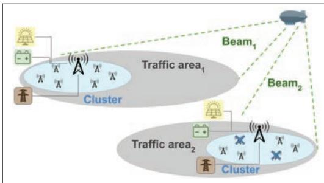
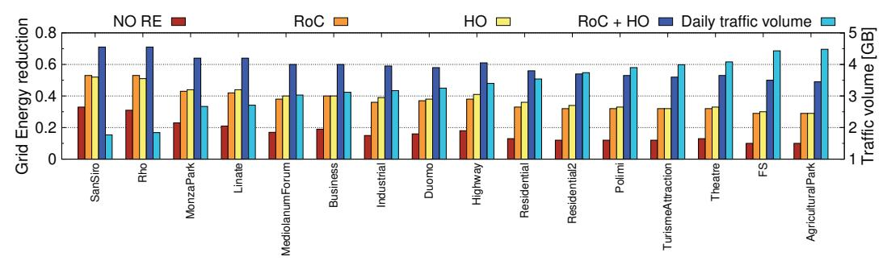
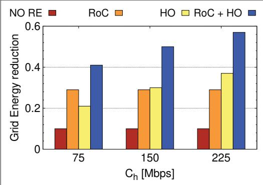
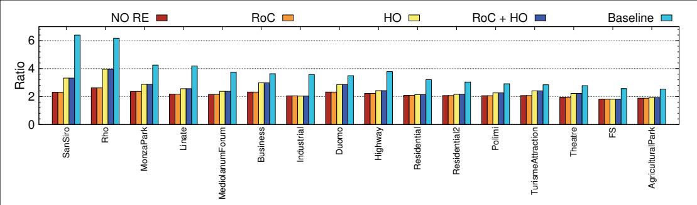
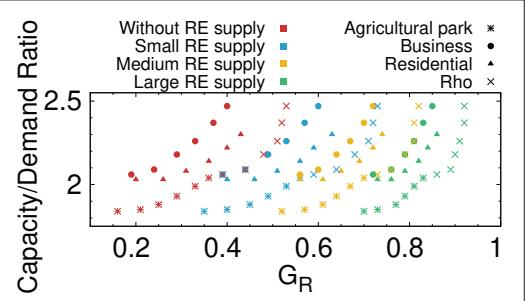

ACCEPTED FROM OPEN CALL

# Can High Altitude Platform Stations Make 6G Sustainable?

Daniela Renga and Michela Meo

## Abstract

The staggering growth of mobile trafic fostered by the spreading of 5G technology and massive Internet of Things applications is leading to the need for extensive radio access network (RAN) densification. However, the entailed boost in energy consumption poses significant challenges for a sustainable transition toward 6G. High altitude platform stations (HAPSs) equipped with aerial base stations (BSs) represent a promising and flexible solution to provide additional capacity that can be used in a flexible way to facilitate terrestrial BSs’ sleep modes and, ultimately, reduce energy consumption and make the network more sustainable.

As a case study, we consider a portion of an urban RAN to investigate the potential benefits deriving from the integration of HAPSs in terrestrial RANs as a means to support joint energy and resource allocation strategies that will be needed in 6G networks. Our results show that ofloading trafic to HAPS-mounted BSs allows reduction of the grid energy demand of terrestrial nodes while still maintaining adequate quality of service.

## Introduction

Radio access networks (RANs) are witnessing a staggering growth of mobile traffic demand due to the popularity of traditional communication services, especially those based on multimedia contents, as well as the penetration of massive Internet of Things communications in several fields. To satisfy this service demand, new mobile communication technologies require an extensive RAN densification, which will be further fostered by the upsurge of the number of connected machines that will lead 6G networks to support about 10 million device/km2, 10 times more than the 5G connection density requirements.

In this scenario, two main challenges are emerging that might limit and compromise the deployment of innovative infrastructures. First, network densification can become critical, especially in urban environments, where physical, legal, and bureaucratic constraints limit the boundless installation of new network infrastructures. Second, the growth of energy consumption of the communication infrastructures is in contrast with the global efforts to guarantee sustainable development. In the design of 5G technologies, a significant effort was made to include energy as a key performance indicator, and energy efficiency has largely improved. However, looking at consumption instead of eficiency, the overall power demand of 5G networks is estimated to be very large [1], at least 10 times larger than the demand of 4G, due to both network densification and high consuming BSs and users’ equipment.

The design of 6G solutions cannot leave these two challenges aside. In order to tackle them, two technologies will play a fundamental role. On one side, renewable energy (RE) sources will be integrated in the telecommunication infrastructure, with the purpose of reducing the energy consumption from the grid and the associated carbon emissions. On the other side, by leveraging on unprecedented network flexibility that can operate across different technologies, new resource on demand (RoD) approaches will dynamically adapt the radio resource availability to the actual varying trafic demand in order to reduce network consumption as much as possible and, at the same time, reduce the need to over-provision the network.

In this context, the integration of non-terrestrial networks may be strategic, since they provide supplementary capacity where and when it is more needed, without requiring additional energy consumption from the power grid. In particular, a High Altitude Platform Station (HAPSs),1 which operates in the stratosphere at an altitude around 20 km [2], can be equipped with Super Macro BS (SMBS) and provide additional capacity over a wide geographical area of up to hundreds kilometers radius [3]. From Mobile Operators’ perspective, moving towards a Space-As-A-Service paradigm means that HAPS mounted SMBSs can be exploited in support to energy and resource allocation strategies implemented by terrestrial nodes. Besides enabling coverage and capacity enhancement over the served region, SMBSs can also support data acquisition, computing, caching, and processing in manifold application domains [2].

So far HAPSs have been considered mainly as a mean to enhance the network service provisioning, and their usage was conventionally limited to rural and remote coverage and to disaster scenarios, where the terrestrial network may either not exist or be sparse. Few studies investigate the use of HAPS for Gigabit Mobile communication [4] or as a support to IoT applications in 6G framework [5], or as intermediate layer in Space-Air-Ground integrated networks [6]. The HAPS integration in populated areas characterized by dense terrestrial networks for reasons such as flexibility and sustainability is a less investigated aspect in the literature [2]. In this article we aim at studying the

The authors consider a portion of an urban RAN to investigate the potential benefits deriving from the integration of HAPSs in terrestrial RANs as a means to support joint energy and resource allocation strategies that will be needed in 6G networks.

The coverage range provided by HAPSs is in between terrestrial and satellite systems, making aerial BSs well suited as complementary network component. Aerial nodes can be rapidly installed (only a few hours are suficient for a HAPS to become operative) and easily removed when they are no longer needed.

  
FIGURE 1. HAPS integration in a terrestrial RANFig. 1: HAPS integration in

potential benefits deriving from integrating HAPS mounted SMBSs in terrestrial RANs, as a mean to support joint energy and resource allocation strategies that will be needed in 6G networks. In particular, the novelty of our contribution consists in exploiting the HAPS capacity, which comes at no operational cost given the HAPS self-sustainability, to offload a limited portion of terrestrial traffic. Although this fraction may not be sufficient to cover the future generation network bandwidth demand, it allows to deactivate a high number of low loaded BSs to save energy during of-peak periods, providing an additional degree of freedom to pursue sustainability in future networks. Since only a limited fraction of terrestrial traffic can be ofloaded to the HAPS in our scenario, we can reasonably assume that delay tolerant trafic is preferably ofloaded to the aerial SMBS, to better preserve QoS for delay sensitive services.

Finally, we aim at investigating the potential of flexibly allocating the HAPS bandwidth, that can be focused on specific areas or redirected from an area to another one depending on where it is more efective in improving energy eficiency and limiting the required on-ground RE supply.

The typical scenario is shown in Fig. 1. A portion of a urban mobile access network integrates a HAPS mounted SMBS that provides additional capacity over different areas and is incorporated in RoD strategies that target the reduction of energy consumption from the power grid. In each trafic area, several clusters consisting of heterogeneous cells coexist. The BSs are powered by the electric grid, and some of them can additionally be equipped with photovoltaic (PV) panels to locally generate RE that can be immediately used by the BSs or stored in some battery units for future usage. To optimize energy consumption, based on RE availability and the amount of trafic to carry, some BSs can be switched of and their trafic can be shifted to the aerial SMBS.

By discussing the benefits that HAPSs can bring to joint energy and resource management, we claim that they can contribute in a substantial way to make future 6G networks greener and} sustainable.

## Integrating Non-Terrestrial Networks

The SMBS bandwidth capacity can be flexibly distributed in space. A single aerial BS can serve a wide geographical area and its coverage can be partitioned by means of multiple beams, whose signal can be dynamically steered and focused on desired spots, to form up to 100 cells over the entire served area [4, 7, 8]. Various partition schemes can be applied to build up differently shaped coverage cells featuring variable sizes that may shrink or expand over time to provide supplementary capacity to areas where it is needed [9].

These huge aerial platforms offer a wide surface to host photovoltaic panels, resulting quite efective to power HAPS with solar energy, given the abundance of unfiltered solar radiation at the typical operating altitudes. This primary energy source is coupled with electrical batteries or hydrogen fuel cells [2]. The high efficiency of today photovoltaic modules and high energy density batteries make HAPS fully self-sustainable. The deployment of HAPSs is progressively becoming more and more economically feasible, thanks to the introduction of innovative and cost-effective technologies and materials, including light-weight building materials that enable high payload capacity, high density energy storage systems yielding 250 Wh/kg, and more efficient and cheap photovoltaic modules, featuring power exceeding 1.5 kW/kg, a record eficiency of almost 38 percent [2], and up to 50 percent CAPEX decrease expected in the decade 2018–2028 [10].

With a 4-fold power consumption increase for 5G BSs [1] and an expected 150 percent surge of operational cost for network operators in 5G scenarios, as reported by Vertiv and 451 Research, the capacity provided by HAPSs at virtually no operational cost enabling BS deactivation makes aeria network nodes very attractive. Moreover, CAPEX for HAPS installation is compensated by the wide and flexible coverage ofered by a single network node, whereas densified on-ground infrastructures requires several nodes and, hence, increased CAPEX.

The coverage range provided by HAPSs is in between terrestrial and satellite systems, making aerial BSs well suited as complementary network component. Aerial nodes can be rapidly installed (only a few hours are sufficient for a HAPS to become operative) and easily removed when they are no longer needed. Despite this flexibility, they have the potential to remain operative for various years [11] and they can still be periodically brought down to the ground for reconfiguration, thus requiring lower upgrade cost with [9, 12].

While in a first phase HAPSs have been considered to provide Internet access over remote and sparsely populated areas, it is now clear that they can play a crucial role also in Smart Urban ecosystems. A fully integrated three-layer Vertical Heterogeneous Network (VHetNet) is currently under discussion as a cornerstone in the 6G network architecture, consisting of the satellites network, the aerial network, and the terrestrial network [9, 13].

In this picture, HAPSs can serve as distributed machine learning platforms and aerial data centers, support massive IoT communication services, and manage the mobility of swarms of Unmanned Aerial Vehicles (UAVs), deployed for large-scale monitoring purposes and cargo delivery tasks [2]. HAPSs can act as alternative backhaul for isolated BSs} as well as to handle LEO satellites handoffs and provide seamless connectivity [2, 9]. Besides these interesting applications, that are summarized in Table 1, little attention has been devoted to HAPSs as a fundamental technology to make future communications more sustainable. By adding flexibility to resource allocation and, at the same time, being self-sustainable, HAPSs can significantly improve energy consumption and efficiency of network operation.

  
FIGURE 2. Grid energy reduction, $\widehat { \theta } _ { \beta } ,$ in diferent trafic areas.Fig. 2: Grid ener

Considering that RANs are usually overdimensioned and given the little load proportionality of BS power consumption, RoD strategies allows the network to dynamically adapt to varying trafic load.

In urban environments, the mobile access is provided by the overlapping of cells of different size, implemented by means of BSs possibly of diferent technologies. The network infrastructure is dimensioned to match the peak trafic demand, resulting oversized most of the time. Hence, resources are dynamically activated and deactivated (put into sleep mode) based on the trafic. The trafic handled by deactivated micro BSs is moved to a macro BS, provided that it has still suficient available capacity. In presence of a HAPS, a fraction of the on-ground mobile traffic from a cluster can be offloaded to the HAPS to reduce the cluster mobile load and allow additional BSs to be deactivated. The HAPS becomes a new knob to be used by the resource allocation strategies to reduce consumption and make the network more sustainable.

## A Case Study

To prove the concept discussed above, we consider a case study that takes inspiration from already deployed 4G technologies for which we have real trafic traces and consumption models. While actual trafic and consumption profiles will change in the future, the benefit of the use of HAPSs and the role they can play in the interplay between energy and resource management can already be proved in this scenario, which is realistic for today deployed technologies.

We consider a portion of a RAN in the city of Milan, Italy, where diferent trafic areas, as those sketched in Fig. 1, can be identified depending on the data traffic patterns. Real traffic data are extracted from a huge dataset provided by a large Italian mobile network operator, that reports the traffic demand volume of 1420 BSs for two months in 2015, with granularity of 15 minutes. To keep into account the growth of mobile traffic volume registered in the past years, the trafic traces are normalized and scaled up, assuming that the peak of each traffic pattern is equal to the maximum bandwidth capacity of a BS, i.e., 150 Mb/s. The BS energy consumption consists of a fixed component, corresponding to the energy that is consumed when the BS is active even with no traffic to transmit, and a variable component that is proportional to the load. Since no consumption model is available for future BSs, for our study we consider the consolidated and well known models for 4G technology [14]. While future BS consumption profiles will change, possibly becoming more load proportional, there is no evidence that they will be significantly lower or drastically diferent; and, in addition, the transition towards 6G will be based on a consistent use of current technology for quite some time. A negligible BS consumption is assumed in sleep mode.

## On-Ground Node Operation and Powering

Considering that RANs are usually overdimensioned and given the little load proportionality of BS power consumption, RoD strategies allows the network to dynamically adapt to varying traffic load. In our study, a micro BS can be periodically put in sleep mode by a central controller if its traffic load is below a given threshold, denoted rmin, provided that the macro BS still has suficient capacity to carry the traffic offloaded from the micro BS itself. The setting of $\mathsf { p } _ { \mathrm { m i n } } ,$ whose values are in the range [0, 1] (1 corresponds to the maximum BS capacity), is decided so as to minimize the energy consumption per carried bit. When the traffic is below $\rho _ { \mathrm { m i n } }$ it is convenient to carry the traffic on the macro BS and save the energy needed to keep the micro cell on. Conversely, when trafic is above $\mathsf { p } _ { \mathrm { m i n } } ,$ it is more convenient to keep the micro cell BS on. The actual value of $\mathsf { p } _ { \mathrm { m i n } }$ depends on the consumption profiles; here, we take it to be equal to 0.37 as in [15], which is the optimal value in our setting. Note that although the future BS consumption models may be diferent, hence leading to diferent actual values of $\mathsf { p } _ { \mathrm { m i n } } ,$ the general system behavior and the consequent benefits will remain similar.

Each cluster of BSs can be equipped with a set of PV panels and some units of lead-acid batteries to power BSs with locally produced solar energy. Assuming a PV panel eficiency of 19 percent, a physical area occupancy of about 5 m2 per kWp is entailed [15], where kWp indicates the capacity of a PV module. The PV dimensioning aims to contribute to sustainability rather than entirely satisfy network demand.

Real RE generation profiles obtained from PVWatts are used to characterize the RE production in the city of Milan. The tool provides, on an hourly basis and for a given location, the average levels of RE power production obtained from a standard PV panel with capacity of 1 kWp during a typical meteorological year.

## HAPS Offloading

In the investigated scenario, a HAPS provides coverage over a wide geographical area by means of a SMBS installed on the platform itself. Thanks to the unique properties of the stratosphere, the HAPS can maintain a quasi-stationary position [2] and direct communication is enabled between end user devices and the SMBS. The coverage area is partitioned in a number of multiple spot

By combining the trafic ofloading and RE at the terrestrial node, the system performance is further enhanced, achieving over 70 percent grid energy saving. Benefits are visible for all the considered trafic areas. However, abso lute savings are lower in low trafic areas with respect to high demanding ones.

  
FIGURE 3. Grid energy reduction, GR, under different values of HAPS cell capacity per cluster, Cₕ.

cells, each focused on a defined traffic zone. Based on ITU-R recommendations, we assume that each HAPS cell can provide 2 Gbps bandwidth capacity in its covered area, where several clusters of on-ground BSs can be present. Our study investigates the operation of a single cluster per each traffic zone, consisting of a macro BS and a number of micro BSs, as representative of the behavior of the entire portion of RAN in that traffic area. We assume that the portion of additional capacity yielded by the HAPS cell that is actually made available to each cluster served by the same cell}, and that we denote by $C _ { h } ,$ is 150 Mb/s in the baseline scenario, corresponding to a uniform bandwidth allocation among HAPS cells. Finally, the HAPS communication segment is powered by solar energy, by means of a set of PV panels and storage units that provide suficient energy supply to satisfy the SMBS demand [2]. Although a consumption model of a SMBS is not yet available, considering a payload with 8 kW power rating for a renewable powered HAPS (like in the Stratobus airship project, started by Thales Alenia Space in 2016)}, the communication segment is reasonably assumed self-sustainable [2].

When a HAPS cell is available over a given traffic area, a fraction of the mobile trafic can be ofloaded to the SMBS from the micro BSs, as long as enough residual capacity is available on the HAPS cell. Only when the HAPS cell capacity is fully utilized a can dditional trafic be moved from the micro BSs to the on-ground macro BS, as is usually done when no HAPS is present. Note that in terms of grid energy demand it is always more convenient to carry any amount of trafic on the HAPS rather than on micro BS. Besides reducing the load proportional energy consumption, HAPS of loading (HO) enables the deactivation of unneeded BSs, further reducing the on-ground energy demand due to BS fixed consumption, either by carrying the entire micro BS trafic load or reducing it closer to $\rho _ { \mathrm { { m i n } } } ,$ so that macro BS offloading can be exploited to switch of the micro BSs.

## Performance Indicators

The system operation is evaluated by means of the following performance indicators:

• Grid Energy Reduction $( { \cal G } _ { R } ) { : }$ fraction of energy drawn from the grid that can be saved in the considered scenario with respect to the baseline scenario (i.e., the case in which no HAPS is deployed, no on-ground RE is locally produced to power the BS cluster, and no

RoD strategy is applied) so that all the cluster BSs are always active.

• Capacity/Demand Ratio (R): average ratio between the overall offered capacity in a given traffic area (including both the on-ground BS cluster and the HAPS cell, when available) and the total trafic demand in the considered traffic area. This indicator assesses the effectiveness of allocating resources on demand.

## Hybrid Network Performance

To investigate the efectiveness of the hybrid terrestrial/aerial access network to reduce energy consumption, several combinations of the size of PV panels and battery are considered for the on-ground local RE generator, assuming commercial PV modules with capacity, denoted by $S _ { P } ,$ of $2 \mathsf { k W p } , 4 \mathsf { k W p }$ and 8 kWp, and a battery size, denoted by $S _ { B } ,$ of 2 kWh, 4 kWh, and 8 kWh. For each traffic area, diferent values of the HAPS cell capacity are tested, corresponding to values of $C _ { h }$ ranging from 25 to 150 percent of the baseline considered capacity per cluster (i.e., 150 Mb/s). Six micro BSs per cluster are assumed. Simulations are run over a period of two months, with time-step granularity of one hour.

## Impact of HAPS Offloading

We first analyze the efect of HO on the system performance. Figure 2 reports the grid energy reduction, $\scriptstyle { C _ { R } , }$ for diferent trafic areas, along with daily trafic volume (azure bars), considering various configurations:

• NO RE (red bars): RoD is applied on the BS cluster, whereas neither RE is produced locally to power the BSs nor is any HAPS present.

• RE on Cluster (RoC, orange bars): RE is locally produced to power the cluster, and RoD strategy is applied.

• HO (yellow bars): HO is active, combined with RoD strategy on the cluster.

• RoC + HO (blue bars): HO is active, combined with RoD strategy and local RE generation on the cluster.

When $C _ { h }$ is set to 150 Mb/s, HO alone results mostly as effective as the presence of an on-ground RE generator in reducing the energy drawn from the grid, which is more than halved with respect to the baseline scenario. By combining the traffic offloading and RE at the terrestrial node, the system performance is further enhanced, achieving over 70 percent grid energy saving. Benefits are visible for all the considered trafic areas. However, absolute savings are lower in low trafic areas with respect to high demanding ones. Hence, when considering the overall grid energy reduction over diferent urban areas, it may be more convenient to allocate larger HAPS cell capacity over more loaded areas. The overall global allocation of HAPS capacity in space has to be carefully decided. These results confirm that for sustainability purposes, several techniques need to be combined: accurate resource allocation, RE generation, and aerial platform for ofloading.

## Quality of Service under HAPS Offloading

The values of the capacity/demand ratio, R, are plotted in Fig. 4 under $C _ { h } ^ { \phantom { ' } } = 1 5 0$ Mb/s for all the considered traffic areas. The azure bars represent the value of R in the baseline scenario, with all the BSs always active. Through RoD and HO, R is reduced, making the radio resource availability more proportional to the actual demand, still guaranteeing a reasonable quality of service (QoS) level.

  
FIGURE 4. Capacity/Demand ratio, R, in diferent trafic areas, sorted by icreasing trafic volume.Fig. 4: Capacity/Demand ratio, R, in different traffic area

In areas with bursty or large traffic patterns, additional benefits in terms of bandwidth availability are achieved by exploiting HO. These findings, together with those previously highlighted, ofer interesting perspectives about the possibility of partitioning and distributing the HAPS capacity, adapting it to the diferent trafic zones, to properly trade off grid energy saving and bandwidth availability. Based on the traffic zone characteristics, different values of capacity can be made available for each cluster, providing higher bandwidth where the traffic demand is larger and reducing it where it is not needed.

## Allocating HAPS Capacity Based on Traffic Demand

We now investigate the impact of HAPS capacity and local on-ground RE supply on the system performance.

Figure 5 shows the values of the performance indicators R vs. $G _ { R }$ in a subset of traffic areas, considering the case without any on-ground RE generator and the case with RE production at the cluster level, under different system size. For a given trafic area and a given RE supply, each dot in the graph represents a different value of the HAPS capacity $C _ { h } ,$ ranging from 0.25x to 1.5x the default value of 150 Mb/s, while colors correspond to different sizes of the RE generators with small, medium, and large size being $S _ { P } = 2 ,$ 4, 8 kWp, with battery capacity $S _ { B } = 2$ , 4, 8 kWh, respectively. As $C _ { h }$ grows, both R and $G _ { R }$ increase in all areas. However, when no RE supply is present, the grid energy saving can be reduced by about 50 percent at most even if the HAPS has large capacity. When a local RE supply is introduced in the cluster, the curves tend to shift toward higher values of energy saving with no impact on ${ \overset { \sim } { R } } ,$ and the gap between diferent trafic areas progressively reduces.

This analysis provides useful insights to tailor service provisioning based on the trafic area characteristics. For example, a larger RE generation system can be introduced to reduce the portion of HAPS capacity reserved to a cell covering a given trafic area, while making the saved capacity available in another cell that covers an area featuring higher trafic demand. Likewise, the HAPS capacity can be set to higher values to obtain similar grid energy saving in those trafic areas where physical constraints do not allow the installation of properly sized RE generators.

  
FIGURE 5. Capacity/demand ratio, R, vs. reduction of energy drawn from the grid, GR, under different values of Cₕ for different traffic areas.

## Challenges and Future D irections

The proposed case study highlights the relevant potential of HAPS-mounted BSs in dense mobile access networks to support a sustainable transition toward 6G. There are, however, a number of key challenges.

1. First, to gain the largest benefit from HAPSs, new decision making approaches are needed for resource activation and allocation strategies, and parameter and configuration setting. Given the size and complexity of the problem, machine learning approaches can provide valuable support, but specific solutions must be designed.

2. Second, for decision making to be efective, accurate predictions of demand for service are needed. Given that the advantages of HAPSs come from their large coverage areas and the effective interplay with terrestrial nodes whose coverage is smaller, predictions should also explore the space dimension, incorporating mobility models.

3. Third, accurate analysis of CAPEX and OPEX are needed to define proper system dimensioning. These analyses are made particularly hard by the evolution of the energy market, which is influenced by the uncertainties related to technological advancements on energy sources, the political situation and its evolution, and the efects of climate change.

4. In addition to the sustainability perspective treated here, the HAPS’s role as a complementary node for the terrestrial network is bound to become even more promising, since aerial BSs will be further enhanced by new pivotal features, including caching and computational capability as well as backhauling functionalities. Moreover, they will be able to cooperate with other types of aerial nodes like drones and satellite networks.

Based on the trafic zone characteristics, diferent values of capacity can be made available for each cluster, providing higher bandwidth where the trafic demand is larger and reducing it where it is not needed.

<table><tr><td>Remote regions</td><td>Smart urban ecosystems</td><td>Vertical heterogeneous network (6G)</td></tr><tr><td>• Overcoming the digital divide • Avoiding the installation of costly and underutilized terrestrial network infrastructures</td><td>• High-speed Internet access in densely populated regions • Enhancing URLLC and eMBB communications • Supporting intelligent transportation systems • Defeating coverage holes</td><td>• Edge intelligence • Edge caching • Supporting massive IoT communication • Mobility management of swarms of UAVs • Alternate backhauling for isolated BSs</td></tr></table>

TABLE 1. HAPS applications in diferent scenarios.

However, the orchestration of this variety of nodes might become complex, introducing uncertainties and additional delays that are incompatible with some service provisioning.

5. While HAPS can be extremely useful in providing services in emerging countries, natural disasters, emergency situations, and temporary power outages, a key challenge is to design solutions to let HAPSs operate when the power grid is unreliable or unavailable, hence partially independent of the other nodes and relying on limited information.

## Conclusion

In the context of extensive mobile network densification in 5G scenarios and in view of the forthcoming transition toward 6G, the integration of HAPS-mounted aerial BSs represents a promising solution to reduce the energy consumption from the grid, decrease the operational cost, and enable dynamic and flexible resource allocation.

Our results show that the integration of a HAPS-mounted SMBS allows reducing the grid energy consumption of terrestrial nodes, especially when combined with some local on-ground RE supply. A limited contribution in terms of HAPS bandwidth yields an additional degree of freedom to enhance sustainability. At no additional operational cost, HO reduces the on-ground grid energy demand by:

• Decreasing the energy consumption required to power terrestrial nodes

• Enabling the deactivation of low-loaded micro BSs

• Favoring terrestrial trafic ofloading to macro BSs, further increasing the chance to put some BSs in sleep mode

The main benefits occur in highly loaded areas, a situation that is particularly relevant for future mobile networks. By properly adapting the HAPS cell capacity in time and space, based on the traffic load observed in the covered zones, the system performance can be further improved in terms of efficient bandwidth resource utilization.

To develop sustainable networks of the future, the integration of terrestrial and aerial technologies is needed. HAPSs become part of the access networks, enabling new cross-technology strategies that minimize energy consumption and exploit at best the presence of RE, while adapting in a very efficient and flexible way to the actual service demand. Our future work will be widened to include the multi-functionality potential of the HAPS and its pivotal role as an intermediate layer between terrestrial and satellite networks.

## Acknowledgment

We thank Dr. Felice Scarpa, whose Master’s thesis (https://webthesis.biblio.polito.it/20426/1/tesi.pdf) carried out under the authors’ supervision opened up the way to our research activity in the field.

## References

[1] C.-L. I, S. Han, and S. Bian, “Energy-Eficient 5G for a Greener Future,” Nature Electronics, vol. 3, Apr. 2020, pp. 182–84.

[2] G. Karabulut Kurt et al., “A Vision and Framework for the High Altitude Platform Station (HAPS) Networks of the Future,” IEEE Commun. Surveys & Tutorials, vol. 23, no. 2, 2021, pp. 729–79.

[3] M. S. Alam et al., “High Altitude Platform Station Based Super Macro Base Station Constellations,” IEEE Commun. Mag., vol. 59, no. 1, Jan. 2021, pp. 103–09.

[4] Y. Shibata et al., “A Study on Cell Configuration for HAPS Mobile Communications,” 2019 IEEE VTC-Spring 2019, 2019.

[5] Z. Jia et al., “Towards Data Collection and Transmission in 6G Space-Air-Ground Integrated Networks: Cooperative HAP and LEO Satellite Schemes,” IEEE IoT J., 2021, pp. 1–1.

[6] Y. Yang et al., “Towards 6G Joint HAPS-MEC-Cloud 3C Resource Allocation for Delay-Aware Computation Offloading,” 2020 IEEE ISPA/BDCloud/SocialCom/SustainCom, 2020, pp. 175–82.

[7] Y. Xing et al., “High Altitude Platform Stations (HAPS): Archi tecture and System Performance,” IEEE VTC-Spring 2021, 2021.

[8] F. Hsieh et al., “UAV-Based Multi-cell HAPS Communication: System Design and Performance Evaluation,” IEEE GLOBE-COM 2020, 2020.

[9] O. Kodheli et al., “Satellite Communications in the New Space Era: A Survey and Future Challenges,” IEEE Commun. Surveys & Tutorials, vol. 23, no. 1, 2021, pp. 70–109.

[10] E. Vartiainen et al., “Impact of Weighted Average Cost of Capital, Capital Expenditure, and Other Parameters on Future Utility-Scale PV Levelised Cost of Electricity,” Progress in Photovoltaics: Research and Applications, vol. 28, no. 6, 2020, pp. 439–53.

[11] F. Baurreau et al., “Stratospheric Platform for Telecommunication Missions,” 2015 IEEE Int’l. Symp. Antennas and Propagation USNC/URSI Nat’l. Radio Science Meeting, 2015, pp. 914–15.

[12] F. Rinaldi et al., “Non-Terrestrial Networks in 5G & Beyond: A Survey,” IEEE Access, vol. 8, 2020, pp. 165,178–200.

[13] X. Cao et al., “Airborne Communication Networks: A Survey,” IEEE JSAC, vol. 36, no. 9, 2018, pp. 1907–26.

[14] G. Auer et al., “D2.3: Energy Eficiency Analysis of the Reference Systems, Areas of Improvements and Target Break down,” Earth, vol. 20, no. 10, 2010.

[15] M. Dalmasso, M. Meo, and D. Renga, “Radio Resource Management for Improving Energy Self-Suficiency of Green Mobile Networks,” Performance Evaluation Review, vol. 44, Sept 2016, pp. 82–87.

## B iographies

Daniela Renga is an assistant professor in the Department of Electronics and Telecommunications at the Politecnico di Torino, Italy. She received her Ph.D. degree in electronics and telecommunications engineering from the same university in 2018.

Michela Meo is a full professor in the Department of Electronics and Telecommunications at the Politecnico di Torino. She received her Laurea degree in electronic engineering in 1993, and her Ph.D. degree in electronic and telecommunications engineering in 1997, both from the Politecnico di Torino.