Received March 31, 2019, accepted May 23, 2019, date of publication June 17, 2019, date of current version July 3, 2019   
Digital Object Identifier 10.1109/ACCESS.2019.2923538

# Channel Measurement and Resource Allocation Scheme for Dual-Band Airborne Access Networks

RUONAN ZHANG 1, (Member, IEEE), QI GUO 1, DAOSEN ZHAI 1, (Member, IEEE), DEYUN ZHOU1, XIAOJIANG DU2, (Senior Member, IEEE),

AND MOHSEN GUIZANI3, (Fellow, IEEE)

1Department of Communication Engineering, Northwestern Polytechnical University, Xi’an 710072, China 2Department of Computer and Information Sciences, Temple University, Philadelphia, PA 19122, USA 3Department of Computer Science and Engineering, Qatar University, Doha 2713, Qatar

Corresponding author: Daosen Zhai (zhaidaosen@126.com)

This work was supported in part by the National Natural Science Foundation of China under Grants 61571370, 61601365, and 61801388, in part by the Key Research Program and Industrial Innovation Chain Project of Shaanxi Province under 2018ZDCXLGY03-04, Grant 2019ZDLGY07-10, Grant 2019JQ-253, and Grant 2019JM-345, in part by the China Postdoctoral Science Foundation under Grant BX20180262, Grant BX20190287, Grant 2018M641020, and Grant 2018M641019, in part by the Civil Aircraft Major Project of China under Grant MIZ-2015-F-009, and in part by the Advance Research Program on Common Information System Technologies under Grant 315075702.

ABSTRACT The aerial base stations (ABSs) can be quickly deployed to provide emergency communications and airborne network infrastructures. How to ensure wide coverage, reliable links, and high throughput for ground users under the conditions of limited onboard power supply, large propagation distance, and restricted frequency resource is a critical and challenging issue. In this work, we propose a hybrid-spectrum scheme for ABS-based airborne access networks, named dual-band aerial access (DBAA) where the ABS employs both the UHF and S-bands to provide connectivity for ground users. The DBAA can improve coverage range and reliability by taking advantage of the preferable radio propagation characteristics of the low-frequency band and meanwhile improve network throughput by exploiting the large spectrum bandwidth in the high-frequency band. Following the cross-layer approach, we first conducted a measurement campaign on the large-scale fading of the air-to-ground (A2G) channels at 785 and 2160 MHz simultaneously. We installed an ABS with two antennas on an airship that hovered at several altitudes from 50 to 950 m. We measured the signal power attenuation from the ABS to a ground terminal that moved in rural, suburban, and urban scenarios with the horizontal distance up to 70 km from the airship. Based on the measurement data, we establish the large-scale fading channel model for ABS at different operating frequencies. Then, we design the joint spectrum-and-power allocation algorithm to maximize the network throughput for the dual-band airborne access network. We evaluate the performance of the optimal resource allocation based on the proposed channel model. The simulation results show that the DBAA scheme with the optimal resource allocation can achieve substantial performance improvement in comparison with the single-band solution given the total spectrum bandwidth and onboard power supply.

INDEX TERMS Airborne access network, aerial base station, air-to-ground channel, channel model, large-scale fading, resource allocation.

## I. INTRODUCTION

With the development of the communication and aeronautical technologies, the unmanned aerial vehicles such as drones, airships, and air balloons have been increasingly utilized to deploy aerial base stations (ABSs) [1]. The communication equipments are loaded on these platform [2] and act as mobile base stations (BSs) to provide access links for ground user equipments (UEs). The airborne access networks have great potential in many application scenarios. ABSs can be quickly deployed to provide emergency communications for rescue and public safety in disasters and social events where the terrestrial BSs are destroyed or overloaded [3]–[5]. When building terrestrial infrastructures is too expensive or infeasible in remote areas, ABSs can get settled in the sky and provide persistent Internet access [6]. Furthermore, ABSs can also serve as the mobile sinks to collect data from ground wireless sensor networks that monitor forests or oceans [7], [8].

Compared with the traditional terrestrial cellular BSs, ABSs also face great challenges in providing access networks. First, considering the onboard power supply and the need for aviatic propulsion, the power for single transmission is very limited. Second, the long transmission distances between ABSs and ground terminals lead to the weakly connected communication links. Meanwhile, the obstruction on signal propagation caused by the ground buildings, trees, and terrains may generate severe shadowing and fading especially when the elevation angle of the ABS is small. Therefore the large-scale fading (LSF) including the path loss (PL) and shadowing effect (SE) in the air-to-ground (A2G) channels is critical for the coverage and capacity of the airborne access networks [9]. Since the A2G channel characteristics are different from the those of the terrestrial channels, the channel measurement and modeling are very important for the system design and performance evaluation [10]–[12]. However, the study on the A2G channels are still quite limited, and measurements for typical application environments and various frequency bands are needed.

Considering the distinctive features of the airborne access networks, we propose a dual-band hybrid-spectrum scheme, named dual-band aerial access (DBAA), in this paper. In DBAA, an ABS employs both a low-frequency band and a high-frequency band (for example, utilizing the UHF and S-bands) simultaneously to provide connectivity for ground users. Due to the substantial different radio propagation characteristics, combination of the UHF and S-bands is a promising direction for the airborne access networks. We can take advantage of the better propagation characteristics of the low-frequency band in complicated scattering environments to improve coverage and reliability and meanwhile increase the network throughput by exploiting the large spectrum bandwidth in the high-frequency band. Following a cross-layer approach, we conducted a measurement campaign on the LSF of the A2G channels in the UHF and S-bands, and establish the multi-frequency channel model. Then based on the channel model, we design and evaluate the joint spectrum-and-power allocation scheme for the dualband airborne access networks to maximize the throughput and coverage.

First, we conducted the field measurement and measured the LSF of the A2G channels in various terrestrial environments for ground UE access. The channels were sounded by using two single-tone signals at 785 and 2160 MHz. The transmitter (TX) was equipped with two omnidirectional antennas for the two frequencies and mounted on the soleplate of an airship. The airship hovered at several altitudes from 100 to 1000 meters. The antennas of the receiver (RX) were installed on the top of a van and moved along two countryside roads to different directions. The received signal strength (RSS) was measured when the horizontal distance between the TX and RX was changed from 0 to 70 kilometers. Based on the measured RSS along the roads, we establish the statistical LSF model with respect to the horizontal distance, ABS altitude, and operating frequency. The measurement results and models present the new features of the low-altitude A2G channels different from the traditional terrestrial cellular channels, such as the PL exponent, standard deviation of the SE, and the dependency on the ABS altitude. The results can help to extend the current A2G channel models and support the design of the DBAA networks.

Second, we design the DBAA scheme for airborne access networks to serve ground users. Each user can communicate with the ABS using either the UHF or the S-bands, and the subchannels and transmission power are allocated to the users according to the channel condition and link capacity requirement. We propose the joint spectrum-and-power resource allocation algorithm for the DBAA networks to maximize the network throughput. Based on the established A2G channel models, we formulate the joint resource allocation problem with the objective to maximize the total data rates of all users, constrained by the limited onboard power supply, frequency bandwidth, and ABS altitude (large-scale channel fading). To solve this mix-integer programming problem, we design a two-state cost-efficient algorithm. We first devise a lowcomplexity spectrum assignment algorithm based on our theoretical analysis. Afterward, by adopting the Lagrange dual technique, we propose an iterative power allocation algorithm to obtain the optimal transmission power for each user.

We have performed extensive simulations of the designed DBAA scheme based on the established A2G channel model. The results show that, with the joint resource allocation optimization, the DBAA scheme can obtain about 46% and 73% network capacity gain compared with the low-frequencyband-only scheme and high-frequency-band-only scheme, respectively. Furthermore, the subchannel allocation optimization can lead to about 36% increase in the network capacity, while the optimal power allocation can provide only about 19% improvement. This indicates that dual-band coverage can enhance the network performance significantly by fully exploiting the large bandwidth in the S-band to improve the network capacity and meanwhile the preferable propagation characteristics in the UHF-band to provide large-area coverage for long-distance ground users. Therefore, the DBAA scheme with the resource allocation optimization provides an efficient approach for the airborne access networks.

The rest of the paper is organized as follows. Sec. II presents the related works in the measurement and modeling of the A2G channels and the performance evaluation. Sec. III introduces the network model of the DBAA scheme. The A2G channel sounding system, measurement scenario and results, and LSF models are presented in Sec. IV. Sec. V provides the design of the joint spectrum-and-power allocation algorithm. The numerical results of the performance of different schemes for the airborne access networks based on the A2G channel models are presented in Sec. VI. Sec. VII concludes the paper and points out the future research issues.

## II. RELATED WORK

We first review the efforts in the A2G channel measurement and modeling, and then discuss the works on the airborne networks. Given the numerous efforts in this area, we mainly focus on the most relevant works in this section, and a more comprehensive survey can be found in [13] and [3].

## A. A2G CHANNEL MEASUREMENT CAMPAIGNS

In the early studies on the A2G communication links [14], the channel impulse responses (CIRs) in the VHF and UHF frequency bands were measured. The authors in [15] proposed a method to design an aeronautical channel model for block-data transmission in the frequency domain. The authors in [16] presented a measurement campaign on the A2G channels for the unmanned aircraft service (UAS) scenario. A measurement setup was established where a signal was continuously transmitted from a small manned airplane with a bandwidth of 20 MHz at the center frequency of 5060 MHz. A vector signal analyzer on the ground recorded the IQ waveforms of the received signals and obtained the RSS. To develop the control and non-payload communication (CNPC) system in the National Airspace System (NAS), the authors in [17] studied the A2G channel characteristics in over-water, hilly, mountainous, suburb, and near urban scenarios. The PL was modeled by a modified log-distance model with a correction for flight direction, and the small-scale fading (SSF) was modeled by the Ricean distribution and the tapped delay line models with up to seven intermittent multipath components (MPCs). The authors in [18] provided a brief summary of the measurements and models of the A2G channels for the altitude range from 500 to 2000 meters. The PL generally followed the freespace model but had significant two-ray attenuation peaks (exceeding 18 dB) for relatively smooth earth surfaces. The SSF was also found to follow the Ricean distribution. The airframe shadowing was also found potentially severe. Meanwhile, the authors in [19] and [20] provided a good reference for the wireless channel analysis.

The European commission project ABSOLUTE focuses on the low-altitude platforms (LAPs) in the airborne network recovery solutions. The works in this regard can be found in [21] and [22]. Particularly, the authors in [21] measured the low-altitude A2G channel to support the development of high-capacity A2G links for range extension. The measurements revealed significant spatial diversity despite the sparse multipath environment. In [22], the authors presented an experimental study of the A2G channels over sea surface at the C-band (5.7 GHz) with low altitudes (from 370 to 1830 meters). The multi-path statistics and the propagation loss at different airborne altitudes were also estimated. In [23], the authors performed a measurement campaign on the aerial access channels between a unmanned aerial vehicle (UAV) and a ground BS in the typical urban and rural macro-cell scenarios. The channels were sounded at 2412 and 919 MHz with the maximal horizontal distances of

420 meters and 10 kilometers in the two scenarios. The statistical PL models were proposed based on the 3GPP terrestrial channel models but adjusted by adding the correction factors (CFs) and dependency on the UAV altitude.

## B. WORKS ON AERIAL BASE STATIONS

In [1], the authors proposed an optimal placement algorithm for UAV BSs that maximized the number of covered users using the minimum transmission power. The UAV-BS deployment was modeled in the horizontal dimension as a circle placement problem and a smallest enclosing circle problem. To minimize the number of ABSs in providing wireless coverage for a group of distributed ground terminals (GTs), the authors in [24] proposed a polynomial-time algorithm that placed ABSs sequentially starting on the area perimeter along a spiral path toward the center, until all GTs were covered. Numerical results showed that the proposed algorithm performed favorably compared with other schemes in terms of the number of ABSs and complexity. In [25], the authors proposed a routing protocol in drone-cells communication networks where ABSs remained stationary in the sky as relays. To relieve the network congestion caused by heavy traffic, a novel queue architecture was designed that could significantly reduce the queueing process at each network node. A new routing metric was also proposed based on the queuing and transmission delay to improve the performance.

Furthermore, the authors in [26] studied the deployment of UAV-BSs in the presence of a terrestrial network. This provided the estimation of the number and locations of hovering UAV-BSs needed to support a terrestrial network. A stochastic geometry-based network planning approach was also proposed for multiple UAV-BSs in a large-scale network. Several papers (e.g., [27], [28] and [29]) have also studied related issues. The authors in [30] investigated the maximization of the coverage for a UAV-BS under the constraint of transmission power. By modeling the low-altitude A2G channel and setting up the relationship between the antenna beam angle and antenna gain, the authors formulated the energyefficient coverage problem as a 2-dimensional optimization equation with respected to the flight altitude and beam angle. The authors in [31] investigated complementing the capacity of an existing macro-cell BS by dynamically placing a network of 5G small BSs on UAVs. Two clustering algorithms were proposed based on the mobile users’ spatio-temporal traffic demand. Based on the real trajectory data in Beijing downtown, the numerical analysis showed that the proposed algorithms could enable real-time connection provisioning.

Although the channel characterization and system design of the airborne communication networks are emerging in recent years, the work in this paper makes new contributions in three aspects. First, the channel measurements in the literature were performed at various frequencies separately. The propagation characteristics of two frequency bands cannot be compared accurately without sounding in the same physical environment simultaneously. In this work, we utilized a dual-band sounder and measured the LSF in the UHF and

S-bands simultaneously. Thus the channel parameters can be compared more accurately, and the results enable the evaluation of the hybrid spectrum scheme. Second, we address the issue of providing connectivity for massive users using an ABS, instead of the traditional point-to-point aircraft data links. The system capacity in supporting a large number of users in a wide area is the key requirement. The proposed DBAA scheme is suitable for the airborne access networks that require large coverage and high throughput simultaneously. Third, we combine the channel measurement and model with the network design using a cross-layer approach.

## III. DESIGN OF DUAL-BAND AIRBORNE ACCESS NETWORK

Motivated by the distinctive features of airborne access networks, we propose the DBAA scheme as illustrated in Fig. 1. An ABS provides connectivity for ground UEs and meanwhile it has a backhaul link to the backbone network such as the Internet. The ABS employs both the UHF and S-bands simultaneously to provide hybrid-spectrum access links. In general, the UHF-band signals have much better capabilities of penetrating obstacles and diffraction to circumvent obstacles. However, the signal bandwidth is small and has limited link capacity. On the other hand, the S-band can use a large bandwidth to achieve high data rates, but suffers from the severe shadowing effect.

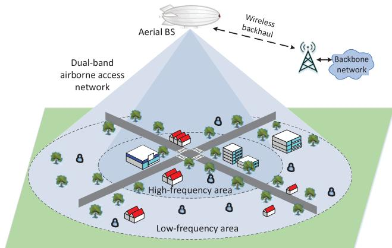  
FIGURE 1. System model of the dual-band airborne access network.

Let $f _ { l }$ and $f _ { h }$ denote the operating frequencies in the low and high bands, respectively. A user is allocated with one subchannel in either band. Suppose that the bandwidth of one subchannel in the low and high-frequency band is $B _ { l }$ and $B _ { h }$ , respectively. Suppose that the ABS utilizes directional antennas for the two bands that have wide beams and face downward the ground, as shown in Fig. 1. Generally speaking, users located in the area beneath the ABS have relatively short distances to the ABS and hence small PL. Thus they can communicate with the ABS in the high-frequency band and adopt a large bandwidth to acquire a high throughput. On the other hand, the users located far away from the ABS use the low-frequency band to reduce the LSF and ensure the received signal power level, but the bandwidth and throughput are relatively small. Meanwhile, when the line-of-sight (LOS) propagation path of a UE is blocked, it may also connect with the ABS in the UHF-band. The good penetration and diffraction capabilities of the low-frequency radio signal can help to avoid the deep fading due to shadowing.

In the DBAA scheme, the numbers of users served in the low and high-frequency bands are denoted by $N _ { l }$ and $N _ { h }$ , respectively. Let $p _ { k }$ represent the transmission power allocated to the k-th user. Accordingly, $G _ { k } ^ { l }$ and $G _ { k } ^ { h }$ denote the channel power gain (CPG) from the ABS to the k-th user in the two bands. The CPG in one band is defined as $G _ { k } = \left( G _ { T X } G _ { R X } \right) / P L$ where $G _ { T X }$ and $G _ { R X }$ are the gains of the TX and RX antennas, respectively.. Thus, the link capabilities for the k-th user in the two bands are

$$
\begin{array} { r } { \{ { { R } _ { k } ^ { l } } = B _ { l } { { \log } _ { 2 } } ( 1 + \frac { { { p } _ { k } } { { G } _ { k } ^ { l } } } { { { \sigma } ^ { 2 } } } ) , } \\ { { { R } _ { k } ^ { h } } = B _ { h } { { \log } _ { 2 } } ( 1 + \frac { { { p } _ { k } } { { G } _ { k } ^ { h } } } { { { \sigma } ^ { 2 } } } ) , } \end{array}\tag{1}
$$

where $p _ { k }$ is the transmission power for the k-th user and $\sigma ^ { 2 }$ is the power of the additive white Gaussian noise (AWGN). Thus the total network throughput can be calculated as

$$
T H _ { n e t } = \sum _ { k = 1 } ^ { N _ { l } } R _ { k } ^ { l } + \sum _ { k = 1 } ^ { N _ { h } } R _ { k } ^ { h } .\tag{2}
$$

In the airborne access network, the total transmission power (denoted by $P ^ { \mathrm { t o t } } )$ and the spectrum resources in the two bands (denoted by $W ^ { l }$ and $W ^ { h } )$ of the ABS are limited. For the DBAA scheme, how to allocate the frequency band $( N _ { l }$ and $N _ { h } )$ , transmission power $( P _ { k } )$ , and subchannels $( B _ { l }$ and $B _ { h } )$ for all the users in the network, considering the A2G large-scale channel fading characteristics, is a critical issue. Since the resource allocation in the airborne access networks is based on the channel fading characteristics in the two bands, we first perform the field measurement at two frequencies simultaneously to obtain the accurate channel model and comparison between the LSF in the two bands. The measurement campaign to characterize the A2G channels and establish the channel model is presented in Sec. IV. Then the joint spectrum-and-power resource allocation algorithm is designed in Sec. V.

## IV. DUAL-BAND A2G CHANNEL MEASUREMENT AND MODELING

## A. CHANNEL MEASUREMENT SYSTEM

The channel sounder for LSF measurement is shown in Fig. 2 and the architecture is illustrated in Fig. 3. To perform the A2G channel measurement, we used a large airship with the length of 35 meters and the maximal diameter of 11 meters. The airship was filled with helium and the TX equipments were loaded on the soleplate of the airship to emulate an ABS, as shown in Fig. 2(a). The altitude of the airship was controlled by a ground tractor. There were an optical fiber and a power cable from the ground tractor to the TX for control message transfer and power supply, respectively. The console computer in the traction vehicle on the ground configured the TX remotely via the fiber. The TX comprised one building baseband unit (BBU) module, two radio remote unit (RRU) modules, and two omnidirectional antennas for the sounding frequencies of 785 and 2160 MHz. The frequency-sweeping method was employed to sound the channels. The two radio chains operated at the two central frequencies with the sweeping bandwidth of 10 MHz and the step of 1 KHz in each band. The antenna gains were both 5 dBi and the transmission power was 40 W. Meanwhile, a GPS acquisition device was installed on the airship to record the position, altitude, and time of the airship.

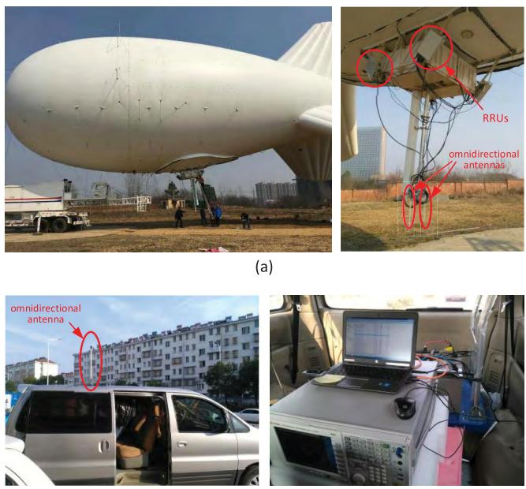  
(b)  
FIGURE 2. Photos of the airship and the A2G channel sounder. (a) Airship and transmitter. (b) Receiver.

The RX on the ground emulated a UE and was composed of a wideband omnidirectional antenna, a spectrum analyzer (SA), a GPS acquisition device, and a computer. The RX antenna was connected to the SA to measured the RSSs. The SA was connected to the computer through an Ethernet to receive control commands from the computer and store the RSS data in the hard disk. These devices were placed in a van. And the RX antenna and the GPS antenna were mounted on the roof, as shown in Fig. 2(b). The SA scanned the two bands alternatively and recorded the RSSs at the two central frequencies. It took 500 milliseconds to capture and store the RSS at one frequency point. Thus the system measured the RSSs once for every second and obtained one sample of the signal power attenuation, i.e., the LSF including PL and SE at one frequency point. When the van run along the roads at a constant speed of 60 kilometers per hour, the SA collected the data continuously. Meanwhile the GPS device connected to the computer kept recording the geolocation and time of the vehicle together with the captured RSS values.

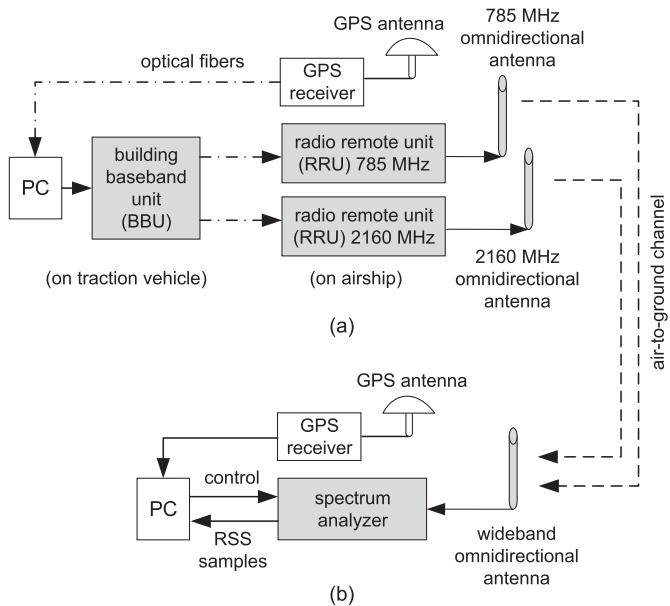  
FIGURE 3. Block diagram of the channel sounder. (a) Transmitter. (b) Receiver (on van).

## B. CHANNEL MEASUREMENT SCENARIO

We measured the LSF of the A2G channels when the RX vehicle traveled in rural, suburban, and urban environments. The measurement setting is illustrated in Fig. 4. The airship hovered at the altitudes of h = 50, 250, 450, 715, and 950 meters above the ground. At each altitude, the RX vehicle moved away from the takeoff position of the airship. It first run to the north and traveled until the sounding signal could not be received (the RSS was close to the noise floor). Then it run back to the original takeoff position. The system kept recording the signal RSSs at the two frequencies in the round trip. Then the vehicle run to the south and repeated the measurement process in the round trip. It was found that the signal at the 2160 MHz could not be received at the distance about 10 kilometers, while the 785 MHz signal could be received until about 50 to 70 kilometers distance (depending on the airship altitude) in both directions.

From the departure point to the south, the overall landscape was a hilly area. In this rural scenario, there were only trees and vast farms by the roadsides, but the sounding signal from the ABS may be blocked by the hills consistently when the vehicle moved along some segments of the road. To the north direction, the RX vehicle run through a small city. The environments along the road included the suburban scenario with sparse buildings by the roadside and the urban scenario with dense buildings. The overall terrain was relatively flat, and the signal may be obstructed by the roadside buildings especially in the downtown area. Thus, the large-scale channel fading was measured in various typical environments in this measurement campaign.

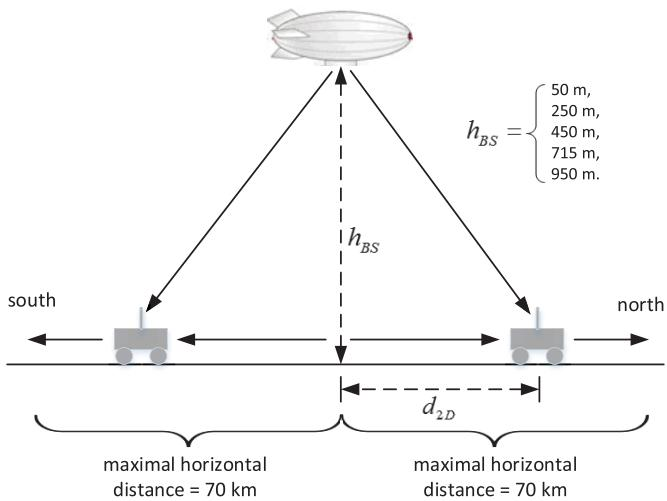  
FIGURE 4. A2G channel measurement scenario using an airship and a mobile vehicle on the ground.

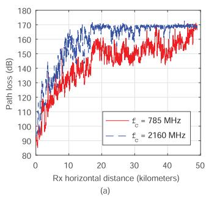

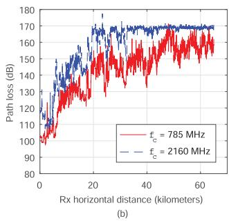  
FIGURE 5. LFS measurement results when the airship was at 250 and 715 meters and the RX vehicle moved toward north. (a) ABS altitude = 250 meters. (b) ABS altitude = 715 meters.

## C. LARGE-SCALE FADING MEASUREMENT

## RESULTS AND MODELS

Since we mainly evaluate the network coverage of an ABS in this work, we focus on the LSF of the A2G channel. The LSF in dB is calculated by

$$
\begin{array} { r } { L S F = P _ { T X } + G _ { T X } + G _ { R X } - P _ { R X } , } \end{array}\tag{3}
$$

where $P _ { T X } = 4 0 ~ \mathrm { W } = 4 6 $ dBm is the transmission power, $G _ { T X } \ = \ G _ { R X } \ = \ 5$ dBi are the gains of the TX and RX antennas, and $P _ { R X }$ is the received signal power captured by the SA. As illustrative examples, Fig. 5 shows the LSF measurement results when the airship hovered at the altitudes of 250 and 715 meters and the RX vehicle traveled to the north for nearly 70 kilometers (i.e., horizontal separation distance between the RX and ABS). The observations are as follows.

• The LSF becomes larger as the separation distance increases. At both frequencies, the LSF increases from about 110 dB to 170 dB. Note that when the LSF was around 170 dB, the received signal was too weak to be detected by the SA and was overwhelmed in the noise. Therefore the upper bound of the LSF observed in the measurement was 170 dB. As shown in Fig. 5, the signal at 785 MHz could be detected until about 70 kilometers, while the 2160 MHz signal was covered by noise over about 20 kilometers due to the much larger LSF.

• The LSF at 2160 MHz was typically about 20 dB larger than that at 785 MHz over the first 20 kilometers. This is because, when the RX vehicle moved along the roads, the signal from the airship may be blocked by the hills or roadside buildings, resulting in the shadow fading. The UHF-band has a much better diffraction capability than the S-band. Thus the signal strength attenuation caused by shadowing was more severe in the S-band.

• The LSF was slightly larger when the airship was 250 meters high. The higher ABS altitude led to longer propagation distances, but meanwhile the LOS probability would be higher. Since the SE was reduced, the LSF was even smaller when the ABS altitude was higher. Therefore, the obstruction by the terrain and ground objects plays a dominant roll in determining the RSS.

## D. PATH LOSS MODELING

The empirical models for the PL in the terrestrial channels, such as the Okumora, Lee, and Hata models, have been studied and used widely [32]. They were developed based on extensive measurement of RSS between cellular BSs (e.g., 30 meters high) and mobile terminals (usually 1.5 to 3 meters high) in different frequency bands and network scenarios. These models have also been adopted in the channel modeling standards such as the 3GPP [33], WINNER [34], and COST [35].

In this work, we design the PL model for the A2G channel based on the COST-2100 specification which extends the Hata model. According to the airborn access network scenario and our measurement results, we further introduce extension to consider the ABS altitude, carrier frequency, and horizontal distance. The overall model for the PL in dB is given in (4), as shown at the bottom of this page, where $f _ { C O S T } ^ { \prime }$ is from the COST-2100 model but the parameters are changed for the A2G channel based on our measurement results. $\Delta _ { C F } \left( h _ { B S } \right)$ is the new correction factor we introduce in the model to reflect the effect by the ABS altitude.

The function $f _ { C O S T } ^ { \prime }$ in (4) is [35]

$$
\begin{array} { r } { f _ { C O S T } ^ { \prime } = a _ { 1 } + a _ { 2 } \log _ { 1 0 } { ( f _ { c } ) } + a _ { 3 } \log _ { 1 0 } { ( h _ { B S } ) } - \Gamma \left( h _ { U E } \right) } \\ { + \left[ a _ { 4 } + a _ { 5 } \log _ { 1 0 } { ( h _ { B S } ) } \right] \log _ { 1 0 } { ( d _ { 2 D } ) } , } \end{array}\tag{5}
$$

$$
\begin{array} { r } { P L _ { d B } = \left\{ \begin{array} { l l } { f _ { C O S T } ^ { \prime } \left( d _ { 2 D } = d _ { B K } \right) + \Delta _ { C F } \left( h _ { B S } \right) , } & { 0 \leq d _ { 2 D } \leq d _ { B K } , 0 \leq h _ { B S } \leq h _ { C F } } \\ { f _ { C O S T } ^ { \prime } \left( d _ { 2 D } \right) + \Delta _ { C F } \left( h _ { B S } \right) , } & { d _ { B K } < d _ { 2 D } \leq d _ { C F } , 0 \leq h _ { B S } \leq h _ { C F } . } \end{array} \right. } \end{array}\tag{4}
$$

TABLE 1. Coefficients of the PL models.
<table><tr><td colspan="2">PL models</td><td> $a _ { 1 }$ </td><td> $a _ { 2 }$ </td><td> $a _ { 3 }$ </td><td> $_ { a _ { 4 } }$ </td><td> $a _ { 5 }$ </td><td> $\overline { { b } }$ </td><td> $\overline { { d _ { B K } } }$  (km)</td><td> $\overline { { d _ { C F } } }$  (km)</td><td> $\overline { { h _ { C F } \ ( \mathbf { m } ) } }$ </td></tr><tr><td rowspan="2">Territorial channel</td><td>Hata model</td><td> $\overline { { 6 9 . 5 5 } }$ </td><td> $2 6 . 1 6$ </td><td>13.82</td><td>44.9</td><td>6.55</td><td>=</td><td></td><td>=</td><td></td></tr><tr><td>COST-2100</td><td>46.3</td><td>33.9</td><td>13.82</td><td>44.9</td><td>6.55</td><td>=</td><td>=</td><td>=</td><td></td></tr><tr><td>A2G</td><td>our model (UHF)</td><td>46.39</td><td>26.16</td><td>15</td><td>44</td><td>0.8</td><td>0.84</td><td>2</td><td>60</td><td>1000</td></tr><tr><td>channel</td><td>our model (S)</td><td>20.18</td><td>33.9</td><td>13.6</td><td>53.78</td><td>1.16</td><td>1.16</td><td>2</td><td>20</td><td>1000</td></tr></table>

where $f _ { c }$ is the carrier frequency in the unit of MHz, $h _ { B S }$ and $h _ { U E }$ are the heights of BS and UE in the unit of meters, respectively, and $d _ { 2 D }$ is the horizontal separation distance in the unit of kilometers. In (4) the mobile station antenna height adjustment factor is

$$
\Gamma \left( h _ { U E } \right) = \left[ 1 . 1 \log _ { 1 0 } { ( f _ { c } ) } - 0 . 7 \right] h _ { U E } - 1 . 5 6 \log _ { 1 0 } { ( f _ { c } ) } + 0 . 8 .\tag{6}
$$

Finally the new correction factor in (4) is

$$
\Delta _ { C F } \left( h _ { B S } \right) = b ( f _ { c } ) \log _ { 1 0 } ^ { 2 } \left( h _ { B S } \right) .\tag{7}
$$

The extensions to the terrestrial cellular channel model for the airborne access network in (4) include the following aspects.

• The ABS altitude is critical in the A2G channels. Based on our measurement results for different ABS altitudes, we propose to add the correction factor, $\Delta _ { C F } \left( h _ { B S } \right)$ in (7), to reflect the effect of the ABS altitude. Meanwhile the coefficient $b ( f _ { c } )$ in $\Delta _ { C F } \left( h _ { B S } \right)$ depends on the carrier frequency.

• Our measurement results show that the PL remains constant when the horizontal distance of the UE away from the ABS is smaller than 2 kilometers at both sounding frequencies. This is because when the UE moves in a small range beneath the ABS, the 3-dimensional distance between the UE and ABS almost does not change, resulting in a constant PL. Therefore the PL function is segmented and the breaking point is at the horizontal distance of $d _ { B K } = 2$ kilometers for both the low and high-frequency bands.

• The coefficients of the COST model, $a _ { 1 }$ to $a _ { 5 }$ in (5), are adjusted for the airborne access networks based on our measurement results. The model parameters (a1 to $a _ { 5 }$ and $b ( f _ { c } ) )$ are selected by fitting the PL measurement results using the minimum mean square error (MMSE) method, and the best-fit coefficients are obtained by multi-dimensional searching. The results are listed in Table 1, where the parameter values in our proposed A2G models are compared with the traditional Hata (urban scenario) and COST-2100 models.

• The model in (4) is applicable for both the sounding frequencies in the UHF and S-bands. The formula are identical but the coefficients are adjusted according to the carrier frequency. Thus the model is unified and easy to use in system perform analysis and simulations.

• The measurement results show that the 785 and 2160 MHz signals could not be received outside about 60 and 20 kilometers ranges, respectively. Therefore the applicable distance range of the proposed model varies depending on the carrier frequency as listed in Table 1. The frequency-dependent cutting-off distance for the model, $d _ { C F }$ , is added in (4).

• Since our A2G channel measurement was performed when the airship was at the altitudes from 50 to 950 meters, the model and parameters given in this section are applicable to the ABS altitude below 1000 meters. Therefore the cutting-off ABS altitude in the model in (4) is $h _ { C F } \approx 1 0 0 0$ meters.

The measurement data and best-fit PL models for 785 and 2160 MHz are depicted in Figs. 6(a) and (b) for the ABS altitudes of 450 and 950 meters, respectively. The Hata (urban scenario), COST-2100, and A2G channel models in [23] are also plotted for comparison. We can see that the proposed model fits the measurement results better than the others at both frequencies. When the height of the airship is larger and the communication distance is farther, the discrepancy between the measurement results and the other models increases and the accuracy of the proposed model is more obvious. Because the model is established based on the measurement data in various environments, it is general and can be used in the design of airborne access networks. The models will be utilized in the network resource allocation scheme and the optimization algorithm design in the next section.

## E. SHADOWING EFFECT MODELING

The SE represents the large-scale signal strength fluctuations resulted from obstructions on the LOS propagation path. The deviation of the observed signal power attenuation and the PL channel model at the measurement positions along the routes, as shown in Fig. 6, are the SE. For the purpose of illustration, the probability histograms of the SE samples for the ABS altitudes of 450 and 950 meters at the two sounding frequencies are plotted in Fig. 7. The Kolmogorov-Smirnov (K-S) test is performed to testify the SE sample data for various airship altitudes and sounding frequencies against the normal distribution. The results confirm the hypothesis with the significance level of 0.05 for all the cases. Therefore, the SE in the A2G channel, denoted as $S E _ { d B }$ , is modeled as a log-normal random variable with zero mean and the standard deviation (STD) of $\sigma _ { S E }$ . This is as expected because the SE is due to the signal obstruction by buildings and trees. The power attenuation can be calculated by multiplying all power losses along the LOS propagation path, which is transformed to addition of the losses in the logarithm domain. According to the central limit theory, the SE should have a normal distribution in the logarithm domain.

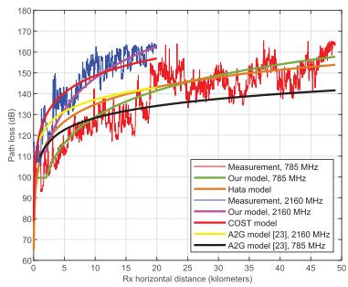  
(a)

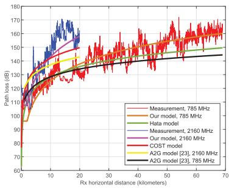  
(b)  
FIGURE 6. PL measurement results and models when the airship was at 450 and 950 meters. (a) Airship altitude = 450 meters. (b) Airship altitude = 950 meters.

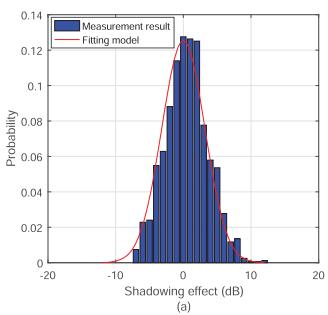

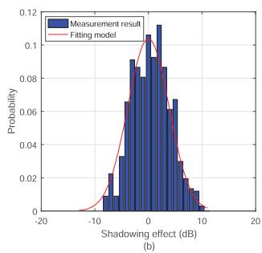  
FIGURE 7. Histograms of the SE at different airship altitudes and frequencies. The superimposed curves are the best-fit normal distribution PDFs. (a) fc = 785 MHz, airship altitude = 450 meters. (b) fc = 2160 MHz, airship altitude = 950 meters.

By fitting the empirical distributions of the SE samples using the MMSE method, the STDs of the normal distribution for the all the cases are obtained and listed in Table 2. It can be found that the STDs of the SE in the S-band are mostly larger than those in the UHF-band. This is because the diffraction in the low-frequency spectrum is better than in the high-frequency spectrum. Thus the signal attenuation by obstruction in the S-band is more severe and hence the signal strength fluctuation is more significant due to shadowing.

The difference between the shadow fading in the A2G channels and that in the traditional terrestrial cellular channel is an important issue. The authors in [36] found that the STD of the LSF could be 3 dB or lower over a wide range of mobile velocities. The STD of the log-normal PDFs of SE in our model in the UHF-band varies between 2.4 and 3.56 dB, which is consistent with the simulation results in [36]. The

TABLE 2. The STD of the Log-normal PDF for SE, σSE.
<table><tr><td>Altitude</td><td>Our model (UHF)</td><td>Our model (S)</td></tr><tr><td>50 m</td><td>2.4319</td><td>3.1812</td></tr><tr><td>250 m</td><td>2.7957</td><td>3.5416</td></tr><tr><td>450 m</td><td>3.5630</td><td>3.1877</td></tr><tr><td>715 m</td><td>3.0810</td><td>3.2047</td></tr><tr><td>950 m</td><td>2.9896</td><td>4.5835</td></tr></table>

STDs in the S-band are mostly larger than 3 dB. The authors in [37] determined empirically that the SE in microcells was normally distributed with the STDs ranging from 3 to 5 dB. The STD of the SE in the UHF-band in our measurement results is smaller than the values in [37]. This may be because the A2G channels have a higher LOS probability than the terrestrial channels. The STD in the S-band is in the range from 3.18 to 4.58 dB, which is also reasonable as the SE is more severe for a higher-frequency band. In summary, the distribution of the SE in the A2G channels is the same as that of the traditional terrestrial cellular channels, but the expectation and STD are smaller.

## V. JOINT SPECTRUM-AND-POWER ALLOCATION FOR DBAA

## A. PROBLEM FORMULATION

The DBAA scheme proposed in Sec. III provides an approach to fully utilize the spectrum resources in different bands. The critical issue is how to allocate the spectrum and power resources to users in the airborne access networks. We design the algorithm for the DBAA to jointly optimize the spectrum assignment and power allocation for all users, based on the A2G channel model obtained in Sec. IV.

We define $\textbf { X } = ~ \{ x _ { k } | k \in \mathcal { K } \}$ and $\textbf { P } = ~ \{ p _ { k } | k \in \mathcal { K } \}$ as the spectrum assignment and the power allocation variables, respectively. $x _ { k }$ denotes the spectrum assignment indicator that is one if a subchannel in the low-frequency spectrum is assigned to user k and zero if a high-frequency subchannel is assigned to user k. The joint optimization problem is formulated as

$$
\begin{array} { r l } & { \displaystyle \operatorname* { m a x } _ { { \bf X } , { \bf F } } \quad \sum _ { k \in { \cal K } } \left( x _ { k } R _ { k } ^ { l } + ( 1 - x _ { k } ) R _ { k } ^ { h } \right) } \\ & { \quad \mathrm { s . t . } \quad \quad } \\ & { \quad \quad \quad \times . \mathsf { E c t } : \displaystyle \sum _ { k \in { \cal K } } p _ { k } \le P ^ { \mathrm { i o t } } } \\ & { \quad \quad \quad \mathrm { ~ } } \\ & { \quad \quad \quad \mathrm { ~ } \mathrm { ~ c . t . } \quad \displaystyle \sum _ { k \in { \cal K } } x _ { k } \le N _ { l } } \\ & { \quad \quad \quad \mathrm { ~ } \mathrm { ~ c . t . } \quad \quad ( 1 - x _ { k } ) \le N _ { h } } \\ & { \quad \quad \quad \quad \mathrm { ~ c . t . } \quad \quad } \\ & { \quad \quad \quad \mathrm { ~ } \mathrm { ~ c 4 } : x _ { k } \in \{ 0 , 1 \} , \quad \forall k \in \mathcal { K } } \\ & { \quad \quad \quad \mathrm { ~ C 5 : 0 \le p _ k ~ } , \quad \forall k \in \mathcal { K } . } \end{array}\tag{8}
$$

where the variables are defined in the system model in Sec. III.

In the programming problem above, the objective is to maximize the sum rate of all users, as given in (2). Besides, the constraint C1 restricts the maximum transmission power of the ABS, which is imposed by the onboard power supply or emission regulation. The constraints C2 and C3 indicate that the number of users accommodated in the network cannot exceed the limitation of the system. This is because the spectrum allocated to the users in the low and high-frequency bands cannot exceed the available spectrum resource $( i . e . , N _ { l } B _ { l } \leq W ^ { l }$ and $N _ { h } B _ { h } \le W ^ { h } )$ ). The constraints C4 and C5 specify the ranges of the control variables X and P.

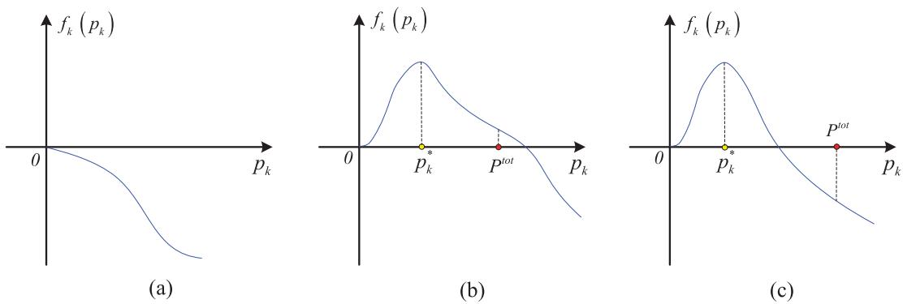  
FIGURE 8. Analysis of the optimal spectrum assignment policy for user k. (a) $B _ { I } G _ { k } ^ { I } - B _ { h } G _ { k } ^ { h } < 0 .$ (b) BlGl − BhGh < 0 & fk Ptot  ≥ 0. (c) BlGl − BhGh < 0 & fk Ptot  < 0.

Since the formulated problem is a mixed integer program which is usually NP-hard, we aim to design suboptimal but cost-efficient algorithms. Specifically, a low-complexity spectrum assignment algorithm is first devised under the assumption that the power allocation scheme is given in advance. Then, we adopt the Lagrange dual technique to obtain the optimal transmission power for each user.

## B. SPECTRUM ASSIGNMENT ALGORITHM

To determine the spectrum assignment policy for user k, we first define $f _ { k } \left( p _ { k } \right)$ as

$$
f _ { k } \left( p _ { k } \right) = B _ { l } { \log } _ { 2 } \left( 1 + \frac { p _ { k } G _ { k } ^ { l } } { \sigma ^ { 2 } } \right) - B _ { h } { \log } _ { 2 } \left( 1 + \frac { p _ { k } G _ { k } ^ { h } } { \sigma ^ { 2 } } \right) .\tag{9}
$$

Taking the derivative of fk (pk) yields

$$
f _ { k } ^ { \prime } \left( p _ { k } \right) = \frac { \left( B _ { l } G _ { k } ^ { l } - B _ { h } G _ { k } ^ { h } \right) - p _ { k } G _ { k } ^ { l } G _ { k } ^ { h } \left( B _ { h } - B _ { l } \right) } { \ln { \left( 2 \right) } \left( 1 + p _ { k } G _ { k } ^ { l } \right) \left( 1 + p _ { k } G _ { k } ^ { h } \right) } .\tag{10}
$$

In what follows, we discuss three cases for $f _ { k } ^ { \prime } \left( p _ { k } \right)$

1) $B _ { l } G _ { k } ^ { l } - B _ { h } G _ { k } ^ { h } < 0$ . In this case, $f _ { k } ^ { \prime } \left( p _ { k } \right) < 0$ and fk (pk ) is strictly decreasing in $\lceil 0 , \ P ^ { \mathrm { t o t } } \rceil$ , as depicted in Fig. 8(a). Since $f _ { k } \left( p _ { k } \right) < f _ { k } \left( 0 \right) ^ { \ast } = 0 , \bar { R } _ { k } ^ { l }$ is always smaller than $R _ { k } ^ { h }$ in $\left\lceil 0 , P ^ { \mathrm { t o t } } \right\rceil$ . As such, user k can achieve a higher data rate in the high-frequency band.

2) $B _ { l } G _ { k } ^ { l } \ - B _ { h } G _ { k } ^ { h } \ > \ 0$ and $f _ { k } \left( P ^ { \mathrm { t o t } } \right) ~ \geq ~ 0$ . In this case, $f _ { k } ^ { \prime } \left( p _ { k } \right) > 0$ in $[ 0 , \ p _ { k } ^ { * } )$ and $f _ { k } ^ { \prime } \left( p _ { k } \right) < 0$ in $( p _ { k } ^ { * } , \ P ^ { \mathrm { t o t } } ]$ where $\begin{array} { r } { p _ { k } ^ { * } = \frac { \left( B _ { l } G _ { k } ^ { l } - B _ { h } ^ { * } G _ { k } ^ { h } \right) } { G _ { k } ^ { l } G _ { k } ^ { h } \left( B _ { h } - B _ { l } \right) } } \end{array}$ . In addition, i $\dot { f } _ { k } \left( P ^ { \mathrm { t o t } } \right) \ge 0 .$ the variation trend of fk $( p _ { k } )$ with respect to $p _ { k }$ is shown in Fig. 8(b). Therefore, user k can achieve a higher data rate in the low-frequency band.

3) $B _ { l } G _ { k } ^ { l } - B _ { h } G _ { k } ^ { h } ~ > ~ 0$ and $f _ { k } \left( P ^ { \mathrm { t o t } } \right) \ < \ 0$ . In this case, $f _ { k } ^ { \prime } \left( p _ { k } \right) > 0$ in [0, p∗k ) and $\dot { f } _ { k } ^ { \prime } ( p _ { k } ) \ : < \ : 0 \mathrm { ~ i n ~ } ( p _ { k } ^ { * } , \ : P ^ { \mathrm { t o t } } ]$

If $f _ { k } \left( P ^ { \mathrm { t o t } } \right) \ < \ 0 .$ , the variation trend of $f _ { k } \left( p _ { k } \right)$ with respect to $p _ { k }$ is shown in Fig. 8(c). If $p _ { k }$ is not given, it cannot be determined which mode is better. For this case, we adopt a suboptimal spectrum assignment method. Specifically, we assume $\begin{array} { r } { p _ { k } \ = \ \frac { P ^ { \mathrm { t o t } } } { K } } \end{array}$ . Thus if $f _ { k } \left( \frac { P ^ { \mathrm { t o t } } } { K } \right) \leq 0 .$ , a subchannel in the high-frequency band is allocated to user k, and otherwise a subchannel in the low-frequency band is allocated to user k.

Base on the above analysis, we propose the spectrum assignment algorithm as given in Algorithm 1. First, we divide all users K into three sets, $\kappa _ { 1 } , \kappa _ { 2 }$ , and $\kappa _ { 3 }$ according to the above three cases. For the users in $\kappa _ { 1 }$ and $\displaystyle \kappa _ { 2 }$ , we can directly determine the spectrum band (lowfrequency or high-frequency) for each user in which the user will achieve a higher data rate regardless of the transmission power. Thus the subchannels for these users can be readily allocated. For the users in $\mathcal { K } _ { 3 }$ , it is hard to determine the band which they should be assigned in before the transmission power is given. For this case, we propose adopting the channel-condition-first method. Specifically speaking, we first sort the users in $\mathcal { K } _ { 3 }$ in the descending order of their CPGs and then assign subchannels for them sequentially. This is because assigning a subchannel to the user with a larger CPG is more helpful for improving the sum data rate. These operations are repeated until the spectrum of one band is fully filled. Then the remainder users can only access in the other band.

## C. POWER ALLOCATION ALGORITHM

For the power allocation in the DBAA scheme, the initial problem is transformed into the following power allocation problem of

$$
\begin{array} { r l r } {  { \operatorname* { m a x } _ { \mathbf { p } } \sum _ { k \in \mathcal { K } } ( x _ { k } R _ { k } ^ { l } + ( 1 - x _ { k } ) R _ { k } ^ { h } ) } } \\ & { \mathrm { s . t . } ~ \mathbf { C } 1 : \sum _ { k \in \mathcal { K } } p _ { k } \le P ^ { \mathrm { t o t } } } \\ & { } & { ~ \mathbf { C } 2 : 0 \le p _ { k } \le P ^ { \mathrm { t o t } } , ~ \forall k \in \mathcal { K } } \\ & { } & { ~ \mathbf { C } 3 : x _ { k } = \{ 1 \begin{array} { l l } { 1 } & { \mathrm { i f } ~ k \in \mathcal { K } _ { l } } \\ { 0 } & { \mathrm { i f } ~ k \in \mathcal { K } _ { h } } \end{array}  . } \end{array}\tag{11}
$$

Algorithm 1 Spectrum Assignment Algorithm for DBAA   
1: Initialization: Let $\overline { { \mathcal { K } _ { l } \Leftarrow \emptyset } }$ and $\overline { { \mathcal { K } _ { h } \Leftarrow \mathcal { V } } } ;$   
2: Divide K into three sets $\kappa _ { 1 } , \kappa _ { 2 } .$ , and $\mathcal { K } _ { 3 }$ , wherein   
$\kappa _ { 1 }$ $= \left\{ k \ : | \ : B _ { l } G _ { k } ^ { l } - B _ { h } G _ { k } ^ { h } < 0 \right\}$ ;   
$\mathcal { K } _ { 2 } = \left\{ k | B _ { l } G _ { k } ^ { l } - B _ { h } G _ { k } ^ { h } > 0 \& f _ { k } \left( P ^ { t o t } \right) \geq 0 \right\}$   
$\mathcal { K } _ { 3 } = \left\{ k | B _ { l } G _ { k } ^ { l } - B _ { h } G _ { k } ^ { h } > 0 \& f _ { k } \left( P ^ { \mathrm { t o t } } \right) < 0 \right\}$ ;   
3: if $| { \mathcal { K } } _ { 1 } | \geq N _ { h }$ or $| \mathcal { K } _ { 2 } | \ge N _ { l }$ then   
4: if $| { \mathcal { K } } _ { 1 } | \geq N _ { h }$ then   
5: Choose $N _ { h }$ users from $\kappa _ { 1 }$ who have larger CPG than   
the others and denote them as $\mathcal { Q } ;$   
6: Let $\mathcal { K } _ { h } \Leftarrow \mathcal { Q }$ and $\begin{array} { r } { \mathcal { K } _ { l } \Leftarrow \mathcal { K } \setminus \mathcal { Q } ; } \end{array}$   
7: else   
8: Choose $N _ { l }$ users from $\displaystyle \kappa _ { 2 }$ who have larger CPG than   
the others and denote them as $\mathcal { Q } ;$   
9: Let $\mathcal { K } _ { l } \Leftarrow \mathcal { Q }$ and $\begin{array} { r } { \mathcal { K } _ { h } \Leftarrow \mathcal { K } \setminus \mathcal { Q } ; } \end{array}$   
10: end if   
11: else   
12: Let $\mathcal { K } _ { h } \Leftarrow \mathcal { K } _ { 1 }$ and $\begin{array} { r } { \mathcal { K } _ { l } \Leftarrow \mathcal { K } _ { 2 } ; } \end{array}$   
13: Sort all users in $\mathcal { K } _ { 3 }$ in the descending order for their   
CPG;   
14: for each user k in the ordered list of $\mathcal { K } _ { 3 }$ do   
15: if fk $\left( \frac { P ^ { \mathrm { t o t } } } { K } \right) \leq 0$ then   
16: Let ${ \mathcal K } _ { h } ^ { \prime } \Leftarrow { \mathcal K } _ { h } \cup \{ k \} ;$   
17: if $| K _ { h } | = = N _ { h }$ then   
18: Let $\begin{array} { r } { \mathcal { K } _ { l } \Leftarrow \mathcal { K } \setminus \mathcal { K } _ { h } ; } \end{array}$   
19: Break;   
20: end if   
21: else   
22: Let ${ \boldsymbol { \mathcal { K } } } _ { l } \Leftarrow { \boldsymbol { \mathcal { K } } } _ { l } \cup \{ k \}$   
23: if $| { \mathcal { K } } _ { l } | = = N _ { l }$ then   
24: Let $\mathcal { K } _ { h } \Leftarrow \mathcal { K } \setminus \mathcal { K } _ { l } ;$   
25: Break;   
26: end if   
27: end if   
28: end for   
29: end if   
30: Output: The spectrum assignment results $\kappa _ { l }$ and $\kappa _ { h } .$

The power allocation problem in (11) is convex and we adopt the Lagrange dual technique to solve the problem. The partial Lagrangian of the primal problem in (11) is given by

$$
L \left( \mathbf { P } , \lambda \right) = \sum _ { k \in \cal K } \bigg ( x _ { k } R _ { k } ^ { l } + \left( 1 - x _ { k } \right) R _ { k } ^ { h } \bigg ) + \lambda \left( P ^ { \mathrm { t o t } } - \sum _ { k \in \cal K } p _ { k } \right) ,\tag{12}
$$

where λ is a dual variable corresponding to the constraint C1 in (11). According to the dual theory, we can solve the following dual problem to obtain the optimal power allocation policy, which is

$$
\operatorname* { m i n } _ { \lambda } \operatorname* { m a x } _ { \mathbf { P } } { L } \left( \mathbf { P } , \lambda \right)
$$

s.t. C1 : $0 \leq p _ { k } \leq P ^ { \mathrm { t o t } }$ , ∀k $\in \kappa$   
C $\begin{array} { r } { \mathrm { ? } : x _ { k } = \left\{ \begin{array} { l l } { \mathrm { 1 } } & { \mathrm { i f } k \in \mathcal { K } _ { l } } \\ { \mathrm { 0 } } & { \mathrm { i f } k \in \mathcal { K } _ { h } } \end{array} \right. . } \end{array}$ (13)   
For the given dual variable $\lambda ,$ by exploiting the standard   
optimization techniques and the KKT conditions, we can get   
the optimal power allocation policy as   
$p _ { k } ^ { * } = \left[ x _ { k } \left( \frac { B _ { l } } { \lambda \ln { ( 2 ) } } - \frac { \sigma ^ { 2 } } { G _ { k } ^ { l } } \right) + ( 1 - x _ { k } ) \left( \frac { B _ { h } } { \lambda \ln { ( 2 ) } } - \frac { \sigma ^ { 2 } } { G _ { k } ^ { h } } \right) \right] ^ { + } ,$   
(14)   
where the operator $[ \cdot ] ^ { + }$ is defined as $[ x ] ^ { + } = \operatorname* { m a x } { \{ 0 , x \} }$   
To obtain the optimal dual variable, we employ the subgra  
dient method to solve the outer minimization problem in (13)   
(also called master dual problem). Specifically, the expres  
sion of λ in the $( t + 1 )$ -th iterations is given by   
$\lambda \left( t + 1 \right) = \left[ \lambda \left( t \right) - \Delta \left( t \right) \left( P ^ { \mathrm { t o t } } - \sum _ { k \in \mathcal { K } } p _ { k } ^ { * } \right) \right] ^ { + } ,$ (15)   
where $\Delta \left( t \right)$ denotes the step size which can be set as $\theta , \theta / t ,$   
or $\theta / { \sqrt { t } } ,$ and θ is a constant. The detailed power allocation   
algorithm is given in Algorithm 2.   
Algorithm 2 Power Allocation Algorithm for DBAA   
1: Initialization:   
• Set $t = 0 ;$   
• Set the initial dual variable $\lambda \left( 0 \right) ;$   
• Set the maximum error tolerance $\delta ;$   
2: while 1 do   
3: Obtain the transmission power $\left\{ p _ { k } ^ { * } \right\}$ according to (14);   
4: Update the dual variables $\lambda ( t + 1 )$ according to (15);   
5: $t = t + 1 ;$   
6: if $\left| \lambda \left( t + 1 \right) - \lambda \left( t \right) \right| \leq \delta$ then   
7: break;   
8: end if   
9: end while   
10: Output: The power allocation results $\left\{ p _ { k } ^ { * } \right\}$

## VI. SIMULATION RESULTS

In this section, we present the simulation results to evaluate the performance of the proposed DBAA scheme and the network resource allocation algorithms. The network setting and simulation parameters are listed in Table 3. The proposed joint spectrum-and-power allocation algorithm is referred to as the Joint Allocation. To demonstrate its efficiency, we compare it with three benchmark algorithms, namely Random Allocation, Power-only Allocation, and Spectrum-only Allocation. In the Random Allocation, the spectrum is randomly assigned to the network users with equal transmission power $\begin{array} { r } { ( i . e . , p _ { k } = \frac { P ^ { \mathrm { t o t } } } { K } } \end{array}$ for all $k \in \mathcal { K } )$ . The Power-only Allocation utilizes our designed Algorithm 2 with random spectrum assignment policy. On the contrary, the Spectrum-only Allocation adopts the designed Algorithm 1 with mean power allocation. Meanwhile, the proposed DBAA is also compared with other two access schemes in the literature, the UAV-BS [25] and the Macrocell-BS [38] where the access points are UAVs and macrocell terrestrial BSs, respectively. The UAV-BS and the Macrocell-BS are both single-band access schemes. The BS height in the Macrocell-BS scheme is relatively low with respect to the communication distances such that the BS height is approximated to zero in the simulations [38]. Considering the BS heights in the Macrocell-BS and the DBAA, the terrestrial and the A2G LSF channel models are adopted, respectively.. The PL exponent was set as 3 in [38] for the Macrocell-BS scheme. In the UAV-BS, since the energy supply is the bottleneck, the transmission power was only 17 dBm in [25] .

TABLE 3. Simulation parameters.
<table><tr><td>Cell radius</td><td> $5 \sim 2 9$  kilometers 100~1100 meters</td></tr><tr><td>Altitude of ABS Path loss model,  $P L$ </td><td>given in (4)</td></tr><tr><td>Noise Power,  $\sigma ^ { 2 }$ </td><td>-100 dBm</td></tr><tr><td>Total transmission Power,  $P ^ { \mathrm { t o t } }$ </td><td>40 Watt</td></tr><tr><td>Transmitter antenna gain,  $G _ { T X }$ </td><td>5 dBi</td></tr><tr><td>Receiver antenna gain,  $G _ { R X }$ </td><td>5 dBi</td></tr><tr><td>Low frequency,  $f _ { l }$ </td><td>785 MHz</td></tr><tr><td>high frequency,  $f _ { h }$ </td><td>2160 MHz</td></tr><tr><td>Subchannel number in low band,  $N _ { l }$ </td><td>350</td></tr><tr><td>Subchannel number in high hand,</td><td>350</td></tr><tr><td> $N _ { h }$  Subchannel bandwidth in low band,</td><td>180 KHz</td></tr><tr><td>Subchannel bandwidth in high band,</td><td>900 KHz</td></tr></table>

Fig. 9 shows the total data rate of all users (i.e., the network throughput) versus the number of users and the comparison with the single-band schemes (i.e., High-Spectrum Allocation and Low-Spectrum Allocation). We can observe that the total data rate increases sub-linearly with the number of users. This is because, with the increment of users, a higher multi-user diversity can be exploited. However, constrained by the total transmission power $P ^ { \mathrm { t o t } }$ , the power allocated to each user decreases with the number of users, which results in the decrement in the data rate of each individual user. Besides, comparing with the Random Allocation, we can find that the total data rate is increased by 55% through the Joint Allocation (optimizing the power allocation and the spectrum assignment simultaneously). Furthermore, the simulation results indicate that the performance gain provided by the spectrum assignment (about 36%) is more significant than the power allocation (about 19%). We can also see in Fig. 9 that the performance of the DBAA is much better than those of the Macrocell-BS and the UAV-BS due to the optimized allocation of dual-band spectrum. Therefore, these results verify the efficiency of the proposed DBAA scheme. To enhance the whole network performance, it is essential to optimize the resource allocation for all served users, especially the spectrum assignment. The dual-band aerial access with optimized resource allocation can achieve a significant performance gain in comparison with the single-band systems.

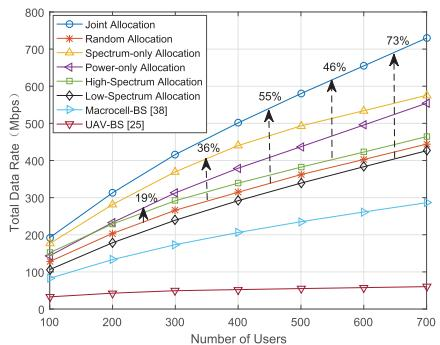  
FIGURE 9. Total data rate versus the number of users. (The cell radius is 10 kilometers; the altitude of the ABS is 500 meters; the maximum coverage radius of the high frequency is 18 kilometers.).

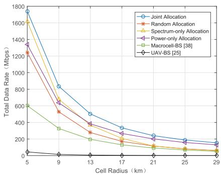  
FIGURE 10. Total data rate versus the cell radius. (The altitude of the ABS is 500 meters; the number of users is 700; the maximum coverage radius of the high frequency is 18 kilometers.).

Fig. 10 depicts the total data rate versus the cell radius. This figure illustrates that the horizontal distance has a great impact on the achievable total data rate. The channel measurement results show that the PL increased very fast with the increase of the horizontal distance in [0, 20] kilometers, but the PL increases quite slowly when the horizontal distance is larger than 20 kilometers, as given in Sec. IV-C. This tendency is consistent with the tendency of the total data rate versus the cell radius in Fig. 10. Meanwhile, we can find that the proposed DBAA scheme greatly outperforms the Macrocell-BS and the UAV-BS schemes with all the cell radii. In particular, when the cell radius is less than 10 kilometers, the PL in both the low and high-frequency bands is relatively small, and the DBAA can make full use of the spectrum resources to significantly improve the network throughput. It is also noticed that the performance of the Spectrum-only Allocation is better than that of the Power-only Allocation when the cell radius is small, but the tendency is reversed when the cell radius is large. This is because, with a small cell size, the PL of the users is similar and the received signal power is mostly sufficient. Thus making full use of the spectrum resource is more important. But with a large cell size, the Spectrum-only Allocation will waste the ABS transmission power because of the transmissions to the users in deep fading. The results also indicate that the joint allocation of power and spectrum resources is critical.

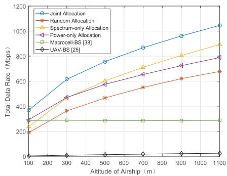  
FIGURE 11. Total data rate versus the ABS altitude. (The cell radius is 10 kilometers; the number of users is 700; the maximum coverage radius of the high frequency is 18 kilometers.).

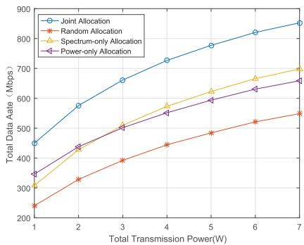  
FIGURE 12. Total data rate versus the transmission power on ABS. (The cell radius is 10 kilometers; the numbers of users in the low and high-frequency spectrum are both 350 $( N _ { I } = N _ { h } = 3 5 0 )$ ; the ABS altitude is 500 m.).

Fig. 11 shows the total data rate versus the altitude of the ABS. The total data rates of the Macrocell-BS is unchanged, because the BS height is approximated to zero. The network throughput of the DBAA increases with the ABS altitude. This is due to the reduction of the SE and the increase of the LOS probability. However, when the ABS altitude is high enough, the three-dimensional distance is much larger than the horizontal distance and becomes dominant, the total data rate will decrease due to the large PL. Furthermore, we can find in Fig. 11 that the DBAA scheme can achieve larger performance gains when the ABS altitude is higher, which is mainly because of the optimal spectrum assignment.

Fig. 12 demonstrates the network throughput versus the total transmission power on the ABS. This figure shows that when the available power is very low, optimizing the power allocation is more helpful to improve the network throughput. This is because the limited power supply needs to be fully utilized. However, with the increment of the power supply, each user can be allocated with relatively large transmission power which is no longer the dominant factor. In this case the subchannel assignment becomes more significant in increasing the total data rate. Therefore, the results show that we can select the resource allocation priority according to the onboard power supply on the ABS.

According to the simulation results, the proposed DBAA scheme with the optimal joint resource allocation can improve the airborne access network throughput significantly. In particular, the dual-band spectrum assignment leads to the majority performance improvement when the power supply is sufficient onboard, and the appropriate power allocation can further enhance the network performance. But when the power supply is limited, the power allocation according to the channel conditions is more beneficial for the coverage of ABS.

## VII. CONCLUSION

In this work we have tackled the challenging issue of providing wide area coverage with high network throughput using ABSs. We propose the DBAA scheme that combines the advantages of small PL in the low-frequency band and large bandwidth in the high-frequency band. We first conducted a field measurement campaign on the A2G channel using an airship at the altitudes from 50 to 950 meters with a multi-band channel sounder. The LSF including PL and SE was measured at 785 and 2160 MHz simultaneously, and the channel models have been established. The dual-band channel measurement results provide a new insight into the A2G propagation characteristics in the airborne access scenario and the basis for the cross-layer design of the DBAA scheme. According to the features of the airborne access networks, we further design the joint spectrum-and-power allocation algorithm based on the optimization technique to maximize the network throughput. The numerical results demonstrate that the DBAA is an efficient approach to significantly improve the network performance. In the future works, we will study planning multiple ABSs to establish the airborne cellular network for wide area coverage. The cell range, inter-cell interference, and network capability can be analyzed based on the proposed A2G channel model. In this work, we use orthogonal resource allocation as a starting point. It is possible to apply non-orthogonal resource allocation to further enhance the system capacity.

## REFERENCES

[1] M. Alzenad, A. El-Keyi, F. Lagum, and H. Yanikomeroglu, ‘‘3-D placement of an unmanned aerial vehicle base station (UAV-BS) for energyefficient maximal coverage,’’ IEEE Wireless Commun. Lett., vol. 6, no. 4, pp. 434–437, Aug. 2017.

[2] L. Wu, Z. Duan, J. Wang, and J. Han, ‘‘Base station access control strategy of mine locomotive unmanned systems,’’ J. Electron. Meas. Instrum., vol. 30, no. 8, pp. 1190–1197, Aug. 2016.

[3] L. Gupta, R. Jain, and G. Vaszkun, ‘‘Survey of important issues in UAV communication networks,’’ IEEE Commun. Surveys Tuts., vol. 18, no. 2, pp. 1123–1152, 2nd Quart., 2016.

[4] M. Mozaffari, W. Saad, M. Bennis, and M. Debbah, ‘‘Mobile unmanned aerial vehicles (UAVs) for energy-efficient Internet of Things communications,’’ IEEE Trans. Wireless Commun., vol. 16, no. 11, pp. 7574–7589, Nov. 2017.

[5] V. Sharma and R. Kumar, ‘‘A cooperative network framework for multi UAV guided ground ad hoc networks,’’ J. Intell. Robotic Syst., vol. 77, nos. 3–4, pp. 629–652, 2015.

[6] L. Li, M. Peng, C. Yang, and Y. Wu, ‘‘Optimization of base-station density for high energy-efficient cellular networks with sleeping strategies,’’ IEEE Trans. Wireless Commun., vol. 65, no. 9, pp. 7501–7514, Sep. 2016.

[7] R. Zhang, J. Pan, D. Xie, and F. Wang, ‘‘NDCMC: A hybrid data collection approach for large-scale WSNs using mobile element and hierarchical clustering,’’ IEEE Internet Things J, vol. 3, no. 4, pp. 533–543, Aug. 2016.

[8] C. Yin, Z. Xiao, X. Cao, X. Xi, P. Yang, and D. Wu, ‘‘Offline and online search: UAV multiobjective path planning under dynamic urban environment,’’ IEEE Internet Things J., vol. 5, no. 2, pp. 546–558, Apr. 2018.

[9] J. Lyu, Y. Zeng, and R. Zhang, ‘‘Cyclical multiple access in UAV-aided communications: A throughput-delay tradeoff,’’ IEEE Wireless Commun. Lett., vol. 5, no. 6, pp. 600–603, Dec. 2016.

[10] J. Huang, C.-X. Wang, R. Feng, J. Sun, W. Zhang, and Y. Yang, ‘‘Multifrequency mmWave massive MIMO channel measurements and characterization for 5G wireless communication systems,’’ IEEE J. Sel. Areas Commun., vol. 35, no. 7, pp. 1591–1605, Jul. 2017.

[11] C. X. Wang, A. Ghazal, B. Ai, P. Fan, and Y. Liu, ‘‘Channel measurements and models for high-speed train communication systems: A survey,’’ IEEE Commun. Surveys Tuts., vol. 18, no. 2, pp. 974–987, 2nd Quart., 2016.

[12] S. M. Yu and S.-L. Kim, ‘‘Downlink capacity and base station density in cellular networks,’’ in Proc. IEEE 11th Int. Symp. Workshops Modeling Optim. Mobile, Ad Hoc Wireless Netw. (WiOpt), Lucca, Italy, May 2013, pp. 119–124.

[13] E. Kalantari, H. Yanikomeroglu, and A. Yongacoglu, ‘‘On the number and 3D placement of drone base stations in wireless cellular networks,’ in Proc. IEEE Veh. Technol. Conf. (VTC-Fall), Montreal, QC, Canada, Sep. 2016, pp. 1–6.

[14] J. Talvitie, P. Leppanen, and T. Poutanen, ‘‘A wideband channel measurement system for aircraft air-to-ground links,’’ in Proc. IEEE 2nd Int. Symp. Spread Spectrum Techn. Appl. (ISSTA), Yokohama, Japan, Nov. 1992, pp. 187–190.

[15] X. Yu, D. Song, and Z. Yang, ‘‘Aeronautical channel modeling in frequency-domain for block-data transmission systems,’’ in Proc. IEEE Int. Conf. Comput. Sci. Automat. Eng. (CSAE), Shanghai, China, Jun. 2011, pp. 719–723.

[16] K. Takizawa, T. Kagawa, S. Lin, F. Ono, H. Tsuji, and R. Miura, ‘‘C-band aircraft-to-ground (A2G) radio channel measurement for unmanned aircraft systems,’’ in Proc. Int. Symp. Wireless Pers. Multimedia Commun. (WPMC), Sydney, NSW, Australia, Sep. 2014, pp. 754–758.

[17] R. Sun and D. W. Matolak, ‘‘Air–ground channel characterization for unmanned aircraft systems part II: Hilly and mountainous settings,’’ IEEE Trans. Veh. Technol., vol. 66, no. 3, pp. 1913–1925, Mar. 2017.

[18] D. W. Matolak and R. Sun, ‘‘Air-ground channels for UAS: Summary of measurements and models for L- and C-bands,’’ in Proc. Integr. Commun. Navigat. Surveill. (ICNS), Herndon, VA, USA, Apr. 2016, pp. 8B2-1–8B2-11.

[19] R. Zhang, L. Cai, Z. Zhong, J. Zhao, and J. Zhou, ‘‘Cross-polarized three-dimensional channel measurement and modeling for small-cell street canyon scenario,’’ IEEE Trans. Veh. Technol., vol. 67, no. 9, pp. 7969–7983, Sep. 2018.

[20] R. Zhang, X. Jiang, T. Taleb, B. Li, H. Qin, Z. Zhong, and X. Zhang, ‘‘Connecting a city by wireless backhaul: 3D spatial channel characterization and modeling perspectives,’’ IEEE Commun. Mag., vol. 55, no. 5, pp. 62–69, May 2017.

[21] T. J. Willink, C. C. Squires, G. W. K. Colman, and M. T. Muccio, ‘‘Measurement and characterization of low-altitude air-to-ground MIMO channels,’’ IEEE Trans. Veh. Technol., vol. 65, no. 4, pp. 2637–2648, Apr. 2016.

[22] Y. S. Meng and Y. H. Lee, ‘‘Measurements and characterizations of air-toground channel over sea surface at C-band with low airborne altitudes,’ IEEE Trans. Veh. Technol., vol. 60, no. 4, pp. 1943–1948, May 2011.

[23] K. Wang, R. Zhang, L. Wu, Z. Zhong, L. He, J. Liu, and X. Pang, ‘‘Path loss measurement and modeling for low-altitude UAV access channels,’’ in Proc. IEEE Veh. Technol. Conf. (VTC-Fall), Toronto, ON, Canada, Sep. 2017, pp. 1–5.

[24] J. Lyu, Y. Zeng, R. Zhang, and T. J. Lim, ‘‘Placement optimization of UAV-mounted mobile base stations,’’ IEEE Commun. Lett., vol. 21, no. 3, pp. 604–607, Mar. 2017.

[25] P. Yang, X. B. Cao, C. Yin, Z. Y. Xiao, X. Xi, and D. P. Wu, ‘‘Routing protocol design for drone-cell communication networks,’’ in Proc. IEEE Int. Conf. Commun. (ICC), Paris, France, May 2017, pp. 1–6.

[26] F. Lagum, I. Bor-Yaliniz, and H. Yanikomeroglu, ‘‘Strategic densification with UAV-BSs in cellular networks,’’ IEEE Wireless Commun. Lett., vol. 7, no. 3, pp. 384–387, Jun. 2018.

[27] X. Du and D. Wu, ‘‘Adaptive cell relay routing protocol for mobile ad hoc networks,’’ IEEE Trans. Veh. Technol., vol. 55, no. 1, pp. 278–285, Jan. 2006.

[28] X. Du and F. Lin, ‘‘Designing efficient routing protocol for heterogeneous sensor networks,’’ in Proc. 24th IEEE Int. Perform., Comput., Commun. Conf. (PCCC), Phoenix, AZ, USA, Apr. 2005, pp. 51–58.

[29] X. Du, M. Guizani, Y. Xiao, and H.-H. Chen, ‘‘A routing-driven ellip tic curve cryptography based key management scheme for heteroge neous sensor networks,’’ IEEE Trans. Wireless Commun., vol. 8, no. 3, pp. 1223–1229, Mar. 2009.

[30] B. Li, C. Chen, R. Zhang, H. Jiang, and X. Guo, ‘‘The energy-efficient UAV-based BS coverage in air-to-ground communications,’’ in Proc. IEEE Sensor Array Multichannel Signal Process. Workshop (SAM), Sheffield, U.K., Jul. 2018, pp. 578–581.

[31] S. Iellamo, J. J. Lehtomaki, and Z. Khan, ‘‘Placement of 5G drone base stations by data field clustering,’’ in Proc. IEEE Veh. Technol. Conf. (VTC Spring), Sydney, NSW, Australia, Jun. 2017, pp. 1–5.

[32] T. A. Benmus, R. Abboud, and M. K. Shatter, ‘‘Neural network approach to model the propagation path loss for great Tripoli area at 900, 1800, and 2100 MHz bands,’’ in Proc. Int. Conf. Sciences Techn. Autom. Control Comput. Eng. (STA), Monastir, Tunisia, Dec. 2015, pp. 793–798.

[33] Study on Channel Model for Frequencies from 0.5 to 100 GHz (Release 14), document TR 38.901 V14.0.0, 3GPP Technical Specification Group Radio Access Networks, Mar. 2017.

[34] ‘‘WINNER+ final channel models (V1.0),’’ Wireless World Initiative New Radio Project, Tech. Rep. CELTIC/CP5-026, Jun. 2010.

[35] R. Verdone and E. A. Zanella, Pervasive Mobile and Ambient Wireless Communications: COST Action 2100. London, U.K.: Springer, 2012.

[36] A. J. Goldsmith, L. J. Greenstein, and G. J. Foschini, ‘‘Error statistics of real-time power measurements in cellular channels with multipath and shadowing,’’ IEEE Trans. Veh. Technol., vol. 43, no. 3, pp. 439–446, Aug. 1994.

[37] A. J. Goldsmith and L. J. Greenstein, ‘‘A measurement-based model for predicting coverage areas of urban microcells,’’ IEEE J. Sel. Areas Com mun., vol. 11, no. 7, pp. 1013–1023, Sep. 1993.

[38] D. T. Ngo, S. Khakurel, and T. Le-Ngoc, ‘‘Joint subchannel assignment and power allocation for OFDMA femtocell networks,’’ IEEE Trans. Wireless Commun., vol. 13, no. 1, pp. 342–355, Jan. 2014.

RUONAN ZHANG (S’09–M’10) received the B.S. and M.Sc. degrees in electrical and electronics engineering from Xi’an Jiaotong University, Xi’an, China, in 2000 and 2003, respectively, and the Ph.D. degree in electrical and electronics engineering from the University of Victoria, Victoria, BC, Canada, in 2010.

He was an IC Design Engineer with Motorola Inc., and Freescale Semiconductor Inc., Tianjin, China, from 2003 to 2006. Since 2010, he has

been with the Department of Communication Engineering, Northwestern Polytechnical University, Xi’an, where he is currently a Professor. His current research interests include wireless channel measurement and modeling, architecture, and protocol design of wireless networks, and satellite communications.

He is a recipient of the New Century Excellent Talent Grant from the Ministry of Education of China. He served as a Local Arrangement Co-Chair for the IEEE/CIC International Conference on Communications in China (ICCC), in 2013, Industry Track and Workshop Chair for the IEEE International Conference on High Performance Switching and Routing (HPSR) in 2019, and as an Associate Editor for the Journal ofCommunications and Networks.

QI GUO received the B.S. degree in communication engineering from Northwestern Polytechnical University, Xi’an, China, in 2017, where he is currently a graduate student in communication and information systems with the School of Electronics and Information. His research interests focus on wireless channel measurement and modeling, signal processing, and machine learning in wireless communications.

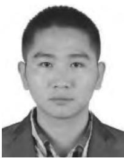

DAOSEN ZHAI (S’16–M’18) received the B.E. degree in telecommunication engineering from Shandong University, Weihai, China, in 2012, and the Ph.D. degree in communication and information systems from Xidian University, Xi’an, China, in 2017. He is currently an Assistant Professor with the School of Electronics and Information, Northwestern Polytechnical University. His research interests focus on radio resource management in energy harvesting networks and 5G

networks, topology control and connectivity analysis in ad hoc networks, and convex optimization and graph theory and their applications in wireless communications.

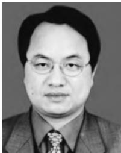

DEYUN ZHOU received the B.S., M.S., and Ph.D. degrees from the Northwestern Polytechnical University in 1985, 1988, and 1991, respectively. His research interests include predictive control, adap tive control, intelligent control theory and applications, complex system modeling and simulation, multi-objective optimization, information fusion, and complex network modeling and applications.

XIAOJIANG DU received the B.S. and M.S. degrees in electrical engineering from Tsinghua University, Beijing, China, in 1996 and 1998, respectively, and the M.S. and Ph.D. degrees in electrical engineering from the University of Maryland, College Park, in 2002 and 2003, respectively. He is a Professor with the Department of Computer and Information Sciences, Temple University, Philadelphia, USA.

His research interests include security, wireless networks, and systems. He has authored over 250 journals and conference papers in these areas, as well as a book published by Springer. He has been awarded more than 5 million US dollars research grants from the U.S. National Science Foundation (NSF), Army Research Office, Air Force, NASA, the State of Pennsylvania, and Amazon. He won the Best Paper Award at IEEE GLOBECOM 2014 and the Best Poster Runner-up Award at the ACM MobiHoc 2014. He served as the Lead Chair of the Communication and Information Security Symposium of the IEEE International Communication Conference (ICC) 2015 and a Co-Chair of Mobile and Wireless Networks Track of IEEE Wireless Communications and Networking Conference (WCNC) 2015. He is a Life Member of ACM.

MOHSEN GUIZANI (S’85–M’89–SM’99–F’09) received the bachelor’s (with distinction) and master’s degrees in electrical engineering, the master’s and doctorate degrees in computer engineering from Syracuse University, Syracuse, NY, USA, in 1984, 1986, 1987, and 1990, respectively. He is currently a Professor with the Department of Computer Science and Engineering, Qatar University, Doha, Qatar. Previously, he served as the Associate Vice President of Graduate Studies, Qatar Univer-

sity, Chair of the Computer Science Department, Western Michigan University, chair of the Computer Science Department, University of West Florida. He also served in academic positions with the University of Missouri-Kansas City, University of Colorado-Boulder, Syracuse University, and Kuwait University. His research interests include wireless communications and mobile computing, computer networks, mobile cloud computing, security, and smart grid.

He currently serves on the editorial boards of several international technical journals and the Founder and Editor-in-Chief of Wireless Communications and Mobile Computing journals (Wiley). He has authored nine books and more than 400 publications in refereed journals and conferences. He guest edited a number of special issues in IEEE journals and magazines. He also served as a member, chair, and the general chair of a number of international conferences. He was selected as the Best Teaching Assistant for two consecutive years at Syracuse University. He received the Best Research Award from three institutions. He was the Chair of the IEEE Communications Society Wireless Technical Committee and the Chair of the TAOS Technical Committee. He served as the IEEE Computer Society Distinguished Speaker from 2003 to 2005.