# DNN Task Partitioning and Migration Strategies in Multi-UAV-Assisted Mobile Edge Computing

Shuman Meng, Bin Li , Member, IEEE, Zhao Yi, Member, IEEE, Lei Liu , Member, IEEE, and Zesong Fei , Senior Member, IEEE

Abstract—Deep neural networks (DNNs) have been widely applied in mobile intelligent applications. However, their high-computational complexity poses significant challenges for resource-constrained mobile devices. To address this issue, this article proposes a multiuncrewed aerial vehicle (UAV)-assisted mobile edge computing architecture tailored for DNN inference tasks. By hierarchically partitioning the DNN model and distributing diferent subtasks between local devices and aerial servers for collaborative processing, the system efectively reduces the computational burden on user terminals. Taking into account the factors, such as unbalanced network load and limited UAV energy, a task migration mechanism is introduced to support the resource coordination and load balancing among multiple UAVs. The aim is to minimize total weighted energy consumption through joint optimization of user–UAV association, DNN partitioning, UAV trajectory, task migration, and computing resource allocation. Due to the dynamic and complex nature of the resulting optimization problem, we model it as a Markov decision process (MDP), and a soft actor–critic with prioritized experience replay (SAC-PER) is proposed to solve it. Furthermore, we integrate convex optimization (CO) techniques into SAC-PER as a subroutine to allocate computing resources to enhance the learning eficiency. Simulation results show that the proposed method achieves faster convergence and reduces the total weighted energy consumption by up to 14.6% compared with baseline methods.

Index Terms—Deep neural network (DNN) task partitioning, deep reinforcement learning (DRL), mobile edge computing, task migration, uncrewed aerial vehicle (UAV).

## I. INTRODUCTION

N RECENT years, deep neural networks (DNNs) have I made breakthrough progress in fields such as autonomous driving, augmented reality navigation, data processing, and speech recognition [1], [2], [3]. DNN builds a multilayer neural network structure by simulating the connectivity of neurons in the human brain and is capable of automatically learning complex features and patterns from large datasets. However, it is extremely challenging to execute DNN-based tasks directly on resource-constrained mobile devices, due to the high computational complexity of DNN inference tasks and the large volumes of data [4], [5], [6]. These devices are usually limited by computing power and energy supply, making it dificult for them to support the operation of DNN models, which restricts the wide deployment and application of DNN.

As an advanced computing paradigm, mobile edge computation (MEC) reduces the data transmission delay and improves computing eficiency by ofloading computationally intensive tasks to edge servers and migrating computing tasks from remote data centers to servers at the network edge for execution [7]. It meets people’s demands for real-time and low-latency services and provides a feasible path for real-time intelligent services. However, in practical applications, fixed edge servers are constrained by static deployment and limited coverage, inevitably facing challenges in handling sudden task requests, which significantly reduces the service availability and degrades user experience [8]. Therefore, the deploying flexible edge computing servers has become increasingly urgent.

Against this background, uncrewed aerial vehicles (UAVs), with their flexible mobility, on-demand deployment capabilities, and advantages in line-of-sight (LoS) communication, have become the key carriers for expanding the service boundaries of MEC [9]. UAVs can not only serve as mobile computing nodes, providing computing and storage resources but also act as relay nodes to improve the network coverage and connectivity quality. With the assistance of UAVs, MEC can respond more flexibly to dynamic and changing scenarios, such as emergencies and crowded areas, providing more stable and eficient services. Furthermore, eficient collaboration among UAVs can be achieved through task sharing, load balancing, and data collaboration [10].

Notably, this dynamic collaboration eficiency highly depends on the refined decision-making of DNN-based task ofloading. We experimentally analyze the per-layer runtime and intermediate output data size of VGG13 [11], and Fig. 1 shows that the execution latency of diferent VGG13 layers difers by up to 3.3 times, with the output data volume fluctuating over three orders of magnitude. This highlights the importance of DNN-based task partitioning for determining optimal split points, as random splitting (RS) may fail to ofload computation-intensive parts to edge nodes with lowtransmission cost. Inspired by this, we develop a DNN task partitioning and migration model to minimize weighted energy consumption of the UAV-assisted MEC system under unbalanced network load and limited UAV energy.

TABLE I  
DIFFERENCES IN OUR SCHEME COMPARED WITH THE MOST RELEVANT SCHEMES
<table><tr><td></td><td></td><td></td><td></td><td>Reference Multi-UAVs DNN Partitioning Task Migration 3D Trajectory Optimization Resource Allocation Optimization Objectives</td><td></td><td></td></tr><tr><td>[12]</td><td>√</td><td></td><td></td><td>√</td><td>√</td><td>Energy</td></tr><tr><td>[13]</td><td>=</td><td></td><td></td><td></td><td></td><td>Latency</td></tr><tr><td>[8]</td><td>√</td><td></td><td>√</td><td></td><td></td><td>Service Quantity</td></tr><tr><td>[15]</td><td>√</td><td></td><td></td><td></td><td>√</td><td>Latency</td></tr><tr><td>[16]</td><td>√</td><td>√</td><td></td><td></td><td>√</td><td>Rate</td></tr><tr><td>[18]</td><td>1</td><td>√</td><td></td><td></td><td>√</td><td>Latency</td></tr><tr><td>Ours</td><td>√</td><td>√</td><td>√</td><td>√</td><td>√</td><td>Energy</td></tr></table>

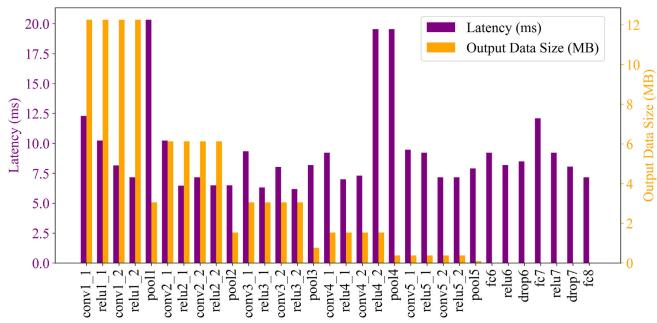  
Fig. 1. VGG13 layerwise runtime and output data size.

## A. Related Works

In this section, we review the related works on the edge computing architecture and the DNN task partitioning. Moreover, we summarize the diferences between the most related works and this work in Table I.

1) Research on UAV-Assisted MEC: Considering the numerous advantages of MEC, there have been extensive studies on maximizing computational rate, minimizing latency, and minimizing energy consumption. For example, Hwang et al. [12] treated UAVs as MEC servers and relays to both enhance transmission and computing performance, aiming to minimize the total energy consumption of users, and proposed a multiagent deep reinforcement learning (MADRL) algorithm to solve it. Chen et al. [13] studied the bitrate-aware video caching and processing with uncertain popularity distribution in the MEC system, and formulated an expected total delay minimization problem under the worst-case distribution to improve the robustness of the video caching. Sun et al. [14] introduced multi-UAV into the MEC system and established a multiobjective optimization problem which simultaneously considered the total latency of task completion, the total energy consumption of UAVs, and the number of tasks ofloaded by UAVs. Zhao et al. [8] proposed a framework focusing on task migration, jointly optimizing UAV trajectory, task ofloading, caching, and migration to address UAV computational constraints and enhance task execution eficiency in resourceconstrained scenarios. Yang et al. [15] proposed a collaborative framework that utilizes device-to-device communication and multiple UAVs to enhance the performance of MEC, jointly optimizing content caching, task ofloading, UAV trajectory, and computation allocation to minimize the average latency.

2) Research on DNN Task Partitioning: DNN-based resource allocation and task ofloading strategies have been widely studied and discussed. Task partitioning enables ofloading the computing tasks of some layers of the DNN model to edge servers, where only the output of the last layer of the first segment needs to be transmitted for subsequent processing. This approach not only efectively reduces overall computation latency but also protects user privacy and security. For example, Peng et al. [16] proposed a DNN partitioning and task ofloading framework that leverages regression-based prediction and DRL to reduce delay, energy, and task-drop rates. Deng et al. [17] investigated a multi-UAV-assisted integrated sensing, communication, and computational system, proposing an adaptive DNN partitioning approach that considers various factors, and developed the convex optimization (CO) algorithm to maximize the average rate of users. Liu et al. [18] transformed the joint DNN partitioning, task ofloading, and resource allocation problems in vehicular edge computing into a dynamic long-term optimization problem. By leveraging the Lyapunov-based MADRL algorithm, they achieved task delay minimization while ensuring system stability. However, existing solutions only focus on inference, with less attention to the multi-UAV-assisted MEC scenarios due to the high dynamic environment caused by the mobility of UAVs.

## B. Contributions and Organization

This article proposes a multi-UAV-assisted MEC system to optimize the weighted energy consumption. Exploiting the flexible mobility and on-demand deployment of UAVs, the framework treats them as aerial computing nodes that dynamically ofload and process DNN-based tasks. An adaptive splitting policy selectively executes computation-intensive DNN layers on UAVs while retaining lightweight layers on users, and a migration mechanism triggered by battery or CPU-load thresholds relocates the remaining subtasks among UAVs in real time. The main contributions of this work are outlined as follows.

1) We investigate a DNN-based multi-UAV-assisted MEC framework that introduces adaptive DNN task partitioning. Taking into account that UAVs may face critically low remaining energy or excessively high-computational loads during task execution, we introduce a dynamic task migration mechanism. Therefore, we establish an optimization problem to minimize weighted energy consumption by collaboratively designing the user–UAV association, DNN partitioning, computing resource allocation, task migration, and UAV trajectory.

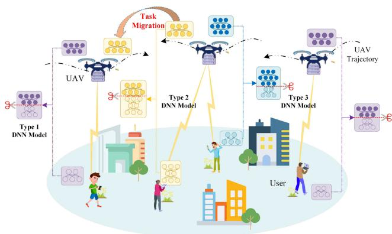  
Fig. 2. Proposed multi-UAV-assisted MEC network system.

2) To address this high-dimensional and non-CO problem, we reframe it as a Markov decision process (MDP) and develop a framework that integrates deep reinforcement learning (DRL) with CO. Specifically, we propose a soft actor–critic with prioritized experience replay (SAC-PER) algorithm and incorporate a CO-based UAV computing resource allocation subproblem solver for each time slot. This approach enables eficient learning in dynamic environments, while enhancing the training stability and overall solution eficiency.

3) We assess the complexity of the proposed algorithm and demonstrate its convergence. Numerical results show that the proposed algorithm significantly outperforms existing baseline methods in terms of convergence speed and energy consumption, greatly reducing the total energy consumption of the system and confirming its efectiveness and practicality in multi-UAV-assisted MEC scenarios.

The remainder of this article is organized as follows. Section II provides a detailed description of the system model for the DNN-based multi-UAV-assisted MEC and formulates the optimization problem. Section III presents the proposed algorithm framework. Section IV evaluates the performance of the proposed scheme through simulation experiments. Finally, Section V concludes this article and discusses future directions.

## II. SYSTEM MODEL AND PROBLEM FORMULATION

## A. System Model

As shown in Fig. 2, we consider a multi-UAV-assisted MEC network containing I users and J UAVs, which are defined as the set $\forall i \in \mathcal { T } \triangleq \{ 1 , 2 , \dots , I \}$ and set $\forall j \in \mathcal { T } \triangleq \{ 1 , 2 , \dots , J \}$ respectively. Simultaneously, we define the flight period of UAVs as $N = T \delta$ , where we express the length of the time slot as δ and the set of the time slots as $\forall t \in T \triangleq \{ 1 , 2 , . . . , T \}$

The horizontal coordinate of each user $i \in \mathcal { T }$ is denoted by ${ \bf w } _ { i } ( t ) = ( x _ { i } ( t ) , y _ { i } ( t ) , 0 ) ^ { T }$ , which remains constant throughout the system operation. We assume that each user i generates a DNN-based task $b _ { i }$ at the beginning. It is worth noting that the DNN models are pretrained and preloaded in every user and UAV without the need for further deployment [19].

## B. UAV Movement Model

We assume that each UAV j flies at a time-varying altitude $H _ { j } ( t ) ~ \in ~ [ H _ { \operatorname* { m i n } } , H _ { \operatorname* { m a x } } ]$ with the 3-D coordinate $\mathbf { q } _ { j } ( t ) \mathbf { \Psi } =$ $( x _ { j } ( t ) , y _ { j } ( t ) , H _ { j } ( t ) ) ^ { T }$ . Therefore, the location of each UAV can be updated as follows:

$$
{ \bf q } _ { j } \left( t + 1 \right) = { \bf q } _ { j } \left( t \right) + { \bf v } _ { j } \left( t \right) \delta + \frac { 1 } { 2 } { \bf a } _ { j } \left( t \right) \delta ^ { 2 } \quad \forall j \in \mathcal { I } , t \in \mathcal { T }\tag{1}
$$

where $\mathbf { v } _ { j } ( t )$ and ${ \bf a } _ { j } ( t )$ denote the velocity and the acceleration of UAV j at time slot $t ,$ respectively.

In addition, to avoid collisions between UAVs during task execution, UAVs should maintain a safe distance $d _ { \mathrm { s a f e } }$ from each other. Meanwhile, to ensure the authenticity of UAVs flight trajectory, the maximum flight velocity $\nu _ { \mathrm { m a x } }$ and the maximum acceleration $a _ { \mathrm { m a x } }$ of UAVs are defined. Therefore, UAVs are required to adhere to the following constraints within each time slot:

$$
\begin{array} { r l } { \left\| \mathbf { q } _ { j } \left( t \right) - \mathbf { q } _ { j ^ { \prime } } \left( t \right) \right\| ^ { 2 } \geq d _ { \mathrm { s a f e } } ^ { 2 } } & { { } \forall j , j ^ { \prime } \in \mathcal { I } , j \neq j ^ { \prime } , t \in \mathcal { T } } \end{array}\tag{2a}
$$

$$
\begin{array} { r } { \left\| \mathbf { v } _ { j } \left( t \right) \right\| \leq \nu _ { \operatorname* { m a x } } , \left\| \mathbf { a } _ { j } \left( t \right) \right\| \leq a _ { \operatorname* { m a x } } \quad \forall j \in \mathcal { I } , t \in \mathcal { T } . } \end{array}\tag{2b}
$$

Following [20], the flight energy of the UAV $j ,$ denoted by $E _ { j } ^ { \mathrm { { f } } \mathrm { { y } } } ( t ) .$ , is given by

$$
\begin{array} { r } { E _ { j } ^ { \mathrm { H y } } \left( t \right) = \left[ \frac { 1 } { 2 } d _ { 0 } \rho _ { 0 } g A \left. \mathbf { v } _ { j } \left( t \right) \right. ^ { 3 } + P _ { 1 } \left( 1 + \frac { 3 \left. \mathbf { v } _ { j } \left( t \right) \right. ^ { 3 } } { U _ { \mathrm { t i p } } ^ { 2 } } \right) \right. } \\ { \qquad + \left. P _ { 2 } \left( \sqrt { 1 + \frac { \left. \mathbf { v } _ { j } \left( t \right) \right. ^ { 4 } } { 4 \nu _ { 0 } ^ { 4 } } } - \frac { \left. \mathbf { v } _ { j } \left( t \right) \right. ^ { 2 } } { 2 \nu _ { 0 } ^ { 2 } } \right) ^ { \frac { 1 } { 2 } } \right] \delta } \end{array}\tag{3}
$$

where $d _ { 0 }$ indicates the fuselage drag ratio, $\rho _ { 0 }$ represents the air density, A represents the rotor’s surface area, and $g$ is its rotor’s solidity. In addition, $P _ { 1 }$ and $P _ { 2 }$ denote the power of the UAV’s blade and the power required for hovering, respectively. v signifies the average rotor speed, and $U _ { \mathrm { t i p } }$ represents the speed of the blade tip.

## C. DNN Partitioning Model

Suppose that there are K types of DNNs (such as AlexNet [21], VGG16 [22] and VGG13), which can be defined as $\forall k \in$ ${ \mathcal { K } } \triangleq \{ 1 , 2 , \ldots , K \}$ . We define the number of layers of the kth DNN model as $\forall l _ { k } \in \mathcal { L } _ { k } \triangleq \{ 1 , 2 , \dots , L _ { k } \}$ . Considering the DNN model contains both convolutional/pooling layers for feature extraction and fully connected layers for classification, the sets $C o n \nu _ { k }$ and $F C _ { k }$ are introduced to denote them, respectively, satisfying $F C _ { k } \cup C o n \nu _ { k } = \mathcal { L } _ { k }$ and $F C _ { k } \cap C o n \nu _ { k } = \emptyset$

Each convolutional/pooling layer is denoted by a tuple $( H _ { l _ { k } } , W _ { l _ { k } } , C _ { l _ { k } } ^ { \mathrm { i n } } , C _ { l _ { k } } ^ { \mathrm { o u t } } , k e r _ { l _ { k } } )$ , where the values $( H _ { l _ { k } } , W _ { l _ { k } } , C _ { l _ { k } } ^ { \mathrm { i n } } )$ represent the input height, width, and channel, respectively, and the values $( C _ { l _ { k } } ^ { \mathrm { o u t } } , k e r _ { l _ { k } } )$ denote the output channel, and kernel size, respectively. The fully connected layer is represented by a tuple $( U _ { l _ { k } } ^ { \mathrm { i n } } , U _ { l _ { k } } ^ { \mathrm { o u t } } )$ , where $U _ { l _ { k } } ^ { \mathrm { i n } }$ and $U _ { l _ { k } } ^ { \mathrm { o u t } }$ represent the sizes of the 1-D input and output of the layer $l _ { k } ,$ respectively.

It is supposed that the set of users with the kth type DNN model is $\mathcal { T } _ { k } ,$ where $\begin{array} { r } { \mathcal { T } = \bigcup _ { k \in \mathcal { K } } \mathcal { T } _ { k } } \end{array}$ . We represent the DNN partitioning decision of user i during time slot t through introducing an integer variable $\varphi _ { i } ( t ) \in \{ 1 , \ldots , L _ { k } + 1 \} , i \in \mathcal { T } _ { k }$ When the DNN-based task is divided into two parts, the first part is processed locally, and the second part is ofloaded onto UAVs for processing. Especially, when $\varphi _ { i } ( t ) = 1$ , the entire DNN-based task $b _ { i }$ is ofloaded onto UAVs for processing; when $2 \leq \varphi _ { i } ( t ) \leq L _ { k } .$ , the former part is processed locally, the latter part is processed on UAV; when $\varphi _ { i } ( t ) = L _ { k } + 1$ , all the DNN-based task $b _ { i }$ will be calculated locally.

We adopt the number of floating-point operations (FLOPs) to model the computation workload of processing input data in each layer [23]. For the convolutional/pooling layer and the fully connected layer, the computational workload of $l _ { k }$ layer is given by

$$
B _ { l _ { k } } = \left\{ \begin{array} { l l } { 2 H _ { l _ { k } } W _ { l _ { k } } \left( C _ { l _ { k } } ^ { \mathrm { i n } } k e r _ { l _ { k } } ^ { 2 } \right) C _ { l _ { k } } ^ { \mathrm { o u t } } , } & { l _ { k } \in C o n \nu _ { k } } \\ { 2 \left( U _ { l _ { k } } ^ { \mathrm { i n } } - 1 \right) U _ { l _ { k } } ^ { \mathrm { o u t } } , } & { l _ { k } \in F C _ { k } . } \end{array} \right.\tag{4}
$$

When a DNN-based task is divided into two parts, the output data generated by the last layer of the first segment is utilized for transmission. Let $D _ { l _ { k } }$ be the output data size of layer $l _ { k } ,$ which is given by [24]

$$
D _ { l _ { k } } = \left\{ \begin{array} { l l } { H _ { l _ { k } } W _ { l _ { k } } C _ { l _ { k } } ^ { \mathrm { i n } } \sigma , } & { l _ { k } \in C o n \nu _ { k } } \\ { U _ { l _ { k } } ^ { \mathrm { i n } } \sigma , } & { l _ { k } \in F C _ { k } } \end{array} \right.\tag{5}
$$

where $\sigma$ is the memory footprint per unit of data.

## D. Communication Model

1) User–UAV Links: Owing to the high probability of non-LoS (NLoS) propagation in user–UAV communications within 3-D environments, the user–UAV channel model accounts for both LoS and NLoS path loss characteristics. Accordingly, the Rician fading model [25] is adopted, and the channel power gain between user i and UAV j is formulated as follows:

$$
h _ { i , j } \left( t \right) = \sqrt { \beta _ { 0 } d _ { i , j } - \chi \left( t \right) } \left( \sqrt { \frac { \Gamma } { \Gamma + 1 } } \overline { { h } } _ { i , j } \left( t \right) + \sqrt { \frac { 1 } { \Gamma + 1 } } \widetilde { h } _ { i , j } \left( t \right) \right)\tag{6}
$$

where $\overline { { h } } _ { i , j } ( t ) = \exp ( - j 2 \pi / \lambda d _ { i , j } ( t ) )$ and $\widetilde { h } _ { i , j } ( t ) \sim \mathcal { C N } ( 0 , 1 )$ are the LoS and NLoS components, respectively. Also, the path loss factor is represented by $\beta _ { 0 }$ , Γ denotes the Rician factor, the path-loss exponent is $\chi ,$ and $d _ { i , j } ( t )$ means the reference distance for the communication between user i and UAV $j .$

Therefore, the transmission rate between user i and UAV j can be expressed as follows:

$$
R _ { i , j } \left( t \right) = B _ { 1 } { \log _ { 2 } \left( 1 + p _ { i } \left( t \right) h _ { i , j } \left( t \right) / \sigma _ { 1 } ^ { 2 } \right) }\tag{7}
$$

where $B _ { 1 }$ and $\sigma _ { 1 }$ represent the subchannel bandwidth and the noise power between UAVs and users, respectively. Also,

$p _ { i } ( t ) \in [ 0 , p _ { i } ^ { \operatorname* { m a x } } ]$ denotes the user $i \mathbf { \ ' } _ { \mathbf { S } }$ transmission power during time slot t and $p _ { i } ^ { \operatorname* { m a x } }$ means user $i \ ' s$ maximum transmission power.

2) UAV–UAV Links: Considering that the communication channel between UAVs is LoS transmission link [26], the channel gain between UAVs is given by

$$
h _ { j , j ^ { \prime } } \left( t \right) = \frac { h _ { 0 } } { \left\| \mathbf { q } _ { j } \left( t \right) - \mathbf { q } _ { j ^ { \prime } } \left( t \right) \right\| ^ { 2 } }\tag{8}
$$

where $h _ { 0 }$ denotes the path loss measured at the reference distance of 1 m. Accordingly, the transmission rate between UAVs can be written as follows:

$$
R _ { j , j ^ { \prime } } \left( t \right) = B _ { 2 } { \log } _ { 2 } \left( 1 + p _ { j } \left( t \right) h _ { j , j ^ { \prime } } \left( t \right) / \sigma _ { 2 } ^ { 2 } \right)\tag{9}
$$

where $B _ { 2 }$ and $\sigma _ { 2 }$ represent the bandwidth and the noise power between UAVs, respectively. And $p _ { j } ( t ) \in [ 0 , p _ { j } ^ { \operatorname* { m a x } } ]$ represents the transmission power of UAV j during time slot t and $p _ { j } ^ { \operatorname* { m a x } }$ means UAV $j ^ { \prime } s$ maximum transmission power.

## E. Computing Model

1) Local Computing Model: The completion delay and energy consumption for local computing are defined as follows.

1) Completion Delay: At time slot t, the portion of DNNbased task $b _ { i }$ is processed locally from $l _ { k } = 1 \mathrm { t o } l _ { k } = \varphi _ { i } ( t ) - 1$ Thus, the user $i \mathbf { \ ' } _ { \mathbf { S } }$ local computation latency is given by

$$
T _ { i } ^ { \mathrm { l o c } } \left( t \right) = \frac { \sum _ { l _ { k } = 1 } ^ { \varphi _ { i } \left( t \right) - 1 } B _ { l _ { k } } } { C _ { 0 } f _ { i } ^ { \mathrm { l o c } } \left( t \right) }\tag{10}
$$

where $f _ { i } ^ { \mathrm { l o c } } ( t ) ~ \in ~ [ 0 , f _ { i } ^ { \mathrm { m a x } } ]$ means the available computing resources of user i in time slot t and $C _ { 0 }$ is the number of FLOPs within a CPU cycle. Specifically, when $\varphi _ { i } ( t ) = 1$ , the entire DNN-based task will be completely ofloaded to the UAV for processing.

We define the user–UAV association factor as $\alpha _ { i , j } ( t ) \in \{ 0 , 1 \}$ When user i is associated with UAV $j , \alpha _ { i , j } ( t ) = 1 ;$ otherwise, $\alpha _ { i , j } ( t ) = 0$ . Suppose that each user is associated with a single UAV, and each UAV serves at least one user and no more than $I _ { \mathrm { m a x } }$ users. Therefore, we have

$$
\begin{array} { c } { \displaystyle \sum _ { j = 1 } ^ { J } \alpha _ { i , j } \left( t \right) = 1 , 1 \le \displaystyle \sum _ { i = 1 } ^ { I } \alpha _ { i , j } \left( t \right) \le I _ { \operatorname* { m a x } } } \\ { \displaystyle \forall i \in \mathbb { Z } , j \in \mathcal { I } , t \in \mathcal { T } . } \end{array}\tag{11}
$$

Under this association, the user $i \mathbf { \ ' } _ { \mathbf { S } }$ transmission delay at time slot t is expressed as follows:

$$
T _ { i } ^ { \mathrm { t r } } \left( t \right) = \sum _ { j = 1 } ^ { J } \alpha _ { i , j } \left( t \right) \frac { D _ { \varphi _ { i } \left( t \right) } } { R _ { i , j } \left( t \right) } .\tag{12}
$$

2) Energy Consumption: We define κ as the efective capacitance. At time slot t, the local processing energy of the first segment of layers $l _ { k } = 1$ to $l _ { k } = \varphi _ { i } ( t ) - 1$ of DNN-based task $b _ { i }$ , denoted by $E _ { i } ^ { \mathrm { l o c } } ( t )$ , is formulated as follows:

$$
E _ { i } ^ { \mathrm { l o c } } \left( t \right) = \kappa f _ { i } ^ { \mathrm { l o c } } ( t ) ^ { 2 } \frac { \sum _ { l _ { k } = 1 } ^ { \varphi _ { i } ( t ) - 1 } B _ { l _ { k } } } { C _ { 0 } } .\tag{13}
$$

Correspondingly, at time slot t, the transmission energy consumption of user i is defined as follows:

$$
E _ { i } ^ { \mathrm { t r } } \left( t \right) = p _ { i } \left( t \right) T _ { i } ^ { \mathrm { t r } } \left( t \right) .\tag{14}
$$

2) Edge Ofloading Model: The completion delay and energy consumption for edge ofloading are defined as follows.

1) Completion Delay: When either the remaining energy $E _ { j } ^ { \mathrm { r e m } } ( t )$ or computational load $\rho _ { j } ( t )$ of the UAV meets its respective specific threshold condition, the UAV can choose to transfer the subsequent layers of the DNN-based task to another available UAV. Specifically, the two threshold conditions are defined as follows.

1) Remaining Energy Condition: $E _ { i } ^ { \mathrm { r e m } } ( t ) \leq \mu _ { 1 } E _ { i } ^ { \mathrm { m a x } }$ where $E _ { j } ^ { \mathrm { m a x } }$ denotes the initial total battery energy of UAV $j .$

2) Computational Load Condition: $\rho _ { j } ( t ) \geq \rho _ { \mathrm { t h } }$ where the load rate $\rho _ { j } ( t )$ is defined as the ratio of the allocated computing resource to the maximum available computing resource of UAV j, i.e.,

$$
\rho _ { j } \left( t \right) = \frac { \sum _ { i = 1 } ^ { I } \alpha _ { i , j } \left( t \right) f _ { i , j } \left( t \right) } { f _ { j } ^ { \operatorname* { m a x } } } .\tag{15}
$$

We define the migration variable as $\beta _ { i , j j ^ { \prime } } ( t ) \in \{ 0 , 1 \}$ , when $\beta _ { i , j j ^ { \prime } } ( t ) = 1$ , the subsequent layers of DNN-based task $b _ { i }$ are migrated from UAV j to UAV $j ^ { \prime }$ for processing; otherwise, $\beta _ { i , j j ^ { \prime } } ( t ) = 0$ . The user i’s DNN-based task can be migrated at most once. Therefore, the following constraints need to be satisfied:

$$
\sum _ { j = 1 } ^ { J } \beta _ { i , j j ^ { \prime } } \left( t \right) \leq 1 \quad \forall j ^ { \prime } \neq j \in \mathcal { I } , i \in \mathcal { I } , t \in \mathcal { T } .\tag{16}
$$

Thus, the transmission delay of DNN-based task $b _ { i }$ from UAV j is denoted as follows:

$$
T _ { i , j } ^ { \mathrm { t r } } \left( t \right) = \sum _ { j ^ { \prime } = 1 , j ^ { \prime } \neq j } ^ { J } \alpha _ { i , j } \left( t \right) \beta _ { i , j j ^ { \prime } } \left( t \right) \frac { D _ { \varphi _ { i } \left( t \right) } } { R _ { j , j ^ { \prime } } \left( t \right) } .\tag{17}
$$

During time slot t, the processing time of DNN-based task $b _ { i }$ from the layer $l _ { k } = \varphi _ { i } ( t )$ to the layer $l _ { k } = L _ { k }$ at the UAV, denoted by $T _ { i } ^ { \mathrm { o f f } } ( t )$ , can be calculated as follows:

$$
\begin{array} { r l } & { T _ { i } ^ { \mathrm { 0 f f } } \left( t \right) = \underbrace { \sum _ { j = 1 } ^ { J } \alpha _ { i , j } \left( t \right) \mathbb { I } _ { \left\{ \beta _ { i , j ^ { \prime } } \left( t \right) = 0 \right\} } \frac { \sum _ { l _ { k } = \varphi _ { i } \left( t \right) } ^ { L _ { k } } B _ { l _ { k } } } { C _ { 0 } f _ { i , j } \left( t \right) } } _ { \mathrm { ( I ) } } } \\ & { \qquad + \underbrace { \sum _ { j = 1 } ^ { J } \sum _ { j ^ { \prime } = 1 , j ^ { \prime } \neq j } ^ { J } \alpha _ { i , j } \left( t \right) \beta _ { i , j j ^ { \prime } } \left( t \right) \frac { \sum _ { l _ { k } = \varphi _ { i } \left( t \right) } ^ { L _ { k } } B _ { l _ { k } } } { C _ { 0 } f _ { i , j ^ { \prime } } \left( t \right) } } _ { \mathrm { ( I I ) } } . } \end{array}\tag{18}
$$

Here, the term (I) represents the delay of the subsequent layers of the DNN-based task $b _ { i }$ processed on UAV j when no migration occurs $( \beta _ { i , j j ^ { \prime } } ( t ) = 0 ) ;$ the term (II) indicates that when migration occurs $( \beta _ { i , j j ^ { \prime } } ( t ) = 1 )$ , the subsequent layers of DNN-based task $b _ { i }$ will be processed on UAV $j ^ { \prime } ,$ where $\mathbb { I } _ { \{ \cdot \} }$ represents the indicator function, when the conditions in the independent variable are satisfied, $\mathbb { I } _ { \{ \cdot \} } = 1$ ; otherwise, $\mathbb { I } _ { \{ \cdot \} } = 0$ Among them, $f _ { i , j } ( t )$ is the computing resources allocated by UAV j to user i during time slot t.

2) Energy Consumption: When the task ofloaded to UAV j need to be migrated, the transmission energy consumption of UAV j is defined as follows:

$$
E _ { i , j } ^ { \mathrm { t r } } \left( t \right) = p _ { j } \left( t \right) T _ { i , j } ^ { \mathrm { t r } } \left( t \right) .\tag{19}
$$

Similar to (18), the energy consumption of UAV j for processing DNN-based task $b _ { i }$ is expressed as follows:

$$
\begin{array} { r } { E _ { i , j } ^ { \mathrm { { o f f } } } \left( t \right) = \underbrace { \kappa \alpha _ { i , j } \left( t \right) \mathbb { I } _ { \left\{ \beta _ { i , j ^ { \prime } } \left( t \right) = 0 \right\} } f _ { i , j } \left( t \right) ^ { 2 } \frac { \sum _ { l _ { k } = \varphi _ { i } \left( t \right) } ^ { L _ { k } } { B _ { l _ { k } } } } { C _ { 0 } } } _ { \mathrm { ( n o ~ m i g r a t i o n : ~ e x c u t e d ~ l o c a l l y ~ o n ~ U A N ~ } j ) } } \\ { + \underbrace { \kappa \sum _ { j = 1 } ^ { J } { \alpha _ { i , j ^ { \prime } } \left( t \right) \beta _ { i , j ^ { \prime } } \left( t \right) f _ { i , j } \left( t \right) ^ { 2 } \frac { \sum _ { l _ { k } = \varphi _ { i } \left( t \right) } ^ { L _ { k } } { B _ { l _ { k } } } } { C _ { 0 } } } } _ { \mathrm { ( m i g r a t e d - i n : o f l o a d e d ~ f r o m ~ U A N ~ } j ^ { \prime } \mathrm { ~ t o ~ U A N ~ } j ) } . } \end{array}\tag{20}
$$

Since the calculated result data volume is usually small and the downlink usually has a high transmission rate, the backhaul delay of the calculated result can be ignored. Therefore, for the DNN-based task $b _ { i }$ generated by user i, the total latency can be calculated by combining (10), (12), (17), and (18), which is given by

$$
T _ { i } \left( t \right) = T _ { i } ^ { \mathrm { l o c } } \left( t \right) + T _ { i } ^ { \mathrm { t r } } \left( t \right) + \sum _ { j = 1 } ^ { J } \left( T _ { i , j } ^ { \mathrm { t r } } \left( t \right) \right) + T _ { i } ^ { \mathrm { o f f } } \left( t \right) .\tag{21}
$$

Correspondingly, the total weighted energy consumption of the system can be computed by combining (3), (13), (14), (19), and (20), which is given by

$$
\begin{array} { l } { { \displaystyle E _ { \mathrm { t o t } } \left( t \right) = \varpi \sum _ { j = 1 } ^ { J } \left( \sum _ { i = 1 } ^ { I } \left( E _ { i , j } ^ { \mathrm { o f f } } \left( t \right) + E _ { i , j } ^ { \mathrm { t r } } \left( t \right) \right) + E _ { j } ^ { \mathrm { f l y } } \left( t \right) \right) } } \\ { { \displaystyle \qquad + \sum _ { i = 1 } ^ { I } \left( E _ { i } ^ { \mathrm { l o c } } \left( t \right) + E _ { i } ^ { \mathrm { t r } } \left( t \right) \right) } } \end{array}\tag{22}
$$

where \$ is nonnegative energy consumption weighting factors [27]. Since the energy consumption on the user side is relatively small compared with that of the UAVs during task ofloading, the weighted sum of user and UAV energy consumption is used to better capture their relative contributions to the overall energy cost.

## F. Problem Formulation

This article aims to minimize the weighted energy consumption by jointly optimizing the DNN partitioning decision variable $\varphi \triangleq \{ \varphi _ { i } ( t ) \ \forall i \in { \mathcal { T } } , t \in { \mathcal { T } } \}$ , the user–UAV association factor $\alpha \triangleq \{ \alpha _ { i , j } ( t ) \forall i \in \mathbb { Z } , j \in \mathcal { I } , t \in \mathcal { T } \}$ , task migration variable $\pmb { \beta } \triangleq \{ \beta _ { i , j j ^ { \prime } } ( t ) \forall i \in \mathbb { Z } , j , j ^ { \prime } \in \mathcal { I } , t \in \mathcal { T } , j \neq j ^ { \prime } \}$ , the computational resource allocation of UAVs $\pmb { f } \triangleq \{ f _ { i , j } ( t ) ~ \forall i \in \mathbb { Z } , j \in \mathcal { I } , t \in \mathcal { T } \}$ , and the flight trajectory of UAVs $\mathbf { q } \triangleq \{ \mathbf { q } _ { j } ( t ) \ \forall j \in \mathcal { I } , t \in \mathcal { T } \}$ . Therefore, the optimization problem can be mathematically formalized as follows:

$$
\mathbf { P 0 } : \operatorname* { m i n } _ { \alpha , f , \mathbf { q } , \varphi , \beta } \sum _ { t = 1 } ^ { T } E _ { \mathrm { t o t } } \left( t \right)\tag{23a}
$$

$$
\begin{array} { r l } { \mathrm { s . t . } } & { { } ( 1 ) , ( 2 ) , ( 1 1 ) , ( 1 6 ) } \end{array}\tag{23b}
$$

$$
\varphi _ { i } \left( t \right) \in \{ 1 , \ldots , L _ { k } + 1 \} \quad \forall i \in \mathcal { T } _ { k } , t \in \mathcal { T }\tag{23c}
$$

$$
\alpha _ { i , j } \left( t \right) \in \left\{ 0 , 1 \right\} \ \quad \forall i \in \mathcal { T } , j \in \mathcal { I } , t \in \mathcal { T }\tag{23d}
$$

$$
\beta _ { i , j j ^ { \prime } } \left( t \right) \in \left\{ 0 , 1 \right\} \quad \forall i \in \mathcal { T } , j
$$

$$
j ^ { \prime } \in \mathcal { T } , j ^ { \prime } \neq j , t \in \mathcal { T }\tag{23e}
$$

$$
0 \leq f _ { i , j } \left( t \right) \leq f _ { j } ^ { \operatorname* { m a x } } \quad \forall i \in \mathcal { T } , j \in \mathcal { I } , t \in \mathcal { T }\tag{23f}
$$

$$
\sum _ { i = 1 } ^ { I } \gamma _ { i , j } \left( t \right) f _ { i , j } \left( t \right) \leq f _ { j } ^ { \operatorname* { m a x } } , j \in \mathcal { I } , t \in \mathcal { T }\tag{23g}
$$

$$
T _ { i } \left( t \right) \leq \delta \quad \forall i \in \mathcal { T } , t \in \mathcal { T }\tag{23h}
$$

where $f _ { j } ^ { \operatorname* { m a x } }$ denotes the maximal computing resource of UAV j and $\begin{array} { r l r } { \gamma _ { i , j } ( t ) } & { { } = } & { \alpha _ { i , j } ( t ) \left( 1 - \ \sum _ { j ^ { \prime } = 1 , j ^ { \prime } \neq j } ^ { J } \beta _ { i , j j ^ { \prime } } ( t ) \right) } \end{array}$ + $\textstyle \sum _ { j ^ { \prime } = 1 , j ^ { \prime } \neq j } ^ { J } \alpha _ { i , j ^ { \prime } } ( t ) \beta _ { i , j ^ { \prime } j } ( t )$ . To be specific, constraints (1) and (2) define the limitations during the UAV flight process. Constraint (23c) dictates that the DNN partitioning decision is integer. Constraints (11) and (23d) imply the user–UAV association factor. Constraints (16) and (23e) indicate that the task migration variable is binary. Constraints (23f) and (23g) indicate the limitations on the allocation of computing resources for UAVs. Constraint (23h) restricts the total delay requirements.

## III. PROPOSED APPROACH

Problem P0 is formulated as a mixed-integer nonlinear program with highly coupled variables and nonconvex constraints. The structural complexity of DNN-based tasks and the dynamic interactions among UAVs and users create a large decision space and further increase problem dimensionality.

To address these challenges, we propose a hierarchical decision-making framework that integrates DRL with CO. This hybrid decomposition is inspired by hierarchical optimization principles, where combinatorial and mobility-related decisions are handled by DRL, while convex substructures are solved analytically to improve convergence stability. Built upon the SAC algorithm, the framework formulates the problem as an MDP, leveraging entropy regularization to strike a balance between exploration and exploitation, thereby improving the learning stability and adaptability. To further enhance the sample eficiency and accelerate convergence, a prioritized experience replay (PER) mechanism is incorporated.

In addition, given the favorable convexity of the UAV computing resource allocation subproblem, we design a CO module that solves this subproblem separately at each time slot, significantly reducing the overall computational complexity. Specifically, at each time slot, the SAC-PER agent first determines the high-level decision variables, including DNN partitioning, user–UAV association, task migration, and UAV trajectory. Based on these decisions, the convex computing resource allocation subproblem is constructed and solved via the CO module to obtain the optimal computing resource allocation. In this manner, the CO solver serves as an inner loop deterministic optimizer embedded within each DRL interaction step. Overall, the proposed framework enables the coordinated optimization across all decision layers, with the ultimate goal of minimizing the total system weighted energy consumption.

## A. Optimization Subroutine for UAV Resource Allocation

It is worth noting that only the edge processing energy $E _ { i , j } ^ { \mathrm { o f f } } ( t )$ is impacted by the UAV computing resource allocation variable in the objective function (23a) of problem P0. Likewise, only the edge processing delay $T _ { i } ^ { \mathrm { o f f } } ( t )$ in the delay constraint (23h) depends on this variable. Then, given the fixed DNN partitioning decision $\varphi ^ { * }$ , the flight trajectory of UAVs $\mathbf { q } ^ { * }$ , task migration $\beta ^ { * }$ and the user–UAV association factor $\alpha ^ { * }$ , which will be later obtained by our SAC-PER method. The optimal computing resource allocation problem can be deduced as follows:

$$
\mathbf { P 1 } : \quad \operatorname* { m i n } _ { f } \ \sum _ { i = 1 } ^ { I } \sum _ { j = 1 } ^ { J } E _ { i , j } ^ { \mathrm { o f f } } \left( t \right)\tag{24a}
$$

$$
\begin{array} { r l } { \mathrm { s . t . } } & { { } ( 2 3 \mathrm { f } ) , ( 2 3 \mathrm { g } ) } \end{array}\tag{24b}
$$

$$
T _ { i } ^ { \mathrm { o f f } } \left( t \right) \leq \delta _ { i } \left( t \right) \quad \forall i \in \mathcal { T } , t \in \mathcal { T }\tag{24c}
$$

where $\begin{array} { r } { \delta _ { i } ( t ) = \delta - T _ { i } ^ { \mathrm { l o c } } ( t ) - T _ { i } ^ { \mathrm { t r } } ( t ) - \sum _ { j = 1 } ^ { J } T _ { i , j } ^ { \mathrm { t r } } ( t ) } \end{array}$ . Considering that each user is associated with only one UAV in a single-time slot, problem P1 can be further reformulated as follows:

$$
\mathbf { P 1 } ^ { \prime } : \quad \operatorname* { m i n } _ { f } \ \sum _ { i = 1 } ^ { I } \sum _ { j = 1 } ^ { J } E _ { i , j } ^ { \mathrm { o f f } } \left( t \right)
$$

$$
\begin{array} { r l } { \mathrm { s . t . } } & { { } ( 2 3 \mathrm { f } ) , ( 2 3 \mathrm { g } ) } \end{array}\tag{25a}
$$

(25b)

$$
\operatorname* { m a x } _ { j } \frac { d _ { i , j } \left( t \right) } { f _ { i , j } \left( t \right) } \leq \delta _ { i } \left( t \right) \quad \forall i \in \mathcal { T } , t \in \mathcal { T }\tag{25c}
$$

where $\begin{array} { r } { d _ { i , j } ( t ) = \gamma _ { i , j } ( t ) \sum _ { l _ { k } = \varphi _ { i } ( t ) } ^ { L _ { k } } B _ { l _ { k } } / C _ { 0 } } \end{array}$

Problem P1<sup>0</sup> is a standard quadratic programming problem that can be solved using CVX [28].

Therefore, when $\{ \varphi ^ { * } , \alpha ^ { * } , \beta ^ { * } { \bf q } ^ { * } \}$ are eficiently solved by the SAC-PER (will be introduced later), the aforementioned subroutine can significantly decrease the associated training complexity by eliminating the need to search for $f _ { i , j } ( t )$ within the solution space of the SAC-PER.

## B. MDP Model

The joint optimization problem is modeled as an MDP, which is represented by a five-tuple $\{ S , { \mathcal { A } } , { \mathcal { P } } , { \mathcal { R } } , \gamma \}$ , where S is the set of environmental states, A represents the set of action states, $\mathcal { P }$ represents the state transition probability function. In this article, to achieve the goal of minimizing weighted energy consumption, it is crucial to design the states, actions, and reward function. The specific details of these components are elaborated as follows.

1) State: The state during time slot t is represented as $\begin{array} { r } { s _ { t } = \left\{ \mathbf { q } _ { j } ( t ) , \mathbf { v } _ { j } ( t ) , b _ { i } , \rho _ { j } ( t ) , E _ { j } ^ { \mathrm { r e m } } ( t ) , R _ { i , j } ( t ) , R _ { j , j ^ { \prime } } ( t ) \ \forall i \in \mathcal { T } , j , j ^ { \prime } \in \mathcal { O } ( d ) , \right\} , } \end{array}$ $\mathcal { I } , j \neq j ^ { \prime } \}$ , including the position of UAV ${ \bf q } _ { j } ( t )$ , the flight speed of UAV $\mathbf { v } _ { j } ( t )$ , the DNN-based task $b _ { i } .$ , the load ratio $\rho _ { j } ( t )$ , the transmission rate between users and UAVs $R _ { i , j } ( t )$ the transmission rate between UAVs $R _ { j , j ^ { \prime } } ( t )$ , and the remaining energy of UAV $E _ { i } ^ { \mathrm { r e m } } ( t )$ . The dynamic evolution of $E _ { j } ^ { \mathrm { r e m } } ( t )$ over time slots is quantified by the following equation:

$$
E _ { j } ^ { \mathrm { r e m } } \left( t + 1 \right) = E _ { j } ^ { \mathrm { r e m } } \left( t \right) - E _ { j } ^ { \mathrm { f l y } } \left( t \right) - \sum _ { i = 1 } ^ { I } \left( E _ { i , j } ^ { \mathrm { t r } } \left( t \right) + E _ { i , j } ^ { \mathrm { o f f } } \left( t \right) \right) .\tag{26}
$$

2) Action: The action during time slot t is denoted by $a _ { t } ~ = ~ \left\{ \varphi _ { i } ( t ) , \alpha _ { i , j } ( t ) , \beta _ { i , j j ^ { \prime } } ( t ) , \mathbf { a } _ { j } ( t ) ~ \forall i ~ \in ~ \mathbb { Z } , j , j ^ { \prime } ~ \in ~ \mathcal { I } , j ~ \neq ~ j ^ { \prime } \right\}$ including the DNN partitioning decision $\varphi _ { i } ( t )$ , the user–UAV association factor $\alpha _ { i , j } ( t )$ , the task migration variable $\beta _ { i , j j ^ { \prime } } ( t )$ the UAV flight acceleration ${ \bf a } _ { j } ( t )$

3) Reward: The reward function of the agent must include the expected goals and penalties related to failure to request. Therefore, the reward function of the agent is written as follows:

$$
\begin{array} { c } { { r \left( s _ { t } , a _ { t } \right) = - E _ { \mathrm { t o t } } \left( t \right) - \lambda _ { \mathrm { l } } P _ { \mathrm { e x } } \left( t \right) - \lambda _ { \mathrm { 2 } } P _ { \mathrm { t i } } \left( t \right) } } \\ { { - \lambda _ { \mathrm { 3 } } \left( P _ { \mathrm { b o } } \left( t \right) + P _ { \mathrm { c o l } } \left( t \right) \right) } } \end{array}\tag{27}
$$

where $\lambda _ { 1 } { - } \lambda _ { 3 }$ should be finely adjusted to enhance both the expected accumulated reward and convergence performance. $P _ { \mathrm { c o l } } ( t )$ and $P _ { \mathrm { b o } } ( t )$ denote the UAV collision penalty and boundary violation penalty, defined as follows:

$$
\begin{array} { l } { { \displaystyle P _ { \mathrm { c o l } } \left( t \right) = \sum _ { j = 1 } ^ { J } \sum _ { j ^ { \prime } = 1 } ^ { J } P \left( \left\| \mathbf { q } _ { j } \left( t \right) - \mathbf { q } _ { j ^ { \prime } } \left( t \right) \right\| , d _ { \mathrm { s a f e } } , d _ { \mathrm { s a f e } } \right) } } \\ { ~ } \\ { { \displaystyle P _ { \mathrm { b o } } \left( t \right) = \frac { 1 } { J } \sum _ { j = 1 } ^ { J } } } \\ { { \displaystyle \qquad \times \left( 1 + \frac { 1 } { K } \left\| \mathbf { q } _ { j } \left( t \right) - c l i p \left( \mathbf { q } _ { j } \left( t \right) , X _ { \mathrm { m i n } } , X _ { \mathrm { m a x } } \right) \right\| \right) } } \end{array}\tag{8a}
$$

(28b)

where $P ( a , b , c ) = 2 \mathrm { ~ - ~ } \exp ( - \operatorname* { m a x } ( 0 , ( a - b ) / c ) )$ . Also, $X _ { \operatorname* { m i n } }$ and $X _ { \mathrm { m a x } }$ are the minimum boundary value and the maximum boundary value, respectively. K is a constant.

The timeout penalty $P _ { \mathrm { t i } } ( t )$ is given by

$$
P _ { \mathrm { t i } } \left( t \right) = \frac { 1 } { I } \sum _ { i = 1 } ^ { I } P \left( T _ { i } \left( t \right) , \delta , \delta \right) .\tag{29}
$$

Furthermore, $P _ { \mathrm { e x } } ( t )$ denotes the penalty for UAVs exceeding maximum speed $\nu _ { \mathrm { m a x } }$ and acceleration $a _ { \mathrm { m a x } }$ , as defined in the following equation:

$$
\begin{array} { l } { \displaystyle P _ { \mathrm { e x } } \left( t \right) = \frac { 1 } { J } \sum _ { j = 1 } ^ { J } { } } \\ { \displaystyle \quad \times \left( \operatorname* { m a x } \left( \left\| \mathbf { v } _ { j } \left( t \right) \right\| + \left\| \mathbf { a } _ { j } \left( t \right) \right\| - \nu _ { \operatorname* { m a x } } - a _ { \operatorname* { m a x } } , 0 \right) \right) . } \end{array}\tag{30}
$$

The objective of P0 is to minimize the upper bound of (22). However, the objective of the DRL agent is to maximize the cumulative reward. Accordingly, we define the reward function as the negative value of (27), which can be described as follows:

$$
J \left( \pi \right) = \mathbb { E } \left[ \sum _ { t = 1 } ^ { T } \gamma \left( t \right) r \left( s _ { t } , a _ { t } \right) \right]\tag{31}
$$

where $\gamma ( t ) \in [ 0 , 1 ]$ is the discount factor that characterizes the relative significance of immediate versus future rewards.

We model the agent’s behavior as a policy π. To equip π with optimal decision-making performance, the optimal policy $\pi ^ { * }$ is derived by maximizing the expected long-term discounted system reward, which is expressed as follows:

$$
\pi ^ { * } = \arg \operatorname* { m a x } _ { \pi } J \left( \pi \right) .\tag{32}
$$

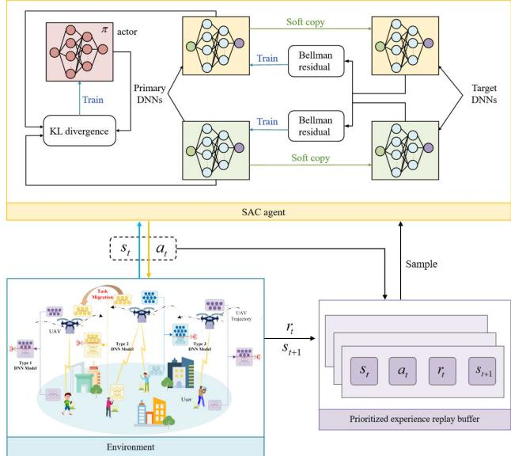  
Fig. 3. Training framework of SAC-PER.

Therefore, we formulate the optimization problem to maximize the value function and obtain the optimal ofloading policy, expressed as follows:

$$
\mathbf { P } 2 : \quad \operatorname* { m a x } J ( \pi )\tag{33a}
$$

$$
\begin{array} { r l } { \mathrm { s . t . } } & { { } ( 2 3 \mathrm { b } ) - ( 2 3 \mathrm { e } ) , ( 2 3 \mathrm { h } ) } \end{array}\tag{33b}
$$

## C. SAC-Based DRL Training Framework

1) SAC Framework: To facilitate deployment, the centralized training framework for the SAC-PER algorithm is illustrated in Fig. 3. In the SAC framework, the goal is to maximize long-term returns from the initial state and involves entropy terms to encourage exploration, which is given by

$$
\pi ^ { * } = \arg \operatorname* { m a x } _ { \pi } \sum _ { t = 1 } ^ { T } \mathbb { E } _ { ( s _ { t } , a _ { t } ) \sim \rho _ { \pi } } [ \gamma ^ { t - 1 } r ( s _ { t } , a _ { t } ) + \alpha \mathcal { H } ( \pi ( \cdot | s _ { t } ) ) ]\tag{34}
$$

where α is the dynamically adjusted temperature coeficient, which is used to control the weight of the entropy term, $\mathcal { H } ( \pi ( \cdot | s _ { t } ) ) = - \mathbb { E } _ { a \sim \pi ( \cdot | s _ { t } ) }$ log π(a|s<sub>t</sub>) represents the strategy entropy and reflects the diversity of the action distribution.

To enable the adaptive control over the exploration intensity, SAC-PER introduces an automatic temperature adjustment mechanism. Instead of fixing α, it is treated as a learnable parameter and updated by minimizing the following loss:

$$
\alpha _ { t } ^ { * } = \arg \operatorname* { m i n } _ { \alpha _ { t } } \mathbb { E } _ { a _ { t } \sim \pi _ { t } ^ { * } } \left[ - \alpha _ { t } \log \left( \pi _ { t } ^ { * } \left( a _ { t } | s _ { t } ; \alpha _ { t } \right) \right) - \alpha _ { l } \mathcal { H } _ { \operatorname* { m i n } } \right]\tag{35}
$$

where $\mathcal { H } _ { \mathrm { m i n } }$ denotes the minimum entropy constraint and $\pi _ { t } ^ { * } ( a _ { t } | s _ { t } ; \alpha _ { t } )$ represents the optimal policy under the temperature $\alpha _ { t }$

The strategy optimization process follows the strategy iteration framework, including two stages: strategy evaluation and strategy improvement.

In the strategy evaluation stage, the action value function $Q _ { \pi } ( s _ { t } , a _ { t } )$ is updated through the Bellman expectation equation and expressed as follows:

$$
\begin{array} { r } { Q _ { \pi } \left( s _ { t } , a _ { t } \right) = r \left( s _ { t } , a _ { t } \right) + \gamma \mathbb { E } _ { s _ { t + 1 } \sim t _ { s } } \left[ \nu _ { \pi } \left( s _ { t + 1 } \right) \right] . } \end{array}\tag{36}
$$

Compared with the traditional DRL algorithm, by introducing entropy, the state-value function of SAC is given by

$$
\nu _ { \pi } ( s _ { t } ) = \mathbb { E } _ { a \sim \pi } [ Q _ { \pi } ( s _ { t } , a _ { t } ) - \alpha \mathrm { l o g } ( \pi ( a _ { t } | s _ { t } ) ) ] .\tag{37}
$$

To reduce the value estimation deviation caused by the approximation error of the function, the SAC-PER algorithm adopts a double-Q network architecture, taking parameters ω<sub>1</sub> and $\omega _ { 2 }$ as approximate action values, respectively, and its loss function is given by

$$
L _ { \mathcal { Q } } \left( \omega _ { i } \right) = \mathbb { E } _ { ( s _ { t } , a _ { t } ) \sim \mathcal { D } } \left[ \frac { 1 } { 2 } \big ( Q _ { \omega _ { i } } \left( s _ { t } , a _ { t } \right) - \hat { \mathcal { Q } } \left( s _ { t } , a _ { t } \right) \big ) ^ { 2 } \right] , i = 1\tag{38}
$$

where D is the experience replay bufer and the target Q value $\hat { Q } ( s _ { t } , a _ { t } )$ is given by

$$
\begin{array} { l } { \displaystyle \hat { \boldsymbol { Q } } ( \boldsymbol { s } _ { t } , \boldsymbol { a } _ { t } ) = \boldsymbol { r } ( \boldsymbol { s } _ { t } , \boldsymbol { a } _ { t } ) + \gamma \sum _ { a _ { t + 1 } \in A } \pi ( \boldsymbol { a } _ { t + 1 } | \boldsymbol { s } _ { t + 1 }  ) } \\ { \displaystyle \qquad \times [ \boldsymbol { Q } _ { \hat { \boldsymbol { \omega } } _ { i } } ( \boldsymbol { s } _ { t + 1 } , \boldsymbol { a } _ { t + 1 } ) - \alpha \log ( \pi ( \boldsymbol { a } _ { t + 1 } | \boldsymbol { s } _ { t + 1 } ) ) ] } \end{array}\tag{39}
$$

where $\hat { \omega } _ { i }$ is the parameter of the target Q-network, which is periodically copied from $\omega _ { i }$

In the strategy improvement stage, the actor network is optimized through the reparameterization technique, and its loss function is given by

$$
\begin{array} { r l } & { L _ { \pi } ( \varphi ) = \mathbb { E } _ { s _ { t } \sim \mathcal { D } } \mathbb { E } _ { a _ { t } \sim \pi _ { \varphi } } } \\ & { \qquad \quad \times [ \alpha \mathrm { l o g } ( \pi _ { \varphi } ( a _ { t } | s _ { t } ) ) - \underset { i = 1 , 2 } { \operatorname* { m i n } } Q _ { \omega i } ( s _ { t } , a _ { t } ) ] . } \end{array}\tag{40}
$$

2) PER: To further improve the sample utilization rate, SAC-PER integrates the priority experience replay mechanism. The priority of empirical tuples is dynamically determined by the temporal diference error, which is given by

$$
\left| { \delta _ { t } } \right| = \frac { 1 } { 2 } \sum _ { i = 1 } ^ { 2 } \left| { r \left( { { s _ { t } } , a _ { t } } \right) + \gamma { Q _ { { \hat { \omega } } _ { i } } } \left( { { s _ { t + 1 } } , { a _ { t + 1 } } } \right) - { Q _ { { \omega } _ { i } } } \left( { { s _ { t } } , a _ { t } } \right) } \right|\tag{41}
$$

where the $| \delta _ { t } |$ sample is sampled preferentially to accelerate the convergence of the critic network.

We define the priority $p _ { i }$ of each transition as $\begin{array} { r c l } { p _ { i } } & { = } & { ( \delta _ { i } + \varepsilon ) ^ { \eta } . } \end{array}$ , where $\varepsilon \quad > \quad 0$ is a small constant to prevent zero probability, and $\eta \in [ 0 , 1 ]$ controls the degree of prioritization. The sampling probability of each transition is given by

$$
P \left( i \right) = \frac { p _ { i } ^ { \beta _ { 1 } } } { \sum _ { k } p _ { k } ^ { \beta _ { 1 } } }\tag{42}
$$

where $\beta _ { 1 }$ controls the priority weight to emphasize high-error transitions. The importance weight for correcting sampling bias is expressed as follows:

$$
\omega _ { i } = \left( \frac { 1 } { W } \cdot \frac { 1 } { P ( i ) } \right) ^ { \beta _ { 2 } }\tag{43}
$$

where W is the capacity of the experience replay and $\beta _ { 2 } \in [ 0 , 1 ]$ is the deviation correction coeficient. Specifically, $\beta _ { 2 } ~ = ~ 0$ disables importance sampling, while $\beta _ { 2 } ~ = ~ 1$ fully corrects the PER-induced bias. Based on the SAC algorithm, the SAC-PER training framework is outlined in Algorithm 1.

```latex
Algorithm 1 Proposed SAC-PER Algorithm
1: Initialize $t ~ = ~ 1$ maximum training episodes Mte and
episode length Epl.
2: Initialize the parameter of actor networks $\varphi$ and the
parameters of critic network $\omega _ { i } ( i = 1 , 2 )$
3: Initialize replay bufer D, temperature parameter α,
entropy level ${ \mathcal { H } } _ { \operatorname* { m i n } }$ and discount factor $\gamma ,$ respectively.
4: for Episode=1 to Mte do
5: for t=1 to Epl do
6: The agent acquires the state $s _ { t }$ from the environ
ment.
7: Based on $s _ { t } ,$ the agent decides action $a _ { t }$ via policy
$\pi _ { \varphi } .$ Obtain next state $s _ { t + 1 }$ and calculate the reward
from the action.
8: Add data to bufer $D \gets D \cup \{ s _ { t } , a _ { t } , r _ { t } , s _ { t + 1 } \} .$
9: if samples meet the size of D then
10: for $b \in \mathcal { B } _ { b a t c h }$ do
11: Sample i with probability $P _ { i } .$
12: Calculate the importance weights $\omega _ { i } .$
13: Calculate the TD error $\delta _ { t }$ according to (41).
14: Update the priority $p _ { i } .$
15: end for
16: end if
17: end for
18: for each gradient step do
19: Update the parameters of the critic network ω
according to (38): $\omega _ { i } \gets \omega _ { i } - \lambda \nabla _ { \omega _ { i } } L _ { Q } ( \omega _ { i } ) , i \in \{ 1 , 2 \} .$
20: Update the actor network parameter $\varphi$ according to
(40): $\varphi  \varphi - \lambda \nabla _ { \varphi } L _ { \pi } ( \varphi ) .$
21: Update the temperature coeficient α according to
(35): $\alpha \gets \alpha - \lambda \nabla _ { \alpha } L ( \alpha )$
22: Update the parameters of the target network $\hat { \omega } _ { i } { : }$
$\hat { \omega } _ { i } \gets \tau \omega _ { i } + ( 1 - \tau ) \hat { \omega } _ { i } , i \in \{ 1 , 2 \}$
23: end for
24: end for
```

## D. Complexity Analysis

The computational complexity of the SAC-PER algorithm mainly arises from two components: the training of the actor and critic networks, and the PER mechanism. Denoting the number of neurons in the uth layer of the actor network as $C _ { u }$ and the number of neurons in the mth layer of the critic network as $\hat { C } _ { m } .$ . The number of fully connected layers in the actor and critic networks is represented by U and M, respectively. The gradient descent complexity for both the actor and critic networks is $\begin{array} { r } { O \left( \sum _ { u = 0 } ^ { U - 1 } C _ { u } \hat { C } _ { u + 1 } \right. + \left. \sum _ { m = 0 } ^ { M - 1 } \hat { C } _ { m } \hat { C } _ { m + 1 } \right) } \end{array}$ . The PER mechanism introduces extra complexity for experience sorting and sampling, which is $O ( ( V _ { 1 } ~ + ~ V _ { 2 } ~ + ~ V _ { 3 } ) \log V _ { 1 } )$ , where $V _ { 1 } , V _ { 2 } , V _ { 3 }$ represent the replay bufer size, batch size, and priority update count, respectively. Also, the CO step for computing resource allocation in SAC-PER introduces an additional complexity of O(N log N), where N is the number of optimization variables. Thus, the overall computational complexity of the SAC-PER algorithm is O(N log N) $+ ~ O ( ( V _ { 1 } ~ + ~ V _ { 2 } ~ +$ $\begin{array} { r } { V _ { 3 } ) \log V _ { 1 } ) + O \left( \mathrm { E p l } \left( \sum _ { u = 1 } ^ { U } C _ { u } C _ { u + 1 } + \ \sum _ { m = 1 } ^ { M } \hat { C } _ { m } \hat { C } _ { m + 1 } \right) \right) } \end{array}$

## IV. SIMULATION RESULTS

In this section, we evaluate the performance of the proposed method against the following benchmark methods.

1) SAC: The SAC algorithm is an actor–critic framework that enhances stability and sample eficiency in continuous control by maximizing a returnentropy weighted sum. Its stochastic policy, twin Q-networks, and auto-tuned temperature coeficient mitigate value overestimation and ensure robust learning [25], [29].

2) SAC-PER: SAC-PER extends the standard SAC framework by incorporating PER. Instead of uniform sampling, PER assigns higher probabilities to transitions with larger TD errors, enabling the agent to focus on more informative experiences.

3) Randomized Ensemble Double Q-Learning (REDQ): The REDQ algorithm is a Q-learning-based method that mitigates overestimation and improves the algorithm stability and performance with multiple Q-networks. It uses randomization to select target Q-networks, reducing Q-value overestimation deviation [30].

4) Proximal Policy Optimization (PPO): The PPO algorithm is a policy gradient-based DRL method that enhances training stability by limiting the policy update amplitude and reduces the sample variance via importance sampling [31].

5) Local Execution (LE): This scheme does not require the segmentation of DNN-based tasks. The computations of all layers of the DNN-based task are carried out on users.

6) Ofloading Execution (OE): The computations of all layers of the DNN-based task are carried out on UAVs.

7) Random Splitting (RS): DNN-based tasks are randomly stratified and ofloaded to UAVs for calculation.

## A. Simulation Settings

The simulation environment of this experiment is written using Python 3.7 and PyTorch 1.11.0. The simulation settings are illustrated as follows. We consider a square area spanning $5 0 0 \times 5 0 0$ m UAVs and users were both randomly distributed within the designated area initially. For the DNN model, we selected the pretrained AlexNet, VGG16, and VGG13 to ensure that the algorithm can still guarantee an eficient segmentation and ofloading strategy under diferent DNNbased tasks. The simulation parameters are detailed as follows: $T = 6 0 \mathrm { ~ s } , \delta = 1 \mathrm { ~ s } , \nu _ { \operatorname* { m a x } } = 2 0 \mathrm { ~ m } / \mathrm { s } , a _ { \operatorname* { m a x } } = 5 \mathrm { m } / \mathrm { s } ^ { 2 } , d _ { \operatorname* { m i n } } = 3$ m, $B _ { 1 } = 1 0$ MHz, B<sub>2</sub> = 15 MHz, f<sup>max</sup> = 1 GHz, $f _ { j } ^ { \operatorname* { m a x } } = 1 0 ~ \mathrm { G H z }$ $p _ { i } ^ { \operatorname* { m a x } } = 0 . 2 \ : \mathrm { W } , p _ { j } ^ { \operatorname* { m a x } } = 0 . 5 \ : \mathrm { W } , \sigma _ { 1 } ^ { 2 } = \sigma _ { 2 } ^ { 2 } = - 8 5 \ : \mathrm { d B m } , \varpi = 0 . 0 0 1$ $\sigma = 4 { \mathrm { ~ B y t e , } } \rho _ { \mathrm { t h } } ^ { \mathrm { } } = 0 . 8 , \mu _ { 1 } = 0 . 1 5 , \chi = 2 , \Gamma = 1 0 , \beta _ { 0 } = - 3 0 { \mathrm { ~ d B } }$ h = −30 dB, κ = 10<sup>−27</sup>, P = 59 03 W, $P _ { 2 } = 7 9 . 0 7 \mathrm { ~ W } _ { \mathrm { ~ } }$ $d _ { 0 } = 0 . 6 , U _ { \mathrm { t i p } } = 1 2 0 \mathrm { \ m } / \mathrm { s } , \nu _ { 0 } = 3 . 6 \mathrm { \ m } / \mathrm { s } ,$ , and $A = 0 . 5 0 3 0 ~ \mathrm { m } ^ { 2 }$ For the proposed algorithm, the episode length is 100, the maximum training episode is 2000, the discount factor γ is 0.99, the replay bufer size is $5 \ \times \ 1 0 ^ { 4 }$ , the actor learning rate and the critic learning rate are both set to $5 ~ \times ~ 1 0 ^ { - 4 }$ , the temperature learning rate is $3 ~ \times ~ 1 0 ^ { - 4 }$ , the number of samples of per batch is 256, and the optimizer is Adam.

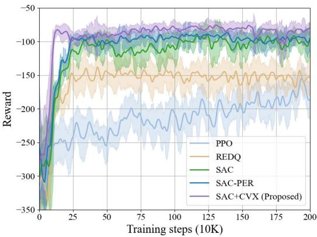  
(a)

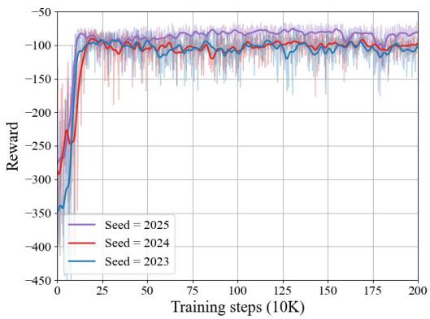  
(b)  
Fig. 4. Performance of the proposed algorithm, where I = 10 and $J = 3 .$ (a) Convergence of the proposed algorithm with three baseline algorithms. (b) Performance of the proposed algorithm under diferent seeds.

## B. Performance Evaluation

1) Convergence: The convergence performance of the proposed algorithm is shown in Fig. 4(a) compared with other benchmark methods. Clearly, all algorithms show a consistent increase in rewards as training iterations progress, highlighting the efectiveness of DRL. Notably, the $\mathrm { S A C + C V X }$ performs a faster convergence rate and achieves higher rewards. Furthermore, REDQ converges more slowly and achieves only moderate rewards, primarily due to its conservative Q-value estimation strategy, which limits its responsiveness to dynamic environments. PPO fails to converge and performs significant fluctuation. This lack of convergence stems from its tendency to get stuck in local optima in complex environments, where it struggles to explore the full action space.

Fig. 4(b) illustrates the performance of the proposed algorithm under three diferent random seeds. It can be seen that after suficient training, the algorithm consistently achieves good convergence and stable performance across diferent seed settings. Although initial exploration varies due to randomness, the algorithm reliably produces consistent results, demonstrating strong robustness to random initialization across scenarios.

2) Performance Comparison Among Diferent Algorithms: Fig. 5 shows that weighted energy consumption grows approximately linearly with the number of users, and error bars verify the statistical reliability of all algorithms. SAC+CVX maintains the gentlest slope via its entropy-regularized policy to sustain high exploration, and a convex subroutine for dynamic closed-form resource reallocation per time slot. While SAC-PER improves the sample eficiency and convergence over vanilla SAC with PER, it lacks CO-based dynamic resource tuning, leading to slightly higher energy consumption than SAC+CVX. By contrast, PPO sufers from high variance due to clipped policy updates, and REDQ faces premature convergence from conservative ensemble Q-averaging.

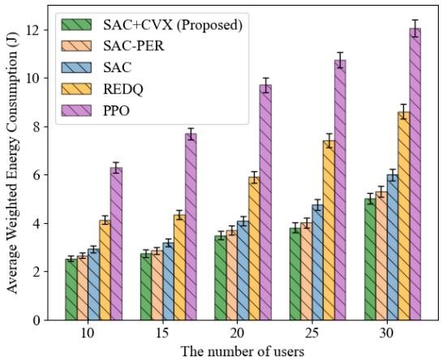  
Fig. 5. Comparison of performance across diferent numbers of users, where J = 3.

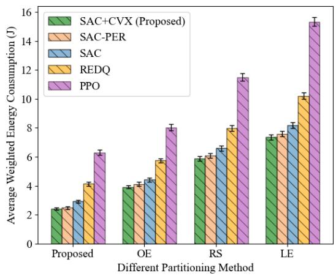  
Fig. 6. Average weighted energy consumption comparison of diferent partitioning methods under four diferent algorithms, where I = 10 and $J = 3 .$

Fig. 6 shows the comparison of the average weighted energy consumption of the four algorithms across diferent splitting methods, with error bars indicating the standard error of repeated experiments to confirm the statistical reliability. The results show that our proposed splitting strategy outperforms others regardless of the algorithm. LE has the highest energy consumption due to low user computing eficiency, RS fails to adapt to dynamic load changes, and OE incurs high communication energy costs from large data transmission. In addition, nonlearning-based partitioning strategies are less optimal than learning-based ones, and SAC+CVX achieves the lowest energy consumption among all algorithms.

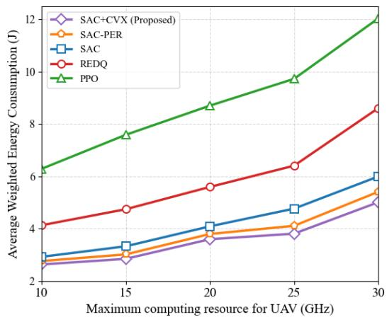  
Fig. 7. Comparison of performance across diferent maximum computing resources of UAVs, where I = 10 and J = 3.

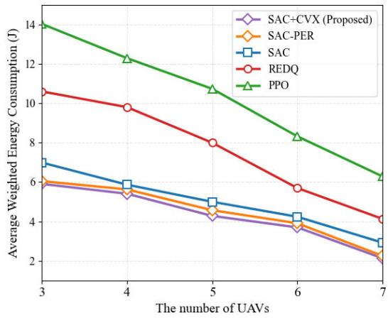  
Fig. 8. Comparison of performance across diferent numbers of UAVs, where I = 10.

Fig. 7 shows the comparison of the average weighted energy consumption across diferent maximum UAV computing resources. Results show that the energy consumption of all algorithms increases with more available UAV computing resources, as users ofload more DNN tasks to UAVs, and this raises edge processing and transmission energy. The proposed algorithm efectively controls energy consumption under varying resource conditions, highlighting its strengths in resource management and energy optimization.

Fig. 8 shows the comparison of weighted energy consumption across diferent numbers of UAVs. As the number of UAVs increases, the average weighted energy consumption decreases. Additional UAVs provide more distributed computing resources, alleviate load pressure, and improve load balancing, reducing overall system energy cost. While the performance gap between SAC+CVX and other schemes narrows, SAC+CVX consistently outperforms benchmarks, highlighting the proposed algorithm’s efectiveness in system performance optimization.

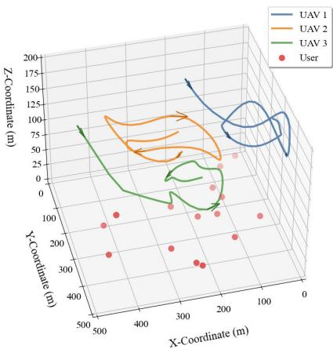

Fig. 9. UAV flight 3-D trajectories with I = 15 and $J = 3 .$  
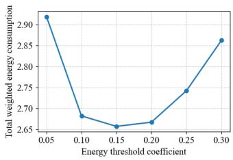  
(a)

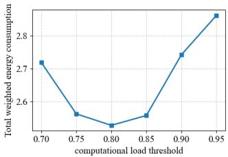  
(b)  
Fig. 10. Sensitivity analysis of migration thresholds, where $I = 1 0$ and $J = 3 .$

3) Trajectory: Fig. 9 illustrates the 3-D flight trajectories of UAVs. During task execution, UAVs dynamically adjust their trajectories according to the spatial distribution of users, actively approaching user-dense areas to perform tasks, which efectively improve the service coverage and resource utilization. To reduce unnecessary flight energy consumption, the UAVs gradually decrease their flight speed after reaching relatively balanced service regions, thereby conserving energy and stabilizing task execution. By jointly optimizing horizontal movement and altitude control, UAVs adapt to the urgency and density of user tasks, enabling eficient sensing, precise positioning, and collaborative coverage.

## C. Sensitivity Analysis of Migration Thresholds

In the proposed framework, task migration is triggered when the remaining energy of a UAV falls below a predefined threshold or its computational load exceeds a certain level. These thresholds balance system stability and resource utilization, so we conduct a sensitivity analysis on the energy threshold coeficient $\mu _ { 1 }$ and the computational load threshold $\rho _ { \mathrm { t h } }$ . Specifically, $\mu _ { 1 }$ defines the battery fraction below which migration starts, while $\rho _ { \mathrm { t h } }$ sets the maximum allowable computational utilization. In experiments, $\mu _ { 1 }$ ranges from 0.05 to 0.30, and $\rho _ { \mathrm { t h } }$ from 0.7 to 0.95.

Fig. 10(a) illustrates that a small $\mu _ { 1 }$ delays task migration, risking energy ineficiency and instability, while an overly large $\mu _ { 1 }$ triggers premature migration and extra communication overhead. Fig. 10(b) reveals that a small $\rho _ { \mathrm { t h } }$ causes unnecessary migration and transmission overhead, whereas a large $\rho _ { \mathrm { t h } }$ leads to heavy UAV load and higher processing energy. Simulation results show stable performance when $\mu _ { 1 } \in [ 0 . 1 , 0 . 2 ]$ and $\rho _ { \mathrm { t h } } \in [ 0 . 7 5 , 0 . 8 5 ]$ . Thus, we adopt $\mu _ { 1 } = 0 . 1 5$ and $\rho _ { \mathrm { t h } } ~ = ~ 0 . 8$ as default settings, achieving a good tradeof between migration stability and energy eficiency.

## V. CONCLUSION

In this article, we have proposed a collaborative DNNbased task partitioning and ofloading optimization method for DNN inference in multi-UAV-assisted MEC systems under complex and dynamic scenarios. A flexible DNN partitioning mechanism has been introduced to divide the model into local and aerial edge components, thereby improving overall computational eficiency. To address UAV load imbalance and energy constraints, a task migration strategy has been designed to enable dynamic coordination and load balancing among UAVs. By jointly optimizing key variables such as user–UAV association, DNN partitioning, computing resource allocation, task migration, and UAV trajectory, a weighted energy minimization model has been constructed and formulated as an MDP. Accordingly, the SAC-PER algorithm combined with CO approach has been developed to eficiently solve the joint optimization problem. Simulation results have demonstrated that the proposed method outperforms existing baselines in terms of energy eficiency and convergence speed. Future research will focus on robustness-aware optimization for dynamic user demands and communication uncertainties to enhance practical system stability.

## REFERENCES

[1] P. Li, Y. Wang, Z. Wang, T. Wang, and J. Cheng, “Joint task ofloading and resource allocation strategy for hybrid MEC-enabled LEO satellite networks: A hierarchical game approach,” IEEE Trans. Commun., vol. 73, no. 5, pp. 3150–3166, May 2025.

[2] K. Zhang, W. Luo, Y. Zhong, L. Ma, W. Liu, and H. Li, “Adversarial spatio-temporal learning for video deblurring,” IEEE Trans. Image Process., vol. 28, no. 1, pp. 291–301, Jan. 2019.

[3] H. Zhang, H. Wang, Y. Li, K. Long, and A. Nallanathan, “DRL-driven dynamic resource allocation for task-oriented semantic communication,” IEEE Trans. Commun., vol. 71, no. 7, pp. 3992–4004, Jul. 2023.

[4] J. Cui, Y. Liu, and A. Nallanathan, “Multi-agent reinforcement learningbased resource allocation for UAV networks,” IEEE Trans. Wireless Commun., vol. 19, no. 2, pp. 729–743, Feb. 2020.

[5] C. Lv et al., “A focal quotient gradient system method for deep neural network training,” Appl. Soft Comput., vol. 184, Dec. 2025, Art. no. 113704.

[6] J. Yoon, Y. Byeon, J. Kim, and H. Lee, “EdgePipe: Tailoring pipeline parallelism with deep neural networks for volatile wireless edge devices,” IEEE Internet Things J., vol. 9, no. 14, pp. 11633–11647, Jul. 2022.

[7] L. Dong, F. Jiang, M. Wang, Y. Peng, and X. Li, “Deep progressive reinforcement learning-based flexible resource scheduling framework for IRS and UAV-assisted MEC system,” IEEE Trans. Neural Netw. Learn. Syst., vol. 36, no. 2, pp. 2314–2326, Feb. 2025.

[8] M. Zhao, R. Zhang, Z. He, and K. Li, “Joint optimization of trajectory, ofloading, caching, and migration for UAV-assisted MEC,” IEEE Trans. Mobile Comput., vol. 24, no. 3, pp. 1981–1998, Mar. 2025.

[9] C. Wang et al., “Covert communication assisted by UAV-IRS,” IEEE Trans. Commun., vol. 71, no. 1, pp. 357–369, Jan. 2023.

[10] X. Diao, W. Yang, L. Yang, and Y. Cai, “UAV-relaying-assisted multiaccess edge computing with multi-antenna base station: Ofloading and scheduling optimization,” IEEE Trans. Veh. Technol., vol. 70, no. 9, pp. 9495–9509, Sep. 2021.

[11] M. Gao, R. Shen, L. Shi, W. Qi, J. Li, and Y. Li, “Task partitioning and ofloading in DNN-task enabled mobile edge computing networks,” IEEE Trans. Mobile Comput., vol. 22, no. 4, pp. 2435–2445, Apr. 2023.

[12] S. Hwang, H. Lee, M. Kim, and I. Lee, “Multiagent deep reinforcement learning for decentralized multi-UAV mobile edge computing networks,” IEEE Internet Things J., vol. 12, no. 10, pp. 14484–14497, May 2025.

[13] Y. Chen, M. Liu, B. Ai, Y. Wang, and S. Sun, “Adaptive bitrate video caching in UAV-assisted MEC networks based on distributionally robust optimization,” IEEE Trans. Mobile Comput., vol. 23, no. 5, pp. 5245–5259, May 2024.

[14] G. Sun et al., “Multi-objective optimization for multi-UAV-assisted mobile edge computing,” IEEE Trans. Mobile Comput., vol. 23, no. 12, pp. 14803–14820, Dec. 2024.

[15] D. Yang, C. Zhan, Y. Yang, H. Yan, and W. Liu, “Integrating UAVs and D2D communication for MEC network: A collaborative approach to caching and computation,” IEEE Trans. Veh. Technol., vol. 74, no. 6, pp. 10041–10046, Jun. 2025.

[16] S. Peng et al., “APT-SAT: An adaptive DNN partitioning and task ofloading framework within collaborative satellite computing environments,” IEEE Trans. Netw. Sci. Eng., vol. 13, pp. 597–610, 2026.

[17] C. Deng, X. Fang, and X. Wang, “Integrated sensing, communication, and computation with adaptive DNN splitting in multi-UAV networks,” IEEE Trans. Wireless Commun., vol. 23, no. 11, pp. 17429–17445, Nov. 2024.

[18] Z. Liu et al., “DNN partitioning, task ofloading, and resource allocation in dynamic vehicular networks: A Lyapunov-guided difusion-based reinforcement learning approach,” IEEE Trans. Mobile Comput., vol. 24, no. 3, pp. 1945–1962, Mar. 2025.

[19] Y. Wu, J. Wu, M. Yao, B. Liu, L. Chen, and S. K. Lam, “Twolevel scheduling algorithms for deep neural network inference in vehicular networks,” IEEE Trans. Intell. Transp. Syst., vol. 24, no. 9, pp. 9324–9343, Sep. 2023.

[20] Q. Wang, X. Chen, and Q. Qi, “Task-driven robust integration of communication and computation for edge-intelligent networks,” IEEE Trans. Commun., vol. 71, no. 1, pp. 244–255, Jan. 2023.

[21] A. Krizhevsky, I. Sutskever, and G. E. Hinton, “ImageNet classification with deep convolutional neural networks,” Commun. ACM, vol. 60, no. 6, pp. 84–90, May 2017.

[22] K. Simonyan and A. Zisserman, “Very deep convolutional networks for large-scale image recognition,” 2014, arXiv:1409.1556.

[23] T. Mohammed, C. Joe-Wong, R. Babbar, and M. D. Francesco, “Distributed inference acceleration with adaptive DNN partitioning and ofloading,” in Proc. IEEE Conf. Comput. Commun. (INFOCOM), Paris, France, Jul. 2020, pp. 854–863.

[24] K. Liu, C. Liu, G. Yan, V. C. S. Lee, and J. Cao, “Accelerating DNN inference with reliability guarantee in vehicular edge computing,” IEEE/ACM Trans. Netw., vol. 31, no. 6, pp. 3238–3253, Dec. 2023.

[25] B. Li, R. Yang, L. Liu, J. Wang, N. Zhang, and M. Dong, “Robust computation ofloading and trajectory optimization for multi-UAV-assisted MEC: A multiagent DRL approach,” IEEE Internet Things J., vol. 11, no. 3, pp. 4775–4786, Feb. 2024.

[26] B. Li, W. Liu, W. Xie, N. Zhang, and Y. Zhang, “Adaptive digital twin for UAV-assisted integrated sensing, communication, and computation networks,” IEEE Trans. Green Commun. Netw., vol. 7, no. 4, pp. 1996–2009, Dec. 2023.

[27] S. Peng, B. Li, L. Liu, Z. Fei, and D. Niyato, “Trajectory design and resource allocation for multi-UAV-assisted sensing, communication, and edge computing integration,” IEEE Trans. Commun., vol. 73, no. 4, pp. 2847–2861, Apr. 2025.

[28] C. Kim, H.-H. Choi, and K. Lee, “Joint optimization of trajectory and resource allocation for multi-UAV-enabled wireless-powered communication networks,” IEEE Trans. Commun., vol. 72, no. 9, pp. 5752–5764, Sep. 2024.

[29] D. Yang, B. Li, and D. Niyato, “Energy-aware task ofloading for rotatable STAR-RIS-enhanced mobile edge computing systems,” IEEE Internet Things J., vol. 12, no. 12, pp. 20239–20250, Jun. 2025.

[30] B. Li, X. Zhu, and J. Wang, “Robust trajectory design and task scheduling with data compression in industrial Internet of Things assisted by UAV,” IEEE Internet Things J., vol. 12, no. 9, pp. 12501–12511, May 2025.

[31] Y. Wang, J. Farooq, H. Ghazzai, and G. Setti, “Joint positioning and computation ofloading in multi-UAV MEC for low latency applications: A proximal policy optimization approach,” IEEE Trans. Mobile Comput., vol. 24, no. 10, pp. 9584–9598, Oct. 2025.


Shuman Meng received the B.S. degree from Dalian Jiaotong University, Dalian, China, in 2024, where she is currently pursuing the M.S. degree with the School of Computer Science, Nanjing University of Information Science and Technology, Nanjing, China.

Her research interests include DNN partitioning and integrated sensing and communication.


Bin Li (Member, IEEE) received the Ph.D. degree from Beijing Institute of Technology, Beijing, China, in 2019.

From 2013 to 2014, he was a Research Assistant with The Hong Kong Polytechnic University, Hong Kong, China. From 2017 to 2018, he was a Visiting Ph.D. Student with the University of Oslo, Oslo, Norway. In 2019, he joined Nanjing University of Information Science and Technology, Nanjing, China. His research interests include UAV communications, reconfigurable intelligent surface, and mobile edge computing.

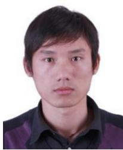

Zhao Yi (Member, IEEE) received the Ph.D. degree in information and communication engineering from Beijing University of Posts and Telecommunications (BUPT), Beijing, China, in 2021.

He is currently a Lecturer with the School of Electronic Information, Hunan First Normal University, Changsha, China. His current research interests include millimetre-wave wireless communication and massive MIMO techniques.


Lei Liu (Member, IEEE) received the B.Eng. degree in electronic information engineering from Zhengzhou University, Zhengzhou, China, in 2010, and the M.Sc. and Ph.D. degrees in communication and information systems from Xidian University, Xi’an, China, in 2013 and 2019, respectively.

From 2018 to 2019, he was a Visiting Ph.D. Student with the University of Oslo, Oslo, Norway. He is currently an Associate Professor with Guangzhou Institute of Technology, Xidian University. His research interests include intelligent transportation and mobile edge computing.


Zesong Fei (Senior Member, IEEE) received the Ph.D. degree from Beijing Institute of Technology (BIT), Beijing, China, in 2004.

He is currently a Professor with the Research Institute of Communication Technology, BIT. He has authored or co-authored over 200 journals and conference papers. His research interests include wireless communications and signal processing, integrated sensing and communications, UAV communications, intelligent reflecting surface, and channel coding.

Dr. Fei is a fellow of China Institute of Communications. He was a corecipient of the Best Paper Award in WCSP 2012, Chinacom 2012, Chinacom 2013, and PIMRC 2015. He serves as an Associate Editor for the IEEE Open Journal of the Communications Society.