# Efficient Charging Coverage Strategy of UAV Based on Improved Deep Reinforcement Learning

Haixu Ma , Wenbo Liu , Guang Yang , Huihui Sun , Dongming Qu , and Hongfei Yang

Abstract—Unmanned aerial vehicles (UAVs) as flight service platform are promising to deliver continuous required coverage to target users through efficient charging strategies. The agility-andresilience of UAVs allow them to be rapidly assigned in accordance with mobile user status and charging strategies that require energyefficient scheduling without compromising the current quality of service. However, as the limited coverage radius and endurance, efficiently scheduling multi-UAVs to adaptively charge, considering service fairness, and minimizing the replacement consumption of UAVs is difficult. Therefore, a multi-objective charging coverage problem is designed to address these factors, which involves the constrained Pareto dominance principle. Subsequently, an assisted deep reinforcement learning model based on the survival incentive (ADRL-SI) is proposed to adaptively charge UAVs while taking into account user fairness and energy-efficient deployment. ADRL-SI adopts a multi-objective particle swarm optimisation approach to assist different agents in learning. The survival incentive mechanism is responsible for securing the UAVs with minimum residual energy. Finally, simulation results display that the proposed ADRL-SI is more advantage than current DRL-based methods in the matter of user service level, UAV energy efficiency, adaptive charging security, and system convergence.

Index Terms—Deep reinforcement learning, UAV intelligent control, assisted learning, survival incentive, charging strategy.

## I. INTRODUCTION

various scenarios has grown tremendously over the last few decades. Airborne base stations mounted on UAVs (UAV-BSs) can be dispatched to serve moving user equipment (UE) in a target region without efficient network coverage [1], [2]. For example, UAVs provide long-term, efficient communications coverage for post-disaster rescue members through energyefficient deployments [3]. Despite the high agility-and-resilience of UAV coverage, their quantity and onboard energy are limited; therefore, some researchers have explored the issue of energy replenishment during mission execution [4], [5]. However, adaptive charging coverage that considers on-demand service quality (user fairness) is difficult because it involves charging scheduling strategies [6], [7] for UAVs, and on-demand service quality [8], [9] for users. Therefore, in this study, an efficient ondemand coverage system that considers the adaptive movement of UAVs with low residual energy towards charging stations, while considering service fairness, was investigated.

With the increasing trend of UAV applications, it has been observed that the primary factor restricting service performance is the limited onboard power [10], [11]. A major challenge is determining how UAVs can efficiently replenish power to maintain mission operations. Related studies have proposed charging methods, such as tethered charging, wireless charging, and round-trip charging stations. Although tethered charging can provide a continuous source of energy for UAVs through cables, the deployment range of the UAVs is limited by the rope length [12]. To address the issue of restricted UAV movement, many researchers have presented wireless charging solutions, such as wireless RF charging [13], solar charging [14], and laser charging [15]. However, wireless charging solutions are severely constrained by the environment and charging is unstable. Therefore, round-trip charging stations are relatively reliable for replenishing energy. However, multi-UAV action decision-making is difficult to provide persistent efficient coverage. The authors of [16] formulated an energy-saving recharging scheduling problem that aims to decrease the total flight distance of UAVs while taking into account quality of service constraints. When the UAV meets the charging requirements, it flies directly to the charging station and then returns to its original position to continue the service. A UAV interrupting the current service to access the charging station necessarily degrades the performance of the coverage network and quality of service.

In addition, deploying a new UAV to replace an old one with less energy is bound to waste flight process energy. Therefore, an efficient charging strategy requires no interruption of current services and minimum replacement consumption. To provide uninterrupted on-demand services to users, the authors of [17] proposed an approach that jointly optimizes the charging trajectories and resource allocation to maximize the achievable throughput to users. However, minimum replacement consumption and maximum service fairness have not been explored. The authors of [18] propose a fair 3D UAV scheduling method with recharging, which takes into account issues of replacement consumption and service fairness. The objective reward function is positively related to the amount of UAV residual energy. It exists three issues: first, it causes UAVs to move near a charging station; second, it enable UAVs to have too much residual energy; and third, it reduces the quality of the on-demand service (user fairness). The aim of UAVs is to improve the quality of service, while the residual energy is only needed to maintain normal operations. In summary, adaptive charging (uninterrupted service and minimum replacement consumption) and service fairness have not been jointly explored.

Deep Reinforcement Learning (DRL) performs well in solving the above problems for intelligent planning tasks. The traditional DRLs are applicable to low-dimensional state spaces. In high-dimensional state spaces, learning efficiency inevitably decreases because of the relatively limited environmental experience. To address the slow convergence and inefficiency of traditional learning models, several studies have discussed the use of related algorithms to assist model learning [19]. The authors of [20] presented a multi-UAV DRL algorithm based on a greedy model to guarantee that information-gathering tasks are accomplished. In [21], the authors initialized the DRL model using a genetic algorithm and presented a mechanism for learning high-quality experience. The authors of [22] trained the weights of a deep Q network (DQN) using the global search means of particle swarm optimisation (PSO) algorithm, and the trial results demonstrated that the PSO-based DQN model effectively improves the system convergence. Although the intelligent deployment of multi-UAVs in multi-dimensional spaces has been explored by some researchers [23], the learning models are still biased owing to the poor quality ofexperience. In our previous study [24], we proposed an assisted DRL algorithm (ADRL) based on an improved multi-objective PSO algorithm with Pareto constraints, and the simulation results proved that its convergence and decision performance were better than those of other popular algorithms. However, the ADRL algorithm does not have a forced charging incentive mechanism, making it difficult for UAVs to obtain charging experience. Consequently, UAVs are unlikely to provide efficient and sustainable services to users.

In our previous study, we showed that swarm intelligence support algorithms (MOPSO) can effectively support agents in generating high-quality experience, improve the learning efficiency of DRL models, and allow agents to make efficient action decisions. However, it is still difficult to control agents to perform goal-directed operations in high-dimensional spaces. The agents deliberately moves towards the charging station without affecting the current quality of service. Simultaneously, a mandatory minimum energy constraint (called the survival incentive, SI) must be set, that is, mandatory movement towards the charging station when the energy of UAVs is below a certain threshold. In other words, the SI plays the role of safety fault diagnosis and assisted learning [24]. The SI can diagnose safety faults, assist UAVs in decision-making for return journeys, and generate charging experiences. The charging scheme is adaptive scheduling, which is manifested by low residual energy moving toward the charging station and high residual energy serving marginal users. Consider replacing the UAV near the charging station to minimize the energy consumption of the replacement routes. To our knowledge, there has been no work on adaptive charging and service fairness for the UAVs using DRL algorithms with the SI mechanism. In this study, we formulate an adaptive charging scheduling strategy for UAVs considering service fairness, and propose an ADRL-SI algorithm with the SI mechanism. The ADRL-SI method is based on the ADRL that we have already proposed, and its SI mainly deals with the problem that the UAVs with low residual energy cannot return safely. The primary contributions of this study are summarized in the following five aspects:

A charging index for adaptive scheduling and deployment of UAVs is proposed to satisfy the service requirements of continuity, security and energy efficiency. As the core of the charging strategy, this index dynamically adjusts UAVs with relatively high remaining energy to move away from the charging station, and vice versa.

An improved ADRL-based multi-objective multi-agent cooperative charging service method involving Pareto dominance principle is proposed. It is formulated to dynamically adapt charging scheduling for on-demand services while taking into account user fairness and not interrupting the current service.

An assisted reinforcement learning module based on particle swarm optimization algorithm in adaptive charging deployment is designed to fine-tune the current reinforcement learning training strategy and assist the agent in generating high-quality experience for model training.

\- An ADRL-SI method considering the SI mechanism is proposed to motivate UAVs to generate charging scheduling experience and secure UAV charging as well as improve the quality of experience to accelerate model convergence. We explicitly design the state, action and reward of the agent in the charging deployment.

\- A number of parametric indicators such as user scores, service fairness, energy efficiency, charging index and convergence are evaluated. The results prove that the current popular DRL methods are inferior to the proposed ADRL-SI.

The subsequent sections of this paper are arranged as follows. Related work on UAV energy replenishment is reviewed in Section II. The basic model of coverage system is presented and the efficient charging problem is formulated in Section III. The preparatory knowledge of DRL and ADRL is introduced in Section IV. The proposed ADRL-SI method is elaborated in Section V. Simulation settings and analyses results are discussed in Section VI. Finally, the conclusion and outlook are carried out in Section VII.

## II. RELATED WORK

Recently, a number of studies have been carried out on the charging deployments for UAVs. A proper charging strategy meets specific task requirements and improves the system’s quality of service. Charging issues fall into three categories: tether deployment, wireless charging, and round-trip charging.

Several studies have proposed a tethered UAV as a viable alternative to provide uninterrupted service, where a UAV is connected to ground stations (GS) via a cable for power and data support [25]. At the cost of limited mobility, tethered UAVs can be a scheme to the problems of limited on-board energy and restricted backhaul link capacity. To extend the lifespan of the UAV, the authors of [26] proposed a cyclic iterative algorithm to maximize the system throughput while optimizing the resource scheduling, user contact, position of the ground charging station (GCS), and UAVs. In [27], the authors proposed an intermittently tethered UAV that balances the power availability of a tethered UAV with the flexibility of an untethered UAV. The results of the case study showed that the system balances performance and cost.

Given the limited movement of tethered UAVs, UAV wireless charging has flexible mobility, for example, charging modes based on radio frequency [28], lasers [29], and solar energy [30]. The authors of [31] proposed a wireless energy transfer algorithm that utilizes a dispatcher UAV to collect solar energy and share its energy with a following UAV using RF-based power transfer via beamforming. In [32], the authors proposed an interference-free wireless rechargeable UAV network model and introduced wireless static chargers (WSCs), which aims to minimize energy wastage in WSCs without the UAV running out of energy. The authors of [33] proposed a DRL-based two-stage alternating optimization algorithm that jointly considers the laser charging time allocation, computational task scheduling and trajectory planning of UAVs to provide efficient mobile edge computing services for mobile devices in metaverse applications. In [34], the authors formulated a wireless rechargeable sensor network problem that maximizes the number of sensor nodes that can receive sufficient energy and upload data by optimizing the trajectory of a laser-based rechargeable UAV.

As wireless charging is significantly affected by distance constraints (e.g., radio frequency) and the environment (e.g., solar energy), the most reliable solution is to plan a reasonable path to and from the charging station for energy supply [35], [36], [37]. In [38], the authors proposed a two-phase joint UAV deployment and a cyclic UAV recharging and reshuffling method that can provide energy-efficient seamless long-term information coverage. This scheme features real-time coverage of fixed target points and requires sufficient UAV support; however, it focuses on fixed target locations and ignores mobile user requirements. In [39], an efficient trajectory planning scheme for UAV networks was proposed while considering system throughput, energy consumption, and coverage fairness. If the residual energy of UAVs is less than a warning threshold, it returns directly to the charging station for energy replenishment. However, a direct flight to the charging station destroys the current coverage performance.

In addition, some researchers have explored issues regarding mobile charging stations (CSs) and charging station placements. The authors of [40] propose an on-demand mobile and recharging scheme for UAVs that utilizes ground vehicles equipped with wireless power transfer facilities. Simulations confirmed that the proposed scheme were better than other methods in the matter of energy efficiency and utility of UAVs. The authors of [41] utilized unmanned ground vehicles (UGVs) to recharge UAVs in the Internet ofThings (IoT), and proposed a DRL-based trajectory optimization method for UGVs and UAVs that jointly reduces the energy consumption, and decreases the age of information (AoI) of IoT devices. In [42], the authors formulated a joint optimization problem aimed at minimizing the AoI of IoT devices by deploying a set of CSs to potential sites and designing the UAV trajectory for data collection and energy replenishment. However, charging stations are difficult to deploy to any location on demand, so UAVs inevitably return to charging stations.

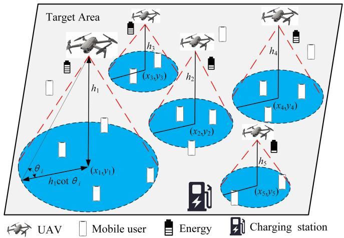  
Fig. 1. Coverage scenarios for UAV charging deployments.

Considering the problems with the above charging methods, UAV charging lacks energy-efficient scheduling to supplement energy without affecting the current service quality. The intelligent control industry has paid extensive attention to DRL [18], [19], [20], [21], [22], [23], [24]. Relevant research has proven that reinforcement learning (RL) can solve numerous UAV charging problems. Despite the remarkable success of DRL in some charging deployments, its applicability and effectiveness in UAV charging strategies remains unexplored.

## III. SYSTEM MODEL AND PROBLEM FORMULATION

Multiple UAV-BSs enable adaptive charging deployment to provide persistent service to users in the target area. We design the system, coverage and energy models that are the preliminaries of coverage deployment. Subsequently, the problem formulation of efficient charging coverage is presented.

## A. System Model

We consider a network of N UAVs that provide on-demand service to M mobile UE in a 2D target area through adaptive charging, as shown in Fig. 1. Let $P = \{ p _ { i } , \dotsc , p _ { N } \}$ be a set of UAVs position, where $p _ { i } ( p _ { i x } , p _ { i y } , p _ { i z } )$ is the position of UAV i $( 1 \leq i \leq N )$ . Let $b _ { m } ( b _ { m x } , b _ { m y } )$ is the position of UE m $( \mathrm { U E } _ { m } , 1 \le m \le M )$ . The UAV is assumed to be able to sense position information, coverage status and energy consumption. The coverage task runs for T time-slots, and $T ^ { \prime }$ is the current elapsed time-slots. As a limited magnitude of UAVs may not service all UE simultaneously, the coverage performance is expressed through the fairness index. The charging station $S ( s _ { x } , s _ { y } , s _ { z } )$ is located at any location in the target area. The

UAV has a coverage radius of $R = { \xi \cdot p _ { z } }$ (ξ is a factor), a deployment altitude interval of $[ f _ { l } , f _ { h } ]$ , and a connectivity distance of $2 \cdot f _ { h }$ . The charging coverage of UAVs involves technologies such as real-time communication and energy-efficient relaying, which are beyond the scope ofthis study, and related studies have been better investigated in [43], [44], [45]. This study focuses on the problem of adaptive scheduling strategy and DRL algorithm optimization for the charging coverage.

## B. Coverage Model

If $\mathrm { U E } _ { m }$ is covered, then make $k _ { m } = 1 ;$ otherwise, $k _ { m } = 0$ Fairness is defined as the widely used Jain’s fairness index [46]. The coverage score and fairness index of UE are exhibited as follows:

$$
c _ { m } = \frac { T _ { m } } { T } , m \in \{ 1 , \dots , M \}\tag{1}
$$

$$
f _ { c } = \frac { \left( \sum _ { m = 1 } ^ { M } c _ { m } \right) ^ { 2 } } { M \left( \sum _ { m = 1 } ^ { M } c _ { m } ^ { 2 } \right) }\tag{2}
$$

where $\begin{array} { r } { T _ { m } = \sum _ { t = 1 } ^ { T ^ { \prime } } k _ { m } } \end{array}$ is the coverage time-slots for $\operatorname { U E } _ { m } .$ . It can be observed that $f _ { c } \in [ 0 , 1 ]$

## C. Energy Model

We focus on the mobile energy consumption of UAVs, while the communication and circuit power consumption [16], [18], [47] are beyond the scope of this study. The accurate prediction of energy consumption requires reliable and realistic energy models [48], [49]. The energy consumption of UAVs during deployment caused by natural wind speeds [41] is a complex model. However, this study focuses on the scheduling decisions and algorithm optimization for the charging strategy, so the complexity of the energy model should be attenuated. For simplicity, we use a linear model $\varphi ( \cdot )$ [24], which can be adjusted as actual needed. The model $\varphi ( \cdot )$ is as follows:

$$
\begin{array} { l } { E _ { u p } : E _ { h o r i } : E _ { h o v e } : E _ { d o w n } = \kappa } \\ { \mathrm { s . t . } ~ E _ { h o v e } = w \cdot e _ { u n i t } } \end{array}\tag{3}
$$

where $E _ { u p } , E _ { d o w n }$ , and $E _ { h o r i }$ are unit distance consumption in the upward, downward and horizontal directions, respectively. $E _ { h o v e }$ is unit time-slot consumption for hovering. $e _ { u n i t }$ is unit time-slot consumption. κ and w are the proportional weight.

## D. Problem Formulation

Our goal is to solve the problems of fair coverage, energy conservation and energy recharging without affecting the quality of service. However, charging to and from the charging station interrupts the current service and affects its quality. Moreover, the replacement of low residual UAVs over long distance results in significant consumption. Therefore, energy replenishment must be performed subliminally near the charging station without affecting the quality of service. The charging service of the coverage system is related to the residual energy of UAVs and the distance to charging station. The scheduling index of the adaptive charging strategy is exhibited as follows:

$$
\begin{array} { r l } & { f _ { I } = \sum _ { i = 1 } ^ { N } \left\| { I _ { i } ^ { c } } - { I _ { i } ^ { c } } \right\| _ { 2 } + I _ { i } ^ { c } } \\ & { \mathrm { s . t } \ : \ : I _ { i } ^ { c } = i n d e x [ \cos \theta r t ( \epsilon _ { i } \vert \le i \le N ) ] } \\ & { e _ { i } = E _ { i } - \sum _ { t = 1 } ^ { N } \epsilon ( \Lambda D _ { i } ) } \\ & { I _ { i } ^ { d } = i n d e x [ \sin \theta r t ( \epsilon _ { i } \vert \le i \le N ) ] } \\ & { d _ { i } = \left\| { p _ { i } } - { S } \right\| _ { 2 } } \\ & { I _ { i } ^ { v } = \left( - 1 \right) ^ { \rho } \left. { I _ { i } ^ { c } } - { I _ { i } ^ { d } } \right. } \\ & { \rho = 0 \mathrm { i n f ~ } \left( I _ { i } ^ { d } \le I _ { i } ^ { c } \mathrm { \normalfont ~ A N D } { a _ { i } ^ { d + 1 } } \le { a _ { i } ^ { d } } \right) } \\ & { \mathrm { ~ o p ~ } \left( I _ { i } ^ { d } < I _ { i } ^ { c } \mathrm { \normalfont ~ A N D } { a _ { i } ^ { d + 1 } } < { a _ { i } ^ { d } } \right) } \\ & { e _ { \mathrm { i s e } } ^ { \mathrm { i s e } } ] } \end{array}\tag{4}
$$

where $I _ { i } ^ { e }$ is the index of residual energy ordering of UAV $i . I _ { i } ^ { d }$ is the sorted index of distance of UAV i from the charging station. $e _ { i }$ is the residual energy of $\mathrm { U A V } i . d _ { i }$ is the distance from UAV i to the charging station. $E _ { i }$ is the initial energy of UAV i. sort{·} is an array sorted in ascending order. index[·] is the UAV index. $| \cdot |$ is the absolute value.  ·  is the Euclidean paradigm. $\triangle D _ { i }$ is the distance travelled by UAV i during each time-slot.

The proposed objective function is expressed as follows:

$$
\begin{array} { r l } & { P ^ { * } = \arg \operatorname* { m a x } _ { \boldsymbol { P } } ~ { \boldsymbol { F } } } \\ & { } \\ { \mathrm { s . t . } ~ { \boldsymbol { F } } = \frac { f _ { c } \cdot \sum _ { m = 1 } ^ { M } c _ { m } } { M \cdot f _ { I } } } \\ & { } \\ & { n _ { s } = \sum _ { i = 1 } ^ { N } \rho _ { i } = N } \\ & { \rho _ { i } = 1 ~ \mathrm { i f } ~ ( e _ { i } \geq \Upsilon \cdot e _ { i , b a c k } ) ~ \mathrm { e l s e } \ 0 } \end{array}\tag{5}
$$

where $\Upsilon$ is the charge factor to return to the charging station. $n _ { s }$ is the number of safe UAVs. $e _ { i , b a c k }$ is the minimum energy required for the UAV i from its current location to return directly to the charging station.

The control algorithm mainly has the following aspects: 1) it fulfills an adaptive and efficient charging strategy in which low residual energy flows to the charging station and high residual energy serves the marginal user; 2) it considers the service fairness of target region under charging endurance; 3) it ensures energy-efficient replacement deployment of UAVs without interrupting services; and 4) it requires UAV replacement near the charging station to avoid energy consumption during flight. In summary, a new ADRL-SI method is proposed by introducing the SI mechanism based on our previously proposed ADRL method. The purpose of SI is to improve the safety of minimum residual energy UAVs and model convergence (generating charging experience for training).

## IV. PRELIMINARIES

This section provides a brief description of deep deterministic policy gradient (DDPG, a DRL method) [50] and ADRL [24].

Fig. 2 shows the logical structure of RL. The agents perceive state $s _ { t } ,$ take action $a _ { t } .$ , and feed back to the environment to obtain reward $r _ { t }$ and next state $s _ { t + 1 }$ . DDPG is a model free off-policy actor-critic DRL algorithm, which consists of actor neural network, critic neural network and experience replay buffer, as shown in Fig. 3. At each epoch t, the centralized agent receives the reward $R _ { t } ( r _ { t } ^ { 1 } , \ldots , r _ { t } ^ { n } )$ corresponding to the current policy action $A _ { t } ( a _ { t } ^ { 1 } , \ldots , a _ { t } ^ { n } )$ , current state $S _ { t } ( s _ { t } ^ { 1 } , \ldots , s _ { t } ^ { n } )$ , and next state $S _ { t + 1 } ( s _ { t + 1 } ^ { 1 } , \ldots , s _ { t + 1 } ^ { n } )$ . The actor network contains evaluated network (eval\_net) $\pi ( s \mid \theta ^ { \pi } ) ~ ( \theta ^ { \pi }$ is parameter) and target network (target\_net) $\pi ^ { \prime } ( s \mid \bar { \theta ^ { \pi ^ { \prime } } } ) \stackrel { \cdot }  ( \theta ^ { \pi ^ { \prime } }$ is parameter) with the same structure, and the Critic network contains evaluated network (eval\_net) $Q \big ( s , a \ \big | \ \theta ^ { Q } \big ) ( \theta ^ { Q } $ is parameter) and target network (target\_net) $Q ^ { \prime } ( s , a \mid \theta ^ { Q ^ { \prime } } ) ( \theta ^ { Q ^ { \prime } }$ is weight vector) with the same structure. Fig. 4 depicts the evaluated network for DDPG, where specifies the current policy by deterministically mapping states to specific actions, and denotes the current state-action value (Q value).

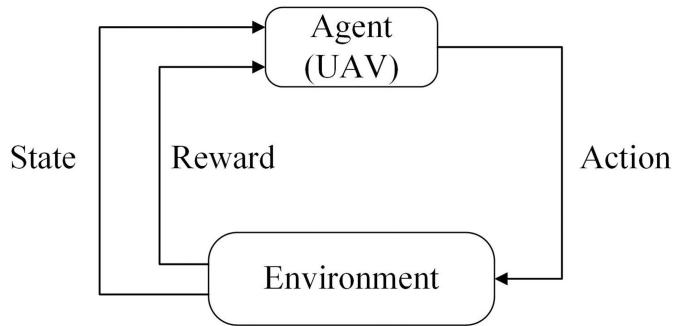  
Fig. 2. Logical structure of RL.

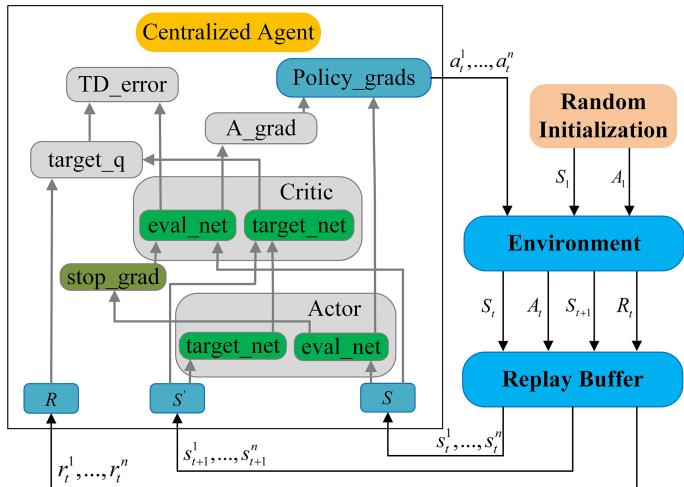  
Fig. 3. Control structure of DDPG.

The purpose of DDPG is to train a state-to-action policy $\pi ( s _ { t } , a _ { t } )$ mapping that maximizes the discounted future cumulative reward $\begin{array} { r } { R _ { t } = \sum _ { t ^ { \prime } = t } ^ { T } \gamma ^ { t ^ { \prime } - t } r ( s _ { t ^ { \prime } } , a _ { t ^ { \prime } } ) } \end{array}$ , where $\gamma \in [ 0 , 1 ]$ is discount factor, and $r ( \cdot )$ is reward function at $t ^ { \prime }$ time-slot.

DDPG approximates the $Q ( \cdot )$ estimation function using neural networks. The discounted cumulative reward can be estimated by $Q ( s _ { t } , a _ { t } \mid \theta ^ { Q } ) , Q ( s _ { t } , a _ { t } \mid \theta ^ { Q } ) = \mathbb { E } [ R _ { t } \mid s _ { t } , a _ { t } ]$ . The DDPG is trained by minimizing the loss function as follows:

$$
L \left( \theta ^ { Q } \right) = \mathbb { E } \left[ y _ { t } - Q \left( s _ { t } , a _ { t } \mid \theta ^ { Q } \right) \right]\tag{6}
$$

where $y _ { t }$ is the $Q$ value of Critic target network.

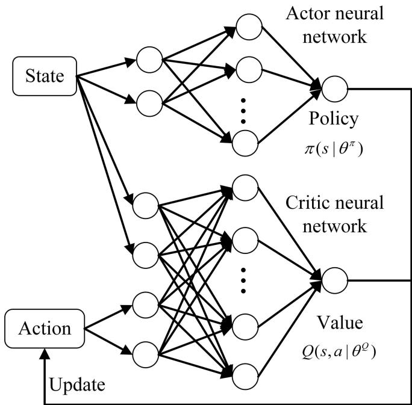  
Fig. 4. Evaluated neural network of DDPG.

Typically, the experience relay is responsible for collecting state transition samples to update the eval\_net weight vector, and the target network is used to estimate the target values and improve learning stability. The $Q$ value of target network can be reckoned as follows:

$$
y _ { t } = r \left( s _ { t } , a _ { t } \right) + \gamma Q ^ { \prime } \left( s _ { t + 1 } , \pi ^ { \prime } \left( s _ { t + 1 } ~ \middle | ~ \theta ^ { \pi ^ { \prime } } \right) \ \middle | ~ \theta ^ { Q ^ { \prime } } \right)\tag{7}
$$

The fundamental manner of DDPG is to update the parameterized actor function $\pi ( s _ { t } , a _ { t } \mid \theta ^ { \pi } )$ and critic function $Q ( s _ { t } , a _ { t } \ |$ $\theta ^ { Q } ) . \ Q ( s _ { t } , a _ { t } \ | \ \theta ^ { Q } )$ can be trained using the $L ( \theta ^ { Q } )$ described above. According to [50], $\pi ( s _ { t } , a _ { t } \mid \theta ^ { \pi } )$ can be updated using the chain rule applied to the cumulative reward J on the actor parameters $\theta ^ { \pi }$ as follows:

$$
\begin{array} { r l } & { \bigtriangledown _ { \theta ^ { \pi } } J \approx \mathbb { E } \left[ \bigtriangledown _ { \theta ^ { \pi } } Q \left( s , a \mid \theta ^ { Q } \right) \mid _ { s = s _ { t } , a = \pi \left( s _ { t } \mid \theta ^ { \pi } \right) } \right] } \\ & { \quad \quad = \mathbb { E } \left[ \bigtriangledown _ { a } Q \left( s , a \mid \theta ^ { Q } \right) \mid _ { s = s _ { t } , a = \pi \left( s _ { t } \right) } \right. } \\ & { \quad \quad \left. \cdot \bigtriangledown _ { \theta ^ { \pi } } \pi \left( s \mid \theta ^ { \pi } \right) \mid _ { s = s _ { t } } \right] } \end{array}\tag{8}
$$

The parameters of the target network is updated as follows:

$$
\theta ^ { Q ^ { \prime } } = \lambda \theta ^ { Q } + ( 1 - \lambda ) \theta ^ { Q ^ { \prime } }\tag{9}
$$

$$
\theta ^ { \pi ^ { \prime } } = \lambda \theta ^ { \pi } + \left( 1 - \lambda \right) \theta ^ { \pi ^ { \prime } }\tag{10}
$$

where λ is the update rate.

Most current RL methods use a random search mechanism, which can result in the inefficient learning of agents in highdimensional spaces. However, the ADRL method can assist in agent learning and improve model training efficiency. As shown in Fig. 5, MOPSO offers an initial learning environment and provides step-by-step (SbS) assistance for the learning process within the ADRL framework. The ADRL method has two additional modules compared with the DDPG method: the MOPSO policy module and the selector module.

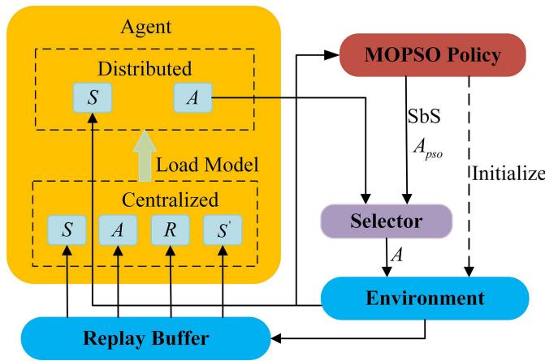  
Fig. 5. Control structure of ADRL.

In the initial phase, the MOPSO policy initializes the environment, and both the distributed agents and the MOPSO policy acquire the state (S) and derive the action (A). The selector chooses one of the two based on a rule, and the selected action acts in the environment. The replay buffer B collects state (S), action (A), reward (R), and next state (S). The centralized agent loads H samples from B for training, and finally loads the trained model into distributed agents. The selector rule is expressed as follows:

$$
\begin{array} { r } { A = \left\{ \begin{array} { l l } { A _ { p s o } , } & { \varpi \mathrm { ~ p r o b a b i l i t y } } \\ { \mathrm { R a n d o m ~ a c t o n } , } & { \varepsilon \left( 1 - \varpi \right) \mathrm { ~ p r o b a b i l i t y } } \\ { \pi \left( s _ { t } \right) + \varpi \cdot \mathcal { N } , } & { \left( 1 - \varepsilon \right) \left( 1 - \varpi \right) \mathrm { ~ p r o b a b i l i t y } } \\ { \mathrm { s . t . } } & { \varpi _ { t + 1 } = \varpi _ { t } \cdot \Gamma , t \in [ 0 , T ] } \end{array} \right. } \end{array}\tag{11}
$$

where $A _ { p s o }$ is the MOPSO action. 	 is the MOPSO action probability (decay factor). ε is the greedy factor of random action. N is Gaussian noise. Γ is the decay coefficient.

Algorithm 1 describes the MOPSO policy in initialization. The MOPSO algorithm constructs an external repository (REP) to reduce the probability of falling into a local optimum and introduces a Pareto optimal criterion to obtain a solution that satisfies the conditions [51]. The Pareto optimal solutions generated by the iterative process are stored in the REP, and the global optimal solution is selected from the REP using roulette wheel. The principle ofPareto optimality is applicable to a multiobjective optimization problem (MOP). The Pareto principle is defined as shown below:

Definition 1: (Pareto Dominance): A vector $\stackrel {  } { u } =$ $( u _ { 1 } , \ldots , u _ { l } )$ dominates $\vec { v } = ( v _ { 1 } , \ldots , v _ { l } )$ (denoted by $\vec { u } \succeq \vec { v } )$ if and only if u is partially more than v, i.e., $\forall i \in \{ 1 , \dots l \} , u _ { i } \geq v _ { i } \wedge \exists i \in \{ 1 , \dots , l \} : u _ { i } > v _ { i }$

Definition 2: (Pareto Optimal Set): For a specified MOP $\vec { \mathcal { f } } ( x )$ , the Pareto optimal set (P∗) is defined as follows:

$$
\mathcal { P } ^ { * } = \left\{ x \in \Omega \vert \neg \exists x ^ { \prime } \in \Omega \overrightarrow { f } ( x ^ { \prime } ) \succeq \overrightarrow { f } ( x ) \right\} .\tag{12}
$$

Definition 3: (Pareto Front): For a specified MOP ${ \vec { f } } \left( x \right)$ and Pareto optimal set ${ \mathcal { P } } ^ { * }$ , the Pareto front (PF∗) is defined as

Algorithm 1: MOPSO   
Input : N, M   
Output: GBEST // optimal particle   
1 for $i = 0 , . . . , N _ { p }$ do // number of particles $N _ { p }$   
2 Initialize $V \bar { E } L [ i ] ;$ $\ H V E L [ i ] \in [ - d _ { m a x } , d _ { m a x } ]$   
3 Initialize $P O P [ i ] ;$   
4 end   
5 Evaluate each particle in the $P O P ;$   
6 Store the non-dominated particles in the $R E P ;$   
7 for $i = 0 , . . . , N _ { p }$ do   
8 $P B E S T S [ i ] = P O P [ i ] ;$   
9 end   
10 while number of cycles $( N _ { c } )$ has not been reached do   
11 GBEST is particle selected in the REP by   
roulette wheel;   
12 for $i = 0 , . . . , N _ { p }$ do   
13 $V E L \left[ i \right] = \dot { \delta } \cdot V E L \left[ i \right] + \zeta \cdot \left( P B E S T S \left[ i \right] - \right.$   
$P O \dot { P } \left[ i \right] ) + \varsigma \cdot ( G \dot { B } \dot { E } S T - P O P \left[ i \right] ) ;$   
14 $P O P \left[ i \right] = P O P \left[ i \right] + V E L \left[ i \right] ;$   
15 Keep $P O P [ i ]$ within the target area;   
16 end   
17 Evaluate each particle in the $P O P ;$   
18 Update the particles of the $R E P ;$   
19 for $U A V i = 1 , . . . , N$ do   
20 if $P O P [ i ]$ is better than PBESTS[i] then   
21 $P B \dot { E } \dot { S } T S [ i ] = P O P [ i ] ;$   
22 end   
23 end   
24 end

follows:

$$
\mathcal { P F } ^ { * } = \left\{ \overrightarrow { u } = \overrightarrow { f } = \left( f _ { 1 } ( x ) , \ldots , f _ { l } ( x ) \right) | x \in \mathcal { P } ^ { * } \right\} .\tag{13}
$$

Definition 4: (Pareto Constraint): For a specified MOP vector ${ \overrightarrow { f } } ( x ) = ( f _ { 1 } ( x ) , \dots , f _ { l } ( x ) )$ , an objective $f _ { i } ( x )$ considers the Pareto dominance if and only if it is not satisfied, ∀i ∈ $\{ 1 , \ldots , l \}$

Algorithm 1 begins by initializing the velocity VEL and position $P O P$ of the particle swarm (lines 1–4). It is assumed that each particle represents the positions of a UAV swarm. In lines 5–6, Evaluate the solutions based on the Pareto constraint (Definition 4) and then store the non-dominated solutions in the REP. Each particle initial solution is recorded as the current particle optimal solution (lines 7–9). Lines 10–24 show the iterative process of MOPSO. Because different particles in REP present different probabilities, the optimal solution is selected by roulette wheel (line 11). Roulette wheel principle: the probability values of different particles are accumulated sequentially, and when the accumulated value exceeds a random number $R _ { n } \ ( 0 \leq R _ { n } \leq 1 )$ , the particle corresponding to the current probability is selected. Update the velocity and position of the particle and maintain the original state if it is outside the search space (lines 12–16). Lines 17–23 are equivalent to lines 5–9. To maintain the capacity of REP, the extra particles are removed using roulette wheel (lines 18). The REP capacity is $N _ { r }$

The MOPSO policy provides the assisted action $A _ { p s o }$ during subsequent deployments. To solve assisted action $A _ { p s o }$ , algorithm 1 is modified in three points as follows:

\- In step 2, modify the random initialization VEL interval to $\begin{array} { r } { \bigl [ \frac { - \hat { d } _ { m a x } } { N _ { d } } , \frac { d _ { m a x } } { N _ { d } } \bigr ] } \end{array}$

\- In step 3, replace the initialized POP with $N _ { p }$ randomly generated position based on the current position of the UAVs, where the random interval is $\big [ \frac { - d _ { m a x } } { N _ { d } } , \frac { d _ { m a x } } { N _ { d } } \big ]$

\- In step 10, modify the number of cycles $N _ { c }$ to $N _ { d }$

## V. PROPOSED ADRL-BASED ALGORITHM: ADRL-SI

This section presents the proposed ADRL-SI algorithm, which is based on both the ADRL method and the SI mechanism. The goal of learning is to enhance the quality of service for users and the performance ofadaptive charge scheduling for the secure and persistent deployment.

In the ADRL-SI algorithm, the centralized agent is the training center, and the distributed agents are the action operators. The details of the basic elements (state, action, and reward) in the ADRL-SI algorithm are as follows:

\- State: For UAV i at time-slot t, its observed state $s _ { t , i } = \{ P _ { t , i } , B _ { t } , E _ { t , i } , f _ { t , c } , f _ { t , I } \}$ . The observed state of UAV i consists of five parts, which are the observed position $P _ { t , i }$ , the state $B _ { t }$ of users, the residual energy $E _ { t , i }$ of UAVs, the fairness index $f _ { t , c } ,$ and the scheduling index $f _ { t , I } . P _ { t , i } = \{ p _ { t , i } , p _ { t , 1 } , \ldots , p _ { t , i - 1 } , p _ { t , i + 1 } , \ldots , p _ { t , N } \}$ $B _ { t } = \{ \left( b _ { t , m x } , b _ { t , m y } , c _ { t , m } \right) \mid \forall m \in [ 1 , M ] \}$ $E _ { t , i } =$ $\{ e _ { t , i } , e _ { t , 1 } , \ldots , e _ { t , i - 1 } , e _ { t , i + 1 } , \ldots , e _ { t , N } \}$

\- Action: For UAV i at time-slot $^ { \cdot \ t , }$ its $a _ { t , i } = \{ \psi _ { t , i } , \phi _ { t , i } , d _ { t , i } \}$ $\psi _ { t , i } \in [ 0 , \pi ]$ and $\phi _ { t , i } \in [ 0 , 2 \pi ]$ are the polar and azimuthal angle of movement, respectively [24]. $d _ { t , i } \in [ 0 , d _ { m a x } ]$ is flight distance and $d _ { m a x }$ is the largest distance. If a UAV crosses the boundary, it remains at its previous position.

\- Reward: As indicated in (5), the reward $\boldsymbol { r } _ { t , i }$ is defined as follows:

$$
{ r _ { t , i } } \mathrm { { = } } \frac { { { f _ { t , c } } \cdot \sum _ { m = 1 } ^ { M } { c _ { t , m } } } } { M \cdot { f _ { t , I } } } - \left( { { I _ { c o n } } + { I _ { b a c k } } + { I _ { o u t } } } \right) \cdot { p } , t \in [ 1 , T ]\tag{14}
$$

where $I _ { c o n }$ is connectivity penalty index. $I _ { b a c k }$ is safety charging penalty index. $I _ { o u t }$ is transboundary penalty index. An index of one denotes a penalty, and zero denotes no penalty. $p$ is the penalty. In addition, the safe distance penalty for UAVs from obstacles has been discussed in detail in [41], which is a complex process and beyond the scope of this study.

To improve the survivability of UAVs with limited onboard power, the SI mechanism is introduced, as shown in Fig. 6. Assuming that MOPSO produces a Pareto-optimal action that prevents the UAV i from safely returning to the charging station, the SI assists in the decision to return and produces charging history experiences. The SI actions are defined as follows:

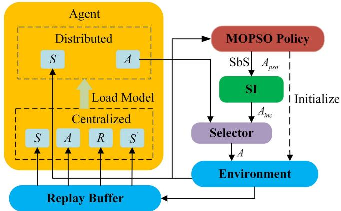  
Fig. 6. Proposed control structure of ADRL-SI.

$$
A _ { i n c } = \left\{ \begin{array} { l l } { A _ { p s o } , } & { e _ { i } \ge \Upsilon \cdot e _ { i , b a c k } } \\ { \vec { V } _ { u n i t } \cdot d _ { m a x } , } & { e _ { i } < \Upsilon \cdot e _ { i , b a c k } } \end{array} \right.\tag{15}
$$

where $A _ { i n c }$ is the action generated by the SI mechanism. $\vec { V }$ is the unit vector of the current UAV pointing toward the charging station.

As mentioned above, ADRL-SI is based on our previously proposed ADRL, the basic concept of which is introduced in Section IV. In MOPSO, objective function $F _ { ; }$ , adaptive charging index $f _ { I }$ and number of safe UAVs $n _ { s }$ are Pareto dominance conditions (Definition 1). The number of safe $\mathrm { U A V s } ~ n _ { s }$ is a Pareto constraint (Definition 4). The purpose of Pareto front is to increase $F$ and decrease $f _ { I }$ . If the condition $( n _ { s } )$ is satisfied, the Pareto dominance conditions are $F$ and $f _ { I }$ . The SI motivates the UAV i to move towards the charging station if the Pareto optimal solution has $e _ { i } < \Upsilon \cdot e _ { i , b a c k } ( n _ { s } < N )$ .

Algorithm 2 describes ADRL-SI in detail. In the beginning, we randomly initialize the parameters and network topologies (lines 1). The state $S _ { 1 }$ is initialized at the start of each episode using MOPSO (line 3). If R is not less than 	 (line 6), then $a _ { t }$ is selected using the ε-greedy mechanism (line 7); otherwise, $a _ { t }$ is selected using the SI mechanism (line 9). The agent executes $a _ { t }$ to observe $s _ { t + 1 }$ and $r _ { t }$ (line 11). An agent should consider issues of connectivity, safe charging, and border crossing; If the rules are broken, it should be punished (lines 12–18). The following steps are updating the neural network (lines 19–26). The replay buffer B stores the collected sample $\left( { { s _ { t } } , { a _ { t } } , { r _ { t } } , { s _ { t + 1 } } } \right)$ into B (line 19). To update the network of actors and critics, B randomly draws $H$ samples for the calculation (line 20). The purpose of minimizing $L ( \theta ^ { Q } )$ is to update critic weights $\theta ^ { Q }$ (6); and the goal of calculating the gradient $\bigtriangledown \theta ^ { \pi } { \cal J }$ is to renew actor weights $\theta ^ { \pi }$ (8) (lines 22–23). The target network parameters $( \theta ^ { Q ^ { \prime } }$ and $\theta ^ { \pi ^ { \prime } } )$ are varied slowly using a ‘soft’ target update technique (lines 24–26). Finally, parameter $\varpi$ is updated (line 28). The time complexity of ADRL-SI adds only one judgement condition (line 9) compared with ADRL [24]; therefore, both have the same time complexity. Overall, the time complexity ofADRL-SI is negligible compared with the time required by DDPG to search for an optimal solution in a high-dimensional complex space.

Algorithm 2: ADRL-SI   
1 Randomly initialize evaluation network $Q$ and π with   
weights $\theta ^ { Q }$ and $\theta ^ { \pi }$ , target network $Q ^ { ' }$ and $\pi ^ { ' }$ with   
weights ${ \theta } ^ { Q ^ { ' } } = { \theta } ^ { Q } , { \theta } ^ { \pi ^ { ' } } = \theta ^ { \pi }$ , and related parameters;   
2 for episode $= 1 , . . . , E p$ do   
3 Initialize a state $S _ { 1 }$ by the MOPSO;   
4 for epoch $t = 1 , . . . , T$ do   
5 // random number $\mathcal { R } \in [ 0 , 1 ]$   
6 if $\mathcal { R } \geq \varpi$ then   
(Random action,   
ε probability   
7 $a _ { t } = \left\{ { \pi \left( s _ { t } \right) } + { \epsilon \mathcal { N } } , \right.$   
$1 - \varepsilon$ probability   
8 else   
LA $e \geq \Upsilon \cdot e _ { b a c k }$   
9 ${ \cal A } _ { i n c } = \left\{ \stackrel { A } { \vec { V } } _ { u n i t } \cdot \right. _ { \textstyle { d } _ { m a x } } ,$   
$e < \Upsilon \cdot e _ { b a c k }$   
10 end   
11 Execute ${ \boldsymbol { a } } _ { t } ,$ and observe $s _ { t + 1 }$ and $r _ { t } ;$   
12 for $\mathrm { U A V } ~ i = 1 , . . . , N$ do   
13 // OR operator |   
14 if $I _ { c o n } \parallel I _ { c o v } \parallel I _ { o u t } = = 1$ then   
15 $\boldsymbol { r } _ { t } = \boldsymbol { r } _ { t } - \left( \boldsymbol { I _ { c o n } } + \boldsymbol { I _ { b a c k } } + \boldsymbol { I _ { o u t } } \right) \cdot \boldsymbol { p } ;$   
16 Maintain original state of UAV i;   
17 end   
18 end   
19 Store sample $\left( { { s _ { t } } , { a _ { t } } , { r _ { t } } , { s _ { t + 1 } } } \right)$ into $\mathbb { B } ;$   
20 Extract H random samples $( s _ { j } , a _ { j } , r _ { j } , s _ { j + 1 } )$   
from B;   
21 $y _ { j } = r _ { j } + \gamma Q ^ { ' } \left( s _ { j + 1 } , \pi ^ { ' } \left( s _ { j + 1 } ~ { \mid \theta ^ { \pi ^ { ' } } } \right) \mid { \theta ^ { Q } } ^ { ' } \right)$   
22 Update weights ${ \bf { \dot { \theta } } } \theta ^ { Q }$ by minimizing loss:   
$\begin{array} { r } { L \left( \theta ^ { Q } \right) = \frac { 1 } { H } \sum _ { j = 1 } ^ { H } \left( y _ { i } - Q \left( s _ { j } , a _ { j } \right) \right) ^ { 2 } ; } \end{array}$   
23 Update weights $\check { \theta } ^ { \pi }$ using: $\bigtriangledown \theta ^ { \pi } { \ } J$ ≈   
$\begin{array} { r } { \frac { 1 } { H } \sum _ { j = 1 } ^ { H } \nabla _ { a } \ L \left( s , a \ | \ \theta ^ { Q } \right) \ | _ { s = s _ { j } , a = \pi ( s _ { j } ) } } \end{array}$   
$\cdot \bigtriangledown \theta ^ { \bar { \pi } } \pi ( s \mid \theta ^ { \pi } ) \mid _ { s = s _ { j } } ;$   
24 Update target network parameters for actor and   
critic:   
25 $\theta ^ { Q ^ { ' } } = \lambda \theta ^ { Q } + ( 1 - \lambda ) \theta ^ { Q ^ { ' } } ; / { / }$ updating rate λ   
26 $\theta ^ { \pi ^ { ' } } = \lambda \theta ^ { \pi } + ( 1 - \lambda ) \theta ^ { \pi ^ { ' } }$   
27 end   
28 $\varpi = \varpi \times \Gamma$   
29 end

## VI. PERFORMANCE EVALUATION

In this section, we first introduce the simulation settings, which consists of parameter settings and comparison methods, and then present the results and analysis.

## A. Simulation Settings

The size of the simulation area is set to a square area with a side length of 200 units. The target area is distributed with two hundred users moving randomly in random directions (forward, backward, left, right) with a unit step size of 0.4. Charging station S is located at the midpoint of either side of square. The maximum initial energy of UAVs is twice the maximum return energy consumption. It is assumed that the UAVs have different initial energies and can fulfil their tasks. The parameters for UAV include: $\kappa = 1 . 4 : 1 . 2 : 1 : 0 . 8 , e _ { u n i t } = 1 , f _ { h } = 4 0 $ units, $f _ { l } =$ 20 units, and $\Upsilon = 1 . 5$ . The parameters for MOPSO include: $\delta = 0 . 6 , \zeta = 0 . 4 , \varsigma = 0 . 4 , N _ { p } = 1 0 0 , N _ { r } = 2 0 0 , N _ { c } = 1 0 0$ and $N _ { d } = 1 0$ . The parameters for DRL include: $E p = 1 0 0 0$ $T = 1 0 0 0 , \varpi = 1 , H = 6 0 0 , \alpha = 0 . 0 0 1 , \gamma = 0 . 9 , \lambda = 0 . 1 , p =$ $1 0 , \varepsilon = 0 . 4 .$ , the size of $\mathbb { B } = 1 0 0 0 , \mathcal { N } \sim ( 0 , 1 0 ^ { - 3 } ) , \Gamma = 0 . 9 9 9$ and $d _ { m a x } = 1$ . The test time-slots for DRL is T. During the testing phase, the survival incentive mechanism was considered to ensure safe charging of the UAV.

A five-layer fully-connected feedforward neural network was used as an actor network and a critic network, respectively. The count of neurons in the middle layer is 400, 200, 100, 64 and 32 in that order. ReLU [52] was used for the activation function. The simulations were run on Tensorflow 2.8 and Python 3.8. In addition, we simulated UAV deployment in ROS (Melodic) and achieved reduced deployment in actual environment.

Four metrics was adopted to assess the performance of ADRL-SI.

\- Average coverage score (c): The score of target user is defined as by (1).

\- Fairness index $( f _ { c } ) \mathrm { : }$ : The Jain fairness index is worked out using (2).

\- Energy efficiency (η): The parameter can be determined as follows [50]:

$$
\eta = { \frac { f _ { c } \cdot { \bar { c } } } { \overline { { E } } } }\tag{16}
$$

where $\overline { E }$ is the average energy consumption of UAVs normalized by $E _ { m a x } . E _ { m a x }$ is the maximum consumption throughout the deployment period.

Number of safe $\mathrm { U A V s } ( n _ { s } ) { \colon }$ The number of UAVs that can safely return to recharge during an endurance flight. ADRL-SI was compared with seven current DRL methods: Assisted Deep Reinforcement Learning (ADRL) [24], Deep Deterministic Policy Gradient (DDPG) [53], Double Deep Q Network (DDQN) [54], Prioritized Experience Replay DQN (PER-DQN) [55], UAV Control policy based on Deep Deterministic Policy Gradient (UC-DDPG) [18], Asynchronous Advantage Actor-Critic (A3C) [56], and Distributed Proximal Policy Optimization (DPPO) [57]. The network parameters of the above methods are consistent. ADRL has initialization and assisted learning steps compared to ADRL-SI but lacks the SI mechanism. There is no initialization, assisted learning steps, or the SI mechanism for the methods other than ADRL. The action space is the same for all methods except DDQN and PER-DQN.

\- ADRL: The method is consistent with ADRL-SI, except for the SI mechanism.

\- DDPG: The model network setup is consistent with ADRL, but DDPG lacks the initialization and assisted learning module.

\- DDQN: The method uses a discrete action space which consists of seven actions: up, down, left, right, forward, backward and hover. For example, [1, 0, 0, 0, 0, 0, 0], which is an upward action.

\- PER-DQN: Batch sampling is based on the priority of the samples in memory. The action space is consistent with DDQN.

\- UC-DDPG: The method is proposed to solve the service problems of persistent UAV coverage. The system reward is as follows:

$$
r _ { t } = \left\{ \begin{array} { l l } { 7 ^ { f _ { t , c } } \cdot \frac { c _ { t , m } } { E _ { t } } + \sum _ { i } ^ { N } U _ { i } } \\ { \cdot 1 0 \left( - \frac { 5 } { 6 } \bar { E } _ { i , t } ^ { 2 } - \frac { 7 } { 6 } \bar { E } _ { i , t } + 1 \right) , } & { \forall E _ { i , t + 1 } > 0 } \\ { - 2 0 , } & { \forall E _ { i , t + 1 } = 0 } \end{array} \right.
$$

$$
{ \mathrm { s . t . } } U _ { i } = { \left\{ \begin{array} { l l } { 1 , } & { { \mathrm { U A V ~ } } i { \mathrm { ~ r e p l e n i s h e d ~ e n e r g y ~ i n ~ } } t } \\ { 0 , } & { { \mathrm { e l s e } } } \end{array} \right. }\tag{17}
$$

where $c _ { t }$ is the total scores of UAVs at time $t , E _ { t }$ is the total residual energy of UAVs at time t. $E _ { i , t }$ and $\overline { { E } } _ { i , t }$ are the residual energy and normalized residual energy of UAV i at time t, respectively. $\begin{array} { r } { \overline { { E } } _ { i , t } = \frac { E _ { i , t } } { E _ { m a x } } } \end{array}$ . Here, $E _ { m a x }$ is the maximum residual energy.

\- A3C: This method is instantiated into four threads, which then train the global actor-critic model independently online.

\- DPPO: The method is basically consistent with A3C, with the difference that DPPO uses samples from all threads to train the global model uniformly.

## B. Result Analysis

We compare and analyze the impact of three parameters (default: coverage range ratio $\xi = 0 . 5 ,$ , energy consumption ratio $w = 1 .$ , and number of UAVs $N = 2 0 )$ on eight methods by means of control variable method. Each parameter corresponds to a scenario that analyses the impact of parameter on average coverage score (c), fairness index $( f _ { c } )$ , energy efficiency (η), and number of safe $\mathrm { U A V s } \left( n _ { s } \right)$ . The $\tau , f _ { c } , \eta .$ , and $n _ { s }$ use the average value of multiple timestamps.

In scenario 1, Fig. 7 shows that $\overline { { c } } , f _ { c } , \eta ,$ and $n _ { s r }$ of all methods vary with ξ during the deployment of UAVs. ADRL-SI is superior to other methods, which is analyzed next for $\xi = 1 . 1$ In Fig. 7(a), ADRL-SI achieves $\overline { { c } } = 0 . 2 9$ , which makes an improvement of 11.5% compared with 0.26 given by other optimum method, ADRL. In Fig. 7(b), ADRL-SI gives $f _ { c } = 0 . 4 8$ compared with 0.43 obtained by other optimum method, ADRL, which represents a 11.6% improvement. In $\mathrm { F i g . 7 ( c ) }$ , ADRL-SI achieves $\eta = 0 . 0 8$ and outperforms other optimum method (0.06 for ADRL) by 33.3%. In Fig. 7(d), Number of safe UAVs ${ n _ { s } } = 4$ achieved by ADRL-SI is superior to other methods. The coverage performance of UAVs for all methods gradually improves as $\xi$ increases.

We can make the following observation from Fig. 7 that ADRL-SI, ADRL and PER-DQN consistently outperform other methods for different ξ. This is because PER-DQN learns high-quality experience from randomly generated samples, and ADRL-SI and ADRL produce high-quality experience with MOPSO. Other methods learn randomly generated experience, which leads to relatively poor performance. ADRL employs the idea of assisted reinforcement learning, which produces experience superior to PER-DQN. This is the fundamental reason why ADRL is superior to PER-DQN. ADRL-SI has the optimum performance, which is attributed to the introduction of the SI mechanism. As shown in Fig. 7(d), the number of safe $\mathrm { U A V s } \ n _ { s }$ is less than 4, except ADRL-SI. The larger the $\xi ,$ the larger the coverage, and the better the system performance. However, the more unstable the system is, the greater the error is. In conclusion, ADRL-SI is superior to other methods for different ξ.

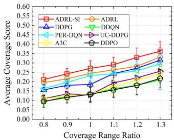  
(a)

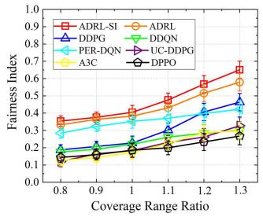  
(b)

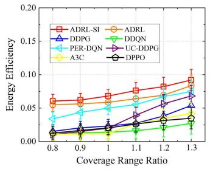  
(c)

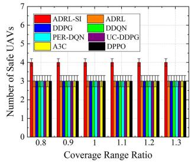  
(d)  
Fig. 7. Impact of the coverage range ratio on the four metrics.

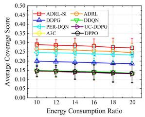  
(a)

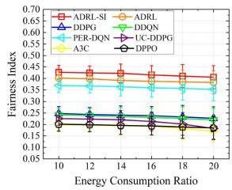  
(b)

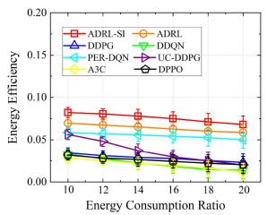  
(c)

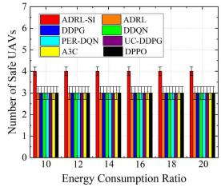  
(d)  
Fig. 8. Impact of the energy consumption ratio on the four metrics.

In scenario 2, Fig. 8 shows that $\overline { c } , f _ { c } , \eta$ , and $n _ { s }$ of all methods vary with w during the deployment of UAVs. ADRL-SI is better than other methods, which is discussed next for $w = 1 6$ . In

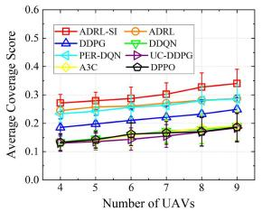  
(a)

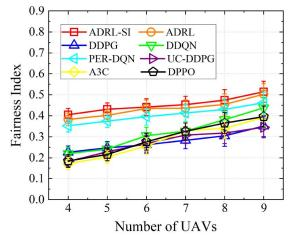  
(b)

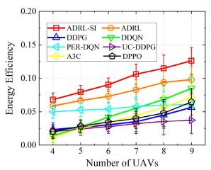  
(c)

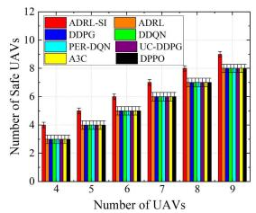  
(d)  
Fig. 9. Impact of the Number of UAVs on the four metrics.

Fig. 8(a), ADRL-SI achieves $\overline { { c } } = 0 . 2 8 .$ , which makes an improvement of 7.7% compared with 0.26 given by other optimum method, ADRL. In Fig. 8(b), ADRL-SI gives $f _ { c } = 0 . 4 2$ compared with 0.39 obtained by other optimum method, ADRL, which represents a 7.7% improvement. In Fig. 8(c), ADRL-SI achieves $\eta = 0 . 0 7$ and outperforms other optimum method (0.06 for ADRL) by 16.7%. In Fig. 8(d), Number of safe UAVs ${ n _ { s } } = 4$ achieved by ADRL-SI is superior to other methods. The coverage performance of UAVs for all methods gradually improves as w decreases.

As can been seen from Fig. 8, ADRL-SI, ADRL and PER-DQN consistently outperform other methods for different w. As discussed above, ADRL is superior to PER-DQN in terms of coverage performance.This is because ADRL generates highquality experience for learning, whereas PER-DQN extracts relatively high-quality experience from stochastic experience to learn. Other methods can only summarize the rules from random experience to train model, so the quality of trained model is relatively poor. As shown in Fig. 8(d), the number of safe UAVs $n _ { s }$ is less than 4, except ADRL-SI. As the $n _ { s }$ in ADRL-SI is larger than that in ADRL, the coverage performance of the former is better than that of the latter. This is because ADRL-SI has the SI mechanism compared to ADRL. As w increases, the movement cost of UAV increases, which reduces the UAV mobility and system performance.The larger w is, the more inert the system is and the less self-adjustment it is, which makes the error larger. In general, ADRL-SI is better than other methods for different w.

In scenario 3, Fig. 9 shows that $\tau , f _ { c } , \eta .$ , and $n _ { s }$ of all methods vary with N during the deployment of UAVs. ADRL-SI is superior to other methods, which is exhibited next for $N =$ 7. In Fig. 9(a), ADRL-SI achieves $\overline { { c } } = 0 . 3 1$ , which makes an improvement of 14.8% compared with 0.27 given by other optimum method, ADRL. In Fig. 9(b), ADRL-SI gives $f _ { c } = 0 . 4 5$ compared with 0.44 obtained by other optimum method, ADRL, which represents a 2.3% improvement. In Fig. 9(c), ADRL-SI achieves $\eta = 0 . 1 1$ and outperforms other optimum method (0.08 for ADRL) by 37.5%. In Fig. 9(d), Number of safe UAVs $n _ { s } = 7$ achieved by ADRL-SI is superior to other methods. The coverage performance of UAVs for all methods gradually improves as N increases.

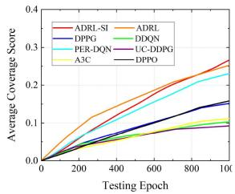

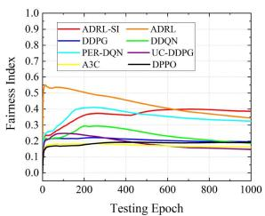  
(b)

(a)  
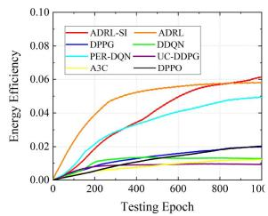

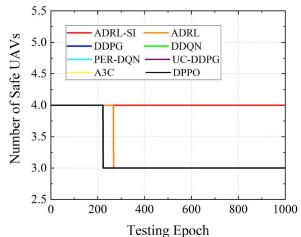  
(d)

(c)  
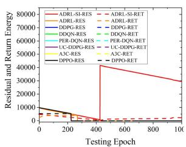  
(e)

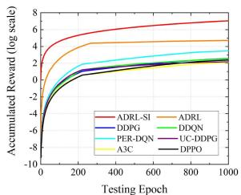  
(f)  
Fig. 10. Performance metrics during one episode testing.

In Fig. 9, ADRL-SI, ADRL and PER-DQN still outperform other methods for different N. Similarly, ADRL-SI is superior to ADRL, which in turn outperforms PER-DQN. The reasons are as follows: 1) determined by the experience quality of training model; 2) determined by the availability of the SI mechanism. However, other methods do not have the above conditions, therefore the performance is relatively poor. As mentioned above, the $n _ { s }$ of UAVs decreases in all cases except for the proposed ADRL-SI. The larger the N, the larger the coverage, and the better the system performance. However, the larger the spatial dimension of the UAVs’ state, the larger the computational overhead and decision error, which will reduce the real-time feasibility of the proposed solution. In summary, ADRL-SI outperforms other methods for different N.

In the scenarios with three default parameters, the c, $f _ { c } , \eta ,$ $n _ { s }$ residual energy (e), and accumulated reward (R) vary over time during deployment (refer Fig. 10). Fig. 10(a) shows that the user scores of ADRL-SI are ultimately higher than those of other methods, primarily owing to the assistance of MOPSO and SI. At 900 epochs, ADRL-SI achieves $\overline { { c } } = 0 . 2 4$ , which makes an improvement of 4.3% compared with 0.23 given by other optimum method, ADRL. Fig. 10(b) shows that the user fairness of ADRL-SI is ultimately greater than that of other methods. At 900 epochs, ADRL-SI achieves $f _ { c } = 0 . 3 9$ , compared with 0.36 obtained by other optimum method, ADRL, which represents a 8.3% improvement. Fig. 10(c) shows that the energy efficiency of ADRL-SI is ultimately greater than those of other methods. At 900 epochs, the ADRL-SI achieves $\eta = 0 . 0 5 9$ and outperforms other optimum method (0.057 for ADRL) by 3.5%.

Fig. 10(d) and (e) show the charging performance of UAVs. Fig. 10(d) shows that $n _ { s }$ is constant over time. The $n _ { s }$ of ADRL-SI is larger than that of other methods, primarily owing to the SI mechanism. At 900 epochs, ADRL-SI achieves $n _ { s } = 4 .$ compared with 3 obtained by other method, which represents a 33.3% improvement. The UAVs have different residual energies when the system is initialized. The UAV with minimum residual energy after initialization is discussed. Fig. 10(e) shows the variation of the residual energy versus the return energy of UAV. At 225 epochs, the residual energy of UAVs is less than the return energy, except for ADRL-SI and ADRL, and the UAVs cannot return. At 270 epochs, the residual energy (ADRL-RES) of ADRL is less than the return energy (ADRL-RET). ADRL-SI replaces energy at charging stations at 429 epochs. At 900 epochs, the residual energy of ADRL-SI is 31713, which represents an improvement compared with 0 yielded by other methods. The UAV is driven by charging incentives to adaptively transition to a charging station to replenish energy.

In Fig. 10(f), the accumulated reward of charging coverage system is described. Reward R increases rapidly until 100 epochs, then slows down and finally levels off. This is because at the beginning, the average score of users is zeros and then the coverage is gradually fair. At 900 epochs, ADRL-SI achieves $\mathcal { R } = 6 . 9 3$ , which makes an improvement of 47.8% compared with 4.69 given by other optimum method, ADRL.

## VII. CONCLUSION

In this paper, we presented an efficient-efficient deployment method for UAVs recharging to adaptively charge UAVs while considering user fairness without an interrupted service. An improved ADRL-SI algorithm was proposed which aims to maximize the reward function that jointly considers energy efficiency, user fairness, and uninterrupted service. The proposed ADRL-SI was based on ADRL and the survival incentive (SI) mechanism, where the ADRL utilizes MOPSO with constrained Pareto dominance to assist DRL. The aim of the SI was to ensure the safe charging of UAVs with minimum residual energy. Specifically, once the residual energy of UAVs was less than the threshold, the SI mechanism was triggered to move towards the charging station. The probability of assisted learning gradually decreased in order to develop the ability of agent to learn autonomously. ADRL-SI only added a residual energy judgement condition, so the time complexity approximated that of our previously proposed ADRL. Simulation results testified that ADRL-SI was better than the popular DRL on the evaluation metric designed by us. In the follow-up, more advanced DRL models for enhanced model convergence will be explored and integrated with emerging technologies such as 5 G or edge computing to enable real-time UAVs decision-making in more complex and resource-constrained environments.

## REFERENCES

[1] Z. Wang and L. J. Duan, “Chase or wait: Dynamic UAV deployment to learn and catch time-varying user activities,” IEEE Trans. Mobile Comput., vol. 22, no. 3, pp. 1369–1383, Mar. 2023.

[2] X. L. Ai, Z. Q. Pu, X. H. Chai, J. L. Lei, and J. Q. Yi, “3D deployment of UAV-mounted base stations for heterogeneous access requirements,” Aerosp. Sci. Technol., vol. 143, Dec. 2023, Art. no. 108731.

[3] O. S. Oubbati, H. Badis, A. Rachedi, A. Lakas, and P. Lorenz, “Multi-UAV assisted network coverage optimization for rescue operations using reinforcement learning,” in Proc. IEEE 20th Consum. Commun. Netw. Conf., 2023, pp. 1003–1008.

[4] Y. Wu, S. Wu, and X. T. Hu, “Cooperative path planning of UAVs & UGVs for a persistent surveillance task in urban environments,” IEEE Internet Things J., vol. 8, no. 6, pp. 4906–4919, Mar. 2021.

[5] A. S. Abdalla and V. Marojevic, “Multiagent learning for secure wireless access from UAVs with limited energy resources,” IEEE Internet Things J., vol. 10, no. 24, pp. 22356–22370, Dec. 2023.

[6] Z. M. N. Sun, H. W. Lin, and X. J. Zhou, “Persistent coverage of UAVs based on deep reinforcement learning with wonderful life utility,” Neurocomputing, vol. 521, pp. 137–145, Feb. 2023.

[7] H. Wang, S. Song, Q. Guo, D. Xu, X. Zhang, and P. Wang, “Cooperative motion planning for persistent 3D visual coverage with multiple quadrotor UAVs,” IEEE Trans. Automat. Sci. Eng., vol. 21, no. 3, pp. 3374–3383, Jul. 2024.

[8] K. Wang, X. Zhang, L. J. Duan, and J. Tie, “Multi-UAV cooperative trajectory for servicing dynamic demands and charging battery,” IEEE Trans. Mobile Comput., vol. 22, no. 3, pp. 1599–1614, Mar. 2023.

[9] Y. Yin, G. Gui, M. Liu, H. Gacanin, and H. Sari, “Joint user pairing and resource allocation in air-to-ground communication-caching-charging integrated network based on NOMA,” IEEE Trans. Veh. Technol., vol. 72, no. 12, pp. 15819–15828, Dec. 2023.

[10] K. Zhu et al., “Aerial refueling: Scheduling wireless energy charging for UAV enabled data collection,” IEEE Trans. Green Commun. Netw., vol. 6, no. 3, pp. 1494–1510, Sep. 2022.

[11] L. Zou, M. S. Munir, Y. K. Tun, S. S. Hassan, P. S. Aung, and C. S. Hong, “When hierarchical federated learning meets stochastic game: Toward an intelligent UAV charging in urban prosumers,” IEEE Internet Things J., vol. 10, no. 12, pp. 10438–10461, Jun. 2023.

[12] A. K. Gupta, S. Ghosh, and M. R. Bhatnagar, “Pricing based scheme for UAV-enabled wireless energy transfer,” IEEE Trans. Veh. Technol., vol. 71, no. 12, pp. 13198–13209, Dec. 2022.

[13] S. Fu et al., “Energy-efficient UAV-enabled data collection via wireless charging: A reinforcement learning approach,” IEEE Internet Things J., vol. 8, no. 12, pp. 10209–10219, Jun. 2021.

[14] H. Wang, P. M. Li, H. Y. Xiao, X. Z. Zhou, and R. W. Lei, “Intelligent energy management for solar-powered unmanned aerial vehicle using multi-objective genetic algorithm,” Energy Convers. Manage., vol. 280, Mar. 2023, Art. no. 116805.

[15] M.-A. Lahmeri, M. A. Kishk, and M.-S. Alouini, “Laser-powered UAVs for wireless communication coverage: A large-scale deployment strategy,” IEEE Trans. Wireless Commun., vol. 22, no. 1, pp. 518–533, Jan. 2023.

[16] C. Zhao, J. Liu, M. Sheng, W. Teng, Y. Zheng, and J. Li„ “Multi-UAV trajectory planning for energy-efficient content coverage: A decentralized learning-based approach,” IEEE J. Sel. Areas Commun., vol. 39, no. 10, pp. 3193–3207, Oct. 2021.

[17] N. Gupta, S. Agarwal, D. Mishra, and B. Kumbhani, “Trajectory and resource allocation for UAV replacement to provide uninterrupted service,” IEEE Trans. Commun., vol. 71, no. 12, pp. 7288–7302, Dec. 2023.

[18] H. Qi, Z. Hu, H. Huang, X. Wen, and Z. Lu, “Energy efficient 3-D UAV control for persistent communication service and fairness: A deep reinforcement learning approach,” IEEE Access, vol. 8, pp. 53172–53184, 2020.

[19] J. You, Y. Liu, J. Chen, and F. Ding, “Iterative identification for multipleinput systems with time-delays based on greedy pursuit and auxiliary model,” J. Franklin Inst., vol. 356, no. 11, pp. 5819–5833, Jul. 2019.

[20] X. Liu, Q. Zhou, C.-T. Cheng, and C. Liu, “A greedy-model-based reinforcement learning algorithm for beyond-5G cooperative data collection,” Phys. Commun., vol. 50, Feb. 2022, Art. no. 101496.

[21] Y. Zhou, X. Ma, S. Hu, D. Zhou, N. Cheng, and N. Lu, “QoE-driven adaptive deployment strategy of multi-UAV networks based on hybrid deep reinforcement learning,” IEEE Internet Things J., vol. 9, no. 8, pp. 5868–5881, Apr. 2022.

[22] T. L. Shan, Y. Wang, C. Zhao, Y. Li, and G. Zhang, and Q. Zhu, “Multi-UAV WRSN charging path planning based on improved heed and IA-DRL,” Comput. Commun., vol. 203, pp. 77–88, Apr. 2023.

[23] Z. Dai, Y. Zhang, W. Zhang, X. Luo, and Z. He, “A multi-agent collaborative environment learning method for UAV deployment and resource allocation,” IEEE Trans. Signal Inf. Process. Networks, vol. 8, pp. 120–130, 2022.

[24] H. X. G. Ma Yang, X. X. Sun, D. M. Qu, and G. Y. Chen, “Improved DRLbased energy-efficient UAV control for maximum lifecycle,” J. Franklin Inst., vol. 361, no. 6, Apr. 2024, Art. no. 106718.

[25] M. Kishk, A. Bader, and M.-S. Alouini, “Aerial base station deployment in 6G cellular networks using tethered drones: The mobility and endurance tradeoff,” IEEE Veh. Technol. Mag., vol. 15, no. 4, pp. 103–111, Dec. 2020.

[26] S. Zhang, W. Liu, and N. Ansari, “On tethered UAV-assisted heterogeneous network,” IEEE Trans. Veh. Technol., vol. 71, no. 1, pp. 975–983, Jan. 2022.

[27] N. Cherif, W. Jaafar, E. Vinogradov, H. Yanikomeroglu, and S. Pollin, “iTUAVs: Intermittently tethered UAVs for future wireless networks,” IEEE Wireless Commun., vol. 30, no. 4, pp. 124–130, Aug. 2023.

[28] A. Lahiry, K. N. Le, V. N. Q. Bao, and V. W. Y. Tam, “Analytical evaluation of power-amplifier-based charging methodology and energy efficiency optimization framework for aerial base stations,” IEEE Trans. Aerosp. Electron. Syst., vol. 58, no. 5, pp. 4451–4472, Oct. 2022.

[29] A. Ranjha and G. Kaddoum, “URLLC-enabled by laser powered UAV relay: A quasi-optimal design of resource allocation, trajectory planning and energy harvesting,” IEEE Trans. Veh. Technol., vol. 71, no. 1, pp. 753–765, Jan. 2022.

[30] Z. J. Tian, Z. J. Haas, and S. Shinde, “Routing in solar-powered UAV delivery system,” Drones, vol. 6, no. 10, Oct. 2022, Art. no. 282.

[31] D. S. Lakew, W. Na, N.-N. Dao, and S. Cho, “Aerial energy orchestration for heterogeneous UAV-assisted wireless communications,” IEEE Syst. J., vol. 16, no. 2, pp. 2483–2494, Jun. 2022.

[32] M. Li, L. Liu, Y. Gu, Y. Ding, and L. Wang, “Minimizing energy consumption in wireless rechargeable UAV networks,” IEEE Internet Things J., vol. 9, no. 5, pp. 3522–3532, Mar. 2022.

[33] X. Wang, J. Li, Z. Ning, Q. Song, L. Guo, and A. Jamalipour, “Wireless powered metaverse: Joint task scheduling and trajectory design for multidevices and multi-UAVs,” IEEE J. Sel. Areas Commun., vol. 42, no. 3, pp. 552–569, Mar. 2024.

[34] X. Ma, X. Liu, and N. Ansari, “Green laser-powered UAV far-field wireless charging and data backhauling for a large-scale sensor network,” IEEE Internet Things J., vol. 11, no. 19, pp. 31932–31946, Oct. 2024.

[35] P. Xue et al., “A Multi-CUAV multi-UAV electricity scheduling scheme: From charging location selection to electricity transaction,” IEEE Internet Things J., vol. 10, no. 23, pp. 20899–20913, Dec. 2023.

[36] J. Y. Qin, M. A. Kishk, and M.-S. Alouini, “Performance analysis of charging infrastructure sharing in UAV and EV-involved networks,” IEEE Trans. Veh. Technol., vol. 72, no. 3, pp. 3973–3988, Mar. 2023.

[37] M. Fan et al., “Deep reinforcement learning for UAV routing in the presence of multiple charging stations,” IEEE Trans. Veh. Technol., vol. 72, no. 5, pp. 5732–5746, May 2023.

[38] X. Li, H. Yao, J. Wang, X. Xu, C. Jiang, and L. Hanzo, “A near-optimal UAV-aided radio coverage strategy for dense urban areas,” IEEE Trans. Veh. Technol., vol. 68, no. 9, pp. 9098–9109, Sep. 2019.

[39] L. Zhang, A. Celik, S. Dang, and B. Shihada, “Energy-efficient trajectory optimization for UAV-assisted IoT networks,” IEEE Trans. Mobile Comput., vol. 21, no. 12, pp. 4323–4337, Dec. 2022.

[40] Y. T. Wang and Z. Su, “An envy-free online UAV charging scheme with vehicle-mounted mobile wireless chargers,” China Commun., vol. 20, no. 8, pp. 89–102, Aug. 2023.

[41] K. Messaoudi, A. Baz, O. Sami Oubbati, A. Rachedi, T. Bendouma, and M. Atiquzzaman, “UGV charging stations for UAV-assisted AoI-Aware data collection,” IEEE Trans. Cogn. Commun. Netw., vol. 10, no. 6, pp. 2325–2343, Dec. 2024.

[42] J. Liu, F. Yang, X. Wang, L. Qu, M. Jin, and H. Dai, “Joint optimization of charging station placement and UAV trajectory for fresh data collection,” IEEE Internet Things J., vol. 11, no. 14, pp. 25057–25073, Jul. 2024.

[43] Z. Ren et al., “Intelligent adaptive gossip-based broadcast protocol for UAV-MEC using multi-agent deep reinforcement learning,” IEEE Trans. Mobile Comput., vol. 23, no. 6, pp. 6563–6578, Jun. 2024.

[44] Y. Su, H. Zhou, Y. Deng, and M. Dohler, “Energy-efficient cellularconnected UAV swarm control optimization,” IEEE Trans. Wireless Commun., vol. 23, no. 5, pp. 4127–4140, May 2024.

[45] E. Eldeeb, M. Shehab, and H. Alves, “Traffic learning and proactive UAV trajectory planning for data uplink in markovian IoT models,” IEEE Internet Things J., vol. 11, no. 8, pp. 13496–13508, Apr. 2024.

[46] R. Jain, D.-M. Chiu, and W. R. Hawe, “A quantitative measure of fairness and discrimination for resource allocation in shared computer system,” Eastern Res. Lab., Digit. Equip. Corporation, Hudson, MA, vol. 21, no. 1, Sep. 1984.

[47] N. Babu, C. B. Papadias, and P. Popovski, “Energy-efficient 3-D deployment of aerial access points in a UAV communication system,” IEEE Commun. Lett., vol. 24, no. 12, pp. 2883–2887, Dec. 2020.

[48] M. Mozaffari, W. Saad, M. Bennis, and M. Debbah, “Efficient deployment of multiple unmanned aerial vehicles for optimal wireless coverage,” IEEE Commun. Lett., vol. 20, no. 8, pp. 1647–1650, Aug. 2016.

[49] B. Zhu, E. Bedeer, H. H. Nguyen, R. Barton, and J. Henry, “UAV trajectory planning in wireless sensor networks for energy consumption minimization by deep reinforcement learning,” IEEE Trans. Veh. Technol., vol. 70, no. 9, pp. 9540–9554, Sep. 2021.

[50] C. H. Liu, Z. Chen, J. Tang, J. Xu, and C. Piao, “Energy-efficient UAV control for effective and fair communication coverage: A deep reinforcement learning approach,” IEEE J. Sel. Areas Commun., vol. 36, no. 9, pp. 2059–2070, Sep. 2018.

[51] C. A. C. Coello, G. T. Pulido, and M. S. Lechuga, “Handling multiple objectives with particle swarm optimization,” IEEE Trans. Evol. Computation, vol. 8, no. 3, pp. 256–279, Jun. 2004.

[52] I. Goodfellow, Y. Bengio, and A. Courville, Deep Learning. Cambridge, MA, USA: MIT Press, 2016.

[53] X. Liu, M. Yu, C. Yang, L. Zhou, H. Wang, and H. Zhou, “Value distribution DDPG with dual-prioritized experience replay for coordinated control of coal-fired power generation systems,” IEEE Trans. Ind. Inform., vol. 20, no. 6, pp. 8181–8194, Jun. 2024.

[54] Z. Chu, F. Wang, T. Lei, and C. Luo, “Path planning based on deep reinforcement learning for autonomous underwater vehicles under ocean current disturbance,” IEEE Trans. Intell. Vehicles, vol. 8, no. 1, pp. 108–120, Jan. 2023.

[55] D. K. Panda, O. Turner, S. Das, and M. Abusara, “Prioritized experience replay based deep distributional reinforcement learning for battery operation in microgrids,” J. Cleaner Prod., vol. 434, Jan. 2024, Art. no. 139947.

[56] H. Shen, K. Zhang, M. Hong, and T. Chen, “Towards understanding asynchronous advantage actor-critic: Convergence and linear speedup,” IEEE Trans. Signal Process., vol. 71, pp. 2579–2594, 2023.

[57] C. Dai, K. Zhu, and E. Hossain, “Multi-agent deep reinforcement learning for joint decoupled user association and trajectory design in full-duplex multi-UAV networks,” IEEE Trans. Mobile Comput., vol. 22, no. 10, pp. 6056–6070, Oct. 2023.

  
Haixu Ma received the B.Sc. degree in electronic information science and technology in 2017, and the M.Sc. degree in software engineering in 2020. He is currently working toward the Ph.D. degree under the supervision of Prof. Guang Yang. His research interests include UAV flight control algorithms, including dynamic obstacle avoidance, intelligent and efficient coverage, deep reinforcement learning, and measurement and control technology.

Wenbo Liu, photograph and biography not available at the time of publication.

Guang Yang received the B.E., M.S., and Ph.D. degrees from the College ofInstrumentation and Electrical Engineering, Jilin University, Changchun, China, in 2006, 2008, and 2011, respectively. From 2018 to 2019, he was a Visiting Scholar with the University of Nebraska-Lincoln, Lincoln, NE, USA. He is currently a Professor with the College of Instrumentation and Electrical Engineering, Jilin University. He is also the Leader of the Key Analytical Instruments Laboratory, Jilin, China. His research interests include analytical instrumentation measurement, UAV flight control,

and measurement and control technology. He was awarded the first prize of Science and Technology of China Instrument Society. He is Reviewer for several analytical instrumentation and vehicle control journals.

Huihui Sun, photograph and biography not availabe at the time of publication.

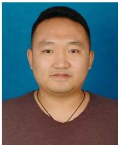

Dongming Qu received the B.Sc. degree in measurement and control technology and instrumentation in 2019. He is currently working toward the Ph.D. degree under the supervision of Prof. Guang Yang. His research interests include precision instruments and machinery, broader, including wide-range spectral acquisition technology based on UAV cruise, UAV hardware design, UAV flight control, efficient cruise path planning, and dynamic spectral analysis based on machine learning.

Hongfei Yang received the M.S. degree in mechanical engineering from Jilin University, Changchun, China, in 2020, and the Ph.D. degree from the School of Instrumentation Science and Electrical Engineering, Jilin University, in 2023. He is currently a Directly-Appointed Associate Professor with Shihezi University, where he is also the Chair of the International Conference on Artificial Intelligence. He has authored or coauthored more than a dozen scholarly papers in international journals, such as IEEE Trans, as a first responsible author. His research interests in-

clude UAV flight control, efficient UAV path planning, industrial defect detection based on UAV cruise, and engineering vehicle environment recognition.