# Energy-Aware Trajectory Design for Outage Minimization in UAV-Assisted Communication Systems

Nishant Gupta , Graduate Student Member, IEEE, Deepak Mishra , Member, IEEE, and Satyam Agarwal , Member, IEEE

Abstract—This paper studies the flight trajectory of unmanned aerial vehicles (UAV) to provide fifth-generation (5G) cellular service in a given area. We consider a single UAV launched from the fixed initial to the final location, during which it serves the ground users that are distributed in a circular field. UAV’s limited on-board energy has been a major concern affecting the system’s performance. Therefore, in this work, we minimize the average outage probability of the system by optimizing the three-dimensional (3D) trajectory of the UAV while considering the velocity and on-board energy as constraints. To solve this problem, we propose two approaches: the low-complexity vertex and the high-performance sequential approach. The vertex approach involves two steps. Firstly, it obtains the optimal solution while relaxing the velocity and on-board energy constraints. Secondly, a greedy solution is proposed for the original problem. The sequential approach finds the optimal location in each time slot sequentially. Simulation results compare the two approaches and show that our proposed strategies provide on an average 41% improvement in average outage probability over the benchmark schemes. Additionally, we show that the sequential approach is better than the vertex approach, though at the cost of high computational complexity.

Index Terms—UAV communication, outage probability, trajectory optimization, on-board energy constraint.

## I. INTRODUCTION

W ITH the advancement in wireless communication, the fifth-generation mobile communication (5G) offers high throughput, high energy efficiency, and low latency. Due to surging demand for mobile broadband, the existing ground infrastructure is facing a huge capacity shortage. Further, in special scenarios, such as search and rescue operations and ondemand emergency services, the deployment of an adequate ground infrastructure in a timely and economical manner is impractical due to high capital and operational costs, as well as substantial delay in deployment [2]. Thus, in many such scenarios, it is anticipated that the existing ground infrastructure might be insufficient to cater to the current needs.

The use of unmanned aerial vehicles (UAVs) as network relays or aerial base stations (BSs) can prove to be an effective solution due to their flexibility, on-demand coverage, and swift deployment. UAVs can maintain line-of-sight (LoS) communication links with the ground users/terminals and enhance the performance and coverage of the current cellular networks [3]. UAVs can be integrated with cellular networks by deploying them as an aerial BS or as relays to support the terrestrial communication system [4]. Some common use cases include coverage expansion or offloading the traffic in a particular scenario, such as sports stadium, carnivals, and live concerts, where the present ground system is insufficient to provide adequate quality-of-service (QoS), service restoration when the ground network infrastructure is interrupted, etc. [5].

Realizing the promising perspective the UAVs offer to the cellular infrastructure, there exist multiple challenges in deploying the UAVs to enhance cellular coverage [6]. Some of them are optimal deployment in three-dimensional (3D) space, communication-oriented trajectory design, and energyefficient communication. The 3D deployment of UAV as an aerial BS is more challenging than the traditional BSs due to the additional altitude constraint that depends upon the presence/absence of ground obstacles. In communicationoriented trajectory design, the UAV trajectory depends upon the user demands and requirements to maximize the system performance [4]. For instance, a UAV can fly close to the users to reduce the link distance between them, or in some cases, it can attain optimal height to maintain LoS communication with multiple users. Besides the 3D deployment and trajectory design, the UAVs have limited on-board energy. As a result, the UAV flight time is usually short and insufficient to provide long-term wireless coverage. Unlike terrestrial infrastructures, which typically have an abundant power supply, the UAVs pose limitations on their performance and endurance. Therefore, UAVs’ energy efficiency demands careful attention as it directly affects the performance of the UAV-assisted communication systems. In general, UAVs’ on-board energy is typically viewed as a key constraint for UAV trajectory design.

In view of the above challenges, in this work, we introduce a framework to obtain the UAV flight trajectory that minimizes the average outage probability of the users while considering the time and energy used for deployment as constraints. This setup can be applied to many practical applications, such as establishing two-way communication between first responders, and fire-fighters in an area with inadequate coverage or traffic offloading in a hotspot area, such as sports events, etc.

TABLE I  
SHORT SUMMARY OF RELATED WORKS THAT CONSIDERS ENERGY CONSTRAINT IN THEIR MODEL. P.LOS IS THE PROBABILISTIC LOS CHANNEL MODEL

<table><tr><td>Ref.</td><td>Objective</td><td>Channel/Traj.</td><td>Key differences</td></tr><tr><td>[20]</td><td>Maximize the system&#x27;s throughput to optimize the UAV trajectory</td><td>LoS / 2D</td><td>Considered 2D trajectory and LoS dominant links</td></tr><tr><td>[21]</td><td>Minimum average rate maximization and energy efficiency</td><td>LoS / 2D</td><td>Considered the analysis with fixed-wing UAV</td></tr><tr><td>[22]</td><td>Maximize coverage to a number of ground users</td><td>LoS / 2D</td><td>Coverage as a performance metric</td></tr><tr><td>[23]</td><td>Maximize the throughput of the network during the flight time</td><td>P.LoS / 2D</td><td>Considered the UAV to move with fixed velocity</td></tr><tr><td>[24]</td><td>Minimization of total outage duration</td><td>LoS / 2D</td><td>LoS dominant links and the UAV with fixed height</td></tr><tr><td>[25]</td><td>Overall throughput maximization</td><td>P.LoS / 3D</td><td>UAV moves with fixed maximum velocity</td></tr><tr><td>[26]</td><td>Maximize the minimum throughput</td><td>P.LoS / 3D</td><td>Analysis only under the LoS conditions</td></tr></table>

## A. Related Works

A trajectory design for the UAV-assisted communication system needs to address two main concerns, namely, communication-related performance and energy consumption in UAV manoeuvring. Over the last few years, a substantial number of studies have been carried out in the above areas, for which we provide a survey on the relevant prior work.

In communication-oriented trajectory design, UAV as an amplify-and-forward relay was considered in [7] to optimize the trajectory and transmit power of the UAV by minimizing the outage probability of the relay system. In [8], UAV two-dimensional (2D) trajectory was optimized for full-duplex UAV aided small cell wireless systems to maximize the total system capacity. The authors in [9] jointly optimized buoy sensors communication scheduling, UAV trajectory, and system power to minimize the maximum average outage probability among all buoy sensors. In [1], the UAV trajectory was optimized by minimizing the average outage probability over all users considering a probabilistic LoS channel model. Due to the limited resources available with the UAVs, user scheduling and UAV trajectory were jointly optimized in [10] and [11] to maximize the minimum data collection rate in UAV-enabled wireless sensor networks.

As there is limited on-board energy available with the UAVs, their energy must be utilized effectively to increase the system’s performance. The above works on communicationoriented trajectory design do not consider the energy availability at the UAV. The energy consumed by the UAV was first emphasized in [12] for a fixed-wing UAV and in [13] for a rotary-wing UAV. In both works, the authors maximized energy efficiency while achieving the user’s minimum rate requirement. Similarly, [14] considered coverage as a constraint to optimize the trajectory and minimize the energy consumption. The 3D trajectory of a UAV relay was designed in [15] to maximize the system energy efficiency while meeting the constraints on UAV trajectory, data rate requirement, and communication and mechanical energy consumption. The authors in [16] focussed on jointly optimizing the user scheduling, power, and bandwidth allocation along with the trajectory to maximize the UAV energy efficiency in the presence of quality-of-experience (QoE) requirements of the users. On the same note, the aim in [17] was to serve the edge users and assist in traffic offloading while the UAV flew in a circular path. Similarly, the works [18], and [19] also considered the energy efficiency to design the 2D trajectory of the UAV.

The works presented so far have focused on UAV trajectory design based on energy efficiency and outage minimization, individually. In all of the above-highlighted works, energy efficiency was considered as an objective function for obtaining an optimal UAV trajectory. However, from the perspective of communication systems, communication-related performance metrics, such as outage, throughput, etc., should be regarded as objective functions, while energy consumption can be included in the constraints. This UAV energy consumption as a constraint ensures that the UAV completes its mission without completely exhausting the available on-board energy. Towards this end, the authors in [20] and [21] considered the energy consumption constraint to optimize the UAV flight trajectory when flying at a fixed altitude while considering the LoS UAVuser channel model. In particular, [20] considered UAV flying energy consumption to be independent of velocity while [21] considered the energy consumption model for a fixed-wing UAV. Moreover, in [22], the authors considered LoS channel model with an objective to maximize coverage to a number of ground users to design the 2D trajectory of the UAV in the presence of energy constraints. Whereas, the authors in [23] considered the 2D trajectory under a probabilistic LoS channel model but assumed the UAV to move with a fixed velocity. Also, the work in [24] took the energy constraint and minimized total outage duration in a LoS channel.

The above works [20]–[24] considered the energy constraint to design the 2D trajectory of the UAV. However, for a rotary-wing UAV, there are very few works for 3D trajectory design in a probabilistic LoS channel model. Some of the works are as follows. The authors in [25] studied the 3D trajectory design by considering the energy consumption as a constraint to maximize the overall throughput of the system but considered the UAV to move with the fixed maximum velocity. This is not applicable to scenarios when UAV have a less limited energy, where the decrease in UAV velocity saves certain amount of energy. To this extent, the authors in [26], considered the variable speed to design UAV trajectory for the same scenario. However, they designed the UAV trajectory while considering the analysis only under the LoS condition and not considering the NLoS condition which is oversimplified. Tables I describes the short summary of related work with key differences that considers the energy constraint.

## B. Novelty, Scope and Key Contributions

Our present work is motivated by practical scenarios, such as providing coverage to first responders or providing connectivity in a crowded region, wherein a UAV is to be deployed in a timely and energy-efficient manner. We consider the scenario where a UAV has to fly from a pre-defined initial to a pre-defined final location in a stipulated time and energy availability to provide coverage to a given set of users. Compared to the prior works [25] and [26], our present work considers a 1) realistic trajectory design (with varying altitude). 2) Practical UAV-user channel model, i.e., Probabilistic LoS channel model [27] considering probabilities of both the LoS and NLoS links, as opposed to [26] which only examines LoS links for analysis. 3) Velocity dependent energy consumption model for a rotary-wing UAV such as drones [13] in the presence of mobility constraints, which [25] assumed the UAV to fly with a fixed velocity. Based on the above differences, this work considers the UAV deployment from a practical standpoint which cannot be derived from the prior works in the literature due to their unrealistic assumptions, such as fixed UAV velocity or LoS channel model.

The key contributions of this work are listed below:

• An optimization problem is framed to minimize the average outage probability over all ground users by optimizing the 3D UAV trajectory, while considering the velocity and total on-board energy constraints under probabilistic LoS channel model that incorporates the probabilities of LoS link and NLoS link separately.

• Noting the non-convexity of the problem, we present the low-complexity vertex approach in Section IV, where the 3D location with minimum outage probability is computed followed by greedy approach to obtain a UAV trajectory. To obtain 3D location, the optimal location problem is framed and the globally optimal solution within acceptable tolerance is obtained.

• To improve upon the vertex solution, we present a highperformance sequential approach discussed in Section V. It starts from the initial location and searches for the optimal UAV location in each time slot sequentially.

• Numerical results provide useful insights on the UAV trajectory obtained from both the approaches and compares them with the benchmark schemes. For both the approaches, the impact of velocity on the average outage probability is shown, and a trade-off between UAV velocity and energy availability is studied.

• In particular, our proposed vertex and sequential approaches show on an average 31% and 52% improvement over the benchmark schemes, respectively.

Rest of the paper is organized as follows. Section II provides the comprehensive overview of the system model. Section III presents the problem formulation. Section IV, and V describe the methodologies proposed followed by their computational complexities. Numerical results are provided in Section VI, followed by conclusion in Section VII.

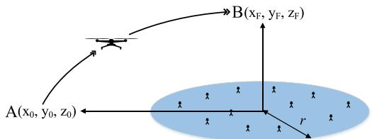  
Fig. 1. System model representing the coverage field having N users in a 2D plane along with $\mathrm { U A V ^ { \bullet } s }$ initial and final locations.

## II. SYSTEM MODEL

In this work, we consider a wireless downlink communication system as shown in Fig. 1, where a UAV is launched from an initial location $\mathrm { A } ( \mathrm { x } _ { 0 } , \mathrm { y } _ { 0 } , \mathrm { z } _ { 0 } )$ and moves to a final location $\mathrm { B } ( \mathrm { x } _ { \mathrm { F } } , \mathrm { y } _ { \mathrm { F } } , \mathrm { z } _ { F } )$ to provide coverage in a 2D circular field of radius r. $\mathrm { x } _ { 0 } , \mathrm { y } _ { 0 } \in \mathbb { R }$ and $\mathbf { x } _ { \mathrm { F } } , \mathbf { y } _ { \mathrm { F } } \in \mathbb { R }$ denote the initial and final horizontal coordinates, respectively, and $\mathrm { z } _ { 0 } , \mathrm { z } _ { F } \in \mathbb { R }$ are the respective heights, where R denotes the set of real numbers. There are N ground users indexed by $\mathcal { N } \triangleq \{ 1 , \dots , N \}$ distributed randomly in the circular field and are assumed to be stationary. Location of the $i ^ { t h } \mathrm { - u s e r }$ is given by 3D Cartesian coordinate $( \boldsymbol { \mathcal { U } } _ { i } , 0 )$ , where $\mathcal { U } _ { i } \ = \ [ x _ { i } , \bar { y _ { i } } ] \ \in \ \bar { \mathbb { R } } ^ { 1 \times 2 } , \ \forall i \ \in \ \mathcal { N } .$ z-coordinate of all users is taken as zero considering all the users on the ground plane. Next, we present models for UAV trajectory, channel outage, and energy consumption.

## A. UAV Trajectory Model

The UAV has to complete its mission (going from the initial location A to the final location B) within time T. For analytical simplicity, the total flight time T of the UAV is discretized into M time slots of equal length, indexed by $\mathcal { M } = \{ 1 , \dots , M \}$ . The time slot duration is given by $\tau = T / M$ , which is chosen such that the UAV is assumed to be stationary within each time slot [28]. Thus, the trajectory of the UAV is approximated as (x[m], y[m], z[m]). The distance between the UAV and the $i ^ { t h } \mathrm { - u s e r }$ at any time slot m is given by $d _ { i } [ m ] = { \sqrt { ( x [ m ] - x _ { i } ) ^ { 2 } + ( y [ m ] - y _ { i } ) ^ { 2 } + z [ m ] ^ { 2 } } }$ Velocity of the UAV within each time slot is given by

$$
\begin{array}{c} v [ m ] \triangleq \frac {1}{\tau} \Big ((x [ m ] - x [ m - 1 ]) ^ {2} + (y [ m ] - y [ m - 1 ]) ^ {2} \\ \qquad + (z [ m ] - z [ m - 1 ]) ^ {2} \Big) ^ {\frac {1}{2}}. \end{array}\tag{1}
$$

## B. UAV-to-Ground Channel Model

As recorded in practical tests [29], the UAV at a relatively high altitude is able to establish a LoS communication with the ground users and due to rich scattering it also undergoes small-scale fading. Thus, the channel between the UAV and the $i ^ { t h } .$ -user at the $m ^ { t h }$ -time slot is modelled as $g _ { i } [ m ] ~ = ~ \sqrt { L _ { i } [ m ] } \tilde { h } _ { i } [ m ]$ , where $\tilde { h } _ { i } [ m ]$ accounts for small scale fading while $L _ { i } [ m ]$ accounts for large-scale attenuation which includes path loss. This large-scale attenuation for UAVground links is usually modelled as a random variable based on the occurrence probabilities of LoS and non-LoS (NLoS) components [13]. Their path loss expressions are given as

$$
L _ {i} [ m ] = \left\{ \begin{array}{l l} d _ {0} d _ {i} [ m ] ^ {- \bar {\alpha}}, & \text { for   LoS   link,   and } \\ \kappa d _ {0} d _ {i} [ m ] ^ {- \bar {\alpha}}, & \text { for   NLoS   link, } \end{array} \right.\tag{2}
$$

where $d _ { 0 }$ represents the path loss at a reference distance of 1 meter (m), α¯ represents the path loss exponent, and $\kappa < 1$ accounts for additional attenuation factor due to NLoS component. The probability that the $i ^ { t h } .$ -user is in LoS with the UAV at time slot m is represented as a logistic function of elevation angle [30] and is given by

$$
P _ {L o S} (\phi_ {i} [ m ]) = (1 + C \exp (- D [ \phi_ {i} [ m ] - C ])) ^ {- 1},\tag{3}
$$

where C and D are parameters depending on environment, such as rural, sub-urban and urban. $\phi _ { i } [ m ]$ (in degrees) is the elevation angle of UAV from the $i ^ { t h }$ -user at time slot m given as $\begin{array} { r } { \phi _ { i } [ m ] = \overline { { \frac { 1 8 0 } { \pi } } } \sin ^ { - 1 } ( { \frac { z [ m ] } { d _ { i } [ m ] } } ) } \end{array}$

As a result, the received SNR, denoted by $\gamma _ { i } [ m ]$ , between the $i ^ { t h }$ -user and the UAV at time slot m is given as $\gamma _ { i } [ m ] =$ $\frac { P _ { t r } | g _ { i } [ m ] | ^ { 2 } } { \sigma _ { n } ^ { 2 } }$ , where $P _ { t r }$ represent the transmit power of the UAV, and $\sigma _ { n } ^ { 2 }$ is the noise power. Furthermore, for simplicity and without loss of generality, we assume Rayleigh fading channel so that the probability density function of SNR $\gamma _ { i } [ m ]$ follows exponential distribution $f _ { \gamma _ { i } [ m ] } ( \gamma _ { i } [ m ] ) =$ $\begin{array} { r } { \frac { 1 } { \bar { \gamma } _ { i } [ m ] } e ^ { \frac { \gamma _ { i } [ m ] } { \bar { \gamma } _ { i } [ m ] } } } \end{array}$ , where $\bar { \gamma } _ { i } [ m ]$ is the average SNR given by $\begin{array} { r } { \bar { \gamma } _ { i } [ m ] = \frac { P _ { t r } \mathbb { E } [ L _ { i } [ m ] ] } { \sigma _ { \infty } ^ { 2 } } } \end{array}$ . This is in line with [31] and is obtained when $\mathbb { E } [ | \tilde { h } _ { i } [ m ] | ^ { 2 } ] = 1$ , and $\begin{array} { r l } { \mathbb { E } [ L _ { i } [ m ] ] \ = } & { { } ( P _ { L o S } ( \phi _ { i } [ m ] ) \ + } \end{array}$ $\kappa ( 1 - \bar { P _ { L o S } ( \phi _ { i } [ m ] ) ) } d _ { 0 } d _ { i } ^ { - \bar { \alpha } } [ m ]$ is average pathloss [13, eq. (4)]. Substituting $\mathbb { E } [ L _ { i } [ m ] ]$ in $\bar { \gamma } _ { i } [ m ]$ , we get

$$
\bar {\gamma} _ {i} [ m ] = \frac {\tilde {\gamma} _ {o} ((1 - \kappa) P _ {L o S} (\phi_ {i} [ m ]) + \kappa)}{\left((x [ m ] - x _ {i}) ^ {2} + (y [ m ] - y _ {i}) ^ {2} + z [ m ] ^ {2}\right) ^ {\alpha}},\tag{4}
$$

where $\widetilde { \gamma } _ { o } \triangleq P _ { t r } d _ { 0 } / \sigma _ { n } ^ { 2 }$ and $\alpha \triangleq \bar { \alpha } / 2$

## C. Outage Probability

Outage probability of the $i ^ { t h } ,$ -user, defined as the probability that the received SNR falls below the threshold $\gamma _ { t h }$ [32]. Here, for a Rayleigh fading channel, the outage probability $P _ { o u t } ^ { i } [ m ]$ of $i ^ { t h }$ -user follows $P _ { o u t } ^ { i } [ m ] \ = \ 1 - \ e ^ { - \frac { \gamma _ { t h } } { \bar { \gamma } _ { i } [ m ] } }$ . Using (4), the outage probability of $i ^ { t h } ,$ -user is given as

$$
P _ {o u t} ^ {i} [ m ] = 1 - e ^ {\left(- \frac {\gamma_ {t h}}{\widetilde {\gamma} _ {o}} \frac {\big ((x [ m ] - x _ {i}) ^ {2} + (y [ m ] - y _ {i}) ^ {2} + z [ m ] ^ {2} \big) ^ {\alpha}}{(1 - \kappa) P _ {L o S} (\phi_ {i} [ m ]) + \kappa}\right)}\tag{5}
$$

In this work, we minimize the outage probability (5) averaged over all users and time to obtain the optimal trajectory.

## D. Energy Consumption Model

UAV velocity and hence, flight time are affected by the limited on-board energy. Thus, to analyze how energy consumption affects the trajectory and the average outage probability of the system, we consider the energy consumption model for a rotary-wing UAV. Rotary-wing UAV is considered in our work due to its better hovering features over fixedwing UAVs [13]. Its energy consumption primarily comprises of propulsion energy consumption, which is required to support its movement and hovering related tasks. In general, the propulsion energy consumption is a function of UAV velocity and acceleration. In this work, since the duration of acceleration/deceleration is small, we ignore the acceleration induced energy consumption, which is in-line with [13]. Then, the propulsion energy consumption $\mathcal { E } ( v [ m ] )$ in the $m ^ { t h }$ -time slot as a function of velocity v[m] is expressed as [16, eq. (16)]

$$
\begin{array}{l} \mathcal {E} (v [ m ]) \triangleq \tau P _ {o} \left(1 + \frac {3 v [ m ] ^ {2}}{U _ {t i p} ^ {2}}\right) + \tau P _ {i} \left(\sqrt {1 + \frac {v [ m ] ^ {4}}{4 v _ {o} ^ {2}}} - \frac {v [ m ] ^ {2}}{2 v _ {o} ^ {2}}\right) ^ {\frac {1}{2}} \\ \quad + \frac {1}{2} \tau d _ {f} \rho s A _ {r} v [ m ] ^ {3} + \vartheta v _ {c}. \end{array} \tag {6}
$$

The parameter $\vartheta = W + \textstyle { \frac { 1 } { 2 } } \rho s _ { p } v [ m ] ^ { 2 }$ sin $\varphi$ represents the thrust of the UAV with $\varphi$ and $v _ { c }$ denote the climb angle and speed of the climb (descent), respectively. Rest of the parameters along with their definition are described in Table II, Section VI.

Communications related energy consumption is not considered in this work due to its being significantly less than the UAV manoeuvring related energy consumption. Next, we analyse the nature of $\mathcal { E } ( v [ m ] )$ ) with variation in v[m].

Lemma 1: The energy consumed by the UAV defined in (6) is a pseudoconvex function with respect to v[m].

Proof: See Appendix A.

We will use this energy consumption model as a constraint to formulate the problem, discussed in the next section.

## III. PROBLEM FORMULATION

We intent to minimize the outage probability averaged over time and users by optimizing UAV trajectory (x[m], y[m], z[m]), while meeting the constraints on trajectory and energy consumption model. Our optimal designs are aimed at serving applications with a UAV communication system-centric goal, rather than individual user-level, where the best-effort delivery is desired to minimize the aggregate outage probability. Then, the optimization problem is formulated as

$$
\begin{array}{l l} \text {(P1)} \colon \min _ {\substack {\{x [ m ], y [ m ], z [ m ] \} \\ \forall   m \in \mathcal {M}}} & \frac {1}{MN} \sum_ {m = 1} ^ {M} \sum_ {i = 1} ^ {N} P _ {o u t} ^ {i} [ m ] \\ \text {subject to (s.t.)}: & (C 1) \colon \sum_ {m = 1} ^ {M} \mathcal {E} (v [ m ]) \leq \mathcal {E} _ {t o t}, \\ & (C 2) \colon (x [ M ], y [ M ], z [ M ]) = (\mathrm{x} _ {\mathrm{F}}, \mathrm{y} _ {\mathrm{F}}, \mathrm{z} _ {\mathrm{F}}), \\ & (C 3) \colon z [ m ] \geq H, \forall m \in \mathcal {M}, \\ & (C 4) \colon v [ m ] \leq V _ {m a x}, \forall m \in \mathcal {M}, \end{array}
$$

where (C1) is the energy consumption constraint with $\mathcal { E } ( v [ m ] )$ defined in (6) and v[m] is defined in (1). $\mathcal { E } _ { t o t }$ in (C1) represents the on-board energy available with UAV for completing the mission. Constraint (C2) ensures that the UAV reaches the final location within M slots, and (C3) represents the minimum height H required by UAV to avoid collisions. We assume $\mathrm { z _ { F } } \geq H . \mathrm { I f } \mathrm { z _ { 0 } } < H$ , we constrained the UAV to move vertically in z-direction until minimum height H is achieved. Constraint (C4) represents the maximum velocity constraint of the UAV. To obtain the solution to the above problem, we first present the following proposition.

Proposition 1: Using $\hat { P } _ { o u t } ^ { i } [ m ]$ defined below in (7) instead of $P _ { o u t } ^ { i } [ m ]$ defined in (5) in problem (P1) is equivalent.

$$
\widehat {P} _ {o u t} ^ {i} [ m ] \triangleq \frac {\frac {\gamma_ {t h}}{\widehat {\gamma} _ {o}} \Big ((x [ m ] - x _ {i}) ^ {2} + (y [ m ] - y _ {i}) ^ {2} + z [ m ] ^ {2} \Big) ^ {\alpha}}{(1 - \kappa) P _ {L o S} (\phi_ {i} [ m ]) + \kappa}.\tag{7}
$$

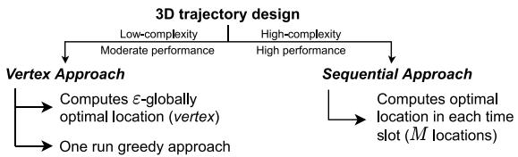  
Fig. 2. Motivation and brief description of proposed solutions.

Proof: Using $e ^ { - a } \ \approx \ 1 - \ a , \ \forall \ a \ \ll \ 1 .$ , in (5), since the $P _ { o u t } ^ { i }$ is a strictly increasing function of $\underset { \sim } { \widehat { P } } { } _ { o u t } ^ { i } .$ , the two optimization problems with objective functions $\hat { P } _ { o u t } ^ { i }$ and $P _ { o u t } ^ { i }$ are equivalent and share the same set of optimal points $( x ^ { * } [ m ] , y ^ { * } [ m ] , z ^ { * } [ m ] )$ [33]. The optimal values are related as $P _ { o u t } ^ { i * } = 1 - e ^ { - \dot { P } _ { o u t } ^ { i * } }$

Accounting the above proposition, we modify (P1) by substituting $\hat { P } _ { o u t } ^ { i } [ m ]$ instead of $P _ { o u t } ^ { i } [ m ]$ as follows

$$
\begin{array}{l l} \text {(P2)} \colon \min_ {\substack {\{x [ m ], y [ m ], z [ m ] \} \\ \forall m \in \mathcal {M}}} & \widehat {P} _ {a v g} \triangleq \frac {1}{M N} \sum_ {m = 1} ^ {M} \sum_ {i = 1} ^ {N} \widehat {P} _ {o u t} ^ {i} [ m ], \\ \text {s.t.}: & (C 1) - (C 4). \end{array}
$$

The objective function in (P2) is non-convex with respect to x[m], y[m] and z[m], $\forall m \ \in \mathcal { M }$ . We propose two solutions based on computational complexity, namely, a lowcomplexity vertex approach with moderate performance and a high performance sequential approach with higher complexity. However, the high computational complexity of sequential approach limits its practical usage when deploying the UAV in a realistic scenario for faster deployment. Thus, to mitigate this issue, we need to have a faster solution. Therefore, we introduce the vertex approach. The vertex approach is practically a very fast algorithm than the sequential one, but we have to sacrifice a bit on the performance to adopt this algorithm. Thus, there exists a trade-off between the performance and the complexity.

Moreover, the vertex approach is a greedy scheme that computes the optimal location of the UAV in 3D space, where the average outage probability is minimum, and builds a trajectory by using this optimal location (as discussed in Section IV). On the other hand, the sequential approach is a sub-optimal scheme that forms the trajectory while computing the optimal location at every time slot (shown in Fig. 4, Section V). The higher complexity of the sequential approach than that of the vertex approach is discussed in Section VI-A. The brief description on the two approaches is shown in Fig. 2.

## IV. VERTEX APPROACH

In this section, we propose a low-complexity greedy solution. The key idea is to first relax the velocity and on-board energy constraints, i.e., (C1) and (C4), respectively, in (P2), then obtain the optimal trajectory that comprises of the initial location, the optimal location (we call it vertex), and the final location. Note that the UAV will not directly go to the final location as the outage at the final location may not be minimum. Thus, the UAV will stay at the vertex till $m < M .$ Accordingly, we relax (C1) and (C4), and introduce a new problem to obtain the best location in 3D space (vertex) where the average outage probability is minimum. Then, we utilize this vertex to obtain a greedy solution to (P2) while accounting for velocity and on-board energy constraints. This approach is named as vertex approach because it constructs the UAV trajectory by following the vertex as shown in Fig. 3.

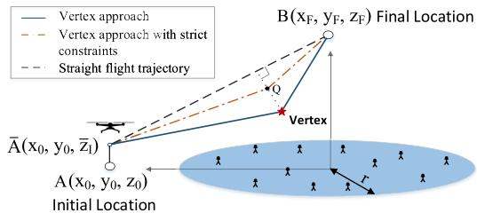  
Fig. 3. Vertex approach to obtain the 3D UAV trajectory.

## A. Vertex Computation

In this sub-section, our objective is to compute the vertex by relaxing (C1) and (C4) in (P2). As the outage probability $\hat { P } _ { o u t } ^ { i } [ m ]$ defined in (7) is a function of the location of fixed ground users $( x _ { i } , y _ { i } ) , \forall i \in \mathcal { N }$ and UAV, we will get a single location in 3D space where the average outage probability is minimum. Next, we define a new optimization problem (P3) to compute the vertex while omitting [m] as follows

$$
\text {(P3)} \colon \min _ {\{x, y, z \}} \bar {P} _ {o u t}, \quad \text {s.t.} \quad | x |, | y | \leq r; H \leq z \leq H _ {m a x},
$$

where $\begin{array} { r } { \bar { P } _ { o u t } \triangleq \frac { 1 } { N } \sum _ { i = 1 } ^ { N } \widehat { P } _ { o u t } ^ { i } } \end{array}$ with $\widehat { P } _ { o u t } ^ { i }$ defined as in (7). As users are present in the coverage field of radius r centered at origin, it is convenient to assume that the optimal points $x ^ { * }$ and $y ^ { * }$ will lie within the coverage field. Thus, $- r \leq x \leq$ $r , - r \leq y \leq r ,$ and z is constraint by $H _ { m a x } . \ H _ { m a x }$ is maximum flying height of the UAV. Since $\bar { P } _ { o u t }$ is non-convex in x, y, and z, it is difficult to obtain the globally optimal solution. Thus, we propose a -globally optimal solution where the obtained solution lies in the -neighbourhood of the globally optimal solution. In this, we first obtain the conditional convexity of $\bar { P } _ { o u t }$ . Thereafter, we apply steepest descent in the convex region and linear search in the non-convex region to obtain a low-complexity solution. In the following, we provide the region over which the function is convex.

Lemma 2: The region over which $\bar { P } _ { o u t }$ is jointly convex in $x , y ,$ and z is given by ${ \mathcal { R } } _ { C }$ , where $\mathcal { R } _ { C }$ is defined in (B.7).

Proof: See Appendix B.

Thus, the problem (P3) is convex in region $\mathcal { R } _ { C }$ and nonconvex in region $\mathcal { R } _ { N C } ~ = ~ \mathcal { R } / \mathcal { R } _ { C } .$ , where R is the region defined by $- r \leq x \leq r , - r \leq y \leq r ,$ and $H \leq z \leq H _ { m a x } .$ Then first, by applying steepest descent in $\mathcal { R } _ { C }$ with acceptable tolerance  and later using linear search in $\mathcal { R } _ { N C }$ by taking step size , we can obtain two optimal solutions within an acceptable tolerance . Best among the two solutions is termed as -globally optimal solution for which $\bar { P } _ { o u t }$ is minimum. Algorithm 1 describes the steps to obtain the -globally optimal solution $\mathcal { X } ^ { \ast }$ for (P3).

## B. UAV Trajectory Without Energy and Velocity Constraints

The solution to (P3) is called the vertex $( { \mathcal { X } } ^ { * } )$ represents the solution obtained by using Algorithm 1. Then, the path traced by the UAV in travelling from the initial (A) to $\mathcal { X } ^ { \ast }$ and then to the final location (B) while hovering at $\mathcal { X } ^ { \ast }$ for all $m \in { \mathcal { M } } \{ M \}$ is defined as the optimal path of (P2) when (C1) and (C4) are relaxed.

Algorithm 1 $\epsilon$-Globally Optimal Solution  
Input: $-r \leq x \leq r, -r \leq y \leq r, H \leq z \leq H_{max}, N, (x_i, y_i), \forall i \in \mathcal{N}, \mathcal{R}$ and $\epsilon$.  
Output: $\bar{P}_{out}^*$ with $\mathcal{X}^* = (x^*, y^*, z^*)$.  
1: Compute $\mathcal{R}_C$ using (B.7), as defined in Appendix B.  
2: Let $\mathcal{X} = (x, y, z)$. For $\mathcal{R}_C$, compute $\mathcal{X}_1^* = arg \min_{\mathcal{X}} \bar{P}_{out}$ using steepest descent with $\epsilon$.  
3: Evaluate $\mathcal{X}_2^* = arg \min_{\mathcal{X}} \bar{P}_{out}$ using linear search over the region $\mathcal{R}_{NC} = \mathcal{R}/\mathcal{R}_C$ by keeping step size $\epsilon$.  
4: Obtain $\mathcal{X}^* = arg \min_{\{\mathcal{X}_j^*\}} \bar{P}_{out}$ for $j \in \{1, 2\}$.  
5: Set $\bar{P}_{out}^*$ to $\bar{P}_{out}$ corresponding to $\mathcal{X}^*$.

The UAV velocity $V _ { o p t }$ is obtained for the slot over which the distance travelled by UAV is maximum which is given by

$$
V _ {o p t} = \max \biggl \{\frac {\| (\mathrm{x} _ {\mathrm{F}} , \mathrm{y} _ {\mathrm{F}} , \mathrm{z} _ {F}) - \mathcal {X} ^ {*} \|}{\tau}, \frac {\| (\mathrm{x} _ {0} , \mathrm{y} _ {0} , \mathrm{z} _ {0}) - \mathcal {X} ^ {*} \|}{\tau} \biggr \}.\tag{8}
$$

## C. The Proposed Vertex Approach

As seen earlier, the optimal trajectory when the energy and velocity constraints are relaxed consists of only three distinct locations - the initial, the vertex, and the final locations, where for all $m \in \mathcal { M } \backslash \{ M \}$ slots, the UAV hovers at the vertex. The presence of on-board energy (C1) and velocity (C4) constraints will restrict the UAV to reach the vertex $\mathcal { X } ^ { \ast }$ in a single time slot.

At the vertex $\mathcal { X } ^ { \ast }$ , the average outage probability is minimum. Our objective is to reach this vertex as quickly as possible and stay there for longer time periods to minimize the average outage. In case, due to insufficient on-board energy or low velocity, if the UAV cannot reach the vertex, then it should at least approach the vertex while transiting towards the final location. This implies that the UAV will move with velocity $V _ { m a x }$ in this approach.

Assuming that the sufficient energy is available with the UAV, whenever $V _ { m a x } ~ \ge ~ V _ { o p t }$ in (C4), with $V _ { o p t }$ defined in (8), the velocity constraint will not affect the trajectory. This is because the UAV can still reach the vertex $\mathcal { X } ^ { \ast }$ in a single time slot. Then, $V _ { o p t }$ can be treated as upper bound on the velocity. However, if $V _ { m a x } < V _ { o p t }$ , the UAV will first move in the direction of $\mathcal { X } ^ { \ast }$ and then towards the final location. This implies the UAV now takes multiple time slots to reach ${ \mathcal { X } } ^ { * } . ~ \mathrm { A s }$ a result, the UAV path consists of many locations while travelling towards $\mathcal { X } ^ { \ast }$ and then towards the final location. Here, the outage at all other locations will be higher than $\mathcal { X } ^ { \ast }$ . Therefore, $\widehat { P } _ { a v g }$ in this case will always be higher than that obtained when energy and velocity constraints are relaxed. Therefore, the $\widehat { P } _ { a v g }$ obtained in (P2) while relaxing (C1) and (C4) is defined as the asymptotic outage of $\widehat { P } _ { a v g } .$

To obtain the solution of (P2), i.e., while considering the on-board energy consumption, we present Algorithm 2. The steps involved in Algorithm 2 are as follows

Algorithm 2 Vertex Approach to Obtain Solution of (P2)

Input:  $(x_{0}, y_{0}, z_{0})$ ,  $(x_{F}, y_{F}, z_{F})$ , M, N,  $V_{max}$ ,  $(x_{i}, y_{i})$ ,  $\forall i \in N$ ,  $E_{tot}$ ,  $\tau$ , and  $\epsilon$ .

Output:  $\widehat{P}_{avg}^{*}$  with optimal  $x^{*}[m]$ ,  $y^{*}[m]$ , and  $z^{*}[m]$ ,  $\forall m \in M$ .

1: Find the vertex  $X^{*}$  using Algorithm 1.

2: if  $z_{0} &lt; H$  then

3: UAV flies vertically up with  $V_{max}$  for  $M_{I} = \left[\frac{H - z_{0}}{\tau V_{max}}\right]$  time slots. Set  $\bar{z}_{I} \triangleq z[M_{I}] = z_{0} + M_{I}\tau V_{max}$  and  $E_{I} \triangleq M_{I}E(V_{max})$  be the energy to reach  $\bar{z}_{I}$ . Calculate  $\widehat{P}_{out}^{i}[m]$  using (7),  $\forall m \in \{1, \cdots, M_{I}\}$ .

4: else

5: Set  $\bar{z}_{I} = z_{0}$  and  $M_{I} = E_{I} = 0$ .

6: Initially, set  $v_{allow} = V_{max}$  and assuming there is sufficient energy available.

7: Calculate  $M_{1} = \left[\frac{\|\left(x_{0}, y_{0}, \bar{z}_{I}\right) - X^{*}\|}{\tau V_{allow}}\right]$  and  $M_{2} = \left[\frac{\|\mathcal{X}^{*} - (\mathrm{x}_{\mathrm{F}}, \mathrm{y}_{\mathrm{F}}, z_{\mathrm{F}})\|}{\tau V_{allow}}\right]$ . Set  $M_{v} = M_{1} + M_{2}$ .

8: if  $M_{v} \leq M - M_{I}$  then

9: Make a straight line from  $(x_{0}, y_{0}, \bar{z}_{I})$  to  $X^{*}$  and from  $X^{*}$  to  $(x_{F}, y_{F}, z_{F})$  each containing  $M_{1}$  and  $M_{2}$  locations, respectively. For  $M - M_{I} - M_{v}$  time slots, the UAV will stay at  $X^{*}$ .

10: Set the obtained locations as solution i.e.,  $(x^{*}[m], y^{*}[m], z^{*}[m])$ ,  $\forall m \in \{M_{I} + 1, \cdots, M\}$ , and obtain  $\widehat{P}_{avg}^{*} \triangleq \frac{1}{MN}\sum_{m=1}^{M}\sum_{i=1}^{N}\widehat{P}_{out}^{i}[m]$  by calculating  $\widehat{P}_{out}^{i}[m]$  using (7).

11: else

12: Solve optimization problem (9), where Q passes through a location in a line segment drawn perpendicular to the straight flight trajectory from the  $X^{*}$ .

13: Repeat step 7 and step 9 with Q instead of  $X^{*}$  to obtain trajectory and calculate  $\widehat{P}_{avg}^{*}$  using step 10.

14: Calculate v[m] and then  $\mathcal{E}(v[m]), \forall m \in \{M_{I} + 1, \cdots, M\}$ , using (1) and (6), respectively. Then, calculate  $E_{h} = \sum_{m=M_{I}+1}^{M}\mathcal{E}(v[m])$ .

15: if  $E_{h} + E_{I} \leq E_{tot}$  then

16: The obtained is feasible and is the proposed vertex solution.

17: else

18: Find percentage energy decrease:  $E_{R} = \left(\frac{E_{h} + E_{I} - E_{tot}}{E_{h} + E_{I}}\right) \times 100.$ 

19: Find  $E(v_{allow})$  by substituting v[m] = v allow into (6).

20: Obtain new energy per slot:  $E_{N} = E(v_{allow}) - [(E_{R}/100) \times E(v_{allow})]$ .

21: Solve equation (6) i.e.,  $E(v[m]) = E_{N}$  for v[m]. Denote the roots as:  $V_{1}$  and  $V_{2}$ . Set v allow = max{V₁, V₂}. while  $E_{R} &gt; 0$  do

22: Repeat steps 7 to 22 with v allow and set the solution.

1) Initial Check on $\mathrm { z _ { 0 } . }$ : As described in Section III, whenever $z _ { 0 } ~ < ~ H$ , we constrained the UAV to move vertically in z-direction until minimum height H is achieved. Thus, if $z _ { 0 } < H ,$ , the UAV will take $\begin{array} { r } { M _ { I } = \lceil \frac { H - \mathbf { Z } _ { 0 } } { \tau V _ { m a x } } \rceil } \end{array}$ slots to reach a $z [ M _ { I } ] = z _ { 0 } + \tau M _ { I } V _ { m a x }$ . Beyond this, the UAV can make horizontal movement. Let $\bar { z } _ { I } \triangleq z [ M _ { I } ] = \mathrm { z } _ { 0 } + M _ { I } \tau V _ { m a x }$ , and ${ \mathcal { E } } _ { I } \triangleq M _ { I } { \mathcal { E } } ( V _ { m a x } )$ be the energy required to reach $\bar { z } _ { I }$ , where $\mathcal { E } ( V _ { m a x } )$ is calculated using (6) with $v [ m ] = V _ { m a x } .$

2) Time Constrained Trajectory: While we relax the energy constraint, the UAV moves with velocity $V _ { m a x }$ first to reach the vertex and then to the final location. The minimum time taken to reach the final location is $\begin{array} { r } { M _ { v } = \lceil \frac { \| ( \mathbf { x } _ { 0 } , \mathbf { y } _ { 0 } , \bar { z } _ { I } ) - \mathcal { X } ^ { * } \| } { \tau V _ { m a x } } \rceil + } \end{array}$ $\lceil \frac { \| \mathcal { X } ^ { * } - ( \mathrm { x } _ { \mathrm { F } } , \mathrm { y } _ { \mathrm { F } } , \mathrm { z } _ { \mathrm { F } } ) \| } { \tau V _ { m a x } } \rceil$ . If the UAV cannot reach the final location in the stipulated time, then to reduce its flight time, the UAV takes a shorter path closer to the straight-line path as shown in on October 27,2026 at 04:00:24 UTC from IEEE Xplore. Restrictions apply.

Fig. 3. We draw a perpendicular from the vertex to the shortest path. The UAV passes through one of the locations through this perpendicular such that it passes through a point close to the vertex and the time taken by the UAV is equal to M. This point Q as shown in Fig. 3 can be obtained by solving the following optimization problem

$$
\begin{array}{l} \min _ {Q} \| Q - \mathcal {X} ^ {*} \| \\ s. t. \left[ \frac {\| Q - \bar {A} \|}{\tau V _ {m a x}} \right] + \left[ \frac {\| Q - B \|}{\tau V _ {m a x}} \right] + \left[ \frac {\| \bar {A} - A \|}{\tau V _ {m a x}} \right] \leq M. \end{array}\tag{9}
$$

This part is described in Step 6-13 of Algorithm 2.

3) Time and Energy Constrained Trajectory: After obtaining the UAV trajectory with given velocity, we compute the total energy consumed by the UAV in travelling from the initial $\bar { \boldsymbol { A } } \triangleq \left( \mathrm { x } _ { 0 } , \mathrm { y } _ { 0 } , \bar { z } _ { I } \right)$ to the final location using $\mathcal { E } _ { h }$ - $\textstyle \sum _ { m = M _ { I } + 1 } ^ { M } { \mathcal { E } } { \big ( } v [ m ] { \big ) }$ , with $\mathcal { E } ( v [ m ] )$ defined in (6). If the energy consumed by the UAV is lesser than the total on-board energy available, $\mathrm { i . e . , ~ } \mathcal { E } _ { h } + \mathcal { E } _ { I } \leq \mathcal { E } _ { t o t }$ , then the obtained solution is feasible and this is our final vertex solution. However, if $\mathcal { E } _ { h } + \mathcal { E } _ { I } ~ > ~ \mathcal { E } _ { t o t }$ , we compute a new velocity, to meet the energy consumption constraint. This is done by calculating the percentage energy to be decreased from each slot to get the new energy requirement as described in Step 18, i.e., $\begin{array} { r } { \dot { \mathcal { E } } _ { R } = ( \frac { \mathcal { E } _ { h } + \mathcal { E } _ { I } - \mathcal { E } _ { t o t } } { \mathcal { E } _ { h } + \mathcal { E } _ { I } } ) \times \dot { 1 } 0 0 } \end{array}$ . This new energy requirement will result in the new maximum allowed UAV velocity denoted by $v _ { a l l o w }$ , which is obtained by solving (6) for $v [ m ]$ . After computing $v _ { a l l o w }$ , the UAV now travels with $v _ { a l l o w }$ instead of $V _ { m a x }$ . With this new $v _ { a l l o w } .$ , we again compute trajectory using Step 7-13 of Algorithm 2. Then with this new trajectory and velocity, we compute the energy consumed and iterate to meet the energy as well as time requirements. Therefore, $v _ { a l l o w }$ is a result of the trade-off between (C1) and (C4). Finally, the algorithm returns the greedy solution of (P2).

Remark 1: The implementation of the Algorithm 2 is based on the fact that the users’ location is known to the UAV. However, when the users location/mobility is unknown, various estimation methodologies must be used to aware the UAV with the locations of the ground users.

## D. Complexity Analysis

In this sub-section, we discuss the computational complexity of the vertex approach. First, we obtain the computations in obtaining the vertex location using Algorithm 1. Thereafter, we state the complexity of the proposed vertex approach.

-globally optimal solution: Algorithm 1 presents the solution to problem (P3). The algorithm first computes the convex region using (B.7) and then apply steepest descent in the convex region and linear search in the non-convex region. The steepest descent can take $\mathcal { O } ( \epsilon ^ { - 2 } )$ iterations to find an iterate where the Euclidean norm of the gradient is lesser than a pre-defined tolerance [34]. The worst-case complexity of Algorithm 1 when no convex regions are found is given by $\mathcal { O } ( N ^ { 3 } )$ , where N represents the set of $x , y ,$ and z. Then the number of iterations are given as $N _ { i t r } = \mathcal { O } ( \epsilon ^ { - 2 } ) \mathcal { O } ( N ^ { 3 } )$

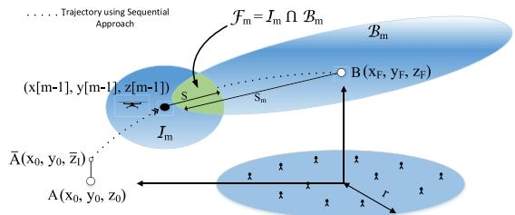  
Fig. 4. UAV 3D trajectory design under sequential approach.

Proposed vertex approach: Algorithm 2 finds the solution to (P2) using the greedy algorithm. The number of iterations involved in Algorithm 2 while ignoring Step 1 depends upon obtaining the velocity $v _ { a l l o w }$ that satisfies the energy constraint. Let $N _ { e }$ denote the iteration count. Then, the overall iterations involved in the vertex approach is given by $N _ { i t r } + N _ { e }$ , where $N _ { i t r }$ is for -globally optimal solution.

The numerical value obtained for $N _ { e }$ is described in Section VI-A. The term low-complexity used for the vertex approach will be verified when we discuss the average number of iterations involved in proposed approaches in Section VI-A.

## V. SEQUENTIAL APPROACH

Intuitively, whenever the UAV is away from the coverage field, to achieve low outage or better LoS link, the UAV has to make large upward movement. In the vertex approach, the greedy solution to (P2) does not guarantee an optimal trajectory. Thus, to obtain a better trajectory, in this section, we propose a sequential approach. Unlike vertex approach that travels in a single direction towards the vertex, the sequential approach searches for an optimal location in each slot sequentially to reach the final location by keeping in view the velocity constraint. Thereafter, the energy constraint is met in the same way as in vertex approach. Note that, as seen in vertex approach, if $z _ { 0 } ~ < ~ H$ , then UAV will make vertical movement to $\bar { z } _ { I }$ as shown in Section IV-C.

The reach of the UAV in each slot depends upon its location in the previous slot, since it is constrained by velocity. We adopt a heuristic approach where the UAV starts with the initial location and moves to an optimal new location in the next slot. Similarly, the UAV moves in further slots until the $( M - 1 ) ^ { t h }$ time slot. In this way, we sequentially obtain the optimal points in each slot to determine the UAV trajectory.

To find the optimal location in the $m ^ { t h }$ -time slot, we first determine the region where the UAV should move to. To determine this, we first define the reachable region of the UAV within a slot from the $( m - 1 ) ^ { t h }$ -time slot as $\mathcal { I } _ { m }$ . Here $\mathcal { I } _ { m }$ is a sphere of radius $S = \tau V _ { m a x }$ . Similarly, $B _ { m }$ defines the region from which the final location is reachable in $( M \mathrm { ~ - ~ } m )$ time slots. So, $B _ { m }$ is a sphere of radius $S _ { m } = \tau ( M { - } m ) V _ { m a x }$ , centered at the final location. The regions $\mathcal { I } _ { m }$ and $B _ { m }$ are shown in Fig. 4. Then, the feasible region for the UAV to move to in the $m ^ { t h }$ -time slot is given by $\mathcal { F } _ { m } = \mathcal { T } _ { m } \cap B _ { m }$ . Therefore, instead of the entire region $\mathcal { I } _ { m }$ , the optimal location in each time slot is searched in region $\mathcal { F } _ { m }$ . To obtain the optimal location in ${ \mathcal { F } } _ { m } .$ we identify the regions in $\mathcal { F } _ { m }$ , where the function is convex/non-convex and then use the search methods to obtain the next slot location to move to. The region over which the function is convex can be computed using (B.7) as described in Lemma 2.

Algorithm 3 Sequential Approach to Obtain Solution of (P2)
Input:  $(x_{0}, y_{0}, z_{0})$ ,  $(x_{F}, y_{F}, z_{F})$ , M, N,  $V_{max}$ ,  $(x_{i}, y_{i})$ ,  $\forall i \in N$ ,  $E_{tot}$ ,  $\tau$ ,  $R_{C}$  and  $\epsilon$ .
Output:  $\widehat{P}_{avg}^{*}$  with optimal  $x^{*}[m]$ ,  $y^{*}[m]$ , and  $z^{*}[m]$ ,  $\forall m \in M$ .
1: Repeat steps 2 to 5 of Algorithm 2 to find  $\bar{z}_{I}$ ,  $M_{I}$ , and  $E_{I}$  and calculate  $\bar{P}_{out}[m] \triangleq \frac{1}{N} \sum_{i=1}^{N} \widehat{P}_{out}^{i}[m]$ ,  $\forall m \in \{1, \ldots, M_{I}\}$ , with  $\widehat{P}_{out}^{i}[m]$  defined in (7).
2: Let  $X_{0} = (x_{0}, y_{0}, \bar{z}_{I})$ ,  $X_{F} = (x_{F}, y_{F}, z_{F})$ , and set  $v_{allow} = V_{max}$ .
3: for  $m = M_{I} + 1 : M - 1$  do
4: Set  $S = v_{allow} \tau$  and make a sphere of radius S centered at  $X_{0}$  and denote the region as  $I_{m}$ .
5: Set  $S_{m} = v_{allow}(M - m)\tau$  and make a sphere of radius  $S_{m}$  centered at  $X_{F}$  and denote it by  $B_{m}$ .
6: Find  $F_{m} = I_{m} \bigcap B_{m}$ .
7: Calculate  $R_{1} = F_{m} \bigcap R_{C}$  and  $R_{2} = F_{m}/R_{1}$ .
8: Let  $X[m] = (x[m], y[m], z[m])$ . For  $R_{1}$ , compute  $X_{1}^{*}[m] = arg\min_{X[m]} P_{out}[m] \triangleq \frac{1}{N} \sum_{i=1}^{N} \widehat{P}_{out}^{i}[m]$ , using GSS with  $\epsilon$ .
9: Evaluate  $X_{2}^{*}[m] = arg\min_{X[m]} P_{out}[m]$  using linear search over the region  $R_{2}$  by keeping step size  $\epsilon$ .
10: Obtain  $X^{*}[m] = arg\min_{X_{j}^{*}[m]} P_{out}[m]$  for  $j \in \{1, 2\}$ .
11: Update  $X_{0} = X^{*}[m]$  and set  $P_{out}^{*}[m] = P_{out}[m]$ .
12: Calculate  $\widehat{P}_{avg}^{*} = \frac{1}{M} \sum_{m=1}^{M} \bar{P}_{out}^{*}[m]$ .
13: Repeat steps 14-21 of Algorithm 2 to update  $v_{allow}$  and find  $E_{R}$ .
14: while  $E_{R} &gt; 0$  do
15: Repeat steps 3 to 13 with  $v_{allow}$  and find the solution.

Therefore, in ${ \mathcal { F } } _ { m } .$ , the convex region is given by $\mathcal { R } _ { C } \cap \mathcal { F } _ { m }$ $( \mathcal { R } _ { C }$ is defined in (B.7)), while the non-convex region is given by ${ \mathcal { F } } _ { m } / ( { \mathcal { R } } _ { C } \cap { \mathcal { F } } _ { m } )$ . In the convex region, we use faster search technique like golden section search (GSS) [35] while in the non-convex region, we obtain the optimal point using linear search with -tolerance to find the minima in the specified interval. In each iteration, two solutions are obtained, one corresponding to the GSS applied over convex region and other corresponding to the linear search over non-convex region. The minimum among the two is chosen as the solution for the $m ^ { t h } .$ -time slot.

The steps describing the sequential approach are defined in Algorithm 3. On-board energy (C1) and velocity (C4) constraints in (P2) are satisfied using the same concept as discussed in Section IV-C. Flight duration constraint is automatically met as the search area is restricted to $\begin{array} { r l } { \mathcal { F } _ { m } } & { { } = } \end{array}$ ${ \mathcal { T } } _ { m } \cap B _ { m }$

Remark 2: In contrast to the vertex approach, where the UAV follows a single direction to reach the vertex location, the sequential approach follows a more accurate path that leads the UAV into a region with low outage in minimum possible time. This happens because the increase in the computation of UAV locations in the sequential approach will enable it to find the optimal location in every slot while reaching the vertex location. However, in the sequential approach, if we constrain the UAV to move in one particular direction, the obtained location will overlap with the vertex location in the vertex approach. Thus, the vertex approach can be viewed as a subset of the sequential approach.

TABLE II  
SYSTEM PARAMETERS CONSIDERED FOR SIMULATIONS

Parameter Symbol Value
Reference, threshold SNR  $\tilde{\gamma}_{o}, \gamma_{th}$  52.5 dB, -3.01 dB
Environment parameters C, D 10, 0.6
Additional attenuation factor  $\kappa$  0.2
Pathloss exponent  $\bar{\alpha}$  2.3
Blade profile, induced power  $P_{o}, P_{i}$  79.86 W, 88.63 W
Tip of rotor blade  $U_{tip}$  120
Fuselag drag ratio  $d_{f}$  0.6
Fuselag equipment plate area  $s_{p}$  0.0151 m²
Mean rotor induced velocity  $v_{o}$  4.01 m/s
Air density  $\rho$  1.225 kg/m³
Rotor disc area  $A_{r}$  0.503 m²
Aircraft's weight W 20 N

$z(m)$ $x(m)$ $y(m)$ $z(m)$ $z(m)$ $z(m)$ $z(m)$ $z(m)$ $z(m)$ $z(m)$ $z(m)$ $z(m)$ $z(m)$ $z(m)$ $z(m)$ $z(m)$ $z(m)$ 

\( z(m)
\)

$h$ $A$ $A'$ $B$ $B'$ $Q$ $Q'$ $V$ $V'$ $V'$ $V''$ $V''$ $V''''$ $V'''$ $V'''''$ $V'''''''$ $V'''''''''$ $V'''''''''$ $V'''''''''$ $V'''''''''$ $V'''''''''$ $V'''''''''$ $V'''''''''$ $V'''''''''$ $V'''''''''$ $V'''''''''$ $V'''''''''$ $V'''''''''$ $V'''''''''$&lt;|content_end|&gt;

Fig. 5. Insights on sub-optimal trajectories of UAV.

## A. Complexity Analysis

In the sequential approach, the sub-optimal solution is achieved sequentially by obtaining the optimal location in each time slot. As discussed in Algorithm 3, in each iteration to obtain the optimal location, the 3D GSS is applied on convex region and linear search on the non-convex region for $M - 1$ time slots. In 3D GSS, the search spaces $\Delta \boldsymbol { x } = ( \boldsymbol { x } ^ { u b } - \boldsymbol { x } ^ { l b } )$ $\Delta y = ( y ^ { u b } - y ^ { l b } )$ ), and $\Delta z = ( z ^ { u b } - z ^ { l b } )$ reduces by a factor of 0.618 in each iteration $[ 3 6 ] . ~ \mathcal { X } ^ { l b }$ and $\dot { \chi } ^ { u b }$ denote the lower and upper bounds on variable $\mathcal { X } \in \{ x , y , z \}$ , respectively. Let $N _ { f e }$ denote the number of iterations to compute $v _ { a l l o w }$ . Then, the overall number of iterations involved in Algorithm 3 is given by $2 N _ { f } N _ { f e } ( \ln ( \frac { \operatorname* { m a x } \{ \Delta x , \Delta y , \Delta z \} } { \epsilon } ) )$ , where $N _ { f } = M - 1$ In Section VI, we provide the numerical values of $N _ { f e }$

## VI. RESULTS AND DISCUSSION

In this section, we present the 3D UAV trajectory and its performance for the proposed strategies and compare it with the benchmark schemes. We consider a setup with 10 ground users [25], randomly distributed in a circle of radius 120 m, centered at origin. The UAV is assumed to fly from the initial location (−150, 0, 0) m to the final location (0, 0, 150) m. The system parameters taken for simulations are listed in Table II.

## A. Trajectory Design Insights

Through Fig. 5, we provide insights into the 3D UAV trajectory. It is plotted for both vertex and sequential approaches with $V _ { m a x } = 3 0 ~ \mathrm { m / s } , T = 2 0 ~ \mathrm { s } , M = 5 0 0 ,$ , and $H = 1 5$ m for different values of $\mathcal { E } _ { t o t } = \{ 3 0 0 0 , 2 7 0 0 \}$ J. Along with the proposed trajectories from vertex and sequential approaches, the vertex point obtained using -globally optimal algorithm. As shown in the Fig. 5, for vertex approach with $\mathcal { E } _ { t o t } ~ =$ 3000 J, the UAV first travels towards the vertex and then travels to the final location in a straight line with velocity $V _ { m a x }$ while hovering at the vertex. For the sequential approach, it first attains some height and then reaches the location with the minimum average outage probability. This is because it does not follow vertex location but instead searches the best location with minimum average outage probability in each time slot sequentially. On the other hand, when $\mathcal { E } _ { t o t } ~ = ~ 2 7 0 0$ J, for vertex approach, due to less energy available, UAV cannot reach the vertex. Thus, it tries to approach the vertex by passing through point Q depending upon the energy available. Also, it can be seen that UAV initially moves vertically to point A¯ to attain a minimum height H as defined in Section IV-C.

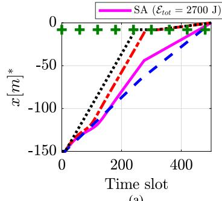  
(a)

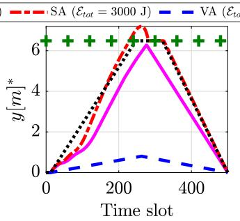  
(b)

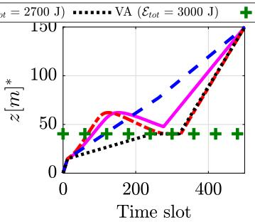  
(c)

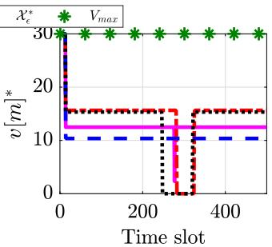  
(d)  
Fig. 6. Variation of (a) x[m]∗, (b) y[m]∗, (c) z [m]∗, and (d) v[m]∗ with number of time slots for different values of energy availability constraint, $\mathcal { E } _ { t o t } .$ SA and VA are sequential and vertex approach, respectively.

In the vertex approach, to obtain $v _ { a l l o w } .$ , the average number of iteration $N _ { e }$ counts to 12. On the other hand, in the sequential approach, the average number of iterations counted for $N _ { f e }$ and $N _ { f }$ is 9 and 49, respectively. Further, to analyze the complexity of both approaches, we use MATLAB on an Intel Core i7 processor with a 3.20 GHz CPU clock to perform simulations. We consider the UAV maximum velocity as $V _ { m a x } = 3 0 ~ \mathrm { m / s }$ , total flight time as $T = 2 0 ~ \mathrm { s }$ which is discretized in $M = 5 0$ time slots and total on-bard energy availability as $\mathcal { E } _ { t o t } = 4 0 0 0 \mathrm { ~ J ~ }$ . The total execution time to obtain the UAV trajectory using the vertex approach is approximately 12.4 s, whereas, the sequential approach took around 45.6 s to optimize the trajectory. This difference increases further when the number of time slots M increases. Hence, we conclude that the vertex approach gives a low-complexity solution compared to the sequential approach. The performance comparison of both approaches will be studied in the next sub-section.

To gain further insights into the UAV trajectory obtained using the proposed approaches, we plot Fig. 6 to show how the optimal $x [ m ] ^ { * } , \ y [ m ] ^ { * } , \ z [ m ] ^ { * }$ , and $v [ m ] ^ { * }$ of UAV is changing with time. Figs. 6(a)-(d) is plotted with respect to $\mathcal { E } _ { t o t } = \{ 2 7 0 0 , 3 0 0 0 \}$ J in (C1) when $V _ { m a x } , T , H .$ , and M are set to 30 m/s, 20 s, 15 m, and 500, respectively. The presence of energy constraint restricts the UAV to fly with $V _ { m a x }$ and finds the new maximum allowed velocity $v _ { a l l o w }$ at which the UAV should fly. Increasing $\mathcal { E } _ { t o t }$ in constraint (C1), will increase $v _ { a l l o w } .$ . As a result, for both approaches, the UAV can reach the vertex and stay there for longer periods of time. For example, in Figs. 6(a)-(c), when $\mathcal { E } _ { t o t } = 2 7 0 0 \mathrm { ~ J ~ }$ , the UAV does not arrive at the optimal location; instead, it flies to the final location from a certain midway point near the vertex point. However, for $\mathcal { E } _ { t o t } = 3 0 0 0 \ \mathrm { J } .$ , it reaches the optimal location and stays there for some time. From Fig. 6(d), it is observed that the UAV first travels with $V _ { m a x }$ in the z-direction without changing the (x, y) coordinates to satisfy (C3) as discussed in Section IV-C and then travels with $v _ { a l l o w }$ . Also, zero UAV velocity in Fig. 6(d) corresponds to hovering at the vertex point.

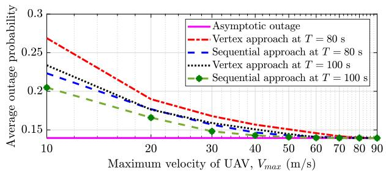  
Fig. 7. Change in average outage probability with $V _ { m a x }$ for different flight time T.

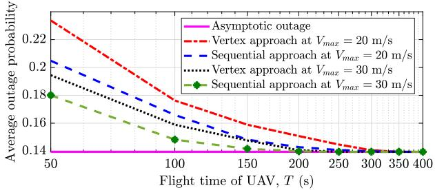  
Fig. 8. Change in average outage probability with T for different maximum velocity Vmax .

## B. Performance Analysis of Proposed Schemes

To understand the impact on $\widehat { P } _ { a v g }$ for different $V _ { m a x }$ and flight time T, while assuming sufficient on-board energy availability at the UAV, we plot Figs. 7, and 8. In Fig. $7 , \widehat { P } _ { a v g }$ is plotted against $V _ { m a x }$ for $T = \{ 8 0 , 1 0 0 \} \mathrm { ~ s ~ }$ . In Fig. $8 , \ \widehat { P } _ { a v g }$ is plotted against T for $V _ { m a x } = \{ 2 0 , 3 0 \}$ m/s. From Fig. 6(d), we observe that the UAV flies with velocity $v _ { a l l o w }$ in both the approaches if the on-board energy is limited. However, if sufficient on-board energy is available, the UAV flies with $V _ { m a x }$ At higher velocity, UAV reaches the optimal location quickly and therefore, the outage probability is minimized. The same is applicable to flight time.

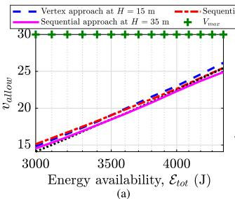

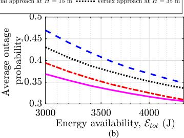  
Fig. 9. (a) $v _ { a l l o w }$ of UAV due to energy constraint (C1) at different values of $\mathcal { E } _ { t o t }$ . (b) Impact of $\mathcal { E } _ { t o t }$ on average outage probability.

Therefore, for both higher velocity and flight time, the UAV will spend more time at the vertex. Since the vertex corresponds to the location of minimum outage probability, spending more time at vertex will decrease the outage probability, and it will finally converge to the asymptotic outage of $\widehat { P } _ { a v g }$ in (P2). It can be observed that the sequential approach performs better than the vertex approach for any fixed value of $V _ { m a x }$ and T because the sequential approach searches the best location in every time slot instead of following the vertex.

From Lemma 1, we have seen that the energy consumption is a pseudoconvex function of the UAV velocity. Therefore, it will have an impact on the velocity by which the UAV should fly. Fig. 9(a) shows how the total energy available, $\mathcal { E } _ { t o t }$ , affects the UAV velocity, with $V _ { m a x } = 3 0 ~ \mathrm { m / s }$ and $T = 2 0 ~ \mathrm { s }$ . We consider the case when the energy consumed by the UAV when flying at $V _ { m a x }$ always exceeds the energy threshold $\mathcal { E } _ { t o t } .$ , i.e., step 15 of Algorithm 2 is not satisfied for both the approaches. From Fig. 7, we observed that more the $V _ { m a x }$ , lower is $\widehat { P } _ { a v g }$ . However, increasing $V _ { m a x } > V _ { 0 }$ results in higher energy consumption, where $V _ { 0 }$ is the velocity at which the energy consumption is minimal as obtained in (A.3). Hence, to obtain the minimum $\widehat { P } _ { a v g }$ , the constraint in (C1) should be satisfied with equality. Because of this, there exists a trade-off in the velocity by which the UAV moves, denoted by $v _ { a l l o w }$ . It is observed that increasing the value of $\mathcal { E } _ { t o t }$ will increase $v _ { a l l o w }$ . As we increase H for fixed $\mathcal { E } _ { t o t } ,$ more number of time slots are consumed to reach the minimum height H, therefore, $\mathcal { E } _ { I }$ will increase. Certainly, the energy left for the rest of the time will decrease. As a result, to compensate the energy left for the $m \in \{ M _ { I } , \ldots , M \}$ time slots, $v _ { a l l o w }$ will further reduce. Therefore, $v _ { a l l o w }$ decreases as H increases.

Similarly, in Fig. 9(b), we study the impact of $\mathcal { E } _ { t o t }$ on average outage probability using the same values of $V _ { m a x }$ and T. The monotonic decreasing nature of $\widehat { P } _ { a v g }$ is desired because $v _ { a l l o w }$ increases with an increase in $\mathcal { E } _ { t o t }$ as observed from Fig. 9(a). Thus, the UAV reaches the vertex quickly and spends longer time at that location, decreasing $\widehat { P } _ { a v g }$

## C. Performance Comparison With Benchmark Schemes

To show the effectiveness of the proposed approach, in Figs. 10(a)-(d), we compare the proposed approaches with the benchmark schemes. The approaches are compared by varying the maximum velocity $V _ { m a x } ,$ , the flight time T of the UAV, on-board energy availability $\mathcal { E } _ { t o t }$ , and number of users N. Fig. 10(a) is plotted with $T = 2 0 \mathrm { s } , N = 1 0$ , and $\mathcal { E } _ { t o t } = 6 0 0 0 \mathrm { J }$ Fig. 10(b) is plotted with $V _ { m a x } = 2 0 \mathrm { m } / \mathrm { s } , N = 1 0$ , and $\mathcal { E } _ { t o t } ~ = ~ 6 0 0 0 ~ \mathrm { ~ i ~ }$ . Fig. 10(c) is plotted with $V _ { m a x } \ = \ 3 0 \ \mathrm { s } ,$ $T = 2 0 ~ \mathrm { s }$ , and $N = 1 0$ . Fig. 10(d) is plotted with $V _ { m a x } = 2 0 ~ \mathrm { s } ,$ $T = 2 0 ~ \mathrm { s } ,$ and $\mathcal { E } _ { t o t } = 4 0 0 0 \mathrm { ~ J ~ }$ . Minimum height H and time slots M are set to 15 m and 50, respectively, for all the subfigures. The benchmark schemes considered for comparison are the fly-and-hover scheme [20], particle swarm optimization (PSO) [37]–[38], and straight flight trajectory [39]. In the flyand-hover scheme, the UAV flies sequentially over the users before reaching the destination. It first computes the sequence of users to be visited to minimize the average outage probability. Following that, it obtains the UAV trajectory while keeping in view the energy consumption constraint. Thus, the horizontal coordinate (x, y) will change according to the user’s location, whereas the vertical coordinate (z) of the UAV is set to the z-coordinate of the vertex till the UAV covers all the users. In PSO, each particle refers to a randomly initialized possible solution. The velocity and position of each particle are then updated in each iteration based on information about the particle’s prior velocity, the particle personal best, and the best position ever occupied by any particle in the swarm.

Flying over users reduces the outage probability of that particular user but does not ensure a decrease in the average outage probability for all users. Whereas in PSO, the non-convexity of the objective function obstructs the UAV to reach the vertex but instead travels through a high outage locations. The vertex approach computes the optimal location where the average outage probability over all users is minimum rather than focussing on the single user. On the other hand, sequential approach, computes that location in every time slot. Therefore, the two proposed trajectory designs, namely the vertex and sequential approach outperform the other schemes and achieves a minimum average outage probability. Furthermore, the trajectory obtained by the sequential approach achieves better performance than the vertex approach. On an average our proposed vertex and sequential approach provide on an average 31% and 52% improvement over the benchmark schemes, respectively.

## VII. CONCLUSION

In this paper, a framework to optimize the UAV trajectory has been presented with an objective to minimize the average outage probability in a UAV-assisted 5G communication system. The UAV is constrained with both the maximum velocity and on-board energy availability. To solve this problem, we propose two trajectory optimization approaches: the vertex and the sequential approach. The vertex approach is based on finding an optimal location with minimum average outage probability and constructing the trajectory based on that location. On the other hand, the sequential approach adopts a heuristic method to obtain the trajectory by searching the best location sequentially in each time slot. This approach provides better performance at the cost of complexity when compared to the vertex approach. Extensive simulations show that both approaches achieve better average outage probability compared to the benchmark schemes. Besides, the optimal location obtained in the vertex approach could be used as a referential baseline to obtain the asymptotic outage of average outage probability while assuming the sufficient on-board energy is available with the UAV. This work can also be extended to a multi-UAV scenario while taking into account practical constraints such as frequency sharing, and anti-collisions, etc.

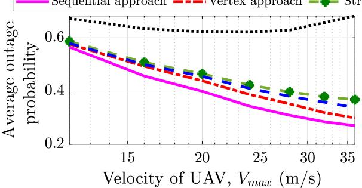

(a)  
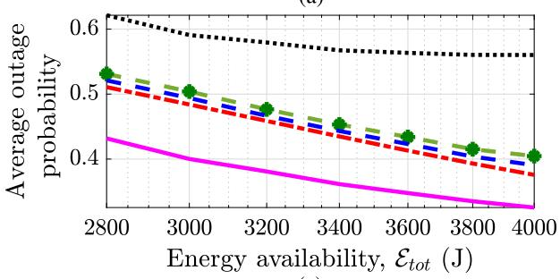  
(c)  
Fig. 10. Comparison of proposed approaches with existing benchmark schemes.

## APPENDIX A

PSEUDOCONVEXITY OF E(v[m]) WITH RESPECT TO v[m]

In this section, we prove the pseudoconvexity of $\mathcal { E } ( v [ m ] )$ with respect to v[m]. Since $\mathcal { E } ( v [ m ] )$ expression defined in (6) is difficult to investigate due to the second term being a square root. Since $\rho = 1 . 2 2 5 , s _ { p } \ll 1$ , and $< 0$ sin $\varphi < 1$ , the second term in ϑ, $\begin{array} { r } { \mathrm { i . e . , ~ } \frac { 1 } { 2 } \rho s _ { p } v [ m ] ^ { 2 } \sin \varphi \ll 1 } \end{array}$ . Then the thrust-toweight ratio $\begin{array} { r } { k = 1 + \frac { \overline { { \frac { 1 } { 2 } } } \rho s _ { p } v [ m ] ^ { 2 } \sin \varphi } { W } \approx 1 } \end{array}$ , because the second term $\frac { \frac { 1 } { 2 } \rho s _ { p } v [ m ] ^ { 2 } \sin \varphi } { W } \approx 0 .$ . Thus, $\vartheta v _ { c }$ becomes a constant term and can be omitted from the prove.

We consider first-order Taylor approximation of the second term when $v [ m ] \gg v _ { o } ,$ , where $v _ { o }$ is the mean rotor induced velocity. The approximation is given as [13, eq. (13)]

$$
\begin{array}{r} \mathcal {E} (v [ m ]) \approx \tau P _ {o} \Bigg (1 + \frac {3 v [ m ] ^ {2}}{U _ {t i p} ^ {2}} \Bigg) + \tau P _ {i} \frac {v _ {o}}{v [ m ]} \\ + \frac {1}{2} d _ {f} \rho s A _ {r} \tau v [ m ] ^ {3}. \end{array}\tag{A.1}
$$

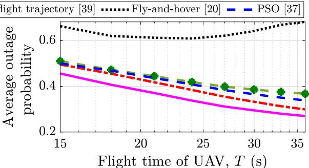

(b)  
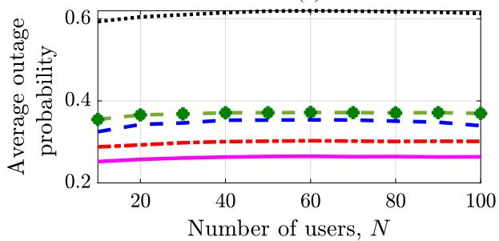  
(d)

Differentiating $\mathcal { E } ( v [ m ] )$ with respect to $v [ m ]$ , we get

$$
\frac {\partial \mathcal {E} (v [ m ])}{\partial v [ m ]} = \frac {6 \tau P _ {o} v [ m ]}{U _ {t i p} ^ {2}} - \frac {\tau P _ {i} v _ {o}}{2 v [ m ] ^ {2}} + \frac {3}{2} d _ {f} \rho s A _ {r} \tau v [ m ] ^ {2}.\tag{A.2}
$$

Equating $\frac { \partial \mathcal { E } ( v [ m ] ) } { \partial v [ m ] } = 0$ , we obtain two roots (one negative and other positive). Since velocity is positive, we discard the negative root. The positive root is given by

$$
\begin{array}{r l} & V _ {0} \triangleq v [ m ] = - \sqrt {\frac {P _ {o} ^ {2}}{h _ {e} ^ {2}} + \frac {\sqrt [ 3 ]{2} \sqrt [ 3 ]{w _ {e}}}{6 h _ {e}} - \frac {2 ^ {2 / 3} P _ {i} U _ {t i p} ^ {2} v _ {o}}{6 \sqrt [ 3 ]{w _ {e}}}} - \frac {P _ {o}}{h _ {e}} \\ & \qquad + \left(- \frac {\sqrt [ 3 ]{2} \sqrt [ 3 ]{w _ {e}}}{6 h _ {e}} + \frac {2 ^ {2 / 3} P _ {i} U _ {t i p} ^ {2} v _ {o}}{6 \sqrt [ 3 ]{w _ {e}}} + \frac {2 P _ {o} ^ {2}}{h _ {e} ^ {2}} \right. \\ & \qquad \left. + \frac {2 \sqrt {6} P _ {o} ^ {3}}{h _ {e} ^ {2} \sqrt {- \frac {2 ^ {2 / 3} h _ {e} ^ {2} P _ {i} U _ {t i p} ^ {2} v _ {o}}{\sqrt [ 3 ]{w _ {e}}} + \sqrt [ 3 ]{2} h _ {e} \sqrt [ 3 ]{w _ {e}} + 6 P _ {o} ^ {2}}}\right) ^ {1 / 2}, \end{array}\tag{A.3}
$$

$$
g _ {e} = 2 A _ {r} ^ {3} d _ {f} ^ {3} P _ {i} ^ {3} \rho^ {3} s ^ {3} U _ {t i p} ^ {1 2} v _ {o} ^ {3} + 8 1 P _ {o} ^ {4} P _ {i} ^ {2} U _ {t i p} ^ {4} v _ {o} ^ {2}, h _ {e} =
$$

$$
A _ {r} d _ {f} \rho s U _ {t i p} ^ {2}
$$

$$
w _ {e} = \sqrt {g _ {e}} - 9 P _ {o} ^ {2} P _ {i} U _ {t i p} ^ {2} v _ {o}
$$

It can be seen by solving $\begin{array} { r } { ( \mathsf { A } . 2 ) , \frac { \partial \mathcal { E } ( v [ m ] ) } { \partial v [ m ] } < 0 } \end{array}$ for $v [ m ] \in$ $[ 0 , V _ { 0 } )$ and $\frac { \partial \mathcal { E } ( v [ m ] ) } { \partial v [ m ] } > 0$ for $v [ m ] \in ( V _ { 0 } , \infty ]$ . This proves the pseudoconvexity of (A.1) with respect to v[m].

As the approximation error is small, we assume $\mathcal { E } ( v [ m ] )$ defined in (6) to be a pseudoconvex function of v[m].

## APPENDIX B

CONDITIONAL JOINT CONVEXITY OF $\bar { P } _ { o u t } \ \mathrm { I N } \ x , y , \mathrm { A N D } \ z$

Although $\bar { P } _ { o u t }$ is non-convex with respect to $x , y ,$ and $z ,$ we can still find the region where $\bar { P } _ { o u t }$ is jointly convex.

Considering $L _ { i } = \sqrt { ( x - x _ { i } ) ^ { 2 } + ( y - y _ { i } ) ^ { 2 } } , \forall i \in \mathcal { N }$ , where $L _ { i }$ represents the horizontal distance between the projection of UAV on the ground and the $i ^ { t h } .$ -user. It can also be written in form of $L _ { i } = \sqrt { f ( x , y ) }$ , where $f ( x , y ) = ( x - x _ { i } ) ^ { 2 } + ( y - y _ { i } ) ^ { 2 }$ The function $f ( x , \ y )$ has $\begin{array} { r } { \frac { \partial ^ { 2 } f ( \dot { x } , \dot { y } ) } { \partial x ^ { 2 } } = 2 , \frac { \partial ^ { 2 } f ( \dot { x } , y ) } { \partial y ^ { 2 } } = 2 . } \end{array}$ , and $\begin{array} { r } { \frac { \partial ^ { 2 } f ( x , y ) } { \partial y \partial x } = \frac { \partial ^ { 2 } f ( x , y ) } { \partial x \partial y } = 0 . } \end{array}$ , then, $d e t [ \mathcal { H } ( f ( x , y ) ) ] > 0$ , where Hessian ${ \mathcal { H } } ( f ( x , y ) ) = { \begin{array} { l } { \left[ { \begin{array} { l l } { { \frac { \partial ^ { 2 } f ( x , y ) } { \partial x ^ { 2 } } } } & { { \frac { \partial ^ { 2 } f ( x , y ) } { \partial x \partial y } } } \\ { { \frac { \partial ^ { 2 } f ( x , y ) } { \partial y \partial x } } } & { { \frac { \partial ^ { 2 } f ( x , y ) } { \partial y ^ { 2 } } } } \end{array} } \right] } } \end{array} $ . This implies that $f ( x , \ y )$ is jointly convex in x and $y .$ Since square root is a monotonic increasing function, therefore it preserves the convexity [40]. Substituting $L _ { i }$ in $\widehat { P } _ { o u t } ^ { i }$ defined in (7), we get,

$$
\widehat {P} _ {o u t} ^ {i} \triangleq \frac {\frac {\gamma_ {t h}}{\widetilde {\gamma} _ {o}} \left(L _ {i} ^ {2} + z ^ {2}\right) ^ {\alpha}}{\frac {(1 - \kappa)}{1 + C \exp \left( \right.- D \left[ \right. \frac {1 8 0}{\pi} \sin^ {- 1} \left( \right.\frac {z}{\sqrt {\left(L _ {i} ^ {2} + z ^ {2}\right)}} - C \left. \right]\left. \right)} + \kappa}.\tag{B.1}
$$

Since $L _ { i }$ is jointly convex in x and y, then proving convexity of $\widehat { P } _ { o u t } ^ { i }$ defined in (B.1) with respect to $L _ { i }$ will result in joint convexity of $\widehat { P } _ { o u t } ^ { i }$ in x and y. The double derivative of $\hat { P } _ { o u t } ^ { i }$ with respect to $L _ { i }$ is given as

$$
\begin{array}{c} \frac {\partial^ {2} \widehat {P} _ {o u t} ^ {i}}{\partial L _ {i} ^ {2}} = \mathcal {A} \left[ \frac {w _ {i} D z}{\alpha \pi} \left(\frac {(2 \alpha - 1) L _ {i}}{(w _ {i} \kappa + 1) ^ {2}} + \frac {9 0 D z (1 - w _ {i} \kappa)}{\pi (w _ {i} \kappa + 1) ^ {3}}\right) \right. \\ \left. + \frac {(w _ {i} + 1) ((2 \alpha - 1) L _ {i} ^ {2} + z ^ {2})}{1 8 0 (1 - \kappa) (w _ {i} \kappa + 1)} \right], \quad (\mathrm{B} \end{array}\tag{B.2}
$$

where A = 360α $\textstyle \frac { \gamma _ { t h } } { \tilde { \gamma } _ { \mathrm { ~ e ~ } } } ( 1 \ - \ \kappa ) ( L _ { i } ^ { 2 } \ + \ z ^ { 2 } ) ^ { \alpha - 2 }$ and $\begin{array} { r l } { w _ { i } } & { { } = } \end{array}$ $\scriptstyle C \exp ( - D ( { \frac { 1 8 0 } { \pi } }$ sin− $\begin{array} { r } { \mathbf { \nabla } ^ { - 1 } \big ( \frac { z } { \sqrt { L _ { i } ^ { 2 } + z ^ { 2 } } } \big ) - C ) ) } \end{array}$ . It is observed that, $\frac { \partial ^ { 2 } \widehat { P } _ { o u t } ^ { i } } { \partial L _ { i } ^ { 2 } }$ is positive for all values of $L _ { i }$ when z is fixed. This implies the convexity of $\widehat { P } _ { o u t } ^ { i }$ in $L _ { i }$ .

Thus, if we prove that $\dot { P } _ { o u t } ^ { i }$ is conditionally jointly convex in $L _ { i } .$ , and z, the same can be applied to $x , y ,$ and z. The Hessian of $\widehat { P } _ { o u t } ^ { i }$ is given as $\mathcal { H } ( \widehat { P } _ { o u t } ^ { i } ) = \left[ \begin{array} { l l } { \frac { \partial ^ { 2 } \widehat { P } _ { o u t } ^ { i } } { \partial L _ { i } ^ { 2 } } } & { \frac { \partial ^ { 2 } \widehat { P } _ { o u t } ^ { i } } { \partial L _ { i } \partial z } } \\ { \frac { \partial ^ { 2 } \widehat { P } _ { o u t } ^ { i } } { \partial z \partial L _ { i } } } & { \frac { \partial ^ { 2 } \widehat { P } _ { o u t } ^ { i } } { \partial z ^ { 2 } } } \end{array} \right]$ , where $\frac { \partial ^ { 2 } \widehat { P } _ { o u t } ^ { i } } { \partial L _ { i } ^ { 2 } }$ is given by (B.2) and $\frac { \partial ^ { 2 } \widehat { P } _ { o u t } ^ { i } } { \partial z \partial L _ { i } } = \frac { \partial ^ { 2 } \widehat { P } _ { o u t } ^ { i } } { \partial L _ { i } \partial z }$ is given as

$$
\begin{array}{r} \frac {\partial^ {2} \widehat {P} _ {o u t} ^ {i}}{\partial z \partial L _ {i}} = \frac {\mathcal {A} _ {1}}{2} \Bigg [ \frac {(\alpha - 1) (w _ {i} + 1) L _ {i} z}{4 5 D (1 - \kappa)} \\ + \left(\frac {1 8 0 D L _ {i} z (w _ {i} \kappa - 1)}{\pi^ {2} (w _ {i} \kappa + 1) ^ {2}} - \frac {(2 \alpha - 1) (L _ {i} ^ {2} - z ^ {2})}{\pi (w _ {i} \kappa + 1)}\right) \times \frac {w _ {i}}{\alpha} \Bigg ], \end{array}\tag{B.3}
$$

$$
\begin{array}{r l} \frac {\partial^ {2} \widehat {P} _ {o u t} ^ {i}}{\partial z ^ {2}} = \mathcal {A} _ {1} \bigg [ & \frac {w _ {i} L _ {i}}{\alpha \pi} \bigg (\frac {(2 \alpha + 1) z}{(w _ {i} \kappa + 1)} + \frac {9 0 D L _ {i} (1 - w _ {i} \kappa)}{\pi (w _ {i} \kappa + 1) ^ {2}} \bigg) \\ & + \frac {(w _ {i} + 1) ((2 \alpha - 1) z ^ {2} + L _ {i} ^ {2})}{1 8 0 D (1 - \kappa)} \bigg ], \end{array}\tag{B.4}
$$

where $\begin{array} { r l r } { \mathcal { A } _ { 1 } } & { { } = } & { 3 6 0 D \alpha \frac { \gamma _ { t h } } { \tilde { \gamma } _ { o } } \frac { ( 1 - \kappa ) } { ( w _ { i } \kappa + 1 ) } ( L _ { i } ^ { 2 } + z ^ { 2 } ) ^ { \alpha - 2 } } \end{array}$ and $\begin{array} { r } { w _ { i } \ = \ C \exp ( - D ( \frac { 1 8 0 } { \pi } \sin ^ { - 1 } ( \frac { z } { \sqrt { L _ { * } ^ { 2 } + z ^ { 2 } } } ) - C ) ) } \end{array}$ . From (B.2), $\frac { \partial ^ { 2 } \widehat { P } _ { o u t } ^ { i } } { \partial L _ { i } ^ { 2 } } > 0 , \forall L _ { i } , z$ and from (B.4), $\frac { \partial ^ { 2 } \widehat { P } _ { o u t } ^ { i } } { \partial z ^ { 2 } } > 0 , \forall L _ { i }$ , and $z > L _ { i } / 4 . 5$ . To show $d e t [ \mathcal { H } ( \widehat { P } _ { o u t } ^ { i } ) ] > 0 .$ , we need to show that $\begin{array} { r } { \mathcal { K } _ { 1 } \triangleq \frac { \partial ^ { 2 } \widehat { P } _ { o u t } ^ { i } } { \partial L _ { i } ^ { 2 } } - \frac { \partial ^ { 2 } \widehat { P } _ { o u t } ^ { i } } { \partial z \partial L _ { i } } > 0 . } \end{array}$ , and $\begin{array} { r } { { \cal { K } } _ { 2 } \triangleq \frac { \partial ^ { 2 } \widehat { P } _ { o u t } ^ { i } } { \partial z ^ { 2 } } - \frac { \partial ^ { 2 } \widehat { P } _ { o u t } ^ { i } } { \partial z \partial L _ { i } } > 0 } \end{array}$ By substituting any value for $z > L _ { i } / 4 . 5$ , say $z = L _ { i } / 4$ in $\kappa _ { 1 }$ and $\kappa _ { 2 }$ , we get,

$$
\begin{array}{l} \mathcal {K} _ {1} = \mathcal {A} _ {2} \left(\frac {2 0 7 0 (2 \alpha - 1) w _ {i} D}{\pi (w _ {i} \kappa + 1) ^ {2}} + \frac {\alpha (2 4 \alpha - 7) (w _ {i} + 1)}{(w _ {i} \kappa + 1) (1 - \kappa)} \right. \\ \left. + \frac {8 1 0 0 0 w _ {i} D ^ {2} (1 - w _ {i} \kappa)}{\pi^ {2} (w _ {i} \kappa + 1) ^ {3}}\right), \end{array}\tag{B.5}
$$

$$
\begin{array}{l} \mathcal {K} _ {2} = \mathcal {A} _ {2} \left(\frac {9 0 \pi (4 6 \alpha - 7) w _ {i} D}{\pi \left(w _ {i} \kappa + 1\right) ^ {2}} + \frac {\alpha (2 3 - 6 \alpha) \left(w _ {i} + 1\right)}{\left(w _ {i} \kappa + 1\right) (1 - \kappa)} \right. \\ \left. + \frac {3 2 4 0 0 0 w _ {i} D ^ {2} \left(1 - w _ {i} \kappa\right)}{\pi^ {2} \left(w _ {i} \kappa + 1\right) ^ {3}}\right), \end{array} \tag {B}\tag{B.6}
$$

where $\mathcal { A } _ { 2 } = 2 ^ { 5 - 4 \alpha } 1 7 ^ { \alpha - 2 } \frac { \gamma _ { t h } } { \widetilde { \gamma } _ { \circ } } ( 1 - \kappa ) ( L _ { i } ^ { 2 } ) ^ { \alpha - 1 }$ . It can be easily observed that $\kappa _ { 1 } > 0$ o and $\kappa _ { 2 } > 0$ from (B.5) and (B.6), respectively. This alongwith (B.2) and (B.4) proves that $\hat { P } _ { o u t } ^ { i }$ is jointly convex in $L _ { i }$ and z with condition $z ~ > ~ L _ { i } / 4 . 5$ From $L _ { i }$ , the above condition can be written as ${ \mathcal { R } } _ { C } ^ { i } \triangleq z ^ { i } >$ $\frac { \sqrt { ( x - x _ { i } ) ^ { 2 } + ( y - y _ { i } ) ^ { 2 } } } { 4 . 5 }$ . The region $\mathcal { R } _ { C } ^ { i }$ represents an inverted cone with center at $( x _ { i } , y _ { i } )$ . For each user we obtain similar cones. So, the overall the region $( \mathcal { R } _ { C } )$ over which $\bar { P } _ { o u t }$ is jointly convex is given as the intersection region of all these cones as

$$
\mathcal {R} _ {C} = \bigcap_ {i = 1} ^ {N} \mathcal {R} _ {C} ^ {i}.\tag{B.7}
$$

## REFERENCES

[1] N. Gupta, D. Mishra, and S. Agarwal, “3D-trajectory design for outage minimization in UAV-assisted 5G communication system,” in Proc. IEEE CCNC, Las Vegas, NV, USA, Jan. 2021, pp. 1–6.

[2] B. Li, Z. Fei, and Y. Zhang, “UAV communications for 5G and beyond: Recent advances and future trends,” IEEE Internet Things J., vol. 6, no. 2, pp. 2241–2263, Apr. 2019.

[3] Y. Zeng, X. Xu, and R. Zhang, “Trajectory design for completion time minimization in UAV-enabled multicasting,” IEEE Trans. Wireless Commun., vol. 17, no. 4, pp. 2233–2246, Apr. 2018.

[4] Y. Zeng, R. Zhang, and T. J. Lim, “Wireless communications with unmanned aerial vehicles: Opportunities and challenges,” IEEE Commun. Mag., vol. 54, no. 5, pp. 36–42, May 2016.

[5] P. Yang, X. Cao, C. Yin, Z. Xiao, X. Xi, and D. Wu, “Proactive dronecell deployment: Overload relief for a cellular network under flash crowd traffic,” IEEE Trans. Intell. Transp. Syst., vol. 18, no. 10, pp. 2877–2892, Oct. 2017.

[6] M. Mozaffari, W. Saad, M. Bennis, Y.-H. Nam, and M. Debbah, “A tutorial on UAVs for wireless networks: Applications, challenges, and open problems,” IEEE Commun. Surveys Tuts., vol. 21, no. 3, pp. 2334–2360, 3rd Quart., 2019.

[7] S. Zhang, H. Zhang, Q. He, K. Bian, and L. Song, “Joint trajectory and power optimization for UAV relay networks,” IEEE Commun. Lett., vol. 22, no. 1, pp. 161–164, Jan. 2018.

[8] M. Hua, L. Yang, C. Pan, and A. Nallanathan, “Throughput maximization for full-duplex UAV aided small cell wireless systems,” IEEE Wireless Commun. Lett., vol. 9, no. 4, pp. 475–479, Apr. 2020.

[9] S. Zeng, H. Zhang, K. Bian, and L. Song, “UAV relaying: Power allocation and trajectory optimization using decode-and-forward protocol,” in Proc. IEEE Int. Conf. Commun. Workshops (ICC Workshops), Kansas City, MO, USA, May 2018, pp. 1–6.

[10] C. You, X. Peng, and R. Zhang, “3D trajectory design for UAVenabled data harvesting in probabilistic LoS channel,” in Proc. IEEE Global Commun. Conf. (GLOBECOM), Waikoloa, HI, USA, Dec. 2019, pp. 1–6.

[11] Q. Wu, Y. Zeng, and R. Zhang, “Joint trajectory and communication design for multi-UAV enabled wireless networks,” IEEE Trans. Wireless Commun., vol. 17, no. 3, pp. 2109–2121, Mar. 2018.

[12] Y. Zeng and R. Zhang, “Energy-efficient UAV communication with trajectory optimization,” IEEE Trans. Wireless Commun., vol. 16, no. 6, pp. 3747–3760, Jun. 2017.

[13] Y. Zeng, J. Xu, and R. Zhang, “Energy minimization for wireless communication with rotary-wing UAV,” IEEE Trans. Wireless Commun., vol. 18, no. 4, pp. 2329–2345, Apr. 2019.

[14] C. D. Franco and G. Buttazzo, “Energy-aware coverage path planning of UAVs,” in Proc. IEEE Int. Conf. Auton. Robot Syst. Competitions, Vila Real, Portugal, Apr. 2015, pp. 111–117.

[15] T. Zhang, G. Liu, H. Zhang, W. Kang, G. K. Karagiannidis, and A. Nallanathan, “Energy-efficient resource allocation and trajectory design for UAV relaying systems,” IEEE Trans. Commun., vol. 68, no. 10, pp. 6483–6498, Oct. 2020.

[16] F. Zeng et al., “Resource allocation and trajectory optimization for QoE provisioning in energy-efficient UAV-enabled wireless networks,” IEEE Trans. Veh. Technol., vol. 69, no. 7, pp. 7634–7647, Jul. 2020.

[17] M. Hua, Y. Wang, C. Li, Y. Huang, and L. Yang, “Energyefficient optimization for UAV-aided cellular offloading,” IEEE Wireless Commun. Lett., vol. 8, no. 3, pp. 769–772, Jun. 2019.

[18] S. Ahmed, M. Z. Chowdhury, and Y. M. Jang, “Energy-efficient UAV relaying communications to serve ground nodes,” IEEE Commun. Lett., vol. 24, no. 4, pp. 849–852, Apr. 2020.

[19] G. Yang, R. Dai, and Y.-C. Liang, “Energy-efficient UAV backscatter communication with joint trajectory design and resource optimization,” IEEE Trans. Wireless Commun., vol. 20, no. 2, pp. 926–941, Feb. 2021.

[20] M. T. Nguyen and L. B. Le, “Flight scheduling and trajectory control in UAV-based wireless networks,” in Proc. IEEE Wireless Commun. Netw. Conf. (WCNC), Seoul, South Korea, May 2020, pp. 1–6.

[21] S. Eom, H. Lee, J. Park, and I. Lee, “UAV-aided wireless communication designs with propulsion energy limitations,” IEEE Trans. Veh. Technol., vol. 69, no. 1, pp. 651–662, Jan. 2020.

[22] X. Jing, J. Sun, and C. Masouros, “Energy aware trajectory optimization for aerial base stations,” IEEE Trans. Commun., vol. 69, no. 5, pp. 3352–3366, May 2021.

[23] T. Zhang, J. Lei, Y. Liu, C. Feng, and A. Nallanathan, “Trajectory optimization for UAV emergency communication with limited user equipment energy: A safe-DQN approach,” IEEE Trans. Green Commun. Netw., vol. 5, no. 3, pp. 1236–1247, Sep. 2021.

[24] Y. Gao, L. Xiao, F. Wu, D. Yang, and Z. Sun, “Cellular-connected UAV trajectory design with connectivity constraint: A deep reinforcement learning approach,” IEEE Trans. Green Commun. Netw., vol. 5, no. 3, pp. 1369–1380, Sep. 2021.

[25] N. Gupta, S. Agarwal, and D. Mishra, “Trajectory design for throughput maximization in UAV-assisted communication system,” IEEE Trans. Green Commun. Netw., vol. 5, no. 3, pp. 1319–1332, Sep. 2021.

[26] A. Meng, X. Gao, Y. Zhao, and Z. Yang, “Three-dimensional trajectory optimization for energy-constrained UAV-enabled IoT system in probabilistic LoS channel,” IEEE Internet Things J., vol. 9, no. 2, pp. 1109–1121, Jan. 2022.

[27] M. Mozaffari, W. Saad, M. Bennis, and M. Debbah, “Drone small cells in the clouds: Design, deployment and performance analysis,” in Proc. IEEE Global Commun. Conf. (GLOBECOM), San Diego, CA, USA, Dec. 2015, pp. 1–6.

[28] C. You and R. Zhang, “3D trajectory optimization in Rician fading for UAV-enabled data harvesting,” IEEE Trans. Wireless Commun., vol. 18, no. 6, pp. 3192–3207, Jun. 2019.

[29] W. Khawaja, I. Guvenc, D. W. Matolak, U.-C. Fiebig, and N. Schneckenburger, “A survey of air-to-ground propagation channel modeling for unmanned aerial vehicles,” IEEE Commun. Surveys Tuts., vol. 21, no. 3, pp. 2361–2391, 3rd Quart., 2019.

[30] A. Al-Hourani, S. Kandeepan, and S. Lardner, “Optimal LAP altitude for maximum coverage,” IEEE Wireless Commun. Lett., vol. 3, no. 6, pp. 569–572, Dec. 2014.

[31] A. M. Hayajneh, S. A. R. Zaidi, D. C. McLernon, and M. Ghogho, “Optimal dimensioning and performance analysis of drone-based wireless communications,” in Proc. IEEE Globecom Workshops, Washington, DC, USA, Dec. 2016, pp. 1–6.

[32] A. Girdher, A. Bansal, and A. Dubey, “On the performance of SLIPTenabled DF relay-aided hybrid OW/RF network,” IEEE Syst. J., early access, Jan. 4, 2022, doi: 10.1109/JSYST.2021.3135957.

[33] D. Mishra, S. De, and C.-F. Chiasserini, “Joint optimization schemes for cooperative wireless information and power transfer over Rician channels,” IEEE Trans. Commun., vol. 64, no. 2, pp. 554–571, Feb. 2016.

[34] C. Cartis, N. Gould, and P. Toint, “On the complexity of the steepestdescent with exact linesearches,” FUNDP. Namur Center Complex Syst. (NAXYS), Namur, Belgium, NAXYS Rep. 16, 2012.

[35] Y.-C. Chang, “N-dimension golden section search: Its variants and limitations,” in Proc. BMEI, Tianjin, China, Oct. 2009, pp. 1–6.

[36] G. Prasad, D. Mishra, K. Tourki, A. Hossain, and M. Debbah, “QoSand energy-aware optimal resource allocations in DF relay-assisted FSO networks,” IEEE Trans. Green Commun. Netw., vol. 4, no. 3, pp. 914–926, Sep. 2020.

[37] A. Brown and D. Anderson, “Trajectory optimization for high-altitude long-endurance UAV maritime radar surveillance,” IEEE Trans. Aerosp. Electron. Syst., vol. 56, no. 3, pp. 2406–2421, Jun. 2020.

[38] H. Teng, I. Ahmad, A. Msm, and K. Chang, “3D optimal surveillance trajectory planning for multiple UAVs by using particle swarm optimization with surveillance area priority,” IEEE Access, vol. 8, pp. 86316–86327, 2020.

[39] C. Zhan, Y. Zeng, and R. Zhang, “Energy-efficient data collection in UAV enabled wireless sensor network,” IEEE Wireless Commun. Lett., vol. 7, no. 3, pp. 328–331, Jun. 2018.

[40] S. Boyd and L. Vandenberghe, Convex Optimization. Cambridge, U.K.: Cambridge Univ. Press, 2004.

Nishant Gupta (Graduate Student Member, IEEE) received the B.Tech. degree in electronics and communication engineering from Chandigarh Engineering College, Mohali, India, in 2015, and the M.Tech. degree in electronics and communication from Panjab University, Chandigarh, India, in 2018. He is currently pursuing the Ph.D. degree with the Department of Electrical Engineering, Indian Institute of Technology Ropar, India. His research interests include 5G networks, UAV communications and optimization.

Deepak Mishra (Member, IEEE) received the Ph.D. degree in electrical engineering from IIT Delhi in 2017. He has been a Senior Research Associate with the School of Electrical Engineering and Telecommunications, UNSW Sydney, Australia, since August 2019. Before that, he was a Postdoctoral Researcher with the Department of Electrical Engineering (ISY), Linköping University, Linköping, Sweden, from August 2017 to July 2019. His current research interests include energy harvesting cooperative communication networks, massive

MIMO, backscattering, physical layer security, as well as signal processing and energy optimization schemes for the uninterrupted operation of wireless networks.

Satyam Agarwal (Member, IEEE) received the Ph.D. degree in electrical engineering from IIT Delhi in 2016. He is currently an Assistant Professor with the Department of Electrical Engineering, IIT Ropar, India. Prior to this, he was an Assistant Professor with IIT Guwahati. In 2017, he was a Postdoctoral Researcher with Politecnico di Torino, Turin, Italy. His research interests are in the wide areas of wireless communication networks, including nextgeneration networks, 5G networks and architecture, and air-borne networks.