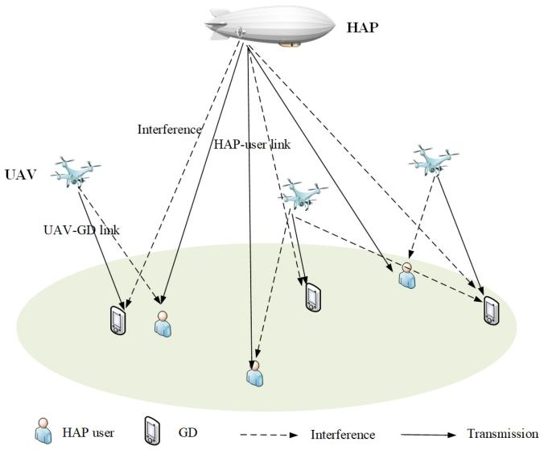
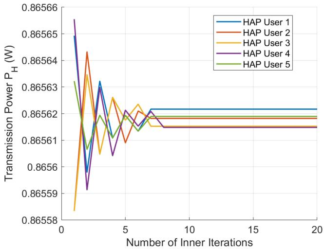
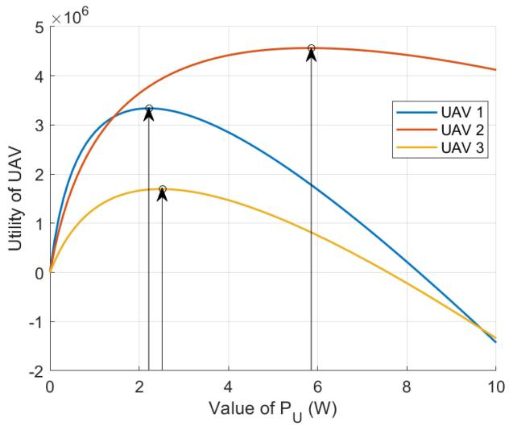
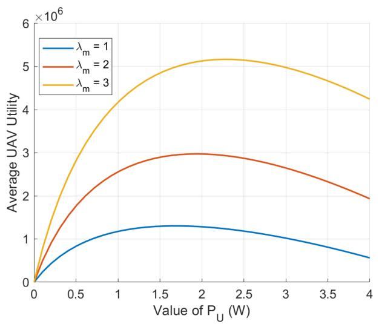
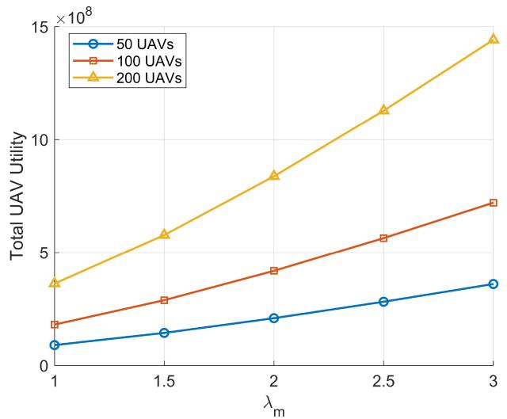
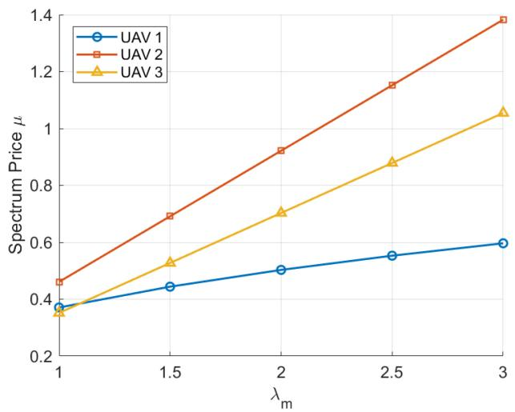
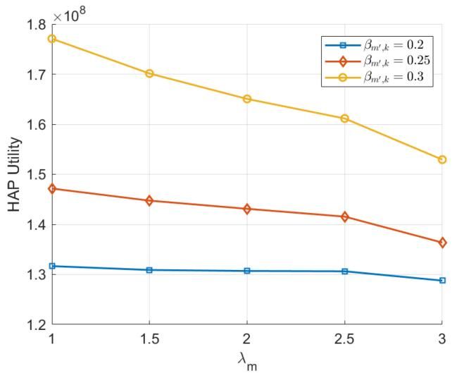
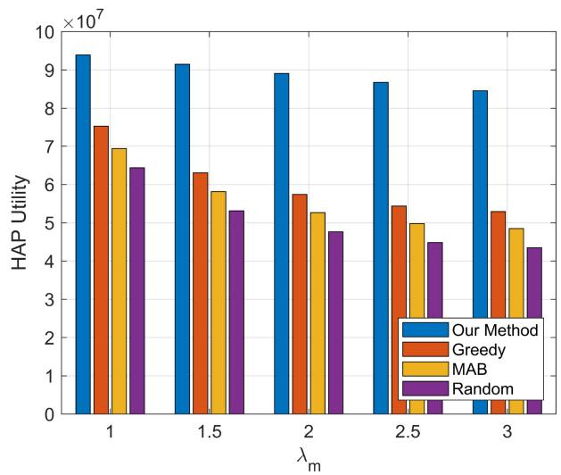
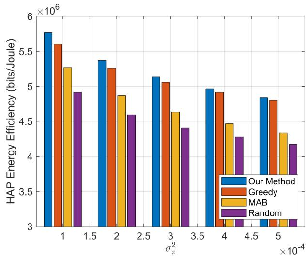

# Energy Efficient Spectrum Sharing and Resource Allocation for 6G Air-Ground Integrated Networks

Tao Huang Graduate Student Member, IEEE, Jingyuan Liu , Graduate Student Member, IEEE, Zheng Chang , Senior Member, IEEE, Yao Wei, Xu Zhao, and Ying-Chang Liang , Fellow, IEEE

Abstract—In this paper, we investigate the spectrum sharing and resource allocation scheme for air-ground integrated wireless network which consists of multiple autonomous aerial vehicles (AAVs) and a high altitude platform (HAP). We consider the AAVs are required to provide services or execute certain missions in the area that HAP owns the spectrum and other resources. Correspondingly, we propose an energy efficient spectrum sharing and resource allocation scheme so that the AAVs can flexibly utilize the radio resources within the area without degrading the quality of service (QoS) of the HAP. In the proposed scheme, we jointly optimize pricing of spectrum and transmit power to maximize the utility of both the HAP and AAVs in the considered system in an energy efficient manner. A game theoretic approach is then presented to find the spectrum sharing and resource allocation strategies for both HAP and AAVs and the problem has been addressed via convex optimization. Our extensive simulations demonstrate marked improvements in system utility, spectrum and energy efficiency, and also highlight the effectiveness of the proposed scheme.

Index Terms—Spectrum sharing, autonomous aerial vehicles, resource allocation, game theory.

# I. INTRODUCTION

# A. Background

HE AIR-GROUND integrated wireless network (AGN) is considered as an essential part for the six generation (6G) network evolution owing to its advantages on flexible deployment and extensive data coverage. Within the

Received 17 June 2024; revised 13 October 2024 and 15 December 2024; accepted 5 January 2025. Date of publication 9 January 2025; date of current version 7 August 2025. This work is partly supported by the National Natural Science Foundation of China (NSFC) under Grant No. 62071105, NSF of Sichuan under Grant No. 25GJHZ0092 and by Horizon EU Grant No. 101086159 and No. 101131117. The associate editor coordinating the review of this article and approving it for publication was K. Shiomoto. (Corresponding author: Jingyuan Liu.)

Tao Huang is with the Center for Intelligent Networking and Communications, University of Electronic Science and Technology of China, Chengdu 611731, China, and also with the Research Institute of China Telecom, Guangzhou, China.

Jingyuan Liu is with the School of Computer Science and Engineering, University of Electronic Science and Technology of China, Chengdu 611731, China (e-mail: liujingyuan@std.uestc.edu.cn).

Zheng Chang is with the School of Computer Science and Engineering, University of Electronic Science and Technology of China, Chengdu 611731, China, and also with the Faculty of Information Technology, University of Jyväskylä, 40014 Jyväskylä, Finland.

Yao Wei and Xu Zhao are with the Research Institute of China Telecom, Guangzhou, China.

Ying-Chang Liang is with the Center for Intelligent Networking and Communications, University of Electronic Science and Technology of China, Chengdu 611731, China.

Digital Object Identifier 10.1109/TNSM.2025.3527651

framework of AGN, autonomous aerial vehicles (AAVs) have emerged with a great potential to provide real-time, flexible, and resilient network services in many kinds, owing to their high maneuverability and flexibility [1]. The versatility and adaptability of AAVs enable them to perform a wide range of applications, including surveillance, agricultural monitoring, disaster management, and logistics. Their ability to provide aerial perspectives and operate in challenging environments has significantly enhanced the efficiency and effectiveness of these operations.

For example, in the sensing data collection operation, AAVs can obtain the sensing data in a Line-of-Sight (LoS) link from the ground Internet of Thing (IoT) devices and then transmit it to the data center for further processing, which may ease the heavy transmit power consumption for low-power IoT devices [2]. To improve network efficiency, high-altitude platforms (HAP) with larger communication coverage are also employed in the AGN [3]. Nevertheless, due to the limited spectrum resources, onboard computation and storage resources, it is still challenging to promote the emerged AGN and cooperate the functions of the AAVs and HAP [4]. In addition, the proliferation of AAVs also poses significant challenges, particularly in terms of spectrum management and resource allocation. As the AAVs increasingly rely on wireless communication to perform their tasks, the demand for spectrum resources has surged. This demand exacerbates the already pressing issue of spectrum scarcity, necessitating novel solutions to ensure efficient and equitable spectrum utilization.

Spectrum sharing, which allows multiple entities to access the same frequency bands, significantly improving spectrum efficiency and utilization, emerges as a pivotal solution to address the growing demand for spectrum resources in AAV networks. Traditional spectrum allocation methods, which assign fixed frequencies to specific users, are insufficient in the dynamic and high-demand environment of AAV operations. AAVs operate in diverse and often challenging environments where maintaining reliable communication links is paramount. Dynamic spectrum sharing mechanisms, in this context, enable AAVs to adaptively select and utilize the best available frequency bands, thereby enhancing the robustness and reliability of communication links. This adaptability is particularly important in scenarios involving high mobility, fluctuating interference levels, and varying network demands. Therefore, exploring spectrum sharing and resource allocation in AGN with AAV and HAP are underscored by the need to efficiently utilize limited spectral resources, enhance communication reliability, optimize network performance, and achieve energy efficiency. As AGN continues to evolve and expand, developing advanced techniques for spectrum sharing and intelligent resource allocation will be essential to fully harness its potential and ensure its seamless integration into the broader wireless communication ecosystem.

However, there are few works about the cooperation of AAV and HAP, in terms of resource sharing and allocation. Moreover, although there are a few works on the spectrum sharing in AAV-based wireless communication system [5], [6], how to model and study the behaviours of the AAV and HAP when they have to interact with each other for resource sharing are of significance. Game theoretic approaches can be applied here, which can leverage market dynamics to allocate spectrum resources based on demand and supply, promoting efficient utilization and minimizing interference among the AAVs and HAP. Advanced techniques can also be explored here to enable AAVs to detect and exploit under-utilized spectrum bands, enhancing spectral efficiency while avoiding harmful interference with existing transmissions [6]. In this paper, we investigate energy efficient spectrum sharing and resource allocation scheme so that the AAVs can flexibly utilize the radio resources within the area without degrading the quality of service (QoS) of the HAP. The proposed scheme is able to shed the light on the way of efficient cooperation of the AAV and HAP in the AGN.

# B. Related Work

Recently, there has been increasing interests in studying resource allocation for terrestrial and AAV wireless networks [7]. In this context, spectrum sharing emerges as a crucial aspect, enabling efficient utilization of limited spectral resources. Spectrum sharing in wireless networks aims to address the challenge of spectrum scarcity by enabling multiple users or network to coexist on the same frequency bands. Various strategies have been proposed to optimize spectrum utilization while maintaining network performance and fairness. Wu et al. propose a game-theory-based spectrum sharing mechanism for industrial IoT networks in high-speed railways [8]. This method addresses the unique requirements of high-mobility environments, ensuring efficient spectrum allocation among competing users. Similarly, Yin et al. present a joint spectrum and power allocation scheme for device-to-device (D2D) communications underlaying cellular networks, highlighting the potential of game-theoretic frameworks to balance interference and resource allocation [10]. Salameh et al. explore energy efficient spectrum sharing in cognitive radio green IoT networks. The proposed approach integrates spectrum management with energy consumption considerations, promoting sustainable network operations [11]. Liu et al. further advance this concept by optimizing channel access in unlicensed spectrum for ultra-reliable low-latency communications (URLLC) using deep reinforcement learning (DRL) techniques, demonstrating significant improvements in both spectrum efficiency and energy consumption [12]. The authors of [13] investigate the use of blockchain technology to facilitate secure and energy efficient spectrum sharing in IoT networks. Blockchain’s decentralized nature can ensure trustworthy spectrum transactions and reducing the risk of malicious interference. Qian et al. in [14] address the challenge of spectrum sharing in massive IoT environments within 5G/B5G networks. The authors propose a multi-operator spectrum sharing model that leverages cooperative game theory to enhance spectral efficiency and manage interference. Hu et al. propose a blockchain-based framework for managing multioperator spectrum sharing. By utilizing blockchain concept, the authors ensure secure and transparent transactions, reducing disputes and improving trust among operators [24].

As we can see, spectrum sharing in the terrestrial network has been widely explored over the past decades. However, AAV networks introduce additional complexities to spectrum sharing due to their mobility, varying altitudes, and dynamic network topologies. The integration of AAVs into wireless networks necessitates specialized approaches to manage spectrum resources effectively. Bai et al. provide a comprehensive survey on RL-based approaches for autonomous multi-AAV wireless networks. RL techniques enable AAVs to adaptively learn optimal spectrum allocation strategies in dynamic environments, enhancing overall network performance and resilience [1]. Qi et al. also address energy efficiency by proposing a resource allocation framework for AAV-assisted vehicular networks with spectrum sharing, demonstrating substantial gains in energy savings and communication reliability [16]. In [17], the authors propose a lightweight blockchain-based framework for secure spectrum sharing in space-air-ground-integrated networks. This approach ensures secure and transparent spectrum transactions, addressing security concerns and enhancing trust among network participants. Tun et al. present a resource sharing model specifically designed for multi-AAV-assisted wireless networks. Their model focuses on optimizing the allocation of spectrum resources among AAVs to enhance communication performance [18]. In [19], Wang et al. introduce a twostage Stackelberg game-based approach for dynamic spectrum sharing in AAV-assisted communications. This approach models the interaction between primary users (licensed spectrum holders) and secondary users (AAVs) to optimize spectrum allocation assuming fixed transmit power of AAV. In [20], the authors explore energy-efficient spectrum access for massive IoT devices over AAV-enabled cellular networks. Their study focuses on balancing spectral efficiency with energy consumption, crucial for extending the operational life of battery-constrained AAVs. The authors of [21] propose an intelligent offloading and resource allocation framework for heterogeneous aerial access IoT networks. By incorporating machine learning techniques, the framework dynamically optimizes resource allocation based on real-time network conditions and user demands.

In [22], Wang et al. introduce a pricing-based power control mechanism for inter-cell AAV-assisted vehicle communication. Utilizing game theory, the authors model the interaction between AAVs and ground vehicles to optimize power control and minimize interference. The authors of [23] propose an intelligent learning framework for spectrum sharing and AAV trajectory optimization. By combining external interaction data with internal inference mechanisms, the framework adapts to dynamic environmental conditions and user demands. In [24], Qian et al. explore a Stackelberg game-based spectrum leasing model for many-to-one AAV communications. This approach addresses the spectrum leasing problem by setting optimal prices for spectrum access, encouraging efficient use of spectral resources among multiple AAVs.

The reviewed literature shows the critical importance of spectrum sharing in both wireless and AAV networks. Various approaches, including game theory, energy efficient algorithms, blockchain integration, and RL, offer promising solutions to the spectrum scarcity challenge. As AAV applications continue to expand, further research into adaptive, secure, and efficient spectrum sharing mechanisms will be essential to fully realize the potential of these advanced communication networks. However, as we can see from the summary of the previous works, there are few works on the design of spectrum sharing in hybrid AAV-HAP network, where AAV can reuse the HAP’s spectrum for data delivery or service provisioning. In this context, we consider to investigate the spectrum sharing design in the hybrid HAP-AAV network where the AAV can adjust its transmit power to reduce the interference to the HAP and HAP can adjust the pricing strategy on the spectrum. This is also quite different from the most of the previous works that transmit power is usually considered to be constant when studying the interactions among different spectrum sharing parties. Moreover, we use a Stackelberg game to investigate the behaviors of the HAP and AAVs during the spectrum sharing process. The HAP is able to adjust its price strategy for spectrum sharing without deteriorate the QoS of its users, and also its transmit power to obtain the best profit. The AAVs can also adjust its power level it optimize its own profit, and rent the spectrum from the HAPs. The game formulation in this context is quite different from previous works and needs to be thoroughly analyzed.

# C. Contribution and Organization

In this work, we investigate the spectrum sharing and resource allocation for the AGN with multiple AAVs and HAP. Bearing in mind the aforementioned works and challenges, the key contributions of this paper include the following aspects:

• We investigate the spectrum sharing and resource allocation scheme for AGN which consists of multiple autonomous aerial vehicles (AAVs) and a high altitude platform (HAP). We consider the AAVs and HAP are owned by different parties which is practical for future network design. The AAVs are required to provide services or execute certain missions in the area that HAP own the spectrum and other resources. In this case, the AAVs need to utilize the HAP’s spectrum for service provisioning.   
• Then we propose an energy efficient spectrum sharing and resource allocation scheme so that the AAVs can flexibly utilize the radio resources within the area without degrading the quality of service (QoS) of the HAP. In the proposed scheme, we jointly optimize spectrum and

flowchart

Fig. 1. HAP and AAV Wireless Network.

transmit power to maximize the utility of both the AAVs and HAP in the considered system.

• We first utilize a game theoretic approach is to find the spectrum sharing and resource allocation strategies for both HAP and AAVs. Then the formulated problem can be addressed via convex optimization. Extensive simulations are conduct to verify the effectiveness of the proposed scheme and study the interaction between the AAVs and HAP.

The remainder of the paper is organized as follows. Section II describes the system model. Section III presents the problem formulation. Section IV introduces efficient spectrum pricing and resource allocation strategy. Section V evaluates the performance of the proposed methods and Section VI concludes the paper.

# II. SYSTEM MODEL

# A. System Assumption

As shown in Fig. 1, we focus on an AGN which consists of M AAVs and a HAP. We denote the set of the AAVs’ indices by $M = \{ 1 , \dots , m , \dots , M \}$ . In the considered system, the = 1HAP owns the spectrum within the area and serve the N users (HUs). We consider the set of HUs is denoted as $N ~ = ~ \{ 1 , \dots , n , \dots , N \}$ . The AAVs are flying across the = 1area to execute certain mission. e.g., collecting data from ground devices (GDs). We assume that at given time slot, each AAV serves a GD, which is quite a practical case for data collection and processing. Each AAV flies at a fixed altitude $H _ { 2 }$ . We define $\boldsymbol { l } _ { h } = ( 0 , 0 , H _ { 1 } )$ as the location of the HAP with its height $H _ { 1 }$ = (0 0 ). We also respectively denote the location of the AAV m at by ${ l _ { m } ^ { u } = ( x _ { m } ^ { u } , y _ { m } ^ { u } , H _ { 2 } ) }$ , and the location =of its corresponding GD by $\begin{array} { r } { l _ { m } ^ { g } \ = \ ( x _ { m } ^ { g } , y _ { m } ^ { g } , 0 ) } \end{array}$ . Similarly, we define $l _ { n } = ( x _ { n } ^ { d } , y _ { n } ^ { d } , 0 )$ = ( 0)as the location of HU n. Some = ( 0)other key notations are listed in Table I. In this paper, we consider the OFDMA network with K subchannels. Thus, the whole spectrum bandwidth is divided into several subchannels, and HAP can communicate with multiple HUs by assigning them to specific subchannels. We study the scenario in which the AAVs can use the HAP’s spectrum resources, and the transmissions of AAVs and HAP can be executed on the same channel set K .

TABLE I KEY NOTATIONS 

<table><tr><td>Notation</td><td>Description</td></tr><tr><td> $P_{h,n,k}^{H}$ </td><td>Transmit power from HAP to HU n on subchannel k</td></tr><tr><td> $H_{h,n,k}$ </td><td>Channel gain from HAP to HU n on subchannel k</td></tr><tr><td> $\gamma_{h,n,k}$ </td><td>SINR from HAP to HU n on subchannel k</td></tr><tr><td> $I_{h,m,n}$ </td><td>Interference to HU n on subchannel k</td></tr><tr><td> $\sigma_{z}^{2}$ </td><td>Gaussian additive noise variance</td></tr><tr><td> $H_{m,k}$ </td><td>Channel gain of UAV transmission on subchannel k</td></tr><tr><td> $\gamma_{m,k}$ </td><td>SINR of UAV transmission on subchannel k</td></tr><tr><td> $P_{m,k}^{U}$ </td><td>Transmit power of UAV m on subchannel k</td></tr><tr><td> $I_{m',k}$ </td><td>Interference from UAV transmitting on the same subchannel</td></tr><tr><td> $R_{h,n,k}^{H}$ </td><td>Transmission data rate from HAP to HU n on subchannel k</td></tr><tr><td> $R_{m,k}$ </td><td>Transmission data rate on subchannel k from UAV m to its GD</td></tr><tr><td> $\lambda_{m}$ </td><td>Profit per rate unit of UAV m</td></tr><tr><td> $\theta_{h}$ </td><td>Unit cost of power consumption of HAP</td></tr><tr><td> $\kappa_{HAP}$ </td><td>Constant operating cost of HAP</td></tr><tr><td> $C_{h,n,k}$ </td><td>Minimum QoS constraint of HAP</td></tr><tr><td> $\eta_{n}$  is the</td><td>Profit per rate unit of HAP&#x27; user n</td></tr><tr><td> $I_{m',k}$ </td><td>Interference from UAV transmitting on the same subchannel</td></tr></table>

# B. Transmission Model

Hence, the spatial distance between AAV m and its GD can be calculated as $d _ { m } = { \sqrt { \| l _ { m } ^ { u } - l _ { m } ^ { g } \| ^ { 2 } } } .$ . The path loss between =the GD and AAV can be given as $L _ { m } = d _ { m } ^ { - \alpha }$ , where α is path =loss exponent. In addition, the spatial distance between HAP and user n can be calculated as $d _ { n } ( l _ { 0 } , l _ { n } ) = \sqrt { \| l _ { 0 } - l _ { n } \| ^ { 2 } }$ . (The path loss from HAP to HU n is $L _ { h , n } = d _ { n } ^ { - \alpha }$ .

=For the transmission from HAP to HU n, the received SINR on subchannel k is given as

$$
\gamma_ {h, n, k} = \frac {P _ {h , n , k} ^ {H} L _ {h , n} H _ {h , n , k}}{I _ {h , m , n} + \sigma_ {z} ^ {2}}, \tag {1}
$$

where $P _ { h , n , k } ^ { H }$ and $H _ { h , n , k }$ are the transmit power and channel fading gain on subchannel k from HAP to HU n, respectively. $\sigma _ { z } ^ { 2 }$ is the Gaussian additive noise variance. $I _ { h , m , n }$ is the interference from AAVs transmitting on the same subchannel.

For the transmission from AAV m to its GD, the received SINR on subchannel k can be modeled as

$$
\gamma_ {m, k} = \frac {P _ {m , k} ^ {U} L _ {m} H _ {m , k}}{\sigma_ {z} ^ {2} + I _ {h , m , k} + I _ {m ^ {\prime} , k}} \tag {2}
$$

where $P _ { m , k } ^ { U }$ is the transmit power of AAV m on subchannel k, $L _ { m }$ and $H _ { m , k }$ are the path loss and channel gain from AAV m to its GD on subchannel k. $I _ { m ^ { \prime } , k }$ is the interference from AAV transmitting on the same subchannel. $I _ { h , m , k }$ is the interference from HAP transmitting on the same subchannel.

$\begin{array} { r } { \sum _ { m } P _ { m , k } ^ { U } L _ { m , n } H _ { m , n } } \end{array}$ Based on above definitions, we can see that and ${ \cal I } _ { h , m , k } ~ = ~ { \cal P } _ { h , m , n } ^ { H } L _ { h , m } \dot { H } _ { h , m , k } .$ ${ { I } _ { h , m , n } } \ =$ $\begin{array} { r } { I _ { m ^ { \prime } , k } = \sum _ { j } P _ { j , k } ^ { U } L _ { j , k } H _ { j , k } . } \end{array}$ .

= Accordingly, the transmission data rate $R _ { h , u , k } ^ { H }$ from HAP to HU u on subchannel k is given as

$$
R _ {h, n, k} ^ {H} = W \log_ {2} (1 + \gamma_ {h, n, k}). \tag {3}
$$

Similarly, considering the AAV is assigned with bandwidth $W _ { m }$ , the transmission data rate on subchannel k from AAV m to its GD can be expressed as

$$
R _ {m, k} = W _ {m} \log_ {2} (1 + \gamma_ {m, k}), \tag {4}
$$

# C. Utility of the HAP

In the consider system, reliable data transmission of the HAP is crucial. Due to simultaneous AAV transmission, interference to the HAP transmission is inevitable if same spectrum were used as shown in (1). The HAP aims to maximize its own revenue by setting optimal prices for the interference and spectrum quota purchased by each AAV and by providing the date services to the HUs. The cost will be the transmit power consumption and its operating cost. In this context, the utility of the HAP can be considered as

$$
\begin{array}{l} U _ {H A P} \left(\mu_ {m}, P _ {h, n, k} ^ {H}, P _ {m, k} ^ {U}\right) = \Phi \left(\mu_ {m}, P _ {m, k} ^ {U}\right) \\ + \sum_ {n = 1} ^ {N} \eta_ {n} R _ {h, n, k} ^ {H} - \Theta \left(P _ {h, n, k} ^ {H}\right), \tag {5} \\ \end{array}
$$

where $\eta _ { n }$ is the profit per rate unit of $\mathrm { H A P } ^ { \prime }$ user n. μm , P Um,k $\Phi ( \mu _ { m } , \dot { P } _ { m , k } ^ { U } )$ characterizes the revenue from interference and Φ( )spectrum quota, and we consider using the following equation

$$
\Phi \left(\mu_ {m}, P _ {m, k} ^ {U}\right) = \sum_ {k = 1} ^ {K} \sum_ {m = 1} ^ {M} \mu_ {m} W _ {m} P _ {m, k} ^ {U} \tag {6}
$$

where which $\mu _ { m }$ is the unit profit. be related to trans $\Theta ( P _ { h , n , k } ^ { H } )$ is the operating cost,consumption and other infrastructure cost. We can model it as

$$
\Theta \left(P _ {h, n, k} ^ {H}\right) = \sum_ {k = 1} ^ {K} \sum_ {n = 1} ^ {N} \theta_ {h} P _ {h, n, k} ^ {H} + \kappa_ {H A P}, \tag {7}
$$

where $\theta _ { h }$ is the unit cost of power consumption. $\kappa _ { H A P }$ is the constant operating cost. In this work, we assume that each AAV can only be assigned with one subchannel, i.e., $W _ { m } = W$ . Thus in the following, we use W to stand for the =bandwidth of one AAV. To ensure its own quality of service (QoS), the HAP sets the minimum QoS constraint $C _ { h , n , k }$ on each user. So we have

$$
R _ {h, n, k} ^ {H} \geq C _ {h, n, k}. \tag {8}
$$

# D. Utility Function of the AAV

In this work, we are interested in how the AAVs and HAP interact to guarantee the service coverage within the area. The AAVs need to rent the spectrum resources from the HAP to provide services to the GDs. The revenues of the AAVs typically come from the rewards of serving the GDs.

Correspondingly, we can utilize the transmission rate as the main indicator of revenue. However, in order to serve the GDs, the AAV needs to pay for the spectrum and the induced interference. Thus, we consider the cost is related to payment to the HAP. Thus, the utility function of an AAV is defined as follows.

$$
U _ {m} \Big (\mu_ {m}, P _ {h, n, k} ^ {H}, P _ {m, k} ^ {U} \Big) = \lambda_ {m} R _ {m, k} - \mu_ {m} W P _ {m, k} ^ {U}, (9)
$$

where $\lambda _ { m }$ is the profit per rate unit of AAV m.

# III. PROBLEM FORMULATION

# A. Stackelberg Game Formulation

In our study, the HAP faces interference challenges from concurrent transmissions of the AAVs. To address this problem, the HAP sets a lower limit on data rate and imposes a pricing on the spectrum and interference generated by the AAVs. Accordingly, the interactions between the HAP and AAVs can be considered as a business market transaction. We adopt the Stackelberg game, in which the HAP acts as a leader and sets the transmit power and spectrum price, while the AAVs act as followers and adjust their transmit power strategies to optimize the utility based on the leader’s decision.

The HAP can make changes to its pricing and resource allocation strategy including power and spectrum allocation to maximize its utility and the AAVs can adapt their actions accordingly. The iterative process continues until the HAP and AAVs reach Nash equilibrium (NE), where neither side can improve their utility by unilaterally changing its strategy. By utilizing the Stackelberg game model, the HAP and AAVs can achieve optimal pricing and resource allocation strategies.

1) HAP Side: Within the framework of our game, the amount of spectrum resources that a AAV can use is influenced by the pricing set by the HAP. Given the HAP’s QoS, it must strategically determine the optimal pricing for spectrum resources to enhance its revenue. Therefore, the HAP’s objective is defined to maximize the utility by adjusting the spectrum resource allocation, bandwidth prices, and transmit power accordingly. Then at HAP side, the problem is formulated as

maxμ,PH

$$
C 1. 2: 0 <   \mu_ {m} <   1,
$$

$$
C 1. 3: 0 <   P _ {h, n, k} ^ {H} <   P _ {\max} ^ {H}, \tag {10}
$$

where $\pmb { \mu } = \{ \mu _ { m } \} , \pmb { P } ^ { H } = \{ P _ { h , n , k } ^ { H } \}$ and $\boldsymbol { P } ^ { U } = \{ P _ { m , k } ^ { U } \}$ {P Um ,k }. $P _ { m a x } ^ { H }$ = = =is the maximum transmit power of the HAP. P1 is formulated with the objective to maximize the utility of the HAP by optimizing the transmit power and spectrum pricing. The constraint C1.1 is to ensure the QoS of the HAP. C1.2 is to put the constraint on the pricing strategy and C1.3 is to make sure the transmit power is not bigger that the maximum transmit power.

2) AAV Side: As can be found in (9), each AAV’s utility is the payoff between the revenue of executing tasks and cost of transmitting power and purchasing spectrum resources. The AAVs aim to optimize their transmission power and spectrum usage to maximize utility, considering both the payment and revenue. Therefore, the AAV m needs to solve the following optimization problem

$\begin{array} { r l } { \textbf { P 2 : } \ } & { \underset { P _ { m , k } ^ { U } } { \operatorname* { m a x } } \quad U _ { m } \Big ( \mu _ { m } , P _ { h , n , k } ^ { H } , P _ { m , k } ^ { U } \Big ) , } \\ & { \begin{array} { r l } { { \mathrm { s . t . } } } & { { } { \scriptstyle C 2 . 1 : \ R _ { m , k } \geq C _ { m , k } , } } \end{array} } \end{array}$ Um  μm , P Hh ,n ,k , P Um ,k  ,

$$
C 2. 2: 0 <   \mu_ {m} <   1,
$$

$$
C 2. 3: 0 <   P _ {m, k} ^ {U} <   P _ {m, m a x} ^ {U}. \tag {11}
$$

where $P _ { m , m a x } ^ { H }$ is the maximum transmit power of the AAV utility of the AAV by optimizing the transmit power. To ensure the QoS of the AAV, we also need to set $R _ { m , k }$ is bigger than a QoS threshold $C _ { m , k }$ . C2.3 is to make sure the transmit power is not bigger that the maximum transmit power of the AAV. Accordingly, we can derive the definition of Stackelberg Equilibrium, as demonstrated in [25] and [26].

# B. Stackelberg Equilibrium

Definition 1: Suppose that $\{ \pmb { \mu } ^ { * } , \pmb { P } ^ { H * } \}$ solves P1 and $P ^ { U * }$ solves P2. Then, for any $( \pmb { \mu } , \pmb { P } ^ { H * } , \pmb { P } ^ { U * } )$ (where ${ \pmb { \mu } } \succeq \mathbf { 0 } ,$ , $P ^ { H * } \succeq \mathbf { 0 }$ and , $P ^ { U * } \succeq \mathbf { 0 } )$ ( ), the combination $( \pmb { \mu } , \pmb { P } ^ { H * } , \pmb { P } ^ { U * } )$ forms an ${ \mathrm { S E } } ,$ ) ( if it satisfies the following definitions:

$$
U _ {H A P} \left(\boldsymbol {\mu} ^ {*}, \boldsymbol {P} ^ {H *}, \boldsymbol {P} ^ {U *}\right) \geq U _ {H A P} \left(\boldsymbol {\mu}, \boldsymbol {P} ^ {H}, \boldsymbol {P} ^ {U *}\right),
$$

$$
U _ {m} \left(\boldsymbol {\mu} ^ {*}, \boldsymbol {P} ^ {H *}, \boldsymbol {P} ^ {U *}\right) \geq U _ {m} \left(\boldsymbol {\mu} ^ {*}, \boldsymbol {P} ^ {H *}, \boldsymbol {P} _ {- m, k} ^ {U *}, P _ {m, k} ^ {U}\right), \forall m. \tag {12}
$$

Remark: To identify the SE, it’s essential to determine the subgame perfect Nash equilibrium (NE) for the game’s components. In our scenario, AAVs engage in a non-cooperative game where they independently adjust their power levels to optimize utility, forming a non-cooperative power control subgame. A NE in this context means that no AAV can improve their utility by solely changing their strategy, given the strategies of others remain unchanged. For the HAP, being the sole decision-maker in its domain, finding the optimal strategy is straightforward once the AAVs’ responses are known. The process involves first solving for the AAV’ best response strategies to any given price μ and transmit power of the HAP $P ^ { H * }$ , thus addressing the non-cooperative game among the AAVs. Subsequently, leveraging the derived optimal power allocations $P ^ { \tilde { U } * }$ , the HAP calculates the optimal prices $\mu ^ { * }$ and transmit power $P ^ { H * }$ to maximize its revenue, thereby achieving the SE.

# IV. SPECTRUM PRICING AND RESOURCE ALLOCATION

Next, we consider non-uniform pricing strategy, which means that the pricing depends on the channel conditions and power allocation of each AAVs. Thus, the HAP assigns different spectrum price to distinct AAV. Then, P2 in (11) is transformed into the following form

$\mathbf { P 2 . 1 } : \quad \operatorname* { m a x } _ { P _ { m , k } ^ { U } } \quad \lambda _ { m } R _ { m , k } - \mu _ { m } W P _ { m , k } ^ { U } ,$ maPU λmRm,k − μmWPUm,k

$$
\text { s.t. } \quad R _ {m, k} \geq C _ {m, k},
$$

$$
0 <   \mu_ {m} <   1,
$$

$$
0 <   P _ {m, k} ^ {U} <   P _ {m, m a x} ^ {U}, \tag {13}
$$

where we can express the first constraint in the following form:

$$
P _ {m, k} ^ {U} \geq \frac {\left(2 ^ {C _ {m , k} / W} - 1\right) \left(\sigma_ {z} ^ {2} + I _ {h , m , k} + I _ {m ^ {\prime} , k}\right)}{L _ {m} H _ {m , k}} \triangleq A _ {m, k}. \tag {14}
$$

In order to address P2.1, we need to obtain the optimal value of PU $P _ { m , k } ^ { U }$ m,k , which is the transmit power of AAV m. To derive a closed-form solution for the variable P U $P _ { m , k } ^ { U } ,$ , we begin by taking the first-order derivative of the objective function, resulting in an expression for the optimal power level P Um,k $\hat { P } _ { m , k } ^ { U } \colon$

$$
\hat {P} _ {m, k} ^ {U} = \frac {\lambda_ {m}}{\mu_ {m}} - \frac {I _ {h , m , k} + I _ {m ^ {\prime} , k} + \sigma^ {2}}{L _ {m} H _ {m , k}}. \tag {15}
$$

We introduce an assumption that limits the interference from other AAVs and HAP received by AAV m to an upper bound, simplifying the notation and analysis throughout the paper. The upper bound $\beta _ { m ^ { \prime } , k }$ effectively replaces $I _ { m ^ { \prime } , k }$ and $\beta _ { h , m , k }$ replaces $I _ { h , m , k }$ in our calculations. For AAV m to effectively provide services to the GD, it is critical that the chosen power level P U $\hat { P } _ { m , k } ^ { U }$ m,k ensures the successful transmission. The optimal power allocation for AAV m is then as follows.

Lemma 1: The optimal solution for transmit power allocation of AAV m is:

$$
P _ {m, k} ^ {U *} = \left\{ \begin{array}{c l} \hat {P} _ {m, k} ^ {U}, & \text { if } \quad \hat {P} _ {m, k} ^ {U} \geq A _ {m, k}, \\ 0, & \text { otherwise. } \end{array} \right. \tag {16}
$$

After addressing the transmit power allocation of the AAVs, we can then solve the pricing strategy and transmit power allocation problem of HAP in P1. Substituting (16) into (10), P1 becomes:

$\mathbf { P 3 } : \quad \operatorname* { m a x } _ { \mu , P ^ { H } } \quad \Phi \left( \mu _ { m } , P _ { m , k } ^ { U * } \right) + \sum _ { n = 1 } ^ { N } \eta _ { n } R _ { h , n , k } ^ { H } \Bigl ( P _ { m , k } ^ { U * } \Bigr )$ maxμ,PH

$$
- \Theta \Big (P _ {h, n, k} ^ {H} \Big),
$$

$\begin{array} { r l } { \mathrm { s . t . } \quad } & { { } R _ { h , n , k } ^ { H } \Bigl ( P _ { m , k } ^ { U * } \Bigr ) \geq C _ { h , n , k } , } \end{array}$

$$
0 <   P _ {h, n, k} ^ {H} <   P _ {m a x} ^ {H},
$$

$$
0 <   \mu_ {m} <   \frac {\lambda_ {m} L _ {m} H _ {m , k}}{\beta_ {h , m , k} + \beta_ {m ^ {\prime} , k} + \sigma^ {2}}. \tag {17}
$$

In P3, in order to obtain the solution of μ and $P ^ { H }$ , we can decouple it into two subproblems including spectrum pricing and power allocation. First, given that the power allocation is done, we can obtain the following problem,

$\begin{array} { r l } { \mathbf { P 3 . 1 } : \quad } & { \underset { \mu } { \operatorname* { m a x } } \quad \Phi \Bigl ( \mu _ { m } , P _ { m , k } ^ { U * } \Bigr ) + \underset { n = 1 } { \overset { N } { \sum } } \eta _ { n } R _ { h , n , k } ^ { H } \Bigl ( P _ { m , k } ^ { U * } \Bigr ) , } \\ & { \quad \mathrm { s . t . } \quad R _ { h , n , k } ^ { H } \Bigl ( P _ { m , k } ^ { U * } \Bigr ) \geq C _ { h , n , k } , } \end{array}$

$$
0 <   \mu_ {m} <   \lambda_ {m} B _ {m}. \tag {18}
$$

$\begin{array} { r } { B _ { m } \ = \ \frac { L _ { m } H _ { m , k } } { \beta _ { h , m , k } + \beta _ { m ^ { \prime } , k } + \sigma ^ { 2 } } } \end{array}$ Bm Lm Hm,kβh,m,k +β +σ2 . It is easy to observe that the problem (18) is convex and hence we use the Lagrangian method to solve the problem. The Lagrangian function $\mathcal { L }$ of the primal problem P3.1 can be given as

$$
L (\boldsymbol {\mu}, \boldsymbol {v}, \boldsymbol {\xi}) = \Phi \left(\mu_ {m}, P _ {m, k} ^ {U *}\right) + \sum_ {n = 1} ^ {N} \eta_ {n} R _ {h, n, k} ^ {H} \left(P _ {m, k} ^ {U *}\right)
$$

$$
- \nu_ {m} \left(R _ {h, n, k} ^ {H} \left(P _ {m, k} ^ {U *}\right) - C _ {h, n, k}\right)
$$

$$
+ \xi_ {m} (\mu_ {m} - \lambda_ {m} B _ {m}), \tag {19}
$$

where the Lagrangian multipliers $\nu _ { m } ~ \geq ~ 0$ and $\xi _ { m } \ \ge \ 0$ 0 0correspond to the two constraints of the problem, respectively. With some derivations, we can rewrite $L ( \mu , \pmb { \nu } , \pmb { \xi } )$ as (20), shown at the bottom of the next page.

Therefore, the dual problem is

$$
\min _ {\boldsymbol {v}, \boldsymbol {\xi}} \max _ {\boldsymbol {\mu}} L (\boldsymbol {\mu}, \boldsymbol {v}, \boldsymbol {\xi}). \tag {21}
$$

By using Lagrange dual decomposition, the dual problem (21), is decomposed into two layers, i.e., maximization of (19), which is the inner problem, and minimization of (21) which is the outer problem. The dual problem can be solved by addressing both problems iteratively, where, in each iteration, the optimal power allocation can be obtained by using the Karush–Kuhn–Tucker (KKT) conditions for a fixed set of Lagrange multipliers, and the outer problem is solved using the (sub)gradient method, as demonstrated in [27] and [28]. Using convex optimization techniques and applying the KKT conditions, the pricing strategy $\mu _ { m } ^ { * }$ can be obtained by

$$
\frac {\partial L (\boldsymbol {\mu} , \boldsymbol {v} , \boldsymbol {\xi})}{\partial \mu_ {m}} = 0. \tag {22}
$$

Moreover, the subgradient method with guaranteed convergence can be used to address the Lagrange multiplier which leads to

$$
\nu_ {m} ^ {l + 1} = \mu_ {m} ^ {l} + \epsilon_ {\mu_ {m}} \Big (R _ {h, n, k} ^ {H} (P _ {m, k} ^ {U *}) - C _ {h, n, k} \Big), \tag {23}
$$

$$
\xi_ {m} ^ {l + 1} = \xi_ {m} ^ {l} + \epsilon_ {\xi_ {m}} (\mu_ {m} - B _ {m}), \tag {24}
$$

where ξm $\xi _ { m } ^ { l + 1 }$ and $\mu ^ { l + 1 }$ are the values of $\xi _ { m }$ and $\mu _ { m }$ at $l + 1$ iterations. $\epsilon _ { \mu _ { m } }$ and $\epsilon _ { \xi _ { m } }$ + 1are the corresponding step sizes. Since the P3.1 is a convex optimization problem, it is guaranteed that the iteration between the outer and inner problems converges to the primal optimal solution. Accordingly, we can obtain the optimal solution of the pricing strategy of HAP for AAV m.

Similarly, given the pricing strategy, the power allocation problem can be given as

$\begin{array} { r l } { \mathbf { P 3 . 2 } : \quad } & { \underset { \pmb { P } ^ { H } } { \operatorname* { m a x } } \quad \displaystyle \sum _ { n = 1 } ^ { N } { \eta _ { n } R _ { h , n , k } ^ { H } \Big ( \pmb { P } ^ { H } , P _ { m , k } ^ { U * } \Big ) } - \Theta \Big ( \pmb { P } ^ { H } \Big ) , } \\ & { \quad \mathrm { s . t . } \quad R _ { h , n , k } ^ { H } \Big ( P _ { m , k } ^ { U * } \Big ) \geq C _ { h , n , k } , } \end{array}$  P H , P U ∗  maxPH

$$
0 <   P _ {m, k} ^ {U} <   P _ {m, m a x} ^ {U}. \tag {25}
$$

We can then use Lagrangian method to solve the problem. The Lagrangian function is given as

$$
\begin{array}{l} L \left(\boldsymbol {P} ^ {H}, \boldsymbol {v}, \boldsymbol {\xi}\right) = \sum_ {n = 1} ^ {N} \eta_ {n} W l o g _ {2} \left(1 + \frac {P _ {h , n , k} ^ {H} L _ {h , n} H _ {h , n , k}}{I _ {h , n , k} + \sigma_ {z} ^ {2}}\right) \\ - \nu_ {m} W l o g _ {2} \left(1 + \frac {P _ {h , n , k} ^ {H} L _ {h , n} H _ {h , n , k}}{I _ {h , n , k} + \sigma_ {z} ^ {2}}\right) \\ - \sum_ {n} \theta_ {h} P _ {h, n, k} ^ {H} + \nu_ {m} C _ {h, n, k} \\ + \xi_ {m} (\mu_ {m} - \lambda_ {m} B _ {m}) \tag {26} \\ \end{array}
$$

Correspondingly, the closed-form optimal power allocation $P _ { h , n , k } ^ { H * }$ can be obtained by addressing

$$
\frac {\partial L \left(\boldsymbol {P} ^ {H} , \boldsymbol {v} , \boldsymbol {\xi}\right)}{\partial \boldsymbol {P} ^ {H}} = 0. \tag {27}
$$

Then we can obtain $P _ { h , n , k } ^ { H * }$ P H ∗ h,n,k as in (29), shown at the bottom of the next page. To summarize the iterative algorithm between inner and master problems, the multiplier updates can be interpreted as the pricing adjustment. Particularly, if the demand of the transmit power exceeds the supply, then the gradient method will raise the prices via adjusting the Lagrange multipliers in the next iteration; otherwise, it will reduce the shadow prices until it is not out of limits. The details of the proposed algorithm is presented in Algorithm 1. Then, we can obtain the optimal solution of transmit power allocation of HAP.

Remark: As we can see, if the HAP assigns an infinite optimal price $\mu _ { m } ^ { * }$ to a specific AAV m, it effectively excludes that AAV from providing services. To ensure the AAV functions, the HAP can also adjust its power level according to the QoS requirement. This mechanism facilitates spectrum sharing within the system. Thus, for the spectrum pricing and resource allocation process, the SE $( \pmb { \mu } ^ { * } , \pmb { P } ^ { U * } , \pmb { P } ^ { H * } )$ between the HAP ( )and AAVs is given by Lemma 1 and addressing P3.1 and P3.2.

The process of transmit power allocation and spectrum price strategy under a non-uniform pricing model is given in Algorithm 1, which is centrally managed by the HAP. Such a non-uniform pricing strategy is the preferred choice in situations where network state information can be directly accessed. This is because non-uniform pricing enables different interference and spectrum prices to be set for each AAV based on their specific level of interference to the HAP. This differentiated pricing strategy allows for more finegrained management of spectrum sharing. Then, by setting different prices for different spectrum and interference levels, the HAP can get higher revenue from the most interfering AAVs via spectrum sharing, thus maximizing the revenue of the whole network. Then, the HAP is able to dynamically adjust prices and its transmit power based on the realtime status of the network as a feedback to regulate the transmission power of AAVs, thereby optimizing the allocation of network resources. The procedure begins with the HAP gathering essential network information, such as channel state information (CSI) of each AAV and its GD. The process is similar to the standard close-loop CSI acquisition in the cellular network where pilot signal can be used for CSI feedback and estimation. The involved communication overheads involved in the algorithm are related to the pilot signal and control signal, the amount of which may not be comparable to the actual data transmission [32].

Algorithm 1 Pricing Strategy and Power Allocation   
1: Initialize $\mu$ , $P^{U}$ , $P^{H}$ and dual variables;
2: repeat
3: Solve the problem P2 using Lemma 1, and obtain $P^{U}$ for each AAV.
4: while (!Convergence) do
5: Solve the problem P3.1 for a given $P^{H}$ and obtain pricing strategy;
6: Solve the problem P3.2 and obtain power allocation;
7: Update dual variables according to (23) and (24);
8: end while
9: HAP broadcasts new price $\mu$ and transmit power $P^{H}$ to all AAVs
10: until Convergence of $\mu$ , $P^{U}$ , $P^{H}$ 11: return $\mu$ , $P^{U}$ , $P^{H}$ .

In Algorithm 1, the complexity of the outer loop mainly depends on the convergence rate of variables μ, PU , PH , $\mu , \bar { P ^ { U } } , P ^ { \bar { H } }$ assuming it requires $\boldsymbol { I _ { \mathrm { o u t e r } } }$ iterations to converge. In each outer iteration, the optimal power allocation $\mathbf { \Delta } _ { P } U$ for each AAV is obtained via a closed-form solution, with a complexity of O(M), where M denotes the number of AAVs. Subsequently, the inner loop runs $I _ { \mathrm { i n n e r } }$ times in each outer iteration to solve subproblems P3.1 and P3.2. Both subproblems are convex optimizations with a complexity of $O ( \log ( 1 / \varepsilon ) )$ , where ε (log(1 ))is the convergence accuracy. Additionally, updating the dual

$$
\begin{array}{l} L (\boldsymbol {\mu}, \boldsymbol {v}, \boldsymbol {\xi}) = \sum_ {k = 1} ^ {K} \sum_ {m = 1} ^ {M} \left(\lambda_ {m} - \frac {\mu_ {m} W}{B _ {m}}\right) + \sum_ {n = 1} ^ {N} \eta_ {n}   W l o g _ {2} \left(1 + \frac {P _ {h , n , k} ^ {H} L _ {h , n} H _ {h , n , k}}{\sum_ {m = 1} ^ {M} (\lambda_ {m} / \mu_ {m} - 1 / B _ {m}) L _ {m , n} H _ {m , n} + \sigma_ {z} ^ {2}}\right) \\ - \nu_ {m} W l o g _ {2} \left(1 + \frac {P _ {h , n , k} ^ {H} L _ {h , n} H _ {h , n , k}}{\sum_ {m = 1} ^ {M} (\lambda_ {m} / \mu_ {m} - 1 / B _ {m}) L _ {m , n} H _ {m , n} + \sigma_ {z} ^ {2}}\right) \\ + \nu_ {m} C _ {h, n, k} + \xi_ {m} \left(\mu_ {m} - \lambda_ {m} B _ {m}\right) \tag {20} \\ \end{array}
$$

TABLE II SIMULATION PARAMETERS 

<table><tr><td>Symbol</td><td>Description</td><td>Value</td></tr><tr><td>M</td><td>Number of UAVs</td><td>3</td></tr><tr><td>N</td><td>Number of HAP users</td><td>10</td></tr><tr><td>K</td><td>Number of subchannels</td><td>10</td></tr><tr><td>W</td><td>Channel bandwidth</td><td>15 kHz</td></tr><tr><td> $\lambda_m$ </td><td>Payoff factor for UAVs</td><td>1</td></tr><tr><td> $\eta_n$ </td><td>Profit per rate unit for HAP</td><td>1.2</td></tr><tr><td> $\theta_h$ </td><td>Unit cost of power consumption for HAP</td><td>5000</td></tr><tr><td> $H_{m,k}$ </td><td>Channel gain for UAVs</td><td>[0.5, 1.5]</td></tr><tr><td> $H_{h,n,k}$ </td><td>Channel gain for HAP</td><td>[0.5, 1.5]</td></tr><tr><td> $L_m$ </td><td>Path loss for UAVs</td><td>[0, 1]</td></tr><tr><td> $L_{h,n}$ </td><td>Path loss for HAP</td><td>[0, 1]</td></tr><tr><td> $σ_z$ </td><td>Gaussian noise variance</td><td>0.0001</td></tr><tr><td> $C_{m,k}$ </td><td>QoS requirement for UAVs</td><td>10 kbps</td></tr><tr><td> $C_{h,n,k}$ </td><td>QoS requirement for HAP</td><td>100 kbps</td></tr><tr><td> $β_{h,m,k}$ </td><td>Interference from HAP to UAVs</td><td>0.1</td></tr><tr><td> $β_{m',k}$ </td><td>Interference from other UAVs</td><td>0.1</td></tr></table>

variables has a complexity of O(M). The overall complexity of the algorithm can be expressed as $O ( I _ { \mathrm { o u t e r } } \times ( M + I _ { \mathrm { i n n e r } } \times$ $( \log ( 1 / \varepsilon ) + M ) )$ .

# V. PERFORMANCE EVALUATIONS

# A. Simulation Setup

In this section, we describe the simulation setup for evaluating the performance of the proposed energy-efficient spectrum sharing and resource allocation scheme in an AGN consisting of multiple AAVs and a HAP. The simulation parameters are outlined in Table II. The network consists of $M = 3 \mathrm { \ A A V s }$ and $N = 1 0 ~ \mathrm { H A P }$ = users, operating over K  10 subchannel. The = =channel bandwidth W of each subchannel is set to 15 kHz.

The QoS requirements for AAVs and HAP users are $C _ { m , k } ~ = ~ 1 0 k b p s$ and $C _ { h , n , k } ~ = ~ 1 0 0 k b p s$ , respectively. = 10Interference terms $\beta _ { h , m , k }$ and $\beta _ { m ^ { \prime } , k }$ 100are set to 0.1. The payoff factor for AAVs $\lambda _ { m }$ is initialized to a vector of ones, and the profit per rate unit for $\mathrm { H A P } \ \eta _ { n }$ is set to 1.2. The unit cost of power consumption for HAP $\theta _ { h }$ is set to 5000. The detailed simulation parameters are summarized in Table II.

To evaluate the performance of our proposed method, we compare it with two benchmark methods: Random Allocation and Fixed Allocation. In the Random Allocation method, the spectrum price μ and transmission powers PU $P ^ { U }$ and $P ^ { H }$ are randomly initialized within their respective ranges. The system iteratively adjusts these parameters based on random settings over multiple trials, and the average performance is recorded. In the Fixed Allocation method, the spectrum price and transmission powers are predetermined and remain constant throughout the simulation, without adapting to the network conditions.

line

| Number of Inner Iterations | HAP User 1 | HAP User 2 | HAP User 3 | HAP User 4 | HAP User 5 |
| -------------------------- | ---------- | ---------- | ---------- | ---------- | ---------- |
| 0                          | 0.86565    | 0.86564    | 0.86558    | 0.86567    | 0.86563    |
| 1                          | 0.86560    | 0.86542    | 0.86535    | 0.86559    | 0.86560    |
| 2                          | 0.86563    | 0.86540    | 0.86538    | 0.86559    | 0.86561    |
| 3                          | 0.86562    | 0.86538    | 0.86532    | 0.86559    | 0.86560    |
| 4                          | 0.86561    | 0.86535    | 0.86528    | 0.86559    | 0.86559    |
| 5                          | 0.86561    | 0.86532    | 0.86525    | 0.86559    | 0.86559    |
| 6                          | 0.86561    | 0.86530    | 0.86523    | 0.86559    | 0.86559    |
| 7                          | 0.86561    | 0.86528    | 0.86522    | 0.86559    | 0.86559    |
| 8                          | 0.86561    | 0.86527    | 0.86521    | 0.86559    | 0.86559    |
| 9                          | 0.86561    | 0.86527    | 0.86521    | 0.86559    | 0.86559    |
| 10                         | 0.86561    | 0.86527    | 0.86521    | 0.86559    | 0.86559    |
| 11                         | 0.86561    | 0.86527    | 0.86521    | 0.86559    | 0.86559    |
| 12                         | 0.86561    | 0.86527    | 0.86521    | 0.86559    | 0.86559    |
| 13                         | 0.86561    | 0.86527    | 0.86521    | 0.86559    | 0.86559    |
| 14                         | 0.86561    | 0.86527    | 0.86521    | 0.86559    | 0.86559    |
| 15                         | 0.86561    | 0.86527    | 0.86521    | 0.86559    | 0.86559    |
| 16                         | 0.86561    | 0.86527    | 0.86521    | 0.86559    | 0.86559    |
| 17                         | 0.86561    | 0.86527    | 0.86521    | 0.86559    | 0.86559    |
| 18                         | 0.86561    | 0.86527    | 0.86521    | 0.86559    | 0.86559    |
| 19                         | 0.86561    | 0.86527    | 0.86521    | 0.86559    | 0.86559    |
| 20                         | 0.86561    | 0.86527    | 0.86521    | 0.86559    | 0.86559    |

Fig. 2. Convergence of transmission power for HAP users over inner iterations.

# B. Results Analysis

1) Stackelberg Equilibrium Analysis: Fig. 2 illustrates the convergence behavior of the transmission power allocated to HAP users over several iterations. The proposed method demonstrates rapid convergence, reaching a stable state within a reasonable number of iterations. This indicates the effectiveness of the iterative optimization process. The transmission power stabilizes as the HAP and AAVs reach the Stackelberg equilibrium, ensuring optimal resource allocation. Stability in power allocation is critical to maintaining consistent network performance and preventing possible degradation of QoS.

In Fig. 3, we present the utility of AAVs as a function of the transmission power $P _ { U }$ . The results show a clear trend where the utility increases with the transmission power up to a certain point, beyond which it begins to decline. This phenomenon is due to the trade-off between the benefits of higher transmission power and the increasing interference and power consumption costs. The optimal transmission power maximizes utility by balancing these opposing effects. This finding underscores the importance of carefully selecting the transmission power to enhance AAV utility while avoiding excessive interference and energy consumption.

Fig. 4 shows the average utility of AAVs as a function of transmission power for different payoff factors $\lambda _ { m }$ . The results indicate that AAVs with higher payoff factors achieve greater utilities, reflecting the increased revenue potential. However, the optimal transmission power, beyond which utility declines, varies with $\lambda _ { m }$ . This highlights the necessity of dynamically adjusting transmission power based on specific payoff factors to maximize utility. The results also reveal that the proposed

$$
P _ {h, n, k} ^ {H *} = \frac {\sum_ {n = 1} ^ {N} H _ {h , n , k} L _ {h , n} W \eta_ {n} - N H _ {h , n , k} L _ {h , n} W \nu_ {m} - \ln 2 I _ {h , n , k} \theta_ {h} - \ln 2 \theta_ {h} * \sigma_ {z} ^ {2}}{\ln 2 H _ {h , n , k} L _ {h , n} \theta_ {h}} \tag {29}
$$

line

| Value of P_U (W) | UAV 1     | UAV 2     | UAV 3     |
| ---------------- | --------- | --------- | --------- |
| 0                | 0         | 0         | 0         |
| 2                | 3.3e6     | 4.5e6     | 1.7e6     |
| 6                | 1.8e6     | 4.6e6     | 0.8e6     |
| 10               | -1.5e6    | 4.1e6     | -1.5e6    |

Fig. 3. Utility of AAVs vs. transmission power $P _ { U }$ .

line

| Value of P_U (W) | λ_m = 1     | λ_m = 2     | λ_m = 3     |
| ---------------- | ----------- | ----------- | ----------- |
| 0                | 0           | 0           | 0           |
| 0.5              | ~0.8        | ~1.5        | ~2.5        |
| 1.0              | ~1.2        | ~2.2        | ~4.0        |
| 1.5              | ~1.3        | ~2.8        | ~5.0        |
| 2.0              | ~1.3        | ~3.0        | ~5.2        |
| 2.5              | ~1.2        | ~2.9        | ~5.1        |
| 3.0              | ~1.0        | ~2.7        | ~4.9        |
| 3.5              | ~0.8        | ~2.4        | ~4.6        |
| 4.0              | ~0.6        | ~2.0        | ~4.3        |

Fig. 4. Average AAV utility vs. transmission power $P _ { U }$ for different payoff factors $\lambda _ { m }$ .

method effectively adapts to different economic conditions, ensuring that AAVs with higher revenue potential are allocated appropriate resources.

2) Impact of Payoff Factors $\lambda _ { m } .$ : Fig. 5 shows the relationship between the total AAV utility and $\lambda _ { m }$ for three different AAV numbers (50, 100, and 200 AAVs). In this case, we also use K  100 subchannels. As $\lambda _ { m }$ increases, the total =AAV utility rises steadily across all population sizes. The AAV utility is higher for larger populations, with the utility for 200 AAVs growing the fastest, followed by 100 AAVs and 50 AAVs. This demonstrates that as the number of AAVs and $\lambda _ { m }$ increase, the system’s total utility improves, highlighting the scalability of the proposed resource allocation scheme.

Fig. 6 illustrates the spectrum price $\mu$ as a function of $\lambda _ { m }$ for different AAVs. The results show that the spectrum price decreases as $\lambda _ { m }$ increases. This inverse relationship suggests that AAVs with higher payoff factors are charged less for spectrum access, aligning with the objective of maximizing overall utility. By lowering the spectrum price for highrevenue AAVs, the proposed method incentivizes these AAVs to increase their transmission power, thus enhancing their utility and contributing to a more efficient spectrum allocation.

line

| λ_m | 50 UAVs | 100 UAVs | 200 UAVs |
| --- | ------- | -------- | -------- |
| 1   | 1.0e8   | 2.0e8    | 4.0e8    |
| 1.5 | 1.5e8   | 3.0e8    | 6.0e8    |
| 2   | 2.0e8   | 4.0e8    | 8.5e8    |
| 2.5 | 2.5e8   | 5.5e8    | 11.5e8   |
| 3   | 3.5e8   | 7.0e8    | 14.5e8   |

Fig. 5. AAV utility vs. $\lambda _ { m }$ for different number of AAVs.   

line

| λ_m | UAV 1 | UAV 2 | UAV 3 |
| --- | --- | --- | --- |
| 1   | 0.38 | 0.45 | 0.36 |
| 1.5 | 0.44 | 0.70 | 0.53 |
| 2   | 0.50 | 0.92 | 0.71 |
| 2.5 | 0.56 | 1.16 | 0.88 |
| 3   | 0.60 | 1.38 | 1.06 |

Fig. 6. Spectrum price $\mu$ vs. $\lambda _ { m }$ for different AAVs.

Fig. 7 explores the impact of interference $\beta _ { m ^ { \prime } , k }$ on HAP utility as a function of $\lambda _ { m }$ . The results indicate that the HAP utility generally increases with $\lambda _ { m }$ , but the presence of interference significantly affects this relationship. Higher levels of interference $\beta _ { m ^ { \prime } , k }$ reduce the HAP utility, highlighting the critical need for effective interference management strategies. The proposed method’s ability to adapt to varying $\lambda _ { m }$ and $\beta _ { m ^ { \prime } , k }$ values demonstrates its robustness and effectiveness in maintaining high utility under different network conditions.

3) Comparative Analysis With Benchmark Methods: We compare the total AAV utility of our proposed resource allocation method against Greedy [30], MAB [31], and Random methods. Greedy: It starts by assigning an initial HAP transmit power and spectrum price to each AAV. It then calculates the immediate utility function for each AAV. AAVs are sorted in descending order of their utility values, and within the QoS constraint, AAVs are selected from highest to lowest utility value. MAB: It begins with an initial HAP transmit power and spectrum price to each AAV and an ε value to balance exploration and exploitation. A random number between 0 and 1 is generated. If this number is less than ε, a random AAV is selected (exploration). Otherwise, the AAV with the highest current reward estimate (utility function) is chosen (exploitation). The reward estimate for the selected AAV is updated based on its actual performance. Random: It assigns an initial HAP transmit power and spectrum price to each AAV and then randomly selects AAVs while ensuring the QoS. Fig. 8 compares the HAP utility across different allocation methods. The results indicate that our method consistently outperforms the other methods, achieving the highest HAP utility for all values of $\lambda _ { m }$ . The utility achieved by Greedy and MAB is relatively close, with Greedy generally outperforming MAB. The Random method produces the lowest utility across all $\lambda _ { m }$ values. This highlights the superiority of the proposed method in maximizing HAP utility compared to alternative allocation strategies.

line

| λ_m | β_m',k = 0.2 | β_m',k = 0.25 | β_m',k = 0.3 |
| --- | ------------ | ------------- | ------------ |
| 1   | 1.31e8       | 1.48e8        | 1.78e8       |
| 1.5 | 1.31e8       | 1.46e8        | 1.70e8       |
| 2   | 1.31e8       | 1.44e8        | 1.65e8       |
| 2.5 | 1.31e8       | 1.42e8        | 1.61e8       |
| 3   | 1.29e8       | 1.37e8        | 1.53e8       |

Fig. 7. HAP utility vs. $\lambda _ { m }$ for different $\beta _ { m ^ { \prime } , k }$ .

bar

| λ_m | Our Method | Greedy | MAB | Random |
| --- | --- | --- | --- | --- |
| 1 | 9.4e7 | 7.5e7 | 6.9e7 | 6.4e7 |
| 1.5 | 9.1e7 | 6.3e7 | 5.8e7 | 5.3e7 |
| 2 | 8.9e7 | 5.7e7 | 5.2e7 | 4.8e7 |
| 2.5 | 8.6e7 | 5.4e7 | 4.9e7 | 4.5e7 |
| 3 | 8.4e7 | 5.2e7 | 4.8e7 | 4.3e7 |

Fig. 8. Comparison of HAP utility for different allocation methods.

bar

| σ²_z × 10⁻⁴ | Our Method | Greedy | MAB | Random |
|---|---|---|---|---|
| 1 | 5.8 | 5.6 | 5.3 | 4.9 |
| 2 | 5.4 | 5.3 | 4.9 | 4.6 |
| 3 | 5.1 | 5.1 | 4.6 | 4.4 |
| 4 | 5.0 | 4.9 | 4.5 | 4.3 |
| 5 | 4.85 | 4.82 | 4.35 | 4.2 |

Fig. 9. Comparison of HAP energy efficiency for different $\sigma _ { z } ^ { 2 }$ under different allocation methods.

Fig. 9 compares the HAP energy efficiency across different allocation methods. Our method consistently achieves the highest energy efficiency across all noise levels. As Gaussian noise variances $\sigma _ { z } ^ { 2 }$ increases, energy efficiency decreases for all methods, but the performance gap between our method and the others remains significant, demonstrating the robustness of the proposed method in maintaining higher energy efficiency under varying noise conditions.

# VI. CONCLUSION

In this paper, we have presented the spectrum sharing and resource allocation scheme for air-ground integrated wireless network which consists of multiple AAVs and a HAP. In the proposed scheme, we jointly optimize pricing of spectrum and transmit power to maximize the utility of both the HAP and AAVs in the considered system in an energy efficient manner. A game theoretic approach is then presented to find the spectrum sharing and resource allocation strategies for both HAP and AAVs and the problem has been addressed via convex optimization. The simulations demonstrate the effectiveness of the proposed scheme on spectrum utilization and energy efficiency for the considered system.

# REFERENCES

[1] Y. Bai, H. Zhao, X. Zhang, Z. Chang, R. Jäntti, and K. Yang, “Toward autonomous multi-UAV wireless network: A survey of reinforcement learning-based approaches,” IEEE Commun. Surveys Tuts., vol. 25, no. 4, pp. 3038–3067, 4th Quart., 2023.   
[2] X. Zhang, Z. Chang, T. Hämäläinen, and G. Min, “AoI-energy tradeoff for data collection in UAV-assisted wireless networks,” IEEE Trans. Commun., vol. 72, no. 3, pp. 1849–1861, Mar. 2024.   
[3] H. Zhao and Z. Chang, “Energy efficient trajectory optimization and resource allocation for HAP-assisted UAV wireless networks,” in Proc. IEEE GLOBECOM, Dec. 2023, pp. 3765–3770.   
[4] L. C. Alexandre, A. Linhares, G. Neto, and A. C. Sodre, “Highaltitude platform stations as IMT base stations: Connectivity from the stratosphere,” IEEE Commun. Mag., vol. 59, no. 12, pp. 30–35, Dec. 2021.   
[5] R. I. Ansari, N. Ashraf, S. A. Hassan, G. C. Deepak, H. Pervaiz, and C. Politis, “Spectrum on demand: A competitive open market model for spectrum sharing for UAV-assisted communications,” IEEE Netw., vol. 34, no. 6, pp. 318–324, Nov./Dec. 2020.

[6] B. Shang, V. Marojevic, Y. Yi, A. S. Abdalla, and L. Liu, “Spectrum sharing for UAV communications: Spatial spectrum sensing and open issues,” IEEE Veh. Technol. Mag., vol. 15, no. 2, pp. 104–112, Jun. 2020.   
[7] J. Yuan, Z. Wu, R. Yin, G. Zhao, X. Chen, and C. Wu, “An optimal distributed energy-efficient resource scheduling for D2D-U enabled cellular networks,” IEEE Trans. Cogn. Commun. Netw., vol. 9, no. 4, pp. 1053–1066, Aug. 2023.   
[8] C. Wu, J. Sheng, Y. Wang, and B. Ai, “Game-theory-based spectrum sharing of industrial IoT networking in high-speed railway heterogeneous communication system,” IEEE Trans. Cogn. Commun. Netw., vol. 10, no. 2, pp. 594–606, Apr. 2024.   
[9] D. Li, J. Cheng, and V. C. M. Leung, “Adaptive spectrum sharing for half-duplex and full-duplex cognitive radios: From the energy efficiency perspective,” IEEE Trans. Commun., vol. 66, no. 11, pp. 5067–5080, Nov. 2018.   
[10] R. Yin, C. Zhong, G. Yu, Z. Zhang, K. K. Wong, and X. Chen, “Joint spectrum and power allocation for D2D communications underlaying cellular networks,” IEEE Trans. Veh. Technol., vol. 65, no. 4, pp. 2182–2195, Apr. 2016.   
[11] H. A. B. Salameh, M. B. Irshaid, A. Al Ajlouni, and M. Aloqaily, “Energy-efficient cross-layer spectrum sharing in CR green IoT networks,” IEEE Trans. Green Commun. Netw., vol. 5, no. 3, pp. 1091–1100, Sep. 2021.   
[12] Y. Liu, H. Zhou, Y. Deng, and A. Nallanathan, “Channel access optimization in unlicensed spectrum for downlink URLLC: Centralized and federated DRL approaches,” IEEE J. Sel. Areas Commun., vol. 41, no. 7, pp. 2208–2222, Jul. 2023.   
[13] Z. Sun, F. Qi, L. Liu, Y. Xing, and W. Xie, “Energy-efficient spectrum sharing for 6G ubiquitous IoT networks through blockchain,” IEEE Internet Things J., vol. 10, no. 11, pp. 9342–9352, Jun. 2023.   
[14] B. Qian, H. Zhou, T. Ma, K. Yu, Q. Yu, and X. Shen, “Multi-operator spectrum sharing for massive IoT coexisting in 5G/B5G wireless networks,” IEEE J. Sel. Areas Commun., vol. 39, no. 3, pp. 881–895, Mar. 2021.   
[15] D. Hu, J. Chen, H. Zhou, K. Yu, B. Qian, and W. Xu, “Leveraging blockchain for multi-operator access sharing management in Internet of Vehicles,” IEEE Trans. Veh. Technol., vol. 71, no. 3, pp. 2774–2787, Mar. 2022.   
[16] W. Qi, Q. Song, L. Guo, and A. Jamalipour, “Energy-efficient resource allocation for UAV-assisted vehicular networks with spectrum sharing,” IEEE Trans. Veh. Technol., vol. 71, no. 7, pp. 7691–7702, Jul. 2022.   
[17] N. Yang, D. Guo, Y. Jiao, G. Ding, and T. Qu, “Lightweight blockchainbased secure spectrum sharing in space–air–ground-integrated IoT network,” IEEE Internet Things J., vol. 10, no. 23, pp. 20511–20527, Dec. 2023.   
[18] Y. K. Tun, K. Kim, P. S. Aung, M. Alsenwi, and C. S. Hong, “An efficient resource sharing model for multi-UAV-assisted wireless networks,” in Proc. 22nd Asia-Pac. Netw. Oper. Manag. Symp. (APNOMS), Tainan, Taiwan, 2021, pp. 390–393.   
[19] Q. Wang et al., “Two-stage Stackelberg game based dynamic spectrum sharing in UAV-assisted communications,” in Proc. IEEE Int. Conf. Commun., Rome, Italy, May 2023, pp. 660–665.   
[20] G. Hattab and D. Cabric, “Energy-efficient massive IoT shared spectrum access over UAV-enabled cellular networks,” IEEE Trans. Commun., vol. 68, no. 9, pp. 5633–5648, Sep. 2020.   
[21] D. S. Lakew, A. -T. Tran, N.-N. Dao, and S. Cho, “Intelligent offloading and resource allocation in heterogeneous aerial access IoT networks,” IEEE Internet Things J., vol. 10, no. 7, pp. 5704–5718, Apr. 2023.   
[22] Q. Wang, Y. Chen, S. Yin, L. Tian, and Y. Guo, “Pricing based power control for inter-cell UAV-assisted vehicle-to-vehicle underlay communication,” China Commun., vol. 16, no. 1, pp. 57–69, Jan. 2019.   
[23] R. Ding, F. Zhou, Q. Wu, and D. W. K. Ng, “From external interaction to internal inference: An intelligent learning framework for spectrum sharing and UAV trajectory optimization,” IEEE Trans. Wireless Commun., vol. 23, no. 9, pp. 12099–12114, Sep. 2024, doi: 10.1109/TWC.2024.3387980.   
[24] C. Qian, S. Chen, Q. Wang, and Y. Tang, “Many-to-one UAVs spectrum leasing: A Stackelberg game based approach,” in Proc. IEEE 23rd Int. Conf. Commun. Technol. (ICCT), Wuxi, China, 2023, pp. 1742–1746.   
[25] Q. Xu, Z. Su, D. Fang, and Y. Wu, “Hierarchical bandwidth allocation for social community-oriented multicast in space-air-ground integrated networks,” IEEE Trans. Wireless Commun., vol. 22, no. 3, pp. 1915–1930, Mar. 2023.   
[26] Q. Wu et al., “Joint computation offloading, role, and location selection in hierarchical multicoalition UAV MEC networks: A Stackelberg game learning approach,” IEEE Internet Things J., vol. 9, no. 19, pp. 18293–18304, Oct. 2022.

[27] H. Zhang, W. Liu, Q. Zhang, and B. Liu, “Joint customer assignment, power allocation, and subchannel allocation in a UAV-based joint radar and communication network,” IEEE Internet Things J., vol. 11, no. 18, pp. 29643–29660, Sep. 2024.   
[28] M. Hosseini and R. Ghazizadeh, “Stackelberg game-based deployment design and radio resource allocation in coordinated UAVs-assisted vehicular communication networks,” IEEE Trans. Veh. Technol., vol. 72, no. 1, pp. 1196–1210, Jan. 2023.   
[29] X. Kang, R. Zhang, and M. Motani, “Price-based resource allocation for spectrum-sharing femtocell networks: A Stackelberg game approach,” IEEE J. Sel. Areas Commun., vol. 30, no. 3, pp. 538–549, Apr. 2012.   
[30] H. El Hammouti, D. Hamza, B. Shihada, M.-S. Alouini, and J. S. Shamma, “The optimal and the greedy: Drone association and positioning schemes for Internet of UAVs,” IEEE Internet Things J., vol. 8, no. 18, pp. 14066–14079, Sep. 2021.   
[31] B. K. S. Lima, R. Dinis, D. B. da Costa, R. Oliveira, and M. Beko, “User pairing and power allocation for UAV-NOMA systems based on multiarmed bandit framework,” IEEE Trans. Veh. Technol., vol. 71, no. 12, pp. 13017–13029, Dec. 2022.   
[32] M. K. Ozdemir and H. Arslan, “Channel estimation for wireless OFDM systems,” IEEE Commun. Surveys Tuts., vol. 9, no. 2, pp. 18–48, 2nd Quart., 2007.

natural_image

Portrait photo of a man in formal attire against a blue background (no text or symbols visible)

Tao Huang (Graduate Student Member, IEEE) received the B.S. degree in communication engineering from the Huazhong University of Science and Technology, Wuhan, China, in 2014, and the M.S. degree in communication engineering and networking from the University of Birmingham, Birmingham, U.K., in 2015. He is currently pursuing the Ph.D. degree with the University of Electronic and Science Technology of China, Chengdu, China. He is currently the Deputy Director of the Mobile Communication and Terminal Research Department,

China Telecom Research Institute. His research interests include the evolution of mobile communication networks, integrated sensing and communication, ambient backscatter communication, private network, and 5G/5G-A/6G technologies.

natural_image

Portrait photo of a young woman with shoulder-length dark hair wearing a light blue collared shirt against a solid blue background (no text or symbols visible)

Jingyuan Liu (Graduate Student Member, IEEE) received the B.S. degree from the School of Computer Science and Engineering, University of Electronic Science and Technology of China in 2021, where she is currently pursuing the Ph.D. degree. Her research interests include incentive mechanism, mobile edge computing, and federated learning. She received the Best Paper Award from IEEE ICC in 2023.

natural_image

Portrait of a man wearing glasses and a blue shirt (no text or symbols visible)

Zheng Chang (Senior Member, IEEE) received the Ph.D. degree from the University of Jyväskylä, Jyväskylä, Finland, in 2013. He has published over 200 papers in journals and conference. His research interests include IoT, cloud/edge computing, security and privacy, vehicular networks, and green communications. He received the Best Paper Awards from ICC in 2023, and IEEE TCGCC and APCC in 2017. He has been awarded as the 2018 IEEE Communications Society Best Young Researcher for Europe, Middle East, and Africa Region, and

the 2021 IEEE Communications Society MMTC Outstanding Young Researcher. He serves as an Editor for IEEE WIRELESS COMMUNICATIONS LETTERS, China Communications, and Wireless Networks (Springer), and a Guest Editor for IEEE NETWORK, IEEE WIRELESS COMMUNICATIONS, IEEE Communications Magazine, IEEE INTERNET OF THINGS JOURNAL, and IEEE TRANSACTIONS ON INDUSTRIAL INFORMATICS. He was an Exemplary Reviewer of 2018 and a Best Editor of IEEE WIRELESS COMMUNICATION LETTERS in 2024. He has participated in organizing workshop and special session in Globecom’ 19, WCNC’18-25, SPAWC’19, and ISWCS’18. He also serves as the Symposium Co-Chair of IEEE ICC’20 and Globecom’23, the Publicity Co-Chair of IEEE Infocom’22, the Workshop Co-Chair of ICCC’22, the TPC Co-Chair of IEEE iThing’22, and a TPC Member for many IEEE major conferences, such as INFOCOM, ICC, and Globecom.

natural_image

Portrait of a man in formal business attire against a blue gradient background (no text or symbols visible)

Yao Wei received the B.S. and M.S. degrees in telecommunication engineering from the Chongqing University of Posts and Telecommunications in 2007 and 2010, respectively, and the Ph.D. degrees in communication and information system from the Beijing University of Posts and Telecommunications in 2013. He is currently the Director of the Mobile Communication and Terminal Research Department, China Telecom Research Institute. He has been engaged in the research of 5G/6G mobile communication network evolution and key technologies over a decade. He is also a Guest Editor of the IEEE TRANSACTIONS ON MOLECULAR, BIOLOGICAL, AND MULTI-SCALE COMMUNICATIONS. In recent years, he mainly focused on the 5G industry private network in industries such as industry and railways, carried out the research and trial of 5G private network key technologies, and compiled and released the “5G Deterministic Networks for Industries” white paper jointly with GSMA.

natural_image

Portrait photo of a man in formal attire against a blue background (no text or symbols visible)

Xu Zhao received the B.S. degree in radio technology and the M.S. degree in communication and information system from the University of Electronic Science and Technology of China, Chengdu, China, in 1999 and 2002, respectively. He has been a Researcher with the Mobile Communication Institute, China Telecom Research Institute, Guangzhou, China, since 2002. His research interests include the evolution of mobile communication networks, mobile network planning and optimization, traffic models, and energy saving

technologies and solutions.

natural_image

Portrait of a smiling man in a suit and tie (no text or symbols visible)

Ying-Chang Liang (Fellow, IEEE) is a Professor with the University of Electronic Science and Technology of China, China. He was a Professor with the University of Sydney, Australia, and a Principal Scientist with the Institute for Infocomm Research, Singapore. His research interests include 5G/6G networks, cognitive radio, dynamic spectrum access, symbiotic radio, and passive Internetof-Things. He is the recipient of numerous paper awards, including the IEEE Communications Society Award for Advances in Communications in 2022, the IEEE Communications Society Stephen O. Rice Prize in 2021, and the IEEE Vehicular Technology Society Jack Neubauer Memorial Award in 2014. He also received the Recognition Award and the Publication Award from the IEEE Communications Society Technical Committee on Cognitive Networks in 2018 and 2020, respectively. He has been recognized by Clarivate Analytics as a Highly Cited Researcher since 2014. He was the Founding Editor-in-Chief of the IEEE JOURNAL ON SELECTED AREAS IN COMMUNICATIONS: Cognitive Radio Series from 2011 to 2014, and was the Editor-in-Chief of the IEEE TRANSACTIONS ON COGNITIVE COMMUNICATIONS AND NETWORKING from 2019 to 2022. He was a Guest/Associate Editor of the IEEE TRANSACTIONS ON WIRELESS COMMUNICATIONS, the IEEE JOURNAL OF SELECTED AREAS IN COMMUNICATIONS, the IEEE Signal Processing Magazine, the IEEE TRANSACTIONS ON VEHICULAR TECHNOLOGY, and the IEEE TRANSACTIONS ON SIGNAL AND INFORMATION PROCESSING OVER NETWORK. He is currently an Associate Editor-in-Chief of China Communications. He served as the TPC Chair and the Executive Co-Chair of the IEEE Globecom’17, and the TPC Co-Chair of IEEE Globecom’24.