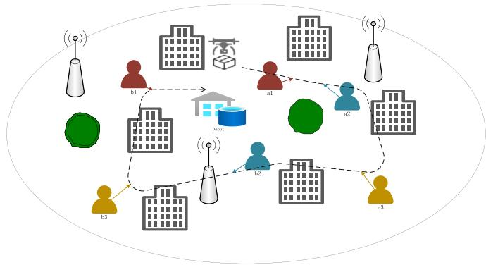
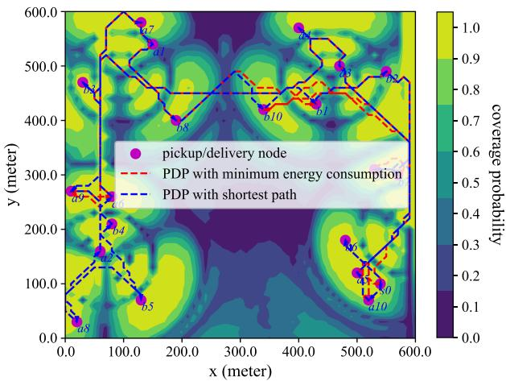
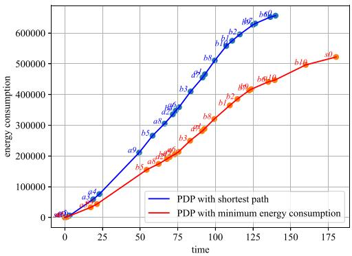
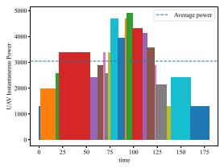
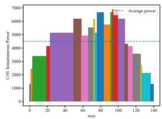
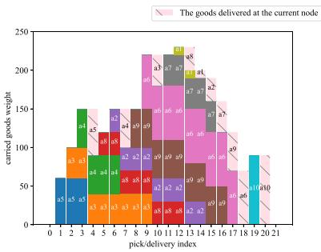
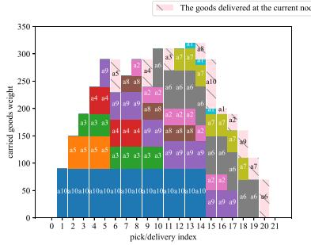

# Energy Minimization for Radio Map-Based UAV Pickup and Delivery Logistics System

Zicong Deng, Fahui Wu, Member, IEEE, Yu Xu , Member, IEEE, Dingcheng Yang , Member, IEEE, and Lin Xiao

Abstract—Cargo UAVs have been used in short-distance logistics scenarios in cities, and this paper investigates the path planning problem for multi-user pickup and delivery of UAVs. The UAV takes off from the depot, completes the pickup and delivery tasks, and returns to the depot; it needs to maintain a reliable connection with the ground base station (GBS) during the UAV’s flight. In the mission, the energy consumption of the UAV is closely related to the order of pickup and delivery as well as the weight of the goods. Therefore, this paper achieves the goal of minimizing UAV energy consumption and designing UAV flight trajectory by optimizing the access sequence. In this paper, we first construct a radio map of the target area, and then we propose an improved Dijkstra’s algorithm to calculate the path which is the shortest between any two access points that satisfies reliable communication. Then, using the constructed distance matrix, we use a hybrid genetic algorithm (HGA) to solve the UAV trajectory of the minimum energy pickup and delivery problem (PDP). Finally, through the simulation analysis of traditional PDP and energy-efficient PDP on the python platform, it can be found that our proposed minimum energy consumption PDP saves about 20% of energy consumption compared with the traditional PDP without considering energy consumption.

Index Terms—Unmanned aerial vehicle (UAV), energy minimization, pickup and delivery problem (PDP), hybrid genetic algorithm (HGA).

## I. INTRODUCTION

With the advantages of low cost, small size, light weight, easy operation and high flexibility, unmanned aerial vehicle (UAV) plays an important role in aerial photography, monitoring, inspection and logistics fields [1], [2]. At the same time, the application of UAV technology has triggered a series of key issues related to UAV pickup and delivery problems, such as path planning, resource allocation, cargo loading optimization, environmental impact assessment, etc.

Compared with traditional logistics networks, which rely mainly on land transportation and are susceptible to traffic congestion and geographic constraints, uncertain delivery times and fluctuating cargo sources, the airborne transportation capability of UAVs enables them to quickly bypass ground obstacles and provide more reliable and timely delivery services [3]. However, there are threats such as network eavesdropping, spoofing attacks, and signal interference when the cargo UAV communicates with the ground control station [4], so in order to ensure that the UAVs are safe to fly for the duration of the mission, we use cellular-connected UAV to replace traditional UAV. The cellular connection UAV is actually using the cellular communication network to connect and control the UAV. It uses the connection between the UAV and the cellular network to convert the communication between the UAV and the ground control station (GCS) into the communication between the UAV and the ground base station (GBS), greatly improve the communication security of UAV [5], [6]. Meanwhile, UAV logistics mainly studies the delivery sequence when goods are uniformly carried by cargo UAV from warehouses and distributed to customers [7], [8], i.e., a variant of travelling salesman problem (TSP); on the contrary, the study of vehicle logistics in vehicle Routing Problem (VRP) has considered the delivery sequence in the distribution process when the cargo vehicles obtain the goods from different pickup points and distribute them to the designated users [9], i.e., pick and delivery problem (PDP), which is of more practical significance.

In response to the above problems, radio map-assisted path planning can largely ensure the reliable connection between cargo UAVs and GBSs during the mission, providing the basis for their safe flight [10]. However, the existing UAV path planning schemes based on radio map generally set a minimum threshold for the radio map (e.g., signal to interference plus noise ratio (SINR) map) to satisfy the communication requirements, and simply divide the radio map into feasible and infeasible regions, whereas the UAV finds the shortest path that satisfies the communication requirements between any two points with the help of shortest path algorithms (e.g., Dijkstra’s Algorithm) within the feasible region [11].

In the field of UAV logistics, Chen [12] extended the research results of [11], adopted a new scheme to construct a radio map and applied it to the PDP. However, the idea of solving the shortest path is still to set the threshold to preprocess the SNR map, and use the traditional Dijkstra algorithm to solve it, and the goal is to minimize the flight time without considering the flight energy consumption. The scheme has the possibility of sacrificing communication quality for the shortest path, and when the overall communication quality is poor, the task can only be completed by reducing the threshold. There is a certain security risk in UAV flight, and the battery capacity of UAV in real scene is an important factor restricting its flight trajectory. This paper takes minimizing flight energy consumption as the objective function to make it more practical.

In response to the shortcomings of existing programs, this paper proposes a new path planning scheme based on radio map, which is used to solve the minimum energy consumption PDP that satisfies reliable communication. We consider a typical cellular connected UAV logistics system. The UAV flies in a specific airspace, collects goods from each pickup point and sends them to the corresponding delivery point, while ensuring reliable communication of the UAV during the mission. Our goal is to minimize its flight energy consumption. The main contributions of this paper are summarized as follows:

Firstly, for the shortest path between any two points that satisfies reliable communication, a variant of Dijkstra’s algorithm is proposed, which integrates the flight distance and interruption time of the UAV on the way, sacrificing a certain flight distance for a lower interruption time to ensure the reliable flight of the UAV.

- Next, for the minimum energy consumption ofcargo UAVs during the mission, the delivery order is closely related to the energy consumption, so we introduced the hybrid genetic algorithm (HGA), the pickup and delivery pairs are constructed as chromosomes, then use the shortest path length that satisfies reliable communication and the quality of the goods at each node to calculate the UAV energy consumption, and the approximate solution is obtained through the operations of crossover and mutation.

  
Fig. 1. Cellular-connected UAV logistics system.

Finally, the simulation results verify the effectiveness of the proposed algorithm. The results show that the proposed algorithm can find the delivery order of the UAV that satisfies reliable communication and minimizes energy consumption. Compared with the baseline scheme, the proposed algorithm significantly improves the communication quality and reduces the total energy consumption of the UAV during the mission.

## II. SYSTEM MODEL AND PROBLEM FORMULATION

As shown in Fig. 1, we envision an application scenario where a cellular-connected UAV provides a pickup and delivery service for multiple pairs of users. In this scenario, since the maneuvering time of the UAV only accounts for a small part of the total running time, its acceleration process can be ignored. At the same time, the literature [13] concludes that the optimal UAV speed to maximize its endurance is a fixed value under the premise of giving the total energy consumption of the UAV. For the convenience of analysis, we assume that UAV takes off from a fixed ground node (i.e. warehouse) at a constant speed v and uploads goods that do not exceed its load limit from the pickup node $a _ { i }$ and unloads the goods at its paired delivery node $b _ { i } .$ , and finally returns to the warehouse. And during the task, the UAV flies at a constant height $H _ { u }$ . To ensure the safety during the flight, the UAV needs to choose a path with the best communication quality, that is, the shortest communication interruption time, to perform logistics distribution according to the user’s location and communication outage probability diagram. Moreover, to reduce the energy consumption during flight, the UAV needs to calculate the minimum energy consumption pickup and delivery order according to the trajectory of reliable communication between any two user nodes, the corresponding order information and the pairing relationship between the pickup and delivery nodes before the mission.

In our system model, the location of the warehouse is $s _ { 0 } = ( x _ { 0 } , y _ { 0 } )$ the pairing relationship of ground users can be represented as $\mathbf { p } =$ $( \mathbf { a } , \mathbf { b } )$ , where $\mathbf { a } = \{ a _ { 1 } , a _ { 2 } , . . . , a _ { N } \}$ represents the pickup ground user node set, $\mathbf { b } = \{ b _ { 1 } , b _ { 2 } , . . . , b _ { N } \}$ represents the delivery ground user node set, and $p _ { i } = ( a _ { i } , b _ { i } )$ represents the goods of delivery point $b _ { i }$ must come from the pickup point $^ { a _ { i } , }$ that is, the UAV must first fly to $a _ { i }$ to pick up the goods and then upload the goods to $b _ { i } .$ , and the horizontal position coordinates of each user $s _ { i } = ( x _ { i } , y _ { i } )$ , then the set of all UAV visit locations can be represented as $S = \{ s _ { 0 } , s _ { 1 } , . . . , s _ { 2 N } \} =$ $\left\{ s _ { 0 } , a _ { 1 } , . . . , a _ { N } , b _ { 1 } , . . . , b _ { N } \right\}$ . Before each task, the platform can generate order information, including the location of each user and the weight of the goods to be delivered. The quality of goods can be represented by a set $W = \{ w _ { 1 } , w _ { 2 } , . . . , w _ { N } \} , w _ { i } \in W$ indicates the quality of the goods that the UAV takes from $a _ { i }$ and delivers to the $b _ { i }$

The access order of UAVs is defined as $H =$ $\left\{ h _ { 0 } , h _ { 1 } , . . . , h _ { 2 N } , h _ { 2 N + 1 } \right\}$ , where $h _ { n } \in H$ represents the nth ground user accessed by the UAV. Intuitively, $h _ { 0 } = h _ { 2 N + 1 } = s _ { 0 } .$ . At time t, the position of UAV is represented by ${ \bf u } ( t ) = ( x ( t ) , y ( t ) , H _ { u } )$

## A. Communication Model

Consider $M \geq 1$ GBSs that may potentially be associated with the UAV during its flight, the antenna radiation model of the GBS and the path loss model was set according to the 3GPP standard [14], [15]. It is assumed that the all GBSs are located at the same horizontal height hGBS m.

In this model, the path is categorized into line-of-sight (LoS) links and non-line-of-sight (NLoS) links. According to the path loss model of different links, the instantaneous power of the signal received by the UAV from the mth GBS is

$$
\begin{array} { r l } {  { p _ { m } = P _ { m } | h _ { m } ( t ) | ^ { 2 } } } \\ & { } \\ & { = P _ { m } \beta ( \mathbf { u } ( t ) ) \bar { h } _ { m } ( \mathbf { u } ( t ) ) \tilde { h } _ { m } ( t ) , } \end{array}\tag{1}
$$

where $P _ { m }$ is the transmit power of the mth GBS, $h _ { m } ( t )$ is channel gain from the mth GBS to UAV at time $t , \beta ( { \mathbf { u } } ( t ) )$ is the GBS antenna gain, $\bar { h } _ { m } ( \mathbf { u } ( t ) )$ is the large-scale channel gain [16].

I(t) is defined as the GBS associated with the UAV at time $t ,$ then the instantaneous SINR at time t is

$$
\gamma ( t ) = \frac { P _ { I ( t ) } | h _ { I ( t ) } ( t ) | ^ { 2 } } { \sum _ { m \notin I ( t ) } P _ { m } | h _ { m } ( t ) | ^ { 2 } + \sigma ^ { 2 } } .\tag{2}
$$

In order to describe the communication reliability more accurately, we use the (2) to calculate the instantaneous SINR value of each potential access point in the plane of the UAV for many times, and take the frequency below the threshold as the outage probability:

$$
\begin{array} { r } { P _ { o u t } ( \mathbf { u } ( t ) , I ( t ) ) = P r \{ \gamma ( t ) < \gamma _ { t h } \} , } \end{array}\tag{3}
$$

where $P r \{ \cdot \}$ is the probability of an event occurring. Finally, the radio map composed of the outage probability of each access point is our outage probability map. Therefore, the total communication outage time between the UAV and the GBS is

$$
T _ { o u t } ( { \mathbf { u } } ( t ) , I ( t ) ) = \int _ { T } { P _ { o u t } ( { \mathbf { u } } ( t ) , I ( t ) ) d t } ,\tag{4}
$$

where T is the total flight time of the UAV.

## B. Energy Consumption Model

According to the UAV energy consumption model proposed by [13], the energy consumption of UAVs during the PDP mission mainly consists of propulsion energy consumption and communication energy consumption. Similarly, when the electromagnetic environment is relatively complex and the pick-up and delivery points are relatively sparse, the vertical take-offand landing energy consumption ofthe UAV is negligible compared to the horizontal flight energy consumption. As the UAV communication energy consumption is much smaller than the propulsion energy consumption, we ignore the communication energy consumption for ease of analysis. Also since we assume a constant flight speed for the UAV and the UAV needs to fulfill the pickup and delivery tasks, the propulsive power of the UAV is a function of the mass of the goods carried by the UAV:

$$
\begin{array} { l } { { \displaystyle P ( w _ { n } ) = P _ { 0 } \left( 1 + \frac { 3 v ^ { 3 } } { U _ { t i p } ^ { 2 } } \right) } } \\ { ~ } \\ { { \displaystyle ~ + P _ { i } \left( \sqrt { 1 + \frac { v ^ { 4 } } { 4 v _ { 0 } ^ { 4 } } } - \frac { v ^ { 2 } } { 2 v _ { 0 } ^ { 2 } } \right) ^ { 1 / 2 } } } \\ { { \displaystyle ~ + \frac { 1 } { 2 } d _ { 0 } \rho s A v ^ { 3 } } , } \end{array}\tag{5}
$$

where $U _ { t i p } , v _ { 0 } , \rho , s , A ,$ d are the tip speed of the rotor blade, the mean rotor induced velocity in hover, the air density, the rotor solidity, the rotor disc area and fuselage drag ratio, respectively [17]. Moreover, $w _ { n }$ is the mass of the cargo carried by the UAV after it passes through the nth visited node, $P _ { 0 }$ and $P _ { i }$ represent the blade profile power and induced power in the hovering state, respectively [18], and they define as

$$
P _ { 0 } = \frac { \delta } { 8 } \rho s A \Omega ^ { 3 } R ^ { 3 } ,\tag{6}
$$

$$
P _ { i } = ( 1 + k ) \frac { { w _ { n } } ^ { 3 / 2 } } { \sqrt { 2 \rho A } } ,\tag{7}
$$

where Ω, R, k are blade angular velocity, rotor radius and incremental correction factor to induced power [18]. Thus, the energy consumption of the UAV in time T is

$$
E = \int _ { T } P ( w _ { n } ) d t .\tag{8}
$$

According to (5), (6), (7) and (8), when the speed of the UAV is determined with other relevant parameters, energy consumption of cargo UAV performing pickup and delivery tasks closely related to the order of visit. The PDP requires the UAV to acquire cargo from the pick-up user a and deliver it to receiving user b. Therefore, different delivery strategies of UAV during the mission will lead to fluctuations in their energy consumption.

## C. Problem Formulation

Based on the obtained interruption probability graph, our goal is to find the order for the UAV to deliver the goods while satisfying the reliable communication and minimizing its energy consumption, and that order of delivering the goods needs to satisfy the constraints of the pickup and delivery problem, the mathematical model is formulated as follows:

$$
( \mathrm { P 0 } ) \operatorname* { m i n } \sum _ { i \in S } \sum _ { j \in S , i \neq j } E _ { i j } x _ { i j }\tag{9}
$$

s.t.

$$
x _ { i j } \in \{ 0 , 1 \} , \forall i , j \in S , i \neq j ,\tag{9a}
$$

$$
\sum _ { i \in S , i \neq j } x _ { i j } = 1 , \forall j \in S ,\tag{9b}
$$

$$
\sum _ { j \in S , i \neq j } x _ { i j } = 1 , \forall i \in S ,\tag{9c}
$$

$$
u _ { i } - u _ { j } + ( 2 n + 1 ) x _ { i j } \leq 2 n , \forall i \neq j ,\tag{9d}
$$

$$
T _ { a _ { k } } < T _ { b _ { k } } , \forall ( a _ { k } , b _ { k } ) \in \mathbf { p } ,\tag{9e}
$$

$$
w _ { n } \leq m _ { m a x } .\tag{9f}
$$

In problem(P0), $i , j$ is the number of the pickup and delivery point. The objective function $E _ { i j }$ is the energy consumed by the UAV flying

from from i to point $j ,$ and it can be calculated by $( 8 ) .$ , since UAVs fly at a constant speed, the equation can be further equated as

$$
E _ { i j } = \int _ { T _ { i j } } P ( w _ { i j } ) d t = \frac { P ( w _ { i j } ) l _ { i j } } { v } ,\tag{10}
$$

where $w _ { i j }$ is the mass of cargo carried by the UAV during its flight from the from i to point $j ,$ and $l _ { i j }$ is the shortest path that satisfies the communication quality requirement during the UAV’s flight from the from i to point $j .$ In addition, $\boldsymbol { x } _ { i j }$ is an indicator function that is 1 if the path contains trajectories from i to j, and 0 if it does not. The constraints in (9b) and (9c) indicate that each delivery point is traversed once and only once. According to the provisions of the PDP, the UAV has and can only have one loop during the mission, so use the Miller-Tucker-Zemlin(MTZ) constraint [19] in (9d) to eliminate the sub-loop. The constraints in (9e) is a time constraint indicating that for each pair of pickup and delivery points, we must pick up the goods before delivery. The constraints in (9f) is the load mass constraint, and the UAV’s load weight cannot exceed its upper load limit.

## III. PROPOSED SOLUTION

In this section, we combine the variant Dijkstra algorithm and the hybrid genetic algorithm based on PDP to solve the problem(P0). We split the problem(P0) into two sub-problems: the shortest path satisfying the communication quality and the minimization of UAV flight energy consumption. Firstly, we propose a method to calculate the shortest path between any two pickup and delivery points that meets the requirements of reliable communication. Secondly, with the help of HGA, under the premise of obtaining the shortest path, we obtain the UAV access sequence that satisfies the minimum energy consumption, and the flight trajectory as well.

## A. Path Matrix for Minimum Interruption Time

In the PDP, the distance between any two pickup and delivery points is known, and is not affected by the delivery order in the final solution. So to save computational resources, we compute the distance matrix before solving the PDP order. For the communication quality requirements of the UAV during flight, our objective is to minimize the interruption time of the UAV throughout its flight. For the shortest path problem that satisfies the communication quality requirements for any two points, we propose a variant of the Dijkstra’s algorithm to solve it.

The traditional Dijkstra’s algorithm follows the idea of breadth-first traversal, using a greedy algorithmic strategy centered on the starting point, traversing each time to the nearest neighboring node that has not visited the vertices from the starting point until it extends to the end point, with the cost of the move being the distance from beginning position to the current position. In our algorithm, the interruption probability graph from the communication model in Section II is introduced as a way to construct a weighted undirected graph.

Since we need to jointly consider path lengths and disruption time in order to select flight paths with reliable communication, we define the move cost as the weighted sum ofthe move distance and the interruption time:

$$
f _ { \mathrm { c o s t } } ( x ) = \omega _ { 1 } { \cdot } d i s t a n c e ( x ) + \omega _ { 2 } { \cdot } T _ { o u t } ( x ) ,\tag{11}
$$

where the algorithm degenerates to the standard Dijkstra’s algorithm when $\omega _ { 2 } = 0$ , and the cost function is only related to the interrupt time when $\omega _ { 1 } = 0$ . We usually choose the appropriate value based on the actual communication quality. When the communication environment in the target area is excellent, the value of $\omega _ { 1 }$ is large and the value of ω2 is small, and the goal is converted to calculate the shortest path because reliable communication is achieved throughout the area; while when the communication environment in the target area is poor, the value of $\omega _ { 1 }$ is small and the value of $\omega _ { 2 }$ is large, and the goal is converted to calculate the shortest interruption time. Based on the above cost function, the shortest path to meet reliable communications is solved for any two delivery points, and the distance matrix is obtained by storing all the path lengths.

Algorithm 1: Cargo UAV Delivery Sequence Based on   
Improved HGA.   
Input: The set of pickup and delivery pairs, p; The   
number of users, k; The set of horizontal   
coordinates of the access point, $S ;$ The set of   
weight of goods at distribution points, W;   
Outage probability graph, $M _ { r a d i o } ;$ Population   
size, $m ;$ Iteration times, $I _ { t } ;$ Crossover   
probability, $p _ { c } ;$ Mutation probability, $p _ { m } ;$   
Replication probability, $p _ { r } ;$   
Output: Sequence of UAV visits, $H ^ { * } ;$ UAV energy   
consumption, $E ^ { * } ;$   
1 Initialize population $\mathbf { P } = \{ \}$ , children population   
$\mathbf { C } = \{ \}$ ,energy consumption set ${ \bf E } = \{ \}$   
2 Calculate the shortest path matrix R between each   
distribution point;   
3 for $i = 1$ to m do   
4 Generate the current pickup and delivery sequence   
$H _ { i } ;$   
5 Add $H _ { i }$ to $\mathbf { P } ;$   
6 end   
7 for $i = 1$ to $I _ { t }$ do   
8 for i = 1 to the size of P do   
9 Get the sequence $H _ { i } ;$   
10 Calculate the total energy consumption $E _ { i }$ in   
the sequence $H _ { i }$ by R andW:   
11 Add $E _ { i }$ to $\mathbf { E } ;$   
12 end   
13 E\* ← min $\{ { \bf E } \}$   
14 $H ^ { * }$ ←The sequence H corresponding to $E ^ { * } ;$   
15 Population P intercepts the first m sequences   
according to the energy consumption value from   
low to high;   
16 while The size of $\mathbf { C < }$ the size of P do   
17 Use the Roulette algorithm to select two   
sequences $H _ { p 1 }$ and $H _ { p 2 }$ from $\mathbf { P } ;$   
18 $H _ { p 1 }$ and $H _ { p 2 }$ perform crossover, mutation and   
replication operations according to   
probabilities $p _ { c } , p _ { m } , p _ { r }$ . to obtain a new   
sequence $H _ { c } ;$   
19 Add $H _ { c }$ to $\mathbf { C } ;$   
20 end   
21 $\mathbf { P }  \mathbf { P } \cup \mathbf { C } ;$   
22 end

## B. HGA for Minimum Energy Consumption

In our model, the energy consumption of the UAV is highly dependent on the order in which the UAV is accessed, so the traditional exact solution methods for the PDP problem are not suitable for this problem, such as the CPLEX solver [20], ORtools solver [21], so we retreat to approximate the solution of problem(P0) with the help of HGA.

The HGA follows the framework of the genetic algorithm (GA) and is a variant of it. The HGA also solves iteratively following operations such as population generation, parent selection, crossover, mutation, and population screening. First, we initialize the population by randomly generating a sequence of length 20 containing the order of UAV visits, and perform an order check on each pickup-delivery pair to ensure that the pickup point will have a higher visit priority than the delivery point. The initialization of the population is completed by depositing the required sequences (i.e., feasible solutions) into the population set. To minimize the UAV energy consumption, we define the fitness function as the energy consumption in (10), where $l _ { i j }$ has been derived from Section III-A. Calculate the fitness of all chromosomes within the population and find the minimum solution among them, which is the current optimal solution. Referring to the idea of ‘survival of the fittest’ in the theory of evolution, in the selection operation, ‘elite selection’ is carried out, in which the best individuals of the current generation are retained, while the other individuals are selected by means of roulette.

After the selection of the population, crossover operations need to be performed on the parent population to generate the offspring population to maintain the diversity of the population. There are many different crossover operators for different optimization problems, such as single-point crossover, two-point crossover, sequential crossover, etc. Here we use the sequential crossover algorithm. We use the sequential crossover operator to randomly select the start and end positions in the chromosome, copy the genes in that region of parent chromosome 1 to the same position in offspring 1, and then fill in the missing genes in offspring 1 in sequence on parent chromosome 2, and the other offspring is obtained in a similar manner [22]. Then, for variational operations, HGA uses a neighborhood search approach to avoid local convergence [9].

It is worth noting that for each child chromosome generated, distribution pairs need to be checked to satisfy that the solution is feasible. The feasible solution is deposited into the population set, the fitness is calculated, and the chromosomes in the bottom 20 percent are eliminated to speed up convergence. At this point, a genetic process is completed, repeat the above operation until the completion of the iteration, you can get the word hybrid genetic algorithm to solve the obtained approximate solutions.

## IV. SIMULATION RESULTS

We consider four terrestrial base stations randomly generated in a 600m × 600 m area. Acording to the requirements of the 3GPP standard [15], the height of the building satisfies the Rayleigh distribution with an average value of 20, and the height of the buildings is limited to 45 m. So when the building model is changed, our algorithm still applies. At the same time, 10 pickup and delivery pairs and a warehouse are randomly generated, and the corresponding goods quality is generated for the 10 delivery orders, i.e., W = {10, 30, 40, 50, 60, 70, 40, 30, 50, 90}(N), and the UAVs leave the warehouse without any cargo.

As shown in Fig. 2, the red solid line is the trajectory of HGA based solution for the PDP with minimum energy consumption, while the blue line is the trajectory of the PDP with shortest path solution using the ORtool toolkit. In contrast to the shortest path, since the quality of goods varies at each pickup point, the PDP based on minimum energy consumption prioritizes the delivery of goods with higher mass and avoids flying large mass loads over longer distances as much as possible.

Fig. 2. UAV trajectories for PDP.  
  
Fig. 3. PDP energy consumption versus time.

  
(a)

  
(b)  
Fig. 4. UAV instantaneous power vs time. (a) PDP with minimum energy consumption. (b) PDP with shortest path.

Fig. 3 is PDP energy consumption comparison in relation to time, as we can see from the figure, the minimum energy consumption PDP’s energy consumption is 522041 J, and the energy consumption of PDP with shortest path is 656475 J, so our proposed method can save up to 20% of energy consumption. Specifically, Fig. 4 have been displayed the relationship between instantaneous power and time of the UAV is shown in the two scenarios of the minimum energy consumption and the shortest flight path. In the figures, the dotted line represents the average power of the UAV during the mission, and different color blocks represent the flight energy consumption ofthe UAV between two consecutive access points. It is clear that the average power of the UAV at minimum energy consumption is much less than the baseline case and the time the UAV is at high power is shorter than the baseline case. And our proposed scheme is that the instantaneous power of the UAV is generally lower than the benchmark situation. Intuitively, Fig. 5 shows the quality of cargo carried by the UAV at each node in two different scenarios. Compared with the shortest path pickup and delivery plan, our proposed method ensures that the UAV will not carry a certain cargo for a long time, thereby controlling the weight of the cargo carried by the UAV during the mission to be much lower than the baseline scheme.

  
(a)

  
(b)  
Fig. 5. The relationship between cargo quality and delivery order. (a) PDP with minimum energy consumption. (b) PDP with shortest path.

Through the above analysis, it can be seen from the trajectory diagram of Fig. 2 that the improved Dijkstra algorithm can ensure the reliable communication of the UAV during the mission. Combining the energy consumption graphs in Fig. 3 ∼ 5 with the pickup and delivery sequence histograms, it can be seen that our proposed algorithm changes the pickup and delivery strategies of the UAVs so that their loads are generally lower, which in turn reduces the energy consumption of the UAVs.

## V. CONCLUSION

In this paper, we study the minimum energy consumption pickup and delivery problem that satisfies the premise of reliable communication. To address this problem, we first propose a variant of Dijkstra algorithm to get the trajectory between any two points that satisfies the shortest interruption time, and generate the corresponding distance matrix; and then combine with the hybrid genetic algorithm to solve the problem and get the UAV trajectory with less energy consumption. Based on this, our next step is to extend the problem to multiple UAVs and to study the corresponding variants of the problem.

## REFERENCES

[1] J. Zhao, H. Hu, Y. Han, and Y. Cai, “A review of unmanned vehicle distribution optimization models and algorithms,” J. Traffic Transp. Eng. (English Ed.), vol. 10, no. 4, pp. 548–559, 2023.

[2] N. Zhao et al., “Uav-assisted emergency networks in disasters,” IEEE Wireless Commun., vol. 26, no. 1, pp. 45–51, Jan. 2019.

[3] V. Yadav and A. Narasimhamurthy, “A heuristics based approach for optimizing delivery schedule of an unmanned aerial vehicle (drone) based delivery system,” in Proc. IEEE 9th Int. Conf. Adv. Pattern Recognit., 2017, pp. 1–6.

[4] K. Mansfield, T. Eveleigh, T. H. Holzer, and S. Sarkani, “Unmanned aerial vehicle smart device ground control station cyber security threat model,” in Proc. IEEE Int. Conf. Technol. Homeland Secur., 2013, pp. 722–728.

[5] Y. Zeng, J. Lyu, and R. Zhang, “Cellular-connected UAV: Potential, challenges, and promising technologies,” IEEE Wireless Commun., vol. 26, no. 1, pp. 120–127, Feb. 2019.

[6] M. Kishk, A. Bader, and M.-S. Alouini, “Aerial base station deployment in 6G cellular networks using tethered drones: The mobility and endurance tradeoff,” IEEE Veh. Technol. Mag., vol. 15, no. 4, pp. 103–111, Dec. 2020.

[7] K. Peng et al., “A hybrid genetic algorithm on routing and scheduling for vehicle-assisted multi-drone parcel delivery,” IEEE Access, vol. 7, pp. 49191–49200, 2019.

[8] N. Cherif, W. Jaafar, H. Yanikomeroglu, and A. Yongaço˘glu, “Disconnectivity-aware energy-efficient cargo-UAV trajectory planning with minimum handoffs,” in Proc. IEEE Int. Conf. Commun., 2021, pp. 1–6.

[9] T. Vidal, T. G. Crainic, M. Gendreau, N. Lahrichi, and W. Rei, “A hybrid genetic algorithm for multidepot and periodic vehicle routing problems,” Operations Res., vol. 60, pp. 611–624, 2012.

[10] X. Pang, M. Sheng, N. Zhao, J. Tang, D. Niyato, and K.-K. Wong, “When UAV meets IRS: Expanding air-ground networks via passive reflection,” IEEE Wireless Commun., vol. 28, no. 5, pp. 164–170, Oct. 2021. [Online]. Available: https://doi.org/10.1109/MWC.010.2000528

[11] S. Zhang, Y. Zeng, and R. Zhang, “Cellular-enabled UAV communication: A connectivity-constrained trajectory optimization perspective,” IEEE Trans. Commun., vol. 67, no. 3, pp. 2580–2604, Mar. 2019.

[12] Y. Chen, D. Yang, L. Xiao, F. Wu, and Y. Xu, “Optimal trajectory design for unmanned aerial vehicle cargo pickup and delivery system based on radio map,” IEEE Trans. Veh. Technol., early access, Mar. 27, 2024, doi: 10.1109/TVT.2024.3382170.

[13] Y. Zeng, J. Xu, and R. Zhang, “Energy minimization for wireless communication with rotary-wing UAV,” IEEE Trans. Wireless Commun., vol. 18, no. 4, pp. 2329–2345, Apr. 2019.

[14] 3GPP, “Study on 3D channel model for LTE,” 3rd Gener. Partnership Project (3GPP), Tech. Rep. TR 36.873, Dec. 2017, version 12.7.0.

[15] B. Mondal et al., “3D channel model in 3GPP,” IEEE Commun. Mag., vol. 53, no. 3, pp. 16–23, Mar. 2015.

[16] R. A. Banez, L. Li, C. Yang, and Z. Han, Mean Field Game and its Applications in Wireless Networks, Berlin, Heidelberg, Germany: Springer, 2021.

[17] Y. Yuan, L. Lei, T. X. Vu, S. Chatzinotas, S. Sun, and B. Ottersten, “Energy minimization in UAV-aided networks: Actor-critic learning for constrained scheduling optimization,” IEEE Trans. Veh. Technol., vol. 70, no. 5, pp. 5028–5042, May 2021.

[18] W. J. Yun et al., “Cooperative multiagent deep reinforcement learning for reliable surveillance via autonomous multi-UAV control,” IEEE Trans. Ind. Informat., vol. 18, no. 10, pp. 7086–7096, Oct. 2022.

[19] M. Desrochers and G. Laporte, “Improvements and extensions to the miller-tucker-zemlin subtour elimination constraints,” Operations Res. Lett., vol. 10, no. 1, pp. 27–36, 1991.

[20] IBM, “Cplex, IBM ilog cplex optimization tools,” URL, 2016, [Online]. Available: https://www.ibm.com/analytics/cplex-optimizer

[21] Google, “Or-tools, google optimization tools,” URL, 2016, [Online]. Available: https://developers.google.com/optimization/routing

[22] R. Kuo, S.-H. Lu, P.-Y. Lai, and S. T. W. Mara, “Vehicle routing problem with drones considering time windows,” Expert Syst. Appl., vol. 191, 2022, Art. no. 116264.