# Holt-Based Prediction Correction Dynamic Multiobjective Evolutionary Algorithm for IoT With AAV in Aerial Edge Computing

Lanlan Kang , Yiyong Wang, and Zhilin Liu

Abstract—This article regards autonomous aerial vehicleassisted aerial edge computing as a dynamic multiobjective optimization problem. In order to continuously track the moving Pareto set, a new Holt-based prediction correction dynamic multiobjective evolutionary algorithm (HDMOEA) is proposed. It includes mainly three main strategies. First, the Wilcoxon signedrank test method is employed to accurately detect environmental change, and the intensity of which is further detected by a new environment perception operator. Second, the Holt-based prediction correction mechanism is constructed to predict the positions of individuals in the next time window. The positions are corrected according to a reference point in order to enhance prediction accuracy and accelerate the search speed of the algorithm. Lastly, a new bi-mutation method is proposed used to maintaining the diversity of the population according to the intensity of environmental changes, thereby reduce the likelihood of the population falling into local optima. The proposed algorithm is compared with six state-of-the-art prediction dynamic multiobjective algorithms on the multiple benchmark test sets. The experimental results show that HDMOEA can faster continuous tracking Pareto frontier, and obtain more accurate Pareto frontier set compared with other comparison algorithms.

Index Terms—Aerial edge computing (AEC), autonomous aerial vehicle (AAV), dynamic multiobjective optimization, environment perception, prediction correction.

## I. INTRODUCTION

W ITH the popularization of Internet of Things (IoT) and the development of the 5G/6G technology, terminal devices, including autonomous aerial vehicle (AAV) which are deployed on the edge environment, are growing [1]. Aerial edge computing (AEC) is presented as AAV-assisted edge computing. AAV can be used as a center of computation and transmission to provide low-cost service for terminals, AEC network architecture is shown in Fig. 1. However, new research gaps are generated. For example, resource scheduling optimization with AAV [2], AAV remote sensing [3], and so on. These problems are essentially multiobjective complex optimization problems. Therefore, AEC problem is a kind of new realistic scenario encountered by dynamic multiobjective optimization problems (DMOPs).

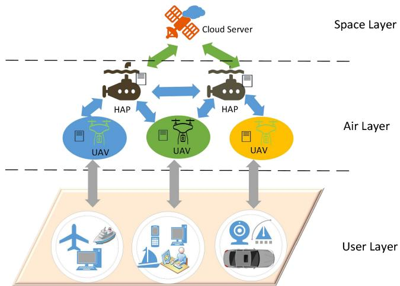  
Fig. 1. Three-layer AEC network.

DMOPs, as an important branch of multiobjective optimization problems (MOPs), are characterized by multiple conflicting optimization objectives which may change with time and environment [5]. They exist in many real application scenarios, such as machine design [6], resource scheduling problem [7], edge computing [8], precision agriculture [9], etc. The dynamic nature of these problems puts higher demand on optimization algorithm in terms of convergence performance and ability to respond to environmental changes. Evolutionary algorithms (EAs), based on its good performance in solving static MOPs, are utilized to solve DMOPs by a number of researchers, who are called dynamic multiobjective EAs (DMOEAs) [3], [4], [10]. However, three basic issues should be considered to solve DMOPs: 1) how to detect environmental change; 2) how to respond the environment changes; and 3) how to keep tracking the optimal solutions quickly in a dynamic environment [11].

The existing monitoring mechanisms of environment change can be roughly divided into three types.

1) Random Detection Method [12]: Randomly select some individuals in population as monitoring points, and judge whether the environment has changed by observing the changes of the fitness values of the monitoring points in two adjacent time windows. However, the selection of the monitoring points is tangled and difficult to determine, the quality of which will directly affect the accuracy of judging on whether the environment changes.

2) Steady-State Change Detection Method [13]: The individuals are ranked according to the its fitness values in a time window, and then they are revalued in the next time windows according to the above sequencing results. The environment is judged to have changed if the currently fitness value changes, and then there is no need to revalue the remaining individuals. However, this method is easy to result in misjudgment or omission of environmental changes because the differences in the fitness value of individuals may be affected by noise or randomness.

3) Statistical Test Detection Method [14]: Determine whether the environment has changed according to the probability distribution of the fitness values of population in two adjacent time windows. Obviously, this method utilizes the global information of population and then effectively reduce the misjudgment rate of environmental change. Therefore, this article adopts it to detect environment change. Meanwhile, a new method for monitoring environmental change is proposed.

The response mechanism will be triggered when environmental changes are monitored. They fall into three categories according to the initialization method: 1) random reinitialization [15]; 2) memory-based reinitialization [16], [17]; and 3) prediction-based reinitialization [18], [19], [20]. The random reinitialization method is widely used in the early stage of the study, but it requires the whole population to reoptimize each time after environmental changes are detected, which will consume too much computing resources. Therefore, researchers adopt a memory-based reinitialization method to partially initialize the population with the help of historical information so as to help the algorithm can quickly track the optimal solution after environment change. However, the effect of this method is often affected by the accuracy of historical information, which is easy to cause the algorithm to fall into local optimal. In order to avoid this phenomenon, a prediction-based reinitialization method is usually adopted at present, which can seek the change rule according to historical environmental information and predict the future environmental changes, so as to improve the continuous tracking efficiency to Pareto frontier in dynamic environment by actively responding to environmental changes. Common prediction methods include linear prediction, autoregressive model, etc. These methods are mostly suitable for shortterm prediction, and their prediction process is relatively complex [21]. Support vector regression (SVR) is used to predict the movement of individuals. SVR prediction method has the advantages of strong robustness and generalization ability, but its performance depends too much on the choice of parameters, and the computational expense is high [39]. It is noted that the Holt prediction model is exponential smoothing time-serial prediction methods with simple models and can cope with different environmental changes by adjusting model parameters in real time [22].

Therefore, in order to continuously track the evolving Pareto frontier in a dynamic environment over time, this article regards several static MOPs under multiple time windows as a whole, by virtue of the decomposition idea of MOEA/D [23], proposes a new Holt-based difference prediction correction dynamic multiobjective optimization algorithm for IoT with AAV in AEC (HDMOEA). The new algorithm has the following twofold innovations.

1) The Wilcoxon signed-rank test method in change point detection is used to detect dynamic environmental changes. In order to maintain the diversity of the population, an environmental perception operator is proposed to determine the intensity of environmental change.

2) The Holt prediction model is used for the first time to predict the individuals in population, and the Holt prediction correction model using second-order difference is innovatively proposed to predict the position of the individuals in the next time window and the predicted value is corrected according to the reference point, so as to achieve the purpose of improving the prediction accuracy of the algorithm.

The subsequent organization of this article is as follows. Section II provides some related knowledge of this article, including the definition of DMOPs, multiobjective optimization algorithm based on decomposition, and basic prediction method. Section III presents a new algorithm in detail, including its strategies, principle, and framework. Section IV presents a series of experiments along with results and analysis. Section V summarizes this article and outlines the direction of future research.

## II. PRELIMINARY STUDY

## A. Problem Definition

Without loss of generality, taking minimization as an example, DMOPs can be formulated as [11]

$$
\begin{array}{l} \min \boldsymbol {f} (\boldsymbol {x}, t) = (f _ {1} (\boldsymbol {x}, t), f _ {2} (\boldsymbol {x}, t), \ldots , f _ {m} (\boldsymbol {x}, t)) ^ {T} \\ \text {s.t.} \quad \boldsymbol {x} \in \Omega \end{array}\tag{1}
$$

where $\mathbf { \Phi } _ { \mathbf { { x } } } ~ = ~ \left( x _ { 1 } , x _ { 2 } , \ldots , x _ { n } \right)$ is the decision variable with n-dimensional space. $\Omega \subset R ^ { n }$ is the decision space. $\pmb { f } ( \pmb { x } , t )$ denotes objective vector with m objective functions. Objective function $f _ { i } ( \pmb { x } , t ) ~ ( i = 1 , 2 , \ldots , m )$ changes over time.

Definition 1 (Pareto Domination): There are two decision vectors u and v in decision space $\Omega , \pmb { u }$ dominate v if $f _ { i } ( { \pmb u } ) \le$ $f _ { i } ( \pmb { \nu } ) \forall i = \{ 1 , 2 , \dots , m \}$ , and $\exists j \in \{ 1 , 2 , \dots , m \} , f _ { j } ( \pmb { u } ) < f _ { j } ( \pmb { \nu } )$

Definition 2 (Pareto-Optimal Solution): Suppose there are two decision variables x and $x ^ { * }$ in decision space $\Omega , f$ is the objective function, x is the Pareto-optimal solution ${ \mathrm { i f ~ } } \lnot \exists { { x } ^ { \ast } } \in$ -, $f ( x ^ { * } ) \prec f ( x )$

Definition 3 (Pareto-Optimal Solution Set): The set of all Pareto-optimal solutions is defined as the Pareto-optimal solution set PS which is expressed as follows:

$$
\mathrm{PS} = \left\{\boldsymbol {x} \in \Omega | \neg \exists x ^ {*} \in \Omega , \boldsymbol {f} (\boldsymbol {x} *) \prec \boldsymbol {f} (\boldsymbol {x}) \right\}.\tag{2}
$$

The PS at time t is denoted as PS(t).

Definition 4 (Pareto-Optimal Front): The mapping of PS in the objective space is called Pareto-optimal front $P F$ which is expressed as follows:

$$
P F = \{\boldsymbol {f} (\boldsymbol {x}) | \boldsymbol {x} \in P S \}.\tag{3}
$$

The PF at t time is denoted as PF(t).

## B. Multiobjective Optimization Algorithm Based on Decomposition

Tchebycheff used to this article, as a decomposition method is introduced in this section [24]. Let $w _ { 1 } , \ldots , w _ { N }$ be a set of weight vectors evenly distributed, MOPs can be decomposed into N single-objective subproblems, and the $j \mathrm { t h }$ subproblem is denoted as

$$
\operatorname{minimizeg} \left(x \mid w _ {j}, z ^ {*}\right) = \max _ {i \in \{1, \dots , m \}} w _ {i} \left| f _ {i} (x) - z _ {i} ^ {*} \right|\tag{4}
$$

where $z ^ { * } = ( z _ { 1 } ^ { * } , . . . , z _ { m } ^ { * } ) ^ { T }$ is the reference point which consists of minimum value for each objective in current time window, i.e. $, z _ { i } ^ { * } = \operatorname* { m i n } \{ f _ { i } ( x ) , x \in \Omega \} ( i = 1 , 2 , . . . , m )$ ). Each subproblem corresponds to a weight vector wj, the neighborhood of which consists of its nearest weight vectors, which are called the wj domain. Therefore, the neighborhood of the jth subproblem contains all subproblems from the $w _ { j }$ domain. The domain of each subproblem consists of a set of subproblems closest to its weight vector, which have similar objective optimization directions.

Inspired by differential evolution, ω is improved via introducing difference mutation to speed up population optimization [25]. The formula is defined as

$$
w _ {i} (g) = x _ {r 1} (g) + F \cdot (x _ {r 2} (g) - x _ {r 3} (g))\tag{5}
$$

where $r 1 , r 2 ,$ and $r 3$ are three random integers in interval $[ 1 , N ] , x _ { r 1 } ( g ) , x _ { r 2 } ( g )$ , and $x _ { r 3 } ( g )$ denote three random individuals, and F is a scale factor used to adjust the amplitude of mutation of the individual in the algorithm.

## C. Prediction Strategy

At present, most prediction-based model is built for predicting the change trend of the population via learning some specific behavior characteristics of the population according to the information of the population in the historical time window. For example, an autoregressive model (AR), whose formulas are expressed as follows:

$$
X _ {t} = c + \phi_ {1} X _ {t - 1} + \phi_ {2} X _ {t - 2} + \dots + \phi_ {p} X _ {t - p} + \varepsilon_ {t}\tag{6}
$$

moving average model (MA):

$$
X _ {t} = \mu + \varepsilon_ {t} + \theta_ {1} \varepsilon_ {t - 1} + \theta_ {2} \varepsilon_ {t - 2} + \dots + \theta_ {q} \varepsilon_ {t - q}.\tag{7}
$$

In (6), X is the observed value at time $t , c$ is the constant, $\phi _ { i }$ is the coefficient of lag term, $\varepsilon _ { t }$ is the error value of model at time t, and $p$ is the order of the model. In (7), μ is the mean of the time series, $\theta _ { 1 }$ is the model parameters, which determines the effect of each error on the current observation, is the error term or random disturbance term at time t, q is the order of the model. Other parameters are the same as (6).

And beyond that, Wang et al. [26] proposed an integrated method that combines four prediction models, two of which are autoregressive models [as shown in (6)]. The four prediction models will be randomly chosen to reinitialize the population when environment changes are detected. However, due to the large number of integration models, the prediction effect of the algorithm may be indirectly affected, meanwhile, the computing overhead will be increased. Karasu et al. [27] proposed a linear prediction model based on average distance to solve a class of DMOPs with translational PS. In addition, Zhou et al. [28] proposed a population prediction strategy (PPS), which constructed a time series at the center point of the population and combined with the overall distribution characteristics of PF. However, the application of PPS is limited by the condition that the environment change should be periodic or there is a certain degree of similarity before and after the changes.

As more and more prediction strategies have been proposed, many researchers have devoted themselves to the study of simpler prediction models without losing prediction accuracy. Along this way, we propose a new Holt prediction model to predict population individuals, so as to realize the rapid response to environmental changes. At the same time, a new correction mechanism or compensation mechanism is proposed to correct the predicted value, so as to further improve the prediction accuracy of individuals under different intensity of environment change. It is one of the key contents of this article.

## III. PROPOSED ALGORITHM

In this section, we first give an optimization architecture of AEC with AAV and clearly point out the role of DMOEA optimization. Second, around DMOP, a novel prediction-based DMOEA is devised to accelerate evolution. The new algorithm mainly includes three strategies: 1) environment detection; 2) environment perception bi-mutation strategy; and 3) Holt prediction correction mechanism. First, the Wilcoxon signedrank test is introduced to detect the environmental change whose intensity is further judged by a new environment perception operator. Second, in order to maintain the diversity of population under environmental change, the environment perception bi-mutation strategy is proposed to help individuals reduce the likelihood of falling into local optimal position. Besides, to improve the speed of population optimization, the Holt prediction correction model is constructed to predict the position of individuals in the next time window. At the same time, the prediction position is corrected according to the reference point. As a result, the corrected prediction value and the original individual participate together in the next iterative evolution.

The new algorithm is called HDMOEA. The pseudocode is given by Algorithm 1.

## A. Optimization Architecture of Aerial Edge Computing With AAV

With the addition of AAVs to the deployments of edge devices, the problem of insufficient computing resources and the insufficiency service performance have been effectively improved. However, in order to improve resource utilization, optimization objectives, such as low delay and low cost, need research in new aerial edge resource scheduling. DMOEA is an advantageous choice to solving the new optimization problem. The optimization architecture of AEC with AAV is shown as Fig. 2.

Algorithm 1: HDMOEA
Input: a DMOP, a stopping criterion, population size N, neighborhood size W, weight vectors ( $W_{1}, \ldots, W_{N}$ );
Output: The solution sets obtained in static environment  $P_{new}$ ;
1 for i = 1 to N
2    Take the nearest set of  $W(i) = \{i_{1}, \ldots, i_{s}\}$ ;
3 end for
4 while while stopping criterion is not satisfied do
5    Environment change is detected by algorithm 2;
6    The new population  $P'$  is obtained by algorithm 3 for prediction and correction;
7    $P_{new} = P'$ ;
8 end

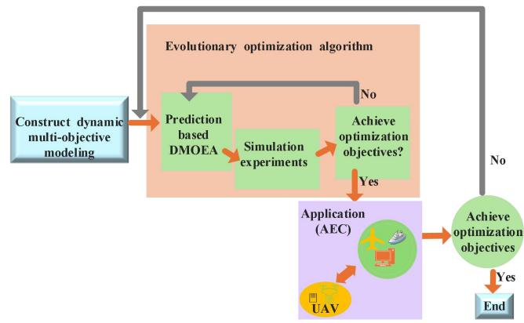  
Fig. 2. Optimization architecture of AEC with AAV.

In the following section, this article takes AEC with AAV as the final application goal, and focuses on the evolutionary optimization algorithm design part in the optimization architecture.

## B. Environment Detection Mechanism

1) Wilcoxon Signed-Rank Test: Since Wilcoxon signedrank test is suitable for large sample data and can detect the difference of the same data set at two different time points, this method is adopted in this article for dynamic environment change detection. It is mainly divided into three step (see [29] for details).

Step 1: Calculate the rank of the difference.

Step 2: Calculated rank sum in the light of (8) and (9): $W ^ { + }$ : the rank sum of the positive rank, $W ^ { - }$ : the rank sum of the negative rank

$$
W ^ {+} = \sum_ {j = 1} ^ {n} R _ {j} ^ {+} I \text { and } I = \left\{ \begin{array}{l l} 1, & \text { if } x _ {j} > 0 \\ 0, & \text { else. } \end{array} \right.\tag{8}
$$

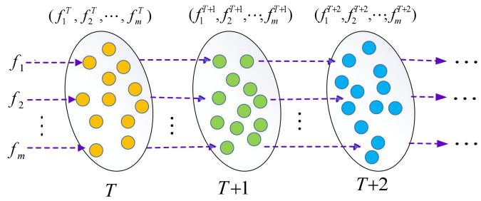  
Fig. 3. Diagram of detection operation flow under successive time windows, where $f _ { m } ^ { T }$ denotes the fitness value of objective m in the T time window.

$$
W ^ {-} = \sum_ {j = 1} ^ {n} R _ {j} ^ {-} I \text {   and   } I = \left\{ \begin{array}{l l} 1, & \text { if } x _ {j} <   0 \\ 0, & \text { else } \end{array} \right.\tag{9}
$$

where $R _ { j } ^ { + }$ denotes the positive rank in the absolute value of sample $| x _ { j } |$ , then $R _ { j } ^ { - }$ denotes the negative rank. n is the number of samples. I is an indicator function with value of 1 or 0.

Step 3: Calculate the test statistic in the light of (10) and (11). Take the sum of smaller ranks as the test statistic. If the sample size is large (usually > 50), the value of the test statistic can be calculated using an approximation of the normal distribution p

$$
Z = \frac {W ^ {+} - n (n + 1) / 4}{\sqrt {n (n + 1) (2 n + 1) / 2 4}} \sim N (0, 1)\tag{10}
$$

$$
p = \phi (z) = \int_ {- \infty} ^ {z} \frac {1}{\sqrt {2 \pi}} e ^ {- \frac {x ^ {2}}{2}} d x.\tag{11}
$$

According to $Z , p$ is calculated according to (11) who is the bilateral probability corresponding to the Z value. If the p-value is less than the significance level (usually 0.05), it is considered that there is a significant difference between the two samples, and then the environment has changed.

Taking DMOP as an example, the fitness values of the population of m optimization objectives are calculated, respectively, the environment change is detected by the Wilcoxon signedrank test method with the fitness values as sample data under two adjacent time windows $( T , T + 1 )$ . The detection operation flow is shown in Fig. 3.

2) Environment Perception Operator: In recent years, a strategy for evaluating the intensity of environment change proposed by Liu et al. [30] has attracted much attention from researchers. This strategy uses the deviation of objective function values between current and historical populations to estimate environmental change, and its specific expression is shown in

$$
F _ {\text { mean }} = \frac {1}{N} \sqrt {\sum_ {j = 1} ^ {m} \sum_ {i = 1} ^ {N} \left(f _ {j} (x _ {i} , t)\right) ^ {2}}\tag{12}
$$

where N is the size of population, m is the number of objective $f ( x , t ) , \ F _ { \mathrm { m e a n } }$ denotes the mean-squared deviation of the population, $f _ { j } ( x _ { i } , t )$ denotes the fitness value of the jth objective of the ith individual at time t. At the same time, in order to judge the intensity of environmental change, Liu gives a change intensity threshold $I _ { \mathrm { e v a } } ( t )$ which is calculated by

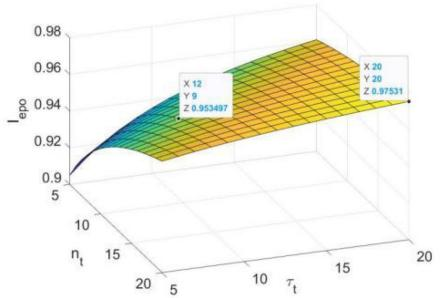  
Fig. 4. Change chart of $I _ { \mathrm { e p o } }$ with the values of $n _ { t }$ and $\tau _ { t }$ in the 3-D space.

$$
I _ {\mathrm{eva}} (t) = \frac {F _ {\mathrm{cur}} ^ {\mathrm{mean}} - F _ {\mathrm{min}}}{F _ {\mathrm{max}} - F _ {\mathrm{cur}} ^ {\mathrm{mean}}}\tag{13}
$$

where $F _ { \mathrm { c u r } } ^ { \mathrm { m e a n } }$ denotes the mean-squared deviation of the population in current time window, and $F _ { \mathrm { m a x } }$ and $F _ { \mathrm { m i n } }$ denote the maximum and minimum mean-squared deviation of the population in the history time window, respectively.

Besides, this article presents a new environment perception operator $I _ { \mathrm { e p o } }$ whose expression is shown in

$$
I _ {\mathrm{epo}} = \exp (- 1 / (n _ {t} + \tau_ {t})).\tag{14}
$$

where $n _ { t }$ is the environmental change intensity in time $t ,$ and $\tau _ { t }$ is the environmental change frequency in time t. The change of $I _ { \mathrm { e p o } }$ with the values of $n _ { t }$ and $\tau _ { t }$ is shown in Fig. 4. The environmental change is considered as moderate when $I _ { \mathrm { e p o } } <$ $I _ { \mathrm { e v a } } ( t )$ , which means environmental change is more than it can control. Whereas the change is dramatic when $I _ { \mathrm { e p o } } \geq I _ { \mathrm { e v a } } ( t )$

3) Environment Perception Bi-Mutation: When the environment changes, the proportion of new individuals introduced ratio(t) [as shown in (15)] is calculated according to the intensity of environmental change [as shown in (16)]

$$
\operatorname{ratio} (t) = \left\{ \begin{array}{l l} \min \{I _ {\text { eva }} (t), 1 \}, & I _ {\text { epo }} <   I _ {\text { eva }} (t) \\ I _ {\text { epo }}, & \text { other } \end{array} \right.
$$

$$
N _ {\mathrm{mut}} = N \times \operatorname{ratio} (t).\tag{15}
$$

(16)

When the intensity of environment change is moderate, $N _ { \mathrm { m u t } }$ individuals are selected for cross-mutation [31] in the first stage, which generate $N _ { \mathrm { n e w } } ( = \ N _ { \mathrm { m u t } } )$ new individuals. The $N _ { \mathrm { n e w } }$ as well as remaining $N { - } N _ { \mathrm { m u m } }$ individuals together enter the next generation evolution. Fig. 5 shows an example of the distribution of population after bi-mutation with moderate environment change in the bi-objective space.

When the intensity of environmental change is dramatic, the $N _ { \mathrm { m u t } }$ individuals closest to the reference point $z ^ { * }$ are cross-mutated in the first stage, and the remaining $N -$ $N _ { \mathrm { m u m } }$ individuals are randomly initialized which can speed up population searching. Fig. 6 shows an example of the distribution of a new population after bi-mutation with dramatic environmental changes in the bi-objective space.

Synthesize the above knowledge points, Algorithm 2 gives the detailed steps of the environment detection mechanism.

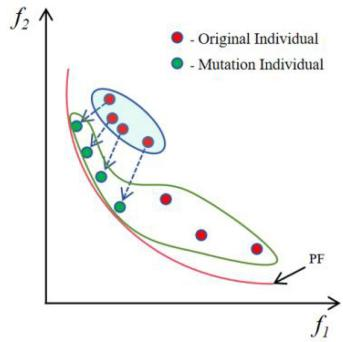  
Fig. 5. Diagram of the population after bi-mutation when environmental change is moderate, they are framed in green.

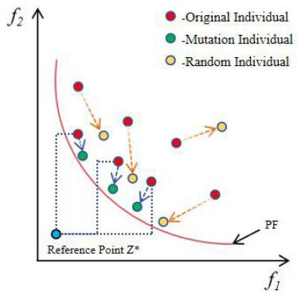

Fig. 6. Diagram of the population after bi-mutation when environmental change is dramatic, they are made up of green and yellow dots.  
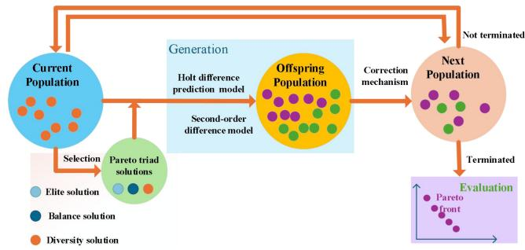  
Fig. 7. Holt-based prediction correction mechanism.

## C. Holt-Based Prediction Correction Mechanism

The Holt-based prediction correction mechanism consists of four stages. First, Pareto triad solution is selected. Second, the Pareto triad solution is predicted by Holt difference prediction (HDP). Third, the predicted values are further corrected by second-order difference model. Thus, all individuals in population can be predicted by the corrected movement trend. Lastly, the predicted values of individuals are corrected by reference point. The process of the Holt-based prediction correction mechanism is shown in Fig. 7.

1) Pareto Triad Solution: Three specified individuals in the population are selected as a Pareto triad, that is, elite solution (Es), balance solution (Bs), and diversity solution (Ds), its specific implications are as follows.

1) Es: The individual is closest to the reference point $z ^ { * } ,$ it represents the optimal solution in the current PF.

Algorithm 2: Environmental Detection Mechanism
Input: Two adjacent time Window populations $P_T, P_{T+1}$, Population size $N$, Current population $P$, reference point $z^*$, Environmental change frequency, Environment perception operator $I_{epo}$;
Output: Updated population $P'$, Updated reference point $z'$;
for i = 1 to N
    if $i\% \tau_T = 1$
    The Wilcoxon signed rank test is performed for $P_T, P_{T+1}$;
    Calculate $F_{mean}$ and $I_{eva}(t)$;
    if $I_{eva}(t) &gt; I_{epo}$ $N_{new} = N_{mut} = N \times \min(I_{eva}(t), 1)$;
    The $N_{new}/2$ individuals closest to the reference point $z^*$ are selected for cross-mutation;
    else
    $N_{new} = N_{mut} = N \times I_{epo}$;
    The $N_{new}$ individuals closest to the reference point $z^*$ are selected for cross-mutation, and the remaining individuals are randomly generated;
    end if
    end if
end for

2) Bs: It is neither strictly close to the reference point $z ^ { * }$ nor significantly deviates from it, it represents a balance in algorithm.

3) Ds: The individual is farthest from the reference point $z ^ { * } ,$ , it represents an extreme on PF, and its existence helps provide diversity for the population.

We will use the HDP correction model proposed in this article to predict and correct the Pareto triad solutions in the next time window to increase the speed of whole population optimization.

2) Holt Difference Prediction Model: This article innovatively introduces Holt prediction method [22] to DMOPs, combining difference idea, proposes a new HDP model, which aims to estimate the moving trend of Pareto triad solutions $\Delta X _ { T }$ at the end of the current time window T by the position of Pareto triad solutions in the historical time window to estimate the position of the rest of the population in the next time window $T + 1$ . The position of Pareto triad solutions in time window $t + T$ is calculated by (17)

$$
\operatorname{Triad} _ {t + T} = a _ {t} + b _ {t} \cdot T
$$

$$
\int a _ {t} = 2 S _ {t} ^ {(1)} - S _ {t} ^ {(2)}\tag{17}
$$

$$
\left\{b _ {t} = \frac {a}{1 - a} \right. \cdot a _ {t}\tag{18}
$$

$$
S _ {t} ^ {(1)} = a \cdot \mathrm{Triad} _ {t} + (1 - a) S _ {t - 1} ^ {(1)}\tag{19}
$$

$$
S _ {t} ^ {(2)} = a \cdot S _ {t} ^ {(1)} + (1 - a) S _ {t - 1} ^ {(2)}\tag{20}
$$

$$
\Delta X _ {T} = \mathrm{Triad} _ {T + 1} - \mathrm{Triad} _ {T}\tag{21}
$$

where $S _ { t } ^ { ( i ) } ( i = 1 , 2 )$ represents the i exponential smoothing value in the t time window. $a _ { t }$ and $b _ { t }$ are two parameters variable in the t time window. a is the memory attenuation factor, $a ~ \in ~ [ 0 , 1 ]$ , the larger the a, the faster the model “forgets” the historical data, therefore, when the position of the population fluctuates relatively smoothly in the historical time window, the larger a is desirable, and vice versa. In this article, when the environment perception operator detects that the environment change is moderate, a takes a larger value. If drastic, a is set to a smaller value.

After obtaining the movement trend $\Delta X _ { T }$ of Pareto triad solution in the time window $T ,$ the positions of other individuals in the population in the time window $T + 1$ are as follows:

$$
X _ {i} ^ {T + 1} = X _ {i} ^ {T} + \Delta X _ {T}, i = 1, 2, \ldots N.\tag{22}
$$

Due to the limitation of historical information, the accuracy of this individual-dependent Holt prediction method still has room for improvement. Therefore, a prediction correction mechanism is further proposed in this article.

3) Pareto Triad Second-Order Difference Model: In this section, the moving trend of the predicted population in adjacent time windows obtained by the HDP is corrected by the second-order difference treatment. The specific correction formulas are shown in

$$
\Delta X _ {T} ^ {1} = \mathrm{Triad} _ {T} - \mathrm{Triad} _ {T - 1}
$$

$$
\Delta X _ {T} ^ {2} = \Delta X _ {T} ^ {1} + (\Delta X _ {T} ^ {1} - \Delta X _ {T - 1} ^ {1}).\tag{23}
$$

(24)

In reality, a variety of optimization problems may change in different ways, such as random changes, nonlinear changes, etc. [32]. In order to simplify the processing of the model and enable it to be applied in a complex and changeable dynamic environment, the new model regards the motion of Pareto triad solutions on different time windows as a motion with the same acceleration over a series of intervals, where the predicted position of individuals in the T + 1 time window is obtained by

$$
X _ {i} ^ {T + 1} = X _ {i} ^ {T} + \Delta X _ {T} ^ {2}, i = 1, 2 \dots N.\tag{25}
$$

To sum up, the prediction individuals are selected via the HDP model (proposed in Section III-B2) and Pareto triad second-order difference model, and then the predicted individuals are again corrected preferentially via measuring the distance between the predicted individual and the reference point. The above is called HDP correction process.

Fig. 8 shows the prediction and correction process. The pseudocode of which is given in Algorithm 3.

$$
\text { IV.   EXPERIMENTAL   DESIGN   AND   RESULT   ANALYSIS }
$$

This section verifies the comprehensive performance of HDMOEA algorithm to solve DMOPs through comparative simulation experiments. A series of experimental settings are given, including test set, performance evaluation index, comparison algorithm, experimental parameter setting, experimental results and analysis, the effectiveness analysis of environmental change detection, and so on. To ensure experimental fairness, all experiments are conducted on MATLAB R2021a.

Algorithm 3: Prediction Correction Mechanism
1 Input: Pareto triad solution $\mathrm{Triad}_T$, $\mathrm{Triad}_{T-1}$, $\mathrm{Triad}_{T-2}$, Current population $P_T = \{X_i^T\}$, reference point $z^*$, Memory attenuation factor $a$, Environmental change counter T;
2 Output: Updated population $P'$, Updated reference point $z'$;
3 for $i = 1$ to $N$
4 if $T = 2$
5    Prediction $X_i^{T+1}$ using HDP model;
6
7 else if $T \geq 3$
8    Predict $X_i^{T+1}$ using HDP model
9    Correct $X_i^{T+1}$ using Pareto triad second-order difference model;
10    Calculate the distance between $X_i^{T+1}$ and $z^*$;
11    Select $N$ optimal individuals to form $P'$;
12    Updated reference point $z'$;
13 end if
14 end for

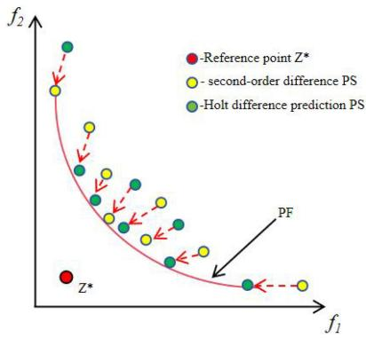  
Fig. 8. Schematic of prediction and correction. The generated population is composed of the N individuals closest to the reference point.

## A. Benchmark Problems and Performance Metric

All experiments are conducted in seven benchmark functions, including four FDA problems (FDA1–FDA4) and three dMOP problems (dMOP1–dMOP3) [21]. They are listed in Table I and divided into three types depending on the characteristics of PS and PF, i.e., Types I–III, where n represents the dimension of decision space and m represents the number of optimization objectives.

In this article, the mean inverse generation distance (MIGD) is used to evaluate the convergence and diversity of DMOEA [33]. Its specific definition is shown in

$$
\mathrm{MIGD} = \frac {1}{| T |} \sum_ {t \in T} \mathrm{IGD} \left(P _ {t} ^ {*}, P _ {t}\right)\tag{26}
$$

where T is a set of discrete time point during evolution, and $| T |$ is the cardinality of T. $\boldsymbol { P } _ { t } ^ { * }$ and $P _ { t }$ indicate real Pareto front and approximate Pareto front in time t. IGD is inverse generation distance, which is used to evaluated the convergence and diversity of the algorithm by measuring the $P _ { t }$ approximation to the $\boldsymbol { P } _ { t } ^ { * }$ in the static environment. MIGD is the average of

TABLE I  
BENCHMARK FUNCTIONS

<table><tr><td>Benchmark functions</td><td>Type (PS, PF)</td><td>Domain</td><td>n</td><td>m</td></tr><tr><td>FDA1</td><td>Type I (change, static)</td><td> $[0, 1] \times [-1, 1]^{n-1}$ </td><td>10</td><td>2</td></tr><tr><td>FDA2</td><td>Type II (change, change)</td><td> $[0, 1] \times [-1, 1]^{n-1}$ </td><td>10</td><td>2</td></tr><tr><td>FDA3</td><td>Type II (change, change)</td><td> $[0, 1]^{n-1}$ </td><td>10</td><td>2</td></tr><tr><td>FDA4</td><td>Type I (change, static)</td><td> $[0, 1]^{n-1}$ </td><td>12</td><td>3</td></tr><tr><td>dMOP1</td><td>Type III (static, change)</td><td> $[0, 1]^{n-1}$ </td><td>10</td><td>2</td></tr><tr><td>dMOP2</td><td>Type II (change, change)</td><td> $[0, 1]^{n-1}$ </td><td>10</td><td>2</td></tr><tr><td>dMOP3</td><td>Type I (change, static)</td><td> $[0, 1]^{n-1}$ </td><td>10</td><td>2</td></tr></table>

TABLE II

EXPERIMENT PARAMETER SETTINGS

<table><tr><td>Parameter name</td><td>Symbol</td><td>values</td></tr><tr><td>Objective number/population size</td><td>m/N</td><td>2/100 or 3/200</td></tr><tr><td>Crossover probability</td><td>Cr</td><td>0.5</td></tr><tr><td>Scale factor</td><td>F</td><td>0.5</td></tr><tr><td>Neighborhood size</td><td>H</td><td>20</td></tr><tr><td>Mutation probability</td><td>PM</td><td>1/n</td></tr><tr><td>Environments</td><td>T</td><td>30</td></tr><tr><td>Change frequency</td><td> $\tau_t$ </td><td>25</td></tr><tr><td>Total iterations</td><td>Iter</td><td>750</td></tr><tr><td>Intensity of change</td><td> $n_t$ </td><td>5,10,20</td></tr><tr><td>Assessment size</td><td>s</td><td>0.2*N</td></tr><tr><td>Attenuation factor</td><td>a</td><td>0.2,0.8</td></tr></table>

IGD values over multiple time windows. The specific indicator of IGD is defined as shown in

$$
\operatorname{IGD} \left(P _ {t} ^ {*}, P _ {t}\right) = \frac {\sum_ {v \in P F _ {t}} d (v , P _ {t})}{\left| P _ {t} ^ {*} \right|}\tag{27}
$$

where $d ( \nu , P _ { t } )$ denotes the minimum Euclidean distance between v and $P _ { t } .$ and $| P _ { t } ^ { * } |$ represents the number of solutions in the real Pareto front.

## B. Performance Comparison and Parameter Settings

In this article, six popular predictive-based DMOEAs are used for comparative experiments with HDMOEA which include individual-based transfer learning algorithm IT-DMOEA [34], knee point-based imbalanced transfer learning algorithm KT-DMOEA [35], hybrid prediction-based strategy and improved social learning optimization algorithm HPS-DMOP [36], species-based particle swarm optimizer enhanced by memory algorithm SGEA [37], decompositionbased hybrid algorithm MDP [38], and decomposition-based MOEA assisted by SVR algorithm MOEA/D-SVR [39]. The settings of main experiment parameters are shown in Table II.

In order to ensure the fairness of comparison, all comparison algorithms use the same common parameter settings. They are listed in Table II, and other special parameters are set according to the original paper.

TABLE III  
IGD MEANS AND STANDARD DEVIATIONS OBTAINED FOR IT-DMOEA, KT-DMOEA, HPS-DMOP, SGEA, MDP, SVR-DMOEA, AND HDMOEA ON THE FDA

<table><tr><td>Algorithm</td><td> $n_t$ </td><td>FDA1</td><td>FDA2</td><td>FDA3</td><td>FDA4</td><td>+/-/-</td></tr><tr><td rowspan="3">IT-DMOEA</td><td>5</td><td>6.53E-3(3.99E-4) -</td><td>2.15E-1(3.14E-1) -</td><td>6.27E+0(1.57E-1) -</td><td>2.27E-1(6.81E-2) -</td><td></td></tr><tr><td>10</td><td>6.80E-3(8.57E-4) -</td><td>2.19E-1(2.86E-1) -</td><td>6.17E+0(8.04E-2) -</td><td>2.26E-1(6.23E-2) -</td><td>0/12/0</td></tr><tr><td>20</td><td>1.09E-2(5.47E-3) -</td><td>2.81E-1(2.39E-1) -</td><td>6.43E+0(4.39E-2) -</td><td>2.32E-1(5.88E-2) -</td><td></td></tr><tr><td rowspan="3">KT-DMOEA</td><td>5</td><td>8.23E-2(9.24E-2) -</td><td>1.67E-1(8.12E-2) -</td><td>1.51E+0(2.01E+0) -</td><td>4.45E-1(3.58E-2) -</td><td></td></tr><tr><td>10</td><td>6.81E-2(7.87E-2) -</td><td>1.68E-1(8.36E-2) -</td><td>1.53E+0(1.86E+0) -</td><td>4.39E-1(3.80E-2) -</td><td>0/12/0</td></tr><tr><td>20</td><td>7.46E-2(3.49E-2) -</td><td>1.85E-1(8.61E-2) -</td><td>1.51E+0(1.85E+0) -</td><td>4.47E-1(3.62E-2) -</td><td></td></tr><tr><td rowspan="3">HPS-DMOP</td><td>5</td><td>8.76E-2(1.97E-3) -</td><td>4.12E-2(4.96E-2) -</td><td>3.96E-2(3.80E-2) ~</td><td>2.00E-1(9.76E-2) -</td><td></td></tr><tr><td>10</td><td>6.99E-2(1.49E-3) -</td><td>2.44E-2(4.73E-2) -</td><td>7.73E-2(3.07E-2) +</td><td>1.51E-1(8.37E-2) -</td><td>2/8/2</td></tr><tr><td>20</td><td>7.76E-2(0.21E-3) -</td><td>5.53E-3(1.53E-2) +</td><td>6.46E-2(3.06E-2) ~</td><td>1.56E-1(9.42E-2) -</td><td></td></tr><tr><td rowspan="3">SGEA</td><td>5</td><td>4.26E-2(2.59E-2) -</td><td>1.83E-2(7.28E-2) -</td><td>9.21E-2(8.02E-2) -</td><td>6.39E-1(3.25E-3) -</td><td></td></tr><tr><td>10</td><td>2.38E-2(1.05E-2) -</td><td>1.71E-2(6.82E-2) -</td><td>10.73E-2(1.01E-1) -</td><td>6.37E-1(2.51E-3) -</td><td>1/11/0</td></tr><tr><td>20</td><td>3.60E-2(5.31E-3) -</td><td>1.81E-2(7.90E-2) -</td><td>6.23E-2(1.05E-2) +</td><td>6.45E-1(1.81E-3) -</td><td></td></tr><tr><td rowspan="3">MDP</td><td>5</td><td>8.86E-2(1.26E-1) -</td><td>3.70E-1(1.91E-1) -</td><td>4.87E-1(3.80E-1) -</td><td>4.08E-1(4.35E-3) -</td><td></td></tr><tr><td>10</td><td>8.21E-2(1.22E-1) -</td><td>3.92E-1(1.94E-2) -</td><td>4.67E-1(3.07E-1) -</td><td>4.06E-1(4.36E-3) -</td><td>0/12/0</td></tr><tr><td>20</td><td>10.13E-2(0.21E-1) -</td><td>3.90E-1(1.93E-2) -</td><td>4.3E-1(3.06E-1) -</td><td>4.15E-1(4.17E-3) -</td><td></td></tr><tr><td rowspan="3">SVR-MOEA</td><td>5</td><td>5.63E-3(7.63E-5) -</td><td>5.64E-3(9.4E-5) -</td><td>2.13E-2(1.75E-2) -</td><td>3.62E-2(3.34E-4) +</td><td></td></tr><tr><td>10</td><td>6.03E-3(2.404E-4) -</td><td>5.32E-3(5.20E-5) -</td><td>9.10E-2(1.30E-1) -</td><td>4.47E-2(5.73E-4) -</td><td>2/10/0</td></tr><tr><td>20</td><td>6.70E-3(1.12E-4) -</td><td>5.61E-3(6.78E-5) -</td><td>1.15E-1(1.56E-3) -</td><td>4.49E-2(8.70E-5) +</td><td></td></tr><tr><td rowspan="3">HDMOEA</td><td>5</td><td>4.08E-3(9.49E-5)</td><td>5.54E-3(9.4E-5)</td><td>1.97E-2(1.72E-2)</td><td>4.69E-2(4.64E-3)</td><td></td></tr><tr><td>10</td><td>5.02E-3(8.85E-5)</td><td>5.21E-3(5.17E-5)</td><td>8.60E-2(1.30E-1)</td><td>4.18E-2(4.92E-4)</td><td></td></tr><tr><td>20</td><td>4.09E-3(1.13E-4)</td><td>5.27E-3(5.78E-6)</td><td>1.05E-1(1.36E-3)</td><td>5.19E-2(6.24E-4)</td><td></td></tr></table>

## C. Experimental Results and Analysis

Experiments are conduced to compare the HDMOEA proposed with six comparison algorithm, the mean and standard deviation of MIGD in 30 experiments are recorded in Tables III and IV, respectively. The best experimental results are indicated in bold. The symbols $\mathrm { \Omega ^ { * } + } / \mathrm { - } / \mathrm { \Omega } \sim ^ { , , }$ indicate that the results are better/worse/similar than HDMOEA, respectively. According to Table III, it can be seen in FDA problems that HDMOEA algorithm achieves best results compared with IT-DMOEA (0/12/0) and KT-DMOEA (0/12/0) whether mean value and standard deviation in all test problems. HDMOEA exists 1–2 experiment results are worse compared with other four comparison algorithms, however, it is superior to the algorithms in most experiments (2/8/2, 1/11/0, 2/10/0). From Table IV, the same conclusion can be reached in dMOP problems. Therefore, the experimental results show that the HDMOEA algorithm has high precision and strong robustness, Fig. 10 further verifies this conclusion.

## D. Effectiveness Analysis of Environment Change Detection

It can be seen from Table I that FDA2, FDA3, dMOP1, and dMOP2 belong all type II-III benchmark problems, that is, PF will change over time. It means that they can be used to test whether the detection method of environment change is effective. Therefore, this article adopts Wilcoxon signedrank test method on type II-III benchmark problems to detect environment change, taking FDA1 and dMOP1 for example, Fig. 9(a) and (b) shows the change points for the first 19 time windows. The existence of change points indicates that environment changes of the population in this time window.

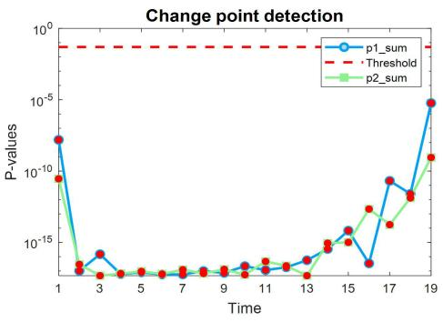  
(a)

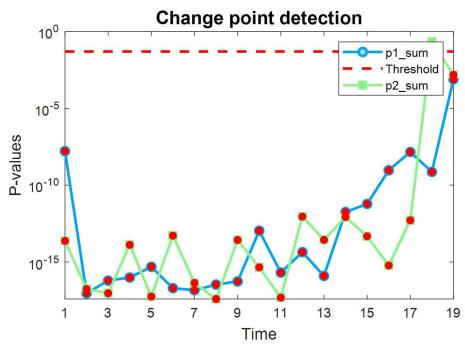  
(b)  
Fig. 9. Using the Wilcoxon signed-rank test in part to test the p-value of the function between different objectives in 19 time windows $( n _ { t } = 1 0 , \tau _ { t } = 2 5 )$ (a) FDA2 (Type II). (b) dMOP1 (Type III).

When the p-value obtained by Wilcoxon signed-rank test is less than the threshold (usually set as 0.05) on time window T and T+1 [29], the environment has changed in this time

TABLE IV  
IGD MEANS AND STANDARD DEVIATIONS OBTAINED FOR IT-DMOEA, KT-DMOEA, HPS-DMOP,SGEA, MDP, SVR-DMOEA, AND HDMOEA ON THE DMOP

<table><tr><td>Algorithm</td><td> $n_t$ </td><td>dMOP1</td><td>dMOP2</td><td>dMOP3</td><td>+/-~</td></tr><tr><td rowspan="3">IT-DMOEA</td><td>5</td><td>7.19E-2(3.37E-1) -</td><td>3.17E-2(3.16E-2) -</td><td>5.21E-3(3.83E-3) ~</td><td></td></tr><tr><td>10</td><td>6.89E-2(2.33E-1) -</td><td>2.06E-2(1.96E-2) -</td><td>5.51E-3(4.58E-3) -</td><td>0/8/1</td></tr><tr><td>20</td><td>5.32E-2(2.38E-2) -</td><td>1.77E-2(1.36E-2) -</td><td>1.02E-2(6.37E-3) -</td><td></td></tr><tr><td rowspan="3">KT-DMOEA</td><td>5</td><td>2.13E-2(3.61E-2) -</td><td>4.55E-2(4.85E-2) -</td><td>4.00E-2(2.81E-2) -</td><td></td></tr><tr><td>10</td><td>3.27E-2(5.06E-2) -</td><td>4.18E-2(4.23E-2) -</td><td>3.91E-2(2.87E-2) -</td><td>0/9/0</td></tr><tr><td>20</td><td>4.22E-2(2.71E-2) -</td><td>3.40E-2(2.88E-2) -</td><td>3.94E-2(2.92E-2) -</td><td></td></tr><tr><td rowspan="3">HPS-DMOP</td><td>5</td><td>0.38E-2(1.94E-3) +</td><td>2.18E-1(1.77E-3) -</td><td>2.47E-1(4.23E-2) -</td><td></td></tr><tr><td>10</td><td>2.17E-2(2.37E-3) -</td><td>1.07E-1(1.78E-2) -</td><td>1.38E-1(8.17E-2) -</td><td>1/8/0</td></tr><tr><td>20</td><td>2.29E-2(4.77E-3) -</td><td>2.33E-2(1.54E-2) -</td><td>8.11E-2(7.47E-2) -</td><td></td></tr><tr><td rowspan="3">SGEA</td><td>5</td><td>0.73E-2(6.7E-2) -</td><td>5.33E-2(3.42E-2) -</td><td>4.12E-2(2.56E-2) -</td><td></td></tr><tr><td>10</td><td>1.58E-2(6.55E-2) -</td><td>2.85E-2(1.50E-2) -</td><td>2.22E-2(1.04E-2) -</td><td>0/9/0</td></tr><tr><td>20</td><td>3.73E-2(2.24E-2) -</td><td>1.90E-2(9.05E-3) -</td><td>1.63E-2(6.64E-3) -</td><td></td></tr><tr><td rowspan="3">MDP</td><td>5</td><td>3.54E-1(1.83E-1) -</td><td>1.10E-1(1.39E-1) -</td><td>9.10E-2(1.33E-1) -</td><td></td></tr><tr><td>10</td><td>3.95E-1(1.87E-1) -</td><td>1.07E-1(1.35E-1) -</td><td>8.01E-2(1.18E-1) -</td><td>0/9/0</td></tr><tr><td>20</td><td>3.88E-1(1.84E-1) -</td><td>1.76E-1(1.31E-1) -</td><td>8.86E-2(1.00E-1) -</td><td></td></tr><tr><td rowspan="3">SVR-DMOEA</td><td>5</td><td>3.79E-3(3.18E-5) -</td><td>6.27E-3(1.50E-3) -</td><td>4.39E-3(2.31E-4) +</td><td></td></tr><tr><td>10</td><td>4.24E-3(1.54e-6) -</td><td>5.19E-3(7.08E-4) -</td><td>4.22E-3(9.18E-5)</td><td>1/7/1</td></tr><tr><td>20</td><td>3.95E-3(1.48E-5)-</td><td>4.96E-3(8.16E-4) -</td><td>4.99E-3(5.33E-5) -</td><td></td></tr><tr><td rowspan="3">HDMOEA</td><td>5</td><td>3.80E-3(2.56E-5)</td><td>3.81E-3(2.22E-5)</td><td>4.56E-3(1.40E-4)</td><td></td></tr><tr><td>10</td><td>4.14E-3(2.14E-5)</td><td>4.01E-3(1.45E-5)</td><td>4.22E-3(2.59E-5)</td><td></td></tr><tr><td>20</td><td>3.79E-3(3.02E-6)</td><td>4.75E-3(5.29E-5)</td><td>4.75E-3(2.51E-4)</td><td></td></tr></table>

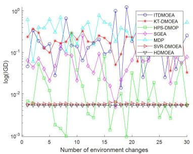  
(a)

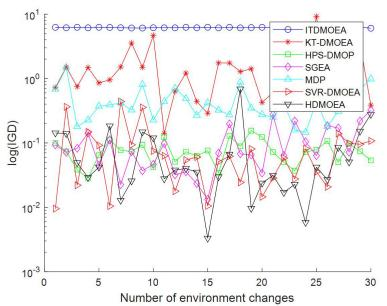  
(b)

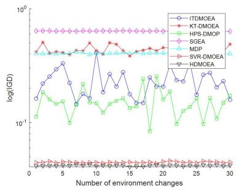  
(c)

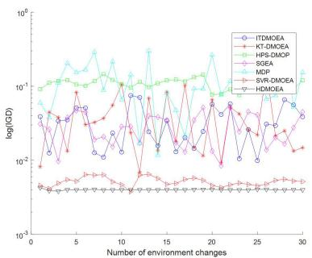  
(d)

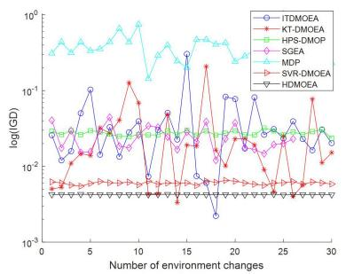  
(e)

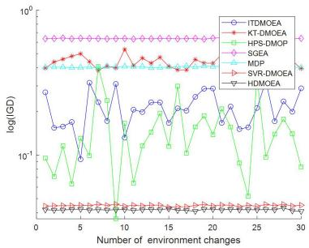  
(f)  
Fig. 10. IGD values on different time windows for seven algorithms on FDA and dMOP $( n _ { t } = 1 0 , \tau _ { t } = 2 5 )$ . (a) FDA2. (b) FDA3. (c) FDA4. (d) dMOP2. (e) dMOP1. (f) dMOP3.

window. Fig. 9 contains three lines: 1) the blue line represents the first cumulative objective function value of the population; 2) the green line represents the second one; and 3) the red dashed line represents the threshold value. When the p-value of any objective is less than the threshold, the change point will be marked in the graph as a red dot. Since the PF of

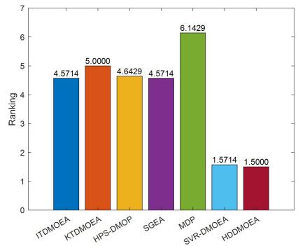  
(a)

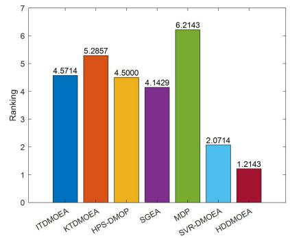

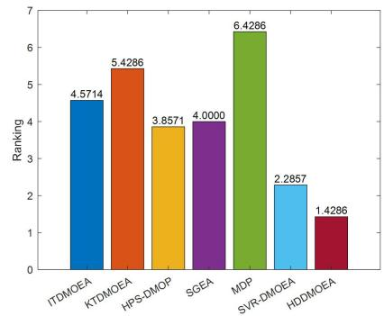

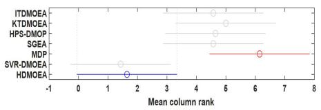  
(d)

(b)  
(c)  
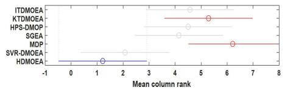  
(e)

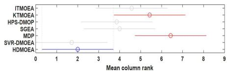  
(f)  
Fig. 11. Histogram of the mean rankings of the six algorithms and the diagram of CD difference when $\tau _ { t } = 2 5 , n _ { t } = 5 , 1 0 , 2 0 .$ (a) and (d) $n _ { t } = 5 , \tau _ { t } = 2 5 .$ (b) and (e) $n _ { t } = 1 0 , \tau _ { t } = 2 5 .$ (c) and (f) $n _ { t } = 2 0 , \tau _ { t } = 2 5$

FDA2 is offset, the environment change detected on FDA2 is also relatively obvious, and every environment change will be detected. For other benchmark problems, although one objective exceeds the threshold value, Wilcoxon signed-rank test method stipulates that as long as the p-value of any objective is less than the threshold value, the environment will be determined to change. It can be seen from Fig. 9 that environmental changes in type II benchmark problems can be effectively detected. Therefore, the Wilcoxon signed-rank test is a very effective means to detect environmental changes.

## E. Comparison Analysis of MIGD

Fig. 10(a)–(f) shows the MIGD values (the mean IGD) obtained by six algorithms on part of the FDA and dMOP problems when the intensity of environment change $n _ { t } = 2 0$ and the frequency of environment change $\tau _ { t } = 2 5$

As shown in Fig. 10, a smaller MIGD indicates that the stability of SVR-DMOEA and HDMOEA is the best on FDA2, and both have better performance.

Similarly, the stability of both SGEA and HPS-DMOP is higher than that of HDMOEA on FDA3. Therein, HPS-DMOP has the best stability, which may be due to its own improved social learning method with fast and stable tracking ability, so it can continue to maintain stability when PF shifts.

Four comparison algorithms show stability on FDA4, including HDMOEA, SVR-DMOEA, SGEA, and MDP. However, HDMOEA presents the better convergent.

As can be seen from the MIGD, the stability of HDMOEA, HPS-DMOP, and SVR-DMOEA is the better on dMOP1. It is noted that ITDMOEA and KT-DMOEA are all the worse. It is probably because they do not obtain enough information of individuals to predict the change of PF.

HDMOEA is the only stability on dMOP2, Meanwhile, it has good convergent.

HDMOEA and SVR-DMOEA gain good stability on dMOP3.

TABLE V $Q _ { \alpha }$ VALUE OF K

<table><tr><td>K</td><td>3</td><td>4</td><td>5</td><td>6</td><td>7</td><td>8</td></tr><tr><td> $q_{\alpha}$ </td><td>2.344</td><td>2.569</td><td>2.728</td><td>2.850</td><td>2.949</td><td>3.031</td></tr></table>

In summary, HDMOEA has the most stable from the view of MIGD as well as good convergent, and the strongest robustness of the algorithm.

In addition, as shown in Tables III and IV, the standard deviation of MIGD of HDMOEA on all benchmark problems is much smaller than the that of other algorithms in different combinations of $n _ { t }$ and $\tau _ { t } .$ . When the standard deviation of MIGD is small, it means that the quality of the solution set obtained is more consistent in multiple runs of the algorithm, and there will be no large fluctuations. That is, it can still maintain good performance under different operating conditions and random factors, and further verify the stability and robustness of the algorithm.

In order to evaluate the performance of the six algorithms fairly and objectively, the Friedman test is used to detect whether there are significant differences in the performance of different algorithms on multiple test problems. To further determine the significant differences of algorithms, the Nimenyi post-hoc test is adopted in this article, the critical difference (CD) of which is calculated by

$$
\mathrm{CD} = q _ {\alpha} \sqrt {\frac {K (K + 1)}{6 N}}\tag{28}
$$

where the value of $q _ { \alpha }$ is determined by Table V, K is the number of comparison algorithms, and N is the number of test functions. There are seven comparison algorithms in this article, therefore, $q _ { \alpha }$ is set to 2.949.

Fig. 11(a)–(f) shows the average ranking of seven algorithms at $\tau _ { t } = 2 5 , n _ { t } = 5 ,$ 10, 20, and the CD value. From Fig. 11(a)–(c), it can be seen that the average ranking of

TABLE VI  
MIGD AND STANDARD DEVIATIONS OF IGD OBTAINED BY HDMOEA FOR DIFFERENT VALUES OF MEMORY ATTENUATION FACTOR a

<table><tr><td rowspan="2">Benchmark</td><td rowspan="2"> $(n_t, \tau_t)$ </td><td>HDMOEA-I</td><td>HDMOEA</td><td>HDMOEA-II</td></tr><tr><td> $a_1=0.7, a_2=0.3$ </td><td> $a_1=0.8, a_2=0.2$ </td><td> $a_1=0.9, a_2=0.1$ </td></tr><tr><td rowspan="3">FDA1</td><td>(5,25)</td><td>5.73E-3(1.35E-4)</td><td>5.66E-3(8.41E-5)</td><td>5.70E-3(2.07E-4)</td></tr><tr><td>(10,25)</td><td>5.08E-3(1.07E-4)</td><td>5.00E-3(7.28E-5)</td><td>5.04E-3(6.10E-5)</td></tr><tr><td>(20,25)</td><td>6.79E-3(1.68E-4)</td><td>6.79E-3(1.67E-4)</td><td>6.80E-3(1.27E-4)</td></tr><tr><td rowspan="3">FDA2</td><td>(5,25)</td><td>5.42E-3(7.76E-5)</td><td>5.46E-3(5.87E-5)</td><td>5.42E-3(5.02E-5)</td></tr><tr><td>(10,25)</td><td>5.16E-3(7.36E-5)</td><td>5.12E-3(1.10E-4)</td><td>5.17E-3(5.45E-5)</td></tr><tr><td>(20,25)</td><td>5.12E-3(5.18E-5)</td><td>5.10E-3(6.20E-5)</td><td>5.12E-3(4.75E-5)</td></tr><tr><td rowspan="3">FDA3</td><td>(5,25)</td><td>1.74E-2(1.70E-2)</td><td>3.49E-2(2.19E-2)</td><td>2.24E-2(1.76E-2)</td></tr><tr><td>(10,25)</td><td>9.65E-3(5.59E-3)</td><td>9.46E-3(8.34E-4)</td><td>2.92E-2(5.63E-2)</td></tr><tr><td>(20,25)</td><td>1.08E-1(1.36E-3)</td><td>1.07E-1(7.42E-4)</td><td>1.07E-1(1.24E-3)</td></tr><tr><td rowspan="3">dMOP1</td><td>(5,25)</td><td>4.33E-3(1.24E-4)</td><td>5.69E-3(5.69E-3)</td><td>4.67E-3(8.99E-4)</td></tr><tr><td>(10,25)</td><td>4.43E-3(5.84E-4)</td><td>4.22E-3(2.64E-3)</td><td>4.72E-3(8.40E-4)</td></tr><tr><td>(20,25)</td><td>4.20E-3(5.38E-5)</td><td>4.17E-3(1.58E-4)</td><td>4.29E-3(7.65E-5)</td></tr><tr><td rowspan="3">dMOP2</td><td>(5,25)</td><td>5.04E-3(4.29E-5)</td><td>5.01E-3(5.23E-5)</td><td>5.07E-3(9.58E-5)</td></tr><tr><td>(10,25)</td><td>5.01E-3(4.13E-5)</td><td>5.00E-3(7.74E-5)</td><td>5.00E-3(4.92E-5)</td></tr><tr><td>(20,25)</td><td>5.16E-3(7.92E-5)</td><td>5.10E-3(1.01E-4)</td><td>5.11E-3(9.35E-5)</td></tr></table>

HDMOEA is the lowest, which means that the algorithm basically ranks the top in all benchmark problems. In CD difference diagram, the smaller the mean column rank of the algorithm, the better the performance. Therefore, it can be concluded that HDMOEA has the best performance from Fig. 11(d)–(f).

To sum up, according to the results of Friedman test and Nemenyi post-hoc test, the performance of the HDMOEA algorithm is better than other algorithms, and the algorithm can maintain the best performance under different environments, which means HDMOEA has good robustness and stability.

## F. Parameter Sensitivity Analysis

The memory attenuation factor a is an important parameter of HDP. It can quickly adjust the response speed of the algorithm to environment change according to the environment perception operator, and then the algorithm can maintain good performance. In this section, several groups of comparative experiments are carried out to get the best a value. $a _ { 1 }$ is set as 0.7, 0.8, and 0.9, respectively, when the intensity of environment change is drastic, $a _ { 2 }$ is set as 0.3, 0.2, and 0.1, respectively, when the intensity of environment change is moderate. Five benchmark functions are selected to take part in experiments, HDMOEA is experimented when $a _ { 1 }$ and $a _ { 2 }$ are set as different values, they are recorded as HDMOEA, HDMOEA-I, and HDMOEA-II (see Table VI for details). The experimental results are shown in Table VI. The best MIGD values in the five benchmark functions are shown in bold. As shown in Table VI, among fifteen different combinations between benchmark functions and parameter, HDMOEA achieves the best results in 12 benchmark functions, while HDMOEA-I and HDMOEA-II achieve best results in two and one benchmark functions, respectively. The results show that the performance of the HDMOEA algorithm is better. Meanwhile, it can be concluded that the best collocation scheme of memory attenuation factor of HDMOEA is $a _ { 1 } = 0 . 8$ and $a _ { 2 } = 0 . 2$

## G. Ablation Experiment

HDMOEA includes two main parts: 1) prediction correction mechanism and 2) environment detection mechanism. HDP is an important method in prediction correction mechanism. In order to understand the role of HDP in HDMOEA, a series of experiments are further carried out in this section.

First, HDMOEA and its two variants, i.e., HDMOEA1 which use difference prediction to replace HDP, HDMOEA2 which use Holt prediction to replace HDP, carry out experiments in five benchmark problems, and the results are shown in Table VII. It can be seen that the performance of the algorithm is worse under the condition that the differential prediction (HDMOEA1) and the Holt prediction (HDMOEA2) are used alone.

Second, the SVR prediction method also participates in comparison experiment. The Holt prediction is replaced from HDMOEA, and called SVR-MOEAD. Two algorithms are carried out experiments in same conditions in DMOP1, the IGD values are gained under iterations 250, 750, and 1250, respectively, the results are presented as a histogram in Fig. 12. It can be seen that the performance of the HDMOEA algorithm is superior to SVR-MOEAD. Meanwhile, it is noted that the performance of SVR-MOEAD gradually approaches that of HDMOEA with the increase of iterations. This phenomenon may due to the fact that the SVR-MOEAD algorithm requires a large number of sample data to be trained in the training process. When the number of iterations is small, the training data is insufficient, resulting in poor performance.

In addition, in order to understand the role of bi-mutation strategy in HDMOEA, it is replaced by single cross-mutation, which named as HDMOEA3. According to the experimental results of HDMOEA and HDMOEA3 in Table VII, although in some results, the effect of bi-mutation strategy is not very good, HDMOEA is the best performing algorithm compared with HDMOEA3.

TABLE VII  
MIGD AND STANDARD DEVIATIONS OF IGD OBTAINED BY HDMOEA AND VARIANTS OF HDMOEA

<table><tr><td>Benchmark</td><td> $(n_t, \tau_t)$ </td><td>HDMOEA</td><td>HDMOEA1</td><td>HDMOEA2</td><td>HDMOEA3</td></tr><tr><td rowspan="3">FDA1</td><td>(5,25)</td><td>5.66E-3(8.41E-5)</td><td>6.15E-3(2.45E-3)</td><td>6.54E-3(8.92E-5)</td><td>6.33E-3(8.39E-5)</td></tr><tr><td>(10,25)</td><td>5.00E-3(7.28E-5)</td><td>6.07E-3(1.25E-3)</td><td>6.11E-3(3.11E-5)</td><td>6.26E-3(3.43E-5)</td></tr><tr><td>(20,25)</td><td>6.79E-3(1.67E-4)</td><td>6.17E-3(3.21E-3)</td><td>6.57E-3(1.12E-4)</td><td>6.37E-3(6.07E-5)</td></tr><tr><td rowspan="3">FDA2</td><td>(5,25)</td><td>5.46E-3(5.87E-5)</td><td>1.21E-2(2.01E-2)</td><td>5.46E-3(7.30E-5)</td><td>5.85E-3(2.55E-4)</td></tr><tr><td>(10,25)</td><td>5.12E-3(1.10E-4)</td><td>3.26E-2(4.38E-2)</td><td>5.29E-3(5.15E-5)</td><td>5.59E-3(7.14E-4)</td></tr><tr><td>(20,25)</td><td>5.10E-3(6.20E-5)</td><td>5.22E-3(8.02E-5)</td><td>5.12E-3(3.51E-5)</td><td>5.08E-3(5.21E-5)</td></tr><tr><td rowspan="3">FDA3</td><td>(5,25)</td><td>3.49E-2(2.19E-2)</td><td>8.10E-2(2.50E-2)</td><td>3.54E-2(2.26E-2)</td><td>4.26E-2(1.96E-2)</td></tr><tr><td>(10,25)</td><td>9.46E-3(8.34E-4)</td><td>1.48E-1(1.06E-1)</td><td>1.09E-1(1.51E-1)</td><td>1.16E-1(1.02E-1)</td></tr><tr><td>(20,25)</td><td>1.07E-1(7.42E-4)</td><td>1.03E-1(4.03E-3)</td><td>1.07E-1(3.99E-3)</td><td>1.06E-1(4.13E-3)</td></tr><tr><td rowspan="3">dMOP1</td><td>(5,25)</td><td>5.69E-3(5.69E-3)</td><td>5.34E-3(1.82E-3)</td><td>4.23E-3(5.28E-5)</td><td>5.68E-3(1.44E-3)</td></tr><tr><td>(10,25)</td><td>4.22E-3(2.64E-3)</td><td>5.70E-3(3.00E-3)</td><td>4.57E-3(8.03E-4)</td><td>7.96E-3(4.18E-3)</td></tr><tr><td>(20,25)</td><td>4.17E-3(1.58E-4)</td><td>4.58E-3(2.17E-4)</td><td>4.25E-3(4.67E-5)</td><td>4.68E-3(1.76E-4)</td></tr><tr><td rowspan="3">dMOP2</td><td>(5,25)</td><td>5.01E-3(5.23E-5)</td><td>1.37E-2(1.09E-2)</td><td>5.73E-3(3.89E-4)</td><td>5.50E-3(1.03E-4)</td></tr><tr><td>(10,25)</td><td>5.00E-3(7.74E-5)</td><td>8.13E-3(4.43E-3)</td><td>5.69E-3(5.25E-4)</td><td>5.27E-3(1.00E-4)</td></tr><tr><td>(20,25)</td><td>5.10E-3(1.01E-4)</td><td>6.26E-3(8.20E-4)</td><td>6.18E-3(1.00E-4)</td><td>5.55E-3(1.24E-4)</td></tr></table>

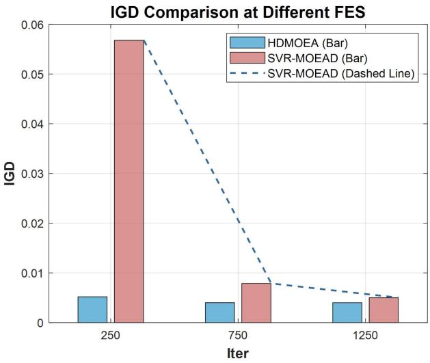  
Fig. 12. Comparison of IGD between HDMOEA and SVR-MOEAD in DMOP1.

## V. CONCLUSION AND PROSPECT

This article proposes a new Holt-based prediction correction dynamic multiobjective EA for IoT with AAV in AEC, shortly HDMOEA. The new algorithm can timely ability to respond to environment changes because it includes the Wilcoxon signed-rank test method to detect environmental changes, and the intensity of which is synchronization detected by a new environment perception operator. Furthermore, the HDP and Pareto triad second-order difference correction model are constructed to gain the movement trend of population, so as to lead all individuals can achieve faster and more accurate tracking of PF under dynamic environment changes. Besides, bi-mutation strategy is devised and used to select adaptively mutation individuals according to the intensity of environment changes, so as to maintain population diversity. HDMOEA shows good convergence and diversity in the three-types of benchmark functions, and emerges better robustness. However, with the increase of the intensity of environmental change, the performance of the algorithm still needs to improve in the type II problems.

In the real dynamic environment, limited by resources, such as cost and energy consumption, it is often unnecessary to find the Pareto-optimal solution (PS) in each relative static time window. Therefore, in the follow-up research, focusing on AEC with AAV problem, the goal of our research is to find a set of acceptable PS with better performance suitable for multiple time windows as the research goal, rather than persisting in finding the PS with the best performance in each time window. In addition, the research will further extend to the three-objective optimization problems in future works.

## REFERENCES

[1] Q. L. Zhang, Y. Luo, H. Jiang, and K. Zhang, “Aerial edge computing: A survey,” IEEE Internet Things J., vol. 10, no. 16, pp. 14357–14373, Aug. 2023.

[2] Y. Chen, K. Li, Y. Wu, J. Huang, and L. Zhao, “Energy efficient task offloading and resource allocation in air-ground integrated MEC systems: A distributed online approach,” IEEE Trans. Mob. Comput., vol. 23, no. 8, pp. 8129–8142, Dec. 2024.

[3] A. K. Sangaiah et al., “R-UAV-Net: Enhanced YOLOv4 with graphsemantic compression for transformative UAV sensing in paddy agronomy,” IEEE Trans. Cogn. Commun. Netw., vol. 14, no. 8, pp. 1–13, Aug. 2021.

[4] F. Song et al., “AoI and energy tradeoff for aerial-ground collaborative MEC: A multi-objective learning approach,” IEEE Trans. Mob. Comput., vol. 23, no. 12, pp. 11278–11294, Dec. 2024.

[5] R. T. Moghaddam, A. H. Akbari, M. Tanhaeean, R. Moghdani, F. G. Jouybari, and M. H. Keshteli, “Multi-objective boxing match algorithm for multi-objective optimization problems,” Expert Syst. Appl., vol. 239, Apr. 2024, Art. no. 122394.

[6] A. Sohani et al., “The real-time dynamic multi-objective optimization of a building integrated photovoltaic thermal (BIPV/T) system enhanced by phase change materials,” J. Energy Storage, vol. 46, Feb. 2022, Art. no. 103777.

[7] X. Q. Tang, S. Q. Qian, and H. H. Wu, “Hybrid immune multi-objective optimization algorithm for dynamic emission economic dispatch,” Appl. Res. Comput., vol. 40, no. 9, pp. 2720–2728, Mar. 2024.

[8] K. J. Qiao et al., “A dual-population evolutionary algorithm based on dynamic constraint processing and resources allocation for constrained multi-objective optimization problems,” Expert Syst. Appl., vol. 238, Mar, 2024, Art, no, 21707

[9] J. Anandakrishnan, A. K. Sangaiah, H. Darmawan, N. K. Son, Y. B. Linet, and M J. F. Alenazi, “Precise spatial prediction of rice seedlings from large-scale airborne remote sensing data using optimized Li-YOLOv9,” IEEE J. Sel. Topics Appl. Earth Observ. Remote Sens., vol. 18, pp. 2226–2238, 2025.

[10] J. H. Zheng, F. Zhou, J. Zou, S. Yang, and Y. Hu, “A dynamic multiobjective optimization based on a hybrid of pivot points prediction and diversity strategies,” Swarm Evol. Comput., vol. 78, Apr. 2023, Art. no. 101284.

[11] Z. T. Wang, Y. Pei, and J. Q. Li, “A survey on search strategy of evolutionary multi-objective optimization algorithms,” Appl. Sci., vol. 13, no. 7, p. 4643, Apr. 2023.

[12] J. X. Li, R. C. Liu, and R. N. Wang, “A change type-based self-adaptive response strategy for dynamic multi-objective optimization,” Knowl.- Based Syst., vol. 243, May 2022, Art. no. 108447.

[13] S. Y. Jiang and S. X. Yang, “A steady-state and generational evolutionary algorithm for dynamic multiobjective optimization,” IEEE Trans. Evol. Comput., vol. 21, no. 1, pp. 65–82, Feb. 2017.

[14] X. M. Ma, J. M. Yang, H. Sun, Z. Y. Hu, and L. X. Wei, “Doublespace environmental change detection and response strategy for dynamic multi-objective optimize problem,” Swarm Evol. Comput., vol. 85, Mar. 2024, Art. no. 101468.

[15] R. Z. Chen, K. Li, and X. Yao, “Dynamic multi-objective optimization with a changing number of objectives,” IEEE Trans. Evol. Comput., vol. 22, no. 1, pp. 157–171, Feb. 2018.

[16] J. Zhang, S. Qu, Z. Zhang, S. Cheng, M. Li, and Y. Bi, “An accelerationbased prediction strategy for dynamic multi-objective optimization,” Soft Comput., vol. 28, no. 2, pp. 1215–1228, Jan. 2024.

[17] H. Peng, J. Xiong, C. Pi, X. Zhou, and Z. Wu, “A dynamic multiobjective optimization evolutionary algorithm with adaptive boosting,” Swarm Evol. Comput., vol. 89, Aug. 2024, Art. no. 101621.

[18] F. X. Wang, M. Huang, S. X. Yang, and X. W. Wang, “Penalty and prediction methods for dynamic constrained multi-objective optimization,” Swarm Evol. Comput., vol. 80, Jul. 2023, Art. no. 101317.

[19] C. L. Yang, D. L. Wang, J. Tang, J. F. Qiao, and W. Yu, “Multireservoir ESN-based prediction strategy for dynamic multi-objective optimization,” Inf. Sci., vol. 652, Jan. 2024, Art. no. 119495.

[20] Z. Z. Liang, Y. Zou, S. X. Zheng, S. X. Yang, and Z. X. Zhu, “A feedback-based prediction strategy for dynamic multi-objective evolutionary optimization,” Expert Syst. Appl., vol. 172, Jun. 2021, Art. no. 114594.

[21] L. L. Cao, L. H. Xu, E. D. Goodman, and H. Li, “Decomposition-based evolutionary dynamic multiobjective optimization using a difference model,” Appl. Soft Comput., vol. 76, pp. 473–490, Mar. 2019.

[22] A. F. Anas, S. H. Mohamad, A. M. N. Nor, H. A. H. Mohd, and H. S. Muhammad, “A comparative analysis of Holt’s, ARIMA, and prophet methods in forecasting Kijang gold prices,” Int. J. Entrepreneurship Manag. Pract., vol. 7, no. 25, pp. 325–338, Jun. 2024.

[23] Q. Zhang and H. Li, “MOEA/D: A multiobjective evolutionary algorithm based on decomposition,” IEEE Trans. Evol. Comput., vol. 11, no. 6, pp. 712–731, Dec. 2007.

[24] S. Helfrich, T. Perini, P. Halffmann, N. Boland, and S. Ruzika, “Analysis of the weighted Tchebycheff weight set decomposition for multiobjective discrete optimization problems,” J. Global Optim., vol. 86, no. 6, pp. 417–440, May 2023.

[25] R. Tanabe and H. Ishibuchi, “Review and analysis of three components of differential evolution mutation operator in MOEA/D-DE,” Soft Comput., vol. 23, no. 23, pp. 12843–12857, Feb. 2019.

[26] F. Wang, Y. X. Li, F. S. Liao, and H. Y. Yan, “An ensemble learning based prediction strategy for dynamic multi-objective optimization,” Appl. Soft Comput., vol. 96, pp. 1–13, Nov. 2020.

[27] S. Karasu, A. Altan, S. Bekiros, and W. Ahmad, “A new forecasting model with wrapper-based feature selection approach using multiobjective optimization technique for chaotic crude oil time series,” Energy, vol. 212, Dec. 2020, Art. no. 118750.

[28] A. M. Zhou, Y. C. Jin, and Q. F. Zhang, “A population prediction strategy for evolutionary dynamic multiobjective optimization,” IEEE Trans Cybern., vol. 44, no. 1, pp. 40–53, Jan. 2014.

[29] K. Saplioglu and Y. S. Güçlü, “Combination of Wilcoxon test and scatter ˘ diagram for trend analysis of hydrological data,” J. Hydrol., vol. 612, Jun. 2022, Art. no. 128132.

[30] R. Liu, P. Yang, and J. Liu, “A dynamic multi-objective optimization evolutionary algorithm for complex environmental changes,” Knowl. Based Syst., vol. 216, Mar. 2021, Art. no. 106612.

[31] W. Tan, Q. C. Qiu, W. Yu, and L. P. Wang, “A decomposed multi-objective evolutionary algorithm based on neighborhood improvement,” J. Chin. Comput. Syst., vol 41, no. 12, pp. 2543–2549, Dec. 2020.

[32] Z. Sabir, M. A. Raja, H. A. Wahab, M. Shoaib, and J. F. G. Aguilar, “Integrated neuro-evolution heuristic with sequential quadratic programming for second-order prediction differential models,” Numer. Methods Partial Differ. Equat., vol. 40, no. 1, pp. 1–17, Jan. 2024.

[33] Q. Zhang, S. Yang, S. Jiang, R. Wang, and X. Li, “Novel prediction strategies for dynamic multiobjective optimization,” IEEE Trans. Evol. Comput., vol. 24, no. 2, pp. 260–274, Apr. 2020.

[34] M. Jiang, Z. Wang, S. Guo, X. Gao, and K. C. Tan, “Individual-based transfer learning for dynamic multiobjective optimization,” IEEE Trans Cybern., vol. 51, no. 10, pp. 4968–4981, Oct. 2021.

[35] M. Jiang, Z. Wang, H. Hong, and G. G. Yen, “Knee pointbased imbalanced transfer learning for dynamic multiobjective optimization,” IEEE Trans. Evol. Comput., vol. 25, no. 1, pp. 117–129, Feb. 2021.

[36] J. Zhang, F. F. Ma, H. D. Zheng, and Z. Z. Liu, “Dynamic multi-objective optimization method based on hybrid prediction strategy and improved social learning optimization algorithm,” Appl. Res. Comput., vol. 40, no. 4, pp. 1101–1107, May 2023.

[37] W. J. Luo, J. Sun, C. Y. Bu, and H. J. Liang, “Species-based particle swarm optimizer enhanced by memory for dynamic optimization,” Appl. Soft Comput., vol. 47, no. 1, pp. 130–140, Oct. 2016.

[38] W. K. Mashwani and A. Salhi, “A decomposition-based hybrid multiobjective evolutionary algorithm with dynamic resource allocation,” Appl. Soft Comput., vol. 12, no. 9, pp. 2765–2780, Sep. 2012.

[39] L. Cao, L. Xu, E. Goodman, C. Bao, and S. Zhu, “Evolutionary dynamic multiobjective optimization assisted by a support vector regression predictor,” IEEE Trans. Evol. Comput., vol. 24, no. 2, pp. 305–319, Apr. 2020.

Lanlan Kang received the Ph.D. degree in computer software and theory from the Computer School, Wuhan University, Wuhan, China, in 2017.

Until now, she has published about 30 relevant research papers. Her research interests include intelligent computing, machine learning, time-series prediction, and Internet of Things.

Yiyong Wang received the B.S. degree in Internet of Things Engineering from Jiangxi University of Science and Technology, GanZhou, China, in 2023, where he is currently pursuing the M.S. degree in Computer Science at the School of Information Engineering.

His current research interests include intelligent computing and Internet of Things.

Zhilin Liu received the B.S. degree in Computer Science and Technology from Zhengzhou University of Light Industry, Zhengzhou, China, in 2022. He is currently pursuing the M.S. degree in Computer Science from Jiangxi University of Science and Technology, GanZhou, China.

His current research interests include autonomous aerial vehicle and Internet of Things.