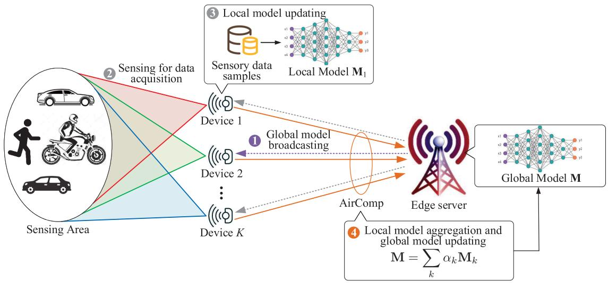
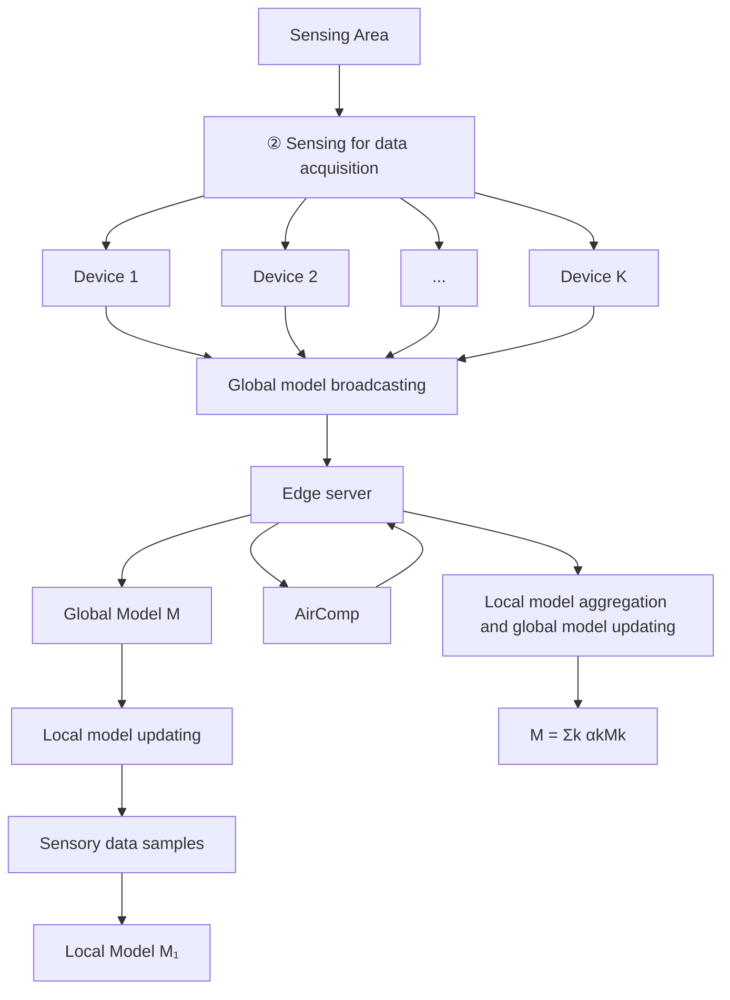
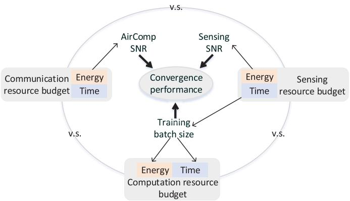
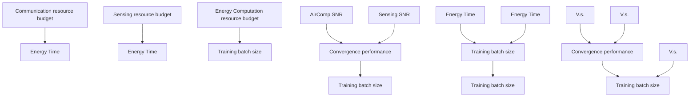
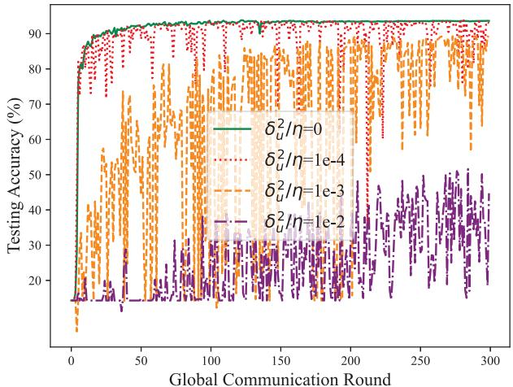
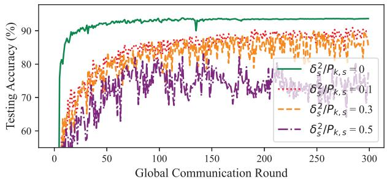
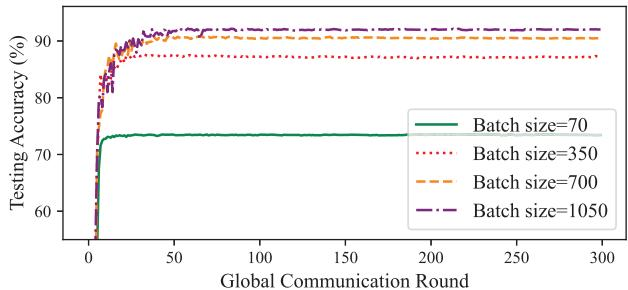
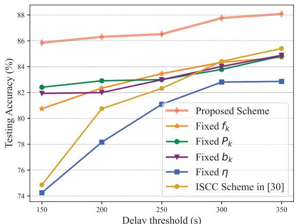
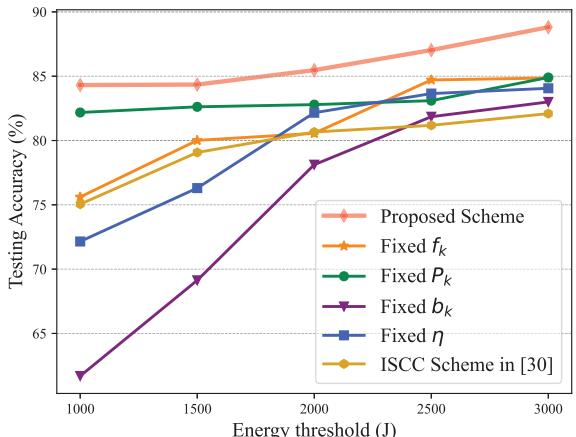
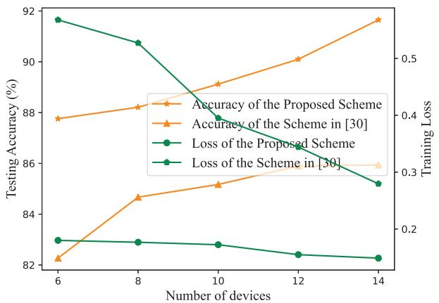

# Integrated Sensing, Communication, and Computation for Over-the-Air Federated Edge Learning

Dingzhu Wen , Member, IEEE, Sijing Xie , Xiaowen Cao , Member, IEEE, Yuanhao Cui , Member, IEEE, Jie Xu , Fellow, IEEE, Yuanming Shi , Senior Member, IEEE, and Shuguang Cui , Fellow, IEEE

Abstract—This paper studies an over-the-air federated edge learning (Air-FEEL) system with integrated sensing, communication, and computation (ISCC), in which one edge server coordinates multiple edge devices to wirelessly sense the objects and use the sensing data to collaboratively train a machine learning model for recognition tasks. In this system, over-the-air computation (AirComp) is employed to enable one-shot model aggregation from edge devices. Under this setup, we analyze the convergence behavior of the ISCC-enabled Air-FEEL in terms of the loss function degradation, by particularly taking into account the wireless sensing noise during the training data acquisition and the AirComp distortions during the over-the-air model aggregation. The result theoretically shows that sensing, communication, and computation compete for network resources to jointly decide the convergence rate. Based on the analysis, we design the ISCC parameters under the target of maximizing the loss function degradation while ensuring the latency and energy budgets in each round. The challenge lies on the tightly

Received 27 February 2025; revised 4 June 2025; accepted 7 August 2025. Date of publication 28 August 2025; date of current version 22 December 2025. This work was supported in part by NSFC under Grant 62293482; in part by the Hetao Shenzhen-HK S&T Cooperation Zone under the Basic Research Project HZQB-KCZYZ-2021067; in part by Shenzhen Outstanding Talents Training Fund under Grant 202002; in part by Guangdong Research Project 2017ZT07X152 and Project 2019CX01X104; in part by Guangdong Provincial Key Laboratory of Future Networks of Intelligence under Grant 2022B1212010001; in part by Shenzhen Key Laboratory of Big Data and Artificial Intelligence under Grant ZDSYS201707251409055; in part by the National Natural Science Foundation of China under Grant 62401369, Grant 62271318, Grant 62471424, and Grant 92267202; in part by Shenzhen Science and Technology Program under Grant RCBS20231211090520032; and in part by Shanghai Sailing Program under Grant 23YF1427400. An earlier version of this paper was presented at the 2024 IEEE/CIC International Conference on Communications in China (ICCC) [DOI: 10.1109/ICCC62479.2024.10681942]. The associate editor coordinating the review of this article and approving it for publication was J. Liu. (Corresponding author: Xiaowen Cao.)

Dingzhu Wen, Sijing Xie, and Yuanming Shi are with the School of Information Science and Technology, ShanghaiTech University, Shanghai 201210, China (e-mail: wendzh@shanghaitech.edu.cn; xiesj2023@shanghaitech.edu.cn; shiym@shanghaitech.edu.cn).

Xiaowen Cao is with the College of Electronic and Information Engineering, Shenzhen University, Shenzhen 518060, China, and also with Guangdong Provincial Key Laboratory of Future Networks of Intelligence, Shenzhen 518172, China (e-mail: caoxwen@szu.edu.cn).

Yuanhao Cui is with the School of Information and Communication Engineering, Beijing University of Posts and Telecommunications, Beijing 100876, China (e-mail: cuiyuanhao@bupt.edu.cn).

Jie Xu and Shuguang Cui are with the School of Science and Engineering (SSE), Shenzhen Future Network of Intelligence Institute (FNii-Shenzhen), and Guangdong Provincial Key Laboratory of Future Networks of Intelligence, The Chinese University of Hong Kong, Shenzhen, Guangdong 518172, China (e-mail: xujie@cuhk.edu.cn; shuguangcui@cuhk.edu.cn).

Digital Object Identifier 10.1109/TWC.2025.3598997 coupled processes of sensing, communication, and computation among different devices. To tackle the challenge, we derive a lowcomplexity ISCC algorithm by alternately optimizing the batch size control and the network resource allocation. It is found that for each device, less sensing power should be consumed if a larger batch of data samples is obtained and vice versa. Besides, with a given batch size, the optimal computation speed of one device is the minimum one that satisfies the latency constraint. Numerical results based on a human motion recognition task verify the theoretical convergence analysis and show that the proposed ISCC algorithm well coordinates the batch size control and resource allocation among sensing, communication, and computation to enhance the learning performance.

Index Terms—Over-the-air federated edge learning, sensingcommunication-computation integration, convergence analysis, resource allocation.

## I. INTRODUCTION

UTURE wireless communication systems are envisioned to deploy artificial intelligence (AI) at the network edge for providing pervasive intelligent services, giving rise to a new research area called edge AI [1]. Edge AI tasks naturally involve three tightly coupled processes, i.e., sensing for data acquisition, communication for data sharing, and computation for signal processing and intelligent decision-making [2], [3], [4]. Integrated sensing and communication (ISAC) [5] and over-the-air federated edge learning (Air-FEEL) [6], [7], [8], [9] are two emerging techniques that integrate two of the three processes for improving the operational efficiency of edge AI. The former shares hardware and network resources (e.g., spectrum) between wireless sensing and communication, leading to decreased hardware size and enhanced resource utilization efficiency for data acquisition and sharing. The latter conducts efficient model aggregation in FEEL via utilizing an integrated communication and computation technique called over-theair computation (AirComp) [10] to accelerate the training of edge AI models. To exploit both benefits and further enhance resource utilization efficiency, integrated sensing, communication, and computation (ISCC) unifies ISAC and Air-FEEL to break the barriers between the three processes. Reference [11] proposed ISCC-based over-the-air (ISCCO) framework, focusing on omnidirectional and directional beampattern designs to minimize AirComp error. To this end, ISCC-based Air-FEEL is the theme of this paper.

## A. Related Works

ISAC and Air-FEEL have been investigated independently in the literature. In ISAC, one framework is radarcommunication coexistence, where existing sensing and communication systems are allowed to coexist via spectrum sharing. The key lies in interference management via designing methods such as null-space radar precoders (see, e.g., [12]), compressive-sensing-based receivers (see, e.g., [13]), and joint transceivers [14]. The other framework is dual-functional radar communication (DRFC), which aims to develop integrated systems capable of communication and sensing on one hardware. In DFRC, tremendous research has been conducted ranging from dual-functional waveform design [15], [16], signal processing [17], and radio resource management [18] to information-theoretic analysis [19], [20] for unifying the design of sensing and communication. On the other hand, Air-FEEL emerges as a promising technique for dealing with the large communication overhead caused by local model aggregation in FEEL. It allows multiple devices to transmit their local models/gradients over the same resource blocks and utilizes the waveform superposition property for calculating the weighted sum of all transmitted symbols [10], [21], [22], [23]. The delay of local model aggregation in Air-FEEL is shown to be irrelevant to the number of participating devices, thus leading to a significant enhancement of communication efficiency [6], [7], [8], [9].

Recently, researchers have made efforts to apply ISAC to empower edge AI. To be specific, edge inference tasks with sensing data as inputs are accelerated via the dual use of wireless signals for obtaining and transmitting real-time data in [24]. Besides, the authors in [25] proposed a novel edge training scheme that edge devices transmit abundant on-device sensing data generated via ISAC to a central server for training AI models. Moreover, some researchers have implemented ISAC in FEEL systems. The authors in [26] proposed a FEEL approach called Wifederated to train machine learning models efficiently for WiFi sensing tasks while preserving data privacy. To boost the spectrum and hardware utilization efficiency, the ISAC signal was adopted for both sensing and communication in [27], and a cooperative sensing scheme based on vertical FEEL was proposed to enhance the sensing performance. To relieve communication overhead, a feature fusion method was designed in the personalized FEEL framework for ISAC-based gesture recognition systems with real Wi-Fi data [28]. Furthermore, the authors in [29] considered the joint optimization of multi-task learning resource allocation, including beamforming in ISAC, combined with the FEEL framework.

However, prior works on Air-FEEL and ISAC-supported FEEL fall short in integrating only two of the three processes for improving the efficiency of FEEL. As pointed out by [2] and [3], the processes of sensing for data acquisition, computation for local updating, and communication for model sharing are highly coupled in FEEL tasks. On one hand, they compete for network resources like time, bandwidth, and energy. On the other hand, the learning performance depends on the obtained and processed number of samples and the gradient distortion caused during the three processes. To this end, an ISCCbased FEEL framework was proposed in [30]. Authors in [31] theoretically analyzed the convergence performance of the proposed FedAVG-ISCC framework. However, the influence of sensing distortion on the learning performance is ignored in [30] and [31], which degrades its performance, especially in the scenario when the sensing signal-to-noise ratio (SNR) becomes low. Besides, traditional orthogonal multiple access (OMA) techniques were adopted in [30] for transmission, leading to a linearly increasing communication latency as the number of devices increases. To tackle the above two issues, a practical ISCC-based Air-FEEL scheme is proposed in this work by considering the influence of sensing noise and adopting AirComp technique for alleviating communication overhead.

## B. Contributions

In this paper, an ISCC-based Air-FEEL framework is considered. In each training round, a global model is first shared by the server to all devices, which then acquire realtime data via wireless sensing. Next, all local models are updated on devices using the obtained local data samples. Finally, the server aggregates all updated local models using AirComp for updating the global model. To enhance the learning performance, we target reducing the convergence latency. However, there are two design challenges. One is the tight coupling of sensing, computation, and communication processes in three aspects: 1) the convergence rate depends on the gradient distortion of each round, which is decided by the sensing and AirComp SNRs, and the number of sensing data samples (i.e., batch size); 2) the batch size decides the on-device computation load; 3) the sensing, computation, and AirComp (communication) processes compete for network resources like energy and time. Next, although the influence of sensory data noise on the convergence performance has been studied in [32], the mathematical characterization regarding how wireless sensing quality impacts the data noise and the influence of the interplay among the sensing, communication, and computation qualities on the convergence performance is still missing, resulting in a lack of theoretical guidance for minimizing the convergence latency. To tackle these challenges, an ISCC resource allocation scheme is proposed. The detailed contributions are listed below.

• ISCC-based Air-FEEL Framework: A practical ISCCbased Air-FEEL framework is established that elaborates on the processes of sensing for data acquisition, ondevice computation for local updating, and AirComp for global aggregation in an online FEEL task. Particularly, the sensing echo signal processing to generate training data samples is introduced. The influence of sensing noise on each data sample is mathematically modeled. The coupling mechanism among sensing, computation, and communication is characterized.

• Theoretical Convergence Analysis: First, we mathematically analyze the influence of sensing and AirComp SNRs as well as the batch size of the obtained sensing data on local gradient distortion, by utilizing the firstorder Taylor approximation of the training loss function.

flowchart

Fig. 1. An ISCC-based Air-FEEL system.

Accordingly, convergence analysis is conducted. To the best of our knowledge, this is the first work to characterize the influence of data sample corruption caused by sensing noise on the convergence performance. It is proved that the convergence is accelerated with higher sensing and AirComp SNRs as well as a larger total batch size of all devices. Particularly, a larger sum batch size and a higher sensing SNR promote the per-round loss function degradation in a multiplicative manner. This provides a foundation for optimizing the learning performance via network resource allocation among sensing, communication, and computation.

• ISCC Scheme of Joint Batch Size Control and Resource Allocation: To achieve fast convergence with limited network resources, we develop a systematic ISCC design. We aim at maximizing the loss function degradation in each round subject to the constraints on latency constraints and individual energy budgets at devices. The problem is non-convex and complicated due to the tight coupling of sensing, communication, and computation among different devices. A low-complexity ISCC scheme is proposed to address this problem by alternately solving two convex sub-problems for batch size control and resource allocation, respectively. Benefiting from the derived closed-form solutions, the computational complexity of each sub-problem is $\mathcal { O } ( K ^ { 2 } )$ ) with K being the number of devices. Moreover, it is found that acquiring a larger batch size of data samples on one device leads to smaller sensing power and vice versa due to limited latency and energy budgets. With given batch sizes, the optimal computation speed of one device is the minimum one that satisfies the latency constraint.

• Performance Evaluation: Extensive simulations based on a human motion recognition task [30] are conducted to evaluate the performance of the proposed scheme. It is observed that a faster convergence rate is achieved with higher sensing and AirComp SNRs and larger batch sizes, thus verifying the theoretical analysis. Then, the superiority of the proposed scheme is demonstrated over other baselines that optimize the system parameters from a partial view. It is shown that the proposed scheme achieves higher testing accuracy than the baseline schemes with the same delay and energy budgets. This is because the proposed scheme properly exploits the inherent relationship among sensing, communication, and computation via joint batch size control and network resource management.

## II. SYSTEM MODEL

## A. ISCC-Based Air-FEEL System

As shown in Fig. 1, in the ISCC-based Air-FEEL system, there is one edge server equipped with a single-antenna access point and K edge devices. All devices are each equipped with a single-antenna ISAC transceiver, and thus can shift between the wireless sensing mode and the communication mode in a time-division manner using a shared radio-frequency frontend circuit [33]. In the sensing mode, one device transmits a dedicated waveform called frequency modulation continuous wave (FMCW) and receives its echo signal as the sensing data, which contains the desired information for training AI models. Different devices are assumed to sense the same target to get homogeneous data samples [34], [35]. Without loss of generality, it is assumed that there is no interference among the sensing signals of different devices by assigning orthogonal bandwidths for different devices or placing them in separated locations [30], [36]. In the communication mode, linear analog modulation is applied. At each subcarrier, all devices transmit one symbol at the same time. The technique of AirComp is adopted for aggregating the signals from all devices at the server [10], [21], [22]. Specifically, a functional value (e.g., the weighted sum) is directly calculated at the server by utilizing the waveform superposition property instead of decoding each data stream.

In the Air-FEEL system shown in Fig. 1, the server coordinates edge devices to cooperatively train a global machine learning model. The training loss function is given by

$$
F (\mathbf {w}) = \frac {1}{K} \sum_ {k = 1} ^ {K} \mathbb {E} _ {\mathbf {x} _ {k} \sim \mathcal {P} _ {k}} \left[ \mathcal {F} (\mathbf {w}; \mathbf {x} _ {k}) \right], \tag {1}
$$

where $\mathcal { F } ( \mathbf { w } ; \mathbf { x } _ { k } )$ is the local loss function of device k, $\mathcal { P } _ { k }$ is the corresponding local data distribution, $\mathbf { x } _ { k } \sim \mathcal { P } _ { k }$ represents a random seed with distribution $\mathcal { P } _ { k }$ with each realization representing one data sample. There are four steps to complete an arbitrary training round t, as described below.

• Global Model Sharing: The server broadcasts a global model $\mathbf { w } ^ { ( t ) }$ to all devices.  
• Training Samples Acquisition: All devices conduct wireless sensing for obtaining a batch of sensing data samples $\{ \hat { \mathbf { x } } _ { k , i } ^ { ( t ) } \}$ is denoted as $b _ { k } ^ { ( t ) }$ , which can be adaptively adjusted over different rounds.  
• Local Model Updating: Each device calculates the local gradient vector based on the global model and the $\{ \bar { \mathbf { x } } _ { k , i } ^ { ( t ) } \}$ vector of device k is denoted as $\tilde { \mathbf { g } } _ { k } ^ { ( t ) }$ .  
• Aggregation and Global Updating: The server aggregates all local gradient vectors using the technique of AirComp to obtain a global one, denoted as $\tilde { \mathbf { g } } ^ { t }$ . The global model is then updated as $\mathbf { w } ^ { ( t + 1 ) } = \mathbf { w } ^ { ( t ) } - \alpha ^ { ( t ) } \tilde { \mathbf { g } } ^ { ( t ) }$ , where $\alpha ^ { ( t ) }$ is the learning rate.

The above steps iterate until model convergence.

## B. Sensing Model for Training Samples Acquisition

In each round t, each device periodically senses1 the target by transmitting an FMCW with multiple up-chirps and receiving the echo signal for obtaining the training data samples [30]. The echo signal of each period corresponds to one training data sample. The period is denoted as $\tau _ { s }$ . The sensing power of each device is assumed to be static in a training round. The echo signal is decomposed of three components, i.e., the desired line-of-sight echo signal containing the useful micro-Doppler information, the clutter caused by higher-order (indirect) reflected paths, and the sensing noise [30], [35], [36]. The following steps are performed on the echo signal of each period to create a training data sample [30], [36].

1) Sampling and Reshaping: The echo signal is sampled into a discrete sequence, which is reformed as a complex Radar matrix in a time-frequency representation [38].  
2) Clutter Cancellation: A singular value decomposition (SVD) based filter is applied to the Radar matrix for clutter cancellation by excluding the singular values of designated dimensions.  
3) Short-time Fourier Transform (STFT): The matrix after cancellation is processed with STFT to create the 2-dimensional Doppler-time spectrogram.

1To address unlabeled sensing samples, [26] proposed methods for continuous annotation, enabling clients to capture accurate labels over time. When sensor data is unavailable, Channel State Information (CSI) is utilized for user tracking, ensuring ongoing training of the federated model. Further, to avoid the high cost and complexity associated with manual annotation, selfsupervised learning techniques have emerged to handle unlabeled sensing data, which learn meaningful representations and capture the temporal structure inherent from unlabeled data [37].

4) Vectorization and Normalization: The spectrogram is further reshaped into a real vector and normalized by the sensing power.

Since the SVD-based filtering and STFT are linear, the i-th data sample obtained by device k in round t is

$$
\hat {\mathbf {x}} _ {k, i} ^ {(t)} = \mathbf {x} _ {k, i} ^ {(t)} + \mathbf {c} _ {k} ^ {(t)} + \frac {\mathbf {n} _ {s} ^ {(t)}}{\sqrt {P _ {k , s} ^ {(t)}}}, 1 \leq i \leq b _ {k} ^ {(t)}, 1 \leq k \leq K, (2)
$$

where x k,i $\mathbf { x } _ { k , i } ^ { ( t ) }$ is the ground-true data sample, ck $\mathbf { c } _ { k } ^ { ( t ) }$ is the residual $\mathbf { n } _ { s } ^ { ( t ) }$ is the sensing noise with a zeromean Gaussian distribution and $\mathbb { E } ( { \mathbf { n } } _ { s } ^ { ( t ) } { \mathbf { n } } _ { s } ^ { ( \bar { t } ) } ) = \delta _ { s } ^ { 2 } , P _ { k , s } ^ { ( t ) }$ is the $b _ { k } ^ { ( t ) }$ is the batch size of the obtained sensing dataset of device k. Without loss of generality, $\mathbf { c } _ { k } ^ { ( t ) }$ ck follows a zero-mean multi-variate Gaussian distribution [30], $\mathbb { E } ( { \mathbf { c } _ { k } ^ { ( t ) } } ^ { H } \mathbf { c } _ { k } ^ { ( t ) } ) = \delta _ { k , c } ^ { 2 } .$ ck The time to obtain one data sample is denoted as $\tau _ { s } .$ . The sensing time of device k is given by

$$
T _ {k, s} ^ {(t)} = b _ {k} ^ {(t)} \tau_ {s}, 1 \leq k \leq K. \tag {3}
$$

The sensing energy consumption of device k is given by

$$
E _ {k, s} ^ {(t)} = P _ {k, s} ^ {(t)} b _ {k} ^ {(t)} \tau_ {s}, 1 \leq k \leq K. \tag {4}
$$

From (2) to (4), one can observe that more time and energy are consumed to obtain a larger batch of data samples. Also, acquiring higher-quality data samples with high sensing SNR consumes more energy.

## C. Local Computation Model

In each training round t, the method of gradient descent is conducted on all devices for getting local gradient vectors. Consider an arbitrary device k, for which the stochastic gradient vector in terms of a data sample $\hat { \mathbf { x } } _ { k , i } ^ { ( t ) }$ is

$$
\hat {\mathbf {g}} _ {k, i} ^ {(t)} = \nabla_ {\mathbf {w} _ {k} ^ {(t)}} \mathcal {F} (\mathbf {w} _ {k} ^ {(t)}; \hat {\mathbf {x}} _ {k, i} ^ {(t)}), 1 \leq i \leq b _ {k} ^ {(t)}, 1 \leq k \leq K, \tag {5}
$$

where gˆ(t)k,i $\hat { \mathbf { g } } _ { k , i } ^ { ( t ) } \in \mathbb { R } ^ { N }$ with N being the length of gradient vectors. The local gradient vector of device k is then given by

$$
\tilde {\mathbf {g}} _ {k} ^ {(t)} = \frac {1}{b _ {k} ^ {(t)}} \sum_ {i = 1} ^ {b _ {k} ^ {(t)}} \hat {\mathbf {g}} _ {k, i} ^ {(t)}. \tag {6}
$$

That says,

$$
\tilde {g} _ {k, j} ^ {(t)} = \frac {1}{b _ {k} ^ {(t)}} \sum_ {i = 1} ^ {b _ {k} ^ {(t)}} \hat {g} _ {k, i, j} ^ {(t)}, 1 \leq j \leq N, \tag {7}
$$

where $\tilde { g } _ { k , j } ^ { ( t ) }$ g˜ k,j and gˆ(t)k,i,j $\hat { g } _ { k , i , j } ^ { ( t ) }$ are j-th dimension of $\tilde { \mathbf { g } } _ { k } ^ { ( t ) }$ g˜k and gˆ(t)k,i, $\hat { \mathbf { g } } _ { k , i } ^ { ( t ) }$ respectively. The computation time for calculating the local gradient vector is

$$
T _ {k, c} ^ {(t)} = \frac {b _ {k} ^ {(t)} C}{f _ {k}}, 1 \leq k \leq K, \tag {8}
$$

where C is the number of processor operation cycles to update the local model using one data sample and $f _ { k }$ is the computation frequency in cycle/s. The local computation energy consumption by device k is given by

$$
E _ {k, c} ^ {(t)} = \Omega_ {k} T _ {k, c} ^ {(t)} f _ {k} ^ {3}, 1 \leq k \leq K, \tag {9}
$$

where $\Omega _ { k }$ is a constant characterizing the local computation performance of the processor on device k [39]. By substituting (8), the local computation energy consumption is

$$
E _ {k, c} ^ {(t)} = \Omega_ {k} b _ {k} ^ {(t)} C f _ {k} ^ {2}, 1 \leq k \leq K. \tag {10}
$$

## D. Aggregation via AirComp

Broadband AirComp is adopted for aggregating all local gradient vectors. M orthogonal subcarriers are used for transmission. Over each subcarrier, all local gradient elements of the same dimension are simultaneously transmitted and aggregated at the server. Specifically, for the j-th dimension of the gradient vector, it is aggregated as

$$
y _ {j} = \sum_ {k = 1} ^ {K} h _ {k} ^ {(t)} \sqrt {\beta_ {k , u} ^ {(t)}} \frac {b _ {k} ^ {(t)}}{b ^ {(t)}} \tilde {g} _ {k, j} ^ {(t)} + n _ {u} ^ {(t)}, 1 \leq j \leq N, \tag {11}
$$

where b(t) = PKk=1 $\begin{array} { r } { \boldsymbol { b } ^ { ( t ) } = \sum _ { k = 1 } ^ { K } \boldsymbol { b } _ { k } ^ { ( t ) } } \end{array}$ bk is the total data samples used for training in this round, $\beta _ { k , u } ^ { ( t ) }$ denotes the transmit power for $h _ { k } ^ { ( t ) }$ is the channel magnitude, $\tilde { g } _ { k , j } ^ { ( t ) }$ g˜k,j $n _ { u } ^ { ( t ) }$ is the uplink channel noise. To facilitate AirComp, a common approach of channel alignment is performed (see, e.g., [10], [21], [22]), i.e.,

$$
\sqrt {\beta_ {k , u} ^ {(t)}} h _ {k} ^ {(t)} = \sqrt {\eta^ {(t)}}, 1 \leq k \leq K, \tag {12}
$$

where $\sqrt { \eta ^ { ( t ) } }$ is a positive constant representing the receive signal magnitude. The gradient is thus recovered as

$$
\tilde {g} _ {j} ^ {(t)} = \frac {1}{\sqrt {\eta^ {(t)}}} y _ {j} = \sum_ {k = 1} ^ {K} \frac {b _ {k} ^ {(t)}}{b ^ {(t)}} \tilde {g} _ {k, j} ^ {(t)} + \frac {n _ {u} ^ {(t)}}{\sqrt {\eta^ {(t)}}}. \tag {13}
$$

Note that devices with weak channel gains, i.e., $h _ { k } ^ { ( t ) }$ h(tk is small, should not participate in federated learning to avoid high receive distortion caused by channel fading and noise, which can be observed from the second term in (13). Furthermore, this results in a lower AirComp SNR η(t) $\frac { \eta ^ { ( t ) } } { \delta _ { u } ^ { 2 } }$ decrease in the loss function and a reduced convergence rate, which will be shown in (36) and (37), respectively. In this work, we assume that device scheduling has been adopted to exclude all the devices with weak channels in advance.2 All involved devices have good channel conditions. The recovered gradient vector is

$$
\tilde {\mathbf {g}} ^ {(t)} = \sum_ {k = 1} ^ {K} \frac {b _ {k} ^ {(t)}}{b ^ {(t)}} \tilde {\mathbf {g}} _ {k} ^ {(t)} + \frac {\mathbf {n} _ {u} ^ {(t)}}{\sqrt {\eta^ {(t)}}}, \tag {14}
$$

where $\mathbf { n } _ { u } ^ { ( t ) }$ n u is the additive white Gaussian noise vector with $\mathbb { E } ( { \mathbf { n } _ { u } ^ { ( t ) } } ^ { H } { \mathbf { n } _ { u } ^ { ( t ) } } ) = \delta _ { u } ^ { 2 }$ H nu .

2For the device scheduling, it is necessary to consider the device’s overall performance, including batch size, SNR, and computation ability, which will be investigated in future studies.

The uploading time is then given as

$$
T _ {k, u} ^ {(t)} = T _ {u} ^ {(t)} = \left\lceil \frac {N}{M} \right\rceil \tau_ {u}, 1 \leq k \leq K, \tag {15}
$$

where d·e represents rounding up, $\tau _ { u }$ is the time of transmitting one gradient element in one subcarrier. The channels over $T _ { k , u } ^ { ( t ) }$ are assumed to be static, since $\tau _ { u }$ and the bandwidth of subcarrier are far smaller than the coherence time and bandwidth [6]. The energy consumption of device k in this step is

$$
E _ {k, u} ^ {(t)} = \mathbb {E} \left[ \left(\sqrt {\beta_ {k , u} ^ {(t)}} \frac {b _ {k} ^ {(t)}}{b ^ {(t)}} \tilde {g} _ {k, j} ^ {(t)}\right) ^ {2} \right] N \tau_ {u}, 1 \leq k \leq K. \tag {16}
$$

Without loss of generality, each local gradient element $\tilde { g } _ { k , j } ^ { ( t ) }$ g˜ k,j is normalized to have a zero mean and unit variance $[ 6 ] .$ [9]. Thereby, by substituting the channel alignment condition in (12) and the unit symbol variance mentioned above, the uploading energy consumption of device k is derived as

$$
E _ {k, u} ^ {(t)} = \frac {\eta^ {(t)} b _ {k} ^ {(t) ^ {2}} N \tau_ {u}}{H _ {k} ^ {(t)} b ^ {(t) ^ {2}}}, 1 \leq k \leq K, \tag {17}
$$

where $H _ { k } ^ { ( t ) } = \mathbb { E } [ ( h _ { k } ^ { ( t ) } ) ^ { 2 } ]$ is the channel power gain.

## III. CONVERGENCE ANALYSIS OF ISCC-BASED AIR-FEEL

In this section, we provide a convergence analysis for ISCC-enabled Air-FEEL in the presence of both sensing and AirComp errors.

## A. Basic Assumptions and Gradient Approximation

1) Basic Assumptions: First, define the second-order mixed derivatives matrix of the loss function $\mathcal { F } ( \mathbf { w } ; \mathbf { x } )$ as

$$
\mathbf {H} (\mathbf {w}; \mathbf {x}) = \nabla_ {\mathbf {w}} \left(\nabla_ {\mathbf {x}} \mathcal {F} (\mathbf {w}; \mathbf {x})\right), \forall \mathbf {w}, \mathbf {x}. \tag {18}
$$

which is a part of $\mathcal { F } ( \mathbf { w } ; \mathbf { x } ) \mathbf { \dot { s } }$ Hessian matrix in terms of w and x. Following [40], the following assumption of bounded norm is made.

Assumption 1 (Bounded Hessian): The Frobenius norm of $\mathbf { H } ( \mathbf { w } ; \mathbf { x } )$ is bounded:

$$
\left\| \mathbf {H} (\mathbf {w}; \mathbf {x}) \right\| _ {\mathcal {F}} \leq A, \forall \mathbf {w}, \forall \mathbf {x}. \tag {19}
$$

Then, denote the stochastic gradient vector generated by a clean data sample $\mathbf { x } _ { k , i } ^ { ( t ) }$ xk,i in round t as

$$
\mathbf {g} _ {k, i} ^ {(t)} = \nabla_ {\mathbf {w} _ {k} ^ {(t)}} \mathcal {F} (\mathbf {w} _ {k} ^ {(t)}; \mathbf {x} _ {k, i} ^ {(t)}), \tag {20}
$$

where w(t)k $\mathbf { w } _ { k } ^ { ( t ) }$ is the local model of device k in round t. Without loss of generality, the following common assumptions are made [41], [42].

Assumption 2 (Unbiased and Variance-Bounded Estimation):

$$
\mathbb {E} (\mathbf {g} _ {k, i} ^ {(t)}) = \mathbf {g} ^ {(t)},
$$

$$
\mathbb {E} \left[ \left\| \mathbf {g} _ {k, i} ^ {(t)} - \mathbf {g} ^ {(t)} \right\| ^ {2} \right] \leq \sigma^ {2}, \tag {21}
$$

where g(t) $\mathbf { g } ^ { ( t ) }$ is the ground-true gradient vector in round t.

Assumption 3 (Bounded Loss Function): The loss function $\mathcal { F } ( \mathbf { w } )$ is lower bounded, i.e.,

$$
\mathcal {F} (\mathbf {w}) \geq \mathcal {F} ^ {*}, \quad \forall \mathbf {w}. \tag {22}
$$

Assumption 4 (Smoothness): The loss function $F ( z )$ is $L _ { - }$ smooth, i.e., for any $\mathbf { v } , \mathbf { w } \in \mathrm { d o m } ( f )$ ,

$$
\mathcal {F} (\mathbf {v}) \leq \mathcal {F} (\mathbf {w}) + (\mathbf {v} - \mathbf {w}) ^ {\top} \nabla \mathcal {F} (\mathbf {w}) + \frac {L}{2} \| \mathbf {v} - \mathbf {w} \| ^ {2}. \tag {23}
$$

2) First-Order Taylor Approximation of Gradient: Recall the stochastic gradient vector gˆk,i $\hat { \mathbf { g } } _ { k , i } ^ { ( t ) }$ defined in (5) is generated with a noisy data sample xˆ(t)k,i $\hat { \mathbf { x } } _ { k , i } ^ { ( t ) }$ defined in (2). Then, the Taylor expansion of the local loss function with noisy data at the reference point xk,i $\mathbf { x } _ { k , i } ^ { ( t ) }$ is given by

$$
\begin{array}{l} \mathcal {F} (\mathbf {w} _ {k} ^ {(t)}; \hat {\mathbf {x}} _ {k, i} ^ {(t)}) = \mathcal {F} (\mathbf {w} _ {k} ^ {(t)}; \mathbf {x} _ {k, i} ^ {(t)}) \\ + \nabla_ {\mathbf {x} _ {k, i} ^ {(t)}} \mathcal {F} (\mathbf {w} _ {k} ^ {(t)}; \mathbf {x} _ {k, i} ^ {(t)}) (\hat {\mathbf {x}} _ {k, i} ^ {(t)} - \mathbf {x} _ {k, i} ^ {(t)}) \\ + O \left(\hat {\mathbf {x}} _ {k, i} ^ {(t)} - \mathbf {x} _ {k, i} ^ {(t)}\right), \tag {24} \\ \end{array}
$$

where $O \left( \hat { \mathbf { x } } _ { k , i } ^ { ( t ) } - \mathbf { x } _ { k , i } ^ { ( t ) } \right)$ x k ,i is the infinitesimal of higher order. By taking the partial derivative with respect to $( \mathrm { w . r . t . } ) \ \mathbf { w } _ { k } ^ { ( t ) }$ for both sides of the above equation, it follows that

$$
\hat {\mathbf {g}} _ {k, i} ^ {(t)} = \mathbf {g} _ {k, i} ^ {(t)} + \hat {\mathbf {H}} _ {k, i} ^ {(t)} (\hat {\mathbf {x}} _ {k, i} ^ {(t)} - \mathbf {x} _ {k, i} ^ {(t)}) + O \left(\hat {\mathbf {x}} _ {k, i} ^ {(t)} - \mathbf {x} _ {k, i} ^ {(t)}\right), \tag {25}
$$

where

$$
\hat {\mathbf {H}} _ {k, i} ^ {(t)} = \nabla_ {\mathbf {w} _ {k} ^ {(t)}} \left(\nabla_ {\mathbf {x} _ {k, i} ^ {(t)}} \mathcal {F} (\mathbf {w} _ {k} ^ {(t)}; \mathbf {x} _ {k, i} ^ {(t)})\right). \tag {26}
$$

According to Assumption 1,

$$
\left\| \hat {\mathbf {H}} _ {k, i} ^ {(t)} \right\| _ {\mathcal {F}} = \left\| \mathbf {H} (\mathbf {w} _ {k} ^ {(t)}; \mathbf {x} _ {k, i} ^ {(t)}) \right\| _ {\mathcal {F}} \leq A. \tag {27}
$$

Next, by ignoring the infinitesimal of higher order terms in (25) [40], we have

$$
\hat {\mathbf {g}} _ {k, i} ^ {(t)} \approx \mathbf {g} _ {k, i} ^ {(t)} + \hat {\mathbf {H}} _ {k, i} ^ {(t)} (\hat {\mathbf {x}} _ {k, i} ^ {(t)} - \mathbf {x} _ {k, i} ^ {(t)}), \tag {28}
$$

which, by substituting the sensing data sample in (2), is derived as

$$
\hat {\mathbf {g}} _ {k, i} ^ {(t)} \approx \mathbf {g} _ {k, i} ^ {(t)} + \hat {\mathbf {H}} _ {k, i} ^ {(t)} \left(\mathbf {c} _ {k} ^ {(t)} + \frac {\mathbf {n} _ {s} ^ {(t)}}{\sqrt {P _ {k , s} ^ {(t)}}}\right). \tag {29}
$$

## B. Unbiased and Variance-Bounded Global Gradient Vector

By substituting (6) and (29) into the globally recovered gradient vector at the server in (14), it is derived as

$$
\tilde {\mathbf {g}} ^ {(t)} = \frac {1}{b ^ {(t)}} \sum_ {k = 1} ^ {K} \sum_ {i = 1} ^ {b _ {k} ^ {(t)}} \left[ \mathbf {g} _ {k, i} ^ {(t)} + \hat {\mathbf {H}} _ {k, i} ^ {(t)} \left(\mathbf {c} _ {k} ^ {(t)} + \frac {\mathbf {n} _ {s} ^ {(t)}}{\sqrt {P _ {k , s} ^ {(t)}}}\right) \right] + \frac {\mathbf {n} _ {u} ^ {(t)}}{\sqrt {\eta^ {(t)}}}. \tag {30}
$$

Then we have the following lemma on the unbiased and variance-bounded gradient estimation.

Lemma 1 (Unbiased and Variance-Bounded Global Gradient Vector)

Unbiased Estimation : $\mathbb { E } \left( \tilde { \mathbf { g } } ^ { ( t ) } \right) = \mathbf { g } ^ { ( t ) }$ ,

Bounded Variance :

$$
\mathbb {E} \left[ \left\| \tilde {\mathbf {g}} ^ {(t)} - \mathbf {g} ^ {(t)} \right\| _ {2} ^ {2} \right] \leq \sum_ {k = 1} ^ {K} \frac {b _ {k} ^ {(t)}}{b ^ {(t) ^ {2}}} \left[ \sigma^ {2} + A ^ {2} \left(\delta_ {k, c} ^ {2} + \frac {\delta_ {s} ^ {2}}{P _ {k , s} ^ {(t)}}\right) \right] + \frac {\delta_ {u} ^ {2}}{\eta^ {(t)}}. \tag {31}
$$

Proof: In (30), the sensing clutter $\mathbf { c } _ { k } ^ { ( t ) }$ , the sensing noise $\mathbf { n } _ { s } ^ { ( t ) }$ $\bar { \mathbf { n } } _ { u } ^ { ( t ) }$ have zero means. According to Assumption 2, it is shown that $\mathbb { E } \left( \tilde { \mathbf { g } } ^ { ( t ) } \right) = \mathbf { g } ^ { ( t ) }$ . Based on this result, the variance of $\tilde { \mathbf { g } } ^ { ( t ) }$ is given by

$$
\begin{array}{l} \mathbb {E} \left[ \left\| \tilde {\mathbf {g}} ^ {(t)} - \mathbf {g} ^ {(t)} \right\| _ {2} ^ {2} \right] \\ = \mathbb {E} \left[ \left\| \frac {1}{b ^ {(t)}} \sum_ {k = 1} ^ {K} \sum_ {i = 1} ^ {b _ {k} ^ {(t)}} \mathbf {g} _ {k, i} ^ {(t)} - \mathbf {g} ^ {(t)} \right\| _ {2} ^ {2} \right] + \mathbb {E} \left[ \left\| \frac {\mathbf {n} _ {u} ^ {(t)}}{\sqrt {\eta^ {(t)}}} \right\| _ {2} ^ {2} \right] \\ + \mathbb {E} \left[ \left\| \frac {1}{b ^ {(t)}} \sum_ {k = 1} ^ {K} \sum_ {i = 1} ^ {b _ {k} ^ {(t)}} \hat {\mathbf {H}} _ {k, i} ^ {(t)} \left(\mathbf {c} _ {k} ^ {(t)} + \frac {\mathbf {n} _ {s} ^ {(t)}}{\sqrt {P _ {k , s} ^ {(t)}}}\right) \right\| _ {2} ^ {2} \right]. \tag {32} \\ \end{array}
$$

The above equation holds as the expectations of all cross terms are 0. According to Assumption 2, the first term in (32) is bounded by

$$
\mathbb {E} \left[ \left\| \frac {1}{b ^ {(t)}} \sum_ {k = 1} ^ {K} \sum_ {i = 1} ^ {b _ {k} ^ {(t)}} \mathbf {g} _ {k, i} ^ {(t)} - \mathbf {g} ^ {(t)} \right\| _ {2} ^ {2} \right] \leq \frac {\sigma^ {2}}{b ^ {(t)}}. \tag {33}
$$

The second term is E $\left\lceil \left\| \frac { { \mathbf { n } } _ { u } ^ { ( t ) } } { \sqrt { \eta ^ { ( t ) } } } \right\| _ { 2 } ^ { 2 } \right\rceil = \frac { \delta _ { u } ^ { 2 } } { \eta ^ { ( t ) } }$ nu η(t) . The third term, according to Assumption 1, is bounded by

$$
\begin{array}{l} \mathbb {E} \left[ \left\| \frac {1}{b ^ {(t)}} \sum_ {k = 1} ^ {K} \sum_ {i = 1} ^ {b _ {k} ^ {(t)}} \hat {\mathbf {H}} _ {k, i} ^ {(t)} \left(\mathbf {c} _ {k} ^ {(t)} + \frac {\mathbf {n} _ {s} ^ {(t)}}{\sqrt {P _ {k , s} ^ {(t)}}}\right) \right\| _ {2} ^ {2} \right] \\ \leq \sum_ {k = 1} ^ {K} \frac {b _ {k} ^ {(t)}}{b ^ {(t) 2}} \left[ A ^ {2} \left(\delta_ {k, c} ^ {2} + \frac {\delta_ {s} ^ {2}}{P _ {k , s} ^ {(t)}}\right) \right], \tag {34} \\ \end{array}
$$

since the expectation of the cross terms of the sensing clutter and noise is 0. In summary, the bounded variance in (31) can be derived. The proof is complete.

## C. Convergence Analysis

In an arbitrary round $t ,$ the global model is updated as

$$
\mathbf {w} ^ {(t + 1)} = \mathbf {w} ^ {(t)} - \alpha^ {(t)} \tilde {\mathbf {g}} ^ {(t)}, \tag {35}
$$

where $\alpha ^ { ( t ) }$ is the learning rate. Based on Assumptions 1–4 and Lemma 1, a per-round loss function degradation can be derived as follows.

Lemma 2: Given learning rate $\begin{array} { r } { \alpha ^ { ( t ) } = \frac { 1 } { \sqrt { T } L } } \end{array}$ , the loss function degradation after an arbitrary training round t is bounded by

$$
\begin{array}{l} \mathbb {E} \left[ \mathcal {F} \left(\mathbf {w} ^ {(t)}\right) - \mathcal {F} \left(\mathbf {w} ^ {(t + 1)}\right) \right] \\ \geq \left(\frac {1}{\sqrt {T} L} - \frac {1}{2 T L}\right) \| \mathbf {g} ^ {(t)} \| ^ {2} \\ \end{array}
$$

flowchart

Fig. 2. Coupling mechanism of sensing, communication, and computation in Air-FEEL.

$$
- \frac {1}{2 T L} \left\{\frac {\delta_ {u} ^ {2}}{\eta^ {(t)}} + \sum_ {k = 1} ^ {K} \frac {b _ {k} ^ {(t)}}{b ^ {(t) ^ {2}}} \left[ \sigma^ {2} + A ^ {2} \left(\delta_ {k, c} ^ {2} + \frac {\delta_ {s} ^ {2}}{P _ {k , s} ^ {(t)}}\right) \right] \right\}, \tag {36}
$$

where T is the number of global rounds.

Proof: Please refer to Appendix A

It is observed in Lemma 2 that the loss function decreases more rapidly with higher AirComp SNR $\eta ^ { ( t ) } / \delta _ { u } ^ { 2 } ,$ a larger $b ^ { ( t ) }$ $\{ P _ { k , s } ^ { ( t ) } / \delta _ { s } ^ { 2 } \}$ . Particularly, a larger sum batch size and a higher sensing SNR promote the per-round loss function degradation in a multiplicative manner. However, these conditions cannot be simultaneously achieved due to the limited network resources like time, energy, and on-device processing capability, as well as hostile channel fading and noise. Thus, it is desirable to design an adaptive resource allocation scheme among the processes of sensing, on-device computation, and AirComp for minimizing the loss function after each training round.

Theorem 1: Based on Lemma 2 and given $\begin{array} { r } { \alpha ^ { ( t ) } = \frac { 1 } { \sqrt { T } L } } \end{array}$ , the ground-truth gradient vector sequence $\left\{ { \bf g } ^ { ( t ) } \right\} _ { t = 0 } ^ { T }$ converges as follows:

$$
\lim _ {T \rightarrow + \infty} \frac {1}{T} \sum_ {t = 0} ^ {T - 1} \| \mathbf {g} ^ {(t)} \| ^ {2} \leq G _ {T}, \tag {37}
$$

where $G _ { T } \qquad = \qquad \frac { 2 L } { \sqrt { T } } \left[ \mathcal { F } \left( \mathbf { w } ^ { ( 0 ) } \right) - \mathcal { F } ^ { * } \right]$

$$
\frac {1}{\sqrt {T} \cdot T} \sum_ {t = 0} ^ {T - 1} \left\{\frac {\delta_ {u} ^ {2}}{\eta^ {(t)}} + \sum_ {k = 1} ^ {K} \frac {b _ {k} ^ {(t)}}{b ^ {(t) ^ {2}}} \left[ \sigma^ {2} + A ^ {2} \left(\delta_ {k, c} ^ {2} + \frac {\delta_ {s} ^ {2}}{P _ {k , s} ^ {(t)}}\right) \right] \right\}
$$

and lim ${ \bf \Gamma } _ { T  + \infty } G _ { T } = 0 .$

Proof: Please refer to Appendix B.

Remark 1 (Task-Oriented ISCC for Air-FEEL) The sensing, on-device computation, and AirComp processes are highly coupled in the ISCC-enabled Air-FEEL task, as shown in Fig. 2. According to Theorem 1, the convergence rate depends on the SNRs of both sensing and AirComp, and the number of obtained and locally updated sensing data samples in each training round. The three processes compete for more time and energy for maximizing their own convergence contribution. Besides, the number of sensed local samples of each device decides its computation cost. Therefore, task-oriented ISCC schemes are desirable for enhancing the convergence performance.

## IV. JOINT BATCH SIZE AND RESOURCE ALLOCATION OPTIMIZATION

With the obtained convergence analysis of ISCC-enabled Air-FEEL in the preceding section, the joint batch size and resource allocation optimization policies for accelerating the convergence is ready to shown in this section.

## A. Problem Formulation

Without loss of generality, we aim at accelerating Air-FEEL’s convergence process by maximizing the per-round loss function degradation, i.e., $\mathbb { E } \mathbf { \bar { \Psi } } \big [ \mathcal { F } \left( \mathbf { w } ^ { ( t ) } \right) - \mathbf { \bar { \mathcal { F } } } \left( \mathbf { w } ^ { ( \hat { t } + 1 ) } \right) \big ]$ for each particular round t, via optimizing the AirComp receive signal power $\eta ^ { ( t ) }$ , the local and overall batch sizes $\{ b _ { k } ^ { ( t ) } \}$ $b ^ { ( t ) }$ $\{ P _ { k , s } ^ { ( t ) } \}$ speeds $\{ f _ { k } ^ { ( t ) } \}$ .

Due to network resource limitations, there are three key constraints on the total batch size, latency, and energy consumption, each of which is introduced below.

1) Constraint on Training Batch Size: The total number of samples obtained by all devices, i.e., the overall batch size, in round t is given by

$$
\mathcal {C} _ {1}: b ^ {(t)} = \sum_ {k = 1} ^ {K} b _ {k} ^ {(t)}. \tag {38}
$$

2) Latency Constraint: The latency of each device k in round t includes the sensing time defined in (3), the on-device computation time defined in (8), and the uploading time (15). The total latency of each device should not exceed the allowed latency for completing this round denoted by T , i.e.,

$$
T _ {k, s} ^ {(t)} + T _ {k, c} ^ {(t)} + T _ {u} ^ {(t)} \leq \mathcal {T}, 1 \leq k \leq K, \tag {39}
$$

which, by substituting (3), (8), and (15), is re-expressed as

$$
\mathcal {C} _ {2}: b _ {k} ^ {(t)} \tau_ {s} + \frac {b _ {k} ^ {(t)} C}{f _ {k}} + \left\lceil \frac {N}{M} \right\rceil \tau_ {u} \leq \mathcal {T}, 1 \leq k \leq K. \tag {40}
$$

3) Energy Consumption Constraint: The energy consumption of each device k in round t includes the sensing energy consumption in (4), the on-device computation sensing energy consumption in (10), and the uploading energy consumption in (17). The total energy consumption of each device should not exceed its budget $E _ { k }$ , i.e.,

$$
E _ {k, s} ^ {(t)} + E _ {k, c} ^ {(t)} + E _ {k, u} ^ {(t)} \leq E _ {k}, 1 \leq k \leq K, \tag {41}
$$

which, by substituting (4), (10), and (17) is given by

$$
\mathcal {C} _ {3}: P _ {k, s} ^ {(t)} b _ {k} ^ {(t)} \tau_ {s} + \Omega_ {k} b _ {k} ^ {(t)} C f _ {k} ^ {2} + \frac {\eta^ {(t)} b _ {k} ^ {(t) ^ {2}} N \tau_ {u}}{H _ {k} ^ {(t)} b ^ {(t) ^ {2}}} \leq E _ {k}, \tag {42}
$$

for $1 \leq k \leq K$ .

Since the exact value of E $\left[ \mathcal { F } \left( \mathbf { w } ^ { ( t ) } \right) - \mathcal { F } \left( \mathbf { w } ^ { ( t + 1 ) } \right) \right]$ is not available, a common approach is maximizing its lower bound approximation defined in the right side of (36) instead (see, e.g., [9], [43], [44]). Note that the norm of the ground-true gradient vector $\| \mathbf { g } ^ { ( t ) } \|$ , the number of total training iterations T, and the smoothness parameter L are irrelevant to the ISCC resource allocation, and as a result, maximizing the right side of (36) is equivalent to

$$
\begin{array}{l} \mathcal{P}_{1}:\min_{\substack{\eta^{(t)},\{b_{k}^{(t)}\} ,b^{(t)},\\ \{P_{k,s}^{(t)}\} ,\{f_{k}^{(t)}\}}}\frac{\delta_{u}^{2}}{\eta^{(t)}} +\sum_{k = 1}^{K}\frac{b_{k}^{(t)}}{b^{(t)2}}\left[\sigma^{2} + A^{2}\left(\delta_{k,c}^{2} + \frac{\delta_{s}^{2}}{P_{k,s}^{(t)}}\right)\right], \\ \mathrm{s.t.} \mathcal {C} _ {1} \sim \mathcal {C} _ {3}. \\ \end{array}
$$

By solving $\mathcal { P } _ { 1 }$ in all rounds, the convergence is accelerated. In the sequel, we consider an arbitrary round and the notation (t) is omitted for simplicity. Note that $\mathcal { P } _ { 1 }$ is a non-convex problem with highly coupled sensing, computation, and communication parameters among different devices. To tackle it, the following variable transformation is first made:

$$
\alpha_ {k} = b _ {k} / b, 1 \leq k \leq K. \tag {43}
$$

It follows that $\mathcal { P } _ { 1 }$ is equivalently derived as

$$
\mathcal{P}_{2}:\min_{\substack{\eta ,\{b_{k}\} ,\{\alpha_{k}\} \\ \{P_{k,s}\} ,\{f_{k}\}}}\frac{\delta_{u}^{2}}{\eta} +\sum_{k = 1}^{K}\frac{\alpha_{k}^{2}}{b_{k}}\left[\sigma^{2} + A^{2}\left(\delta_{k,c}^{2} + \frac{\delta_{s}^{2}}{P_{k,s}}\right)\right],
$$

$$
\text { s.t. } \quad \sum_ {k = 1} ^ {K} \alpha_ {k} = 1, \tag {44}
$$

$$
b _ {k} \tau_ {s} + \frac {b _ {k} C}{f _ {k}} + \left\lceil \frac {N}{M} \right\rceil \tau_ {u} \leq \mathcal {T},   \forall k, \tag {45}
$$

$$
P _ {k, s} b _ {k} \tau_ {s} + \Omega_ {k} b _ {k} C f _ {k} ^ {2} + \frac {\eta \alpha_ {k} ^ {2} N \tau_ {u}}{H _ {k}} \leq E _ {k}, \tag {46}
$$

for all k. However, $\mathcal { P } _ { 2 }$ still remains non-convex due to the coupled variables therein. To this end, we decompose it into two convex sub-problems and adopt the method of alternating optimization to find its solution, as described below.

## B. Batch Size Optimization

The first sub-problem optimizes batch sizes of all devices, i.e. $\{ \alpha _ { k } \}$ and $\{ b _ { k } \}$ , with given variables of $\{ P _ { k , s } \} , \{ f _ { k } \}$ , and $\eta ,$ which is reformulated as

$$
\mathcal {P} _ {3}: \min _ {\{b _ {k} \}, \{\alpha_ {k} \}} \sum_ {k = 1} ^ {K} \frac {\alpha_ {k} ^ {2}}{b _ {k}} \left[ \sigma^ {2} + A ^ {2} \left(\delta_ {k, c} ^ {2} + \frac {\delta_ {s} ^ {2}}{P _ {k , s}}\right) \right],
$$

${ \mathrm { s . t . } } \qquad ( 4 4 ) , ~ ( 4 5 ) , ~ { \mathrm { a n d ~ } } ( 4 6 ) .$

To handle the integer variables, $b _ { k }$ are relaxed to be continuous and are rounded to integers for implementation, with negligible loss due to the typically large magnitudes. It is easy to show that $\mathcal { P } _ { 3 }$ is convex as all constraints form a convex set and the objective function is convex due to the convexity of $\alpha _ { k } ^ { 2 } / b _ { k }$ .

1) Feasibility Checking: To begin with, it is necessary to check whether $\mathcal { P } _ { 3 }$ is feasible under given network conditions and given variables of $\{ P _ { k , s } \} , \{ f _ { k } \}$ , and $\eta .$ . The feasibility can be checked by equivalently solving the following problem:

$$
\max _ {\{b _ {k} \}, \{\alpha_ {k} \}} \sum_ {k = 1} ^ {K} \alpha_ {k},
$$

$$
\text { s.t. } (4 5) \text { and } (4 6). \tag {47}
$$

If the optimal value achieved by problem (47) is no smaller than 1, then problem $\mathcal { P } _ { 3 }$ is feasible, since all constraints therein can be satisfied. Note that problem (47) is convex and can be solved using existing algorithms such as interior point methods [45].

2) Optimal Solution to Problem $\mathcal { P } _ { 3 } \mathrm { . }$ Notice that problem $\mathcal { P } _ { 3 }$ is convex and satisfies the Slater’s condition, and thus strong duality holds between the primal problem and its dual problem. Therefore, we apply the Karush–Kuhn–Tucker (KKT) condition to optimally solve problem $\mathcal { P } _ { 3 }$ . Then, we have the following lemma, where $\mu , \ \{ \gamma _ { k } \} , \ \{ \lambda _ { k } \}$ are the dual variables associated with constraints (44), (45), and (46), respectively.

Lemma 3: The optimal solution to problem $\mathcal { P } _ { 3 }$ is derived as

$$
\alpha_ {k} ^ {\star} = \frac {(- \mu^ {\star} - 2 \sqrt {J _ {k} M _ {k}}) H _ {k}}{2 \lambda_ {k} ^ {\star} \eta N \tau_ {u}}, \forall k, \tag {48}
$$

$$
b _ {k} ^ {\star} = \frac {H _ {k}}{2 \lambda_ {k} \eta N \tau_ {u}} \left(- \mu^ {\star} \sqrt {\frac {M _ {k}}{J _ {k}}} - 2 M _ {k}\right), \forall k, \tag {49}
$$

with $J _ { k } = \gamma _ { k } ^ { \star } ( \tau _ { s } + C / f _ { k } ) + \lambda _ { k } ^ { \star } ( P _ { k , s } \tau _ { s } + \Omega _ { k } C f _ { k } ^ { 2 } )$ and $M _ { k } =$ $\sigma ^ { 2 } + A ^ { 2 } ( \delta _ { k , c } ^ { 2 } + \delta _ { s } ^ { 2 } / P _ { k , s } )$ , where $\mu ^ { \star } , \left\{ \gamma _ { k } ^ { \star } \right\}$ , and $\{ \lambda _ { k } ^ { \star } \}$ are the optimal dual variables that can be obtained via the primal-dual algorithm with a complexity of $\mathcal { O } ( K ^ { 2 } )$ .

Proof: Please refer to Appendix C.

By substituting $\alpha _ { k } ^ { \star } = b _ { k } ^ { \star } / b$ into Lemma 3, the overall batch size is

$$
b ^ {\star} = \sqrt {\frac {\sigma^ {2} + A ^ {2} (\delta_ {k , c} ^ {2} + \delta_ {s} ^ {2} / P _ {k , s})}{\gamma_ {k} ^ {\star} (\tau_ {s} + C / f _ {k}) + \lambda_ {k} ^ {\star} (P _ {k , s} \tau_ {s} + \Omega_ {k} C f _ {k} ^ {2})}}, \forall k. \tag {50}
$$

Remark 2 (Optimal Batch Sizes) According to Lemma 3 and (50), the optimal batch sizes have the following properties. To begin with, the local batch size of device k, i.e., $b _ { k } ^ { \star }$ , is proportional to its channel gain $H _ { k }$ , as more energy can be used for sensing and computation with a stronger channel. Besides, the overall batch size b decreases with the consumed sensing power to obtain one sample, i.e., $P _ { k , s }$ , and the computation load to update the local model using one data sample, i.e., C. Moreover, both $\{ b _ { k } ^ { \star } \}$ and $b ^ { \star }$ first increase with the computation speeds $\{ f _ { k } \}$ but then decrease, since higher computation speeds lead to lower latency but higher energy consumption.

## C. Resource Allocation Optimization

The second sub-problem of resource allocation optimizes the variables of $\{ P _ { k , s } \} , \ \{ f _ { k } \}$ , and $\eta ,$ with given $\{ \alpha _ { k } \}$ and $\left\{ b _ { k } \right\}$ , which is given by

$$
\mathcal {P} _ {4}: \min _ {\eta , \{P _ {k, s} \}, \{f _ {k} \}} \frac {\delta_ {u} ^ {2}}{\eta} + \sum_ {k = 1} ^ {K} \frac {\alpha_ {k} ^ {2}}{b _ {k}} \left[ \sigma^ {2} + A ^ {2} \left(\delta_ {k, c} ^ {2} + \frac {\delta_ {s} ^ {2}}{P _ {k , s}}\right) \right], \tag {51}
$$

${ \mathrm { s . t . } } \qquad ( 4 5 ) { \mathrm { ~ a n d ~ } } ( 4 6 ) .$

In $\mathcal { P } _ { 4 } .$ , it is easy to observe that the objective function is the sum of multiple inversely proportional functions and the two constraints form a convex set. Hence, $\mathcal { P } _ { 4 }$ is convex, which can be optimally solved by using the KKT conditions as shown in the following lemma. Let $\{ \phi _ { k } \}$ and $\{ \psi _ { k } \}$ denote the dual variables associated with constraints (45) and (46) in problem $\mathcal { P } _ { 4 }$ , respectively.

Lemma 4: The optimal solution to problem $\mathcal { P } _ { 4 }$ , denoted by $\{ P _ { k , s } ^ { \star } \} , \{ f _ { k } ^ { \star } \}$ , and $\eta ^ { \star }$ , are given by

$$
P _ {k, s} ^ {\star} = \frac {\alpha_ {k} A \delta_ {s}}{b _ {k} \sqrt {\psi_ {k} ^ {\star} \tau_ {s}}} = \frac {A \delta_ {s}}{b \sqrt {\psi_ {k} ^ {\star} \tau_ {s}}}, \forall k, \tag {52}
$$

$$
\eta^ {\star} = \sqrt {\delta_ {u} ^ {2} \left(\sum_ {k = 1} ^ {K} \frac {\psi_ {k} ^ {\star} \alpha_ {k} ^ {2} N \tau_ {u}}{H _ {k}}\right) ^ {- 1}}, \tag {53}
$$

$$
f _ {k} ^ {\star} = \frac {b _ {k} C}{\mathcal {T} - \left\lceil \frac {N}{M} \right\rceil \tau_ {u} - b _ {k} \tau_ {s}}, \forall k, \tag {54}
$$

where $\{ \phi _ { k } ^ { \star } \}$ and $\{ \psi _ { k } ^ { \star } \}$ are the optimal dual variables that could be obtained by using the primal-dual algorithm with a complexity of $\mathcal { O } ( K ^ { 2 } )$ .

Proof: Please refer to Appendix D.

Remark 3 (Optimal Resource Allocation): According to Lemma $^ { 4 , }$ the optimal computation speeds of each device $k ,$ i.e., $f _ { k } ^ { \star }$ , is the minimum one that satisfies the latency constraint, since a lower computation speed also alleviates the computational energy consumption and more energy budgets can be used for sensing and communication for either enhancing their qualities or obtaining more data samples. Besides, for each device k, less sensing power $P _ { k , s } ^ { \star }$ should be allocated if a larger batch size $b _ { k }$ is obtained.

## D. Overall Alternating Optimization Algorithm

Based on the solutions of the two convex sub-problems $\mathcal { P } _ { 3 }$ and $\mathcal { P } _ { 4 } ,$ , the alternating optimization is adopted to solve $\mathcal { P } _ { 2 } .$ , as summarized in Algorithm 1. At the beginning of the algorithm, initialization is made to guarantee the feasibility of $\mathcal { P } _ { 3 }$ via selecting initial values of $\{ P _ { k , s } \} , \{ f _ { k } \}$ , and η that ensure the maximum of the feasibility problem in (47) no less than 1. Then, $\mathcal { P } _ { 3 }$ and $\mathcal { P } _ { 4 }$ are sequentially and iteratively solved by fixing the variables of each other. Since both $\mathcal { P } _ { 3 }$ and $\mathcal { P } _ { 4 }$ are convex and the optimal solutions can be achieved, all subsequent sub-problems are feasible as long as the first one is feasible. The convergence of Algorithm 1 is guaranteed since each step in the iteration leads to a non-increasing objective value in $\mathcal { P } _ { 2 }$ and the objective functiointegran of $\mathcal { P } _ { 2 }$ is lower bounded.

Algorithm 1 Joint Design of Batch Size and Resource Allocation  
Input: $H_{k}$ , T and $\{E_{k}\}$ .
1 Loop
2 Initialize $\{P_{k,s}\},\{f_{k}\}$ , and $\eta$ .
3 Until $P_{3}$ is feasible.
4 Loop
5 Obtain optimal solution to $P_{3}$ via Lemma 3.
6 Obtain optimal solution to $P_{4}$ via Lemma 4.
7 Until Convergence.
Output: $\{\alpha_{k}\},\{b_{k}\},\{P_{k,s}\},\{f_{k}\}$ , and $\eta$ .

Algorithm 1 needs to be executed to solve $\mathcal { P } _ { 2 } .$ , which is equivalent to $\mathcal { P } _ { 1 }$ , only when the network settings change, including channel state information, energy budgets, sensing distortion, and communication noise. Particularly, in the case where the network settings vary over different training rounds, Algorithm 1 should be executed in each round to solve $\mathcal { P } _ { 2 } .$ The complexity of Algorithm 1 depends on alternatively solving the two convex subproblems $\mathcal { P } _ { 3 }$ and $\mathcal { P } _ { 4 } ^ { \phantom { \dagger } } .$ , whose computation complexities are both $\mathcal { O } ( K ^ { 2 } )$ with K being the number of devices. Note that the execution of Algorithm 1 is at the server with powerful processors, its computation load can be ignored.

line chart

| Global Communication Round | Testing Accuracy (%) - δ²u/η=0 | Testing Accuracy (%) - δ²u/η=1e-4 | Testing Accuracy (%) - δ²u/η=1e-3 | Testing Accuracy (%) - δ²u/η=1e-2 |
| -------------------------- | ------------------------------ | ---------------------------------- | ---------------------------------- | ---------------------------------- |
| 0                          | ~85                            | ~85                                | ~85                                | ~85                                |
| 50                         | ~90                            | ~88                                | ~75                                | ~20                                |
| 100                        | ~90                            | ~88                                | ~75                                | ~20                                |
| 150                        | ~90                            | ~88                                | ~75                                | ~20                                |
| 200                        | ~90                            | ~88                                | ~75                                | ~20                                |
| 250                        | ~90                            | ~88                                | ~75                                | ~20                                |
| 300                        | ~90                            | ~88                                | ~75                                | ~20                                |

(a) Testing accuracy v.s. Aircomp noise  

line chart

| Global Communication Round | Testing Accuracy (%) - δ²s/Pk,s = 0 | Testing Accuracy (%) - δ²s/Pk,s = 0.1 | Testing Accuracy (%) - δ²s/Pk,s = 0.3 | Testing Accuracy (%) - δ²s/Pk,s = 0.5 |
| -------------------------- | ----------------------------------- | ------------------------------------ | ------------------------------------ | ------------------------------------ |
| 0                          | ~60                                 | ~60                                  | ~60                                  | ~60                                  |
| 50                         | ~90                                 | ~85                                  | ~80                                  | ~75                                  |
| 100                        | ~92                                 | ~88                                  | ~85                                  | ~78                                  |
| 150                        | ~92                                 | ~89                                  | ~87                                  | ~79                                  |
| 200                        | ~92                                 | ~89                                  | ~88                                  | ~78                                  |
| 250                        | ~92                                 | ~89                                  | ~89                                  | ~79                                  |
| 300                        | ~92                                 | ~89                                  | ~89                                  | ~79                                  |

(b) Testing accuracy v.s. sensing noise  

line chart

| Global Communication Round | Batch size=70 | Batch size=350 | Batch size=700 | Batch size=1050 |
| -------------------------- | ------------- | -------------- | -------------- | --------------- |
| 0                          | 60            | 60             | 60             | 60              |
| 50                         | 72            | 88             | 90             | 91              |
| 100                        | 72            | 88             | 90             | 91              |
| 150                        | 72            | 88             | 90             | 91              |
| 200                        | 72            | 88             | 90             | 91              |
| 250                        | 72            | 88             | 90             | 91              |
| 300                        | 72            | 88             | 90             | 91              |

(c) Testing accuracy v.s. batch size  
Fig. 3. Effects of network resources on convergence.

## V. SIMULATION RESULTS

## A. Simulation Settings

In the experiment, we consider an Air-FEEL network with one server and $K = 6 ~ \mathrm { { I S A C } }$ devices. The downlink channel gains of devices are assumed to be Rayleigh fading. The path loss is $1 0 ^ { - 3 }$ . We adopt the wireless sensing dataset in [30] to train ResNet-10 [46], which has 4,900,677 model parameters in total. The sensing task is to classify seven different human motions, i.e., standing, adult pacing, child pacing, adult walking, child walking, adult walking, and child walking. The learning rate is 0.1. Other related parameters are listed in Table I by default.

line chart

| Delay threshold (s) | Proposed Scheme | Fixed f_k | Fixed P_k | Fixed b_k | Fixed η | ISCC Scheme in [30] |
| ------------------- | --------------- | --------- | --------- | --------- | ------- | ------------------- |
| 150                 | 86.0            | 80.5      | 82.5      | 82.0      | 74.5    | 75.0                |
| 200                 | 86.5            | 82.0      | 83.0      | 82.5      | 78.0    | 80.5                |
| 250                 | 86.8            | 83.5      | 83.5      | 83.0      | 81.0    | 82.5                |
| 300                 | 87.5            | 84.5      | 84.0      | 84.0      | 82.5    | 84.5                |
| 350                 | 88.0            | 85.0      | 84.5      | 84.5      | 82.5    | 85.5                |

(a) Testing accuracy v.s. delay threshold

line chart

| Energy threshold (J) | Proposed Scheme | Fixed f_k | Fixed P_k | Fixed b_k | Fixed η | ISCC Scheme in [30] |
| -------------------- | --------------- | --------- | --------- | --------- | ------- | ------------------- |
| 1000                 | 84.5            | 75.5      | 82.0      | 63.0      | 72.0    | 75.0                |
| 1500                 | 84.5            | 80.0      | 82.5      | 69.5      | 76.5    | 78.5                |
| 2000                 | 85.5            | 81.0      | 82.5      | 78.5      | 82.0    | 80.5                |
| 2500                 | 87.0            | 84.5      | 83.5      | 82.0      | 83.5    | 81.5                |
| 3000                 | 89.0            | 85.0      | 84.5      | 83.0      | 84.0    | 82.5                |

(b) Testing accuracy v.s.energy threshold

Fig. 4. Effects of network resources on performance.  
TABLE I SIMULATION PARAMETER SETTINGS

<table><tr><td>Parameter</td><td>Description</td><td>Value</td></tr><tr><td> $f_{k}^{\max}$ </td><td>Maximal CPU frequency of device k (Hz)</td><td> $\text{Unif}(0.4,2) \times 10^{9}$ </td></tr><tr><td> $p_{k,s}^{\max}$ </td><td>Maximal sensing power of device k (W)</td><td> $\text{Unif}(0.6,3) \times 10^{-2}$ </td></tr><tr><td> $\Omega_{k}$ </td><td>CPU constant of device k</td><td> $\text{Unif}(0.2,1) \times 10^{-26}$ </td></tr><tr><td>C</td><td>CPU cycles for one sample</td><td> $2.5 \times 10^{7}$ </td></tr><tr><td> $\sigma^{2}$ </td><td>Noise spectral density (W/Hz)</td><td> $10^{-10}$ </td></tr><tr><td> $\tau_{s}$ </td><td>Sensing one data sample time (s)</td><td>0.5</td></tr><tr><td> $\tau_{u}$ </td><td>Transmitting one gradient element time (s)</td><td>0.02</td></tr><tr><td> $\delta_{k,c}^{2}$ </td><td>variance of residual clutter after cancellation</td><td>1</td></tr></table>

## B. Effects of Sensing, Communication, and Computation

For demonstrating how the Air-FEEL performance is affected by sensing, communication, and computation, Fig. 3 presents the influence of normalized AirComp distortion variance $\mathrm { ( i . e . , ~ } \delta _ { u } ^ { 2 } / \eta )$ , the normalized sensing noise variance on each device $( \mathrm { i . e . , ~ } \delta _ { s } ^ { 2 } / P _ { k , s } )$ , and the batch size of each device $( \mathrm { i } . \mathrm { e } . , \ b _ { k } )$ on the testing accuracy and convergence behavior. Specifically, in Fig. 3(a), we set $b _ { k } = 3 5 0$ , ∀k and $\delta _ { s } ^ { 2 } / P _ { k , s } =$ 0, ∀k. It is observed that a higher testing accuracy and a faster convergence rate are achieved when the normalized AirComp distortion variance is low. Particularly, with larger normalized AirComp distortion (e.g., $\delta _ { u } ^ { 2 } / \eta \geq 1 e - 3 )$ , the model training oscillates and may even not converge. In Fig. 3(b), we set $b _ { k } ~ = ~ 3 5 0$ , ∀k and $\delta _ { u } ^ { 2 } / \eta = 0$ . Similarly, low normalized sensing noise variance leads to better learning performance in terms of testing accuracy and convergence rate. In Fig. 3(c), we set $\delta _ { s } ^ { 2 } / P _ { k , s } = 0$ , ∀k and $\delta _ { u } ^ { 2 } / \eta = 0 .$ . It shows that a larger training batch size in each round can enhance the testing accuracy as well as the convergence rate.

The observations above verify the convergence analysis in Section III, i.e., the learning performance is affected by the normalized AirComp distortion variance, the normalized sensing noise variance on each device, and the batch size of each device.

## C. Effects of Network Resources

To verify the superiority of the proposed ISCC scheme, the following benchmark schemes are compared under different network resources. All these benchmark schemes demonstrate single-dimensional optimizations focusing on isolated subsystems, lacking the proposed framework’s tripartite synergy across sensing, computation, and communication processes. We also compare the proposed ISCC scheme with other ISCC works, e.g., the scheme with OMA in [30].

• Fixed power design: We fix the sensing power as the maximum sensing power, i.e., $P _ { k , s } ~ = ~ P _ { k } ^ { m a x } , \forall k$ k , and then optimize the remaining variables the same as the proposed one.  
• Fixed computation frequency design: We fix the computation frequency as the maximum computation frequency, i.e., $f _ { k } \ = \ f _ { k } ^ { m a x } , \forall k$ , and then optimize the remaining variables the same as the proposed one.  
• Fixed magnitude design: We fix the receive signal magnitude as $\eta = 0 . 0 1$ , and then optimize the remaining variables the same as the proposed one.  
• Fixed batch size design: We merely optimize the subproblem of resource allocation and fix the batch size as the strictest requirements, i.e., $b _ { k } = 2 5 0 , \forall k$ , in perround latency simulations and $b _ { k } = 5 0 0 , \forall k$ , in energy simulations.

Fig. 4(a) shows the testing accuracy w.r.t. different delay thresholds. It is observed that, given a per-round latency threshold requirement, our proposed scheme outperforms other benchmark schemes and achieves the highest testing accuracy when the requirement is met. Particularly, compared with [30], a distinctive strength of the proposed scheme lies in consideration of sensing distortion and transmission method to obtain more sensed samples. It is also observed that the performance tends to be better as the per-round training delay becomes larger. This is because more samples or higher sensing and AirComp SNRs can be sensed with a looser constraint. However, when the delay is large enough, the performance tends to converge. The reason is that, in such a case, energy consumption acts as a main system bottleneck.

line chart

| Number of devices | Testing Accuracy (%) | Training Loss |
| ----------------- | -------------------- | ------------- |
| 6                 | 87.5                 | 0.1           |
| 8                 | 88.0                 | 0.2           |
| 10                | 89.0                 | 0.3           |
| 12                | 90.0                 | 0.4           |
| 14                | 91.5                 | 0.3           |

Fig. 5. Effects of device numbers.

Fig. 4(b) shows the testing accuracy w.r.t. different energy consumption thresholds. It is observed that our proposed scheme outperforms other benchmark schemes, which validates efficient learning. Moreover, the performance also tends to be better, with a larger energy consumption threshold. Similar to the previous case, the performance also tends to converge because the per-round training delay is the main system bottleneck.

## D. Effects of Device Numbers

Fig. 5 shows the testing accuracy and training loss w.r.t. the number of devices for both the proposed scheme and the scheme in [30]. As the number of devices increases, the testing accuracy improves. This is because a larger number of devices provides more sensing samples, enhancing the model’s generalization capability and consequently boosting performance. Additionally, the proposed algorithm consistently outperforms the method in [30] as the number of devices increases.

## VI. CONCLUSION

This paper investigated a new ISCC-based over-the-air FEEL framework, where the sensing, computation, and communication on devices are tightly coupled under the goal of enhancing learning performance. The detailed convergence analysis was first conducted, which is shown to be dependent on sensing noise, training batch size, and AirComp distortion. Particularly, we made the first attempt to characterize the effect of sensing noise on the FEEL convergence performance. Based on the theoretical convergence analysis, an ISCC scheme was proposed for enhancing the learning performance, that maximizes the loss function degradation in each round via joint batch size control and network resource allocation. The convergence behavior and the performance gain of the proposed ISCC scheme were verified via extensive simulation experiments. This work opens several research directions for future investigation. These include further enhancing learning performance through strategies such as device scheduling based on integrated specific threshold or gradient importance and implementing asynchronous updating mechanisms.

## ACKNOWLEDGMENT

Part of the described research work is conducted in the Core Facility Platform of Computer Science and Communication provided by ShanghaiTech University.

## APPENDIX A PROOF OF LEMMA 2

According to Assumption 4, we have

$$
\begin{array}{l} \mathcal {F} \left(\mathbf {w} ^ {(t + 1)}\right) - \mathcal {F} \left(\mathbf {w} ^ {(t)}\right) \leq \left(\mathbf {w} ^ {(t + 1)} - \mathbf {w} ^ {(t)}\right) ^ {T} \mathbf {g} ^ {(t)} \\ + \frac {L}{2} \left\| \mathbf {w} ^ {(t + 1)} - \mathbf {w} ^ {(t)} \right\| ^ {2}, \tag {55} \\ \end{array}
$$

which, by substituting the global model update in (35), is derived as

$$
\mathcal {F} \left(\mathbf {w} ^ {(t + 1)}\right) - \mathcal {F} \left(\mathbf {w} ^ {(t)}\right) \leq - \left(\alpha^ {(t)} \tilde {\mathbf {g}} ^ {(t)}\right) ^ {T} \mathbf {g} ^ {(t)} + \frac {L \alpha^ {(t) ^ {2}}}{2} \left\| \tilde {\mathbf {g}} ^ {(t)} \right\| ^ {2}. \tag {56}
$$

Taking expectations for both sides of the above inequality, it follows that

$$
\begin{array}{l} \mathbb {E} \left[ \mathcal {F} \left(\mathbf {w} ^ {(t + 1)}\right) - \mathcal {F} \left(\mathbf {w} ^ {(t)}\right) \right] \leq - \alpha^ {(t)} \| \mathbf {g} ^ {(t)} \| ^ {2} \\ + \frac {L \alpha^ {(t) ^ {2}}}{2} \mathbb {E} \left[ \left\| \tilde {\mathbf {g}} ^ {(t)} \right\| ^ {2} \right], \tag {57} \\ \end{array}
$$

since $\mathbb { E } ( \tilde { \mathbf { g } } ^ { ( t ) } ) = \mathbf { g } ^ { ( t ) }$ according to Lemma 1. On the other hand, it holds that

$$
\begin{array}{l} \mathbb {E} \left[ \left\| \tilde {\mathbf {g}} ^ {(t)} \right\| ^ {2} \right] = \mathbb {E} \left[ \left\| \left(\tilde {\mathbf {g}} ^ {(t)} - \mathbf {g} ^ {(t)}\right) + \mathbf {g} ^ {(t)} \right\| ^ {2} \right] \\ = \mathbb {E} \left[ \left\| \tilde {\mathbf {g}} ^ {(t)} - \mathbf {g} ^ {(t)} \right\| ^ {2} \right] + 2 \mathbb {E} \left[ \left(\tilde {\mathbf {g}} ^ {(t)} - \mathbf {g} ^ {(t)}\right) ^ {T} \mathbf {g} ^ {(t)} \right] + \left\| \mathbf {g} ^ {(t)} \right\| ^ {2} \\ = \mathbb {E} \left[ \left\| \tilde {\mathbf {g}} ^ {(t)} - \mathbf {g} ^ {(t)} \right\| ^ {2} \right] + \left\| \mathbf {g} ^ {(t)} \right\| ^ {2}, \tag {58} \\ \end{array}
$$

where the third equality holds because $\mathbb { E } \big ( \tilde { \mathbf { g } } ^ { ( t ) } \big ) = \mathbf { g } ^ { ( t ) }$ . Then, by substituting the inequality of bounded variance in Lemma 1 into (58), the following inequality is derived:

$$
\begin{array}{l} \mathbb {E} \left[ \left\| \tilde {\mathbf {g}} ^ {(t)} \right\| ^ {2} \right] \leq \sum_ {k = 1} ^ {K} \frac {b _ {k} ^ {(t)}}{b ^ {(t) ^ {2}}} \left[ \sigma^ {2} + A ^ {2} \left(\delta_ {k, c} ^ {2} + \frac {\delta_ {s} ^ {2}}{P _ {k , s} ^ {(t)}}\right) \right] + \frac {\delta_ {u} ^ {2}}{\eta^ {(t)}} \\ + \left\| \mathbf {g} ^ {(t)} \right\| ^ {2}. \tag {59} \\ \end{array}
$$

By substituting the above inequality into (57), it is further derived that

$$
\begin{array}{l} \mathbb {E} \left[ \mathcal {F} \left(\mathbf {w} ^ {(t + 1)}\right) - \mathcal {F} \left(\mathbf {w} ^ {(t)}\right) \right] \\ \leq - \alpha^ {(t)} \| \mathbf {g} ^ {(t)} \| ^ {2} \\ \end{array}
$$

$$
\begin{array}{l} + \frac {L \alpha^ {(t) ^ {2}}}{2} \left\{\frac {\delta_ {u} ^ {2}}{\eta^ {(t)}} + \left\| \mathbf {g} ^ {(t)} \right\| ^ {2} \right. \\ \left. + \sum_ {k = 1} ^ {K} \frac {b _ {k} ^ {(t)}}{b ^ {(t) ^ {2}}} \left[ \sigma^ {2} + A ^ {2} \left(\delta_ {k, c} ^ {2} + \frac {\delta_ {s} ^ {2}}{P _ {k , s} ^ {(t)}}\right) \right] \right\}. \tag {60} \\ \end{array}
$$

By setting the learning rate as $\begin{array} { r } { \alpha ^ { ( t ) } = \frac { 1 } { \sqrt { T } L } } \end{array}$ √1T L , (36) follows. The lemma is thus proved.

## APPENDIX B PROOF OF THEOREM 1

By rearranging (36), we obtain

$$
\begin{array}{l} \left(\frac {1}{\sqrt {T} L} - \frac {1}{2 T L}\right) \| \mathbf {g} ^ {(t)} \| ^ {2} \\ \leq \mathbb {E} \left[ \mathcal {F} \left(\mathbf {w} ^ {(t)}\right) - \mathcal {F} \left(\mathbf {w} ^ {(t + 1)}\right) \right] \\ + \frac {1}{2 T L} \left\{\frac {\delta_ {u} ^ {2}}{\eta^ {(t)}} + \sum_ {k = 1} ^ {K} \frac {b _ {k} ^ {(t)}}{b ^ {(t) ^ {2}}} \left[ \sigma^ {2} + A ^ {2} \left(\delta_ {k, c} ^ {2} + \frac {\delta_ {s} ^ {2}}{P _ {k , s} ^ {(t)}}\right) \right] \right\}. \tag {61} \\ \end{array}
$$

Since ${ \sqrt { T } } \leq T , T = 1 , 2 , \cdot \cdot \cdot$ , the left side of (61) is scaled as

$$
\left(\frac {1}{\sqrt {T} L} - \frac {1}{2 \sqrt {T} L}\right) \| \mathbf {g} ^ {(t)} \| ^ {2} = \frac {1}{2 \sqrt {T} L} \| \mathbf {g} ^ {(t)} \| ^ {2}.
$$

Then, by multiplying $2 \sqrt { T } L$ on both sides, we obtain

$$
\begin{array}{l} \left\| \mathbf {g} ^ {(t)} \right\| ^ {2} \leq 2 \sqrt {T} L \left[ \mathcal {F} \left(\mathbf {w} ^ {(t)}\right) - \mathcal {F} \left(\mathbf {w} ^ {(t + 1)}\right) \right] \\ \left. + \frac {1}{\sqrt {T}} \left\{\frac {\delta_ {u} ^ {2}}{\eta^ {(t)}} + \sum_ {k = 1} ^ {K} \frac {b _ {k} ^ {(t)}}{b ^ {(t) ^ {2}}} \left[ \sigma^ {2} + A ^ {2} \left(\delta_ {k, c} ^ {2} + \frac {\delta_ {s} ^ {2}}{P _ {k , s} ^ {(t)}}\right) \right] \right\}. \right. \tag {62} \\ \end{array}
$$

Next, averaging both sides across all communication rounds $t = 0 , 1 , \cdots , T - 1$ obtains

$$
\begin{array}{l} \frac {1}{T} \sum_ {t = 0} ^ {T - 1} \| \mathbf {g} ^ {(t)} \| ^ {2} \leq \frac {2 L}{\sqrt {T}} \left[ \mathcal {F} \left(\mathbf {w} ^ {(0)}\right) - \mathcal {F} \left(\mathbf {w} ^ {(T)}\right) \right] \\ + \frac {1}{\sqrt {T} \cdot T} \sum_ {t = 0} ^ {T - 1} \left\{\frac {\delta_ {u} ^ {2}}{\eta^ {(t)}} + \sum_ {k = 1} ^ {K} \frac {b _ {k} ^ {(t)}}{b ^ {(t) ^ {2}}} \left[ \sigma^ {2} + A ^ {2} \left(\delta_ {k, c} ^ {2} + \frac {\delta_ {s} ^ {2}}{P _ {k , s} ^ {(t)}}\right) \right] \right\} \\ \leq \frac {2 L}{\sqrt {T}} \left[ \mathcal {F} \left(\mathbf {w} ^ {(0)}\right) - \mathcal {F} ^ {*} \right] \\ + \frac {1}{\sqrt {T} \cdot T} \sum_ {t = 0} ^ {T - 1} \left\{\frac {\delta_ {u} ^ {2}}{\eta^ {(t)}} + \sum_ {k = 1} ^ {K} \frac {b _ {k} ^ {(t)}}{b ^ {(t) ^ {2}}} \left[ \sigma^ {2} + A ^ {2} \left(\delta_ {k, c} ^ {2} + \frac {\delta_ {s} ^ {2}}{P _ {k , s} ^ {(t)}}\right) \right] \right\}. \tag {63} \\ \end{array}
$$

As the number of rounds goes to infinity, we have (37). This completes the proof.

## APPENDIX C PROOF OF LEMMA 3

Notice that problem $\mathcal { P } _ { 3 }$ is convex and satisfies the Slater’s condition, and thus strong duality holds between the primal problem and its dual problem. Therefore, we apply the

KKT conditions to optimally solve problem $\mathcal { P } _ { 3 } ^ { } ,$ . Then the Lagrangian of problem $\mathcal { P } _ { 3 }$ is

$$
\begin{array}{l} \mathcal {L} _ {3} = \sum_ {k = 1} ^ {K} \frac {\alpha_ {k} ^ {2}}{b _ {k}} \left[ \sigma^ {2} + A ^ {2} \left(\delta_ {k, c} ^ {2} + \frac {\delta_ {s} ^ {2}}{P _ {k , s}}\right) \right] + \mu \left(\sum_ {k = 1} ^ {K} \alpha_ {k} - 1\right) \\ + \sum_ {k = 1} ^ {K} \gamma_ {k} \left(b _ {k} \tau_ {s} + \frac {b _ {k} C}{f _ {k}} + \left\lceil \frac {N}{M} \right\rceil \tau_ {u} - \mathcal {T}\right) \\ + \sum_ {k = 1} ^ {K} \lambda_ {k} \left(P _ {k, s} b _ {k} \tau_ {s} + \Omega_ {k} b _ {k} C f _ {k} ^ {2} + \frac {\eta \alpha_ {k} ^ {2} N \tau_ {u}}{H _ {k}} - E _ {k}\right), \\ \end{array}
$$

where $\mu , \{ \gamma _ { k } \geq 0 \}$ , and $\left\{ \lambda _ { k } \geq 0 \right\}$ are the dual variables associated with the constraints in (44), (45), and (46), respectively. Based on the KKT conditions with any given µ, $\left\{ \gamma _ { k } \ \geq \ 0 \right\}$ , and $\{ \lambda _ { k } \ge 0 \}$ , if follows that

$$
\begin{array}{l} \frac {\partial \mathcal {L} _ {3}}{\partial b _ {k}} = - \frac {\alpha_ {k} ^ {2}}{b _ {k} ^ {2}} \left[ \sigma^ {2} + A ^ {2} \left(\delta_ {k, c} ^ {2} + \frac {\delta_ {s} ^ {2}}{P _ {k , s}}\right) \right] + \gamma_ {k} \left(\tau_ {s} + \frac {C}{f _ {k}}\right) \\ + \lambda_ {k} (P _ {k, s} \tau_ {s} + \Omega_ {k} C f _ {k} ^ {2}) = 0, \forall k, \tag {64} \\ \end{array}
$$

$$
\frac {\partial \mathcal {L} _ {3}}{\partial \alpha_ {k}} = \frac {2 \alpha_ {k}}{b _ {k}} \left[ \sigma^ {2} + A ^ {2} \left(\delta_ {k, c} ^ {2} + \frac {\delta_ {s} ^ {2}}{P _ {k , s}}\right) \right] + \mu + \frac {2 \lambda_ {k} \alpha_ {k} \eta N \tau_ {u}}{H _ {k}} = 0, \forall k, \tag {65}
$$

where (64) and (65) are the first-order derivatives of $\mathcal { L } _ { 3 }$ w.r.t. $\alpha _ { k }$ and $b _ { k } ,$ , respectively. By combining (64) and (65) and with some manipulations, we have

$$
\alpha_ {k} = \frac {(- \mu - 2 \sqrt {J _ {k} M _ {k}}) H _ {k}}{2 \lambda_ {k} \eta N \tau_ {u}}, \forall k, \tag {66}
$$

$$
b _ {k} = \frac {H _ {k}}{2 \lambda_ {k} \eta N \tau_ {u}} \left(- \mu \sqrt {\frac {M _ {k}}{J _ {k}}} - 2 M _ {k}\right), \forall k, \tag {67}
$$

with $J _ { k } = \gamma _ { k } ( \tau _ { s } + C / f _ { k } ) + \lambda _ { k } ( P _ { k , s } \tau _ { s } + \Omega _ { k } C f _ { k } ^ { 2 } )$ and $M _ { k } =$ $\sigma ^ { 2 } + A ^ { 2 } ( \delta _ { k , c } ^ { 2 } + \delta _ { s } ^ { 2 } / { \cal P } _ { k , s } )$ . Thus it remains to find the optimal dual variables $\mu , \ \{ \gamma _ { k } \ \geq \ 0 \}$ , and $\left\{ \lambda _ { k } \ \geq \ 0 \right\}$ . By leveraging the primal-dual method, we update both the primal variables and the dual variables to approximately satisfy the optimality conditions. As a result, we can obtain the optimal solution for both the primal and dual variables. At each iteration $i ,$ dual ariables are updated as

$$
\mu^ {(i + 1)} = \mu^ {(i)} + \delta_ {\mu} \frac {\partial \mathcal {L} _ {3}}{\partial \mu^ {(i)}}, \tag {68}
$$

$$
\gamma_ {k} ^ {(i + 1)} = \max \left\{\gamma_ {k} ^ {(i)} + \delta_ {\gamma_ {k}} \frac {\partial \mathcal {L} _ {3}}{\partial \gamma_ {k} ^ {(i)}}, 0 \right\}, \forall k, \tag {69}
$$

$$
\lambda_ {k} ^ {(i + 1)} = \max \left\{\lambda_ {k} ^ {(i)} + \delta_ {\lambda_ {k}} \frac {\partial \mathcal {L} _ {3}}{\partial \lambda_ {k} ^ {(i)}}, 0 \right\}, \forall k, \tag {70}
$$

where $\delta _ { \mu } , ~ \{ \delta _ { \gamma _ { k } } \}$ , and $\{ \delta _ { \lambda _ { k } } \}$ are the step sizes. It gradually increases the value of the dual variable until convergence, and then obtains the primary optimal solution through optimal dual variables, as shown in Lemma 3. This lemma is thus proved.

## APPENDIX D PROOF OF LEMMA 4

As problem P4 is convex and satisfies the Slater’s condition, the strong duality holds between the primal problem and its dual problem. The KKT conditions are thus applied to solve problem $\mathcal { P } _ { 4 }$ , where the Lagrangian function is

$$
\begin{array}{l} \mathcal {L} _ {4} = \frac {\delta_ {u} ^ {2}}{\eta} + \sum_ {k = 1} ^ {K} \frac {\alpha_ {k} ^ {2}}{b _ {k}} \left[ \sigma^ {2} + A ^ {2} \left(\delta_ {k, c} ^ {2} + \frac {\delta_ {s} ^ {2}}{P _ {k , s}}\right) \right] \\ + \sum_ {k = 1} ^ {K} \phi_ {k} \left(b _ {k} \tau_ {s} + \frac {b _ {k} C}{f _ {k}} + \left\lceil \frac {N}{M} \right\rceil \tau_ {u} - \mathcal {T}\right) \\ + \sum_ {k = 1} ^ {K} \psi_ {k} \left(P _ {k, s} b _ {k} \tau_ {s} + \Omega_ {k} b _ {k} C f _ {k} ^ {2} + \frac {\eta \alpha_ {k} ^ {2} N \tau_ {u}}{H _ {k}} - E _ {k}\right), \tag {71} \\ \end{array}
$$

with $\left\{ \phi _ { k } \ \ge \ 0 \right\}$ and $\{ \psi _ { k } ~ \ge ~ 0 \}$ being multipliers. Hence, it holds that

$$
\frac {\partial \mathcal {L} _ {4}}{\partial P _ {k , s}} = - \frac {\alpha_ {k} ^ {2} A ^ {2} \delta_ {s} ^ {2}}{b _ {k} P _ {k , s} ^ {2}} + \psi_ {k} b _ {k} \tau_ {s} = 0, \forall k, \tag {72}
$$

$$
\frac {\partial \mathcal {L} _ {4}}{\partial f _ {k}} = - \frac {\phi_ {k} b _ {k} C}{f _ {k} ^ {2}} + 2 \psi_ {k} \Omega_ {k} b _ {k} C f _ {k} = 0, \forall k, \tag {73}
$$

$$
\frac {\partial \mathcal {L} _ {4}}{\partial \eta} = - \frac {\delta_ {u} ^ {2}}{\eta^ {2}} + \sum_ {k = 1} ^ {K} \frac {\psi_ {k} \alpha_ {k} ^ {2} N \tau_ {u}}{H _ {k}} = 0, \tag {74}
$$

$$
\phi_ {k} \left(b _ {k} \tau_ {s} + \frac {b _ {k} C}{f _ {k}} + \left\lceil \frac {N}{M} \right\rceil \tau_ {u} - \mathcal {T}\right) = 0, \forall k, \tag {75}
$$

$$
\psi_ {k} \left(P _ {k, s} b _ {k} \tau_ {s} + \Omega_ {k} b _ {k} C f _ {k} ^ {2} + \frac {\eta \alpha_ {k} ^ {2} N \tau_ {u}}{H _ {k}} - E _ {k}\right) = 0, \forall k, \tag {76}
$$

in which (72), (73), and (74) are the first-order derivative conditions of $\mathcal { L } _ { 4 }$ w.r.t. $P _ { k , s } , f _ { k }$ , and $\eta ,$ respectively, (75) and (76) denote the complementary slackness conditions.

By combining (72) and (75), it holds that

$$
P _ {k, s} = \frac {\alpha_ {k} A \delta_ {s}}{b _ {k} \sqrt {\psi_ {k} \tau_ {s}}} = \frac {A \delta_ {s}}{b \sqrt {\psi_ {k} \tau_ {s}}}, \forall k, \tag {77}
$$

with second equation holding with $\alpha _ { k } = b _ { k } / b$ . Furthermore, from (74), we have

$$
\eta = \sqrt {\delta_ {u} ^ {2} \left(\sum_ {k = 1} ^ {K} \frac {\psi_ {k} \alpha_ {k} ^ {2} N \tau_ {u}}{H _ {k}}\right) ^ {- 1}}, \tag {78}
$$

Since $\psi _ { k } \neq 0$ , ∀k, it holds $\phi _ { k } \neq 0 .$ , ∀k, and combining (75), it follows that

$$
b _ {k} \tau_ {s} + \frac {b _ {k} C}{f _ {k}} + \left\lceil \frac {N}{M} \right\rceil \tau_ {u} = \mathcal {T}, \tag {79}
$$

from which, we accordingly obtain

$$
f _ {k} = \frac {b _ {k} C}{\mathcal {T} - \left\lceil \frac {N}{M} \right\rceil \tau_ {u} - b _ {k} \tau_ {s}}, \forall k. \tag {80}
$$

Then, it remains to find the optimal multipliers $\{ \phi _ { k } \ge 0 \}$ and $\{ \psi _ { k } \ge 0 \}$ . We apply the primal-dual method to iteratively update both the primal variables and dual variables. At each iteration i, dual variables are updated as

$$
\phi_ {k} ^ {(i + 1)} = \max \left\{\phi_ {k} ^ {(i)} + \delta_ {\phi_ {k}} \frac {\partial \mathcal {L} _ {3}}{\partial \phi_ {k} ^ {(i)}}, 0 \right\}, \forall k, \tag {81}
$$

$$
\psi_ {k} ^ {(i + 1)} = \max \left\{\psi_ {k} ^ {(i)} + \delta_ {\psi_ {k}} \frac {\partial \mathcal {L} _ {3}}{\partial \psi_ {k} ^ {(i)}}, 0 \right\}, \forall k, \tag {82}
$$

where $\{ \delta _ { \phi _ { k } } \}$ and $\{ \delta _ { \psi _ { k } } \}$ are step sizes. By increasing the value of the dual variable until convergence, it obtains the primary solution through optimal dual solution, as shown in Lemma 4. Hence, this lemma is completely proved.

## REFERENCES

[1] K. B. Letaief, Y. Shi, J. Lu, and J. Lu, “Edge artificial intelligence for 6G: Vision, enabling technologies, and applications,” IEEE J. Sel. Areas Commun., vol. 40, no. 1, pp. 5–36, Jan. 2022.  
[2] Y. Shi, Y. Zhou, D. Wen, Y. Wu, C. Jiang, and K. B. Letaief, “Taskoriented communications for 6G: Vision, principles, and technologies,” IEEE Wireless Commun., vol. 30, no. 3, pp. 78–85, Jun. 2023.  
[3] D. Wen, X. Li, Y. Zhou, Y. Shi, S. Wu, and C. Jiang, “Integrated sensing-communication-computation for edge artificial intelligence,” IEEE Internet Things Mag., vol. 7, no. 4, pp. 14–20, Jul. 2024.  
[4] D. Wen, Y. Zhou, X. Li, Y. Shi, K. Huang, and K. B. Letaief, “A survey on integrated sensing, communication, and computation,” IEEE Commun. Surveys Tuts., early access, Dec. 23, 2024, doi: 10.1109/ COMST.2024.3521498.  
[5] F. Liu et al., “Integrated sensing and communications: Toward dualfunctional wireless networks for 6G and beyond,” IEEE J. Sel. Areas Commun., vol. 40, no. 6, pp. 1728–1767, Jun. 2022.  
[6] G. Zhu, Y. Wang, and K. Huang, “Broadband analog aggregation for low-latency federated edge learning,” IEEE Trans. Wireless Commun., vol. 19, no. 1, pp. 491–506, Jan. 2020.  
[7] M. M. Amiri and D. Gund ¨ uz, “Machine learning at the wireless edge: ¨ Distributed stochastic gradient descent over-the-air,” IEEE Trans. Signal Process., vol. 68, pp. 2155–2169, 2020.  
[8] K. Yang, T. Jiang, Y. Shi, and Z. Ding, “Federated learning via overthe-air computation,” IEEE Trans. Wireless Commun., vol. 19, no. 3, pp. 2022–2035, Mar. 2020.  
[9] X. Cao, G. Zhu, J. Xu, Z. Wang, and S. Cui, “Optimized power control design for over-the-air federated edge learning,” IEEE J. Sel. Areas Commun., vol. 40, no. 1, pp. 342–358, Jan. 2022.  
[10] G. Zhu and K. Huang, “MIMO over-the-air computation for highmobility multimodal sensing,” IEEE Internet Things J., vol. 6, no. 4, pp. 6089–6103, Aug. 2019.  
[11] S. Wang, Y. Gong, X. Li, and Q. Li, “Integrated sensing, communication, and computation over the air: Beampattern design for wireless sensor networks,” IEEE Internet Things J., vol. 11, no. 6, pp. 9681–9692, Mar. 2024.  
[12] J. A. Mahal, A. Khawar, A. Abdelhadi, and T. C. Clancy, “Spectral coexistence of MIMO radar and MIMO cellular system,” IEEE Trans. Aerosp. Electron. Syst., vol. 53, no. 2, pp. 655–668, Apr. 2017.  
[13] L. Zheng, M. Lops, and X. Wang, “Adaptive interference removal for uncoordinated radar/communication coexistence,” IEEE J. Sel. Topics Signal Process., vol. 12, no. 1, pp. 45–60, Feb. 2018.  
[14] L. Chen, Z. Wang, Y. Du, Y. Chen, and F. R. Yu, “Generalized transceiver beamforming for DFRC with MIMO radar and MU-MIMO communication,” IEEE J. Sel. Areas Commun., vol. 40, no. 6, pp. 1795–1808, Jun. 2022.  
[15] R. Zhang, B. Shim, W. Yuan, M. D. Renzo, X. Dang, and W. Wu, “Integrated sensing and communication waveform design with sparse vector coding: Low sidelobes and ultra reliability,” IEEE Trans. Veh. Technol., vol. 71, no. 4, pp. 4489–4494, Apr. 2022.  
[16] H. Hua, J. Xu, and T. X. Han, “Optimal transmit beamforming for integrated sensing and communication,” IEEE Trans. Veh. Technol., vol. 72, no. 8, pp. 10588–10603, Aug. 2023.  
[17] T. Huang, N. Shlezinger, X. Xu, Y. Liu, and Y. C. Eldar, “MAJoRCom: A dual-function radar communication system using index modulation,” IEEE Trans. Signal Process., vol. 68, pp. 3423–3438, 2020.  
[18] F. Wang and H. Li, “Power allocation for coexisting multicarrier radar and communication systems in cluttered environments,” IEEE Trans. Signal Process., vol. 69, pp. 1603–1613, 2021.  
[19] M. Ahmadipour and M. Wigger, “An information-theoretic approach to collaborative integrated sensing and communication for two-transmitter systems,” IEEE J. Sel. Areas Inf. Theory, vol. 4, pp. 112–127, 2023.  
[20] H. Hua, T. X. Han, and J. Xu, “MIMO integrated sensing and communication: CRB-rate tradeoff,” IEEE Trans. Wireless Commun., vol. 23, no. 4, pp. 2839–2854, Apr. 2024.  
[21] D. Wen, G. Zhu, and K. Huang, “Reduced-dimension design of MIMO over-the-air computing for data aggregation in clustered IoT networks,” IEEE Trans. Wireless Commun., vol. 18, no. 11, pp. 5255–5268, Nov. 2019.  
[22] X. Cao, G. Zhu, J. Xu, and K. Huang, “Optimized power control for over-the-air computation in fading channels,” IEEE Trans. Wireless Commun., vol. 19, no. 11, pp. 7498–7513, Nov. 2020.  
[23] X. Cao, Z. Lyu, G. Zhu, J. Xu, L. Xu, and S. Cui, “An overview on over-the-air federated edge learning,” IEEE Wireless Commun., vol. 31, no. 3, pp. 202–210, Jun. 2024.  
[24] X. Jin, G. Li, S. Wang, M. Wen, C. Xu, and H. V. Poor, “Integrated sensing and communication for edge inference with end-to-end multi-view fusion,” IEEE Wireless Commun. Lett., vol. 13, no. 8, pp. 2040–2044, Aug. 2024.  
[25] T. Zhang, G. Li, S. Wang, G. Zhu, G. Chen, and R. Wang, “ISACaccelerated edge intelligence: Framework, optimization, and analysis,” IEEE Trans. Green Commun. Netw., vol. 7, no. 1, pp. 455–468, Mar. 2023.  
[26] S. M. Hernandez and E. Bulut, “WiFederated: Scalable WiFi sensing using edge-based federated learning,” IEEE Internet Things J., vol. 9, no. 14, pp. 12628–12640, Jul. 2022.  
[27] P. Liu, G. Zhu, W. Jiang, W. Luo, J. Xu, and S. Cui, “Vertical federated edge learning with distributed integrated sensing and communication,” IEEE Commun. Lett., vol. 26, no. 9, pp. 2091–2095, Sep. 2022.  
[28] Y. Zhu, R. Zhang, Y. Cui, S. Wu, C. Jiang, and X. Jing, “Communication-efficient personalized federated edge learning for decentralized sensing in ISAC,” in Proc. IEEE Int. Conf. Commun. Workshops (ICC Workshops), May 2023, pp. 207–212.  
[29] X. Liu, H. Zhang, C. Ren, H. Li, C. Sun, and V. C. M. Leung, “Multitask learning resource allocation in federated integrated sensing and communication networks,” IEEE Trans. Wireless Commun., vol. 23, no. 9, pp. 11612–11623, Sep. 2024.  
[30] P. Liu et al., “Toward ambient intelligence: Federated edge learning with task-oriented sensing, computation, and communication integration,” IEEE J. Sel. Topics Signal Process., vol. 17, no. 1, pp. 158–172, Jan. 2023.  
[31] Y. Liang, Q. Chen, G. Zhu, and H. Jiang, “Theoretical analysis and performance evaluation for federated edge learning with integrated sensing, communication and computation,” in Proc. IEEE Int. Conf. Commun. Workshops (ICC Workshops), May 2023, pp. 592–598.  
[32] M. B. Mashhadi, M. Mahdavimoghadam, R. Tafazolli, and W. Saad, “Collaborative learning with a drone orchestrator,” IEEE Trans. Veh. Technol., vol. 73, no. 1, pp. 637–650, Jan. 2024.  
[33] L. Han and K. Wu, “Joint wireless communication and radar sensing systems – state of the art and future prospects,” IET Microw., Antennas Propag., vol. 7, no. 11, pp. 876–885, Aug. 2013.  
[34] D. Wen, X. Jiao, P. Liu, G. Zhu, Y. Shi, and K. Huang, “Task-oriented over-the-air computation for multi-device edge AI,” IEEE Trans. Wireless Commun., vol. 23, no. 3, pp. 2039–2053, Mar. 2024.  
[35] Z. Zhuang, D. Wen, Y. Shi, G. Zhu, S. Wu, and D. Niyato, “Integrated sensing-communication-computation for over-the-air edge AI inference,” IEEE Trans. Wireless Commun., vol. 23, no. 4, pp. 3205–3220, Apr. 2024.  
[36] D. Wen et al., “Task-oriented sensing, computation, and communication integration for multi-device edge AI,” IEEE Trans. Wireless Commun., vol. 23, no. 3, pp. 2486–2502, Mar. 2024.  
[37] B. Barahimi, H. Tabassum, M. Omer, and O. Waqar, “Context-aware predictive coding: A representation learning framework for WiFi sensing,” IEEE Open J. Commun. Soc., vol. 5, pp. 6119–6134, 2024.  
[38] V. C. Chen and H. Ling, Time-Frequency Transforms for Radar Imaging and Signal Analysis. Norwood, MA, USA: Artech House, 2002.  
[39] Q. Zeng, Y. Du, K. Huang, and K. K. Leung, “Energy-efficient resource management for federated edge learning with CPU-GPU heterogeneous computing,” IEEE Trans. Wireless Commun., vol. 20, no. 12, pp. 7947–7962, Dec. 2021.  
[40] T. Castiglia, A. Das, S. Wang, and S. Patterson, “Compressed-VFL: Communication-efficient learning with vertically partitioned data,” in Proc. Mach. Learn. Res. (PMLR), 2022, pp. 2738–2766.  
[41] Z. Allen-Zhu, “Natasha 2: Faster non-convex optimization than SGD,” in Proc. Adv. Neural Inf. Process. Syst., vol. 31, 2018, pp. 2675–2686.  
[42] S. Ghadimi and G. Lan, “Stochastic first- and zeroth-order methods for nonconvex stochastic programming,” SIAM J. Optim., vol. 23, no. 4, pp. 2341–2368, Jan. 2013.  
[43] L. Zeng, D. Wen, G. Zhu, C. You, Q. Chen, and Y. Shi, “Federated learning with energy harvesting devices,” IEEE Trans. Green Commun. Netw., vol. 8, no. 1, pp. 190–204, Mar. 2024.  
[44] D. Liu and O. Simeone, “Privacy for free: Wireless federated learning via uncoded transmission with adaptive power control,” IEEE J. Sel. Areas Commun., vol. 39, no. 1, pp. 170–185, Jan. 2021.  
[45] F. A. Potra and S. J. Wright, “Interior-point methods,” J. Comput. Appl. Math., vol. 124, nos. 1–2, pp. 281–302, 2000.  
[46] K. He, X. Zhang, S. Ren, and J. Sun, “Deep residual learning for image recognition,” in Proc. IEEE Conf. Comput. Vis. Pattern Recognit. (CVPR), Jun. 2016, pp. 770–778.

natural_image

Portrait photo of a man in business attire (no text or symbols visible)

Dingzhu Wen (Member, IEEE) received the bachelor’s and master’s degrees from the Department (School) of Information Science and Electronic Engineering, Zhejiang University, in 2014 and 2017, respectively, and the Ph.D. degree from the Department of Electrical and Electronic Engineering, The University of Hong Kong, in 2021. He is currently an Assistant Professor at the School of Information Science and Technology, ShanghaiTech University. His research interests include edge artificial intelligence (AI), task-oriented communications, and integrated

sensing-communication-computation. He was a recipient of the Exemplary Reviewer of IEEE TRANSACTIONS ON COMMUNICATIONS in 2022 and the IEEE GlobeCom 2023 Workshop Best Paper Award. He was awarded the Excellent Mentor of ShanghaiTech University in 2023. He served as the Co-Organizer for several workshops at IEEE ICC 2025/2024, IEEE Globe-Com 2025, IEEE WCNC 2025, IEEE PIMRC 2024/2023, and IEEE VTC 2023-Fall, and the Session Chair for IEEE ICC 2024/2023, IEEE VTC 2023-Fall, and IEEE WCSP 2023. He co-organized tutorials at IEEE Globe-Com 2022, IEEE/CIC ICCC 2025, and IEEE PIMRC 2025.

natural_image

Portrait photo of a woman with long dark hair wearing a collared shirt and brown jacket (no text or symbols visible)

Sijing Xie received the B.E. degree in communication engineering from Shanghai University, Shanghai, China, in 2023. She is currently pursuing the Ph.D. degree with the School of Information Science and Technology, ShanghaiTech University, Shanghai. Her research interests include wireless communication, federated edge learning, and integrated sensing-communication-computation.

natural_image

Portrait of a young woman with long dark hair and a patterned collar (no text or symbols visible)

Xiaowen Cao (Member, IEEE) received the B.Eng. and Ph.D. degrees from Guangdong University of Technology in 2017 and 2022, respectively. She is currently an Assistant Professor with the College of Electronics and Information Engineering, Shenzhen University, Shenzhen, China, and a Visiting Scholar with Guangdong Provincial Key Laboratory of Future Networks of Intelligence, Shenzhen. Her research interests include edge learning, over-the-air computation, as well as integrated sensing, communication, and computation. She was a recipient of

the World’s Top 2% Scientists by Stanford University, the Best Paper Award of IEEE JC&S 2024, and the eExemplary Reviewer for IEEE WIRELESS COMMUNICATIONS LETTERS. She has served as the Co-Chair for the IEEE VTC-Fall 2023 Workshop on ISCC and the TPC Co-Chair for the IEEE WCNC/PIMRC 2024 Workshop.

natural_image

Portrait photo of a man in a suit and tie (no text or symbols visible)

Yuanhao Cui (Member, IEEE) is currently an Assistant Professor with the School of Information Science and Engineering, Beijing University of Posts and Telecommunications, Beijing, China. His research interests include signal processing and wireless communications, and in particular, in the area of integrated sensing and communications (ISAC) and low-altitude wireless network (LAWN). He is a member of the IMT-2030 (6G) ISAC Task Group. He was listed among the World’s Top 2% Scientists by Stanford University for citation impact

from 2023 to 2024. He was a recipient of numerous Best Paper Awards, including the 2025 IEEE Communication Society, the Information Theory Society Joint Paper Award, the 2024 IEEE Communications Society Asia–Pacific Outstanding Paper Award, the 2024 IEEE Globecom Best Paper Award, the 2024 IEEE JC&S Symposium Best Paper Award, the 2023 ACM MobiCom Best Paper Award in ISAC, and the 2023 IEEE/CIC ICCC 2023 Best Paper Award. He serves on the editorial board for IEEE TRANSACTIONS ON MOBILE COMPUTING, IEEE Vehicular Technology Magazine, IEEE INTERNET OF THINGS JOURNAL, and IEEE JOURNAL OF BIOMEDICAL AND HEALTH INFORMATICS. He was the Symposium Co-Chair of IEEE GLOBECOM 2024 and was an Organizer/the Chair of several workshops and special sessions on ISAC in flagship IEEE and ACM conferences, including IEEE ICC, IEEE/CIC ICCC, IEEE SPAWC, IEEE VTC, IEEE WCNC, IEEE ICASSP, and ACM MobiCom. He is the Founding Chair of the IEEE ComSoc Special Interest Group on Low-Altitude Wireless Networks (LAWN-SIG), the Founding Secretary of the IEEE ComSoc ISAC Emerging Technology Initiative (ISAC-ETI), and the Founding Secretary of the CCF Scientific Communication Standing Committee.

natural_image

Portrait of a man wearing glasses and a suit (no text or symbols visible)

Jie Xu (Fellow, IEEE) received the B.E. and Ph.D. degrees from the University of Science and Technology of China. He is currently an Associate Professor (Tenured) with the School of Science and Engineering, Shenzhen Future Network of Intelligence Institute (FNii-Shenzhen), and Guangdong Provincial Key Laboratory of Future Networks of Intelligence, The Chinese University of Hong Kong, Shenzhen. His research interests include wireless communications, wireless information and power transfer, UAV communications, edge computing and

intelligence, and integrated sensing and communication (ISAC). He was a recipient of the 2017 IEEE Signal Processing Society Young Author Best Paper Award, the IEEE/CIC ICCC 2019 Best Paper Award, the 2019 IEEE Communications Society Asia–Pacific Outstanding Young Researcher Award, and the 2019 Wireless Communications Technical Committee Outstanding Young Researcher Award. He is the Symposium Co-Chair of the IEEE GLOBECOM 2019 Wireless Communications Symposium and the IEEE ICC 2025 Communication Theory Symposium, the Workshop Co-Chair of several IEEE ICC and GLOBECOM Workshops, the Tutorial Co-Chair of IEEE/CIC ICCC 2019/2022, the Chair of the IEEE Wireless Communications Technical Committee (WTC), and the Vice Co-Chair of the IEEE Emerging Technology Initiative (ETI) on ISAC. He served or is serving as the Associate Editor-in-Chief for IEEE TRANSACTIONS ON MOBILE COMPUTING, an Editor for IEEE TRANSACTIONS ON WIRELESS COMMUNICATIONS, IEEE TRANSACTIONS ON COMMUNICATIONS, IEEE WIRELESS COMMUNICA-TIONS LETTERS, and Journal of Communications and Information Networks, an Associate Editor for IEEE ACCESS, and a Guest Editor for IEEE WIRELESS COMMUNICATIONS, IEEE JOURNAL ON SELECTED AREAS IN COMMUNICATIONS, IEEE Internet of Things Magazine, Science China Information Sciences, and China Communications. He is a Distinguished Lecturer of the IEEE Communications Society.

natural_image

Portrait of a man wearing glasses and a light blue shirt (no text or symbols visible)

Yuanming Shi (Senior Member, IEEE) received the B.S. degree in electronic engineering from Tsinghua University, Beijing, China, in 2011, and the Ph.D. degree in electronic and computer engineering from The Hong Kong University of Science and Technology (HKUST) in 2015. Since September 2015, he has been with the School of Information Science and Technology, ShanghaiTech University, where he is currently a Full Professor. His research areas include wireless communications, artificial intelligence, and convex optimization. He is an IET Fellow. He was a

recipient of the IEEE Marconi Prize Paper Award in Wireless Communications in 2016, the Young Author Best Paper Award by the IEEE Signal Processing Society in 2016, the IEEE ComSoc Asia–Pacific Outstanding Young Researcher Award in 2021, Chinese Institute of Electronics First Prize in Natural Science in 2022, and China Institute of Communications First Prize in Natural Science in 2024. He is an Editor of IEEE TRANSACTIONS ON WIRELESS COMMUNICATIONS, IEEE JOURNAL ON SELECTED AREAS IN COMMUNICATIONS, Journal of Communications and Information Networks, and Space Habitation.

natural_image

Portrait of a man wearing glasses and formal attire (no text or symbols visible)

Shuguang Cui (Fellow, IEEE) received the Ph.D. degree in electrical engineering from Stanford University, CA, USA, in 2005. He was the Executive Dean of the School of Science and Engineering at CUHK, Shenzhen, the Executive Vice Director of Shenzhen Research Institute of Big Data, and the Director of the Future Network of Intelligence Institute (FNii). He has been working as an Assistant, Associate, Full, and Chair Professor of Electrical and Computer Engineering at The University of Arizona, Texas A&M University, UC Davis, and

CUHK, Shenzhen, respectively. His current research interests focus on the merging of AI and communication networks. He was an Elected Member of the IEEE Signal Processing Society SPCOM Technical Committee from 2009 to 2014. He is a member of the Steering Committee for IEEE TRANSACTIONS ON BIG DATA. In 2020, he won the IEEE ICC Best Paper Award, the ICIP Best Paper Finalist, and the IEEE GlobeCom Best Paper Award. In 2021, he won the IEEE WCNC Best Paper Award. In 2023, he won the IEEE Marconi Best Paper Award and was elected as a fellow of both Canadian Academy of Engineering and the Royal Society of Canada. He was selected as a Thomson Reuters Highly Cited Researcher and listed in the World’s Most Influential Scientific Minds by ScienceWatch in 2014. He was a recipient of the IEEE Signal Processing Society 2012 Best Paper Award. He has served as the general co-chair and the TPC co-chair for many IEEE conferences. He was the Elected Chair of the IEEE ComSoc Wireless Technical Committee from 2017 to 2018. He is the Chair of the Steering Committee for IEEE TRANSACTIONS ON COGNITIVE COMMUNICATIONS AND NETWORKING. He is also the Vice Chair of the IEEE VT Fellow Evaluation Committee and a member of the IEEE ComSoc Award Committee. He has also been serving as an Area Editor for IEEE Signal Processing Magazine and an Associate Editor for IEEE TRANSACTIONS ON BIG DATA, IEEE TRANSACTIONS ON SIGNAL PROCESSING, IEEE JOURNAL ON SELECTED AREAS IN COMMU-NICATIONS Series on Green Communications and Networking, and IEEE TRANSACTIONS ON WIRELESS COMMUNICATIONS. He started to serve as the Editor-in-Chief for IEEE TRANSACTIONS ON MOBILE COMPUTING. He was an IEEE ComSoc Distinguished Lecturer in 2014. He was an IEEE VT Society Distinguished Lecturer in 2019.