# Intelligent Heterogeneous Aerial Edge Computing for Advanced 5G Access

Tri-Hai Nguyen , Thanh Phung Truong , Graduate Student Member, IEEE, Anh-Tien Tran , Nhu-Ngoc Dao , Senior Member, IEEE, Laihyuk Park , and Sungrae Cho

Abstract—In the context of the Internet of Things (IoT), aerial computing platforms (ACPs), such as unmanned aerial vehicles and high-altitude platforms with edge computing capabilities have the potential to significantly expand coverage, enhance performance, and handle complex computational tasks for IoT devices (IoTDs). Non-orthogonal multiple access (NOMA) has also emerged as a promising multiple access technology for advanced 5G networks. This paper presents a multi-ACP-enabled NOMA edge network, which enables heterogeneous ACPs to provide computational assistance to IoTDs. To minimize delay and energy consumption, we formulate a joint task offloading and resource allocation problem that considers IoTD association, offloading ratio, transmit power, and computational resource allocation variables. To address the complexity of the optimization problem, it is modeled as a multi-agent Markov decision process and solved using a multiagent deep deterministic policy gradient (MADDPG)-based solution. Extensive simulation results demonstrate that the proposed MADDPG-based framework can remarkably adapt to the dynamic nature of multi-ACP-enabled NOMA edge networks. It consistently outperforms various benchmark schemes regarding energy efficiency and task processing delay across different simulated scenarios.

Index Terms—Aerial computing platform, multi-agent deep deterministic policy gradient, non-orthogonal multiple access, resource allocation, task offloading.

# I. INTRODUCTION

S THE world prepares for advanced 5G wireless communications, expectations are high for capabilities that go further mobile Internet to support advanced Internet of Things (IoT) applications with diverse resource needs and quality of service (QoS) requirements [1]. By offloading computationintensive tasks to nearby computing servers with multi-access

Manuscript received 11 November 2023; revised 22 February 2024; accepted 26 February 2024. Date of publication 29 February 2024; date of current version 12 June 2024. This work was supported by the Research Program funded by the SeoulTech (Seoul National University of Science and Technology). Recommended for acceptance by Prof. K. Yang. (Tri-Hai Nguyen and Thanh Phung Truong contributed equally to this work.) (Corresponding authors: Laihyuk Park; Sungrae Cho.)

Tri-Hai Nguyen and Laihyuk Park are with the Department of Computer Science and Engineering, Seoul National University of Science and Technology, Seoul 01811, South Korea (e-mail: haint93@seoultech.ac.kr; lhpark@ seoultech.ac.kr).

Thanh Phung Truong, Anh-Tien Tran, and Sungrae Cho are with the School of Computer Science and Engineering, Chung-Ang University, Seoul 06974, South Korea (e-mail: tptruong@uclab.re.kr; attran@uclab.re.kr; srcho@cau.ac.kr).

Nhu-Ngoc Dao is with the Department of Computer Science and Engineering, Sejong University, Seoul 05006, South Korea (e-mail: nndao@sejong.ac.kr).

Digital Object Identifier 10.1109/TNSE.2024.3371434

edge computing (MEC) technology, resource-constrained IoT devices (IoTDs) can perform more complex tasks or conserve energy [2], [3]. However, the sole reliance on terrestrial network infrastructure limits the achievement of truly ubiquitous global connectivity. Economic disparities and environmental factors significantly limit the feasibility of sufficient network coverage in remote areas such as deserts, forests, and oceans. Furthermore, terrestrial infrastructure is inherently vulnerable to natural disasters (e.g., earthquakes, floods, and bushfires) and anthropogenic disruptions (e.g., power failures, theft, and sabotage). To address these challenges, aerial access networks leveraging platforms such as unmanned aerial vehicles (UAVs), high-altitude platforms (HAPs), and satellites have emerged as a captivating prospect for augmenting 5G and beyond networks [4], [5]. These aerial platforms offer the capability to provide critical Internet services in regions where terrestrial network coverage remains economically or geographically impractical. Notably, the 3rd Generation Partnership Project (3GPP) is actively exploring the integration of UAVs, HAPs, and satellite access into its standards for advanced 5G access [1], [6], [7]. Utilizing HAPs and UAVs equipped with computational capabilities as aerial computing platforms (ACPs), aerial edge computing can offer seamless communication and computing experiences for IoTDs through the advantages of line-of-sight (LoS) communication and flexible deployment [8], [9]. In particular, HAPs, stationed high in the stratosphere, provide wide-area communication and monitoring. Powered by sustainable energy, HAPs can remain aloft for extended periods. Although UAVs have limited resources and flight time, they can operate at lower altitudes across varied terrains, offering lower latency and deployment costs than HAPs. These ACPs can be applied in diverse use cases and scenarios [8], [9]. For example, in aerial surveillance [10], UAVs perform face identification and offload heavy computations to nearby edge servers, overcoming their limited energy resources. Similarly, UAVs can assist marine operations by hovering as aerial edge servers for unmanned surface vehicles collecting underwater sensor data [11]. HAPs offer high-capacity backhaul links for a wider reach, while UAVs extend connectivity directly to ground users through localized access points [12]. The heterogeneous multi-ACP network leverages the strengths of both HAPs and UAVs, providing access and computational services for remote IoTDs or establishing temporary communications for disaster relief efforts [13], [14], [15].

# A. Motivation

While aerial access infrastructure offers immense potential for expanding connectivity, it also introduces challenges in upcoming 3GPP standard releases [4], [5]. Non-orthogonal multiple access (NOMA) has emerged as the leading access technology for 5G and beyond, garnering substantial attention in academia and industry [12], [16], [17]. Integrating NOMA into aerial networks with multiple ACPs is expected to provide sufficient resources and satisfy the QoS requirements of IoTDs in different scenarios. To this end, task offloading and resource allocation strategies have to be carefully designed to exploit the spectral and computational resources made available by NOMA and aerial networks effectively while addressing challenges such as user scheduling, latency, and energy efficiency optimization. Furthermore, the inherent dynamics of aerial networks pose difficulties for traditional optimization algorithms, restricting their ability to make real-time decisions in response to rapidly changing environments. Deep reinforcement learning (DRL) has emerged as a suitable technique for addressing complex decision-making problems in dynamic, multi-agent wireless networks [14], [15], [18], [19], [20], [21]. While Deep Q-network (DQN) [22] remains a foundational DRL algorithm, its discrete optimization capabilities limit its suitability. Deep deterministic policy gradient (DDPG) [23], a policy-based DRL adept at high-dimensional continuous optimization, aligns well with continuous resource allocation in wireless networks. Notably, multi-agent DDPG (MADDPG) [24] extends DDPG to the multi-agent setting through centralized training and decentralized execution, making it particularly suitable for complex aerial network optimization challenges. Motivated by these factors, this paper explores a NOMA-based multi-ACP-enabled edge network and proposes a MADDPG-based solution for jointly optimizing task offloading and resource allocation.

# B. Contributions

To the best of our knowledge, the existing literature lacks a comprehensive investigation into the joint task offloading and resource allocation (JTORA) problems in multi-ACP-enabled NOMA edge networks, which serve as the focus of this paper. We propose a multi-agent DRL-based framework employing an enhanced MADDPG, where HAPs and UAVs function as cooperative agents to tackle the JTORA problem. The main contributions of this paper are as follows.

\- To meet the growing demands of IoTDs for computation offloading across challenging terrains, we propose a novel heterogeneous multi-ACP-enabled NOMA edge architecture that combines the broad coverage of a HAP with the flexibility and localized coverage of multiple UAVs. In the system, NOMA facilitates efficient spectrum utilization, while the partial offloading scheme allows for concurrent processing of the computational task on both the IoTD and its associated ACP, aiming to minimize the IoTD’s computing delay and energy consumption. To achieve this objective, we formulate a JTORA problem that jointly optimizes IoTD association, task offloading ratio, transmission power, and computing resource allocation.

\- Due to the complexity of the JTORA problem, we adopt a multi-agent Markov decision process (MAMDP) model and propose a MADDPG-based framework to learn optimal computation offloading and resource allocation policies in the system. In addition, we propose an action pretreatment function, ensuring that the generated actions comply with system constraints and correlations between optimization variables. This enables the agents to learn policies within the specified limits, preventing penalties or undesirable outcomes. The proposed framework, characterized by centralized training and decentralized execution, fosters efficient cooperation among multiple ACPs to maximize the long-term expected reward and optimize the computing overhead.

\- To evaluate the effectiveness of the proposed method, we conducted comprehensive simulations. The results demonstrate the superiority of our approach in terms of better convergence and improved performance compared to alternative strategies such as single-agent DDPG, greedy offloading, full offloading, and randomized offloading across diverse scenarios.

The remainder of the paper is organized as follows. A literature review is conducted in Section II. In Section III, we introduce the system model and formulate the JTORA problem. Section IV proposes a multi-agent DRL-based framework to address the formulated optimization problem. In Section V, we present simulation results to evaluate the performance of the proposed framework. Finally, conclusions and future research directions are shown in Section VI.

# II. RELATED WORK

Task offloading and resource allocation are vital factors that significantly influence the overall performance of aerial edge computing systems [8], [9]. This section surveys recent, relevant studies in network modeling with UAV and HAP-assisted computation, leveraging DRL-based optimization techniques.

With high mobility and flexibility, UAVs can serve as MEC servers for aiding IoT computing offloading in a space-airground integrated network as in [25]. Due to the complexity and dynamics of the system, a policy gradient approach is used to optimize the offloading policies in the large action space, while an actor-critic approach accelerates the learning process. However, the resource allocation issue is not jointly considered, while the single-agent DRL approach cannot capture the interactions between multiple UAVs in the network. Some studies investigate multi-UAV-assisted MEC systems, in which UAVs cooperate to find optimized policies for computation offloading and resource sharing through multi-agent DRL frameworks [19], [20]. In [19], a base station and UAVs equipped with MEC servers work together to allocate spectrum, computing, and caching resources for users. The system is optimized via the MADDPG algorithm. However, the optimization objective only considers the number of satisfied tasks, neglecting the consideration of energy consumption, which is an important factor in MEC systems. Moreover, the traditional base station may not be suitable for remote areas due to high deployment costs or infrastructure limitations. Additionally, the employed binary offloading scheme, where tasks are either completely offloaded or executed locally, restricts the system’s flexibility. Real-world scenarios often involve tasks with varying computational demands, making a more granular approach, such as partial offloading, desirable for optimal resource utilization and energy efficiency. In [20], MEC-UAVs manage tasks offloaded from ground devices and redirect them to a nearby base station if they cannot handle them. However, the approach lacks consideration for direct offloading from the device to the base station. If a UAV malfunctions, the associated task becomes unprocessed. Furthermore, the assumption of equal allocation of computational resources from the MEC server to each served device is impractical, as each device exhibits varying computational demands that require optimal allocation.

Compared to UAVs, HAPs offer greater computing capabilities and broader network coverage due to their higher flight altitude and larger payload capacity. HAPs are employed to assist vehicular users in computing offloading and caching, aiming to reduce delay and energy consumption using DRL techniques [26], [27], [28], [29]. In [26], a DQN-based value decomposition networks approach is proposed to optimize caching and computation offloading decisions in a three-layer HAP-road side unit-vehicle network. While the objective is to minimize system delay, it does not consider energy consumption. In [27], vehicles can offload their tasks to HAPs or neighboring vehicles. A double DQN (DDQN) approach, which can overcome the overestimation problem found in DQN, is used to minimize the total computation and communication overhead. In both studies [26], [27], the employed binary offloading scheme is not suitable for scenarios with diverse computational demands. In addition, DQN and DDQN can only apply for discrete optimization. Consequently, the action space needs to be discretized, which reduces the possibility of reaching the optimal solution. As demonstrated in [28], [29], DDPG effectively tackles continuous optimization, proving valuable for HAP-assisted edge computing systems. However, the previous studies [26], [27], [28], [29] primarily focus on HAP-centric architectures without integrating multi-UAV-enabled edge computing. In [30], HAP serves as a centralized computing platform while UAVs act as aerial users collecting ground data, with the task offloading problem addressed using the DDPG approach. In [21], the authors focus on task and energy offloading in a UAV-based aerial network with a solution based on a multi-agent soft actor-critic model. HAP is responsible for energy sources of UAVs and fog nodes. Similar to [30], UAVs act as task owners, but instead of offloading tasks to HAP, they send tasks to on-ground fog computing nodes. The role of HAP is limited to the centralized training process of multi-agent DRL, and it does not provide direct computing assistance to IoTDs or UAVs. The works [21], [30] demonstrate the potential of HAPs in aerial MEC networks. Still, they also reveal a gap in fully utilizing the complementary strengths of HAPs and UAVs in a collaborative computing framework.

Recent studies have shifted attention towards the cooperation between UAVs and HAPs, recognizing their potential for a more comprehensive and effective computational solution. Task offloading and resource allocation problems in aerial edge computing systems involving a HAP and several UAVs are explored [13], [14], [15]. In [13], IoTDs offload tasks to UAVs, and if UAVs cannot handle the tasks, they forward them to a HAP. Similar to [19], [26], [27], the work limits the computing model to binary offloading, restricting its flexibility. In [14], UAVs collect tasks from IoTDs and offload a portion to a HAP. A multi-agent proximal policy optimization approach addresses the task offloading problem. However, only UAVs are considered learning agents, while the HAP is not included despite its involvement in the computation model. Due to the hierarchical design in both studies [13], [14], where a HAP can only receive tasks from IoTDs via UAVs, the IoTDs outside UAV coverage cannot be served and the tasks cannot be offloaded in case of UAV failure. In [15], while a heterogeneous HAP-UAV computing system leverages the MADDPG algorithm to enhance QoS for IoTDs, it has limitations. Firstly, the system relies on a traditional orthogonal multiple access (OMA) technique, requiring bandwidth communication resource optimization. Meanwhile, NOMA is an advanced communication technique that enables users to share communication resources with different power levels, resulting in higher spectral efficiency compared to OMA [12], [16], [17]. Secondly, the system fails to consider optimizing the transmit power of IoTDs, directly impacting their energy consumption, a crucial aspect of system performance. Lastly, the assumption that the MEC server allocates computing resources equally to each IoTD is unrealistic in situations with different QoS requirements and computational demands.

In previous studies, communication models do not incorporate advanced multiple access techniques such as NOMA, which could enhance system spectrum efficiency. Additionally, computation models assume equal resource allocation to all IoTDs and rely on a binary offloading scheme, limiting their effectiveness. These limitations suggest the need for further improvements to achieve a more comprehensive and efficient HAP-UAV collaborative edge computing system.

# III. SYSTEM MODEL AND PROBLEM FORMULATION

This section details the system model and problem formulation. Key notations used in the article are presented in Table I.

# A. Network Scenario

We examine a heterogeneous multi-ACP-enabled NOMA edge network with a HAP, multiple UAVs, and various terrestrial IoTDs within the HAP’s coverage, as shown in Fig. 1. In remote areas, the proposed heterogeneous multi-ACP system promises significant advantages regarding availability and reliability. The HAP offers wide-area coverage and redundancy for consistent connectivity to a large number of IoTDs, while UAVs provide targeted support in specific areas. Additionally, the HAP is less susceptible to environmental factors due to its high altitude operation, improving reliability compared to UAVs. Finally, the system can dynamically allocate resources based on real-time demand, with UAVs assisting areas experiencing high computational load, while HAPs serve as the backbone for overall connectivity and processing power. It is also assumed that the UAVs fly constantly along predetermined paths, and harvesting techniques replenish their energy [15], [19], [25]. The set of IoTDs is denoted as $k \in \mathcal { K } = \{ 1 , \dots , K \}$ , and the = 1HAP and UAVs equipped with MEC servers form a set of ACPs, represented as $n \in \mathcal { N } = \{ 1 , . . . , N \}$ , where $n = N$ represents = 1 =the HAP, otherwise, the UAV. Each ACP serves as a computing node for the IoTDs under its coverage. The set of IoTDs covered by the ACP n is denoted as $\kappa _ { n }$ with the number of IoTDs $K _ { n }$ accordingly.

TABLE I KEY NOTATIONS 

<table><tr><td>Notation</td><td>Description</td></tr><tr><td> $n, N, \mathcal{N}$ </td><td>The index, the number, and the set of ACPs ( $n = N$  indicates the HAP, otherwise, the UAV)</td></tr><tr><td> $k, K, \mathcal{K}$ </td><td>The index, the number, and the set of IoTDs</td></tr><tr><td> $K_n, \mathcal{K}_n$ </td><td>The number and the set of IoTDs under the coverage of ACP  $n$ </td></tr><tr><td> $t, T, \mathcal{T}$ </td><td>The index, the number, and the set of time slots</td></tr><tr><td> $\tau_k = (s_k, w_k, d_k)$ </td><td>Task of IoTD  $k$  with task size  $s_k$ , required computing resource/bit  $w_k$ , and delay limit  $d_k$ </td></tr><tr><td> $(x_k, y_k, 0)$ </td><td>Coordinates of IoTD  $k$ </td></tr><tr><td> $(x_n, y_n, z_n)$ </td><td>Coordinates of ACP  $n$ </td></tr><tr><td> $d_{k,n}$ </td><td>Distance between IoTD  $k$  and ACP  $n$ </td></tr><tr><td> $p_{\text{max}}$ </td><td>Maximum transmit power of IoTDs</td></tr><tr><td> $g_{k,n}$ </td><td>Channel gain between IoTD  $k$  and ACP  $n$ </td></tr><tr><td> $g_0$ </td><td>Channel gain at a reference distance of 1 m</td></tr><tr><td> $r_{k,n}$ </td><td>Transmission rate between IoTD  $k$  and ACP  $n$ </td></tr><tr><td> $\kappa_k$ </td><td>Energy consumption coefficient of IoTD  $k$ </td></tr><tr><td> $\sigma_n^2$ </td><td>Noise power at ACP  $n$ </td></tr><tr><td> $W_n$ </td><td>Communication bandwidth of ACP  $n$ </td></tr><tr><td> $F_k, F_n$ </td><td>Computational capacity of IoTD  $k$  and ACP  $n$ </td></tr><tr><td> $T_k, T_k^{\text{local}}, T_{k,n}^{\text{offload}}$ </td><td>Delay cost, IoTD  $k$ &#x27;s delay, and ACP  $n$ &#x27;s delay for processing  $\tau_k$ </td></tr><tr><td> $E_k, E_k^{\text{local}}, E_{k,n}^{\text{offload}}$ </td><td>Energy cost, IoTD  $k$ &#x27;s energy, and ACP  $n$ &#x27;s energy for processing  $\tau_k$ </td></tr><tr><td> $\omega_k$ </td><td>Objective weight coefficient for IoTD  $k$ </td></tr><tr><td> $C_k$ </td><td>Overall computing overhead for processing  $\tau_k$ </td></tr><tr><td colspan="2">Decision variables</td></tr><tr><td> $a_{k,n}$ </td><td>Association between IoTD  $k$  and ACP  $n$ </td></tr><tr><td> $o_k$ </td><td>Offloading ratio for task  $\tau_k$ </td></tr><tr><td> $p_k$ </td><td>Transmit power of IoTD  $k$ </td></tr><tr><td> $f_{k,n}$ </td><td>Computing resources of ACP  $n$  allocated to IoTD  $k$ </td></tr></table>

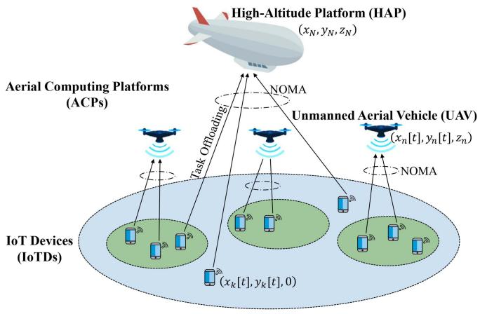

<details>
<summary>flowchart</summary>

```mermaid
graph TD
    A["High-Altitude Platform (HAP) (xN, yN, zN)"] --> B["Aerial Computing Platforms (ACPs)"]
    B --> C["Task Offloading"]
    C --> D["NOMA"]
    D --> E["Unmanned Aerial Vehicle (UAV) (xn[t"], yn["t"], zn)]
    E --> F["NOMA"]
    F --> G["IoT Devices (IoTDs)"]
    G --> H["(xk[t"], yk["t"], 0)]
    H --> I["Mobile Device"]
    H --> J["Mobile Device"]
    H --> K["Mobile Device"]
```
</details>

Fig. 1. Multi-ACP-enabled NOMA edge network.

The network operates throughout T discrete time slots of equal duration, with each slot being small enough to assume that the network is static during that time. The set of time slots is specified as $t \in { \mathcal { T } } = \{ 1 , . . . , T \}$ . The network coordinates = 1are represented in a three-dimensional Euclidean coordinate system. The IoTDs’ positions at time slot t are specified as $( x _ { k } [ t ] , y _ { k } [ t ] , 0 )$ , ∀k. The UAVs’ positions at time slot t are ( [ ] [ ]denoted as $( x _ { n } [ t ] , y _ { n } [ t ] , z _ { n } ) , \forall n \neq N$ , with a constant altitude of $z _ { n } .$ ( [ ] [ ] ) =. The HAP is deployed at a fixed point over the region of interest at an altitude of $z _ { N }$ in the stratosphere [31], and its position is denoted as $\left( x _ { N } , y _ { N } , z _ { N } \right)$ . Hence, at time slot $t ,$ the ( )distance between IoTD k and UAV n, referred to as $d _ { k , n } [ t ]$ , and [ ]the distance between IoTD k and the HAP N, referred to as $d _ { k , N } [ t ]$ , are computed by

$$
d _ {k, n} [ t ] = \sqrt {\left(x _ {n} [ t ] - x _ {k} [ t ]\right) ^ {2} + \left(y _ {n} [ t ] - y _ {k} [ t ]\right) ^ {2} + z _ {n} ^ {2}}, \tag {1}
$$

$$
d _ {k, N} [ t ] = \sqrt {\left(x _ {n} - x _ {k} [ t ]\right) ^ {2} + \left(y _ {N} - y _ {k} [ t ]\right) ^ {2} + z _ {N} ^ {2}}. \tag {2}
$$

Each IoTD k generates a computation-intensive and timesensitive task $\tau _ { k }$ in the network. At time slot t, the task generated by IoTD k is represented by $\tau _ { k } [ t ] = ( s _ { k } [ t ] , w _ { k } [ t ] , d _ { k } [ t ] )$ . Here, $s _ { k }$ [ ] = ( [ ] [ ] [ ])is the task size (bits), wk is the required computational resources to process a data bit (CPU cycles/bit), and $d _ { k }$ is the limited delay. A partial offloading model is applied to provide flexibility, allowing for a portion of the task to be offloaded and the remainder to be processed locally. This is more flexible than a binary offloading model [2], [32]. Hence, for each task $\tau _ { k } [ t ]$ , we introduce an offloading rate variable $o _ { k } [ t ] \in [ 0 , 1 ]$ [ ]as the portion [ ] [0 1]of the task offloaded to the ACP, while the remaining portion $\left( 1 - o _ { k } [ t ] \right)$ is processed locally.

[ ])Since the IoTDs can be under the coverage of multiple ACPs, we introduce an IoTD association variable, $a _ { k , n } [ t ] \in$ [ ]{ , }, ∀k, n, t, to represent the association between the IoTD 0 1k and the ACP n. Hence, $a _ { k , n } [ t ] = 1$ indicates that the IoTD k [ ] = 1associate with the ACP n, otherwise, $a _ { k , n } [ t ] = 0$ . At each time [ ] = 0slot, each IoTD is only served by at most one ACP represented by

$$
\sum_ {n \in \mathcal {N}} a _ {k, n} [ t ] \leq 1, \forall k, t. \tag {3}
$$

# B. Communication Model

NOMA is used to connect IoTDs and ACPs as it can provide better spectrum utilization than traditional OMA techniques. In NOMA, multiple users can be supported in the same resource block, while each user has a resource block in OMA. To ensure reliable data acquisition, we assume each ACP can obtain accurate channel state information (CSI) and perform perfect successive interference cancellation (SIC). With the perfect SIC, the ACP can completely subtract the signals of IoTDs with stronger channels from those with weaker channels, enabling significantly improved decoding accuracy for all IoTD messages [12], [17].

In contrast to densely populated urban environments, the relative absence of physical obstructions in remote areas facilitates a dominance of LoS communication for connecting IoTDs with ACPs [11], [12], [13], [15], [20]. In addition, the system leverages the deployment flexibility, mobility, and versatility of ACPs to readily establish and maintain LoS conditions. Hence, the contribution of non-LoS (NLoS) propagation can be ignored. Therefore, the channel gain between IoTD $k \in \kappa _ { n }$ and the associated ACP n at time slot t can be calculated by

$$
g _ {k, n} [ t ] = g _ {0} d _ {k, n} ^ {- \alpha} [ t ], \tag {4}
$$

where $\alpha \geq 2$ denotes a path loss exponent, and $g _ { 0 }$ denotes the channel gain at a reference distance of 1 m. From the principle of ${ \mathrm { S I C } } ,$ the signals are decoded in the decreasing order of channel gains, i.e., $g _ { 1 , n } \geq g _ { 2 , n } \geq \cdot \cdot \cdot \geq g _ { K _ { n } , n } .$ Thus, at time slot t, the transmission rate (bits/s) of IoTD k to ACP n can be estimated as

$$
r _ {k, n} [ t ] = W _ {n} \log_ {2} \left(1 + \frac {a _ {k , n} [ t ] p _ {k} [ t ] g _ {k , n} [ t ]}{\sum_ {j = k + 1} ^ {K _ {n}} a _ {j , n} [ t ] p _ {j} [ t ] g _ {j , n} [ t ] + \sigma_ {n} ^ {2}}\right), \tag {5}
$$

where the communication bandwidth of ACP n is represented as $W _ { n } , p _ { k } [ t ]$ represents the transmit power of IoTD k, and $\sigma _ { n } ^ { 2 }$ [ ]denotes the noise power at ACP n. It is worth noting that the transmit power of IoTD k is constrained by a maximum transmit power $p _ { \operatorname* { m a x } } , \mathrm { i . e . , 0 } \leq p _ { k } [ t ] \leq p _ { \operatorname* { m a x } } , \forall k , t$ .

# C. Computation Model

By leveraging IoTD associations, tasks can be concurrently offloaded to the corresponding ACPs and processed locally. This work considers the computing overhead regarding task processing delay and energy consumption of IoTDs. Similar to previous studies [2], [15], [32], the overhead associated with transmitting the results is negligible due to their typically small size.

1) Local Computation: The local processing delay of $( 1 -$ $o _ { k } [ t ] )$ part of the task $\tau _ { k } [ t ]$ of the IoTD k is computed by

$$
T _ {k} ^ {\text { local }} [ t ] = \frac {(1 - o _ {k} [ t ]) s _ {k} [ t ] w _ {k} [ t ]}{F _ {k}}, \tag {6}
$$

where $F _ { k }$ denotes the computational capacity of IoTD k (CPU cycles/s). As in [15], [32], the energy consumed by the IoTD for processing the task can be calculated as

$$
E _ {k} ^ {\text { local }} [ t ] = \kappa_ {k} F _ {k} ^ {2} (1 - o _ {k} [ t ]) s _ {k} [ t ] w _ {k} [ t ], \tag {7}
$$

where $\kappa _ { k } \geq 0$ represents the energy consumption factor for IoTD k.

2) ACP-Assisted Computation: If IoTD k delegates $o _ { k } [ t ]$ portion of task $\tau _ { k }$ [ ]to the connected ACP n, then the processing latency comprises two phases: the offloading duration from IoTD k to $\operatorname { A C P } n ,$ , and the execution duration at ACP n. Hence, during time slot t, the latency for handling $o _ { k } [ t ]$ fraction of task $\tau _ { k }$ through offloading is estimated as

$$
T _ {k, n} ^ {\text { offload }} [ t ] = a _ {k, n} [ t ] \left(\frac {o _ {k} [ t ] s _ {k} [ t ]}{r _ {k , n} [ t ]} + \frac {o _ {k} [ t ] s _ {k} [ t ] w _ {k} [ t ]}{f _ {k , n} [ t ]}\right), \tag {8}
$$

where $f _ { k , n } [ t ]$ denotes the computing resources of the ACP n [ ]allocated to IoTD k. The allocated computing resources cannot exceed the available computing capacity $F _ { n }$ of the ACP n, which should satisfy $\begin{array} { r } { \sum _ { k \in \mathcal K } a _ { k , n } [ t ] f _ { k , n } [ t ] \le F _ { n } , \forall n , t } \end{array}$ .

Thus, the energy utilization of IoTD k for delegating the $o _ { k } [ t ]$ part of task $\tau _ { k }$ to ACP n is determined by

$$
E _ {k, n} ^ {\text { offload }} [ t ] = \frac {a _ {k , n} [ t ] p _ {k} [ t ] o _ {k} [ t ] s _ {k} [ t ]}{r _ {k , n} [ t ]}. \tag {9}
$$

Offloading a task $( \tau _ { k } )$ to an ACP requires careful resource allocation to ensure successful execution. This means when offloading part of the task $( o _ { k } > 0 )$ , we must set non-zero values for three key variables: $a _ { k , n } , p _ { k }$ , and $f _ { k , n }$ . In other words, the chosen ACP n, identified by ${ a } _ { k , n }$ , must dedicate processing power $f _ { k , n }$ to handle the offloaded part of the task $o _ { k }$ sent from the IoTD k with transmit power $p _ { k }$ . This ensures the offloaded part of the task is fully executed at the ACP and not dropped or incomplete. Hence, we impose a constraint as

$$
\sum_ {n \in \mathcal {N}} \lceil a _ {k, n} [ t ] p _ {k} [ t ] f _ {k, n} [ t ] \rceil \geq \lceil o _ {k} [ t ] \rceil , \forall k, t, \tag {10}
$$

where · represents the ceiling function, which returns to the least integer greater than or equal to the input number.

3) Computing Overhead: Under the partial offloading scheme, an IoT device’s task can be processed locally and through offloading simultaneously [2], [32]. Hence, the time taken to complete IoTD k’s task is determined by

$$
T _ {k} [ t ] = \max \left\{T _ {k} ^ {\text { local }} [ t ], T _ {k, n} ^ {\text { offload }} [ t ] \right\}. \tag {11}
$$

The IoTD k consumes energy for local processing and offloading the task to the ACP, represented by

$$
E _ {k} [ t ] = E _ {k} ^ {\text { local }} [ t ] + E _ {k, n} ^ {\text { offload }} [ t ]. \tag {12}
$$

Overall, the computation overhead of the task $\tau _ { k } [ t ]$ for IoTD k is determined by

$$
C _ {k} [ t ] = \omega_ {k} T _ {k} [ t ] + (1 - \omega_ {k}) E _ {k} [ t ], \tag {13}
$$

where $\omega _ { k }$ is a coefficient that represents IoTD k’s preference for task execution latency and energy consumption. To ensure the QoS, the task has to be completed within a maximum delay $d _ { k } [ t ]$ , expressed as

$$
T _ {k} [ t ] \leq d _ {k} [ t ], \forall k, t. \tag {14}
$$

# D. Joint Optimization Problem

We formulate the JTORA problem in minimizing the consumed energy of the IoTDs and the delay in processing their tasks, subject to the system constraints. Specifically, the decision variables to be optimized include IoTD association $\{ a _ { k , n } [ t ] , \forall k , n , t \}$ , offloading ratio $\{ o _ { \boldsymbol { k } } [ t ] , \forall \boldsymbol { k } , t \}$ , transmit power [ ]of IoTDs $\{ p _ { k } [ t ] , \forall k , t \}$ [ ], and computing resource allocation of [ ]the HAP and UAVs $\{ f _ { k , n } [ t ] , \forall k , n , t \}$ . The JTORA problem is formulated as

$$
\text {(P1)} \colon \min _ {\{a _ {k, n} [ t ], o _ {k} [ t ], p _ {k} [ t ], f _ {k, n} [ t ], \forall k, n, t \}} \sum_ {k \in \mathcal {K}} C _ {k} [ t ], \tag {15a}
$$

$$
\text { s.t. } a _ {k, n} [ t ] \in \{0, 1 \}, \forall k, n, t, \tag {15b}
$$

$$
\sum_ {n \in \mathcal {N}} a _ {k, n} [ t ] \leq 1, \forall k, t, \tag {15c}
$$

$$
o _ {k} [ t ] \in [ 0, 1 ], \forall k, t, \tag {15d}
$$

$$
0 \leq p _ {k} [ t ] \leq p _ {\max}, \forall k, t, \tag {15e}
$$

$$
\sum_ {k \in \mathcal {K}} a _ {k, n} [ t ] f _ {k, n} [ t ] \leq F _ {n}, \forall n, t, \tag {15f}
$$

$$
\sum_ {n \in \mathcal {N}} \lceil a _ {k, n} [ t ] p _ {k} [ t ] f _ {k, n} [ t ] \rceil \geq \lceil o _ {k} [ t ] \rceil , \forall k, t, \tag {15g}
$$

$$
T _ {k} [ t ] \leq d _ {k} [ t ], \forall k, t, \tag {15h}
$$

where (15b) and (15c) ensure that each IoTD is assigned to one ACP at a time, (15d) restricts the offloading ratio to a valid range, (15e) limits the IoTD’s transmit power not to exceed the maximum transmit power, (15f) ensures that the allocated computing resources for all associated IoTDs do not exceed the ACP’s available computing resources, (15g) guarantees that the tasks are executed completely, and (15h) limits the task’s execution delay not to exceed the delay limit, ensuring the system’s QoS. However, the problem (P1) is a mixed-integer programming problem, which is non-convex and NP-hard due to the discrete integer variable (i.e., IoTD association) and continuous variables (i.e., offloading ratio, transmission power, and computation resource allocation). In addition, system states are temporally correlated among adjacent time slots, and behaviors of ACPs and IoTDs do not change arbitrarily. Solving the problem using conventional optimization techniques is challenging. Hence, we turn the problem into a MAMDP model and leverage a MADDPG algorithm to handle complex problem dynamics and achieve efficient policies for task offloading and resource allocation.

# IV. MULTI-AGENT DRL FRAMEWORK FOR MULTI-ACP-ENABLED NOMA EDGE COMPUTING

In this section, we undertake a normalization process to eliminate the impact of the diversity of optimization variables. Then, the MAMDP model is constructed for the normalized problem and solved using the MADDPG-based framework.

# A. Problem Normalization

To eliminate the effect of the diversity of the decision variables, we normalize them into a continuous range suitable for activation functions in the multi-agent DRL framework. First, we utilize power variable $p _ { k } ^ { \prime } [ t ]$ , and resource variable $f _ { k , n } ^ { \prime } [ t ] \in [ 0 , 1 ]$ [ ]as the normalized variables of $p _ { k } [ t ]$ , and $f _ { k , n } [ t ]$ [ ] [0 1], respectively. Then, the values of $p _ { k } [ t ]$ and $f _ { k , n } [ t ]$ ] [ ]are computed by

$$
p _ {k} [ t ] = p _ {k} ^ {\prime} [ t ] p _ {\max},
$$

$$
f _ {k, n} [ t ] = f _ {k, n} ^ {\prime} [ t ] F _ {n}. \tag {16}
$$

Furthermore, we relax the binary association variables ${ a } _ { k , n }$ to the continuous variables a	k,n $a _ { k , n } ^ { \prime }$ with the range [0,1]. Then, the binary association variable ${ a } _ { k , n }$ is represented by

$$
a _ {k, n} = \left\{ \begin{array}{l l} 1, & \text { if   } n = \arg \max _ {n} \{a _ {k, n} ^ {\prime}, \forall n \}, \\ 0, & \text { otherwise }, \end{array} \right. \tag {17}
$$

where the function returns the maximum index in arg maxthe considered list. By using the relaxation variables $a _ { k , n } ^ { \prime }$ and the   function, the constraints (15b) and (15c) in the arg maxproblem (P1) are naturally satisfied. Besides, the ACPs’ computing resources are assumed to be fully utilized to optimize system performance regarding cost function minimization. Consequently, the constraints (15e), (15f), (15g) in the problem (P1) are rewritten with normalized variables as

$$
p _ {k} ^ {\prime} [ t ], f _ {k, n} ^ {\prime} [ t ] \in [ 0, 1 ], \tag {18}
$$

$$
\sum_ {k \in \mathcal {K}} a _ {k, n} [ t ] f _ {k, n} ^ {\prime} [ t ] = \left\{ \begin{array}{l l} 1, & \text { if   } \sum_ {k \in \mathcal {K}} a _ {k, n} [ t ] \geq 1, \\ 0, & \text { otherwise }, \end{array} \right. \tag {19}
$$

$$
\sum_ {n \in \mathcal {N}} \lceil a _ {k, n} [ t ] p _ {k} ^ {\prime} [ t ] f _ {k, n} ^ {\prime} [ t ] \rceil = \lceil o _ {k} [ t ] \rceil . \tag {20}
$$

After normalizing the variables, the original problem (P1) can be reformulated as

$$
\text {(P2)} \colon \min _ {\{a _ {k, n} ^ {\prime} [ t ], o _ {k} [ t ], p _ {k} ^ {\prime} [ t ], f _ {k, n} ^ {\prime} [ t ], \forall k, n, t \}} \sum_ {k \in \mathcal {K}} C _ {k} [ t ],
$$

$$
\text { s.t. } a _ {k, n} ^ {\prime} [ t ], o _ {k} [ t ] \in [ 0, 1 ], (1 4), (1 8), (1 9), (2 0), \forall k, n, t. \tag {21}
$$

# B. Multi-Agent Markov Decision Process Transformation

In this part, the problem (P2) is transformed into a MAMDP model, where ACPs act as agents that sense their environment and jointly optimize task offloading and resource allocation. The set of ACP agents is denoted by $n \in \mathcal { N } = \{ 1 , . . . , N \}$ , where $n = N$ = 1indicates the HAP agent; otherwise, the UAV agent. We =define a tuple $( \pmb { \mathscr { s } } , \pmb { \mathscr { O } } , \pmb { \mathscr { A } } , \pmb { \mathscr { R } } )$ to describe the interaction process ( )within MAMDP. Here, S denotes the global state space, $\mathcal { O } _ { n } \in$ $\mathcal { O } = \{ \mathcal { O } _ { 1 } , . . . , \mathcal { O } _ { N } \}$ represents the set of observations, $A _ { n } \in$ $\pmb { \mathcal { A } } = \{ \mathcal { A } _ { 1 } , \ldots , \mathcal { A } _ { N } \}$ indicates the set of actions, and $\mathcal { R } _ { n } \in \mathcal { R } =$ $\{ \mathcal { R } _ { 1 } , \ldots , \mathcal { R } _ { N } \}$ =represents the set of rewards. In a given state $\mathbf { s } [ t ] \in { \pmb { s } } ,$ , each agent n receives a local observation $\mathbf { o } _ { n } [ t ] \in \mathcal { O } _ { n } .$ , [ ]takes an action $\mathbf { a } _ { n } [ t ] \in \mathcal { A } _ { n }$ [ ], and obtains an individual reward $\mathbf { r } _ { n } [ t ] \in \mathcal { R } _ { n }$ [ ]. Furthermore, we propose an action pretreatment [ ]function that ensures the action is feasible before interacting with the environment to handle constraints in the problem (P2).

1) State: The current system state that includes the ACP-IoTD channel information and computational tasks is denoted as the state $\mathbf { s } [ t ] \in S$ . Formally, the state s t during time slot t [ ]can be expressed by

$$
\mathbf {s} [ t ] = \left\{g _ {1, n} [ t ], \dots , g _ {K _ {n}, n} [ t ], \tau_ {1} [ t ], \dots , \tau_ {K} [ t ], \forall n \in \mathcal {N} \right\}. \tag {22}
$$

2) Observation: The observation of each ACP agent n is a partial view of the state available to each agent, including its channel information with the associated IoTDs and corresponding tasks. Hence, the observation ${ \bf o } _ { n } [ t ] \in \mathcal { O } _ { n }$ of ACP agent n during time slot t is described as

$$
\mathbf {o} _ {n} [ t ] = \{g _ {1, n} [ t ], \dots , g _ {K _ {n}, n} [ t ], \tau_ {1} [ t ], \dots , \tau_ {K _ {n}} [ t ] \}. \tag {23}
$$

3) Action: The action is the decision made by each agent based on its observation. Accordingly, the ACP agents make decisions on the device association, the ratio of task offloading, the transmit power, and the computing resource allocation. According to the problem (P2), the action $\mathbf { a } _ { n } [ t ] \in \mathcal { A } _ { n }$ of ACP agent

n at time slot t is defined as

$$
\mathbf {a} _ {n} [ t ] = \{a _ {k, n} ^ {\prime} [ t ], o _ {k} [ t ], p _ {k} ^ {\prime} [ t ], f _ {k, n} ^ {\prime} [ t ], \forall k \in \mathcal {K} _ {n} \}. \tag {24}
$$

4) Action Pretreatment: An action pretreatment function ensures that the agent’s actions adhere to the environmental constraints. This enables the agent to learn policies within the specified limits, preventing penalties or undesirable outcomes. Initially, a sigmoid function, defined as sigmoid $\begin{array} { r } { \left. x \right. = \frac { 1 } { 1 + e ^ { - x } } . } \end{array}$ ( ) =is applied as the activation function for the actor network’s output. This scales the action values within the [0,1] range. To address the remaining constraints in the problem (P2), a multi-stage mapping function (Algorithm 1), denoted as $\mathcal { M } ( \cdot )$ , is introduced. It operates as follows.

Stage 1: If the offloading ratio variable for the IoTD k is 0, indicating no intention to offload, the corresponding mapping IoTD association variable is also set to 0. This signifies that no ACP is designated for that particular IoTD.   
Stage 2: The binary IoTD association variables ${ a } _ { k , n }$ in (17) are recalculated based on the updated mapping IoTD association variables obtained from Stage 1.   
Stage 3: When no ACP is available to execute the task’s offloaded portion $o _ { k } ,$ , the offloading ratio variable is set to 0. This ensures that no offloaded task is left unassigned, satisfying constraint (20).   
Stage 4: Computing resources are allocated exclusively to IoTDs intended to offload to a specific ACP n, as determined by the mapping IoTD association variables. The vector of computing resource allocation variables for ACP n, after filtering out non-associated IoTDs, is denoted as $\{ f _ { k , n } ^ { \mathrm { f i l t e r } } , \forall k \in \mathcal { K } _ { n } \}$ .   
Stage 5: We apply the softmax function to normalize the vector of filtered computing resource allocation variables $\{ f _ { k , n } ^ { \mathrm { f i l t e r } } , \forall k \in \mathcal { K } _ { n } \}$ into a probability distribution, represented by $\{ f _ { k , n } ^ { \mathrm { m a p } } , \forall k \in \mathcal { K } _ { n } \}$ . This normalization ensures that the available computing resources of ACP n are fully utilized, as stated in constraint (19).

With the implementation of the action pretreatment function, only the QoS constraint (14) remains unaddressed. This constraint, along with the delay limit value, aids in determining whether a task is successfully executed, contributing to the calculation of the task success rate, a key performance evaluation metric.

5) Reward: The reward evaluates the effect of an agent’s action on the current state. In this paper, it is defined as the negative of the computing overhead of tasks with a penalty factor. The reward of each ACP agent n is defined by

$$
\mathbf {r} _ {n} [ t ] = \sum_ {k \in \mathcal {K} _ {n}} - (C _ {k} [ t ] + \lambda_ {k} [ t ] \Delta), \tag {25}
$$

where $\Delta$ is the value of the penalty and $\lambda _ { k } [ t ]$ denotes the binary Δpenalty variable, which is expressed by

$$
\lambda_ {k} [ t ] = \left\{ \begin{array}{l l} 1, & \text { if   } T _ {k} [ t ] > d _ {k} [ t ], \\ 0, & \text { otherwise. } \end{array} \right. \tag {26}
$$

# Algorithm 1: Multi-Stage Mapping Function $\mathcal { M } ( \cdot ) .$ .

1: Input: Action an   
2: Stage 1: Map association variables amapk,n $a _ { k , n } ^ { \mathrm { m a p } }$ observing offloading ratio variables $o _ { k } , \forall n , k \in \mathcal { K } _ { n }$

$$
a _ {k, n} ^ {\text { map }} = \left\{ \begin{array}{l l} 0, & \text { if   } o _ {k} = 0, \\ a _ {k, n} ^ {\prime}, & \text { otherwise }. \end{array} \right.
$$

3: Stage 2: Re-calculate $a _ { k , n } , \forall n , k \in \mathcal { K } _ { n }$

$$
a _ {k, n} = \left\{ \begin{array}{l l} 1, & \text { if } n = \underset {n} {\arg \max} \{a _ {k, n} ^ {\mathrm{map}}, \forall n \} \text { and } a _ {k, n} ^ {\mathrm{map}} > 0, \\ 0, & \text { otherwise. } \end{array} \right.
$$

4: Stage 3: Map offloading ratio variables $o _ { k } ^ { \operatorname* { m a p } }$ observing remaining variables $a _ { k , n } , p _ { k } ^ { \prime } , f _ { k , n } ^ { \prime } , \forall n , k \in \mathcal { K } _ { n }$

$$
o _ {k} ^ {\text { map }} = \left\{ \begin{array}{l l} 0, & \text { if } \sum_ {n \in \mathcal {N}} a _ {k, n} p _ {k} ^ {\prime} f _ {k, n} ^ {\prime} = 0, \\ o _ {k}, & \text { otherwise }. \end{array} \right.
$$

5: Stage 4: Filter out non-associated IoTDs for the ACPs

$$
f _ {k, n} ^ {\text { filter }} = a _ {k, n} f _ {k, n} ^ {\prime}, \forall n, k \in \mathcal {K} _ {n}
$$

6: Stage 5: Map computing resource allocation variables fk,n map $f _ { k , n } ^ { \mathrm { m a p } }$

$$
f _ {k, n} ^ {\text { map }} = \text { softmax } (f _ {k, n} ^ {\text { filter }}) = \frac {e ^ {f _ {k , n} ^ {\text { filter }}}}{\sum_ {j = 1} ^ {K _ {n}} e ^ {f _ {j , n} ^ {\text { filter }}}}, \forall n, k \in \mathcal {K} _ {n}
$$

7: return amapk,n, ok $a _ { k , n } ^ { \mathrm { m a p } } , o _ { k } ^ { \mathrm { m a p } } , p _ { k } ^ { \prime } , f _ { k , n } ^ { \mathrm { m a p } }$ map

Each ACP agent n aims to maximize its long-term expected reward as

$$
\mathbf {R} _ {n} = \max _ {\mathbf {a} _ {n} [ t ]} \mathbb {E} \left[ \sum_ {t = 1} ^ {T} \gamma^ {t - 1} \mathbf {r} _ {n} [ t ] \right], \tag {27}
$$

where $\gamma \in [ 0 , 1 ]$ is a discount factor that determines how much [0 1]importance should be given to future rewards and $\mathbb { E } [ \cdot ]$ returns the expected value.

# C. Multi-Agent DRL Design for JTORA Optimization

MADDPG [24] is a potent algorithm for addressing continuous optimization challenges in multi-agent systems within the realm of multi-agent DRL. MADDPG expands on the DDPG algorithm [23] by employing a centralized training and decentralized execution framework. Each agent’s policy is represented by a DNN, which is trained using the DDPG algorithm. During training, agents leverage information from other agents’ observations and actions to refine their policies, fostering cooperation. During execution, each agent relies solely on its observations to determine its actions.

We propose a MADDPG-based framework to solve the described MAMDP. For simplicity, we have omitted the time slot index in the following. In the centralized training phase, we consider a set of agents denoted by . Each agent n has its own set of parameters denoted by $\theta _ { n } \stackrel { . } { = } \{ \theta _ { n } ^ { \mu } , \theta _ { n } ^ { Q } , \theta _ { n } ^ { \mu ^ { \prime } } , \theta _ { n } ^ { Q ^ { \prime } } \}$ , where $\theta _ { n } ^ { \mu }$ and $\theta _ { n } ^ { Q }$ are the parameters of its actor network $\mu _ { n }$ and critic network $Q _ { n }$ , respectively. Additionally, $\theta _ { n } ^ { \mu ^ { \prime } }$ and $\theta _ { n } ^ { Q }$ are the parameters of the target actor network $\mu _ { n } ^ { \prime }$ and target critic network $Q _ { n } ^ { \prime }$ , respectively. The actor network generates actions based on the agent’s local observation, while the critic network evaluates the quality of the chosen action. Meanwhile, the target networks enhance the stability of the training process by periodically updating them with the parameters from the main networks [23]. Each agent n aims to maximize its long-term expected reward through an objective function, $\begin{array} { r } { \mathcal { T } ( \theta _ { n } ^ { \mu } ) \stackrel { - } { = } \mathbb { E } [ \sum _ { t = 1 } ^ { T } \gamma ^ { t - 1 } { \bf r } _ { n } [ t ] ] } \end{array}$ , and can choose ( ) = [an action based on its local observation, $\mathbf { a } _ { n } = \mu _ { n } ( \mathbf { o } _ { n } \mid \theta _ { n } ^ { \mu } )$ . The = ( )agent n can calculate the gradient of the deterministic policy $\mu _ { n }$ by

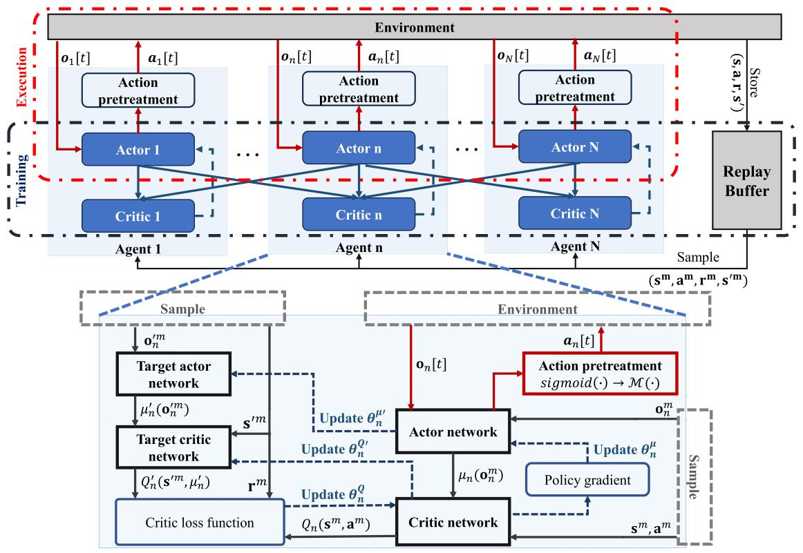

<details>
<summary>flowchart</summary>

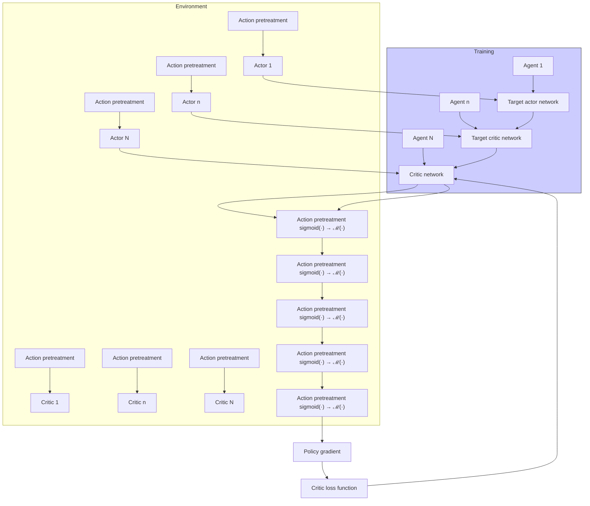
</details>

Fig. 2. MADDPG-based optimization framework for multi-ACP-enabled NOMA edge network.

$$
\nabla_ {\theta_ {n} ^ {\mu}} \mathcal {J} = \mathbb {E} _ {\mathbf {s}, \mathbf {a} \sim \mathcal {D}} [ \nabla_ {\theta_ {n} ^ {\mu}} \mu_ {n} (\mathbf {o} _ {n} \mid \theta_ {n} ^ {\mu})
$$

$$
\nabla_ {\mathbf {a} _ {n}} Q _ {n} \left(\mathbf {s}, \mathbf {a} \mid \theta_ {n} ^ {Q}\right) \left| _ {\mathbf {a} _ {n} = \mu_ {n} (\mathbf {o} _ {n} | \theta_ {n} ^ {\mu})} \right], \tag {28}
$$

where D denotes the experience replay buffer recording all agents’ experiences, which contains a series of tuples $( \mathbf { s } , \mathbf { a } , \mathbf { r } , \mathbf { s } ^ { \prime } )$ . Here, s, $\mathbf { a } = \{ \mathbf { a } _ { n } , \forall n \} , \mathbf { r } = \{ \mathbf { r } _ { n } , \forall n \}$ , and $\mathbf { s } ^ { \prime }$ rep-( ) = =resent the states, actions, rewards, and next states for all agents, respectively. $Q _ { n } ( \mathbf { s } , \mathbf { a } \mid \theta _ { n } ^ { Q } ) \big | _ { \mathbf { a } _ { n } = \mu _ { n } ( \mathbf { o } _ { n } | \theta _ { n } ^ { \mu } ) }$ is a centralized critic ( )function, also known as an action-value function. In the training procedure, the critic network $Q _ { n }$ is updated by minimizing a loss function parameterized by $\theta _ { n } ^ { Q }$ as

$$
\mathcal {L} \left(\theta_ {n} ^ {Q}\right) = \mathbb {E} _ {\mathbf {s}, \mathbf {a}, \mathbf {r}, \mathbf {s} ^ {\prime}} \left[ \left(Q _ {n} \left(\mathbf {s}, \mathbf {a} \mid \theta_ {n} ^ {Q}\right) - Y _ {n}\right) ^ {2} \right],
$$

$$
Y _ {n} = \mathbf {r} _ {n} + \gamma Q _ {n} ^ {\prime} \left(\mathbf {s} ^ {\prime}, \mathbf {a} ^ {\prime} \mid \theta_ {n} ^ {Q ^ {\prime}}\right) \bigg | _ {\mathbf {a} _ {n} ^ {\prime} = \mu_ {n} ^ {\prime} \left(\mathbf {o} _ {n} ^ {\prime} \mid \theta_ {n} ^ {\mu^ {\prime}}\right)}, \tag {29}
$$

where $Y _ { n }$ is the target state-action value estimated by the target networks, $\mathbf { a } ^ { \prime } = \{ \mathbf { a } _ { n } ^ { \prime } , \forall n \}$ , and $\mathbf { a } _ { n } ^ { \prime }$ denotes the action of the agent n given its next observation ${ \bf o } _ { n } ^ { \prime }$ in the next state $\mathbf { s } ^ { \prime } .$ Then, the parameters of the n-th actor network can be updated based on the critic network using the policy gradient given by

$$
\nabla_ {\theta_ {n} ^ {\mu}} \mathcal {J} \approx \frac {1}{M} \sum_ {m} ^ {M} [ \nabla_ {\theta_ {n} ^ {\mu}} \mu_ {n} (\mathbf {o} _ {n} ^ {m} \mid \theta_ {n} ^ {\mu})
$$

$$
\nabla_ {\mathbf {a} _ {n}} Q _ {n} (\mathbf {s}, \mathbf {a} \mid \theta_ {n} ^ {Q}) | _ {\mathbf {a} _ {n} = \mu_ {n} (\mathbf {o} _ {n} ^ {m} | \theta_ {n} ^ {\mu})} ], \tag {30}
$$

where M is the size of the mini-batch randomly sampled from the relay buffer D. Finally, the parameter update process for the target networks is performed by each agent n to enhance learning stability as

$$
\theta_ {n} ^ {Q ^ {\prime}} \leftarrow \varsigma \theta_ {n} ^ {Q} + (1 - \varsigma) \theta_ {n} ^ {Q ^ {\prime}},
$$

$$
\theta_ {n} ^ {\mu^ {\prime}} \leftarrow \varsigma \theta_ {n} ^ {\mu} + (1 - \varsigma) \theta_ {n} ^ {\mu^ {\prime}}, \tag {31}
$$

where $\varsigma \ll 1$ is the soft update coefficient.

1The proposed MADDPG framework is illustrated in Fig. 2, which is the centralized training and decentralized execution as considered in many previous works [18], [19], [20], [24]. In the centralized training stage, besides local observation, each agent is trained using extra information, including other agents’ observations and actions. In the decentralized execution stage, each agent n decides its action $a _ { n }$ according to the local observation $o _ { n }$ and applies the proposed action pretreatment function to satisfy the action constraints. We detail the proposed framework in Algorithm 2. Initialization of networks, hyperparameters, and the network environment is performed (lines 1–4). Each episode involves observing the initial state and observations (line 6). The workflow comprises data collection and training. At time slot t, each agent determines an action based on its observation using its actor network (line 10). To enhance agent performance and encourage action exploration, we add noise to the actor policy, resulting in the action $\begin{array} { r } { \mathbf { a } _ { n } = \mu _ { n } \big ( \mathbf { o } _ { n } \big ) + \mathcal { O } \mathcal { U } . } \end{array}$ = ( ) +where OU is augmented Ornstein-Uhlenbeck noise. A pretreatment function handles constraints (line 11). Each agent interacts independently with the environment, obtaining reward ${ \bf r } _ { n }$ and storing $( \mathbf { s } , \mathbf { a } , \mathbf { r } , \mathbf { s } ^ { \prime } )$ in replay buffer D (lines 13–14). Training ( )is enforced through information sharing. In each training step, a batch of experience samples $( \mathbf { s } ^ { m } , \mathbf { a } ^ { m } , \mathbf { r } ^ { m } , \mathbf { s } ^ { \prime m } )$ is randomly ( )drawn from D (line 18). Agent n obtains its sample observation $\mathbf { o } _ { n } ^ { m }$ from sample state $\mathbf { s } ^ { m }$ (line 19). Each agent updates its critic and actor networks accordingly (lines 20–21). Finally, the soft update rule updates the target networks (line 23). The algorithm repeats until convergence or the desired number of episodes is reached, yielding optimal actor network parameters $\{ \theta _ { n } ^ { \mu } , \forall n \}$ (line 26). After training, each UAV downloads the trained action networks from the HAP and performs actions in a decentralized manner.

Algorithm 2: MADDPG-Based Framework for Joint Task Offloading and Resource Allocation.   
1: Initialize actor and critic networks with random weights
2: Initialize target networks with the same weights as corresponding networks
3: Initialize hyperparameters: number of episodes Z, number of time steps T, learning rates $(lr_{a}, lr_{c})$ , relay buffer D, mini-batch size M, discount factor γ
4: Initialize network environment
5: for $z = 1, \ldots, Z$ do
6: Reset environment, observe initial state s[1] and observations $\{o_{n}[1], \forall n\}$ 7: for $t = 1, \ldots, T$ do
8: # Collecting observed data
9: for $n = 1, \ldots, N$ do
10: Select action $\mathbf{a}_{n} = \mu_{n}(\mathbf{o}_{n}) + \mathcal{O}\mathcal{U}$ 11: Perform action pretreatment $\mathcal{M}(\mathbf{a}_{n})$ 12: end for
13: Execute joint actions a, obtain rewards r, and observe new state $s'$ 14: Add experience tuple $(s, a, r, s')$ to D
15: Set $s \leftarrow s'$ 16: # Training process
17: for $n = 1, \ldots, N$ do
18: Randomly sample a mini-batch of M samples $(s^{m}, a^{m}, r^{m}, s'^{m})$ from D
19: Obtain observations $\{o_{n}^{m}, \forall n\}$ from state $s^{m}$ 20: Update critic network by (29)
21: Update actor network by (30)
22: end for
23: Update target networks for each agent by (31)
24: end for
25: end for
26: return $\{\theta_{n}^{\mu}, \forall n\}$

# D. Computational Complexity

We examine the computational complexity of the proposed MADDPG-based framework. The DNNs in the framework have an input layer, two hidden layers, and an output layer, which are fully connected. The computational complexity is mainly determined by the number of matrix multiplications in DNNs [33]. Hence, in each training step, the computational complexity of each agent is computed as

$$
O \left(\sum_ {l ^ {a} = 0} ^ {L ^ {a} - 1} X _ {l ^ {a}} ^ {a} X _ {l ^ {a} + 1} ^ {a} + \sum_ {l _ {c} = 0} ^ {L ^ {c} - 1} X _ {l ^ {c}} ^ {c} X _ {l ^ {c} + 1} ^ {c}\right), \tag {32}
$$

where $L ^ { a }$ and $L ^ { c }$ are the number of layers in the actor and critic networks, respectively, and $X _ { l ^ { a } } ^ { a }$ and $X _ { l ^ { c } } ^ { c }$ are the number of nodes in the l a-th actor layer and the l c-th critic layer, respectively. The overall computational complexity of the MADDPG-based training framework is given by

$$
O \left(N T Z M \left(\sum_ {l ^ {a} = 0} ^ {L ^ {a} - 1} X _ {l ^ {a}} ^ {a} X _ {l ^ {a} + 1} ^ {a} + \sum_ {l _ {c} = 0} ^ {L ^ {c} - 1} X _ {l ^ {c}} ^ {c} X _ {l ^ {c} + 1} ^ {c}\right)\right), \tag {33}
$$

where N is the number of agents, T is the number of training steps, Z is the number of training episodes, and M is the mini-batch size. The training stage can be done in the HAP, which has a powerful computation capability [18], [21]. During the decentralized execution phase, each ACP agent simply executes its policy based on the trained actor network with the computational complexity given as $O ( \sum l ^ { a } = 0 \ X _ { l ^ { a } } ^ { a } X _ { l ^ { a } + 1 } ^ { a } )$ (which is favorable and suitable for real-time inference.

# V. PERFORMANCE EVALUATION

In this section, we evaluate the convergence and performance of the proposed MADDPG-based framework in a simulated multi-ACP-enabled NOMA edge network.

# A. Simulation Configurations

We use Python 3.10 and Pytorch 1.13.1 to simulate and train agents in an IoT edge network environment with a 1000 m × 1000 m area. The HAP is positioned at 500, 500 (m) at a 20 km ( )altitude, covering a 500 m radius. Twenty IoTDs $( K = 2 0 )$ are =randomly distributed. The UAVs fly along predetermined paths at a velocity of 10 m/s and an altitude of 100 m with a coverage radius of 100 m. We evaluate two network environments: 3ACPsenv with one HAP and two UAVs (N 3), and $5 A C P s – e n \nu$ with =one HAP and four UAVs (N  5). Unless otherwise specified, =the simulation parameters are given in Table II as in [13], [14], [15]. Given the lack of a standard, directly comparable algorithm for our specific optimization problem, we evaluate the performance of the proposed framework against several customized benchmarks below.

Proposed MADDPG-based Task Offloading and Resource Allocation (MADDPG): The proposed MADDPG framework jointly optimizes IoTD association, offloading ratio, transmit power, and computing resource allocation in a multi-agent setting, where all ACPs act as cooperative agents.

TABLE II SIMULATION PARAMETERS 

<table><tr><td>Parameter</td><td>Value</td></tr><tr><td colspan="2">Environment parameters</td></tr><tr><td>Time slot duration</td><td>0.5 s</td></tr><tr><td>Noise power,  $\sigma_n^2$ </td><td>-170 dBm/Hz</td></tr><tr><td>Reference channel gain,  $g_0$ </td><td> $1.42e^{-4}$ </td></tr><tr><td>Path loss exponent,  $\alpha$ </td><td>2</td></tr><tr><td>HAP bandwidth,  $W_N$ </td><td>200 MHz</td></tr><tr><td>HAP computing resource,  $F_N$ </td><td>100 GHz</td></tr><tr><td>UAV bandwidth,  $W_n$ </td><td>20 MHz</td></tr><tr><td>UAV computing resource,  $F_n$ </td><td>20 GHz</td></tr><tr><td>Number of IoTDs, K</td><td>20</td></tr><tr><td>IoTDs computing resource,  $F_k$ </td><td>1 GHz</td></tr><tr><td>IoTDs energy coefficient,  $\kappa_k$ </td><td> $1e^{-28}$ </td></tr><tr><td>IoTDs maximum transmit power,  $p_{\text{max}}$ </td><td>20 dBm</td></tr><tr><td>Task size,  $s_k$ </td><td>[0.8, 1.2] Mbits</td></tr><tr><td>Required computation per task,  $w_k$ </td><td>[700, 900] CPU cycles/bit</td></tr><tr><td>Task delay constraint,  $d_k$ </td><td>[0.4, 0.5] s</td></tr><tr><td>Weight coefficient,  $w_k$ </td><td>0.5</td></tr><tr><td colspan="2">Algorithm parameters</td></tr><tr><td>Penalty value, Δ</td><td>10000</td></tr><tr><td>Actor hidden layer 1</td><td>512 nodes</td></tr><tr><td>Actor hidden layer 2</td><td>128 nodes</td></tr><tr><td>Critic hidden layer 1</td><td>1024 nodes</td></tr><tr><td>Critic hidden layer 2</td><td>256 nodes</td></tr><tr><td>Replay buffer size</td><td> $5e^4$ </td></tr><tr><td>Soft update coefficient,  $\varsigma$ </td><td>0.01</td></tr><tr><td>Number of episodes for training</td><td>4000</td></tr><tr><td>Number of episodes for testing</td><td>100</td></tr><tr><td>Number of time steps per episode</td><td>200</td></tr></table>

DDPG-based Task Offloading and Resource Allocation (DDPG) [2], [30]: Via the DDPG algorithm, the HAP as a single agent observes the network environment and specifies the IoTD association, offloading ratio, transmit power, and computing resource allocation decisions for all IoTDs.   
Greedy-based Task Offloading and Resource Allocation (GREEDY) [29]: This scheme involves discretizing actions into discrete spaces, each comprising six value levels. A local search algorithm based on a greedy strategy determines the action at each step.   
- Full Task Offloading (FULL) [15], [27]: All IoTD tasks are fully offloaded to the associated HAP or UAV.   
- Random Task Offloading (RANDOM) [15], [27]: The IoTD tasks are processed with random decision variables.

The total reward obtained during each training episode is the evaluation metric for convergence analysis. For performance analysis, the following metrics are employed.

- Episode cost: It quantifies the average cost (or computing overhead) incurred per episode during the testing phase, which comprises 100 episodes. A lower episode cost indicates a more efficient and cost-effective approach.   
Energy consumption (Joule): It measures the overall energy consumed by the IoTDs during task execution.   
- Tasks success rate (%): It represents the proportion of completed tasks within the delay limit. It is calculated as

the number of successful tasks divided by the total number of tasks.

# B. Convergence Analysis

To optimize the MADDPG-based framework, we perform Monte Carlo simulations by testing and analyzing the impact of four hyperparameters, i.e., learning rate, batch size, and discount factor, on the convergence of the proposed framework in 3ACPs-env. The simulation results are displayed in Fig. 3. The same hyperparameters are used for all agents.

Firstly, we assess the convergence of the proposed training algorithm by testing three pre-determined values for the learning rates, $( l r _ { a } , \stackrel { \cdot } { l r _ { c } } ) = \stackrel { \textstyle ^ { - } } { \{ }  ( 2 e ^ { - 3 } , 5 e ^ { - 3 } ) , ( 1 e ^ { - 3 } , 5 e ^ { - 3 } ) , ( 1 e ^ { - 3 } , 3 e ^ { - 3 } ) \stackrel { \cdot }  \textstyle \}$ , where $l r _ { a }$ ) = (2 5 ) (1 5 ) (1 3refers to the learning rate of the actor network and $l r _ { c }$ refers to the learning rate of the critic network. The batch size used for training is 32, and the discount factor is 0.9. As shown in Fig. 3(a), the learning rate set of $( 1 e ^ { - 3 } , 5 e ^ { - 3 } )$ achieves the best (1 5 )performance. The algorithm starts to converge after around 500 episodes with this learning rate set. Meantime, the learning rate set of $( 1 e ^ { - 3 } , 3 e ^ { - 3 } )$ starts to converge after approximately 1500 (1 3 )episodes. On the other hand, the set of $( 2 e ^ { - 3 } , 5 e ^ { - 3 } )$ fails to reach (2 5convergence. As a result, the set of learning rate $( \mathrm { i } e ^ { - 3 } , 5 e ^ { - 3 } )$ is set as defaults in the following evaluations.

Secondly, we vary the batch size $M = \{ 1 6 , 3 2 , 6 4 \}$ to inves-= 16 32 64tigate its impact on the training process. The discount factor is set to 0.9. As depicted in Fig. 3(b), the proposed algorithm performs best when $M = 3 2 .$ , while a smaller value of M (i.e., $M = 1 6 )$ = 32 results in slower convergence, and a larger value of M (i.e., M ) results in instability during training due to the = 64noise introduced by the larger batch size. Hence, the batch size M   is fixed during the following evaluations.

= 32Thirdly, we analyze how changing the discount factor γ affects the convergence of the proposed MADDPG-based algorithm. The discount factor is a crucial hyperparameter that significantly impacts how the agent values future rewards. If the discount factor is set to 0, then only the immediate reward is considered, while a value of 1 would mean that all future rewards are considered. If the agent focuses on short-term rewards within a dynamic environment, the reward may fail to accurately capture the effectiveness of action over an extended period, especially when the environment undergoes changes; otherwise, convergence becomes unattainable when using a large discount factor, as it deviates significantly from the fundamental nature of the environment. As shown in Fig. 3(c), a small discount factor $( \gamma = 0 . 8 )$ cannot correctly affect the nature of the dynamic envi-= 0 8ronment, which makes the agent converge to a bad sub-optimal point. Also, a significant big discount factor $( \gamma = 0 . 9 9 )$ fails to capture the essence of the environment because of the significant focus on future rewards, which causes a big drop in the chaotic environment when the environment state in the training sample is large enough. The results indicate that a discount factor of $\gamma = 0 . 9$ performs the best in our system. Then, this discount = 0 9factor value is used throughout the remaining simulations.

Finally, we assess the improvement of the MADDPG over the single-agent DDPG by modeling performance in two scenarios: 3ACPs-env and 5ACPs-env. For a fair comparison,

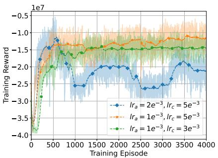

<details>
<summary>line</summary>

| Training Episode | Training Reward (Ira = 2e-3, Irc = 5e-3) | Training Reward (Ira = 1e-3, Irc = 5e-3) | Training Reward (Ira = 1e-3, Irc = 3e-3) |
| ---------------- | ------------------------------------------ | ---------------------------------------- | ---------------------------------------- |
| 0                | -4.0                                       | -4.0                                     | -4.0                                     |
| 500              | -1.5e7                                     | -1.5e7                                   | -1.5e7                                   |
| 1000             | -2.0e7                                     | -1.5e7                                   | -1.5e7                                   |
| 1500             | -2.5e7                                     | -1.5e7                                   | -1.5e7                                   |
| 2000             | -2.5e7                                     | -1.5e7                                   | -1.5e7                                   |
| 2500             | -2.5e7                                     | -1.5e7                                   | -1.5e7                                   |
| 3000             | -2.5e7                                     | -1.5e7                                   | -1.5e7                                   |
| 3500             | -2.5e7                                     | -1.5e7                                   | -1.5e7                                   |
| 4000             | -2.5e7                                     | -1.5e7                                   | -1.5e7                                   |
</details>

(a) Learning rate.

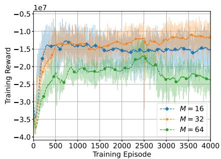

<details>
<summary>line</summary>

| Training Episode | M = 16 | M = 32 | M = 64 |
| ---------------- | ------ | ------ | ------ |
| 0                | -4.0e7 | -4.0e7 | -4.0e7 |
| 500              | -1.5e7 | -1.5e7 | -2.5e7 |
| 1000             | -1.5e7 | -1.5e7 | -2.5e7 |
| 1500             | -1.5e7 | -1.5e7 | -2.5e7 |
| 2000             | -1.5e7 | -1.5e7 | -2.5e7 |
| 2500             | -1.5e7 | -1.5e7 | -2.5e7 |
| 3000             | -1.5e7 | -1.5e7 | -2.5e7 |
| 3500             | -1.5e7 | -1.5e7 | -2.5e7 |
| 4000             | -1.5e7 | -1.5e7 | -2.5e7 |
</details>

(b) Batch size.

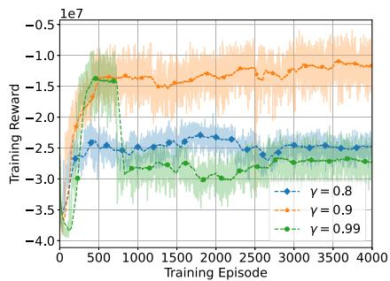

<details>
<summary>line</summary>

| Training Episode | γ = 0.8 | γ = 0.9 | γ = 0.99 |
| ---------------- | ------- | ------- | -------- |
| 0                | -3.5e7  | -3.5e7  | -4.0e7   |
| 500              | -2.5e7  | -1.5e7  | -1.5e7   |
| 1000             | -2.5e7  | -1.5e7  | -2.5e7   |
| 1500             | -2.5e7  | -1.5e7  | -2.5e7   |
| 2000             | -2.5e7  | -1.5e7  | -2.5e7   |
| 2500             | -2.5e7  | -1.5e7  | -2.5e7   |
| 3000             | -2.5e7  | -1.5e7  | -2.5e7   |
| 3500             | -2.5e7  | -1.5e7  | -2.5e7   |
| 4000             | -2.5e7  | -1.5e7  | -2.5e7   |
</details>

(c) Discount factor.

Fig. 3. Model convergence concerning training hyperparameters.   
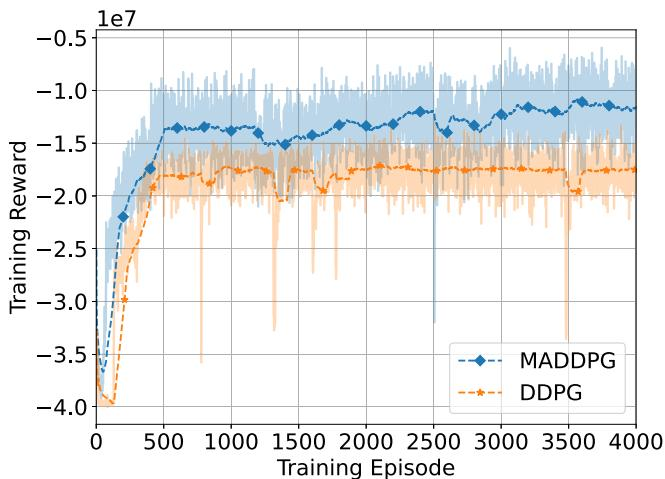

<details>
<summary>line</summary>

| Training Episode | MADDPG     | DDPG       |
| ---------------- | ---------- | ---------- |
| 0                | -3.8e7     | -3.9e7     |
| 500              | -1.5e7     | -2.0e7     |
| 1000             | -1.4e7     | -2.0e7     |
| 1500             | -1.5e7     | -2.0e7     |
| 2000             | -1.4e7     | -2.0e7     |
| 2500             | -1.4e7     | -2.0e7     |
| 3000             | -1.3e7     | -2.0e7     |
| 3500             | -1.2e7     | -2.0e7     |
| 4000             | -1.2e7     | -2.0e7     |
</details>

(a) Learning rate.

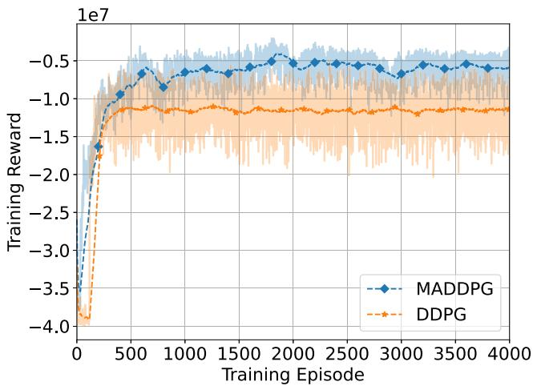

<details>
<summary>line</summary>

| Training Episode | MADDPG     | DDPG       |
| ---------------- | ---------- | ---------- |
| 0                | -3.8e7     | -3.9e7     |
| 500              | -0.8e7     | -1.2e7     |
| 1000             | -0.6e7     | -1.1e7     |
| 1500             | -0.5e7     | -1.1e7     |
| 2000             | -0.5e7     | -1.1e7     |
| 2500             | -0.5e7     | -1.1e7     |
| 3000             | -0.5e7     | -1.1e7     |
| 3500             | -0.5e7     | -1.1e7     |
| 4000             | -0.5e7     | -1.1e7     |
</details>

(b) Batch size.   
Fig. 4. Convergence comparison between MADDPG and single-agent DDPG.

MADDPG and single-agent DDPG use the same set of optimal hyperparameters evaluated above. Fig. 4(a) depicts the training performances of 3-agent DDPG and 1-agent DDPG in the 3ACPs-env, whereas Fig. 4(b) depicts the training performances of 5-agent DDPG and 1-agent DDPG in the 5ACPs-env. The findings in Fig. 4 indicate that MADDPG performs better than single-agent DDPG in both cases. The 3-agent DDPG performs approximately 35.33% better than the 1-agent DDPG in the first scenario. The 5-agent DDPG performs approximately 59% better than the 1-agent DDPG in the second scenario. MADDPG involves a centralized training phase followed by decentralized execution of the trained policies in the individual agents. MAD-DPG differs from single-agent DDPG by allowing agents to interact and coordinate their actions, enabling better collaboration and collective decision-making for improved system performance [15], [20], [21].

# C. Performance Analysis

In this part, we assess the proposed MADDPG framework performance compared with other benchmarks in two scenarios, i.e., 3ACPs-env and 5ACPs-env.

We evaluate the system performance in the 3ACPs-env scenario by changing the task size from 0.8 to 1.2 Mbits, as shown in Fig. 5. Increasing the task size leads to a rise in system cost due to the increased resource demands (Fig. 5(a)). In particular, the cost in our proposed approach grows by about 66.2% when increasing the size by 0.1 Mbits. In addition, a larger task size makes the environment more challenging, reducing the task success rate (Fig. 5(b)). Our MADDPG framework had a high task success rate of approximately 95% in the case of 0.8 Mbits and about 70% in the case of 1.2 Mbits. Similarly, the system energy consumption increases with the rise in task size as the number of bits to execute and offload increases (Fig. 5(c)). Our proposed framework demonstrates superior performance compared to other approaches. Notably, the episode cost is reduced by approximately 30% compared to DDPG and by factors of 2.4, 2.99, and 3.44 compared to FULL, RANDOM, and GREEDY schemes, respectively. Moreover, in a highly complex problem, using GREEDY with discretized variables resulted in poor performance. Discrete spaces can contain many sub-optimal points, and the greedy-based searching approach can get stuck at a sub-optimal point, leading to possibly low performance.

We also assess the system performance in the 5ACPs-env scenario with the varying task size, as shown in Fig. 6. Similar to the previous scenario, increasing the task size decreases the system performance (i.e., increases the episode cost, reduces the task success rate, and increases the energy consumption). Our proposed MADDPG framework outperforms the remaining benchmarks in this scenario with the highest task success rate and lowest episode cost. The 5ACPs-env scenario also performs better than the 3ACPs-env scenario, with an overall reduction in episode cost of about 1.28, 1.48, and 1.59 times in the MADDPG, DDPG, and FULL schemes, respectively, and approximate reductions of 11% and 9% in the RANDOM and GREEDY schemes, respectively. This is because more ACPs provide more computing and communication resources, increasing the system’s capacity. In particular, the task success rate in this scenario is about 79.4% in the strictest case (i.e., task size 1.2 Mbits), while it is about 70% in the 3ACPs-env scenario. Therefore, environmental requirements should be carefully considered when deploying a multi-ACP-enabled edge system to provide suitable resources and ensure system performance.

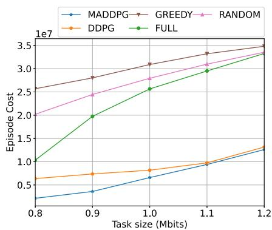

<details>
<summary>line</summary>

| Task size (Mbits) | MADDPG | GREEDY | RANDOM | DDPG | FULL |
| ----------------- | ------ | ------ | ------ | ---- | ---- |
| 0.8               | 0.3    | 2.6    | 2.0    | 0.7  | 1.0  |
| 0.9               | 0.4    | 2.8    | 2.4    | 0.8  | 2.0  |
| 1.0               | 0.7    | 3.1    | 2.8    | 0.9  | 2.5  |
| 1.1               | 1.0    | 3.4    | 3.1    | 1.0  | 3.0  |
| 1.2               | 1.3    | 3.5    | 3.4    | 1.3  | 3.4  |
</details>

(a) Episode cost.

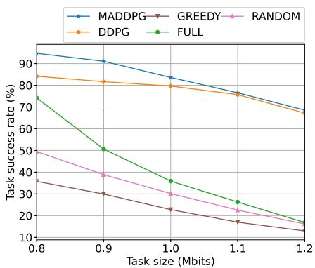

<details>
<summary>line</summary>

| Task size (Mbits) | MADDPG | GREEDY | RANDOM | DDPG | FULL |
| ----------------- | ------ | ------ | ------ | ---- | ---- |
| 0.8               | 93     | 36     | 50     | 84   | 74   |
| 0.9               | 91     | 31     | 40     | 82   | 51   |
| 1.0               | 84     | 24     | 30     | 80   | 36   |
| 1.1               | 77     | 18     | 22     | 76   | 27   |
| 1.2               | 69     | 14     | 16     | 69   | 17   |
</details>

(b) Task success rate.

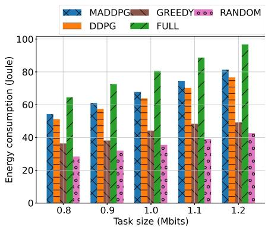

<details>
<summary>bar</summary>

| Task size (Mbits) | MADDPG | GREEDY | RANDOM | DDPG | FULL |
| ----------------- | ------ | ------ | ------ | ---- | ---- |
| 0.8               | 54     | 37     | 28     | 51   | 65   |
| 0.9               | 61     | 39     | 31     | 57   | 73   |
| 1.0               | 68     | 40     | 36     | 64   | 81   |
| 1.1               | 75     | 48     | 39     | 71   | 89   |
| 1.2               | 82     | 49     | 42     | 77   | 97   |
</details>

(c)Energy consumption.

Fig. 5. System performance with respect to task sizes in 3ACPs-env.   
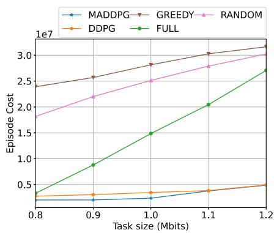

<details>
<summary>line</summary>

| Task size (Mbits) | MADDPG | GREEDY | RANDOM | DDPG | FULL |
| ----------------- | ------ | ------ | ------ | ---- | ---- |
| 0.8               | 0.3    | 2.4    | 1.8    | 0.3  | 0.4  |
| 0.9               | 0.3    | 2.6    | 2.2    | 0.3  | 0.9  |
| 1.0               | 0.3    | 2.8    | 2.5    | 0.3  | 1.5  |
| 1.1               | 0.4    | 3.0    | 2.8    | 0.4  | 2.0  |
| 1.2               | 0.5    | 3.2    | 3.0    | 0.5  | 2.7  |
</details>

(a) Episode cost.

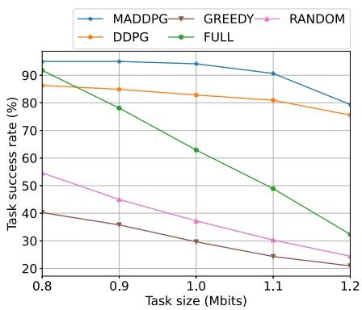

<details>
<summary>line</summary>

| Task size (Mbits) | MADDPG | GREEDY | RANDOM | DDPG | FULL |
| ----------------- | ------ | ------ | ------ | ---- | ---- |
| 0.8               | 92     | 40     | 55     | 88   | 90   |
| 0.9               | 91     | 36     | 45     | 85   | 78   |
| 1.0               | 90     | 30     | 37     | 83   | 63   |
| 1.1               | 88     | 25     | 30     | 81   | 50   |
| 1.2               | 80     | 22     | 25     | 75   | 32   |
</details>

(b) Task success rate.

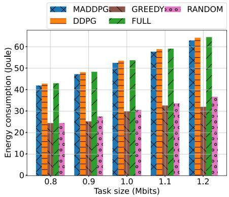

<details>
<summary>bar</summary>

| Task size (Mbits) | MADDPG | GREEDY | DDPG | RANDOM |
| ----------------- | ------ | ------ | ---- | ------ |
| 0.8               | 42     | 25     | 43   | 25     |
| 0.9               | 47     | 26     | 48   | 28     |
| 1.0               | 52     | 30     | 53   | 31     |
| 1.1               | 58     | 33     | 59   | 34     |
| 1.2               | 63     | 32     | 64   | 37     |
</details>

(c） Energy consumption.   
Fig. 6. System performance with respect to task sizes in 5ACPs-env.

# VI. CONCLUSION

This paper investigated a multi-ACP-enabled NOMA edge system with one HAP and several UAVs that assist in the computational tasks offloaded by IoTDs. Our goal was to minimize task processing latency and energy consumption of IoTDs by formulating a JTORA problem. This formulation considered device association, offloading ratio, transmit power, and computational resource allocation. The problem is transformed into the MAMDP, which is then addressed using the proposed MADDPG-based framework with the action pretreatment function. Our numerical results show that, compared to single-agent DDPG and other benchmark schemes, the proposed MADDPG-based approach can determine the efficient offloading and resource allocation policies while significantly reducing task computation overhead. In future works, we will extend our work to adapt the proposed algorithm into several system and application scenarios, wherein we can perform deep analyses compared to appropriate existing solutions. We will also explore alternative prominent multi-agent DRL optimization algorithms and other emerging communication technologies.

# REFERENCES

[1] W. Chen et al., “5G-Advanced toward 6G: Past, present, and future,” IEEE J. Sel. Areas Commun., vol. 41, no. 6, pp. 1592–1619, Jun. 2023.   
[2] V. D. Tuong, T. P. Truong, T.-V. Nguyen, W. Noh, and S. Cho, “Partial computation offloading in NOMA-assisted mobile-edge computing systems using deep reinforcement learning,” IEEE Internet Things J., vol. 8, no. 17, pp. 13196–13208, Sep. 2021.   
[3] C. Feng, P. Han, X. Zhang, B. Yang, Y. Liu, and L. Guo, “Computation offloading in mobile edge computing networks: A survey,” J. Netw. Comput. Appl., vol. 202, 2022, Art. no. 103366.   
[4] N.-N. Dao et al., “Survey on aerial radio access networks: Toward a comprehensive 6G access infrastructure,” IEEE Commun. Surv. Tut., vol. 23, no. 2, pp. 1193–1225, Secondquarter 2021.

[5] M. M. Azari et al., “Evolution of non-terrestrial networks from 5G to 6G: A survey,” IEEE Commun. Surv. Tut., vol. 24, no. 4, pp. 2633–2672, Fourthquarter 2022.   
[6] X. Lin, S. Rommer, S. Euler, E. A. Yavuz, and R. S. Karlsson, “5G from space: An overview of 3GPP non-terrestrial networks,” IEEE Commun. Standards Mag., vol. 5, no. 4, pp. 147–153, Dec. 2021.   
[7] X. Lin, “An overview of 5G advanced evolution in 3GPP release 18,” IEEE Commun. Standards Mag., vol. 6, no. 3, pp. 77–83, Sep. 2022.   
[8] Q. Zhang, Y. Luo, H. Jiang, and K. Zhang, “Aerial edge computing: A survey,” IEEE Internet Things J., vol. 10, no. 16, pp. 14357–14374, Aug. 2023.   
[9] Q.-V. Pham et al., “Aerial computing: A new computing paradigm, applications, and challenges,” IEEE Internet Things J., vol. 9, no. 11, pp. 8339–8363, Jun. 2022.   
[10] S. Jung, C. Park, M. Levorato, J.-H. Kim, and J. Kim, “Two-stage selfadaptive task outsourcing decision making for edge-assisted multi-UAV networks,” IEEE Trans. Veh. Technol., vol. 72, no. 11, pp. 14889–14905, Nov. 2023.   
[11] M. Dai, Y. Wu, L. Qian, Z. Su, B. Lin, and N. Chen, “UAV-assisted multi-access computation offloading via hybrid NOMA and FDMA in marine networks,” IEEE Trans. Netw. Sci. Eng., vol. 10, no. 1, pp. 113–127, Jan./Feb 2023.   
[12] P. Qin et al., “Joint trajectory plan and resource allocation for UAV-enabled C-NOMA in air-ground integrated 6G heterogeneous network,” IEEE Trans. Netw. Sci. Eng., vol. 10, no. 6, pp. 3421–3434, Nov./Dec. 2023.   
[13] Z. Jia, Q. Wu, C. Dong, C. Yuen, and Z. Han, “Hierarchical aerial computing for Internet of Things via cooperation of HAPs and UAVs,” IEEE Internet Things J., vol. 10, no. 7, pp. 5676–5688, Apr. 2023.   
[14] H. Kang, X. Chang, J. Miši´c, V. B. Miši´c, J. Fan, and Y. Liu, “Cooperative UAV resource allocation and task offloading in hierarchical aerial computing systems: A MAPPO-based approach,” IEEE Internet Things J., vol. 10, no. 12, pp. 10497–10509, Jun. 2023.   
[15] D. S. Lakew, A.-T. Tran, N.-N. Dao, and S. Cho, “Intelligent offloading and resource allocation in heterogeneous aerial access IoT networks,” IEEE Internet Things J., vol. 10, no. 7, pp. 5704–5718, Apr. 2023.   
[16] Y. Yuan, Z. Yuan, and L. Tian, “5G non-orthogonal multiple access study in 3GPP,” IEEE Commun. Mag., vol. 58, no. 7, pp. 90–96, Jul. 2020.   
[17] Y. Liu et al., “Evolution of NOMA toward next generation multiple access (NGMA) for 6G,” IEEE J. Sel. Areas Commun., vol. 40, no. 4, pp. 1037–1071, Apr. 2022.   
[18] Y. Zhang, Z. Mou, F. Gao, J. Jiang, R. Ding, and Z. Han, “UAVenabled secure communications by multi-agent deep reinforcement learning,” IEEE Trans. Veh. Technol., vol. 69, no. 10, pp. 11599–11611, Oct. 2020.   
[19] H. Peng and X. Shen, “Multi-agent reinforcement learning based resource management in MEC- and UAV-assisted vehicular networks,” IEEE J. Sel. Areas Commun., vol. 39, no. 1, pp. 131–141, Jan. 2021.   
[20] N. Zhao, Z. Ye, Y. Pei, Y.-C. Liang, and D. Niyato, “Multi-agent deep reinforcement learning for task offloading in UAV-assisted mobile edge computing,” IEEE Trans. Wireless Commun., vol. 21, no. 9, pp. 6949–6960, Sep. 2022.   
[21] Z. Cheng, M. Liwang, N. Chen, L. Huang, X. Du, and M. Guizani, “Deep reinforcement learning-based joint task and energy offloading in UAV-aided 6G intelligent edge networks,” Comput. Commun., vol. 192, pp. 234–244, 2022.   
[22] V. Mnih et al., “Human-level control through deep reinforcement learning,” Nature, vol. 518, no. 7540, pp. 529–533, 2015.   
[23] T. P. Lillicrap et al., “Continuous control with deep reinforcement learning,” in Proc. 4th Int. Conf. Learn. Representations, 2016, arxiv:1509.02971.   
[24] R. Lowe, Y. Wu, A. Tamar, J. Harb, P. Abbeel, and I. Mordatch, “Multiagent actor-critic for mixed cooperative-competitive environments,” in Proc. 31st Int. Conf. Neural Inf. Process. Syst., 2017, pp. 6382–6393.   
[25] X. Cheng et al., “Space/aerial-assisted computing offloading for IoT applications: A learning-based approach,” IEEE J. Sel. Areas Commun., vol. 37, no. 5, pp. 1117–1129, May 2019.   
[26] Q. Ren, O. Abbasi, G. K. Kurt, H. Yanikomeroglu, and J. Chen, “Caching and computation offloading in high altitude platform station (HAPS) assisted intelligent transportation systems,” IEEE Trans. Wireless Commun., vol. 21, no. 11, pp. 9010–9024, Nov. 2022.   
[27] N. Waqar, S. A. Hassan, A. Mahmood, K. Dev, D.-T. Do, and M. Gidlund, “Computation offloading and resource allocation in MECenabled integrated aerial-terrestrial vehicular networks: A reinforcement learning approach,” IEEE Trans. Intell. Transp. Syst., vol. 23, no. 11, pp. 21478–21491, Nov. 2022.

[28] T.-H. Nguyen, T. P. Truong, N.-N. Dao, W. Na, H. Park, and L. Park, “Deep reinforcement learning-based partial task offloading in high altitude platform-aided vehicular networks,” in Proc. IEEE 13th Int. Conf. Inf. Commun. Technol. Convergence 2022, pp. 1341–1346.   
[29] T.-H. Nguyen and L. Park, “HAP-assisted RSMA-enabled vehicular edge computing: A DRL-based optimization framework,” Mathematics, vol. 11, no. 10, 2023, Art. no. 2376.   
[30] T. P. Truong, N.-N. Dao, and S. Cho, “HAMEC-RSMA: Enhanced aerial computing systems with rate splitting multiple access,” IEEE Access, vol. 10, pp. 52398–52409, 2022.   
[31] G. K. Kurt et al., “A vision and framework for the high altitude platform station (HAPS) networks of the future,” IEEE Commun. Surv. Tut., vol. 23, no. 2, pp. 729–779, Secondquarter 2021.   
[32] M. Min, L. Xiao, Y. Chen, P. Cheng, D. Wu, and W. Zhuang, “Learningbased computation offloading for IoT devices with energy harvesting,” IEEE Trans. Veh. Technol., vol. 68, no. 2, pp. 1930–1941, Feb. 2019.   
[33] I. Goodfellow, Y. Bengio, and A. Courville, Deep learning. Cambridge, MA, USA: MIT Press, 2016. [Online]. Available: http://www. deeplearningbook.org


<details>
<summary>natural_image</summary>

Portrait of a man wearing glasses and a suit (no text or symbols visible)
</details>

Tri-Hai Nguyen received the B.S. degree (Honor Program) in computer science from the University of Information Technology, VNU-HCM, Ho Chi Minh City, Vietnam, in 2015, the M.Eng. degree in information and communication technology from Soongsil University, Seoul, South Korea, in 2017, and the Ph.D. degree in computer science and engineering from Chung-Ang University, Seoul, in 2022. He is currently a Research Professor with the Department of Computer Science and Engineering, Seoul National University of Science and Technology (SeoulTech),

Seoul. His research interests include the Intelligence of Things, aerial computing, and beyond 5G/6G networks.


<details>
<summary>natural_image</summary>

Portrait photo of a young man in a white collared shirt (no text or symbols visible)
</details>

Thanh Phung Truong (Graduate Student Member, IEEE) received the B.S. degree in electronicstelecommunications engineering from the Ho Chi Minh City University of Technology, Ho Chi Minh City, Vietnam, in 2018, and the M.S. degree in computer science and engineering in 2022 from Chung-Ang University, Seoul, South Korea, where he is currently working toward the Ph.D. degree in computer science and engineering. His research interests include machine learning, mobile edge computing, and wireless communication.

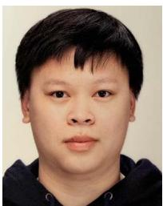

<details>
<summary>natural_image</summary>

Portrait photo of a young man with short dark hair wearing a dark hoodie (no text or symbols visible)
</details>

Anh-Tien Tran received the B.S. degree in electronics and telecommunications from the Da Nang University of Science and Technology, Da Nang, Vietnam, in 2018. He is currently working toward the Ph.D. degree in computer science and engineering with Chung-Ang University, Seoul, South Korea. His research interests include wireless network communication, video streaming, and machine learning.


<details>
<summary>natural_image</summary>

Portrait of a man wearing a red shirt (no visible text or symbols)
</details>

Nhu-Ngoc Dao (Senior Member, IEEE) received the B.S. degree in electronics and telecommunications from the Posts and Telecommunications Institute of Technology, Hanoi, Vietnam, in 2009, and the M.S. and Ph.D. degrees in computer science from the School of Computer Science and Engineering, Chung-Ang University, Seoul, South Korea, in 2016 and 2019, respectively. He is currently an Assistant Professor with the Department of Computer Science and Engineering, Sejong University, Seoul. Prior to joining Sejong University, he was a Visiting Researcher with the University of Newcastle, Callaghan, NSW, Australia, in 2019, and a Postdoc Researcher with the Institute of Computer Science, University of Bern, Bern, Switzerland, from 2019 to 2020. He is currently the Editor of the Scientific Reports and PLoS One journals. His research interests include network softwarization, mobile cloudization, intelligent systems, and the Intelligence of Things. Dr. Dao is a Professional Member of ACM.


<details>
<summary>natural_image</summary>

Portrait of a man wearing glasses and a sweater over a collared shirt (no text or symbols visible)
</details>

Laihyuk Park received the B.S., M.S., and Ph.D. degrees in computer science and engineering from Chung-Ang University, Seoul, South Korea, in 2008, 2010, and 2017, respectively. From 2011 to 2016, he was a Research Engineer with Innowireless, Bundang, South Korea. From 2018 to 2019, he held the position of an Assistant Professor with Chung-Ang University. He is currently an Assistant Professor with the Department of Computer Science and Engineering, Seoul National University of Science and Technology (SeoulTech), Seoul. His research interests include demand response, smart grids, and the Internet of Things.


<details>
<summary>natural_image</summary>

Portrait of a man wearing glasses and a suit (no text or symbols visible)
</details>

Sungrae Cho received the B.S. and M.S. degrees in electronics engineering from Korea University, Seoul, South Korea, in 1992 and 1994, respectively, and the Ph.D. degree in electrical and computer engineering from the Georgia Institute of Technology, Atlanta, GA, USA, in 2002. He is currently a Professor with the School of Computer Science and Engineering, Chung-Ang University (CAU), Seoul. Prior to joining CAU, he was an Assistant Professor with the Department of Computer Sciences, Georgia Southern University, Statesboro, GA, from 2003 to 2006, and a Senior Member of Technical Staff with the Samsung Advanced Institute of Technology, Kiheung, South Korea, in 2003. From 1994 to 1996, he was a Research Staff Member with the Electronics and Telecommunications Research Institute, Daejeon, South Korea. From 2012 to 2013, he held a Visiting Professorship with the National Institute of Standards and Technology, Gaithersburg, MD, USA. His research interests include wireless networking, ubiquitous computing, and ICT convergence. He has been the Subject Editor of Electronics Letter (IET) since 2018 and was an Area Editor of Ad Hoc Networks (Elsevier) from 2012 to 2017. He has served numerous international conferences as an Organizing Committee Chair, such as IEEE SECON, ICOIN, ICTC, ICUFN, TridentCom, and IEEE MASS, and as a Program Committee Member, such as IEEE ICC, GLOBECOM, VTC, MobiApps, SENSORNETS, and WINSYS.