# Joint Optimization of Energy Efficiency and Stable Communication Quality for Cargo UAV-Enabled Multi-Package Pickup and Delivery

Guoguo Huang , Jiangling Cao , Liang Yang , Senior Member, IEEE, and Shenghai Chen

Abstract— In this paper, we consider a cellular-connected cargo drone (UAV) system for multi-package pick-up and delivery within a designated area, in which the UAV departs from a warehouse carrying packages for delivery, completes these deliveries, collects packages for pick-up, and finally returns to the warehouse. The most critical aspect is maintaining a reliable communication link between the UAV and the ground base stations (GBSs) while accomplishing these logistics tasks. Specifically, our objective is to minimize the cargo UAV’s total energy consumption for pick-up and delivery while ensuring that the probability of the UAV’s trajectories being covered by GBSs during its mission remains above specified thresholds. To address the proposed problem, we introduce a two-phase hybrid genetic algorithm and deep reinforcement learning (HGADRL) framework to obtain the logistics service order of the cargo UAV as well as its flight trajectories. In the first place, genetic algorithm (GA) is employed to determine the service order for the UAV, and based on this order, the second phase utilizes deep reinforcement learning (DRL) to further optimize the flight trajectory of the UAV in each stage. To demonstrate the validity of the proposed approach, three benchmark schemes for comparison and the effect of the two-phase HGADRL framework under four different communication outage thresholds are conducted. Extensive experiments manifest that the proposed framework exhibits significant superiority in minimizing energy consumption for cargo UAV systems while maintaining a stable connection with GBSs.

Index Terms— Cellular-connected UAV, deep reinforcement learning, genetic algorithm, trajectory optimization.

## I. INTRODUCTION

altitude economy, the near-surface airspace is becoming an important carrier for promoting changes in the modern logistics model [1]. Due to its advantages of autonomous flight, adaptability and low cost, drone (UAV) logistics stands out from traditional ground transportation and plays a key role in the low-altitude economy. Compared to traditional truckbased delivery, UAVs offer flexible delivery routes, are free from traffic congestion, and significantly enhance logistics efficiency [2], [3]. Additionally, UAVs offer significant environmental and energy-saving benefits, as they are typically powered by rechargeable batteries [4], making them a more sustainable solution for logistics. As a result, UAVs are increasingly seen as an ideal fit for last-mile delivery and contactless services. The commercial deployment of UAVs for logistics system has witnessed substantial proliferation across global industries. Amazon [5], the e-commerce behemoth, has revolutionized last-mile logistics through its Prime Air initiative, which employs UAVs dispatched from strategically positioned fulfillment centers to ensure 30-minute doorstep delivery. Concurrently, JD.com’s avant-garde approach materialized through its dedicated drone express network [6], effectively bridging the urban-rural service gap that has long perpetuated socioeconomic disparities in remote Chinese territories. Of particular note is Zipline’s pioneering medical distribution framework [7], deployed years before mainstream adoption, which transports critical biomedical supplies—blood, transplant organs, and emergency drugs—across remote African regions.

In densely populated urban or remote areas, UAVs bypass ground transportation limitations, offering faster and more effective delivery services. With the advancement of artificial intelligence [8], cellular-connected UAVs [9] have opened up new possibilities for precise remote control and task scheduling, bringing significant advantages to the logistics. By leveraging cellular networks, these UAVs can dynamically adjust flight paths, ensuring the efficient and secure transport of goods. Unlike conventional UAVs, the integration of cellular connectivity allows for extended operational ranges, enabling UAVs to operate in complex urban environments with greater ease. UAVs are proving invaluable in applications such as emergency response [10] and humanitarian aid, where they can quickly deliver critical supplies to hard-to-reach areas, playing a crucial role in disaster relief operations.

## A. Related Works

The application of UAVs in logistics systems manifests through three primary dimensions. The first involves parameter optimization within single UAV logistics frameworks [11], [12], [13], [14]. Specifically, [11] introduced a disconnectivity-aware cargo UAV, employing dynamic programming to optimize flight trajectories under capacity constraints, thereby minimizing energy consumption and handoff rates during operations. In [12], the authors addressed package collection scenarios with no-fly zones by optimizing both pick-up strategies and flight paths to maximize total cargo value under payload constraints. While an innovative doubly weighted task-time graph was presented in [14] to coordinate strict delivery deadlines with time-sensitive, locationdependent perception tasks, ensuring timely delivery while minimizing energy consumption and maximizing perception rewards. The second dimension focuses on task scheduling and collaborative mechanisms for UAV swarms [15], [16], [17]. Notably, [15] resolved critical limitations in existing research by proposing multi-trip vehicle routing problems (VRPs) for UAV delivery systems, addressing both the impracticality of single-depot restrictions and the oversight of battery-life and payload impacts on energy consumption, which effectively balances operational feasibility with cost efficiency. The third dimension explores cooperative truck-drone delivery optimization [18], [19], [20]. Hybrid system integrating ground vehicles and UAVs demonstrates enhanced efficiency through coordinated operations. For instance, [18] tackled task scheduling challenges in multi-order delivery using cargo UAVs, while [19] introduced a hybrid truck-drone delivery (HTDD) algorithm that synergistically combined truck-only, truck-drone tandem, and independent drone to minimize total energy consumption across the integrated logistics network.

However, most existing UAV studies are confined to lineof-sight (LoS) channels [11], [25], [26], making UAV heavily reliant on point-to-point communication with very limited tolerable range. Outages in communication during operations can create multi-domain risks, which, for instance, may lead to collisions in autonomous drone swarms when avoidance protocols fail. Integrating UAVs with terrestrial cellular networks can address these challenges, since 5G and beyond mobile networks offer higher data transmission rate and lower latency, making cellular-connected UAVs a highly promising research direction [27], [28]. Cellular-connected UAVs not only require safety assurance against connectivity losses [29] but also heavily depend on continuous communication with ground base stations (GBSs) to access real-time user locations, package weight, and dynamic logistical data. Although cellular integration confers significant benefits, traditional ground mobile networks are designed for terrestrial users, with down-tilted GBS antennas, yielding weak coverage at aerial altitudes. Numerous studies have sought to overcome these limitations, focusing primarily on two paradigms [26], [30]: cellular-connected UAV systems where UAVs operate as aerial users served by GBSs and UAV-assisted cellular networks where UAVs function as aerial base stations providing service to ground users. In the following research, we concentrate exclusively on the former.

The integration of UAVs with cellular-networks was addressed across several studies with distinct approaches. An integrated graph theory and convex optimization is employed in [25] to optimize UAV flight trajectories while maintaining reliable cellular network connectivity with GBSs. However, this approach relied on conventional LoS channel assumptions between UAVs and GBSs, which may not align with real-world environments. In contrast, [29] proposed a coverage-aware navigation framework that constructed a 2D aerial radio map to simulate UAV missions in urban environments. By formulating the navigation problem as a Markov decision process (MDP) and employing deep reinforcement learning (DRL), the method ensures mission completion while preserving communication quality. Building upon this foundation, [31] extended the operational airspace from 2D to 3D configurations, demonstrating that UAVs can successfully execute flight missions while maintaining satisfactory communication quality through enhanced spatial adaptability and signal coverage optimization. The integration of cellular-connected UAVs into logistics systems was systematically addressed in [21], [22], and [32] through distinct paradigms. A multiuser delivery system was investigated in [32], where a UAV distributed parcels, aiming to minimize the weighted sum of energy consumption and communication outage duration during mission execution while maintaining cellular connectivity with GBSs. Meanwhile, [21] focused on a package collection scenario utilizing cellular-connected UAVs, where the joint optimization of flight trajectories and pick-up strategies achieved dual objectives: maximizing the total collected package value and minimizing communication outage time. In short, [32] prioritizes energy-communication tradeoffs in distribution tasks, and [21] balances connectivity constraints with operational efficiency in collection missions.

## B. Motivation and Contributions

Table I summarizes the relevant literature on UAV logistics. We observe that although many studies address connectivity between cellular-connected UAVs and GBSs, they predominantly focus on minimizing communication outage duration while overlooking the essential requirement that the UAV must sustain a stable cellular connection with GBSs throughout the entire mission. Current literature primarily optimizes outage time without addressing the imperative of maintaining specified communication quality during flight operations. To bridge this gap, this paper establishes a pickup and delivery system that simultaneously minimizes the cargo UAV’s overall energy consumption and guarantees the outage probability experienced by the UAV always below predefined thresholds throughout the whole delivery and pick-up missions.

Achieving these objectives necessitates the co-optimization of the UAV’s flight trajectory and service order across multiple users. The formulated problem exhibits inherent complexity due to its non-convex, NP-hard nature and the interdependencies among multiple users, rendering conventional convex optimization methods ineffective. Furthermore, direct application of DRL struggles with convergence in this high-dimensional combinatorial scenario [33], [34], [35]. To overcome these limitations, we propose a two-phase HGADRL framework that decouples the optimization process by first using a genetic algorithm (GA) to optimize service sequences through heuristic search and then applying DRL-based trajectory optimization under the given service orders. The main contributions of this paper are summarized as follows:

TABLE I  
SUMMARY OF THE RELATED REFERENCE ON UAV LOGISTICS
<table><tr><td>Ref</td><td>Number of parcel</td><td>Communication quality</td><td>Stable Connectivity</td><td>Energy consumption</td><td>Channel</td><td>Algorithms</td></tr><tr><td>[11]</td><td>1</td><td>×</td><td>X</td><td>√</td><td>Probabilistic LoS</td><td>Dynamic programming</td></tr><tr><td>[12]</td><td>&gt;1</td><td>X</td><td>X</td><td>X</td><td></td><td>Convex optimization</td></tr><tr><td>[14]</td><td>1</td><td>X</td><td>X</td><td>√</td><td></td><td>Bellman-Ford</td></tr><tr><td>[21]</td><td>&gt;1</td><td>√</td><td>X</td><td>√</td><td>Practical measurement</td><td>Hybrid deep reinforcement learning</td></tr><tr><td>[22]</td><td>&gt;1</td><td>√</td><td>X</td><td>√</td><td>Practical measurement</td><td>Simulated annealing and deep reinforcement learning</td></tr><tr><td>[23]</td><td>&gt;1</td><td>X</td><td>X</td><td>√</td><td></td><td>Heuristics algorithm</td></tr><tr><td>[24]</td><td>&gt;1</td><td>√</td><td>X</td><td>√</td><td>Practical measurement</td><td>Improved ant colony algorithm and deep reinforcement learning</td></tr><tr><td>This paper</td><td>&gt;1</td><td>√</td><td>√</td><td>√</td><td>Practical measurement</td><td>HGADRL</td></tr></table>

• This paper proposes a cellular-connected cargo UAV pick-up and delivery model, where the cargo UAV carrying packages for delivery departs from the warehouse, completes package distribution and collects specified packages in the designated area, before ultimately returning to the logistics warehouse. Our objective is to minimize the UAV’s energy consumption during logistics services through optimizing service sequence and flight trajectory, while ensuring that the outage probability at the locations traversed by the UAV remains below specified thresholds throughout the whole mission.

• To address this complex and highly non-convex problem in the multi-package UAV logistics service system, we propose a novel two-phase HGADRL framework that decomposes the UAV service problem into service sequence optimization and trajectory design as two subproblems. In the sequence optimization phase, the UAV service sequence is obtained through minimizing energy consumption. Subsequently, we optimize the flight trajectory to maintain reliable cellular connectivity above specified thresholds while further minimizing energy consumption in the trajectory design phase.

• During the service scheme design phase, we employ GA where each user corresponds to a gene, enabling iterative evolution to obtain an optimal energy-efficient service sequence for the system through successive generations. Based on the determined logistics service sequence, then the state-of-the-art multi-step dueling double deep Q-Network (dueling DDQN) algorithm is utilized to derive the optimal flight trajectory for the cargo UAV, while ensuring that the probability of the cargo UAV being covered by the GBSs is kept above certain thresholds to guarantee good communication between them.

• To validate the effectiveness of our proposed solution, we establish three benchmarks for comparison, namely dueling DDQN-based trajectory design with distance-minimized service order, rapidly-exploring random tree (RRT)-based trajectory optimization with energy-minimized service sequence, and RRT-based trajectory design with distance-minimized service order. Furthermore, we compare the effect of the proposed method under four different thresholds. Numerical results demonstrate that our proposed two-phase HGADRL framework exhibits significant superiority in maintaining reliable communication with GBSs while achieving minimal energy consumption for the cargo UAV.

TABLE II  
NOTATION DEFINITION
<table><tr><td rowspan=1 colspan=1>Notations</td><td rowspan=1 colspan=1>Definitions</td></tr><tr><td rowspan=1 colspan=1>Lw</td><td rowspan=1 colspan=1>Location of the logistics warehouse</td></tr><tr><td rowspan=1 colspan=1> $\underline { { L _ { u s e r } ^ { i } } }$ </td><td rowspan=1 colspan=1>Location of the i-th user</td></tr><tr><td rowspan=1 colspan=1>LCBS</td><td rowspan=1 colspan=1>Location of the m-th GBS</td></tr><tr><td rowspan=1 colspan=1>T</td><td rowspan=1 colspan=1>Task duration</td></tr><tr><td rowspan=1 colspan=1>I</td><td rowspan=1 colspan=1>Number of service points</td></tr><tr><td rowspan=1 colspan=1>M</td><td rowspan=1 colspan=1>Number of ground base station</td></tr><tr><td rowspan=1 colspan=1>q(t)</td><td rowspan=1 colspan=1>The position of the cargo UAV at time t</td></tr><tr><td rowspan=1 colspan=1>gi</td><td rowspan=1 colspan=1>Weight of the parcel at the i-th user service point</td></tr><tr><td rowspan=1 colspan=1>Yth</td><td rowspan=1 colspan=1>Communication signal-to-interference ratio threshold</td></tr><tr><td rowspan=1 colspan=1>Pt</td><td rowspan=1 colspan=1>Base station transmit power</td></tr><tr><td rowspan=1 colspan=1> $\overline { { W _ { U A V } } }$ </td><td rowspan=1 colspan=1>Weight of the cargo UAV itself</td></tr><tr><td rowspan=1 colspan=1> $\overline { { W _ { t o t a l } } }$ </td><td rowspan=1 colspan=1>Total weight of the cargo UAV including the cargo</td></tr><tr><td rowspan=1 colspan=1>SIR(t)</td><td rowspan=1 colspan=1>The SIR received by the cargo UAV at time t</td></tr><tr><td rowspan=1 colspan=1>Pout(q(t))</td><td rowspan=1 colspan=1>Probability of UAV-GBS communication outage at time t</td></tr><tr><td rowspan=1 colspan=1>Utip</td><td rowspan=1 colspan=1>The tip speed of the rotor blade</td></tr><tr><td rowspan=1 colspan=1>P_0</td><td rowspan=1 colspan=1>The blade profile power</td></tr><tr><td rowspan=1 colspan=1>A</td><td rowspan=1 colspan=1>The rotor disc area</td></tr><tr><td rowspan=1 colspan=1>δ</td><td rowspan=1 colspan=1>The air density</td></tr><tr><td rowspan=1 colspan=1>λ</td><td rowspan=1 colspan=1>Incremental correction factor to induced power</td></tr><tr><td rowspan=1 colspan=1>Hv(t)</td><td rowspan=1 colspan=1>The cargo UAV&#x27;s flight altitude at time t</td></tr><tr><td rowspan=1 colspan=1>γd</td><td rowspan=1 colspan=1>Communication outage probability threshold</td></tr></table>

The rest of this paper is structured as follows: Section II presents the system model of the UAV-enabled multi-package pick-up and delivery, Section III elaborates on the problem formulation and decomposition. The detailed solution approaches and experimental results analysis are covered in Sections IV and V respectively. Finally, Section VI draws the conclusions. Besides, we have summarized the main notations in this paper in Table II.

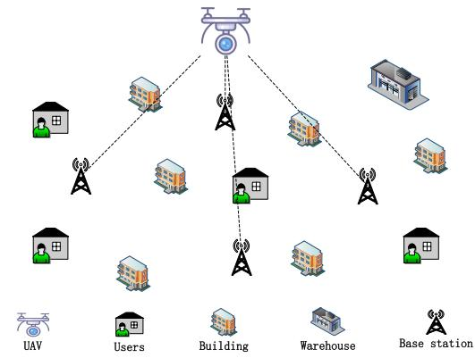  
Fig. 1. System model.

## II. SYSTEM MODEL

As shown in Fig. 1, we consider a system of a cellular-connected cargo UAV for package pick-up and delivery, in which a cargo UAV provides logistics services to users within a designated area with a size of $L \times L ~ \mathrm { k m ^ { 2 } }$ , mainly responsible for the pick-up and delivery of parcels for users, thereby addressing the last-mile issue in logistics. Users may request either pick-up or delivery services at any location within the area of interest, ensuring operational flexibility. The cargo UAV departs from the logistics warehouse, carries parcels to delivery points, then proceeds to other pick-up points to collect parcels, and finally returns to the logistics warehouse. The location of the logistics warehouse is fixed and is represented by $L _ { w } = [ x _ { w } , y _ { w } , 0 ]$ . The task duration of the cargo UAV is denoted by T, over which its position is defined as the 3D-coordinate ${ \bf q } ( t ) = ( x ( t ) , y ( t ) , h ( t ) ) , t \in [ 0 , T ]$ , and its trajectory is composed of a sequence of position points. The cargo UAV departs from the logistics warehouse with a total weight of $W _ { t o t a l }$ , an empty weight of $W _ { u a v } ,$ and a maximum flight speed of $V _ { m a x }$ . To ensure flight stability and cargo safety, the cargo UAV maintains a constant altitude of H during its entire flight, only ascending or descending at user service points. There are I users needing to be served in the system, with the location of the i-th user denoted as $L _ { u s e r } ^ { i } = ( x _ { u s e r } ^ { i } , y _ { u s e r } ^ { i } , 0 ) , i \in \{ 0 , 1 , 2 , \ldots , I - 1 \}$ , which also remains changeless. Prior to executing its task, the cargo UAV obtains relevant information about all users from the cellular network, including the service point location, type of service request (pick-up or delivery), and parcel weight. The parcel weight at the i-th user service point is denoted as $g _ { i }$

## A. Radio Environment Construction

UAVs rely on existing cellular networks for communication and maintain a connection with only one GBS at any given time. Signals from non-connected GBSs interfere with the UAV’s communication, and the signal-interference-ratio (SIR) is used to measure signal quality. The UAV experiences communication outage at its current position if the SIR falls below a set threshold $\gamma _ { t h }$ [29]. The system consists of M GBSs, where the location of the m-th GBS is $L _ { G B S } ^ { m } ~ = ~$ $( x _ { G B S } ^ { m } , y _ { G B S } ^ { m } , z _ { G B S } )$ , and the height of the base stations is stationary. To simulate the real-world condition, we follow the 3GPP standard [36], which divides each GBS into three sectors. The signal received by the UAV from the k-th sector of the m-th GBS at time t is primarily influenced by three factors comprising large-scale path loss, antenna gain, and small-scale fading. The radio map constructed in this paper provides the spatial distribution of the received signal in the space at height H.

1) Signal Attenuation and Path Loss: The path loss between the UAV and the GBS depends on whether there is a LoS channel, which is determined by their relative position and surrounding buildings. Similarly, whether there is a LoS link between the UAV and the $m _ { k } { \cdot } \mathrm { t h }$ GBS can be determined by checking if their communication path is blocked by ground buildings. According to the 3GPP standard [36], the large-scale path loss can be represented as

$$
P L _ { m _ { k } } ( t ) = \left\{ \begin{array} { l l } { 2 2 \log _ { 1 0 } { ( d _ { m _ { k } } ( t ) ) } + 2 0 \log _ { 1 0 } { ( f _ { c } ) } } \\ { \quad + 2 8 , \quad } & { L o S ; } \\ { ( 4 6 - 7 \log _ { 1 0 } { ( H ) } ) \log _ { 1 0 } { ( d _ { m _ { k } } ( t ) ) } } \\ { \quad - 1 7 . 5 + 2 0 \log _ { 1 0 } { ( \frac { 4 0 \pi { f _ { c } } } { 3 } ) } , } & { N L o S , } \end{array} \right.\tag{1}
$$

where $d _ { m _ { k } } ( t )$ represents the Euclidean distance between the UAV and the m -th GBS at time t, and $f _ { c }$ denotes the carrier frequency.

2) Outage Probability and Radio Coverage: Predicated on 3GPP standards, there are $B = 3 \times M$ sectors. The signal received by the UAV from sector k of the m-th GBS can be expressed as

$$
\begin{array} { r l } & { P _ { m _ { k } } ( t ) = P _ { t } \cdot \left| h _ { m _ { k } } ( t ) \right| ^ { 2 } } \\ & { \qquad = P _ { t } \cdot P L _ { m _ { k } } ( \mathbf { q } ( t ) ) \cdot G _ { m _ { k } } ( \mathbf { q } ( t ) ) \cdot \tilde { h } _ { m _ { k } } ( t ) , } \end{array}\tag{2}
$$

where $P _ { t }$ denotes the transmit power of the sector of GBSs, which is a constant [29], $G _ { m _ { k } } ( \mathbf { q } ( t ) )$ represents the antenna gain, and $\tilde { h } _ { m _ { k } } ( t )$ is a random variable representing small-scale fading, which follows a Rician distribution in LoS channels and a Rayleigh distribution in NLoS channels.

Let $c ( t )$ denote the cell connected to the UAV at time t, $c ( t ) \ \in \ \vec { \mathcal { B } } \ \triangleq \ \{ ( m , k ) \ : \ m \in \ \mathcal { M } , k \ \in \ K \}$ , where $\mathcal { M } \ : =$ $\{ 1 , 2 , \ldots M \}$ and $\mathcal { K } = \{ 1 , 2 , 3 \}$ . Generally, the UAV maintains communication with the cell offering the highest received SIR. Signals from non-connected cells can cause interference. Since UAV-ground communications are more prone to interference from terrestrial counterparts, noise effects are neglected in this study. SIR received by the cargo UAV at time t can be written as

$$
S I R ( t ) = \frac { P _ { c ( t ) } ( t ) } { \displaystyle \sum _ { m _ { k } \in \mathcal { B } , m _ { k } \neq c ( t ) } P _ { m _ { k } } ( t ) } .\tag{3}
$$

Due to the randomness of the received signal, the SIR is also a random variable and when the SIR is lower than the threshold $\gamma _ { t h }$ , the UAV enters an outage state. Thus, the outage probability is

$$
P _ { o u t } ( \mathbf { q } ( t ) ) = P r ( S I R ( t ) < \gamma _ { t h } ) ,\tag{4}
$$

where $P r ( \cdot )$ corresponds to the probability of an event occurring.

Drawing on the foregoing analysis, a 2D radio coverage map depicting the coverage distribution of UAV at altitude H can be constructed by calculating the outage probability across arbitrary spatial positions at the altitude H, where coverage probability is defined as one minus outage probability.

## B. Pick-Up and Delivery Model

Let the user set be marked as $\mathcal { T } = \{ 1 , 2 , \hdots , I \}$ , and use the indicator variable $b _ { i }$ to indicate the service type of the ith user, which is 1 if it is pick-up service, 0 otherwise. The cargo UAV needs to start and end at the logistics warehouse, completing all tasks in sequence. The mission sequence is defined as $\Pi = \{ \pi _ { 0 } , \pi _ { 1 } , . . . , \pi _ { n } , \pi _ { I + 1 } \}$ , where $\pi _ { i , i \in \mathcal { I } } ~ \in ~ \mathcal { I }$ stands for the index of the i-th user visited by the UAV. Specifically, $\pi _ { 0 }$ and $\pi _ { I + 1 }$ are both the locations of the logistics warehouse, representing the UAV’s starting and ending points, respectively. The carrying weight of packages when the cargo UAV departs from the i-th mission point can be denoted as $W _ { i }$ , whose value dynamically varies according to the mission sequence and type, and that is

$$
W _ { i } = \left\{ \begin{array} { l l } { W _ { i - 1 } + b _ { \pi _ { i } } \cdot g _ { \pi _ { i } } , } & { 1 \leq i \leq I ; } \\ { W _ { u a v } + \displaystyle \sum _ { I _ { i } = - 1 , i \in \mathcal { T } } g _ { i } , } & { i = 0 . } \end{array} \right.\tag{5}
$$

## C. Energy Consumption Model

During the mission execution of a cargo UAV, its energy consumption primarily consists of propulsion energy required for flight and communication energy used for information exchange between the UAV and GBSs. Communication energy consumption is negligible compared to propulsion energy consumption and can be considered a secondary factor [37]. Propulsion energy consumption, which is the dominant source of energy expenditure, is further divided into energy consumption during horizontal flight and energy consumption during take-off and landing phases of the mission.

1) Horizontal Energy Consumption: This part primarily depends on the UAV’s flight speed and payload. Since the flight speed of the UAV in this paper remains a constant during horizontal flight, the energy consumption during horizontal flight can be expressed as a function of the UAV’s total weight, which is defined as

$$
\begin{array} { c l c r } { { } } & { { } } & { { E _ { h o r } = \displaystyle \int _ { 0 } ^ { T } P _ { h o r } ( W ( t ) ) d t } } \\ { { } } & { { } } & { { ~ = \displaystyle \sum _ { i = 0 } ^ { I } P _ { h o r } ( W _ { i } ) \cdot \frac { d _ { i + 1 } } { V _ { m a x } } , } } \end{array}\tag{6}
$$

where $d _ { i + 1 }$ is the flying distance from $\pi _ { i }$ to $\pi _ { i + 1 }$ and $W ( t )$ denotes the total weight of the UAV at time t. $P _ { h o r } ( W _ { i } )$ represents the power when the payload is $W _ { i } .$ , indicated as

$$
P _ { h o r } ( W _ { i } ) = ( 1 + \lambda ) \frac { W _ { i } ^ { ~ \frac { 3 } { 2 } } } { \sqrt { 2 \delta A } } \left( \sqrt { 1 + \frac { \delta ^ { 2 } A ^ { 2 } V _ { m a x } ^ { 4 } } { W _ { i } ^ { 2 } } } - \frac { V _ { m a x } ^ { 2 } \delta A } { W _ { i } } \right) ^ { \frac { 1 } { 2 } }
$$

$$
+ P _ { 0 } \left( 1 + \frac { 3 V _ { m a x } ^ { 2 } } { U _ { t i p } ^ { 2 } } \right) + \frac { 1 } { 2 } s \delta d _ { 0 } A V _ { m a x } ^ { 3 } ,\tag{7}
$$

which consists of induced power, blade profile, and parasite, where $\lambda , \delta , A , P _ { 0 } , U _ { t i p } , s$ , and $d _ { 0 }$ are incremental correction factor to induced power, the air density, the rotor disc area, the blade profile power, the tip speed of the rotor blade, the rotor solidity, and the fuselage drag ratio respectively, detailed in [38].

2) Vertical Energy Consumption: The vertical energy consumption is primarily associated with take-off and landing. According to [38], [39], and [40], no energy is consumed during the descent phase, while the energy consumed during the ascent phase is proportional to the ascent height and this leads to the equation

$$
E _ { v e r } = \int _ { 0 } ^ { T } P _ { v e r } ( W _ { i } , H _ { v } ( t ) ) d t ,\tag{8}
$$

where $P _ { v e r } ( W _ { i } , H _ { v } ( t ) )$ is the power when the UAV takes off and $H _ { v } ( t )$ represents the UAV’s flight altitude at time t, according to [41], which can be written as

$$
P _ { v e r } ( W _ { i } , H _ { v } ( t ) ) = W _ { i } \dot { H } _ { v } ( t ) , \forall H _ { v } ( t ) > 0 .\tag{9}
$$

Thus, the total energy consumption of the cargo UAV during package pick-up and delivery missions is the sum of the energy consumed in the horizontal and vertical directions, and the final form is

$$
E _ { t o t a l } = E _ { h o r } + E _ { v e r } .\tag{10}
$$

## III. PROBLEM FORMULATION AND DECOMPOSITION

This paper aims to optimize the pick-up and delivery mission of the cargo UAV, enabling it to depart from the logistics warehouse, accomplish package delivery, collect parcels at designated service points, and ultimately return to the warehouse, while maintaining a good connection between the UAV and GBSs. To simplify the problem, this paper assumes that the cargo UAV’s battery capacity is sufficiently enough to ensure uninterrupted service to all users within the system during a single voyage and successful completion of the return journey. During the majorization process, we prioritize the planning of flight trajectory and the order design of pick-up and delivery and the goal is to make sure that the communication outage probability during the UAV’s flight remains below a preset threshold $\gamma _ { d }$ all the time, while minimizing system energy consumption. Reflecting the objectives defined above, we establish a mathematical model with its objective function mathematically defined as

$$
( \mathbf { P } 0 ) : \operatorname* { m i n } _ { \mathbf { q } ( t ) , \Pi } \quad E _ { t o t a l }\tag{11}
$$

$$
\begin{array} { r } { \mathrm { s . t . ~ } \mathbf { q } ( 0 ) = L _ { w } , } \end{array}\tag{11a}
$$

$$
\begin{array} { r } { \mathbf q ( T ) = L _ { w } , } \end{array}\tag{11b}
$$

$$
\mathbf q ( t + 1 ) = \mathbf q ( t ) + V _ { m a x } \cdot \vec { \mathbf v } , \forall t \in [ 0 , T ] ,
$$

$$
| | \vec { \mathbf { v } } | | = 1 ,\tag{11c}
$$

(11d)

$$
0 \leq x ( t ) \leq L , \forall t \in [ 0 , T ] ,\tag{11e}
$$

$$
0 \leq y ( t ) \leq L , \forall t \in [ 0 , T ] ,\tag{11f}
$$

$$
0 \leq h ( t ) \leq H , \forall t \in [ 0 , T ] ,\tag{11g}
$$

$$
\begin{array} { r } { \mathbf q ( t ) = L _ { u s e r } ^ { i } , \exists t \in [ 0 , T ] , \forall i \in \mathcal { I } , } \end{array}\tag{11h}
$$

$$
P _ { o u t } ( t ) \leq \gamma _ { d } ,
$$

(5) − (9),

(11i)

where (P0) is defined as the minimization of energy consumption. (11a) and (11b) ensure that the cargo UAV takes off from the warehouse and returns to it upon completion of the mission. The constraints (11c)-(11d) represent the position update of the UAV, where ⃗v denotes the UAV flying direction. (11e)-(11g) guarantee that the UAV’s flight trajectory remains within the designated area. The constraint (11h) indicates that the UAV reaches the position of any user at a certain moment during the mission, which means the UAV serves all services within the system and (11i) specifies that the UAV must avoid regions with the communication outage probability exceeding the threshold $\gamma _ { d }$ during its flight.

It is noteworthy that directly solving the multi-objective optimization problem with constraints to determine the optimal UAV trajectory q(t) and delivery sequence $\pi$ is fraught with complexities. First, the energy consumption function $E _ { t o t a l }$ is an intricate nonlinear function of $\mathbf { q } ( t )$ and π, which markedly heightens the sophisticate of the problem. Second, the comunication outage probability $P _ { o u t }$ in constraint (11h) exhibits a stochastic relationship with the UAV trajectory $\mathbf { q } ( t )$ as deduced from Eqs. (3)-(4) and this stochastic characteristic complicates the derivation of a closed-form expression. Moreover, the objective function (P0) presents a non-convex NPhard problem, which restricts the applicability of conventional optimization techniques (e.g., convex optimization algorithms) and precludes the direct attainment of the global optimal solution for (P0). However, given that the formulated optimization problem involves multiple objectives and the presence of multiple users, significant complexities emerge when directly employing deep reinforcement learning methods. With the aim of addressing this challenge, we propose a hierarchical approach by decomposing the optimization problem into two interconnected subproblems. Initially, we utilize GA to obtain the sequence of pick-up and delivery. Subsequently, leveraging the known sequence as a foundation, DRL is implemented to refine the UAV’s flight trajectory between consecutive users, thereby efficiently navigating the problem’s intricacies and achieving the optimization objectives.

## A. The Optimization for Pick-Up and Delivery Order

Since different flight sequences signify that the UAV carries different weights during various flight stages, which affects its energy consumption, the aim of this subproblem is to acquire the optimal pick-up and delivery sequence of the cargo UAV in the designated area to minimize the UAV’s overall flight energy consumption. The subproblem can be formulated as

$$
\begin{array} { r } { \left( \mathrm { P 1 } \right) : \underset { \Pi } { \operatorname* { m i n } } \quad E _ { t o t a l } } \\ { \mathrm { s . t . ~ } \left( 5 \right) - \left( 9 \right) . } \end{array}\tag{12}
$$

## B. The Optimization for the UAV’s Trajectory

As the UAV’s energy consumption is highly dependent on its flight trajectories at various stages, longer distances lead to greater energy consumption. Thus, on the basis of problem (P1), this subproblem focuses on minimizing energy consumption by optimizing the UAV’s flight trajectories between adjacent users. It is imperative to observe that the cargo UAV must avoid regions where the communication outage probability exceeds the predefined threshold $\gamma _ { d }$ during its flight to maintain stable connections with GBSs, and this problem takes the form of

Algorithm 1 GA for Pick-Up And Delivery Order   
1: Initialize: the population P with the size of $N _ { m a x }$ , the   
number of generations $G ,$ and the crossover probability   
$P _ { c }$ and mutation probability $P _ { m }$   
2: for $\mathfrak { n } { = } 1 , 2 , \ldots , N _ { m a x }$ do   
3: calculate the fitness according to Eq. (15) for each   
individual and select the top half with the highest fitness   
as parents.   
4: if random()< $P _ { c }$ then   
5: Order Crossover   
6: end if   
7: if random()< $P _ { m }$ then   
8: Swap Mutation   
9: end if   
10: Add the new individual to the population and recalcu  
late its fitness.   
11: end for   
12: Decode the genes of the fittest individual in the population   
to determine the optimal service sequence.

$$
\begin{array} { r l } & { ( \mathbf { P } 2 ) : \underset { \mathbf { q } ( t ) } { \operatorname* { m i n } } \quad E _ { t o t a l } } \\ & { \qquad \mathrm { s . t . } ~ ( 1 1 a ) - ( 1 1 i ) , ( 5 ) - ( 9 ) . } \end{array}\tag{13}
$$

After the service sequence is determined in (P1), the total weight of the UAV remains a constant across all flight stages. Since vertical energy consumption during mission execution is closely related to the UAV’s weight and altitude differences, this vertical energy consumption becomes a constant once the total weight and altitude differences are fixed. Consequently, (P2) can be simplified to minimizing horizontal energy consumption by optimizing the UAV’s flight trajectory in each stage, which can reduce to

$$
\begin{array} { r l } & { ( \mathrm { P 3 } ) : \underset { \mathbf { q } ( t ) } { \operatorname* { m i n } } \quad E _ { h o r } } \\ & { \qquad \mathrm { s . t . } ~ ( 1 1 a ) - ( 1 1 i ) , ( 5 ) - ( 9 ) . } \end{array}\tag{14}
$$

## IV. THE TWO-PHASE HGADRL FRAMEWORK

Following the preceding analysis, we propose a two-phase HGADRL framework to tackle the problem successively, which partitions the problem into two sequential phases. The energy consumption of the cargo UAV is extremely dependent on its load, and the total weight of the UAV in each flight phase varies with different pick-up and delivery schemes, so in order to minimize the total energy consumption of the cargo UAV, the sequence of user services needs to be optimized. In the first phase, GA is utilized to obtain the optimal user service sequence so as to reduce the energy consumption needed by the UAV in completing the logistics service task. The flight trajectory of the cargo UAV also affects its energy consumption, and a longer flight trajectory means higher energy consumption, therefore, it is necessary to optimize the flight trajectory of the UAV so that it can complete its logistics tasks as soon as possible to achieve the purpose of energy saving. According to the order of services obtained in the first phase, the second phase leverages the promising DRL to further refines the flight trajectories between consecutive users, with the aim of slashing energy consumption while ensuring that the communication connection probability between the cargo UAV and GBSs remains above predefined thresholds. The proposed HGADRL algorithm framework is illustrated in Fig. 2.

## A. GA for Service Order

For the sake of lowering the energy consumption of the cargo UAV, optimal service order is required. More users and types of services also imply that the paths available to the cargo UAV are more massive and choosing the optimal path among them is quite intractable. To address this challenge, we propose a GA-based pick-up and delivery approach for UAV-enabled multi-parcel pick-up and delivery system. GA is an algorithm inspired by the principles of natural selection and evolution that aims to find the best solution through an iterative process similar to biological evolution [42]. Compared to other heuristic algorithms, GA does not reckon on the mathematical form of the problem, does not require gradient information and continuity of the objective function, and is well suited to deal with nonlinear, high-dimensional, discrete, and hybrid optimization problems. Additionally, the population evolution in GA supports parallel search, and the operation of evaluating the fitness and heredity of multiple individuals at the same time in each generation of evolution can significantly improve the computational efficiency.

In the process of optimizing the order of the cargo UAV services using GA, this paper assumes that the UAV traverses in a straight line between adjacent users. GA operates on a population of individuals which represent feasible solutions to the problem, leveraging stochastic techniques to conduct an efficient search within the solution space. The core components of GA include selection, crossover, and mutation, which guide the evolution toward the optimal individual representing the global optimum. Additionally, GA is structured around five key elements including parameter encoding, initial population setup, fitness function design, genetic operator configuration (selection, crossover, mutation), and parameter updates. Together, these components enable GA to efficiently explore complex optimization landscapes and converge to near-optimal solutions.

Within this proposed framework, each individual within the population is encoded as a pick-up and delivery order, with each gene corresponding to a user, and the chromosome structure comprising I genes. During the initialization phase, the population is initialized through stochastic generation to enhance genetic diversity. In this solution, the fitness function is formulated with energy consumption as a critical constraint, quantifies individual efficiency via the reciprocal of energy consumption, and is mathematically expressed as

$$
F = \frac { 1 } { E + \epsilon } ,\tag{15}
$$

where $E$ represents the total energy consumption of the pick-up and delivery scheme, and ϵ is a small regularization constant. The fitness function adheres to the energy sensitivity principle, where F is inversely related to energy consumption, meaning that as energy consumption increases, fitness decreases and individuals with lower energy consumption are prioritized during genetic operations. This inverse relationship enables the algorithm to dynamically select energy-efficient delivery sequence during iterations, providing clear optimization guidance for subsequent selection, crossover, and mutation operations, while avoiding local optima caused by excessive energy consumption.

1) Selection: Individuals are selected from the population to form the child population based on fitness-proportional probabilities, with higher fitness values increasing the likelihood of selection.

2) Order Crossover: Randomly select the start and end positions from the two parent chromosomes. Copy the genes from the first parent to the child within this region, then fill missing genes in the child with non-duplicated genes from the second parent in sequence. Repeat the process for the second child, ensuring both inherit traits from both parents while preserving genetic diversity.

3) Swap Mutation: Arbitrarily selecting two positions on a chromosome and swapping the genetic values at these positions introduces novel genetic combinations while preserving the chromosome’s genetic integrity.

The next generation population is generated from the current generation by selection, ordered crossover, and swap mutation. The process is detailed in Algorithm 1. Experimental validation sets the population size to 200 and runs the evolutionary process for 100 generations to ensure efficient convergence within reasonable computational constraints.

## B. DRL for Trajectory Optimization

After determining the optimal pick-up and delivery order by solving problem (P1), it is necessary to further optimize the flight trajectory of the cargo UAV between adjacent users under outage probability constraints. Solving this problem directly presents significant challenges because it is difficult to derive an exact mathematical expression for the outage probability $P _ { o u t } ,$ the distribution of ground buildings causes frequent changes in channel states, and $P _ { o u t }$ exhibits a stochastic dependence on the cargo UAV’s trajectory q(t) and the cell association state c(t).

Deep reinforcement learning technology possesses an autonomous learning capability, eliminating the need for comprehensive system modeling and precise assumptions about dynamic environments typically required by conventional optimization algorithms [43]. By continuously interacting with the environment and iteratively refining policies, DRL achieves superior performance in complex dynamic settings. This learning mechanism not only enables DRL to adapt to environmental uncertainties but also demonstrates significant advantages in unmodeled or partially modeled systems, thereby addressing challenges that traditional methods often fail to resolve.

To effectively tackle the problem, we employ the state-ofthe-art dueling DDQN algorithm [44] with multi-step learning to optimize the cargo UAV’s flight trajectory in this paper. When solving continuous problems using DRL, the first step is to formalize the problem as a Markov decision process [45]. This requires discretizing the continuous time into intervals of length $\Delta$ , resulting in $N _ { t } = T / \Delta$ time slots. The trajectory of the UAV is represented by a series of discrete positions $\{ \mathbf { q } ( n ) \} _ { n = 1 } ^ { N _ { t } } , n \in \mathcal { N } = \{ 1 , 2 , \ldots , N _ { t } \}$ , abbreviated as $\{ { \bf q } _ { n } \} _ { n = 1 } ^ { N _ { t } }$ therefore (10c) can be represented as

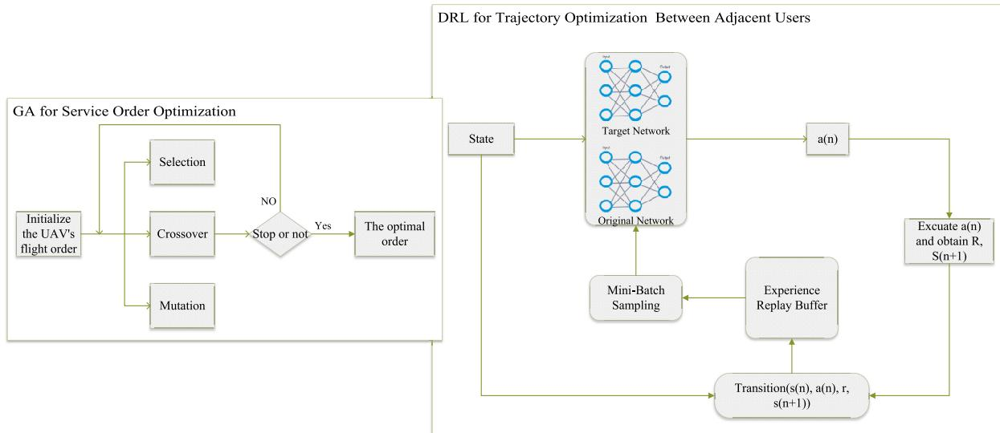  
Fig. 2. The proposed HGADRL algorithm framework.

$$
\mathbf q ( n + 1 ) = \mathbf q ( n ) + \Delta _ { d } \cdot \vec { \mathbf v } ,\tag{16}
$$

where $\Delta _ { d } = V _ { m a x } \cdot \Delta$ denotes the flight distance of the UAV per time slot, and in particular,

$$
\begin{array} { r } { x ( n + 1 ) = x ( n ) + \Delta _ { d } \cdot c o s ( \phi ) , } \end{array}\tag{17}
$$

$$
y ( n + 1 ) = y ( n ) + \Delta _ { d } \cdot s i n ( \phi ) ,\tag{18}
$$

in which $\phi$ denotes the horizontal direction angle of the UAV’s flight.

Specifically, ∆ should be sufficiently small to ensure negligible position changes of the cargo UAV within the n-th interval, and the cell association $c _ { n } .$ , the received signal power from the GBS $P _ { c _ { n } } ( n )$ , the signal-to-interference ratio $S I R ( n )$ and the communication outage probability $P _ { o u t } ( n )$ should remain constant. For a given threshold $\gamma _ { t h }$ and cell association strategy $c _ { n } , S I R ( n )$ can be rewritten as $S I R ( \mathbf { q } _ { n } , c _ { n } ; \tilde { h } )$ , and $\tilde { h }$ denotes the small-scale fading. Then define an indicator variable

$$
\begin{array} { r } { R ( \mathbf q _ { n } , c _ { n } ; \tilde { h } ) = \left\{ \begin{array} { l l } { 1 , } & { S I R ( \mathbf q _ { n } , c _ { n } ; \tilde { h } ) < \gamma _ { t h } ; } \\ { 0 , } & { S I R ( \mathbf q _ { n } , c _ { n } ; \tilde { h } ) \ge \gamma _ { t h } . } \end{array} \right. } \end{array}\tag{19}
$$

Thus, the communication outage probability can be rewritten as

$$
\begin{array} { r l } & { P _ { o u t } ( \mathbf { q } _ { n } , c _ { n } ) = P r \{ S I R ( \mathbf { q } _ { n } , c _ { n } ; \tilde { h } ) < \gamma _ { t h } \} } \\ & { \qquad = \mathbb { E } [ R ( \mathbf { q } _ { n } , c _ { n } ; \tilde { h } ) ] . } \end{array}\tag{20}
$$

As described in [46], to calculate the outage probability for the n-th time slot, it is essential to perform J measurements of SIR received by the UAV from each cell in a very short time within each slot. And this can be achieved using the existing reference signal received power (RSRP) and reference signal received quality (RSRQ) in practical applications. RSRP indicates the energy level of signals during wireless propagation and directly shows the power level of reference signals received by terminal devices. RSRQ, however, focuses on reflecting the signal quality, taking into account the relationship between signals, interference, and noise, and can effectively assess the availability and reliability of signals. The experimental outage probability $\hat { P } _ { o u t }$ can be approximated using statistical methods as

$$
\hat { P } _ { o u t } ( \mathbf { q } _ { n } , c _ { n } ) = \frac { 1 } { J } \sum _ { j = 1 } ^ { J } R _ { j } ( \mathbf { q } _ { n } , c _ { n } ; \tilde { h } ) ,\tag{21}
$$

where $R _ { j } ( \mathbf { q } _ { n } , c _ { n } ; \tilde { h } )$ denotes the result of the j-th SIR sampling measurement. According to the law of large numbers, the larger the J, the closer $\hat { P } _ { o u t }$ gets to $P _ { o u t }$

Based on the previous analysis, once the logistics service order of the cargo UAV is determined, the UAV’s total weight at each stage is fixed, which means the flight power at each stage remains constant. Consequently, $E _ { h o r }$ in (P3) is proportional to the flight time. To simplify calculations, (P3) can be given by

$$
\left( \mathbf { P 4 } \right) : \operatorname* { m a x } _ { \mathbf { q } _ { n } } \quad - N _ { t }\tag{22}
$$

$$
\mathrm { s . t . } \ \mathbf { q } _ { 0 } = L _ { w } , \mathbf { q } _ { N _ { t } } = L _ { w } ,
$$

$$
0 \leq x ( n ) \leq D , \forall n \in { \mathcal { N } } ,\tag{22a}
$$

$$
0 \leq y ( n ) \leq D , \forall n \in { \mathcal { N } } ,\tag{22b}
$$

(22c)

$$
0 \leq h ( n ) \leq H , \forall n \in { \mathcal { N } } ,\tag{22d}
$$

$$
\begin{array} { r } { \mathbf q _ { n } = L _ { u s e r } ^ { i } , \exists n \in \mathcal N , \forall i \in \mathcal { T } , } \end{array}\tag{22e}
$$

$$
\hat { P } _ { o u t } (  { \mathbf { q } } _ { n } , c _ { n } ; \tilde { h } ) < \gamma _ { d } ,
$$

$$
( 1 6 ) - ( 1 8 ) .\tag{22f}
$$

Algorithm 2 Dueling DDQN for Trajectory Design   
1: Initialize:the maximum number of episode E, the maxi  
mum number of steps $N _ { s t e p }$ per episode, the experience   
replay buffer B with capacity B, the size of the sampling   
mini-batch $D ,$ the outage probability $\gamma _ { d } ,$ the initial explo  
ration probability ϵ and its decaying rate α.   
2: Initialize:the reward for reaching the destination $R _ { e x }$ , the   
penalty for going out of bounds $P _ { e x } ,$ the penalty for the   
outage probability exceeding the threshold $P _ { F } ,$ and the   
distance tolerance for reaching the destination $D _ { e s }$   
3: Initialize:the evaluation network with parameters $\theta$ and   
the target network with parameters $\theta ^ { - }  \theta . \ \tau$ is the   
soft-update factor for the target network.   
4: for episode=1,2,. . . ,E do   
5: Initialize the sliding window W with capacity $N _ { 1 }$   
6: if E is divisible by 5 then   
7: Initialize the state $q _ { I }$ to the starting point.   
8: else   
9: Randomly generate initial location $q _ { I } \in S .$   
10: end if   
11: repeat   
12: Choose an action $a _ { n }$ according to the ϵ-greedy strat  
egy as in Eq. (24).   
13: Execute the action $a _ { n } ,$ obtain the immediate reward   
$r _ { n } ,$ and transition to the next state $s _ { n + 1 }$ and store   
the obtained experience data $( s _ { n } , a _ { n } , r _ { n } , s _ { n + 1 } )$ in the   
sliding window.   
14: $\mathbf { i f } \ \mathbf { n } { \geq } \ N _ { 1 }$ then   
15: Calculate the cumulative reward of $N _ { 1 }$ according   
to Eq. (25). Store $\left( s _ { n } , a _ { n } , r _ { n : n + N _ { 1 } } , s _ { n + N _ { 1 } } \right)$ in the   
experience replay buffer B.   
16: end if   
17: if $B \geq B _ { m i n }$ then   
18: Randomly sample a mini-batch D from the expe  
rience replay buffer B. Update the parameters $\theta$   
of the evaluation network $Q _ { w } ( s , a ; \theta )$ according to   
the gradient descent strategy for Eq. (26).   
19: Update the target network $Q _ { w ^ { - } } ( s , a ; \theta ^ { - } ) \colon$   
$\theta ^ { - } = \tau \theta ^ { - } + ( 1 - \tau ) \theta$   
20: end if   
21: Set the time step $n \gets n + 1$ , exploration probability   
$\epsilon  \alpha \epsilon .$   
22: until $| | q _ { n } - D e s | | < D _ { e s } \mathrm { o r } n = N _ { s t e p }$   
23: end for

In the complete Markov Decision Process (MDP), at each time step, the agent (i.e., the cargo UAV) observes a state from the environment, executes an action, receives an immediate reward from the environment, and transitions to the next state. Therefore, (P4) can be directly mapped to the MDP framework $\langle \mathcal { S } , \mathcal { A } , \mathcal { P } , \mathcal { R } \rangle$

1) State S: the state represents the UAV’s position $\mathbf { q } _ { n }$ , and the state space is defined as the set of all possible positions within the flyable area $S = \{ \mathbf { q } _ { n } = ( x _ { n } , y _ { n } , h _ { n } ) ; 0 \leq x _ { n } \leq$ $D , 0 \leq y _ { n } \leq D , 0 \leq h _ { n } \leq H \}$

2) Action $\mathcal { A } \mathrm { : }$ the action corresponds to the $\mathrm { U A V } \mathbf { \hat { s } }$ flight direction, and the action space is discretized into $N _ { a c }$ possible flight directions $\mathcal { A } = \{ \vec { \mathbf { v } } ^ { ( \mathrm { i } ) } , \vec { \mathbf { v } } ^ { ( 2 ) } , \ldots , \vec { \mathbf { v } } ^ { ( N _ { a c } ) } \}$

3) Probability $\mathcal { P } \colon$ the state transition probability concerning the flight strategy of the cargo UAV is defined by equation (15).

4) Reward $\mathcal { R } \mathrm { : }$ the reward function at each time step is calculated as

$$
\mathcal { R } = \left\{ \begin{array} { l l } { - 1 , } & { \hat { P } _ { o u t } ( \mathbf { q } _ { n } ) \leq \gamma _ { d } ; } \\ { - 1 - P _ { F } , } & { o t h e r w i s e , } \end{array} \right.\tag{23}
$$

where $P _ { F } ~ = ~ 5$ denotes the penalty incurred if the cargo UAV enters an area in which the communication outage probability exceeds the threshold $\gamma _ { d } .$ . When the cargo UAV reaches the corresponding destination at each stage, it receives an additional reward value $R _ { e x }$ , and if the UAV flies beyond the designated area, it causes an additional penalty $P _ { e x }$ . This reward function indicates that each additional step taken by the UAV before reaching its destination triggers a penalty of 1, which encourages the cargo UAV to avoid detours and reach destinations faster. Additionally, if the UAV flies into an area where the communication outage probability $P _ { o u t }$ exceeds the preset threshold $\gamma _ { d } ,$ , it receives an extra penalty $P _ { F }$ . This mechanism ensures the cargo UAV avoid regions with high outage probabilities, thereby safeguarding communication quality during mission execution.

After the problem is formulated as MDP, it can be addressed using any RL algorithm. In this paper, we employ the multi-step dueling DDQN algorithm, which incorporates two neural networks, namely a target network and an evaluation network. Both the two networks adopt the dueling architecture, a design that separates the value function into state value and advantage components, thereby enhancing the stability and convergence of the learning process. Additionally, both target network and evaluation network share the same parameters, ensuring consistency in value function representation while fulfilling distinct roles during training. This dualing network configuration [44] enables the algorithm to balance exploration and exploitation effectively, leveraging the target network for stable policy updates and the evaluation network for dynamic action-value estimation.

While optimizing UAV trajectories using multi-step learning, the UAV first acquires its current position from the environment as the state. Subsequently, the UAV selects an action based on the ϵ-greedy algorithm, a strategy that balances exploration and exploitation. Specifically, it selects a random action for exploration with probability ϵ and the optimal action for exploitation with probability $( 1 - \epsilon )$ . This strategy ensures the UAV can explore new paths and exploit known information for optimal decisions during optimization, which can be described as

$$
a = \left\{ \begin{array} { l l } { \underset { a \in \mathcal { A } } { \arg \operatorname* { m a x } } \ Q ( s , a ; \theta ) , } & { \mathrm { w i t h ~ p r o b a b i l i t y ~ } ( 1 - \epsilon ) ; } \\ { \mathrm { R a n d o m l y ~ s e l e c t e d ~ f r o m ~ } \mathcal { A } , } & { \mathrm { w i t h ~ p r o b a b i l i t y ~ } \epsilon , } \\ { \quad } & { \mathrm { ( 7 4 ) } } \end{array} \right.\tag{24}
$$

where $Q ( s , a ; \theta )$ is the action-value function, representing the expected future reward obtained by executing action a in state s. As exploration iterations increase, accumulated experience grows richer, and the planned trajectory progressively converges toward an optimal solution. Consequently, the initial exploration probability ϵ decays over time to reduce the frequency of random exploration. This decay follows a predefined rate α, but ϵ is constrained to remain above a minimum threshold $\gamma _ { e } ,$ ensuring residual exploration capability in the later stages of optimization. This dynamic adjustment enables the UAV to balance exploration and exploitation effectively, thereby enhancing the performance of trajectory optimization.

To implement multi-step learning, the agent adopts a sliding window to store the most recent $N _ { 1 }$ transitions and based on these transitions, the agent calculates the cumulative reward $R _ { n : n + N _ { 1 } }$ over the $N _ { 1 }$ steps preceding the current step, which is expressed as

$$
R _ { n : n + N _ { 1 } } = \sum _ { i = 0 } ^ { N _ { 1 } - 1 } \gamma ^ { i } R _ { n + i + 1 } ,\tag{25}
$$

where the discount factor $\gamma$ is taken to balance immediate and long-term rewards, with values closer to 1 prioritizing long-term gains. Transition data $\left( s _ { n } , a _ { n } , R _ { n : n + N _ { 1 } } , s _ { n + N _ { 1 } } \right)$ generated through agent-environment interactions are stored in a replay buffer with capacity B. During training, random minibatches D of size D are sampled from this buffer to update the evaluation network’s parameters, by minimizing the loss function through gradient descent and the loss function is defined as

$$
\begin{array} { r l } & { L o s s ( \theta ) = \mathbb { E } _ { ( s _ { n } , a _ { n } , R _ { n : n + N _ { 1 } } , s _ { n + N _ { 1 } } ) \sim \mathbf { D } } [ ( R _ { n : n + N _ { 1 } } } \\ & { \quad \quad \quad + \gamma ^ { N _ { 1 } } Q _ { w ^ { - } } ( s _ { n + N _ { 1 } } , a ^ { * } ; \theta ^ { - } ) - Q _ { w } ( s _ { n } , a _ { n } ; \theta ) ) ^ { 2 } ] , } \end{array}\tag{26}
$$

where

$$
a ^ { * } = \arg \operatorname* { m a x } _ { a \in \mathcal { A } } Q _ { w } ( s , a ; \theta ) ,\tag{27}
$$

and $Q _ { w } ( s , a ; \theta )$ is the evaluation network, while $Q _ { w ^ { - } } ( s , a ; \theta ^ { - } )$ stands for the target network, with both structured as dueling networks, as shown below

$$
\begin{array} { r } { Q ( s , a ; \theta , \psi , \zeta ) = V ( s ; \theta , \psi ) + A ( s , a ; \theta , \zeta ) } \\ { - \displaystyle \frac { 1 } { | A | } \sum _ { a \in \mathcal { A } } A ( s , a ; \theta , \zeta ) , } \end{array}\tag{28}
$$

where θ represents the shared component of the state and advantage networks, where $\psi$ and $\zeta$ denote their respective distinct components.

The pseudocode for optimizing UAV trajectories based on the multi-step dueling DDQN algorithm is demonstrated in Algorithm 2. During training, a pre-training phase inspired by [29] initializes the network parameters θ closer to the optimal policy, accelerating convergence. Each episode starts with a random position, followed by action selection via an ϵ- greedy strategy. After executing the action, the cargo UAV transitions to the next state, and the experience is stored. Cumulative rewards are computed and added to the experience replay buffer B. When the buffer reaches minimum capacity, a mini-batch is sampled, and network parameters are updated via gradient descent, refining the UAV’s trajectory planning.

In this work, we use GA and dueling DDQN to solve the problem of multi-point delivery and trajectory optimization for UAV. For GA, as mentioned earlier, the population size, the number of iterations, and the number of service points are denoted as P, G, and I, respectively, where I is a constant. Each generation requires fitness calculation, sorting and selection, sequential crossover, and mutation operations. The time complexity can be expressed as $O ( G \times ( P l o g P + P I ) )$ , which simplifies to $O ( G P l o g P )$ when I is a constant. The space complexity is O(PI). For D3QN, if the number of segments is $S ,$ the number of training epochs is $E ,$ and the maximum number of steps per epoch is $N _ { s t e p } .$ , with each forward/backward propagation of the neural network taking constant time $t _ { f }$ , the overall training time complexity is $O ( S \times E \times N _ { s t e p } \times t _ { f } )$ . The primary space overhead stems from the replay cache of size $B ,$ resulting in a space complexity of $O ( B )$ . Both algorithms demonstrate excellent practical usability.

## V. SIMULATION RESULTS

This section presents a systematic interpretation of the critical parameter configurations implemented in the simulation experiments, along with the design of benchmark comparative studies, which are followed by a comprehensive evaluation and comparative analysis of the proposed algorithm’s performance characteristics.

## A. Parameter Configuration

1) Antenna Configuration: The service area is geometrically modeled as a $L \times L = 3 \times 3 \ k m ^ { 2 }$ rectangular topological grid, within which 9 GBSs of 25 m height are uniformly deployed, each configured with a main lobe downtilt angle of $1 5 ^ { \circ }$ . In accordance with 3GPP TR 38.901 specifications, an 8- element directional uniform linear array (ULA) is vertically aligned at each GBS, while sector transmission power is standardized at 2 dB.

2) Urban Environment Modeling: Strictly adhering to ITU-R M.2412 guidelines [47], the ratio of building area to the total area of the distribution region, denoted as $\alpha ,$ is set to 0.32. The building density per unit area is determined to be 320, and regarding the building height, it conforms to a Rayleigh distribution with a variance of 50. Architectural geometries are represented using rectangular prism schematics, as illustrated in Fig. 3.

3) Genetic Algorithm and Neural Network Parameters: Hyperparameters for GA including population size $N _ { m a x } ,$ maximum iterations $G ,$ crossover probability $P _ { c } ,$ , and mutation rate $P _ { m }$ are optimized through parametric sensitivity analyses. As outlined in Algorithm 2, seven deep neural networks (DNNs) with dueling DDQN architecture are employed to optimize multi-phase UAV trajectory. Each DNN incorporates five hidden layers (512-256-128-128-9) and leverages the Adam optimizer for gradient-based parameter updates. Additional parameter specifications are systematically organized in a tabular format in Table III.

## B. Simulation Result Analysis

To validate the performance advantages of our proposed cooperative UAV trajectory planning scheme, we design five benchmark comparison schemes, the first three of which strictly adhere to the communication outage probability threshold constraints.

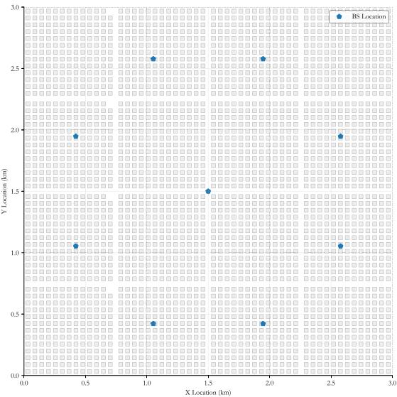  
Fig. 3. Architectural structures and BS deployment configuration.

TABLE III  
PARTIAL SIMULATION PARAMETERS
<table><tr><td rowspan=1 colspan=1>Simulation parameter</td><td rowspan=1 colspan=1>Value</td></tr><tr><td rowspan=1 colspan=1>The size of the area D</td><td rowspan=1 colspan=1>3km</td></tr><tr><td rowspan=1 colspan=1>The maximum flight speed of the $\overline { { \mathrm { U A V ~ } V _ { m } } }$ </td><td rowspan=1 colspan=1>30 m/s</td></tr><tr><td rowspan=1 colspan=1>The fuselage weight of the UAV $\overline { { W _ { \mathrm { u a v } } } }$ </td><td rowspan=1 colspan=1>30N</td></tr><tr><td rowspan=1 colspan=1>UAV Flight Altitude H</td><td rowspan=1 colspan=1>100 m</td></tr><tr><td rowspan=1 colspan=1>The population size $\overline { { N _ { m a x } } }$ </td><td rowspan=1 colspan=1>200</td></tr><tr><td rowspan=1 colspan=1>Maximum number of iterations of GA G</td><td rowspan=1 colspan=1>500</td></tr><tr><td rowspan=1 colspan=1>Maximum number of flight steps between any two points $\overline { { N _ { f } } }$ </td><td rowspan=1 colspan=1>200</td></tr><tr><td rowspan=1 colspan=1>Maximum number of training $\overline { { N _ { t } } }$ </td><td rowspan=1 colspan=1>2000</td></tr><tr><td rowspan=1 colspan=1>Discount factor γ</td><td rowspan=1 colspan=1>1</td></tr><tr><td rowspan=1 colspan=1>Action Space $\overline { { \mathrm { S i z e } N _ { a c } } }$ </td><td rowspan=1 colspan=1>8</td></tr><tr><td rowspan=1 colspan=1>Time step length $\overline { { \Delta t } }$ </td><td rowspan=1 colspan=1>0.5 s</td></tr><tr><td rowspan=1 colspan=1>Reward for reaching destination $\overline { { R _ { \mathrm { r d } } } }$ </td><td rowspan=1 colspan=1>300</td></tr><tr><td rowspan=1 colspan=1>Outbound penalty $\overline { { R _ { \mathrm { 0 b } } } }$ </td><td rowspan=1 colspan=1>-500</td></tr><tr><td rowspan=1 colspan=1>The number of signal measurements after a new state J</td><td rowspan=1 colspan=1>1000</td></tr><tr><td rowspan=1 colspan=1>Neural coefficient updating frequency of target network $\overline { { F } }$ </td><td rowspan=1 colspan=1>5</td></tr></table>

1) Distance-Optimized Dueling Double Deep Q-Network Scheme (D3QN-Dist): First, use GA to obtain the service sequence with the shortest UAV flight distance, and then use dueling DDQN algorithm to obtain the flight trajectory for each stage.

2) Energy-Oriented RRT Optimization Scheme (RRT-Energy): A multi-stage optimization paradigm is adopted, combining bio-inspired scheduling optimization with RRT. In the initial stage, consistent with the algorithm proposed in this paper, GA is used to determine the service order of the UAVs to minimize total energy consumption. At the same time, the RRT algorithm is used to obtain the flight trajectory of the UAVs.

3) Distance-Driven RRT Optimization Scheme (RRT-Dist): This scheme similarly leverages GA to determine the most distance-efficient delivery sequence through the total distance minimization. It then employs an RRT-based navigational strategy that systematically constructs obstacle matrices to capture regions with inadequate GBS coverage ratios, generating collision-free flight paths through probabilistic spatial sampling and connectivity validation governed by predefined coverage threshold constraints.

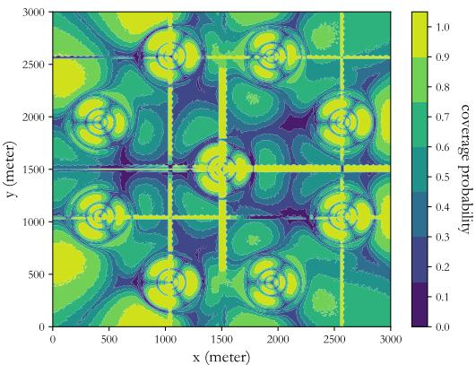  
Fig. 4. Coverage probability distribution map.

4) Energy-Oriented Straight Line Scheme (Line-Energy): GA is utilized to obtain the service sequence that minimizes the cargo UAV’s energy consumption. In the flight trajectory optimization stage, the cargo UAV flies in a straight line between adjacent service points.

5) Energy-Oriented Dueling Double Deep Q-Network With $S o f t  – P _ { o u t }$ Scheme (HGADRL-Soft): This scheme uses GA to obtain an energy-efficient service sequence. When using dueling DDQN to obtain flight trajectories, the outage probability is used as a soft target, i.e., the reward function is $\mathcal { R } = - 1 - \mu P _ { o u t }$ . According to [24], $\mu$ is the weighting factor for energy consumption and communication quality. The larger $\mu$ is, the more the flight trajectory focuses on communication quality. Here, $\mu$ is set to 10.

Fig. 4 shows the 2D radio map in urban UAV communication environments, from which we can observe that there are obvious strip-shaped areas of low coverage between adjacent base stations. This is caused by sidelobe interference generated by non-associated GBSs, resulting in total interference power reaching a level sufficient to degrade the quality of the main lobe signal and significantly reduce coverage probability.

Fig. 5 elucidates the sliding average of the cumulative reward value during UAV flight trajectory training using the dueling DDQN algorithm and as shown in which, the cumulative reward remains low in the initial training phase, attributable to the agent’s nascent environmental cognition and stochastically initialized Q-network parameters that inadequately capture the complex dependencies between the cargo UAV’s flight actions, energy consumption and communication quality. As training progresses, the Q-network continuously updates parameters through the experience replay mechanism, gradually establishing an accurate state-action value evaluation model. This enables the UAV to select optimal actions for energy consumption control, ultimately achieving stable convergence of cumulative rewards. The proportion of dueling DDQN-trained UAV flight trajectories exhibiting coverage probabilities exceeding the preset threshold is demonstrated in Fig. 6. The blue curve represents the proportion of times the UAV learned feasible trajectories without exceeding the outage probability threshold in the latest 200 episodes and the orange curve indicates the ratio of the number of times the UAV learned feasible trajectories without exceeding the outage probability threshold to the total number of times it learned trajectories in the latest 200 episodes. Initially, the UAV had a low success rate in learning ideal trajectories, but as training episodes increase, the success rates of both two curves rise significantly and eventually stabilize. What’s more, the orange curve gradually converges with the blue one, showing that in the late training stage, the UAV could always learn feasible flight trajectories.

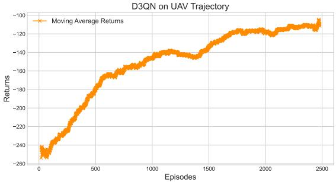  
Fig. 5. Moving-averaged reward return curve.

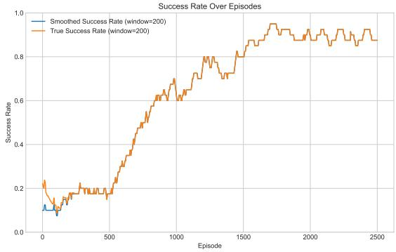  
Fig. 6. Success rate over episodes.

As shown in Fig. 7, the UAV flight trajectories, which are generated under different communication outage probability thresholds and with a focus on minimizing total system energy consumption, are presented. Moving from left to right, as the outage probability threshold decreases from 0.8 to 0.65, the UAV’s allowable flight area gradually shrinks, yet the proposed algorithm consistently optimizes feasible flight trajectories. In particular, when the outage probability threshold γ is lowered to 0.7, it can be clearly observed that the UAV’s trajectory between Pick-up point 2 and Pick-up point 1 undergoes a significant change, with the UAV opting to take a detour along a longer path to avoid the appearance of outage. To validate the proposed algorithm’s reliability under varying outage thresholds, Fig. 8 shows the real-time communication outage probability during UAV flight, which shows that the trained trajectories strictly satisfy the preset outage probability requirements. Notably, even when the threshold is set to 0.65, the proposed algorithm maintains communication outage probability within the required range through refined trajectory optimization, fully verifying the robustness and reliability of the dueling DDQN-based path planning scheme.

The flight trajectories of four different schemes with a communication outage threshold of 0.8 are depicted in Fig. 9, from which it can be clearly observed that the delivery sequence obtained by the distance-oriented scheme and that obtained by the energy-aware scheme exhibit significant differences. The distance-oriented scheme, aiming to avoid redundant paths, initially directs the UAV to Pick-up point 1, whils the energy-aware scheme opts to first unload the packages before performing pick-ups, a strategy dictated by its focus on optimizing energy efficiency. Given that the UAV’s energy consumption is directly proportional to its load weight, the “delivery-first, pickup-later” scheme is adopted to prevent the increased energy consumption that would result from carrying more packages. In addition, it can be observed that, compared to the flight trajectory optimized by the dueling DDQN algorithm, that optimized by the RRT algorithm is more circuitous and is characterized by a longer total flight distance of the cargo UAV, and this is because RRT algorithm randomly searches for paths within the flyable area without considering the total path cost, whereas the dueling DDQN algorithm can balance flight path and total cost. The energy consumption of the different schemes under different outage thresholds is plotted in Fig. 10, from which it can be seen that, regardless of the thresholds, the total energy consumption consumed by the energy-based delivery sequence is always less than that of the distance-based scheme, where the total energy consumption for obtaining the trajectory of the UAV using the dueling DDQN is always less than that using the RRT algorithm. Additionally, the total energy consumption consumed by the four schemes shows a decreasing trend as the threshold value keeps increasing, this is because, the increase in the threshold value of the outage probability means that the flyable area of the UAV becomes larger, and the UAV flie shorter distances to complete the flight tasks. Numerical result show that for the average energy saving rate at each threshold, D3QN-Energy saves about 19.7% on average compared to RRT-Energy and about 33.2% compared to D3QN-Distance. It can be seen that D3QN-Energy trained with the energy minimization objective not only significantly outperforms the distance-based or RRT-based schemes at each threshold, but also demonstrates more than 20%-30% energy savings on the overall average, proving its effectiveness and robustness in energy-efficient delivery scenarios.

Moreover, Table IV lists the total flight distances of the cargo UAV under different delivery schemes and when optimized by different algorithms. Quantitative analysis reveals that energy-aware schemes consistently result in longer total flight distances than distance-oriented configurations, as they intentionally increase flight distance to balance energy consumption due to payload weight. Furthermore, across all outage thresholds, dueling DDQN achieves shorter total flight distances than RRT. This stems from the fact that the RRT algorithm finds a feasible path from the flyable region while dueling DDQN not only effectively avoids high-risk zones but also identifies the shortest feasible paths within permissible regions.

Fig. 11 shows the flight trajectories of HGADRL, HGADRT-soft, RRT, and Straight Line under different outage thresholds in an energy-efficient delivery sequence. As shown in the Fig. 11, no matter what the algorithm is, as the outage threshold decreases, the flight trajectories become more circuitous. This is because a lower outage probability threshold reduces the available flight area for the cargo UAV, forcing it to travel longer distances to avoid regions with high outage probabilities. Regardless of the outage probability threshold, the trajectories obtained by the RRT algorithm are more circuitous. This is because the RRT algorithm searches for feasible flight trajectories using an obstacle matrix without considering the UAV’s excess energy consumption. The Straight Line algorithm yields the shortest flight distance because the straightline-based scheme does not consider the connectivity between the UAV and the GBSs, i.e., $\mu = 0 .$ . It can be observed from

  
(a)

  
(b)

  
(c)

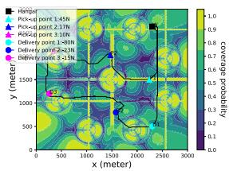  
(d)

Fig. 7. Energy-Based UAV Flight Trajectories under Different Outage Thresholds. (a) $\gamma _ { d } = 0 . 8 .$ (b) $\gamma _ { d } = 0 . 7 5 .$ (c) $\gamma _ { d } = 0 . 7 .$ (d) $\gamma _ { d } = 0 . 6 5 .$  
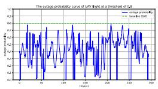

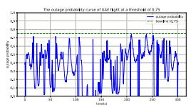  
(a)  
(b)

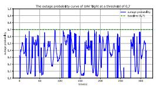  
(c)

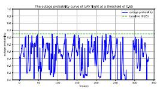  
(d)

Fig. 8. Energy consumption-based real-time outage probability curve for UAV flight under different thresholds. (a) $\gamma _ { d } = 0 . 8 .$ (b) $\gamma _ { d } = 0 . 7 5 .$ (c) $\gamma _ { d } = 0 . 7$ (d) $\gamma _ { d } = 0 . 6 5 .$  
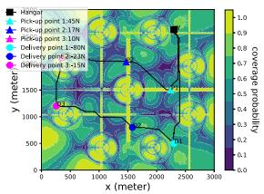  
(a)

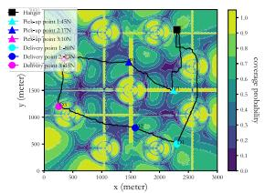  
(b)

  
(c)

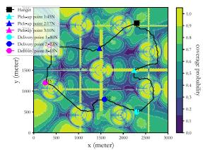  
(d)

Fig. 9. The flight trajectories of different schemes at a threshold of 0.8. (a) HGADRL. (b) RRT-Energy. (c) D3QN-Dist. (d) RRT-Dist.  
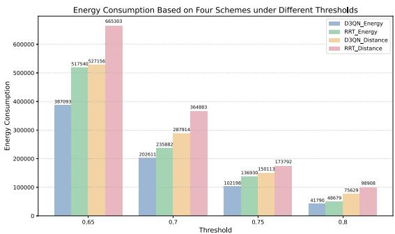

TOTAL UAV FLIGHT DISTANCE WITH DIFFERENT ALGORITHMSAND THRESHOLDS UNDER VARIOUS SCHEMES  
TABLE IV
<table><tr><td rowspan=2 colspan=1>Threshold</td><td rowspan=1 colspan=2>Distance-Based</td><td rowspan=1 colspan=2>Energry-Based</td></tr><tr><td rowspan=1 colspan=1>D3QN</td><td rowspan=1 colspan=1>RRT</td><td rowspan=1 colspan=1>D3QN</td><td rowspan=1 colspan=1>RRT</td></tr><tr><td rowspan=1 colspan=1>0.65</td><td rowspan=1 colspan=1>8835.0</td><td rowspan=1 colspan=1>11850</td><td rowspan=1 colspan=1>10110.0</td><td rowspan=1 colspan=1>14835</td></tr><tr><td rowspan=1 colspan=1>0.70</td><td rowspan=1 colspan=1>8040.0</td><td rowspan=1 colspan=1>10140</td><td rowspan=1 colspan=1>9435.0</td><td rowspan=1 colspan=1>11085</td></tr><tr><td rowspan=1 colspan=1>0.75</td><td rowspan=1 colspan=1>7815.0</td><td rowspan=1 colspan=1>9135</td><td rowspan=1 colspan=1>9060.0</td><td rowspan=1 colspan=1>12780</td></tr><tr><td rowspan=1 colspan=1>0.80</td><td rowspan=1 colspan=1>7725.0</td><td rowspan=1 colspan=1>9615</td><td rowspan=1 colspan=1>8835.0</td><td rowspan=1 colspan=1>9600</td></tr></table>

Fig. 10. Energy consumption based on four schemes under different thresholds.

Fig. 11 that regardless of the threshold value, the straight-line trajectory always passes through regions where the outage probability exceeds the threshold. The HGADRL-soft scheme treats the outage probability as a soft target, balancing communication quality and energy consumption like the HGADRL scheme. Fig. 12 shows the real-time outage probability of the HGADRL-soft scheme at different outage thresholds. It can be seen that only when the threshold is 0.8 does the flight trajectory obtained by HGADRL-soft meet the outage threshold requirement. As the outage probability threshold decreases, although both HGADRL and HGADRL-soft can simultaneously balance energy consumption and communication quality, the HGADRL-soft scheme still experiences regions with outage probabilities exceeding thresholds at certain times. Therefore, the communication quality of the HGADRL-soft scheme cannot be guaranteed at all times.

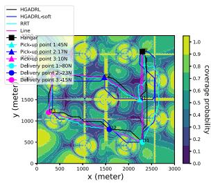  
(a)

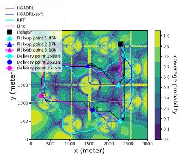  
(b)

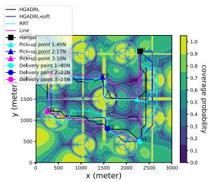  
(c)

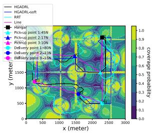  
(d)

Fig. 11. Energy-based different UAV flight trajectories under different outage thresholds. (a) $\gamma _ { d } = 0 . 8 .$ (b) $\gamma _ { d } = 0 . 7 5 .$ (c) $\gamma _ { d } = 0 . 7 .$ (d) $\gamma _ { d } = 0 . 6 5 .$  
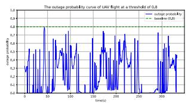  
(a)

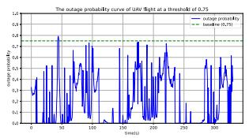  
(b)

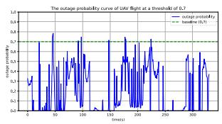  
(c)

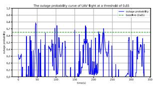  
(d)  
Fig. 12. Energy consumption-based real-time outage probability curve for HGADRL-soft under different thresholds. (a) $\gamma _ { d } ~ = ~ 0 . 8 .$ (b) $\gamma _ { d } ~ = ~ 0 . 7 5$ (c) $\gamma _ { d } = 0 . 7 .$ . (d) $\gamma _ { d } = 0 . 6 5$

## VI. CONCLUSION

In this paper, we considered a cellular-connected cargo UAV system for a designated area, where we minimized cargo UAV’s energy consumption during missions while ensuring GBS coverage probability exceeds set thresholds. To address this, we proposed a two-phase HGADRL approach consisting of service sequence optimization and UAV trajectory design. First, genetic algorithm determined the service sequence, and then, grounded in the established sequence, a multistep dueling DDQN algorithm was utilized to obtain the optimal flight trajectory for the UAV. Extensive experiments shows our two-phase HGADRL framework is superior for optimizing energy consumption while maintaining good GBS connectivity. However, our assumptions about the cargo UAV’s capacity and battery payload meeting all user needs, and its flight altitude always exceeding actual ground buildings, are unrealistic for practical applications. Thus, future research could focus on three-dimensional UAV flight spaces and capacity constraints.

## REFERENCES

[1] W. Yuan et al., “From ground to sky: Architectures, applications, and challenges shaping low-altitude wireless networks,” 2025, arXiv:2506.12308.

[2] S. Rajendran and J. Zack, “Insights on strategic air taxi network infrastructure locations using an iterative constrained clustering approach,” Transp. Res. E, Logistics Transp. Rev., vol. 128, pp. 470–505, Aug. 2019.

[3] M. Moshref-Javadi and M. Winkenbach, “Applications and research avenues for drone-based models in logistics: A classification and review,” Expert Syst. Appl., vol. 177, Sep. 2021, Art. no. 114854.

[4] Y. Zeng, J. Lyu, and R. Zhang, “Cellular-connected UAV: Potential, challenges, and promising technologies,” IEEE Wireless Commun., vol. 26, no. 1, pp. 120–127, Feb. 2019.

[5] M. McFarland. (Jul. 2019). Amazon Makes Its First Drone Delivery in the U.K. [Online]. Available: https://money.cnn.com/2016/12/ 14/technology/amazon-drone-delivery/index.html

[6] L. Cao. (Nov. 2016). JD.com’s Drone Delivery Program Takes Flight in Rural China. [Online]. Available: https://jdcorporateblog.com/jd-comsdrone-delivery-program-takes-flight-in-rural-china/

[7] I. Singh. (Nov. 2021). Zipline to Bring Backyard Drone Deliveries to Salt Lake City. [Online]. Available: https://dronedj.com/2021/11/11/ziplinedrone-delivery-salt-lake-city-utah

[8] J. Wang et al., “Generative AI for integrated sensing and communication: Insights from the physical layer perspective,” IEEE Wireless Commun., vol. 31, no. 5, pp. 246–255, Oct. 2024.

[9] Y. Chen, D. Yang, L. Xiao, F. Wu, and Y. Xu, “Optimal trajectory design for unmanned aerial vehicle cargo pickup and delivery system based on radio map,” IEEE Trans. Veh. Technol., vol. 73, no. 8, pp. 11706–11718, Aug. 2024.

[10] M. Patchou, B. Sliwa, and C. Wietfeld, “Flying robots for safe and efficient parcel delivery within the COVID-19 pandemic,” in Proc. IEEE Int. Syst. Conf. (SysCon), Vancouver, BC, Canada, Apr. 2021, pp. 1–7.

[11] N. Cherif, W. Jaafar, H. Yanikomeroglu, and A. Yongacoglu, “Disconnectivity-aware energy-efficient cargo-UAV trajectory planning with minimum handoffs,” in Proc. IEEE Int. Conf. Commun., Jun. 2021, pp. 1–6.

[12] W. Wen, K. Luo, L. Liu, Y. Zhang, and Y. Jia, “Joint trajectory and pick-up design for UAV-assisted item delivery under no-fly zone constraints,” IEEE Trans. Veh. Technol., vol. 72, no. 2, pp. 2587–2592, Feb. 2023.

[13] Y. Xing, C. Carlson, and H. Yuan, “Optimize path planning for UAV COVID-19 test kits delivery system by hybrid reinforcement learning,” in Proc. IEEE 12th Annu. Comput. Commun. Workshop Conf. (CCWC), Jan. 2022, pp. 0177–0183.

[14] B. Liu, W. Ni, R. P. Liu, Y. J. Guo, and H. Zhu, “Optimal routing of unmanned aerial vehicle for joint goods delivery and in-situ sensing,” IEEE Trans. Intell. Transp. Syst., vol. 24, no. 3, pp. 3594–3599, Mar. 2023.

[15] K. Dorling, J. Heinrichs, G. G. Messier, and S. Magierowski, “Vehicle routing problems for drone delivery,” IEEE Trans. Syst. Man, Cybern. Syst., vol. 47, no. 1, pp. 70–85, Jan. 2017.

[16] V. Yadav and A. Narasimhamurthy, “A heuristics based approach for optimizing delivery schedule of an unmanned aerial vehicle (drone) based delivery system,” in Proc. 9th Int. Conf. Adv. Pattern Recognit. (ICAPR), Dec. 2017, pp. 1–6.

[17] B. Liu, W. Ni, and H. Zhu, “Optimal charging scheduling and speed control for delay-bounded drone delivery,” IEEE Trans. Veh. Technol., vol. 73, no. 11, pp. 16481–16490, Nov. 2024.

[18] G. Wu, N. Mao, Q. Luo, B. Xu, J. Shi, and P. N. Suganthan, “Collaborative truck-drone routing for contactless parcel delivery during the epidemic,” IEEE Trans. Intell. Transp. Syst., vol. 23, no. 12, pp. 25077–25091, Dec. 2022.

[19] D. Wang, P. Hu, J. Du, P. Zhou, T. Deng, and M. Hu, “Routing and scheduling for hybrid truck-drone collaborative parcel delivery with independent and truck-carried drones,” IEEE Internet Things J., vol. 6, no. 6, pp. 10483–10495, Dec. 2019.

[20] S. Sawadsitang, D. Niyato, P.-S. Tan, and P. Wang, “Joint ground and aerial package delivery services: A stochastic optimization approach,” IEEE Trans. Intell. Transp. Syst., vol. 20, no. 6, pp. 2241–2254, Jun. 2019.

[21] B. Duo, A. Kong, Q. Wu, X. Yuan, and Y. Li, “Joint path and pick-up design for connectivity-aware UAV-enabled multi-package delivery,” IEEE Trans. Intell. Transp. Syst., vol. 25, no. 12, pp. 20017–20031, Dec. 2024.

[22] J. Cao et al., “Trajectory optimization and pick-up and delivery sequence design for cellular-connected cargo AAVs,” IEEE Trans. Mobile Comput., vol. 24, no. 3, pp. 1402–1416, Mar. 2025.

[23] D. N. Das, R. Sewani, J. Wang, and M. K. Tiwari, “Synchronized truck and drone routing in package delivery logistics,” IEEE Trans. Intell. Transp. Syst., vol. 22, no. 9, pp. 5772–5782, Sep. 2021.

[24] H. Peng, J. Cao, D. Yang, C. Li, T. H. Luan, and Z. Su, “Balancing energy efficiency and communication quality in UAV cargo delivery systems,” IEEE Internet Things J., vol. 12, no. 16, pp. 34019–34034, Aug. 2025.

[25] S. Zhang, Y. Zeng, and R. Zhang, “Cellular-enabled UAV communication: A connectivity-constrained trajectory optimization perspective,” IEEE Trans. Commun., vol. 67, no. 3, pp. 2580–2604, Mar. 2019.

[26] W. Zhang, Q. Wang, X. Liu, Y. Liu, and Y. Chen, “Three-dimension trajectory design for multi-UAV wireless network with deep reinforcement learning,” IEEE Trans. Veh. Technol., vol. 70, no. 1, pp. 600–612, Jan. 2021.

[27] Y. Zeng, Q. Wu, and R. Zhang, “Accessing from the sky: A tutorial on UAV communications for 5G and beyond,” Proc. IEEE, vol. 107, no. 12, pp. 2327–2375, Dec. 2019.

[28] Y. Zeng and X. Xu, “Toward environment-aware 6G communications via channel knowledge map,” IEEE Wireless Commun., vol. 28, no. 3, pp. 84–91, Jun. 2021.

[29] Y. Zeng, X. Xu, S. Jin, and R. Zhang, “Simultaneous navigation and radio mapping for cellular-connected UAV with deep reinforcement learning,” IEEE Trans. Wireless Commun., vol. 20, no. 7, pp. 4205–4220, Jul. 2021.

[30] J. Chen and D. Gesbert, “Efficient local map search algorithms for the placement of flying relays,” IEEE Trans. Wireless Commun., vol. 19, no. 2, pp. 1305–1319, Feb. 2020.

[31] H. Xie, D. Yang, L. Xiao, and J. Lyu, “Connectivity-aware 3D UAV path design with deep reinforcement learning,” IEEE Trans. Veh. Technol., vol. 70, no. 12, pp. 13022–13034, Dec. 2021.

[32] J. Cao, L. Xiao, D. Yang, and F. Wu, “Energy consumption and communication quality tradeoff for logistics UAVs: A hybrid deep reinforcement learning approach,” in Proc. IEEE Wireless Commun. Netw. Conf. (WCNC), Mar. 2023, pp. 1–6.

[33] K. K. Nguyen, T. Q. Duong, T. Do-Duy, H. Claussen, and L. Hanzo, “3D UAV trajectory and data collection optimisation via deep reinforcement learning,” IEEE Trans. Commun., vol. 70, no. 4, pp. 2358–2371, Apr. 2022.

[34] Z. Ma et al., “Deep reinforcement learning for energy efficiency maximization in RSMA-IRS-assisted ISAC system,” IEEE Trans. Veh. Technol., pp. 1–6, Jun. 2025.

[35] G. Sun et al., “Aerial reliable collaborative communications for terrestrial mobile users via evolutionary multi-objective deep reinforcement learning,” IEEE Trans. Mobile Comput., vol. 24, no. 7, pp. 5731–5748, Jul. 2025.

[36] V. V. Díaz and D. M. Aviles, “A path loss simulator for the 3GPP 5G channel models,” in Proc. IEEE 25th Int. Conf. Electron. Elect. Eng. Comput. (INTERCON), 2018, pp. 1–4.

[37] Y. Gao, L. Xiao, F. Wu, D. Yang, and Z. Sun, “Cellular-connected UAV trajectory design with connectivity constraint: A deep reinforcement learning approach,” IEEE Trans. Green Commun. Netw., vol. 5, no. 3, pp. 1369–1380, Sep. 2021.

[38] Y. Zeng, J. Xu, and R. Zhang, “Energy minimization for wireless communication with rotary-wing UAV,” IEEE Trans. Wireless Commun., vol. 18, no. 4, pp. 2329–2345, Apr. 2019.

[39] Y. Xu, T. Zhang, Y. Liu, D. Yang, L. Xiao, and M. Tao, “UAV-assisted MEC networks with aerial and ground cooperation,” IEEE Trans. Wireless Commun., vol. 20, no. 12, pp. 7712–7727, Dec. 2021.

[40] L. Santoro, A. Albanese, M. Canova, M. Rossa, D. Fontanelli, and D. Brunelli, “A plug-and-play TinyML-based vision system for drone automatic landing,” in Proc. IEEE Int. Workshop Metrol. Ind. 4.0 IoT, Jun. 2023, pp. 293–298.

[41] A. Meng, X. Gao, Y. Zhao, and Z. Yang, “Three-dimensional trajectory optimization for energy-constrained UAV-enabled IoT system in probabilistic LoS channel,” IEEE Internet Things J., vol. 9, no. 2, pp. 1109–1121, Jan. 2022.

[42] H. N. Palit, I. Sugiarto, D. Prayogo, and A. T. K. Pratomo, “Performance analysis of a parallel genetic algorithm: A case study of the traveling salesman problem,” in Proc. 1st Int. Conf. Inf. Syst. Inf. Technol. (ICISIT), Jul. 2022, pp. 330–335.

[43] H. Bayerlein, M. Theile, M. Caccamo, and D. Gesbert, “UAV path planning for wireless data harvesting: A deep reinforcement learning approach,” in Proc. IEEE Global Commun. Conf. (GLOBECOM), Dec. 2020, pp. 1–6.

[44] H. V. Hasselt, A. Guez, and D. Silver, “Deep reinforcement learning with double Q-learning,” in Proc. 30th Conf. Artif. Intell. (AAAI), Mar. 2016, pp. 2094–2100.

[45] R. S. Sutton and A. G. Barto, Reinforcement Learning: An Introduction. Cambridge, MA, USA: MIT Press, 2018.

[46] M. T. Dabiri, M. Rezaee, V. Yazdanian, B. Maham, W. Saad, and C. S. Hong, “3D channel characterization and performance analysis of UAV-assisted millimeter wave links,” IEEE Trans. Wireless Commun., vol. 20, no. 1, pp. 110–125, Jan. 2021.

[47] Propagation Data and Prediction Methods Required for the Design of Terrestrial Broadband Radio Access Systems Operating in a Frequency Range From 3 to 60 GHz, document ITU-R, Rec. P.1410-5, Radiowave Propag., Feb. 2012.

  
Guoguo Huang was born in Henan, China. She received the B.S. degree from Tiangong University, Tianjin, China, in 2024. She is currently pursuing the M.S. degree with the College of Computer Science and Electronic Engineering, Hunan University, Changsha, China. Her current research interests include the UAV communications and machine learning.

Jiangling Cao received the M.S. degree in communication engineering from Nanchang University, Nanchang, China, in 2024. His research interests include UAV communications, machine learning, and intelligent transportation systems.

Liang Yang (Senior Member, IEEE) was born in Hunan, China. He received the Ph.D. degree in electrical engineering from Sun Yat-sen University, Guangzhou, China, in 2006. From 2006 to 2013, he was a Teacher with Jinan University, Guangzhou. In 2013, he joined Guangdong University of Technology, Guangzhou. He is currently a Professor with Hunan University, Changsha, China. His current research interests include the performance analysis of wireless communications systems.

Shenghai Chen was born in Hunan, China. He received the Ph.D. degree from the College of Computer Science and Electronic Engineering, Hunan University, Hunan, in 2024. He is currently with the Key Laboratory of Intelligent Control Technology for Wuling-Mountain Ecological Agriculture, Hunan, and the School of Electrical and Information Engineering, Huaihua University, China. His current research interests include wireless communication and optical wireless communication and sensing in ecological agriculture.