# Joint Optimization of Trajectory and User Association via Reinforcement Learning for UAV-Aided Data Collection in Wireless Networks

Gong Chen , Graduate Student Member, IEEE, Xiangping Bryce Zhai , Member, IEEE, and Congduan Li , Member, IEEE

Abstract— Unmanned Aerial Vehicles (UAVs) can be used as aerial base stations for data collection in next-generation wireless networks due to their high adaptability and maneuverability. This paper investigates the scenario where multiple UAVs cooperatively fly over heterogeneous ground users (GUs) and collect data without a central controller. With the consideration of signal-to-interference-and-noise ratio (SINR) and fairness among users, we jointly optimize the trajectories of UAVs and the GUs associations to maximize the total throughput and energy efficiency. We formulate the long-term optimization problem as a decentralized partially observed Markov decision processes (DEC-POMDP) and derive an approach combining the coalition formation game (CFG) and multi-agent deep reinforcement learning (MADRL). We first formulate the discrete association scheduling problem as a non-cooperative theoretical game and use the CFG algorithm to achieve a decentralized scheme converging to Nash equilibrium (NE). Then, a MARLbased technique is developed to optimize the trajectories and energy consumption continuously in a centralized-training but decentralized-execution manner. Simulation results demonstrate that the proposed algorithm outperforms the commonly used schemes in the literature, regarding the fair throughput and energy consumption in a distributed manner.

Index Terms— UAV trajectory design, fair throughputs, energy-efficiency, coalition formation games, multi-agent deep reinforcement learning.

## I. INTRODUCTION

BENEFITING from the rapid maturation of wireless com-munication technologies, numerous ground users (GUs) munication technologies, numerous ground users (GUs) can form a wireless network platform for many applications, such as transportation, industrial automation, disaster detection, etc. [1], which have drawn increasing attention from both academia and industry. However, these GUs often have limited insistent energy supply and finite data buffer [2] and consequently need to transmit sensory data to the control center for further processing. In addition, in many complex environments, e.g., in remote or mountain areas, it is impractical for GUs to build data links with fixed base stations (BSs) due to severe blocking or transmission failures. Due to the high mobility, adaptability, and low cost, unmanned aerial vehicles (UAVs) provide an effective solution to the data collection problem in wireless networks by serving as aerial base stations, which can build a higher chance of line-of-sight (LoS) links and extend communication coverage.

Contrary to typical terrestrial BSs communications systems, which are deployed at fixed locations, UAVs can fly toward GUs to improve the quality of service (QoS) [3], [4] and cooperation between multiple UAVs can rapidly increase the data collection efficiency [5], [6]. One fundamental challenge is the design of multiple UAVs’ trajectories and the association of GUs. Since arbitrarily distributed GUs may suffer severe interference from other co-channel and adjacent counterparts [6], the trajectories of multiple cooperative UAVs need to be meticulously designed for interference management to avoid potential collisions [7] and to improve the system’s fair performance so that no GU suffers from low throughput all the time. Besides, each GU independently chooses a UAV to transmit data, which will have a direct impact on the network transmission rate. If too many GUs simultaneously make the same decision, the transmission rate of the system will be significantly reduced due to serious interference and link congestion. Additionally, GUs will not share scheduling information to ensure the data security, avoid ancillary time, and reduce spectrum costs [8]. To solve these issues, it would be worthwhile to exploit reasonable and decentralized strategies to jointly optimize the GUs association and multiple UAVs’ trajectories.

## A. Related Works

Many existing works have studied the joint design of UAV trajectory and user association in UAV-assisted communication. For instance, the work [9] conceived an innovative energy-efficient scheme for a UAV-aided millimeterwave network with non-orthogonal multiple access (NOMA). They solved this complicated problem by optimizing the UAV placement, hybrid precoding, and power allocation with substantial mathematical derivations. In [10], the authors jointly optimized the UAV trajectory and time schedule to ensure the security of UAV-relayed wireless networks through a novel iterative mechanism. Similarly, [11] maximized the sum rate in a UAV-assisted NOMA system with optimal UAV trajectory and NOMA precoding. Besides, in [12], the authors investigated an inventive solar-powered UAV system for sustainable and power-efficient communication. The authors sought to maximize the system’s total throughput by jointly optimizing the 3D UAV trajectory and resource allocation with off-line and on-line schemes. However, in such a system, multi-UAVs should be considered for higher efficiency. References [9], [10], [11], [12], [13] formulated resource allocation and trajectory design issues as a mixed-integer non-linear problem (MINLP) and applied a successive convex approximate method to get some sub-optimal solutions. Although these works were feasible in given scenarios, they essentially reconstruct the original non-convex problem to a convex one at the price of precision. Besides, these approaches in [9], [10], [11], [13], and [12] need to calculate optimization issues again when the environment changes. Moreover, conventional optimization problems require global information to find the universal optimal solutions, which may cause privacy data leakage and is impractical.

Recently, deep reinforcement learning (DRL) has been widely used in UAV-aided wireless communications, which models the problem as a Markov decision process (MDP) in a trial-and-error manner. In [14], the authors exploited deep Q-learning (DQN) to obtain the optimal UAV route for energy-efficient data collection in a wireless charging scenario. A deep deterministic policy gradient (DDPG) algorithm was leveraged in [15] and [16] to continuously control the UAV and outperformed the commonly used baselines in throughput maximization and energy consumption reduction. In the scenario with a large area, data collection efficiency with a single UAV fails to meet expectations. Multi-agent reinforcement learning (MARL) is an extension of single RL to multi-agent environments, which can provide a distributed perspective to address the decision-making problem and has been widely used in diverse multi-UAVs wireless communication scenarios. For instance, a hierarchical learning approach is exploited in [17] for multiple UAVs in backscatter communication to minimize the total flight time. In [5], a multi-agent deep deterministic policy gradient (MADDPG) was leveraged to maximize the total throughput with limited energy constraint. Peng et al. in [18] maximized the number of offloaded tasks while satisfying the QoS requirements by using a MADDPGbased method.

Furthermore, there are few in-depth studies on the association between multiple UAVs and multiple users in most existing works in the literature. Classical DRL methods are only competent in discrete action space (e.g., DQN in [14]) or continuous action space (e.g., DDPG in [15] and [16]). These techniques typically falter in our work with hybrid action space (i.e., discrete GU association, continuous UAV trajectory, and energy adjustment). In [18], [19], [20], and [21], the authors relaxed the binary association variables into continuous variables and use MADRL-based methods to cope with continuous action space in UAV-enabled networks. Nevertheless, this treatment reduces GUs association accuracy and increases the complexity of action space and training. In addition, existing works [7], [8] assumed that complete GUs association information can be obtained by users, while it is challenging to implement this centralized control to manage the global GUs association due to the privacy issues and extra spectrum cost. Zhang et al. in [22] and Xu et al. in [23] assumed each ground user accesses the UAV that provides the best SINR. In practice, each GU, as an independent entity, can access UAVs independently to achieve its own goals, which will lead to link congestion when multiple users access the same UAV and reduce the sum rate of the system.

Game theory is a powerful tool to achieve mutual benefits independently between multiple entities, which has been used in resource allocation or task offloading. The work in [24] formulated a coalition formation game (CFG) to optimize UAV task selection and spectrum allocation in a coalition to maximize the total utility of all tasks. A matching game and coalition game algorithms were introduced in [25] for both power control and subchannel allocation in multi-cell cellular networks to maximize the uplink sum-rate. However, further investigations on how to perform decentralized user association with a game in multi-UAVs and multi-Users applications are still needed.

## B. Motivations and Contributions

In this paper, we investigate a UAV-assisted heterogeneous wireless network scenario, where both UAVs trajectories and GUs association are optimized to improve the system performance. We adopt the MARL method to achieve real-time decision-making in this time-varying application and enable a distributed manipulation of multiple UAVs without information exchange. This complex MARL training has a hybrid action space, including discrete association and continuous UAVs control. Different from the works [18], [19], [20], [21], [22], [23], to cope with the cooperation-competition between independent GUs and discrete association with incomplete information, we adopt game theory to design a decentralized scheme for GUs with low complexity. Consequently, the hybrid action space in our formulated problem is transformed into a continuous space. Then, a distributed approach is proposed for UAV trajectory and energy consumption optimization. The main contributions of our work are summarized as follows:

1) To improve the fairness of UAV-assisted wireless networks, we formulate an optimization problem to jointly optimize multiple UAVs trajectories and GUs association with the consideration of energy efficiency, flying speed, interference management, and collision avoidance. Then, a more general case with 3-D trajectory design and mobile users is investigated. It is essential to solve this problem because of the cooperative relationship between UAVs and the competitions between GUs.

2) We transform the proposed problem into a decentralized partially observed Markov decision process (DEC-POMDP) due to the non-convex feature and dynamic environment. We then proposed a MARL-based method, naming energy-efficient trajectories design combined CFG (EETD-CFG), to address this problem with hybrid action space in a distributed manner.

3) To handle the discrete association action space and competition between GUs, we introduce the best response and coalition formation game for different cases. Firstly, we establish a centralized scheme based on the best response with GUs information sharing. Secondly, a decentralized CFG algorithm is utilized to optimize the association with local information. The convergence of both algorithms can be proved through NE.

4) Through training the model offline, EETD-CFG can be executed at each UAV for trajectory planning in a distributed manner, supplemented by a decentralized CFG algorithm for GUs association. Thus, our methods can work together as a distributed mean and outperform other optimization approaches.

The remainder of this paper is organized as follows. The UAV-assisted wireless network architecture and association model are presented, followed by the formulated optimization problem in Section II. The proposed distributed algorithm for solving the formulated problem with EETD-CFG is provided in Section III. In Section IV, we extend our work to a more general case in 3-D communication system with mobile GUs. In Section V, we show the in-depth simulation results and analysis of our algorithms. Finally, we reach the conclusions of our work in Section VI. All proof can be found in Appendix.

## II. SYSTEM MODEL AND PROBLEM FORMULATION

Consider a multi-UAV assisted heterogeneous wireless network, as shown in Fig. 1. There are M heterogeneous GUs randomly distributed in the given area ${ \mathcal F } ,$ such as handheld users, sensors, smart cameras, etc. The location of the m-th GU can be represented by $\pmb { g } _ { m } \in \mathbb { R } ^ { 3 }$ . We assume that there are N rotary-wing UAVs, denoted by the set $\mathcal { N } \triangleq$ $\{ 1 , \cdots , N \}$ flying at the altitude $H > 0$ and acting as aerial BSs to collect data from GUs. Taking the signal-to-noise ratio threshold into consideration, the m-th GU has a disk communication region with a radius of $r _ { m }$ [26]. Thus data can be collected once UAVs fly into this region and UAVs can communicate with multiple GUs when flying through their public area. Additionly, the perfect channel state information (CSI) is demanding for highly dynamic system owing to the mobility of UAV. Therefore, we assume that each GU is equipped with the Global Positioning System (GPS) and can report their location before data transmission to the selected UAV, which is similar to the research contributions in [21] and [12].

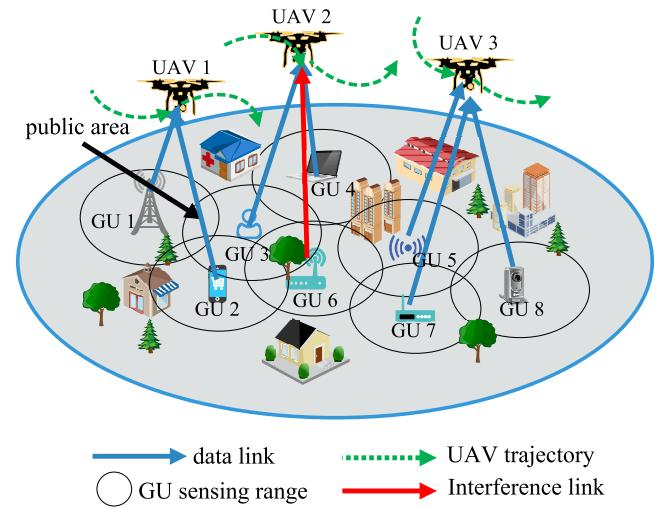  
Fig. 1. Multi-UAV assisted heterogeneous wireless system.

The service mission lasts for a specific period with a duration $T \ > \ 0$ and this system is assumed to work in a time-slotted manner with multiple slots $\delta \ > \ 0 ,$ , which is small enough. Then we have $t \in \mathcal { T } = \{ 1 , 2 , \cdot \cdot \cdot , K \}$ where $\begin{array} { r } { K \ = \ \frac { T } { \delta } } \end{array}$ . The location of the n-th UAV in a 3D Cartesian coordinate system is approximately denoted as ${ \mathbf { } } u _ { n } ( t ) \ = \ [ x _ { n } ( t ) , y _ { n } ( t ) , H ] \ \in \ \mathbb { R } ^ { 3 }$ . During each time slot, we presume each UAV has a limited flight speed $v _ { m a x }$ with a yaw angle $\theta _ { n } ( t ) \in [ 0 , 2 \pi ]$ . Thus the trajectory $\{ u _ { n } ( t ) \} _ { t \in T }$ of the n-th UAV is subject to

$$
\begin{array}{c} x _ {n} (t + 1) = x _ {n} (t) + d _ {n} (t) v _ {m a x} \delta \cdot \cos (\theta_ {n} (t)), \\ y _ {n} (t + 1) = y _ {n} (t) + d _ {n} (t) v _ {m a x} \delta \cdot \sin (\theta_ {n} (t)), \\ | | \boldsymbol {u} _ {n} (t + 1) - \boldsymbol {u} _ {n} (t) | | \leq v _ {m a x} \delta , \end{array}\tag{1}
$$

(2)

where $d _ { n } ( t ) ~ \in ~ [ 0 , 1 ]$ denotes the proportion of maximum speed. Besides, during collection mission, each UAV should keep a safe distance $d _ { m i n }$ to avoid collision at time slot t by:

$$
\left| \left| \boldsymbol {u} _ {n} (t) - \boldsymbol {u} _ {n ^ {\prime}} (t) \right| \right| \geqslant d _ {m i n}, \quad \forall n, n ^ {\prime} \in \mathcal {N}.\tag{3}
$$

## A. Air-to-Ground (A2G) Communication Model

Due to the dynamic environment, UAVs may not have enough additional information, e.g., the height of buildings or obstacles. Thus, it is simplistic to apply the free-space pathloss model to the urban environment straightly [27]. Therefore, we deploy the probabilistic-based LoS model in our scenario, which has different occurrence probabilities of LoS and Non-LoS (NLoS) links depending on the type of environment and the elevation angle combined with the location of GUs and UAVs. The channel coefficient $h _ { n , m } ( t )$ between the n-th UAV and the m-th GU at the time slot t is modeled as

$$
h _ {n, m} (t) = \sqrt {\beta_ {n , m} (t)} \tilde {h} _ {n, m} (t),\tag{4}
$$

where $\beta _ { n , m } ( t )$ denotes the larg-scale fading effects due to the path loss and shadowing, and $\tilde { h } _ { n , m } ( t )$ denotes the small scale fading coefficient. According to [28], the probability of LoS link between the n-th UAV and the m-th GU is expressed as $\begin{array} { r l r } { P _ { n , m } ^ { L o S } ( t ) } & { { } = } & { \frac { 1 } { 1 + C \exp \Big ( - D \Big ( \frac { 1 8 0 } { \pi } \arcsin \Big ( \frac { H } { d _ { n , m } ( t ) } \Big ) - C \Big ) \Big ) } } \end{array}$ , where the parameters $C$ and $D$ are dependent on the propagation environment, such as rural, urban, dense urban, or others. Here, $d _ { n , m } ( t ) = | | \pmb { u } _ { n } - \pmb { g } _ { m } | |$ represents the distance between the n-th UAV and the m-th GU at time slot t. Consequently, the probability of NLoS is $P _ { n , m } ^ { N L o S } ( t ) = 1 - P _ { n , m } ^ { L o S } ( t )$

According to [29] and [30], UAVs fly at the fixed altitude $H .$ Considering the free space and additive pathloss, the channel power gain $\beta _ { n , m } ( t )$ in the A2G communication model is:

$$
\beta_ {n, m} (t) = \left\{ \begin{array}{l l} \frac {1}{\eta_ {L o S}} \left(\frac {4 \pi f _ {c} d _ {n , m}}{c}\right) ^ {- 2} & \text {   LoS,   } \\ \frac {1}{\eta_ {N L o S}} \left(\frac {4 \pi f _ {c} d _ {n , m}}{c}\right) ^ {- 2} & \text {   NLoS,   } \end{array} \right.\tag{5}
$$

where $f _ { c }$ represents the carrier frequency, $\eta _ { L o S }$ and $\eta _ { N L o S }$ are the excessive path loss under LoS and NLoS links, respectively. The parameter c denotes the speed of light. Therefore, the average channel power gain is given by:

$$
\begin{array}{l} \beta_ {n, m} (t) = \frac {P _ {n , m} ^ {L o S} (t)}{\eta_ {L o S}} \beta_ {0} (d _ {n, m}) ^ {- 2} + \frac {P _ {n , m} ^ {N L o S} (t)}{\eta_ {N L o S}} \beta_ {0} (d _ {n, m}) ^ {- 2} \\ = \hat {P} _ {n, m} ^ {L o S} (t) \beta_ {0} (d _ {n, m}) ^ {- 2}. \end{array} \tag {6}\tag{6}
$$

Here, $\begin{array} { r l r } { \beta _ { 0 } } & { { } = } & { \left( \frac { 4 \pi f _ { c } } { c } \right) ^ { - 2 } } \end{array}$ represents the channel power gain at the distance of 1m, and $\begin{array} { r c l } { \hat { P } _ { n , m } ^ { L o S } ( t ) } & { = } & { P _ { n , m } ^ { L o S } ( t ) \frac { 1 } { \eta _ { L o S } } ~ + } \end{array}$ $\begin{array} { r } { ( 1 - P _ { n , m } ^ { L o S } ( t ) ) \frac { 1 } { \eta _ { N L o S } } } \end{array}$ . The values of the parameters in A2G communication model can be found in Table I.

We assume that each UAV is assigned an orthogonal dedicated channel with uniform bandwidth $B _ { n }$ , thus the interference between different UAVs can be ignored. Note that each UAV can provide service for multiple heterogeneous GUs simultaneously when flying through the public area. As a result, each GU is affected by interference from other GUs served by the same UAV. The service indication $\{ a _ { n , m } ( t ) \} _ { t \in T }$ is adopted to represent the association between multi-UAVs and multi-GUs, where $a _ { n , m } ( t ) ~ = ~ \{ 0 , 1 \}$ with $\begin{array} { l c l } { \displaystyle a _ { n , m } ( t ) } & { = } & { 1 } \end{array}$ indicating that the m-th GU requests the n-th UAV at time slot t and $a _ { n , m } ( t ) = 0$ otherwise. Therefore, we can get the following constraints:

$$
a _ {n, m} (t) = \left\{ \begin{array}{l l} 1 & d _ {n, m} ^ {h} \leq r _ {m}, \text { GU   } m \text {   requests   UAV   } n, \\ 0 & \text { otherwise }, \end{array} \right.\tag{7}
$$

$$
\sum_ {n = 1} ^ {N} a _ {n, m} (t) = 1, \forall t \in \mathcal {T}\tag{8}
$$

$$
\sum_ {m = 1} ^ {M} a _ {n, m} (t) \leq M, \forall t \in \mathcal {T}\tag{9}
$$

where (8) indicates that each GU can only request one UAV at each time slot, and (9) means each UAV can collect data from at most M GUs simultaneously $d _ { n , m } ^ { h }$ denotes the horizontal distance between n-th UAV and m-th GU at time slot t.

Let $P _ { m }$ be the transmission power of heterogeneous GUs with uniform distribution, and if the m-th GU is served by the n-th UAV at time slot t, i.e., $a _ { n , m } ( t ) = 1$ , the data rate between the n-th UAV and the m-th GU is given by:

$$
R _ {n, m} (t) = B _ {n} \log_ {2} \left(1 + \frac {P _ {m} | h _ {n , m} (t) | ^ {2}}{\sum_ {j = 1 , j \neq m} ^ {M ^ {\prime}} P _ {j} | h _ {n , j} (t) | ^ {2} + \sigma^ {2}}\right).\tag{10}
$$

The term $\textstyle \sum _ { j = 1 , j \neq m } ^ { M ^ { \prime } } P _ { j } | h _ { n , j } ( t ) | ^ { 2 }$ in the denominator of (10) represents the collective interference from other GUs serviced by the same UAV. $\sigma ^ { 2 }$ is the receiver noise power of the additive white Gaussian noise (AWGN). In this case, each GU concurrently served by the n-th UAV has the same full wireless channel bandwidth $B _ { n }$ Hertz (Hz). Given the above analysis of this system, the long-term throughput of the n-th UAV is:

$$
T h _ {n} (t) = \sum_ {m = 1} ^ {M} \sum_ {t = 1} ^ {K} a _ {n, m} (t) R _ {n, m} (t) \cdot \delta ,\tag{11}
$$

where $\begin{array} { r } { \sum _ { t = 1 } ^ { K } a _ { n , m } ( t ) R _ { n , m } ( t ) \ \cdot \ \delta } \end{array}$ represents the long-term capacity of the m-th GU.

## B. UAV Energy Consumption Model

Energy consumption is a critical issue in UAV-assisted wireless communication because of the limited payload and size of UAVs. In our scenario, UAVs need to fly around to provide different GUs with service in different time slots owing to the restricted number of UAVs, which accelerates energy consumption. We thus introduce an energy consumption model for rotary-wing UAV [29], given by:

$$
\begin{array}{l} P _ {f} (v) = P _ {0} \left(1 + \frac {3 v ^ {2}}{U _ {t i p} ^ {2}}\right) + P _ {1} \left(\sqrt {1 + \frac {v ^ {4}}{4 v _ {0} ^ {4}}} - \frac {v ^ {2}}{2 v _ {0} ^ {2}}\right) ^ {\frac {1}{2}} \\ + \frac {1}{2} \chi \rho \tau A v ^ {3}, \end{array}\tag{12}
$$

where $U _ { t i p }$ is the tip velocity of moving blade, and $v _ { 0 }$ denotes the mean rotor speed in hovering status. Moreover, $\chi , \rho , \tau , A$ are fuselage drag ratio, air density, rotor solidity, and rotor disc area, respectively. The parameters $P _ { 0 }$ and $P _ { 1 }$ represent two constant parameters in the hovering state, and more details can be found in [29]. The energy consumption of the UAV includes propulsion energy and communication energy. All the specific parameters and values are shown in Table I. In practice, we ignore the energy of communication in this paper as it is much smaller than the propulsion energy [29]. By setting $v = 0$ in (12), we can get the hovering energy consumption, which is expressed as $P _ { h } = P _ { 0 } + P _ { 1 }$

Thus, for hovering and flying status in a collection mission, the energy consumption of the n-th UAV with flight speed $v _ { n } ( t )$ until time T is given as:

$$
E _ {n} (t) = \int_ {0} ^ {T} P _ {f} (v (t)) d t = \sum_ {t = 1} ^ {K} P (v _ {n} (t)) \cdot \delta .\tag{13}
$$

## C. Problem Formulation

In this paper, we aim to jointly optimize multi-UAVs trajectories, flight speed control, energy consumption, as well as GUs association to 1) achieve fair performance among heterogeneous GUs, 2) maximize the system total throughput, and 3) enhance the energy efficiency of UAVs. Maximizing the total throughput in our scenario may lead to unfairness among GUs because UAVs may hover or visit certain GUs habitually, which results in some GUs suffering from low capacity all the time. Moreover, unreasonable GUs association will lead to severe interference and link congestion. To work around this problem, we introduce Jain’s fairness index [5] as a metric to measure fair performance quantitatively:

$$
\hat {f} (t) = \frac {\left(\sum_ {m = 1} ^ {M} T h _ {m} (t)\right) ^ {2}}{M (\sum_ {m = 1} ^ {M} (T h _ {m} (t)) ^ {2})},\tag{14}
$$

where $\begin{array} { r c l } { T h _ { m } ( t ) } & { = } & { \sum _ { t \in \mathcal { T } } a _ { n , m } ( t ) R _ { n , m } ( t ) \cdot \delta } \end{array}$ denotes the throughput of the m-th GU in the long-term mission. Evidently, the fairness index varies from $\textstyle { \bar { \frac { 1 } { M } } }$ to 1, which means that a greater value represents fairer performance among GUs from the system panorama. Ulteriorly, considering the limited onboard energy of UAVs, we define the corresponding energy-efficiency based on (11) and (13) as:

$$
E (t) = \frac {\sum_ {n = 1} ^ {N} T h _ {n} (t)}{\sum_ {n = 1} ^ {N} E _ {n} (t)},\tag{15}
$$

where the numerator means the total data collected by UAVs and the denominator represents the energy consumption during the collection mission.

According to the fairness index and communication model presented in the preceding subsection, we aim to maximize the long-term energy efficiency in this system by considering GUs association $\{ a _ { n , m } ( t ) \} _ { t \in \mathcal { T } }$ and UAVs’ trajectories $\{ { \pmb u } _ { n } ( t ) \} _ { t \in \mathcal { T } }$ Consequently, the optimization problem can be formulated as:

$$
\text {(P1)} \colon \max _ {\{a _ {n, m} (t) \}, \{\boldsymbol {u} _ {n} (t) \}} \hat {f} (t) \cdot E (t)\tag{16}
$$

$$
s. t. a _ {n, m} (t) = \{0, 1 \},\tag{16a}
$$

$$
\sum_ {n = 1} ^ {N} a _ {n, m} (t) = 1, \quad \forall t, m, n \in \mathcal {T}, \mathcal {M}, \mathcal {N},\tag{16b}
$$

$$
\sum_ {m = 1} ^ {M} a _ {n, m} (t) \leq M, \quad \forall t, m, n \in \mathcal {T}, \mathcal {M}, \mathcal {N},\tag{16c}
$$

$$
0 \leq v _ {n} (t) \leq v _ {\max}, t \in \mathcal {T}, n \in \mathcal {N},\tag{16d}
$$

$$
d _ {n} (t) \in [ 0, 1 ], \quad \forall t, n \in \mathcal {T}, \mathcal {N},\tag{16e}
$$

$$
\theta_ {n} (t) \in [ 0, 2 \pi ], \quad \forall t, n \in \mathcal {T}, \mathcal {N},\tag{16f}
$$

$$
\left| \left| \boldsymbol {u} _ {n} (t) - \boldsymbol {u} _ {n ^ {\prime}} (t) \right| \right| \geqslant d _ {\min}, \quad \forall n, n ^ {\prime} \in \mathcal {N},\tag{16g}
$$

$$
\boldsymbol {u} _ {n} (t) \in \mathcal {F}, \quad \forall t, n \in \mathcal {T}, \mathcal {N}.\tag{16h}
$$

The constraints (16a)-(16c) represent the association between multiple UAVs and GUs. (16d)-(16f) means that each UAV’s movement should abide by the basic rule, e.g., the flight speed and yaw angle constraints. (16g) signifies each UAV entails keeping a safe distance to avoid a collision. Moreover, the restriction (16h) limits the frontier of UAVs’ data collection.

Distinctly, the optimization problem in (16) is a non-convex mixed integer programming problem, which is NP-hard and is challenging to solve. This problem is non-convex on account of two chief explanations. The first one is that the GUs association variables are binary. The second one is that this problem contains thousands of variables to optimize due to the time-varying system. Moreover, in light of the highly dynamic environment and local information resulting from the mobility of multiple UAVs and heterogeneous GUs, it is infeasible to establish a central controller in this system to achieve global control. Fortunately, MARL and game theory can achieve the solution from the perspective of each agent individually.

## III. MULTI-AGENT REINFORCEMENT LEARNING WITH GAME THEORY

Considering the connected relations among the formulated constraints in the previous section, we proposed a MARL-based method to achieve GUs association and UAVs trajectories design. In this scheme, each UAV acts as an agent to learn the flight scheme, energy management, and provide service for GUs. Specifically, we first reformulate the optimization problem as a decentralized partially observed Markov decision process and then design a MARL algorithm to solve the problem. We ulteriorly propose two association methods based on game theory to solve the discrete action space.

## A. Decentralized Partially Observed Markov Decision Processes

The decentralized partially observed Markov decision processes (DEC-POMDP) is generally defined as a tuple $\langle S , \mathcal { A } , \mathcal { O } , \mathcal { R } , \mathcal { P } , N , \gamma \rangle .$ S is the global state space modeling of the environment. We regard N UAVs as agents to explore the unknown environment, thus $\mathcal { A } = \{ \mathcal { A } _ { 1 } , \cdot \cdot \cdot , \mathcal { A } _ { n } \}$ denotes the shared action space for each UAV. A set of observations $\mathcal { O } =$ $\{ \mathcal { O } _ { 1 } , \cdots , \mathcal { O } _ { n } \}$ originate from each agent’s local information. Each UAV receives a private observation $\ O _ { n } \colon { \mathcal { S } } \ \to \ { \mathcal { O } } _ { n }$ from global state and obtains rewards given the observation and joint agents’ actions, i.e., $r _ { n } \in \mathcal { R } \colon \mathcal { O } _ { n } \times \mathcal { A } \to \mathbb { R } ^ { n }$ P denotes the state transition function $\mathcal { P } : \mathcal { S } \times \mathcal { A }  \mathcal { S } ^ { \prime }$ which means DEC-POMDP transits to a new state $S ^ { \prime }$ after executing joint action. $\gamma$ is the discount factor with $0 < \gamma < 1$ which indicates the importance between future rewards and present rewards. In a time-slotted environment, each agent aims to maximize its own total expected discounted reward $\begin{array} { r } { R _ { n } = \sum _ { t = 0 } ^ { T } \gamma ^ { t } r _ { n } ( t ) , n = 1 , 2 , \cdots , N } \end{array}$ . The details of each component in DEC-POMDP are described as follows.

• State: According to the formulated optimization problem, the state of the environment includes three components, i.e., the locations of all UAVs and GUs, association indicator $a _ { n , m } ( t )$ as well as the energy consumption of each UAV at time slot t. Therefore, the environment state $s ( t ) \in S , \forall t \in T$ can be expressed as:

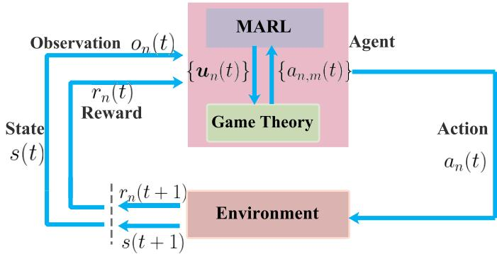  
Fig. 2. The framework of our methods.

$$
\begin{array}{c} s (t) = \left\{\boldsymbol {u} _ {1}, \dots , \boldsymbol {u} _ {n}, \boldsymbol {g} _ {1}, \dots , \boldsymbol {g} _ {m}, a _ {1, 1} (t), \dots , a _ {1, m} (t), \right. \\ \left. a _ {n, 1} (t) \dots , a _ {n, m} (t), E _ {1} (t), \dots , E _ {n} (t) \right\}. \end{array} \tag {17}
$$

• Observation: There is no information exchange between different UAV-BSs due to the dynamic caused by the high mobility of UAVs and the time-varying environment. Therefore, each UAV only has its own location ${ \bf { u } } _ { n } ( t )$ and energy consumption $E _ { n } ( t )$ . Moreover, each GU will not exchange association strategies to prevent private data leakage and extra communication cost. Thus, UAV has the m-th GU’s association and location information when collecting data from the m-th GU. In summary, the observation of the n-th UAV at time slot t, i.e., $o _ { n } ( t ) \in \mathcal { O } _ { n }$ is given by:

$$
\begin{array}{c} o _ {n} (t) = \{\boldsymbol {u} _ {n} (t), E _ {n} (t), a _ {n, 1} (t), \dots , a _ {n, m} (t), \\ \qquad \qquad \qquad \qquad \qquad \qquad \qquad \qquad \qquad \qquad \boldsymbol {g} _ {1}, \dots , \boldsymbol {g} _ {m} \}. \end{array}\tag{18}
$$

• Action: Each UAV chooses its flight yaw angle and flight speed according to (1) at time slot t, i.e., $d _ { n } ( t ) \in [ 0 , 1 ]$ and $\theta _ { n } ( t ) \ \in \ [ 0 , 2 \pi ]$ . By constraint (9), each UAV can collect data from M GUs at most, thus the association of the n-th UAV is also included in the action space. The actions of the n-th UAV, i.e., $a _ { n } ( t ) \in \mathcal { A } _ { n } ( t )$ is given by:

$$
a _ {n} (t) = \left\{d _ {n} (t), \theta_ {n} (t), a _ {n, 1} (t), \dots , a _ {n, m} (t) \right\}.\tag{19}
$$

• Reward: UAVs in the wireless communication system cooperatively collect data from GUs with a shared purpose, i.e., to maximize the long-term energy efficiency and improve fair performance. As a result, the collective part reward for all UAVs can be expressed as follows based on (16):

$$
t h _ {n} (t) = \xi_ {t h} \hat {f} \cdot E (t),\tag{20}
$$

where $\xi _ { t h }$ is the coefficient of energy-efficiency reward. Besides, to guarantee UAVs keep a safe distance from each other to avoid collision, the safe distance constraints (3) should be satisfied, and the same with the boundary constraint (16h). We adopt binary indicator $\xi _ { n } ^ { d } ( t )$ and $\xi _ { n } ^ { b } ( t )$ to denote whether these two conditions are violated. Therefore, the reward function of UAV m is given by:

$$
r _ {n} (t) = t h _ {n} (t) - \xi_ {n} ^ {d} (t) \cdot r _ {d} - \xi_ {n} ^ {b} (t) \cdot r _ {b},\tag{21}
$$

where $r _ { d }$ and $r _ { b }$ are penalties if UAV m offends constraints, i.e., $\xi _ { n } ^ { d } ( t ) = \xi _ { n } ^ { b } ( t ) = 1$

As observed from DEC-POMDP, the actions of UAVs are hybrid, with continuous UAV flight control and discrete GU association indication. However, the conventional DRL algorithms, which are only competent in discrete (e.g., DQN in [14]) or continuous action space (e.g., DDPG in [15] and [16]), typically falter in hybrid action space. Therefore, to improve the current state of affairs, we introduce game theory to deal with discrete association problems, which is a powerful tool to investigate the interplay among multiple players and achieve mutual benefits independently. As a result, the action space of UAVs is continuous, and we can adopt the framework of MARL.

Concretly, the optimization problem can be divided into two subproblems during the MARL training process, as shown in Fig. 2. First, given the location of UAVs at time slot t, the GUs association subproblem will be solved through game theory to maximize the total throughput of the system by association strategies for GUs. According to the association, each UAV will adjust its location based on the long-term expected discounted reward $R _ { n } ( t )$ by MARL. Once the trajectories are optimized, it has an impact on the association in turn. The two subproblems can be optimized in an iterative and distributive manner.

## B. Game Theory Based Methods for Discrete Association

In this subsection, we adopt a strategic form non-cooperative game expressed as $\mu ( { \mathcal { M } } , { \mathcal { S } } , { \mathcal { U } } )$ to represent the GUs association problem at time slot t, where

• M is a finite set of players, i.e., heterogeneous GUs.

$s$ represents the association strategies of GUs, and ${ \boldsymbol { S } } =$ $\{ s _ { 1 } , \cdots , s _ { m } \}$ where $s _ { i } \in \mathcal { N } , \forall i \in \mathcal { M }$

${ \mathcal { U } } \ = \ \{ U _ { 1 } , \cdot \cdot \cdot , U _ { m } \}$ , where $U _ { i } , \forall i \in { \mathcal { M } }$ denotes the transimission rate, $\mathrm { i . e . , } U _ { i } = R _ { s _ { i } , i } .$

Our objective is to design an algorithm for GUs association, and no GU has the enticement to change the assignment onesidedly. Namely, the game coverages to Nash Equilibrium (NE) [31].

Definition 1 (Nash Equilibrium): A association strategy profile $s ^ { * } = ( s _ { 1 } ^ { * } , s _ { 2 } ^ { * } , \cdot \cdot \cdot , s _ { m } ^ { * } )$ is a pure-strategy Nash equilibrium if no GUs can ulteriorly increase its transmission rate by changing the assignment unilaterally, i.e.,

$$
\begin{array}{r} U _ {m} (s _ {m} ^ {*}, s _ {- m} ^ {*}) \geq U _ {m} (s _ {m}, s _ {- m} ^ {*}), \forall m \in \mathcal {M}, \\ \forall s _ {m} \in \mathcal {N}, s _ {m} \neq s _ {m} ^ {*}, \end{array}\tag{22}
$$

where $s _ { - m }$ denotes the association strategy except the m-th GU. Therefore, the GUs association subproblem is equivalent to maximize each GU utility given all the other GUs’ association, i.e.,

$$
\begin{array}{l} \text {(P2 - 1):} \max \sum_ {m \in \mathcal {M}} U _ {m} (s _ {m}, s _ {- m}) \\ \text {s.t. (16a), (16b), (16c).} \end{array}\tag{23}
$$

Algorithm 1 Best Response Based Algorithm (BR)

Inputs: The location  $\boldsymbol{u}(t)$  and  $\boldsymbol{g}(t)$  of UAVs and GUs at time slot t; transmission power  $P_{m}$ ; UAVs bandwidth  $B_{n}$ ;

Outputs: GUs association  $\{a_{n,m}(t)\}_{t\in\mathcal{T}}$ ;

1: Initialize a greedy strategy  $s=\{s_{1},\cdots,s_{m}\}$ , i.e., GU m selects the nearest UAV to access.

2: Calculate the total transmission rate  $U_{sum}$  of s;

3: repeat

4: while  $m\leq M$  do

5: Calculate the nominee UAVs set  $N_{m}$  which satisfies  $d_{n,m}^{h}\leq r_{m}$ ;

6: if  $N_{m}\neq\varnothing$  then

7: the m-th GU randomly accesses a UAV selected from  $N_{m}$  while keeping other GU strategies unchanged and obtain new strategy  $s'$ ;

8: Calculate  $U_{sum}'$  of new strategy;

9: if  $U_{sum}'\geq U_{sum}$  then

10:  $U_{sum}\leftarrow U_{sum}'$ ;  $s\leftarrow s'$ 

11: end if

12: end if

13:  $m\leftarrow m+1$ 

14: end while

15: until the association converges to a stable state;

Apparently, the utility maximization problem is an integer programming problem. It is infeasible to solve the problem by traversal method, in which computation complexity is $O ( N ^ { M } )$ with $N \ < \ M$ . With the number of GUs increasing, the traversal method is unworkable. Thus, we propose the best response [31] based association algorithm (BR) with GUs association information sharing.

Definition 2 (Best Response): Under the premise of giving other GUs strategies $s _ { - m }$ , the m-th GU’s strategy $s _ { m } ^ { * }$ is a best response if:

$$
\begin{array}{r} U _ {m} (s _ {m} ^ {*}, s _ {- m}) \geq U _ {m} (s _ {m}, s _ {- m}), \quad \forall m \in \mathcal {M}, \\ \forall s _ {m} \in \mathcal {N}, \quad s _ {m} \neq s _ {m} ^ {*}. \end{array}\tag{24}
$$

1) Centralized Algorithm: The details of the BR algorithm for each GU are shown in Algorithm 1 for the case that all GUs will share their association information during the collection mission. To be more concrete, the GUs first select the nearest UAV to access according to the distance and its communication rage with computation complexity $O ( N \cdot M )$ Afterward, we acquire the greedy strategy s and calculate the total system rate $U _ { s u m }$ . Given the introductory strategy, we ulteriorly readjust the strategy based on the best response (Lines 4-14). In other words, we traverse GUs by the piece and select a candidate UAV that meets the condition $d _ { n , m } ^ { h } \leq$ $r _ { m } ,$ while keeping other GUs strategies unchanged. Once we achieve a new strategy which has a higher total transmission rate, we will update the strategy and the overall rate, i.e., $U _ { s u m } \gets U _ { s u m } ^ { \prime }$ and $s \gets s ^ { \prime }$ . This update process has the worst computation complexity $O ( C _ { 1 } \cdot M )$ where $C _ { 1 }$ is a small constant. Finally, we can achieve a stable association strategy by applying several iterations with the worst computation complexity $O ( ( C _ { 1 } + N ) \cdot M )$

Theorem 1: The final association in the Algorithm 1 converges to Nash Equilibrium.

## Proof: See Appendix A.

Although the BR method can achieve a near-optimal solution for GUs association game, it requires GUs to exchange association information. In other words, BR needs a centralized control center for global control. It is infeasible to implement BR due to the data security and extra communication cost. Therefore, we ulteriorly proposed a decentralized method based on Coalition Formation Game (CFG) [24].

2) Decentralized Algorithm: The GUs association problem is formulated as a CFG to acquire system transmission rate maximization. In CFG, the game players are the GUs, and these players independently select UAVs to transmit data and aim to maximize the system uplink sum rate. A coalition contains GUs that select the same UAV. Therefore, the players can be divided into N disjoint coalitions due to the constraint (8), that is:

$$
\begin{array}{c} \mathcal {M} = \mathcal {C} _ {1} \cup \mathcal {C} _ {2} \cup \dots \cup \mathcal {C} _ {n}, \quad \mathcal {C} _ {n} \cap \mathcal {C} _ {n ^ {\prime}} = \varnothing , \\ \qquad \qquad \qquad \qquad \qquad \qquad \qquad \qquad \qquad \forall n, n ^ {\prime} \in \mathcal {N}, \quad n \neq n ^ {\prime}, \end{array}\tag{25}
$$

where $\Theta = \{ \mathcal { C } _ { 1 } \cup \mathcal { C } _ { 2 } \cup \cdot \cdot \cdot \cup \mathcal { C } _ { n } \}$ is denoted as a coalition partition. For example, Fig. 1 demonstrates a scenario with 8 GUs and 3 UAVs. Through the CFG algorithm, we achieve a near-optimal solution $\Theta ~ = ~ \{ \{ 1 , 2 \} _ { 1 } , \{ 3 , 4 , 6 \} _ { 2 } , \{ 5 , 7 , 8 \} _ { 3 } \}$ The term {1, 2}1 in partition means GU 1 and 2 will select the first UAV to transmit data. Evidently, the coalition utility $U _ { n }$ is equivalent to the sum transmission rate of serviced GUs in the coalition ${ \mathcal { C } } _ { n } .$ , that is:

$$
U _ {n} = \sum_ {m \in \mathcal {C} _ {n}} U _ {m} (s _ {m}, s _ {- m}).\tag{26}
$$

In advance of scrutinizing the proposed CFG-based algorithm, we first introduce a preference coalition based on [24], i.e., $\succeq$ to present the comparison of different coalition performances.

Definition 3 (Preference Coalition): Given two coalition $\mathcal { C } _ { n }$ and $\mathcal { C } _ { n ^ { \prime } }$ in CFG, $\mathcal { C } _ { n }$ outperforms $\mathcal { C } _ { n ^ { \prime } }$ if the former has higher coalition utility. Therefore, the Preference coalition can be described as:

$$
\mathcal {C} _ {n} \succeq \mathcal {C} _ {n ^ {\prime}} \Leftrightarrow U _ {n} \geq U _ {n ^ {\prime}}.\tag{27}
$$

Under the guidance of the Preference coalition, each GU will abide by the following rules to join in or secede from a coalition, including the coalition switch rule and insert rule.

Switch Rule: Assume two GUs $m \in \mathcal { C } _ { n } , m ^ { \prime } \in \mathcal { C } _ { n ^ { \prime } }$ , two GUs prefer to switch their coalition with each other, i.e., m ∈ $\mathcal { C } _ { n ^ { \prime } } , m ^ { \prime } \in \mathcal { C } _ { n }$ , when satisfies:

$$
\sum_{j\in \{\mathcal{C}_{n}\setminus m\cup m^{\prime}\}}U_{j}(s_{j},s_{-j}) + \sum_{j\in \{\mathcal{C}_{n^{\prime}}\setminus m^{\prime}\cup m\}}U_{j}(s_{j},s_{-j})\\ \geq U_{n} + U_{n^{\prime}}.\tag{28}
$$

Insert Rule: Suppose GU m $\in \mathcal { C } _ { n }$ , the m-th GU prefers to join in coalition $\mathcal { C } _ { n ^ { \prime } }$ from $\mathcal { C } _ { n }$ :

$$
\sum_ {j \in \{\mathcal {C} _ {n} \setminus m \}} U _ {j} (s _ {j}, s _ {- j}) + \sum_ {j \in \{\mathcal {C} _ {n ^ {\prime}} \cup m \}} U _ {j} (s _ {j}, s _ {- j}) \geq U _ {n} + U _ {n ^ {\prime}}.\tag{29}
$$

Algorithm 2 Coalition Formation Game Based Algorithm (CFG)

Inputs: The location  $\boldsymbol{u}(t)$  and  $\boldsymbol{g}(t)$  of UAVs and GUs at time slot t; transmission power  $P_{m}$ ; UAVs bandwidth  $B_{n}$ ; Initial random coalition partition  $\Theta$ 

Outputs: Final Nash-stable GU association  $\Theta_{final}$ ;

1: repeat

2: Randomly select a the m-th GU from M and denote the coalition that its belongs to as  $C_{n}$ ;

3: Randomly select another coalition  $C_{n'}$  from m's nominee set  $N_{m}, C_{n} \neq C_{n'}$ 

4: Calculate the coalition utility  $U_{C_{n}}$  and  $U_{C_{n'}}$ , respectively.

5: Randomly select a GU  $m'$  from coalition  $C_{n'}$ 

6: if satisfies switch rule (28) then

7:  $C_{n'} \leftarrow \{C_{n'} \backslash m'\} \cup m; C_{n} \leftarrow \{C_{n} \backslash m\} \cup m'$ 

8: else {satisfies insert rule (29)}

9:  $C_{n'} \leftarrow C_{n'} \cup m; C_{n} \leftarrow C_{n} \backslash m$ 

10: end if

11: until the partition converges to a stable state;

The proposed rules are designed to consider two coalitions as a whole. In other words, GU m joins the coalition, which can increase the total utility of both the original and new coalitions. A distributed coalition formation algorithm is proposed to cope with the GUs association problem, which is shown in Algorithm 2. At the beginning of the algorithm, an initial coalition partition is preset randomly. In each iteration, we choose an arbitrary GU, which acts as a player to make its own decision. First, the selected m-th GU explores another new coalition randomly, and a random $m ^ { \prime } { \cdot } \mathrm { t h }$ GU is ulteriorly selected for comparison. This selection process has complexity $O ( N )$ by considering the worst condition. If the switch rule is met, the m-th and $m ^ { \prime } .$ -th GUs will exchange their coalition with each other. Next, the m-th GU will decide whether to join in new coalition or keep accessing the current UAV by the insert rule. These comparison complexity is $O ( C _ { 2 } )$ Through iterative updates, all GUs can independently find stable strategies and achieve a NE without sharing information with other GUs. Therefore, the total computation complexity of CFG is $O ( C _ { 3 } ( C _ { 2 } + N ) )$ , where $C _ { 2 }$ and $C _ { 3 }$ are small constants.

Theorem 2: A final coalition formation in the Algorithm 2 converges to Nash-stable.

Proof: See Appendix B.

## C. Energy-Efficient Trajectories Design and Association Scheduling

In the previous subsection III-B, we cope with the problem of GUs association in a decentralized manner when UAVs are located in a known position. As shown in Fig 2, once the GUs association $\{ a _ { n , m } ( t ) \} _ { t \in T }$ is determined, it in turn has impact on the trajectories. Therefore, we aim to ulteriorly optimize multiple UAVs trajectories and improve energy efficiency, that is:

$$
\begin{array}{c} \text {(P2 - 2):} \max _ {\{\boldsymbol {u} _ {n} (t) \} _ {t \in \mathcal {T}}} \hat {f} (t) \cdot E (t) \\ s. t. (1 6 d), (1 6 e), (1 6 f), (1 6 g), (1 6 h). \end{array}\tag{30}
$$

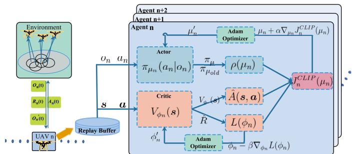  
Fig. 3. MARL framework.

To optimize the non-convex and time-varying subproblem with the continuous variable $\{ { \pmb u } _ { n } ( t ) \} _ { t \in \mathcal { T } }$ , we investigate Multi-Agent Proximal Policy Optimization (MAPPO) [32], which is an extended version of a popular on-policy reinforcement learning algorithm PPO [33]. MAPPO has a great benefit of centralized training and decentralized execution (CTDE) to be applicable in a competitive setting. In a centralized training process, the agent is augmented with extra information about other agents, such as other agents’ local observations and policies. Conversely, the additional information is not necessary for the testing process. After completing the training process, the trained model can be deployed to each agent. Thus, each agent can make a decision based on its local observations. Based on the MAPPO and CFG algorithms in the previous section, we propose a MARL control technique, named EETD-CFG.

As illustrated in Fig. 3, MAPPO is composed of the wireless networks and N UAVs, which act as agents. Each agent is implemented by the PPO algorithm, which has two separate neural networks: a policy network (denoted as actor $\pi _ { \mu _ { n } } )$ with parameters $\mu _ { n } ,$ and a value function network (represented by critic $V _ { \phi _ { n } } )$ with parameters $\phi _ { n } .$ Let $\pi ~ = ~ \{ \pi _ { 1 } , \cdot \cdot \cdot , \pi _ { n } \}$ be the set of all agents’ policies with policies parameters $\mu ~ = ~ \{ \mu _ { 1 } , \cdot \cdot \cdot , \mu _ { n } \}$ . Given the joint actions ${ \pmb a } _ { t } = \{ a _ { 1 } ( t ) , \cdot \cdot \cdot , a _ { n } ( t ) \}$ and global state $s _ { t } ~ = ~ \{ o _ { 1 } ( t ) , \cdot \cdot \cdot , o _ { n } ( t ) \}$ at time slot t, we can achieve $\begin{array} { r } { \pi ( a _ { t } | s _ { t } ) = \prod _ { n \in \mathcal { N } } \pi _ { \mu _ { n } } ( a _ { n } ( t ) | o _ { n } ( t ) ) } \end{array}$ . In the following, we use the standard definitions about global state value function $V _ { \pi _ { \mu } } .$ global state-action value function $Q _ { \pi _ { \mu } }$ and global advantage function $A _ { \pi _ { \mu } }$

$$
\left\{ \begin{array}{l} V _ {\pi_ {\mu}} (\boldsymbol {s} _ {t}) = \mathbb {E} _ {\boldsymbol {a} _ {t}, \boldsymbol {s} _ {t + 1}, \dots} [ R _ {t} | \boldsymbol {s} _ {t} ], \\ Q _ {\pi_ {\mu}} (\boldsymbol {s} _ {t}, \boldsymbol {a} _ {t}) = \mathbb {E} _ {\boldsymbol {s} _ {t + 1}, \boldsymbol {a} _ {t + 1}, \dots} [ R _ {t} | \boldsymbol {s} _ {t}, \boldsymbol {a} _ {t} ], \\ A _ {\pi_ {\mu}} (\boldsymbol {s} _ {t}, \boldsymbol {a} _ {t}) = Q _ {\pi_ {\mu}} (\boldsymbol {s} _ {t}, \boldsymbol {a} _ {t}) - V _ {\pi_ {\mu}} (\boldsymbol {s} _ {t}), \end{array} \right.\tag{31}
$$

where $\begin{array} { r } { R _ { t } \ = \ \sum _ { n \in \mathcal { N } } R _ { n } ( t ) } \end{array}$ denotes the sum reward of all agents. In our scenario, all agents cooperatively adjust the parameters μ of the policy so as to maximize the total expected return:

$$
\max _ {\boldsymbol {\mu}} J (\boldsymbol {\mu}) = \mathbb {E} _ {s \sim p ^ {\pi}, a \sim \pi_ {\mu}} \left[ \pi (a | s) Q _ {\pi_ {\mu}} (s, a) \right],\tag{32}
$$

where $p ^ { \pi }$ denotes the stationary state distribution. Based on the policy gradient theorem, we apply the gradient ascent to the parameters $\mu ,$ and the gradient of the policy

can be written as:

$$
\nabla_ {\boldsymbol {\mu}} J (\boldsymbol {\mu}) = \mathbb {E} _ {\boldsymbol {s} \sim \boldsymbol {p} ^ {\pi}, \boldsymbol {a} \sim \pi_ {\mu}} \left[ \nabla_ {\boldsymbol {\mu}} \log \pi (\boldsymbol {a} | \boldsymbol {s}) Q _ {\pi_ {\mu}} (\boldsymbol {s}, \boldsymbol {a}) \right].\tag{33}
$$

Due to the independent agent in the multi-agent model and (31), we write the gradient of the expected return of each agent n as:

$$
\begin{array}{r l} & {\nabla_ {\mu_ {n}} J (\mu_ {n})} \\ & {\quad = \mathbb {E} _ {\pmb {s} \sim \pmb {p} ^ {\pi}, \pmb {a} \sim \pmb {\pi} _ {\mu_ {n}}} \left[ \nabla_ {\mu_ {n}} \log \pi_ {\mu_ {n}} (a _ {n} | o _ {n}) Q _ {\pmb {\pi} _ {\mu}} (\pmb {s}, \pmb {a}) \right]} \\ & {\quad = \mathbb {E} _ {\pmb {s} \sim \pmb {p} ^ {\pi}, \pmb {a} \sim \pmb {\pi} _ {\mu_ {n}}} \left[ \nabla_ {\mu_ {n}} \log \pi_ {\mu_ {n}} (a _ {n} | o _ {n}) A _ {\pmb {\pi} _ {\mu}} (\pmb {s}, \pmb {a}) \right].} \end{array}\tag{34}
$$

It can be observed from the policy gradient in (34), that each agent’s policy gradient $\nabla _ { \mu _ { n } } J ( \mu _ { n } )$ depends on its own policy $\pi _ { \mu _ { r } }$ and shared actions and observations of other agents. In the centralized-training and decentralized-execution framework, the centralized critic estimates the joint advantage function $A _ { \pi _ { \mu } } ( s , a )$ by the shortened version of generalized advantage estimation (GAE) [34]. The estimated advantage value at time step t is computed by:

$$
\hat {A} _ {t} = \hat {A} (\pmb {s} _ {t}, \pmb {a} _ {t}) = \delta_ {t} + \gamma \lambda \delta_ {t + 1} + \dots + (\gamma \lambda) ^ {T - 1 - t} \delta_ {T - 1}.\tag{35}
$$

where $\delta _ { t } \ = \ R _ { t } + \gamma V _ { \phi _ { n } } ( \pmb { s } _ { t + 1 } ) - V _ { \phi _ { n } } ( \pmb { s } _ { t } )$ . We can significantly reduce variance while maintaining a tolerable level of bias when estimating advantage value by adjusting the hyperparameter λ.

For each agent $n ,$ we improve the policy in a PPO-clip [33] manner, which can guarantee the update of the parameter $\mu _ { n }$ keeps within conservative bounds [35], [36]. Let $\rho _ { t } ( \mu _ { n } ) =$ $\frac { \pi _ { \mu } ( a _ { t } | o _ { t } ) } { \pi _ { \mu _ { o l d } } ( a _ { t } | o _ { t } ) }$ be the probability ratio between the old policy and the new policy after gradient ascent steps. Therefore, the surrogate objective function in MAPPO for each agent can be written as:

$$
\begin{array}{l} J _ {n} ^ {C L I P} (\mu_ {n}) \\ \qquad = \mathbb {E} _ {\boldsymbol {s} _ {t}, \boldsymbol {a} _ {t}} \left[ \min \left(\rho_ {t} (\mu_ {n}) \hat {A} (\boldsymbol {s} _ {t}, \boldsymbol {a} _ {t}), c (\epsilon , \hat {A} (\boldsymbol {s} _ {t}, \boldsymbol {a} _ {t}))\right) \right]. \end{array}\tag{36}
$$

Here, $\boldsymbol { c } ( \epsilon , \hat { \boldsymbol { A } } ( \pmb { s } _ { t } , \pmb { a } _ { t } ) )$ , the second term inside the min, is the clip function which restricts the surrogate function by clipping the probability ratio. It can be expressed as:

$$
c (\epsilon , \hat {A} (\boldsymbol {s} _ {t}, \boldsymbol {a} _ {t})) = \left\{ \begin{array}{l l} (1 + \epsilon) \hat {A} _ {t} & \hat {A} _ {t} \geq 0, \\ (1 - \epsilon) \hat {A} _ {t} & \hat {A} _ {t} \leq 0. \end{array} \right.\tag{37}
$$

With this scheme, we can regularize the policy improvement by sidestepping the ratio $\rho _ { t } ( \mu _ { n } )$ moving out of the interval $[ 1 - \epsilon , 1 + \epsilon ]$ . Then, the new policy will not deviate too far from the old policy by adjusting the related hyperparameter , which is usually set to be 0.2.

In the training process of MAPPO, we denote agents interaction with the environment as a fixed-length trajectory $\tau = \{ s _ { 0 } , \pmb { a } _ { 0 } , r _ { 0 } , \pmb { s } _ { 1 } , \cdot \cdot \cdot , r _ { T - 1 } , \pmb { s } _ { T } \}$ , containing the history of all agents’ observations, actions, and rewards. We collect a set of trajectories in the replay buffer and denote them as B. Then, the agent n in MAPPO updates its policy to maximize the surrogate function via stochastic gradient ascent:

$$
\mu_ {n} ^ {\prime} = \arg \max _ {\mu_ {n}} \frac {1}{| \mathcal {B} | T} \sum_ {\tau \in \mathcal {B}} \sum_ {t = 0} ^ {T} J _ {n} ^ {C L I P} (\mu_ {n}).\tag{38}
$$

Algorithm 3 Energy-Efficient Trajectories Design Combined
Colation Formation Game (EETD-CFG)

Inputs: GUs transmission power $P_{m}$; UAVs bandwidth $B_{n}$;
episode length $T$ and maximum iteration round $L$;

Outputs: UAVs' trajectories $\{\boldsymbol{u}_{n}(t)\}_{t\in\mathcal{T}}$;

1: Initialize a replay buffer $\mathcal{D}$, learning rate $\alpha$ and maximum iteration $G$; Set actor networks of all agents, $\boldsymbol{\mu}=\{\mu_{1},\cdots,\mu_{n}\}$, critic networks, $\phi=\{\phi_{1},\cdots,\phi_{n}\}$

2: for iteration $l=1$ to $L$ do

3: Reset the environment and the initial UAVs' locations and set trajectory $\tau=[]$;

4: for an episode $t=1$ to $T$ do

5: Solve GUs association problem by Algorithm 2

6: Each UAV $n\in\mathcal{N}$ execute action according to GUs association and its own policy $\pi_{\mu_{n}}(a_{\mu_{n}}(t)|o_{\mu_{n}}(t))$

7: the $n$-th UAV gets the reward $r_{n}(t)$ and next observation $o_{n}(t+1)$;

8: $\tau=\tau\cup[o_{t},\boldsymbol{s}_{t},\boldsymbol{a}_{t},r_{t},o_{t+1},\boldsymbol{s}_{t+1}]$

9: end for

10: Calculate advantage estimate $\hat{A}$ via GAE on $\tau$, using (35); Compute reward-to-go $\hat{R}$ on $\tau$;

11: Store data $[o_{t},\boldsymbol{s}_{t},\boldsymbol{a}_{t},r_{t},o_{t+1},\boldsymbol{s}_{t+1},\hat{A},\hat{R}]$ into $\mathcal{D}$;

12: for mini batch $g=1$ to $G$ do

13: Randomly choose mini-batch $B$ from $\mathcal{D}$;

14: Each UAV $n\in\mathcal{N}$ updates $\mu_{n}$ and $\phi_{n}$ by:

$\mu_{n}^{\prime}\leftarrow\mu_{n}+\alpha\nabla_{\mu_{n}}J_{n}^{CLIP};$ $\phi_{n}^{\prime}\leftarrow\phi_{n}-\alpha\nabla_{\phi_{n}}L(\phi_{n})$

15: end for

16: Set $\mathcal{D}=\varnothing$

17: end for

Think back we employ the centralized critic network to calculate an estimator of the advantage function, which can update actor networks and own parameters. The updating of the critic is to minimize the loss by regression on the mean-squared error function:

$$
\begin{array}{l} \phi_ {n} ^ {\prime} = \arg \min _ {\phi_ {n}} L (\phi_ {n}) \\ \qquad = \arg \min _ {\phi_ {n}} \frac {1}{| \mathcal {B} | T} \sum_ {\tau \in \mathcal {B}} \sum_ {t = 0} ^ {T} \left(V _ {\phi_ {n}} (\boldsymbol {s} _ {t}) - \hat {R} _ {t}\right) ^ {2}, \end{array}\tag{39}
$$

where $\hat { R } _ { t }$ is the discounted reward-to-go [33], which can be calculated by $\begin{array} { r } { \hat { R } _ { t } = \sum _ { k = t } ^ { T - 1 } \gamma ^ { k - t } r _ { k } + \gamma ^ { \top - t } V _ { \phi _ { n } } ( s _ { T } ) } \end{array}$

Combining the MAPPO method and the CFG algorithm in the previous subsection III-B, we propose the Energy-Efficient Trajectories Design combined CFG, presented in Algorithm 3. In the training phase, each UAV first solves GU associations problem by using the CFG approach according to the initial location. Then, each UAV acts as an agent to interact with the environment and input its observations into policy $\pi _ { \mu _ { n } } ( a _ { n } ( t ) | o _ { n } ( t ) )$ . the n-th UAV will execute actions $a _ { n } ( t )$ obtain rewards $r _ { n } ( t )$ , and next observation. In this same fashion, each UAV will collect a T-timestep trajectory $\tau _ { n } .$ We then calculate an advantage estimate Aˆ and Rˆ. In the updating process, we update the actor and critic networks iteratively in the G epoch and randomly select $| B |$ mini-batch data from the replay buffer. According to these sampled data, parameters $\mu _ { n }$ and $\phi _ { n }$ are updated by the stochastic gradient approach via (38) and (39), respectively. During the execution phase, each UAV uses its policy network and CFG approach to adjust flying speed in a distributed manner, yaw angle, GUs association, as well as energy consumption on the condition of its local observation.

It is conceivable to analyze the computation complexity of the EETD-CFG approach from two perspectives. For subproblem P2-1, we solve this GUs association problem in the CFG algorithm, and the worst computation complexity is $O ( C _ { 3 } ( C _ { 2 } + N ) )$ from the previous subsection. For subproblem P2-2, we only take the execution phase into account because we can train our model offline. During the execution phase, the computation complexity relates to each agent’s policy network purely. Each UAV utilizes a Deep Neural Network (DNN) as a policy network to make a decision. According to [5], the computation complexity of a DNN with fully connected layers is $O \left( \sum _ { f = 1 } ^ { F } n _ { f } \cdot n _ { f - 1 } \right)$ , where $F$ represents the number of network layers, and $\boldsymbol { n } _ { f }$ denotes the number of neurons in the f-th layer.

## IV. EXTENSION TO 3-D SCENARIO

In this section, we extend the previous probabilistic-based LoS model into a more practical channel model in a 3D environment and we consider the mobility of GUs (e.g., smart cars and hand-held devices). We employed the Gauss-Markov random movement model (GMRMM) [37] to demonstrate the mobility of GUs, which is expressed as:

$$
\boldsymbol {v} _ {m} (t + 1) = l \boldsymbol {v} _ {m} (t) + (1 - l) \bar {\boldsymbol {v}} + \bar {q} \sqrt {1 - l ^ {2}} \boldsymbol {w} _ {m} (t),\tag{40}
$$

where ${ \pmb v } _ { m } = ( v _ { m } ^ { x } ( t ) , v _ { m } ^ { y } ( t ) )$ is the m-th GU’s velocity vector. $l , { \bar { v } } , { \bar { q } }$ denote the memory level, asymptotic mean, and asymptotic standard deviation. ${ \pmb w } _ { m } ( t )$ represents an uncorrelated random Gaussian process $\mathcal { N } ( 0 , \kappa ^ { 2 } )$ . Therefore, the location of the m-th GU is updated by $\pmb { g } _ { m } ( t + 1 ) = \pmb { g } _ { m } ( t ) + \pmb { v } _ { m } ( t ) \delta$

For convenience, we use spherical coordinates $\{ d _ { n } ( t ) , \theta _ { n } ( t ) , \phi _ { n } ( t ) \}$ to describe the movement of the n-th UAV, where $\phi _ { n } ( t )$ is the polar angle from the positive z-axis with $0 \leq \phi _ { n } ( t ) \leq \pi$ In 3-D trajectory design, we consider the small-scale fading modeled by the Rician distribution [38] between the n-th UAV and the m-th GU, which is given by:

$$
\tilde {h} _ {n, m} (t) = \sqrt {\frac {K _ {n , m}}{1 + K _ {n , m}}} \bar {h} _ {n, m} + \sqrt {\frac {1}{1 + K _ {n , m}}} \hat {h} _ {n, m},\tag{41}
$$

where $\bar { h } _ { n , m }$ is the deterministic LoS channel component with $| \bar { h } _ { n , m } | = 1 .$ , and $\hat { h } _ { n , m }$ represents the random scattered component with $\hat { h } _ { n , m } \sim \mathcal { C N } ( 0 , 1 ) . \ K _ { n , m }$ denotes the Rician factor of the channel which is closely relevant to the elevation angle between UAV and GU, expressed as $K _ { n , m } =$ $I _ { 1 } \exp ( I _ { 2 } \arcsin ( z _ { n } ( t ) / d _ { n , m } ( t ) )$ , where $I _ { 1 }$ and $I _ { 2 }$ are constant parameters determined by specific environment with altitude constraint $H _ { m i n } \leq z _ { n } ( t ) \leq H _ { m a x }$

Additionally, we introduce the classical aerodynamic energy consumption of rotary-wing UAV [39] including vertical flight (climbing or decending) power and level flight power, which is expressed as:

$$
P _ {3 D} (v) = P _ {f} (v) + \left(W _ {e} + \frac {1}{2} \rho s _ {p} v _ {x y} ^ {2} \sin \psi\right) v _ {z},\tag{42}
$$

where $W _ { e }$ represents the weight of the UAV, and $s _ { p }$ denotes the fuselage equipment plate area. The parameter $\psi$ is the climb angle of the UAV. Therefore, the formulated optimization problem can be designed as follows:

$$
\text {(P3)} \colon \max _ {\{a _ {n, m} (t) \}, \{\boldsymbol {u} _ {n} (t) \}} \hat {f} (t) \cdot E (t)\tag{43}
$$

$$
s. t. (1 6 a) - (1 6 h),
$$

$$
0 \leq \phi_ {n} (t) \leq \pi , t \in \mathcal {T}, n \in \mathcal {N},\tag{43i}
$$

$$
H _ {m i n} \leq z _ {n} (t) \leq H _ {m a x}, t \in \mathcal {T}, n \in \mathcal {N}.\tag{43j}
$$

To solve the above problem, we need to redefine the observation space, action space and reward function of each UAV as follow:

Observation: $o _ { n } ( t ) = \{ \pmb { u } _ { n } ( t ) , E _ { n } ( t ) , a _ { n , 1 } ( t ) , \cdot \cdot \cdot , a _ { n , m } ( t )$ $\pmb { g } _ { 1 } ( t ) , \cdot \cdot \cdot , \pmb { g } _ { m } ( t ) \}$ . Action: $a _ { n } ( t ) \ = \ \{ d _ { n } ( t ) , \theta _ { n } ( t ) , \ \phi _ { n } ( t )$ $a _ { n , 1 } ( t ) , \cdots , a _ { n , m } ( t ) \}$ . Reward: $\begin{array} { r l r } { r _ { n } ( t ) } & { { } = } & { \ t h _ { n } ( t ) - } \end{array}$ $\xi _ { n } ^ { d } ( t ) \ \cdot \ r _ { d } \ - \ \xi _ { n } ^ { b } ( t ) \ \cdot \ r _ { b } \ - \ \xi _ { n } ^ { h } ( t ) \ \cdot \ r _ { h }$ , where the binary indicator $\xi _ { n } ^ { h } \ = \ 1$ represents n-th UAV violates the altitude constraint (43j).

Therefore, having defined the observation, action, and reward function of each UAV, the 3-D problem (43) can be solved by utilizing the proposed EETD-CFG algorithm as introduced in the previous section.

## V. SIMULATION RESULTS

In this section, we present in-depth simulation results to demonstrate the validation of our proposed EETD-CFG algorithm. We consider 8 heterogeneous GUs randomly distributed in a given area of $4 0 0 \times 4 0 0 m ^ { 2 }$ . All the GUs have the same circular communication area with a radius $r _ { m } = 1 0 0 m$ Multiple UAVs fly at a fixed altitude of $H = 1 0 0 m$ with a maximum flight speed of $V _ { m a x } = 2 0 \mathrm { m / s }$ and collect data in an urban environment. In the EETD-CFG approach, the used neural networks have two hidden layers and utilize RELU and tanh as activation functions. The number of neurons in each hidden layer is set to 400. Table I lists the other parameters in our work.

## A. Convergent Behavior of Game Theory Approaches

In this subsection, we evaluate the effectiveness and convergence of our game theory algorithms. As shown in Fig. 4a, we randomly set 4 UAVs’ initial locations in this given area to collect data from 8 GUs, where each UAV is marked by a red star and GUs are represented by dark dots. We employ two GUs association approaches as a comparison:

• Optimal algorithm: With fewer UAVs and GUs, we can get optimal association results by traversing all possible associations. The computation complexity is $O ( N ^ { M } )$ ).

• Greedy algorithm: Each GU will select the nearest UAV to access. This method may cause system congestion, and its computation complexity is O(MN).

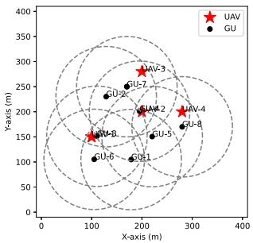  
(a) UAVs network

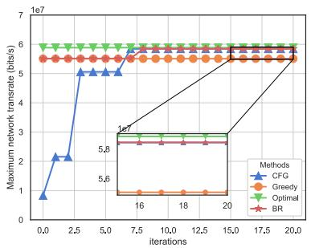  
(b) Maximum sum rate

Fig. 4. The convergence of proposed approaches based on game theory.  
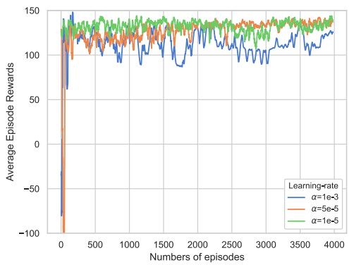  
Fig. 5. EETD-CFG Rewards under different learning rate.

Fig. 4(b) illustrates the convergence of our proposed BR and CFG algorithms in terms of the system sum rate versus iteration index. All the experimental curves are the average of 100 independent trials. It can be observed that the optimal algorithm can achieve the best performance. Both BR and CFG can rapidly achieve near-optimal solutions and converge to a stable state. The greedy algorithm achieves the lowest sum-rate conversely because many GUs may select the same UAV, leading to congestion and severe interference. Meanwhile, at the beginning of the iteration, BR outperforms CFG because it initializes using the greedy method at the expense of higher computation complexity. CFG instead initializes using a random state. Fig. 4(b) ulteriorly demonstrates that the convergence rate of CFG is higher than BR and achieves the same near-optimal solutions to this problem. This is mainly because BR is a centralized method, and it needs the global information to adjust each GU association, which may reduce efficiency. By contrast, as a decentralized approach, each GU will execute CFG in a distributed manner and achieve mutual benefit quickly.

## B. Training Performance and Comparison With Baselines

In this subsection, we demonstrate the training convergence of EETD-CFG and make a comparison with other baselines. Since the sensible learning rate in neural networks has a critical impact on the overall performance, we first conduct a comparison to determine the optimal hyperparameter. We illustrate the training curves of EETD-CFG in the simple scenario where there are 8 GUs and 2 UAVs randomly distributed in a given area. As observed in Fig. 5, the total rewards corresponding to different learning rates increase with the growth in learning episodes. Since the networks will adjust their weight parameters to produce a better policy and action value as the number of learning boosts. Moreover, when learning rate $\alpha = 1 \times 1 0 ^ { - 3 }$ , the average episode rewards fluctuate violently during the training process. Conversely, under smaller learning rate $\alpha = 1 \times 1 0 ^ { - 5 }$ and $\alpha = 5 \times 1 0 ^ { - 5 }$ , EETD-CFG coverage quickly and fluctuate in a small range. Although they have the same performance, a smaller learning rate means more gradient update steps. Therefore, we choose $\alpha = 5 \times 1 0 ^ { - 5 }$ as the hyperparameter of EETD-CFG, considering less training time.

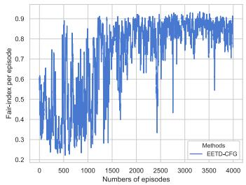  
(a) Fairness index

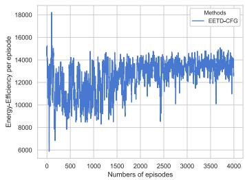  
(b) Energy-Efficiency  
Fig. 6. Fairness index and Energy-Efficiency during training phase.

In Fig. 6, we illustrate the training curves of the average fairness index and energy-efficiency of EETD-CFG with learning rate $\alpha = 5 \times 1 0 ^ { - 5 }$ , respectively. After about 2000 episodes, UAVs began to learn reasonable moving policies to provide fair data collection services for GUs and enhance energy efficiency. At the end of the training process, the fairness index in Fig. 6(a) finally converges to nearly 0.9 and then fluctuates in a small range. Similarly, the energy efficiency increases continuously and achieves a stable efficiency of about $1 . 4 \times 1 0 ^ { 4 }$ in Fig. 6(b).

Since the optimal GUs association must traverse all workable solutions, it is infeasible to implement in EETD with hundreds of time slots in an episode. To ulteriorly evaluate EETD-CFG, we consider the following baseline methods, i.e., EETD-Greedy, EETD-BR, MADDPG-CFG and Iterative algorithm (IA):

• EETD-Greedy: This is a greedy version of GUs association combined energy-effciency trajectory design. Like [22], [23] in this method, GUs select the nearest UAVs to access.

• EETD-BR: We also implemented a BR version to solve our problem with association information sharing between GUs. In this scheme, we assume that there exists a controller responsible for exchanging GU associations information.

• MADDPG-CFG: MADDPG, an off-policy MARL approach, is commonly used in [5], [21], and [18] to cope with multi-UAVs assisted wireless communication scenarios. In this baseline, we adopt the CFG scheme to solve the GUs association problem and MADDPG to control multi-UAVs.

• IA: According to [9], we utilized IA to solve the energy efficiency optimization problem in UAV networks. First, the complicated non-convex problem is converted into a convex problem by approximate optimization. Then we employ the Dinkelbach method to solve this fractional programming with several subproblems. We implement two IA algorithms, i.e., IA-Greedy and IA-CFG, by using the greedy scheme and CFG scheme for GUs association.

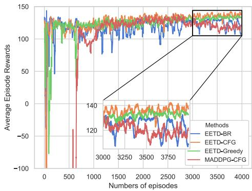  
Fig. 7. Average episode rewards under different approaches.

The average episode rewards for different methods are shown in Fig. 7. We conducted experiments under the simple scenario with 2 UAVs and 8 GUs. It can be observed that after 4000 training episodes, EETD-CFG coverages to the most stable solutions and achieves a smoother training curve. During the training process, we notice an interesting phenomenon that EETD-BR fluctuates violently and even performs worse than the greedy association scheme. The rationale has two main aspects. The first is that EETD-BR utilizes the centralized association method, which needs more iterations to achieve a stable solution, as illustrated in Fig. 4(b). This phenomenon thus reveals the effectiveness and necessity of the decentralized association scheme in achieving mutual benefit quickly. The second one is that we set two UAVs to conduct data collection assignments in this simple dynamic scenario. As a result, the solutions obtained by the EETD-CFG and EETD-BR algorithms are similar to those achieved by the greedy scheme under certain circumstances. However, MADDPG achieves the same performance as EETD-CFG for about 2000 episodes, but the outcome becomes impaired with the increase of training episodes. Instead, EETD-CFG can regularize policy improvement within a reasonable range.

We ulteriorly illustrate the comparison between different algorithms in terms of fairness index, energy efficiency, and system throughput under different experimental settings. Fig. 8 demonstrates the impact of the number of UAVs ranging from 2 to 6, where the GUs in this area are fixed at 8. It is apparent from Fig. 8(a) and Fig. 8(b) that the fairness index and total throughput increase monotonously no matter which approach is used. This is because, as more UAVs execute data collection, GUs will have more association policies to achieve mutual benefits. Moreover, EETD-CFG consistently outperforms all five other baselines under different conditions. For example, EETD-CFG achieves a fairness of 0.8877, which demonstrates an improvement of 5.6% compared to the 0.8406 obtained by EETD-BR when the number of UAVs is 2. It can be seen from Fig. 8(b), that the total throughput in EETD-CFG is appreciably higher than those MARL-based schemes. On the contrary, EETD-Greedy has deficient performance since the greedy association scheme may lead to severe interference and congestion, which sorely declines the system throughput. It is worth noting that, in Fig. 8(b), the EETD-CFG achieve higher throughput than the EETD-BR scheme, especially with more UAVs. This performance evals the effectiveness and necessity of a decentralized association algorithm, which enables each GU to make a distributed policy and accelerate the convergence.

TABLE I  
MODEL PARAMETERS

<table><tr><td>Parameters</td><td>Value</td></tr><tr><td>Tip speed of the rotor blade  $U_{tip}$ </td><td>120m/s [17]</td></tr><tr><td>Fuselage drag ratio  $\chi$ </td><td>0.6 [17]</td></tr><tr><td>Mean rotor speed in hovering status  $v_0$ </td><td>4.03m/s [17]</td></tr><tr><td>Air density and UAV weight  $\rho, W_e$ </td><td>1.225kg/ $m^3$ , 20N [17]</td></tr><tr><td>Rotor solidity and rotor disc area  $\tau, A$ </td><td>0.05, 0.503 $m^2$  [17]</td></tr><tr><td>UAV hovering energy  $P_0, P_1$ </td><td>84.12W, 86.34W [17]</td></tr><tr><td>Rician fading parameters  $I_1, I_2$ </td><td>0dB, 6.4dB [38]</td></tr><tr><td>GMRAMM parameters  $l, \bar{v}, \bar{q}, \kappa$ </td><td>0.5, [0, 1]m/s, 1, 2 [37]</td></tr><tr><td>Maximum speed of UAV  $v_{max}$ </td><td>20m/s [26]</td></tr><tr><td>Flying altitude and noise power  $H, \sigma^2$ </td><td>100m, -110dBm</td></tr><tr><td>GU transmission power  $P_m$ </td><td> $P_m \in [0.1, 1]W$ </td></tr><tr><td>Carrier frequency  $f_c$ </td><td>2GHz</td></tr><tr><td>UAV bandwidth  $B_n$ </td><td> $B_n \in [1, 2]Hz$ </td></tr><tr><td>Discount factor  $\gamma$ </td><td>0.978</td></tr><tr><td>Outside and safety penalty  $r_b, r_d$ </td><td>100, 10</td></tr><tr><td>GAE parameter  $\lambda$ </td><td>0.98 [32]</td></tr><tr><td>Duration of a time slot  $\delta$ </td><td>0.5s</td></tr><tr><td>Environment [C, D,  $\eta_{LoS}, \eta_{NLoS}$ ]</td><td>[12.08, 0.11, 1dB, 23dB] [30]</td></tr><tr><td>PPO epoch G</td><td>10 [32]</td></tr></table>

By comparison with IA-CFG and IA-Greedy, our proposed EETD-CFG scheme guarantees fairness among GUs and acquires high energy efficiency by sacrificing a small amount of total throughput. On the contrary, the traditional optimization methods may converage to local optimal solutions. For example, IA-CFG with 5 UAVs obtains a higher sum throughput than EETD-CFG while ignoring the fair performance among GUs and achieving lower energy efficiency. Compared with IA-CFG, EETD-CFG obtains 0.93 and 6.534 × 104, which improves 15.3% and 9.7% in fairness and energy efficiency, respectively. In addition, with the increase of the number of UAVs, IA-CFG outperforms IA-Greedy in terms of system fairness, total sum throughput, as well as energy efficiency, which demonstrates the effectiveness and necessity of the CFG scheme for GUs association.

Interestingly, as shown in Fig. 8(c), the energy efficiency of different approaches increases with the rise of the number of UAVs and then decreases after reaching a peak value. The justification behind this is that more UAVs will collect more data from GUs leading to an improvement in the energy efficiency. However, each GU can only access one UAV in each time slot. Therefore, when continuing to increase the number of UAVs, some UAVs may not collect data from GUs in certain time slots while the total energy consumption grows rapidly, which in turn degrades the energy efficiency.

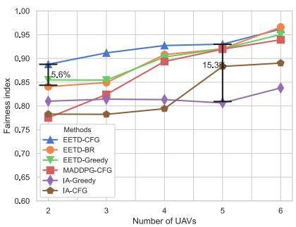  
(a) Fairness index

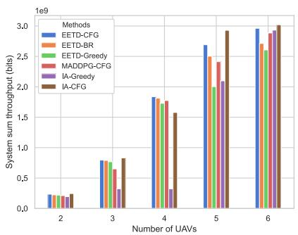  
(b) Total throughput

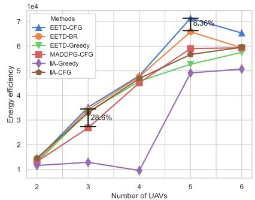  
(c) Energy Efficiency

Fig. 8. Comparison of (a) fairness index, (b) energy efficiency, and (c) total throughput with different UAVs.  
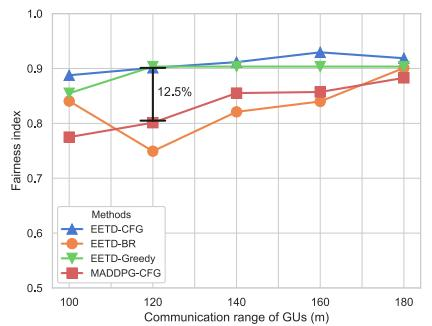  
(a) Fairness index

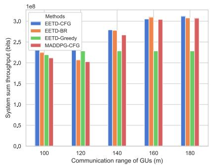  
(b) Total throughput

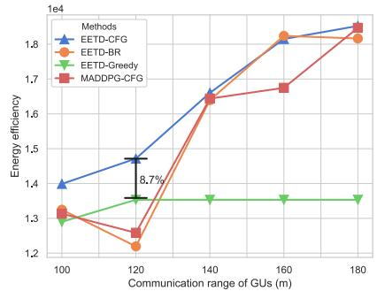  
(c) Energy Efficiency  
Fig. 9. Impact of different GUs communication ranges on (a) fairness index, (b) total throughput, and (c) energy efficiency.

But in aggregate, the EETD-CFG obtains the best solution to enhance energy efficiency with all N. In particular, when the number of UAVs is 3, EETD-CFG gives an energy efficiency of $3 . 5 2 1 2 \times 1 0 ^ { 4 }$ , which improves 28.6% compared to that of MADDPG. The above performance evaluation exemplifies our proposed approach based on MARL and CFG successes to learn distributed control policies to maximize fair throughput and improve energy efficiency.

In the following experiment, we investigate the impact of heterogeneous GUs communication ranges on the performance of EETD-CFG and the comparison schemes. As illustrated in Fig. 9, we conducted simulation experiments by varying the GUs’ communication ranges from 100m to 180m. We set the number of UAVs and GUs in the network to be 2 and 8, respectively. We can observe that, as the communication range of GUs increases, the performance of all approaches displays analogous tendencies. In Fig. 9(a) and Fig. 9(b), the fairness index and total throughput increase gradually, along with the communication range magnifying. The explanation is that UAVs can concurrently visit more GUs to collect data with greater GU communication range, leading to higher energy efficiency, as shown in Fig. 9(c). It should be noticed that the performance improvement of EETD-Greedy is not significant compared with other schemes. The intuitive reason is that GUs in EETD-Greedy select the nearest UAV to access. As a result, the GU communication range will have a limited impact on the evaluation metrics. Nevertheless, EETD-CFG outperforms the three other proposed schemes, which proves the applicable efficacy of the suggested approach. For instance, when the communication range is set to 120m, EETD-CFG achieves an average fairness index 12.5% higher than that obtained by MADDPG and an average energy efficiency 8.7% higher than that achieved by EETD-Greedy, respectively.

## C. 3D Trajectory and Mobile GUs

In this subsection, we further investigate the performance of our proposed EETD-CFG in more practical 3-D wireless communication with Rician fading. We conducted the experiments in 3-D space with 2 UAVs and 8 motionless GUs. For reasons of flight security and collision avoidance of UAVs, the filght altitude is constrained in $5 0 \leq z _ { n } ( t ) \leq 2 5 0 \mathrm { m }$ and the other specific experiment parameters are similar in Table I. We illustrate the comparison of average episode rewards, energy efficiency between EETD-CFG-3D and EETD-Greedy-3D in Fig. 10(a) and Fig. 10(b). From Fig. 10(a) and Fig. 10(b), the proposed EETD-CFG scheme still obtains higher average episode rewards as well as higher energy efficiency than the EETD-Greedy scheme, which reveals the effectiveness of our proposed algorithms. In Fig. 10(c), we demonstrate the fairness index of our proposed approaches in 2-D and 3-D scenarios, respectively. We also execute the simulations under different numbers of moving GUs. We observe that as the number of mobile GUs increases, the fairness index of all approaches declines in varying degrees. Specifically, EETD-Greedy is highly related to the location of GUs, which leads to a lower fairness index with different mobile GUs. By comparison, the EETD-CFG can alternate the GUs assocation effectively and achieve higher fair performance. In addition, because of the extra Rician fading effect, EETD-CFG obtains slightly lower results than fixed altitude in 3-D channel conditions. In Fig. 10(d), we show the examples of 2 UAVs trajectories with different algorithms in 2D and 3D scenarios.

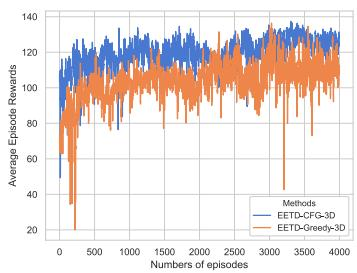  
(a) Average episode rewards

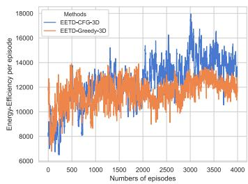  
(b) Energy Efficiency

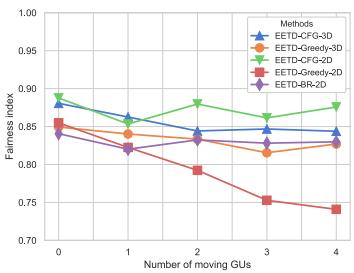  
(c) Fairness index

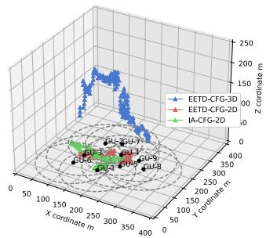  
(d) UAVs trajectories  
Fig. 10. Comparison of (a) Average episode rewards, (b) energy efficiency, (c) fairness index with different number of moving GUs and (d) UAVs trajectories

## VI. CONCLUSION

In this paper, we study the trajectory optimization and user association for UAV-assisted heterogeneous wireless networks. We aim to improve the system’s fairness and enhance the long-term energy efficiency by considering interference management, GUs association, and collision avoidance. Due to the dynamic environment and non-convex feature of the problem, we formulate this problem as a DEC-POMDP and propose an approach combining game theory and MARL. Firstly, we use game theory to cope with the discrete action space in MARL and propose centralized and decentralized algorithms for different cases. Secondly, for the continuous trajectory and energy optimization, we utilize MAPPO to control UAVs based on a centralized training and decentralized execution framework. Compared with other MARL approaches and convential optimization method with different GUs associations schemes, our proposed algorithm has better performance in a distributed manner. In our future work, we will investigate the resource management problem in multi-UAV enabled wireless communication networks.

## APPENDIX A PROOF OF THEOREM 1

Proof: We prove that BR approach converges to Nash Equilibrium. Suppose that the final strategies achieved by BR are $( s _ { 1 } ^ { * } , \cdots , s _ { m } ^ { * } )$ but are not Nash Equilibrium. In that way, there must be a certain GU i and its some practicable strategy $s _ { i } ~ \in ~ S _ { i }$ make Nash equilibrium invalid, i.e., $U _ { i } ( s _ { i } ^ { * } , s _ { - i } ^ { * } ) ~ \leq$ $U _ { i } ( s _ { i } , s _ { - i } ^ { * } )$ . Recall that in BR, we will update our strategies if there is a better one. Therefore, there must exists $s _ { i } ^ { \prime } \in$ $S _ { i }$ in updating process such that $U _ { i } ( s _ { i } , s _ { - i } ^ { * } ) \ \leq \ U _ { i } ( s _ { i } ^ { \prime } , { s _ { - i } ^ { * } } )$ If $s _ { i } ^ { \prime } ~ = ~ s _ { i } ^ { * }$ there will be contradiction and the proof is complete. If $s _ { i } ^ { \prime } \neq s _ { i } ^ { * }$ , then there must exists some other strategy $s _ { i } ^ { \prime \prime } \in S _ { i }$ is better than $s _ { i } ^ { \prime }$ in BR updating phase, i.e., $U _ { i } ( s _ { i } ^ { \prime } , s _ { - i } ^ { * } ) \leq U _ { i } ( s _ { i } ^ { \prime \prime } , s _ { - i } ^ { * } )$ . Similarly, if $s _ { i } ^ { \prime \prime } = s _ { i } ^ { * }$ , the proof is complete. Otherwise, we repeat the above process. Because the game is finite, we finally prove that the final strategies $( s _ { 1 } ^ { * } , \cdots , s _ { m } ^ { * } )$ is Nash Equilibrium. 

## APPENDIX B PROOF OF THEOREM 2

Proof: We prove that the final coalition formation in CFG is Nash-stable by utilizing the exact potential game (EPG).

Definition 4 (Exact Potential Game, EPG): A game is called as a potential game if and only if there exists a potential function Φ satisfying the following equation:

$$
\begin{array}{c} \Phi (s _ {m}, s _ {- m}) - \Phi (s _ {m} ^ {\prime}, s _ {- m}) = U _ {m} (s _ {m}, s _ {- m} ^ {*}) - U _ {m} (s _ {m} ^ {\prime}, s _ {- m} ^ {*}) \\ \forall s _ {m} \in \mathcal {N}, \quad \forall s _ {m} ^ {\prime} \in \mathcal {N}. \end{array} \tag {44}
$$

(44) demonstrates that a potential function reflects the difference in the utility resulted from every unilaterally deviating player. Recall the coalition ${ \mathcal { C } } _ { n }$ utility in (26), so we define each GU’s coalition formation utility as:

$$
U _ {m} (s _ {m}, s _ {- m}) = \sum_ {k \in \mathcal {C} _ {n}} U _ {k} (s _ {k}, s _ {- k}) - \sum_ {k \in \mathcal {C} _ {n} \setminus m} U _ {k} (s _ {k}, s _ {- k}).\tag{45}
$$

Afterwards, we denote the sum of all coalitions utility as potential function, that is $\begin{array} { r } { \Phi = \sum _ { \mathcal { C } _ { n } \in \Theta } U _ { n } } \end{array}$ . Suppose that the m-th GU adjusts the association from $s _ { m }$ to $s _ { m } ^ { \prime } ,$ i.e., $\mathcal { C } _ { n } $ $\mathcal { C } _ { n ^ { \prime } }$ . The difference in potential function is:

$$
\begin{array}{l} \Phi (s _ {m}, s _ {- m}) - \Phi (s _ {m} ^ {\prime}, s _ {- m}) \\ = \sum_ {k \in \mathcal {C} _ {n}} U _ {k} (s _ {k}, s _ {- k}) + \sum_ {k \in \mathcal {C} _ {n ^ {\prime}}} U _ {k} (s _ {k}, s _ {- k}) + \sum_ {k \in D} U _ {k} (s _ {k}, s _ {- k}) \\ - \sum_ {k \in \mathcal {C} _ {n} \backslash m} U _ {k} (s _ {k}, s _ {- k}) - \sum_ {k \in \mathcal {C} _ {n ^ {\prime}} \cup m} U _ {k} (s _ {k}, s _ {- k}) \\ - \sum_ {k \in D ^ {\prime}} U _ {k} (s _ {k}, s _ {- k}) \\ = U _ {m} (s _ {m}, s _ {- m}) - U _ {m} (s _ {m ^ {\prime}}, s _ {- m}). \end{array} \tag {46}
$$

Because the change of the m-th GU coalition selection only has an impact on the GUs in coalition ${ \mathcal { C } } _ { n }$ and $\mathcal { C } _ { n ^ { \prime } }$ . Hence, the

following equation is valid:

$$
\sum_ {k \in D} U _ {k} (s _ {k}, s _ {- k}) = \sum_ {k \in D ^ {\prime}} U _ {k} (s _ {k}, s _ {- k}),\tag{47}
$$

where $D ~ = ~ \{ \Theta \backslash \{ \mathcal { C } _ { n } \cup \mathcal { C } _ { n ^ { \prime } } \} \}$ and $D ^ { \prime } \ = \ \{ \Theta \} \{ \{ \mathcal { C } _ { n } \backslash m \}$ ∪ $\{ { \mathcal { C } } _ { n ^ { \prime } } \cup m \} \} \}$ . It should be noticed from (46) and definition of EPG that the CFG alogrithm is an EPG with the potential function defined as the system sum-rate. According to [24], the EPG has at least one NE. Therefore, the final association of CFG is a stable coalition partition. 

## REFERENCES

[1] A. Al-Fuqaha, M. Guizani, M. Mohammadi, M. Aledhari, and M. Ayyash, “Internet of Things: A survey on enabling technologies, protocols, and applications,” IEEE Commun. Surveys Tuts., vol. 17, no. 4, pp. 2347–2376, 4th Quart., 2015.

[2] W. Chen, X. Qiu, T. Cai, H.-N. Dai, Z. Zheng, and Y. Zhang, “Deep reinforcement learning for Internet of Things: A comprehensive survey,” IEEE Commun. Surveys Tuts., vol. 23, no. 3, pp. 1659–1692, 3rd Quart., 2021.

[3] L. Yang, H. Yao, J. Wang, C. Jiang, A. Benslimane, and Y. Liu, “Multi-UAV-enabled load-balance mobile-edge computing for IoT networks,” IEEE Internet Things J., vol. 7, no. 8, pp. 6898–6908, Aug. 2020.

[4] Y. Zeng, X. Xu, S. Jin, and R. Zhang, “Simultaneous navigation and radio mapping for cellular-connected UAV with deep reinforcement learning,” IEEE Trans. Wireless Commun., vol. 20, no. 7, pp. 4205–4220, Jul. 2021.

[5] C. H. Liu, Z. Chen, and Y. Zhan, “Energy-efficient distributed mobile crowd sensing: A deep learning approach,” IEEE J. Sel. Areas Commun., vol. 37, no. 6, pp. 1262–1276, Jun. 2019.

[6] Q. Wu, Y. Zeng, and R. Zhang, “Joint trajectory and communication design for multi-UAV enabled wireless networks,” IEEE Trans. Wireless Commun., vol. 17, no. 3, pp. 2109–2121, Mar. 2018.

[7] H. Kim and J. Ben-Othman, “A collision-free surveillance system using smart UAVs in multi domain IoT,” IEEE Commun. Lett., vol. 22, no. 12, pp. 2587–2590, Dec. 2018.

[8] K. Zhang, X. Gui, D. Ren, and D. Li, “Energy–latency tradeoff for computation offloading in UAV-assisted multiaccess edge computing system,” IEEE Internet Things J., vol. 8, no. 8, pp. 6709–6719, Apr. 2021.

[9] X. Pang, J. Tang, N. Zhao, X. Zhang, and Y. Qian, “Energy-efficient design for mmWave-enabled NOMA-UAV networks,” Sci. China Inf. Sci., vol. 64, no. 4, Apr. 2021, Art. no. 140303.

[10] F. Cheng, G. Gui, N. Zhao, Y. Chen, J. Tang, and H. Sari, “UAV-relayingassisted secure transmission with caching,” IEEE Trans. Commun., vol. 67, no. 5, pp. 3140–3153, May 2019.

[11] N. Zhao et al., “Joint trajectory and precoding optimization for UAVassisted NOMA networks,” IEEE Trans. Commun., vol. 67, no. 5, pp. 3723–3735, May 2019.

[12] Y. Sun, D. Xu, D. W. K. Ng, L. Dai, and R. Schober, “Optimal 3D-trajectory design and resource allocation for solar-powered UAV communication systems,” IEEE Trans. Commun., vol. 67, no. 6, pp. 4281–4298, Jun. 2019.

[13] J. Ji, K. Zhu, D. Niyato, and R. Wang, “Joint trajectory design and resource allocation for secure transmission in cache-enabled UAVrelaying networks with D2D communications,” IEEE Internet Things J., vol. 8, no. 3, pp. 1557–1571, Feb. 2021.

[14] S. Fu et al., “Energy-efficient UAV-enabled data collection via wireless charging: A reinforcement learning approach,” IEEE Internet Things J., vol. 8, no. 12, pp. 10209–10219, Jan. 2021.

[15] R. Ding, F. Gao, and X. S. Shen, “3D UAV trajectory design and frequency band allocation for energy-efficient and fair communication: A deep reinforcement learning approach,” IEEE Trans. Wireless Commun., vol. 19, no. 12, pp. 7796–7809, Aug. 2020.

[16] Y. Yu, J. Tang, J. Huang, X. Zhang, D. K. C. So, and K.-K. Wong, “Multi-objective optimization for UAV-assisted wireless powered IoT networks based on extended DDPG algorithm,” IEEE Trans. Commun., vol. 69, no. 9, pp. 6361–6374, Sep. 2021.

[17] Y. Zhang, Z. Mou, F. Gao, L. Xing, J. Jiang, and Z. Han, “Hierarchical deep reinforcement learning for backscattering data collection with multiple UAVs,” IEEE Internet Things J., vol. 8, no. 5, pp. 3786–3800, Mar. 2021.

[18] H. Peng and X. Shen, “Multi-agent reinforcement learning based resource management in MEC- and UAV-assisted vehicular networks,” IEEE J. Sel. Areas Commun., vol. 39, no. 1, pp. 131–141, Jan. 2021.

[19] D. S. Lakew, A.-T. Tran, N.-N. Dao, and S. Cho, “Intelligent offloading and resource allocation in heterogeneous aerial access IoT networks,” IEEE Internet Things J., early access, Mar. 25, 2022.

[20] J. Ji, K. Zhu, and L. Cai, “Trajectory and communication design for cache-enabled UAVs in cellular networks: A deep reinforcement learning approach,” IEEE Trans. Mobile Comput., early access, Jun. 13, 2022.

[21] R. Ding, Y. Xu, F. Gao, and X. Shen, “Trajectory design and access control for air–ground coordinated communications system with multiagent deep reinforcement learning,” IEEE Internet Things J., vol. 9, no. 8, pp. 5785–5798, Apr. 2022.

[22] R. Zhang, M. Wang, and L. X. Cai, “SREC: Proactive self-remedy of energy-constrained UAV-based networks via deep reinforcement learning,” in Proc. GLOBECOM IEEE Global Commun. Conf., Dec. 2020, pp. 1–6.

[23] S. Xu, X. Zhang, C. Li, D. Wang, and L. Yang, “Deep reinforcement learning approach for joint trajectory design in multi-UAV IoT networks,” IEEE Trans. Veh. Technol., vol. 71, no. 3, pp. 3389–3394, Mar. 2022.

[24] J. Chen et al., “Joint task assignment and spectrum allocation in heterogeneous UAV communication networks: A coalition formation game-theoretic approach,” IEEE Trans. Wireless Commun., vol. 20, no. 1, pp. 440–452, Jan. 2021.

[25] A. S. Matar and X. Shen, “Joint subchannel allocation and power control in licensed and unlicensed spectrum for multi-cell UAV-cellular network,” IEEE J. Sel. Areas Commun., vol. 39, no. 11, pp. 3542–3554, Nov. 2021.

[26] D. Song, X. B. Zhai, X. Liu, and C. W. Tan, “Jointly optimal fair data collection and trajectory design algorithms in UAV-aided cellular networks,” in Proc. IEEE Wireless Commun. Netw. Conf. (WCNC), Mar. 2021, pp. 1–6.

[27] Y. Zeng, Q. Wu, and R. Zhang, “Accessing from the sky: A tutorial on UAV communications for 5G and beyond,” Proc. IEEE, vol. 107, no. 12, pp. 2327–2375, Dec. 2019.

[28] A. Al-Hourani, S. Kandeepan, and S. Lardner, “Optimal LAP altitude for maximum coverage,” IEEE Wireless Commun. Lett., vol. 3, no. 6, pp. 569–572, Dec. 2014.

[29] Y. Zeng, J. Xu, and R. Zhang, “Energy minimization for wireless communication with rotary-wing UAV,” IEEE Trans. Wireless Commun., vol. 18, no. 4, pp. 2329–2345, Mar. 2019.

[30] M. Sun, X. Xu, X. Qin, and P. Zhang, “AoI-Energy-Aware UAVassisted data collection for IoT networks: A deep reinforcement learning method,” IEEE Internet Things J., vol. 8, no. 24, pp. 17275–17289, Dec. 2021.

[31] P. G. Spirakis and C. H. Papadimitriou, Algorithmic Game Theory, vol. 3, N. Nisan, T. Roughgarden, È. Tardos, and V. Vazirani, Eds. Cambridge Univ. Press, 2009, pp. 41–46.

[32] C. Yu, A. Velu, E. Vinitsky, Y. Wang, A. M. Bayen, and Y. Wu, “The surprising effectiveness of MAPPO in cooperative, multi-agent games,” 2021, arXiv:2103.01955.

[33] J. Schulman, F. Wolski, P. Dhariwal, A. Radford, and O. Klimov, “Proximal policy optimization algorithms,” Jul. 2017, arXiv:1707.06347.

[34] J. Schulman, P. Moritz, S. Levine, M. I. Jordan, and P. Abbeel, “Highdimensional continuous control using generalized advantage estimation,” 2016, arXiv:1506.02438.

[35] S. Kakade and J. Langford, “Approximately optimal approximate reinforcement learning,” in Proc. ICML, vol. 2, Jul. 2002, pp. 267–274.

[36] J. Schulman, S. Levine, P. Abbeel, M. Jordan, and P. Moritz, “Trust region policy optimization,” in Proc. 32nd Int. Conf. Mach. Learn. (PMLR), vol. 37. Lille, France, Jul. 2015, pp. 1889–1897.

[37] Z. Yang, S. Bi, and Y.-J.-A. Zhang, “Online trajectory and resource optimization for stochastic UAV-enabled MEC systems,” IEEE Trans. Wireless Commun., vol. 21, no. 7, pp. 5629–5643, Jul. 2022.

[38] C. You and R. Zhang, “3D trajectory optimization in Rician fading for UAV-enabled data harvesting,” IEEE Trans. Wireless Commun., vol. 18, no. 6, pp. 3192–3207, Jun. 2019.

[39] N. Gupta, D. Mishra, and S. Agarwal, “Energy-aware trajectory design for outage minimization in UAV-assisted communication systems,” IEEE Trans. Green Commun. Netw., vol. 6, no. 3, pp. 1751–1763, Sep. 2022.

  
Gong Chen (Graduate Student Member, IEEE) is currently pursuing the master’s degree under the supervision of Prof. X. B. Zhai with the School of Computer Science and Technology, Nanjing University of Aeronautics and Astronautics, China. His research interests include unmanned aerial vehicle and deep reinforcement learning in wireless communication networks.

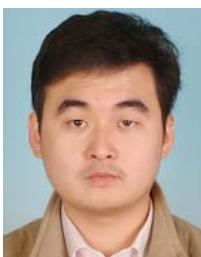

Congduan Li (Member, IEEE) received the B.S. degree from the University of Science and Technology Beijing, China, in 2008, the M.S. degree from Northern Arizona University, AZ, USA, in 2011, and the Ph.D. degree from Drexel University, PA, USA, in 2015, all in electrical engineering. From October 2015 to August 2018, he was a Post-Doctoral Research Fellow at the Institute of Network Coding, The Chinese University of Hong Kong and at the Department of Computer Science, City University of Hong Kong. He is currently an Associate Professor

with the School of Electronics and Communication Engineering, Sun Yatsen University, China. His research interests include the areas related with networks, such as coding, security, wireless, storage, and caching.

Xiangping Bryce Zhai (Member, IEEE) received the B.Eng. degree in computer science and technology from Shandong University in 2006 and the Ph.D. degree in computer science from the City University of Hong Kong in 2013. He was a Post-Doctoral Fellow at the City University of Hong Kong. He is currently an Associate Professor with the College of Computer Science and Technology, Nanjing University of Aeronautics and Astronautics, China. His research interests include the Internet of Things, power control, edge computing, resource optimization, and spatial analytics. He is actively involved in organizing and chairing sessions, and has served as a reviewer for several journals and TPC for several international conferences.