# Joint Task Scheduling and Communication-Computation Optimization for Wireless Networked Control With HRLLC

Yiyang Li , Graduate Student Member, IEEE, Xianxin Song , Member, IEEE, Zhiqing Wei , Member, IEEE, Zhiyong Feng , Senior Member, IEEE, and Jie Xu , Fellow, IEEE

Abstract—This paper studies a wireless control system at network edge, in which a base station (BS) wirelessly coordinates the closed-loop control of multiple subsystems each consisting of a plant, a sensor, and an actuator. In this system, the BS first collects the state information from the sensors of plants, then processes the information via edge computing, and finally sends the obtained command signals back to the actuators for controlling the plants. In particular, we consider the hyperreliable and low-latency communications (HRLLC) for the state and command signal transmission, by using the rate formulas based on short-packet communication. Under this setup, we first present a time-division-multiple-access (TDMA) protocol for coordinating the sensing, communication, and computation among the multiple plants. Then, we jointly optimize the task scheduling as well as the communication and computation resource allocations to minimize the closed-loop control latency while ensuring the stability of the multiple control subsystems. The considered problem is a highly non-convex combinatorial optimization problem that is difficult to solve. To resolve this issue, we present efficient algorithms by first optimizing the communication and computation resource allocations under given task scheduling via the techniques of alternating optimization and successive convex approximation, and then designing the task scheduling based on the exhaustive search or the lowcomplexity flow-shop scheduling. Numerical results show that the proposed joint resource allocation design with exhaustive search based task scheduling significantly outperforms other benchmark schemes without such joint optimization, and the proposed low-complexity task scheduling based on flow-shop scheduling achieves performance close to the upper bound by exhaustive search.

Received 17 June 2025; accepted 4 August 2025. Date of publication 20 August 2025; date of current version 22 December 2025. This work was supported in part by the National Natural Science Foundation of China under Grant 92267202 and Grant 62471424, in part by the Basic Research Project of Hetao Shenzhen-HK S&T Cooperation Zone under Grant HZQB-KCZYZ-2021067, in part by Guangdong Provincial Key Laboratory of Future Networks of Intelligence under Grant 2022B1212010001, and in part by Guangdong Major Project of Basic and Applied Basic Research under Grant 2023B0303000001. An earlier version of this paper was presented in part at the IEEE Vehicular Technology Conference (VTC) Workshop 2023 [DOI: 10.1109/VTC2023-Fall60731.2023.10333835]. The associate editor coordinating the review of this article and approving it for publication was J. Liu. (Corresponding author: Jie Xu.)

Yiyang Li, Xianxin Song, and Jie Xu are with the School of Science and Engineering (SSE) and the Future Network of Intelligence Institute (FNii), The Chinese University of Hong Kong, Shenzhen 518172, China (e-mail: yiyangli1@link.cuhk.edu.cn; xianxinsong@link.cuhk.edu.cn; xujie@ cuhk.edu.cn).

Zhiqing Wei and Zhiyong Feng are with the Key Laboratory of Universal Wireless Communications, Ministry of Education, Beijing University of Posts and Telecommunications, Beijing 100876, China (e-mail: weizhiqing@bupt.edu.cn; fengzy@bupt.edu.cn).

Digital Object Identifier 10.1109/TWC.2025.3598004

Index Terms—Wireless networked control, mobile edge computing (MEC), hyper-reliable and low-latency communications (HRLLC), joint communication and computation resource allocation, optimization.

## I. INTRODUCTION

IXTH-GENERATION (6G) wireless networks are experiencing a paradigm shift from connected everything in fifth-generation (5G) to connected intelligence [2], supporting novel applications such as smart cities, autonomous driving, and industrial automation [3]. Among various 6G applications, wireless networked inference and control are particularly appealing, in which base stations (BSs) first collect the sensing information from distributed sensors or internet-of-things (IoT) devices, then process such information via attached computation servers, and finally send command signals to actuators for remote control. Within the 6G vision, the emergence of ultra-low-latency ultra-high-reliability communication, and massive device connectivity have driven cutting-edge research in wireless networked control [2]. Different from conventional communication tasks focusing only on signal transmission, the wireless networked control involves closed-loop information processing flow including sensing, communication, computation, and control, which needs to be performed with low latency and high reliability [4]. However, conventional wireless designs focused solely on optimizing the communication performance, by overlooking the impact of communication and computation latency on control performance [5]. Different from conventional separate designs, it is paramount to integrate communication, computation, and control into a joint design for optimizing the performance of wireless networked control in 6G [6], [7].

Mobile edge computing (MEC) and hyper-reliable and low-latency communications (HRLLC) have emerged as two promising techniques to realize the low-latency wireless networked control for 6G. On the one hand, MEC pushes the cloud-like computation capabilities at the network edge (e.g., at BSs), such that the users can offload the computation tasks to nearby edge servers deployed at BSs (instead of farapart cloud servers) for remote processing, thus lowering the computation latency and reducing the energy consumption, especially for latency-critical and computation-intensive tasks [8], [9], [10]. On the other hand, HRLLC provides low-latency and hyper-reliable short-packet communication for sensing data and control command transmission [11], aiming at providing reliability higher than 99.9999% and end-to-end latency less than one millisecond [4]. Different from conventional Shannon capacity that assumes an infinite blocklength and an asymptotically zero error rate, HRLLC takes into account the short-packet transmission, in which both the blocklength and outage probability affect the transmission rate [12]. For instance, MEC and HRLLC are particularly important for smart manufacturing systems, in which the products need to remain connected to their manufacturer for real-time maintenance and updates over the whole lifetime, which highly depend on the low-latency and high-reliability connections with real-time computation and control [13]. Therefore, it is of great importance to study wireless networked control systems with joint design of communication, computation, and control by exploiting both MEC and HRLLC.

In the literature, there have been some prior works investigating the MEC networks with joint communication and computation design [14], [15], [16], [17], [18], [19], [20], [21]. In particular, various prior works investigated the computation task offloading from the users to the MEC server by considering independent computation tasks [14], [15], [16], [17], [18]. For instance, the authors in [14], [15] studied the multiuser MEC system with multiple users offloading their computation tasks to an MEC server based on orthogonal frequency-division multiple access (OFDMA), in which the joint communication and computation resource allocations were optimized for improving the energy efficiency. The authors in [16], [17], and [18] further exploited the techniques such as cooperative communication/computation, wireless power transfer (WPT), and non-orthogonal multiple access (NOMA) for further enhancing the computation efficiency. Furthermore, some other works [19], [20] considered the MEC systems with inter-dependent computation tasks at users, in which the task scheduling and computation resources were jointly optimized. In particular, [19] considered an MEC system with one single user, in which the task scheduling and transmit power allocation were jointly optimized to minimize the execution latency of multiple tasks. Reference [20] considered the scenario with two users cooperatively accomplishing a set of tasks with given execution orders, in which the optimal task scheduling policy and resource allocation were jointly optimized to minimize the weighted sum of energy consumption and task execution time. In addition, the above works were extended to the case with multiple MEC servers [10], [21], in which the association between devices and edge servers became a new design degree of freedom for reducing the end-to-end service latency and minimizing the energy costs. Despite the above research progress, however, the existing works on MEC considered the computation performance as the design objective. Therefore, these works are not applicable for the closed-loop wireless networked control, for which the control stability becomes an important performance indicator, and the short-packet transmission is crucial for control command transmission.

There has been another line of research studying the wireless networked control systems with joint communication and control design [22], [23], [24], [25], [26]. For instance, [22] investigated a wireless control network featuring multiple subsystems sharing the wireless medium, in which channelaware scheduling and power allocation were jointly optimized to minimize the total power consumption while ensuring the convergence for wireless networked control. Furthermore, lower closed-loop latency means higher control performance as long as the controlled system is stable [27]. The authors in [24], [25], and [26] investigated the wireless networked control by taking into account the uplink short-packet transmission for state parameters uploading from devices to BS server, in which the communication resource allocations (e.g., bandwidth and transmit power) and control parameters were jointly designed to optimize the control latency and control stability. However, these prior works did not consider the remote computation process at the edge server or the downlink command signal downloading for closed-loop control, and also neglected the task scheduling issue among multiple subsystems. Therefore, we are motivated to fill in such a research gap in this work.

This paper studies a wireless control system at the network edge, in which a BS wirelessly coordinates the closed-loop control of multiple subsystems each consisting of a plant, a sensor, and an actuator. In this system, the sensors of plants first upload sensing data to the BS for remote processing, and then the BS broadcasts the control command to the actuators for wireless control. As such, each subsystem needs to undergo three subsequent processes including state uploading, edge computing, and command broadcasting over time. These processes among different subsystems are coupled due to their sharing of communication and computation resources. Due to the causality of the three tasks and their coupling among subsystems, it is a crucial but difficult problem to properly schedule the task offloading order and optimize the allocation of communication and computation resources to minimize the closed-loop control latency in this network. In particular, we present a time-division-multiple-access (TDMA) operation protocol for the multi-plant wireless control, in which the sensing, communication, and computation tasks for different plants are operated over different time slots subsequently. This protocol allows the different subsystems to decouple the communication and computation over time, thus enabling efficient resource allocations to enhance system efficiency while meeting the real-time control requirements. Furthermore, we consider HRLLC for the state signal uploading from sensors to BS and the command signal downloading from BS to actuators, by using the rate formulas based on the short-packet communication. This consideration introduces an interesting trade-off between communication latency and reliability in enhancing the control stability, i.e., achieving a higher communication reliability generally requires longer transmission latency that may destabilize the control system; while achieving shorter latency may lead to lower communication reliability that could potentially destabilize the closed-loop control and causing it to revert to an open-loop state. As such, the optimization of communication latency and reliability becomes another important issue for enhancing the stability of the wireless networked control system. The main results are summarized as follows.

Under the above setup and the TDMA operation protocol, we jointly optimize the task ordering/scheduling, as well as communication and computation resource allocations (i.e., the transmit power control at both plants and BS, the computing frequency allocation at BS, and the time allocation for TDMA) to minimize the closed-loop control latency while ensuring the stability of the controlled plants. Due to the involvement of task scheduling and the coupling of variables, the formulated latency minimization problem is a non-convex combinatorial problem that is highly non-trivial to solve.  
• To resolve this issue, we first consider the communication and computation resource allocation problem under given task scheduling. We present an efficient algorithm to find a converged solution to this problem via the techniques of alternating optimization and successive convex approximation (SCA). Next, we propose two methods to optimize the task scheduling based on the exhaustive search and the low-complexity flow-shop scheduling, respectively.  
• Finally, numerical results show that the proposed solution efficiently reduces the closed-loop control latency as compared to other benchmark schemes without such joint optimization. It is also observed that the flow-shop scheduling based design achieves performance close to that by the exhaustive search based task scheduling.

It is worth noting that the conference version of this paper [1] considered the closed-loop latency minimization problem with given task scheduling. Differently, this paper considers the task scheduling as another set of design variables in addition to the resource allocation. Thus, the newly formulated problem in this paper becomes a combinatorial optimization problem that is more difficult to solve. To handle this problem, we develop two new algorithms based on the exhaustive search and the low-complexity flow-shop scheduling, respectively. The remainder of this paper is organized as follows. Section II presents the system model for wireless networked control. Section III formulates the closed-loop control latency minimization problem. Section IV presents efficient algorithms to optimize the joint communication and computation resource allocation under given task scheduling. Section V proposes efficient task scheduling designs. Section VI provides numerical results to demonstrate the merits of the proposed designs. Section VII concludes this paper.

Notations: Vectors and matrices are denoted by bold lowercase and upper-case letters, respectively. $\mathbb { R } ^ { N \times \dot { M } }$ denotes the space of $N \times M$ real matrices. I and 0 represent an identity matrix and an all-zero matrix with appropriate dimensions, respectively. For a square matrix A, $\operatorname { T r } ( \mathbf { A } )$ denotes its trace, $\mathbf { A } ^ { \hat { T } }$ denotes its transpose, and $\mathbf { A } \succeq \mathbf { 0 }$ means that A is positive semi-definite. $\textstyle \operatorname* { P r } \left\{ \cdot \right\}$ represents the probability operator, $\mathbb { E } [ \cdot ]$ represents the expectation operator, and $\| \cdot \|$ denotes the Euclidean norm of a vector. Function Q(·) represents the Gaussian Q function.

## II. SYSTEM MODEL

We consider a wireless networked control system as shown in Fig. 1, in which one BS (installed with edge server and controller) wirelessly coordinates the closed-loop control of J subsystems each consisting of one plant, one sensor, and one actuator. Let $\mathcal { I } = \{ 1 , \ldots , J \}$ denote the set of subsystems. We assume that the BS or edge server has the global network information (such as the channel state information between the BS and subsystems and loads of computation tasks) and accordingly optimizes the task scheduling as well as the joint communication, computation, and control decisions. In this wireless networked control system, each subsystem is sampled every T seconds. Over each sample period, the sensor of each plant j first samples the state vector $\hat { \mathbf { x } } _ { j } ~ \in ~ \mathbb { R } ^ { M \times 1 }$ (e.g., the object’s displacement and velocity) at the beginning of the sample period, in which M is the number of state parameters. Then the plant transmits the state information to the controller deployed at BS for edge computing. After that, the BS transmits the obtained feedback control command $\hat { \mathbf { u } } _ { j } ~ \in \mathbb { R } ^ { K \times 1 }$ to the corresponding plant, in which K is the number of parameters for control command. The feedback control command is input at the end of the sample period.

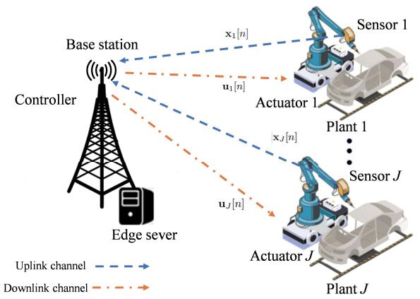

flowchart

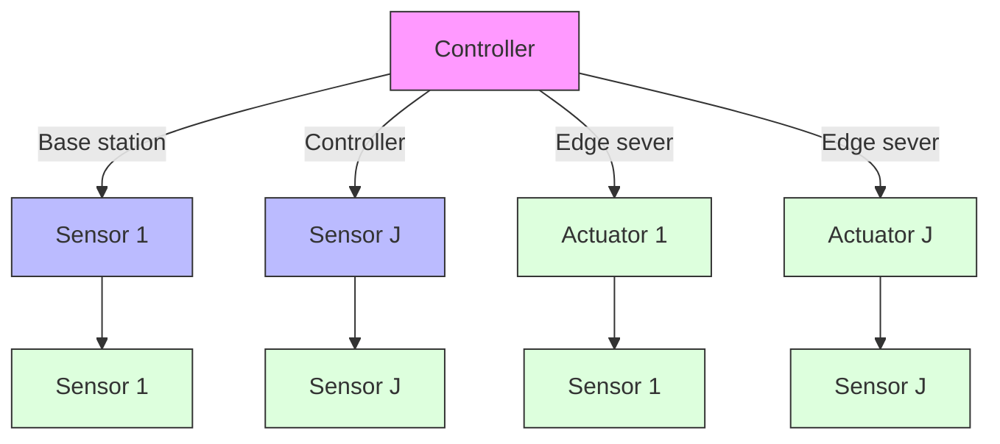

Fig. 1. The multi-plant wireless control system at network edge.

We consider one particular sample period, during which the TDMA operational protocol is implemented as shown in Fig. 2, such that the state uploading, edge computation, and control command downloading for different plants are operated over different time slots.1 In particular, each sample period with duration T is divided into $2 J + 1$ time slots, in which the first J time slots are used for state uploading, the $( J + 1 ) – \mathrm { t h }$ time slot is used for dedicated joint edge computing, and the last J time slots are used for command downloading.2 Let $\bar { t } _ { j }$ denote the uploading time duration of slot j for subsystem j, tˆ denote the dedicated edge computing time duration of slot $J + 1$ for all subsystems, and $\underline { { t } } _ { j }$ denote the downloading time duration of slot $J + j + 1$ for subsystem $\begin{array} { r } { \sum _ { j = 1 } ^ { J } \bar { t } _ { j } + \hat { t } + \sum _ { j = 1 } ^ { J } \underline { { t } } _ { j } = T } \end{array}$ $\bar { t } _ { j } \mathrm { ^ { * } s } ,$ $\underline { { t } } _ { j } ^ { \mathrm { ~ , ~ s , ~ } }$ , and T are variables need to be optimized later.

1As an initial work, in this paper we adopt the TDMA protocol to facilitate the joint task scheduling and resource allocation design to enhance control performance. Notably, the proposed design framework can be extended to other multiple access schemes such as frequency division multiple access and orthogonal frequency division multiple access.  
2Notice that the edge computing for each subsystem j can be implemented from slot j + 1 to slot $J + { \bar { j } } .$ . Although computation tasks can be completed before the allocated computation slot if the computation resource is sufficient, we consider that the downloading process starts from the $( J + 2 ) \tplus$ slot to avoid interference between uplink and downlink transmissions.

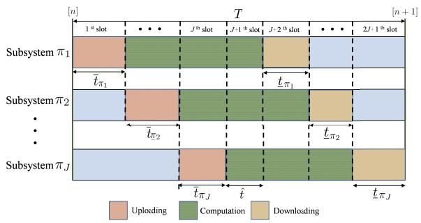

stacked bar chart

| Subsystem | Uploading | Computation | Downloading |
|-----------|-----------|-------------|-------------|
| π₁        | 1st slot  | jth slot    | 2J-1th slot |
| π₂        | t̂π₁       | t̂π₁         | t̂π₁        |
| π₃        | t̂π₂       | t̂π₂         | t̂π₂        |
| π₄        | t̂π₃       | t̂π₃         | t̂π₃        |

Fig. 2. TDMA operational protocol for multi-plant control.

Let permutation $\pi \triangleq [ \pi _ { 1 } , \pi _ { 2 } , \cdot \cdot \cdot , \pi _ { J } ]$ denote the task scheduling order for state uploading, edge computation, and command downloading among the J subsystems, which is also a decision variable to be optimized.3 In each particular slot j, the sensor of plant $\pi _ { j }$ sends the observed state vector $\hat { \mathbf { x } } _ { \pi _ { \mathcal { I } } }$ j to the BS controller for remote processing (e.g., via state estimation and linear state feedback [27]). Then, the BS processes the received signal starting from slot $j + 1$ to slot $J + j$ . After that, the BS transmits the obtained control command $\hat { \mathbf { u } } _ { \pi _ { j } }$ back to the corresponding plant $\pi _ { j }$ at slot $J + j + 1$ . In the following, we introduce the control model as well as the communication and computation model for wireless networked control.

## A. Control Model

In general, the state $\mathrm { v e c t o r } ^ { 4 } \ \hat { \mathbf { x } } _ { \pi _ { j } } ( t )$ of plant $\pi _ { j }$ changes continuously over time t, which can be characterized by the following continuous control function via a linear differential equation [28]:

$$
d \hat {\mathbf {x}} _ {\pi_ {j}} (t) = \mathbf {A} _ {\pi_ {j}} \hat {\mathbf {x}} _ {\pi_ {j}} (t) d t + \mathbf {B} _ {\pi_ {j}} \hat {\mathbf {u}} _ {\pi_ {j}} (t) d t + d \mathbf {n} _ {\pi_ {j}} (t), \tag {1}
$$

where $\begin{array} { r l r } { \mathbf { n } _ { \pi _ { i } } ( t ) } & { { } \in } & { \mathbb { R } ^ { M \times 1 } } \end{array}$ denotes the disturbance or the independent and identically distributed (i.i.d.) additive white Gaussian noise (AWGN) with mean zero and covariance $\mathbf { R } _ { \pi _ { j } } .$ , $\mathbf { A } _ { \pi _ { i } } \in \mathbb { R } ^ { M \times M }$ represents the dynamic relationships among system states, and $\begin{array} { l l l } { \mathbf { B } _ { \pi _ { i } } } & { \in } & { \mathbb { R } ^ { \bar { M } \times K } } \end{array}$ characterizes how the external control input $\hat { \mathbf { u } } _ { \pi _ { j } } ( t )$ influences the evolution of state variables.5

The above continuous-time control model can be expressed as an equivalent discrete-time one over samples. Let $\mathbf { x } _ { \pi _ { j } } [ n ]$ denote the state of plant $\pi _ { j }$ at sample n. Based on (1), the discrete-time control model of each subsystem j is accordingly obtained as

$$
\mathbf {x} _ {\pi_ {j}} [ n + 1 ] = \boldsymbol {\Gamma} _ {\pi_ {j}} \mathbf {x} _ {\pi_ {j}} [ n ] + \boldsymbol {\Lambda} _ {\pi_ {j}} \mathbf {u} _ {\pi_ {j}} [ n ] + \mathbf {n} _ {\pi_ {j}} [ n ], \tag {2}
$$

where ${ \bf u } _ { \pi _ { j } } [ n ]$ denotes the input vector of sample n that is used to control the actuator of plant $\pi _ { j } .$ . In (2), the state transition

3We consider that the BS executes the computing task in a first-come-firstserve manner, and sends the corresponding feedback signals to plants in the same order as the state uploading [19].  
4The state variables of control system constitute a minimal set of variables that fully describe the internal dynamic behavior of the system, such as the positions and velocities in mechanical systems, and the voltages and currents in electrical circuits.  
5One typical example of such a control system is the classic spring-massdamping (SMD) system [29] given in Appendix VII.

matrix $\mathbf { { \Gamma } } _ { \pi _ { i } } = e ^ { T \mathbf { { A } } _ { \pi _ { j } } } \in \mathbb { R } ^ { M \times M }$ describes how the discretized state evolves from one sample to the next,6 and the input matrix $\begin{array} { r } { { \bf { \Lambda } } _ { \pi _ { j } } = \left( \int _ { 0 } ^ { T } e ^ { { \bf { A } } _ { \pi _ { j } } t } d t \right) { \bf { B } } _ { \pi _ { j } } \in \mathbb { R } ^ { M \times K } } \end{array}$ describes how the discretized control input affects the state [30].

Next, we introduce the control input ${ \bf u } _ { \pi _ { j } } [ n ]$ for each subsystem $\pi _ { j } ~ \in ~ \mathcal { I }$ at sample n, which depends on whether the transmission of uploading and downloading is successful. Let $\overline { { \alpha } } _ { \pi _ { j } } [ n ]$ and $\underline { { \alpha } } _ { \pi _ { j } } [ n ]$ denote the indicators for the successful transmission of uploading and downloading, respectively. Here, $\overline { { \alpha } } _ { \pi _ { i } } [ n ] \ = \ 1$ (or $\underline { { \alpha } } _ { \pi _ { i } } [ n ] = 1 )$ means that the uploading (or downloading) is successful, while $\overline { { \alpha } } _ { \pi _ { i } } [ n ] = 0$ (or $\underline { { \alpha } } _ { \pi _ { i } } [ n ] = 0 )$ means that the transmission is in outage. Let Pr $\left\{ \overline { { { \alpha } } } _ { \pi _ { j } } [ n ] = 0 \right\} ~ = ~ \overline { { { \varepsilon } } } _ { \pi _ { j } }$ and $\mathrm { P r } \left\{ \underline { { \alpha } } _ { \pi _ { j } } [ n ] = 0 \right\} ~ = ~ \underline { { \varepsilon } } _ { \pi _ { j } }$ denote the outage probabilities for uploading and downloading, respectively. In particular, if $\overline { { \alpha } } _ { \pi _ { j } } [ n ] \underline { { \alpha } } _ { \pi _ { j } } [ n ] = 1$ or equivalently the state information and command signals are both correctly transmitted, then the optimal (closed-loop) linear negative feedback control is implemented, such that ${ \bf u } _ { \pi _ { j } } [ n ] = - { \bf K } _ { \pi _ { j } } { \bf x } _ { \pi _ { j } } [ n ]$ , where $\mathbf { K } _ { \pi _ { j } }$ is the feedback coefficient [27].7 By contrast, if $\overline { { { \alpha } } } _ { \pi _ { j } } [ n ] \underline { { { \alpha } } } _ { \pi _ { j } } [ n ] = 0$ or equivalently the state and/or command transmission fails, then we have ${ \bf u } _ { \pi _ { i } } [ n ] = 0$ for open-loop control [31]. Based on the control inputs, each subsystem $\pi _ { j }$ is expressed as

$$
\mathbf {x} _ {\pi_ {j}} [ n + 1 ] = \left\{ \begin{array}{l l} \boldsymbol {\Gamma} _ {\pi_ {j}} ^ {\text {close}} \mathbf {x} _ {\pi_ {j}} [ n ] + \mathbf {n} _ {\pi_ {j}} [ n ], & \text {if} \overline {{\alpha}} _ {\pi_ {j}} [ n ] \underline {{\alpha}} _ {\pi_ {j}} [ n ] = 1, \\ \boldsymbol {\Gamma} _ {\pi_ {j}} ^ {\text {open}} \mathbf {x} _ {\pi_ {j}} [ n ] + \mathbf {n} _ {\pi_ {j}} [ n ], & \text {if} \overline {{\alpha}} _ {\pi_ {j}} [ n ] \underline {{\alpha}} _ {\pi_ {j}} [ n ] = 0, \end{array} \right. \tag {3}
$$

where $\Gamma _ { \pi _ { j } } ^ { \mathrm { c l o s e } } = \Gamma _ { \pi _ { j } } - \Lambda _ { \pi _ { j } } { \bf K } _ { \pi _ { j } }$ j denotes the closed-loop control parameter, and Γopenπ $\mathbf { r } _ { \pi _ { j } } ^ { \mathrm { o p e n } } = \mathbf { r } _ { \pi _ { j } }$ = Γπj denotes the open-loop control parameter.

Ensuring the stability of plants is important for the operation of control systems. Towards this end, we apply the Lyapunovlike function to guarantee the stability of plants, which is expressed as $\Delta \left( \mathbf { x } _ { \pi _ { j } } [ n ] \right) = \mathbf { x } _ { \pi _ { j } } [ n ] ^ { T } \mathbf { Q } _ { \pi _ { j } \mathbf { x } _ { \pi _ { j } } } [ n ]$ , where $\mathbf { Q } _ { \pi _ { j } }$ is a given positive definite matrix [22] to evaluate the stability of subsystem $\pi _ { j }$ . In order to maintain the so-called Lyapunovlike stability, the functions $\Delta \left( \mathbf { x } _ { \pi _ { j } } [ n ] \right)$ should decrease at rates $\eta _ { \pi _ { j } } ~ < ~ 1$ during the evolution of each subsystem $\pi _ { j } ~ [ 2 2 ]$ . Due to the randomness introduced by control perturbation and transmission errors, $\mathbf { x } _ { \pi _ { j } } [ n ]$ and $\Delta \left( \mathbf { x } _ { \pi _ { j } } [ n ] \right)$ are random variables. By applying expectation over $\Delta \left( \mathbf { x } _ { \pi _ { j } } [ n ] \right)$ , the stability condition for each control subsystem $\pi _ { j }$ is given by [22]

$$
\mathbb {E} \left[ \Delta \left(\mathbf {x} _ {\pi_ {j}} [ n + 1 ]\right) \mid \mathbf {x} _ {\pi_ {j}} [ n ] \right] \leq \eta_ {\pi_ {j}} \Delta \left(\mathbf {x} _ {\pi_ {j}} [ n ]\right) + \operatorname{Tr} \left(\mathbf {Q} _ {\pi_ {j}} \mathbf {R} _ {\pi_ {j}}\right). \tag {4}
$$

By defining $\varepsilon _ { \pi _ { j } } = ( 1 - \overline { { \varepsilon } } _ { \pi _ { j } } ) ( 1 - \underline { { \varepsilon } } _ { \pi _ { i } } )$ and substituting (3) into (4), the stability condition in (4) is re-expressed as

$$
\begin{array}{l} \varepsilon_ {\pi_ {j}} \mathbf {x} _ {\pi_ {j}} [ n ] ^ {T} \boldsymbol {\Gamma} _ {\pi_ {j}} ^ {\text { close } T} \mathbf {Q} _ {\pi_ {j}} \boldsymbol {\Gamma} _ {\pi_ {j}} ^ {\text { close }} \mathbf {x} _ {\pi_ {j}} [ n ] + (1 - \varepsilon_ {\pi_ {j}}) \\ \mathbf {x} _ {\pi_ {j}} [ n ] ^ {T} \boldsymbol {\Gamma} _ {\pi_ {j}} ^ {\text { open } T} \mathbf {Q} _ {\pi_ {j}} \boldsymbol {\Gamma} _ {\pi_ {j}} ^ {\text { open }} \mathbf {x} _ {\pi_ {j}} [ n ] + \operatorname{Tr} \left(\mathbf {Q} _ {\pi_ {j}} \mathbf {R} _ {\pi_ {j}}\right) \\ \leq \eta_ {\pi_ {j}} \mathbf {x} _ {\pi_ {j}} [ n ] ^ {T} \mathbf {Q} _ {\pi_ {j}} \mathbf {x} _ {\pi_ {j}} [ n ] + \operatorname{Tr} \left(\mathbf {Q} _ {\pi_ {j}} \mathbf {R} _ {\pi_ {j}}\right), \tag {5} \\ \end{array}
$$

${ } ^ { 6 } \mathrm { H e r e } , e ^ { T { \bf A } _ { \pi _ { j } } } = { \bf I } + { \bf A } _ { \pi _ { j } } T + \frac { 1 } { 2 } ( { \bf A } _ { \pi _ { j } } T ) ^ { 2 } + \cdot \cdot \cdot + \frac { 1 } { n ! } ( { \bf A } _ { \pi _ { j } } T ) ^ { n } + \cdot \cdot \cdot .$

7In practice, there exist other feedback design methods [30] such as proportional integral derivative (PID) feedback control and linear quadratic regulator (LQR) feedback control. Here, we consider the most widely implemented linear negative feedback control method [30], while our design principles are extensible to other feedback control methods.

or equivalently

$$
\mathbf {x} _ {\pi_ {j}} [ n ] ^ {T} \left[ \eta_ {\pi_ {j}} \mathbf {Q} _ {\pi_ {j}} - \varepsilon_ {\pi_ {j}} \boldsymbol {\Gamma} _ {\pi_ {j}} ^ {\text { close } T} \mathbf {Q} _ {\pi_ {j}} \boldsymbol {\Gamma} _ {\pi_ {j}} ^ {\text { close }} - (1 - \varepsilon_ {\pi_ {j}}) \right.
$$

$$
\left. \boldsymbol {\Gamma} _ {\pi_ {j}} ^ {\text { open } T} \mathbf {Q} _ {\pi_ {j}} \boldsymbol {\Gamma} _ {\pi_ {j}} ^ {\text { open }} \right] \mathbf {x} _ {\pi_ {j}} [ n ] \geq 0. \tag {6}
$$

Notice that the inequality in (6) must hold for any plant state ${ \bf x } _ { \pi _ { j } } [ n ] \neq 0$ . Therefore, the stability condition in (6) is further equivalent to the following condition:

$$
\eta_ {\pi_ {j}} \mathbf {Q} _ {\pi_ {j}} - \varepsilon_ {\pi_ {j}} \boldsymbol {\Gamma} _ {\pi_ {j}} ^ {\text { close } T} \mathbf {Q} _ {\pi_ {j}} \boldsymbol {\Gamma} _ {\pi_ {j}} ^ {\text { close }} - (1 - \varepsilon_ {\pi_ {j}})
$$

$$
\boldsymbol {\Gamma} _ {\pi_ {j}} ^ {\text { open } T} \mathbf {Q} _ {\pi_ {j}} \boldsymbol {\Gamma} _ {\pi_ {j}} ^ {\text { open }} \succeq \mathbf {0}. \tag {7}
$$

## B. Communication and Computation Model for Wireless Networked Control

This subsection considers the communication and computation in the wireless networked control system for uploading, computing, and downloading, and the sensors and the BS are each equipped with a single antenna.8 First, we consider the state information uploading from each sensor $\pi _ { j }$ to BS at slot $\pi _ { j }$ . Let $\overline { { h } } _ { \pi _ { j } }$ denote the channel power gain from sensor $\pi _ { j }$ to the BS receiver. The corresponding signal-to-noise ratio (SNR) at the BS is γπj $\begin{array} { r } { \overline { { \gamma } } _ { \pi _ { j } } \ : = \ : \frac { \overline { { p } } _ { \pi _ { j } } \overline { { h } } _ { \pi _ { j } } } { \sigma ^ { 2 } } } \end{array}$ σ2 , where $\overline { { p } } _ { \pi _ { j } }$ denotes the transmit power at plant $\pi _ { j } ,$ and $\sigma ^ { 2 }$ denotes the noise power at the BS receiver. We consider the short-packet or finite blocklength transmission for HRLLC. In this case, the achievable rate of short-packet transmission for subsystem $\pi _ { j }$ is approximated by [12]

$$
\overline {{r}} _ {\pi_ {j}} \approx B \left[ \log \left(1 + \overline {{\gamma}} _ {\pi_ {j}}\right) - \sqrt {\frac {\tilde {V}}{\bar {t} _ {\pi_ {j}} B}} Q ^ {- 1} \left(\overline {{\varepsilon}} _ {\pi_ {j}}\right) \right], \tag {8}
$$

where $Q ^ { - 1 } ( \cdot )$ denotes the inverse of the Q function, B denotes the system bandwidth, $\overline { { t } } _ { \pi _ { i } }$ denotes the uplink transmission time, and $\tilde { V } \ = \ ( \log e ) ^ { 2 }$ denotes the approximated channel dispersion [32]. Based on (8), the outage probability for the state information uploading from sensor $\pi _ { j }$ to the BS is

$$
\overline {{\varepsilon}} _ {\pi_ {j}} \left(\overline {{p}} _ {\pi_ {j}}, \overline {{t}} _ {\pi_ {j}}\right) = Q \left(\frac {\sqrt {\overline {{t}} _ {\pi_ {j}} B} \log \left(1 + \frac {\overline {{p}} _ {\pi_ {j}} \overline {{h}} _ {\pi_ {j}}}{\sigma^ {2}}\right) - \frac {\overline {{\lambda}} _ {\pi_ {j}}}{\sqrt {\overline {{t}} _ {\pi_ {j}} B}}}{\log e}\right). \tag {9}
$$

Then, we consider the edge computing process at the BS. As shown in Fig. 2, after receiving the uploaded information, the BS edge server obtains control command via edge computing. Let $\hat { \lambda } _ { \pi _ { j } }$ denote the computing bits for subsystem $\pi _ { j } ,$ and $f _ { \pi _ { j } , k }$ denote the allocated CPU frequency for subsystem $\pi _ { j }$ at slot $k .$ Furthermore, let $S _ { \pi _ { j } }$ denote the density of the computing tasks. In order to complete the computing tasks within the allocated computation time, we have

$$
\begin{array}{l} \sum_ {k = 1} ^ {J - j} f _ {\pi_ {j}, k} \bar {t} _ {\pi_ {k + j}} + f _ {\pi_ {j}, J - j + 1} \hat {t} + \sum_ {k = J - j + 2} ^ {J} f _ {\pi_ {j}, k} \underline {{t}} _ {\pi_ {k + j - J - 1}} \\ \geq S _ {\pi_ {j}} \hat {\lambda} _ {\pi_ {j}}, \forall j \in \mathcal {J}. \tag {10} \\ \end{array}
$$

8The multi-antenna technique can be used to enhance the performance, which is left for future work.

Furthermore, let $F _ { \mathrm { m a x } }$ denote the maximum computing capacity of the edge server in cycles/s. Therefore, we have

$$
\sum_ {j = \max \{1, i - J \}} ^ {\min \{i - 1, J \}} f _ {\pi_ {j}, i - j} \leq F _ {\max}, \forall i \in \{2, \dots , 2 J \}. \tag {11}
$$

Then, we consider the command signal downloading from the BS to actuator $\pi _ { j }$ at slot $j + J + 1$ . Let $\underline { { h } } _ { \pi _ { j } }$ denote the channel power gain from the BS to the receiver of plant $\pi _ { j }$ . $\begin{array} { r } { \underline { { \gamma } } _ { \pi _ { i } } = \frac { \underline { { p } } _ { \pi _ { j } } \underline { { h } } _ { \pi _ { j } } } { \sigma ^ { 2 } } } \end{array}$ πj where σ2 $\underline { { p } } _ { \pi _ { j } }$ denotes the transmit power at the BS, and $\sigma ^ { 2 }$ denotes the noise power at plant $\pi _ { j } .$ . Similar to (8), the achievable rate of downlink transmission is approximated by

$$
\underline {{r}} _ {\pi_ {j}} \approx B \left[ \log \left(1 + \underline {{\gamma}} _ {\pi_ {j}}\right) - \sqrt {\frac {\tilde {V}}{\underline {{t}} _ {\pi_ {j}} B}} Q ^ {- 1} \left(\underline {{\varepsilon}} _ {\pi_ {j}}\right) \right]. \tag {12}
$$

Based on (12), we further have

$$
\underline {{\varepsilon}} _ {\pi_ {j}} \left(\underline {{p}} _ {\pi_ {j}}, \underline {{t}} _ {\pi_ {j}}\right) = Q \left(\frac {\sqrt {\underline {{t}} _ {\pi_ {j}} B} \log \left(1 + \frac {\underline {{p}} _ {\pi_ {j}} \underline {{h}} _ {\pi_ {j}}}{\sigma^ {2}}\right) - \frac {\underline {{\lambda}} _ {\pi_ {j}}}{\sqrt {\underline {{t}} _ {\pi_ {j}} B}}}{\log e}\right). \tag {13}
$$

## III. PROBLEM FORMULATION

In this section, we present the stability constrained closedloop control latency minimization problem of our interest. To facilitate the derivation, we first deal with the control stability constraint in (7), which is difficult to handle. This is due to the fact that $\Gamma _ { \pi _ { j } }$ is represented as an exponential function involving a matrix, and $\mathbf { \Delta } \Lambda _ { \pi _ { \lambda } }$ further incorporates its integrated form. In the following, we approximate constraint (7) as a tractable form. Towards this end, we consider the first-order approximations that $\begin{array} { r } { \mathbf { r } _ { \pi _ { j } } \approx \mathbf { I } + T \mathbf { A } _ { \pi _ { j } } } \end{array}$ j and ${ \bf \Lambda } \Lambda _ { \pi _ { j } } ~ \approx ~ T { \bf B } _ { \pi _ { j } }$ for subsystem $\pi _ { j } .$ . As the sampling duration T is sufficiently short, the first-order approximations are sufficiently accurate and the higher-order terms are negligible [33]. By replacing $\Gamma _ { \pi _ { j } }$ and $\Lambda _ { \pi _ { i } }$ as $\mathbf { I } { + } T \mathbf { A } _ { \pi _ { j } }$ and $T \mathbf { B } _ { \pi _ { j } }$ , respectively, the stability condition in (7) is approximated as

$$
\begin{array}{l} \eta_ {\pi_ {j}} \mathbf {Q} _ {\pi_ {j}} + \varepsilon_ {\pi_ {j}} \left[ \left(\mathbf {K} _ {\pi_ {j}} ^ {T} \mathbf {B} _ {\pi_ {j}} ^ {T} \mathbf {Q} _ {\pi_ {j}} + \mathbf {Q} _ {\pi_ {j}} \mathbf {B} _ {\pi_ {j}} \mathbf {K} _ {\pi_ {j}}\right) T \right. \\ + \left(\mathbf {A} _ {\pi_ {j}} ^ {T} \mathbf {Q} _ {\pi_ {j}} \mathbf {B} _ {\pi_ {j}} \mathbf {K} _ {\pi_ {j}} + \mathbf {K} _ {\pi_ {j}} ^ {T} \mathbf {B} _ {\pi_ {j}} ^ {T} \mathbf {Q} _ {\pi_ {j}} \mathbf {A} _ {\pi_ {j}} \right. \\ \left. \left. - \mathbf {K} _ {\pi_ {j}} ^ {T} \mathbf {B} _ {\pi_ {j}} ^ {T} \mathbf {Q} _ {\pi_ {j}} \mathbf {B} _ {\pi_ {j}} \mathbf {K} _ {\pi_ {j}}\right) T ^ {2} \right] \\ \begin{array}{l} - \left[ \mathbf {Q} _ {\pi_ {j}} + \left(\mathbf {A} _ {\pi_ {j}} ^ {T} \mathbf {Q} _ {\pi_ {j}} + \mathbf {Q} _ {\pi_ {j}} \mathbf {A} _ {\pi_ {j}}\right) T + \left(\mathbf {A} _ {\pi_ {j}} ^ {T} \mathbf {Q} _ {\pi_ {j}} \mathbf {A} _ {\pi_ {j}}\right) T ^ {2} \right] \\ \mathbf {0}, \end{array} \tag {14} \\ \end{array}
$$

in which $\varepsilon _ { \pi _ { j } } ~ = ~ \left( 1 - \overline { { { \varepsilon } } } _ { \pi _ { j } } \left( \overline { { { p } } } _ { \pi _ { j } } , \overline { { { t } } } _ { \pi _ { j } } \right) \right) \left( 1 - \underline { { { \varepsilon } } } _ { \pi _ { j } } \left( \underline { { { p } } } _ { \pi _ { j } } , \underline { { { t } } } _ { \pi _ { j } } \right) \right)$ is a function with respect to (w.r.t.) $\overline { { p } } _ { \pi _ { j } } , \bar { t } _ { \pi _ { j } } , \underline { { p } } _ { \pi _ { i } } ,$ and $\underline { { t } } _ { \pi _ { j } } .$ Furthermore, we impose a reliability threshold for short-packet transmissions, such that the corresponding outage probabilities for uploading and downloading cannot exceed the threshold $\varepsilon _ { \mathrm { t h } }$ , i.e.,

$$
\overline {{{\varepsilon}}} _ {\pi_ {j}} \left(\overline {{{p}}} _ {\pi_ {j}}, \overline {{{t}}} _ {\pi_ {j}}\right) \leq \varepsilon_ {\mathrm{th}}, \forall j \in \mathcal {J}, \tag {15}
$$

$$
\underline {{\varepsilon}} _ {\pi_ {j}} \left(\underline {{p}} _ {\pi_ {j}}, \underline {{t}} _ {\pi_ {j}}\right) \leq \varepsilon_ {\mathrm{th}}, \forall j \in \mathcal {J}. \tag {16}
$$

Based on the outage probability constraints in (15) and (16), we replace $\varepsilon _ { \pi _ { j } } \mathrm { a s } ( 1 - \varepsilon _ { \mathrm { t h } } ) ^ { 2 }$ , and accordingly re-express (14) as a worst-case stability condition in the following:

$$
\begin{array}{l} \left[ (1 - \varepsilon_ {\mathrm{th}}) ^ {2} \left(\mathbf {A} _ {\pi_ {j}} ^ {T} \mathbf {Q} _ {\pi_ {j}} \mathbf {B} _ {\pi_ {j}} \mathbf {K} _ {\pi_ {j}} + \mathbf {K} _ {\pi_ {j}} ^ {T} \mathbf {B} _ {\pi_ {j}} ^ {T} \mathbf {Q} _ {\pi_ {j}} \mathbf {A} _ {\pi_ {j}} \right. \right. \\ \left. \left. - \mathbf {K} _ {\pi_ {j}} ^ {T} \mathbf {B} _ {\pi_ {j}} ^ {T} \mathbf {Q} _ {\pi_ {j}} \mathbf {B} _ {\pi_ {j}} \mathbf {K} _ {\pi_ {j}}\right) - \mathbf {A} _ {\pi_ {j}} ^ {T} \mathbf {Q} _ {\pi_ {j}} \mathbf {A} _ {\pi_ {j}} \right] T ^ {2} \\ + \left[ (1 - \varepsilon_ {\mathrm{th}}) ^ {2} \left(\mathbf {K} _ {\pi_ {j}} ^ {T} \mathbf {B} _ {\pi_ {j}} ^ {T} \mathbf {Q} _ {\pi_ {j}} + \mathbf {Q} _ {\pi_ {j}} \mathbf {B} _ {\pi_ {j}} \mathbf {K} _ {\pi_ {j}}\right) \right. \\ \left. - \left(\mathbf {A} _ {\pi_ {j}} ^ {T} \mathbf {Q} _ {\pi_ {j}} + \mathbf {Q} _ {\pi_ {j}} \mathbf {A} _ {\pi_ {j}}\right) \right] T + (\eta_ {\pi_ {j}} - 1) \mathbf {Q} _ {\pi_ {j}} \succeq \mathbf {0}. \tag {17} \\ \end{array}
$$

For notational convenience, we define constant matrices

$$
\begin{array}{l} \mathbf {P} _ {\pi_ {j}} = (1 - \varepsilon_ {\mathrm{th}}) ^ {2} \left(\mathbf {A} _ {\pi_ {j}} ^ {T} \mathbf {Q} _ {\pi_ {j}} \mathbf {B} _ {\pi_ {j}} \mathbf {K} _ {\pi_ {j}} + \mathbf {K} _ {\pi_ {j}} ^ {T} \mathbf {B} _ {\pi_ {j}} ^ {T} \mathbf {Q} _ {\pi_ {j}} \mathbf {A} _ {\pi_ {j}} \right. \\ \left. - \mathbf {K} _ {\pi_ {j}} ^ {T} \mathbf {B} _ {\pi_ {j}} ^ {T} \mathbf {Q} _ {\pi_ {j}} \mathbf {B} _ {\pi_ {j}} \mathbf {K} _ {\pi_ {j}}\right) - \mathbf {A} _ {\pi_ {j}} ^ {T} \mathbf {Q} _ {\pi_ {j}} \mathbf {A} _ {\pi_ {j}}, (18) \\ \mathbf {M} _ {\pi_ {j}} = (1 - \varepsilon_ {\mathrm{th}}) ^ {2} \left(\mathbf {K} _ {\pi_ {j}} ^ {T} \mathbf {B} _ {\pi_ {j}} ^ {T} \mathbf {Q} _ {\pi_ {j}} + \mathbf {Q} _ {\pi_ {j}} \mathbf {B} _ {\pi_ {j}} \mathbf {K} _ {\pi_ {j}}\right) \\ - \left(\mathbf {A} _ {\pi_ {j}} ^ {T} \mathbf {Q} _ {\pi_ {j}} + \mathbf {Q} _ {\pi_ {j}} \mathbf {A} _ {\pi_ {j}}\right). (19) \\ \end{array}
$$

$$
\begin{array}{l} \mathbf {M} _ {\pi_ {j}} = (1 - \varepsilon_ {\mathrm{th}}) ^ {2} \left(\mathbf {K} _ {\pi_ {j}} ^ {T} \mathbf {B} _ {\pi_ {j}} ^ {T} \mathbf {Q} _ {\pi_ {j}} + \mathbf {Q} _ {\pi_ {j}} \mathbf {B} _ {\pi_ {j}} \mathbf {K} _ {\pi_ {j}}\right) \\ - \left(\mathbf {A} _ {\pi_ {j}} ^ {T} \mathbf {Q} _ {\pi_ {j}} + \mathbf {Q} _ {\pi_ {j}} \mathbf {A} _ {\pi_ {j}}\right). \tag {19} \\ \end{array}
$$

Therefore, the stability constraint (7) is finally converted to

$$
\mathbf {P} _ {\pi_ {j}} T ^ {2} + \mathbf {M} _ {\pi_ {j}} T + (\eta_ {\pi_ {j}} - 1) \mathbf {Q} _ {\pi_ {j}} \succeq \mathbf {0}, \forall j \in \mathcal {J}, \tag {20}
$$

where $\mathbf { P } _ { \pi _ { j } } , \mathbf { M } _ { \pi _ { j } }$ , and $\mathbf { Q } _ { \pi _ { j } }$ are real symmetric matrices. The constraints in (20) establish the relationship between the linear time-invariant system stability and closed-loop control latency.9

Our objective is to minimize the closed-loop control latency, i.e., the sample period $\begin{array} { r } { T = \sum _ { j = 1 } ^ { J } \bar { t } _ { \pi _ { j } } + \hat { t } ^ { \ast } + \sum _ { j = 1 } ^ { J } \underline { { t } } _ { \pi _ { i } } } \end{array}$ , by joint optimizing task scheduling $\pi = \{ \pi _ { j } \}$ , transmit power allocation $\pmb { p } = \{ \overline { { p } } _ { \pi _ { j } } , \underline { { p } } _ { \pi _ { i } } \}$ , time allocation $\bar { \pmb { t } } = \{ \bar { t } _ { \pi _ { j } } , \underline { { t } } _ { \pi _ { j } } , \hat { t } , T \}$ , and CPU frequency allocation $\boldsymbol { f } = \{ f _ { \pi _ { j } , k } \}$ , while ensuring the control stability constraint in (20), subject to various constraints on communication and computation resources. The stability constrained latency minimization problem is formulated as problem (P1) at the top of the next page.

$$
\text {(P1)}: \min _ {\boldsymbol {\pi}, \boldsymbol {p}, t, f} T \tag {21a}
$$

$$
\text { s.t. } \quad 0 \leq \overline {{p}} _ {\pi_ {j}} \leq P _ {\max}, \forall j \in \mathcal {J}, \tag {21b}
$$

$$
0 \leq \underline {{{p}}} _ {\pi_ {j}} \leq P _ {\max}, \forall j \in \mathcal {J}, \tag {21c}
$$

$$
\overline {{{\varepsilon}}} _ {\pi_ {j}} \left(\overline {{{p}}} _ {\pi_ {j}}, \overline {{{t}}} _ {\pi_ {j}}\right) \leq \varepsilon_ {\mathrm{th}}, \forall j \in \mathcal {J}, \tag {21d}
$$

$$
\underline {{{{\varepsilon}}}} _ {\pi_ {j}} \left(\underline {{{{p}}}} _ {\pi_ {j}}, \underline {{{{t}}}} _ {\pi_ {j}}\right) \leq \varepsilon_ {\mathrm{th}}, \forall j \in \mathcal {J}, \tag {21e}
$$

$$
\mathbf {P} _ {\pi_ {j}} T ^ {2} + \mathbf {M} _ {\pi_ {j}} T + (\eta_ {\pi_ {j}} - 1) \mathbf {Q} _ {\pi_ {j}} \succeq \mathbf {0}, \forall j \in \mathcal {J}, \tag {21f}
$$

$$
\begin{array}{l} \sum_ {k = 1} ^ {J - j} f _ {\pi_ {j}, k} \bar {t} _ {\pi_ {k + j}} + f _ {\pi_ {j}, J - j + 1} \hat {t} \\ + \sum_ {k = J - j + 2} ^ {J} f _ {\pi_ {j}, k} t _ {\pi_ {k + j - J - 1}} \geq S _ {\pi_ {j}} \hat {\lambda} _ {\pi_ {j}}, \forall j \in \mathcal {J}, \tag {21g} \\ \end{array}
$$

9The control stability constraint for other nonlinear time-invariant systems need to be derived based on the specific system model, which is an interesting topic for future work.

$$
\sum_ {j = \max \{1, i - J \}} ^ {\min \{i - 1, J \}} f _ {\pi_ {j}, i - j} \leq F _ {\max}, \forall i \in \{2, \dots , 2 J \}, \tag {21h}
$$

$$
T = \sum_ {j = 1} ^ {J} \bar {t} _ {\pi_ {j}} + \hat {t} + \sum_ {j = 1} ^ {J} t _ {\pi_ {j}}, \tag {21i}
$$

$$
\pi_ {j} \in \mathcal {J}, \pi_ {j} \neq \pi_ {i}, \forall i, j \in \mathcal {J}, j \neq i. \tag {21j}
$$

In problem (P1), constraints (21b) and (21c) ensure that the transmit power cannot exceed the maximum value $P _ { \mathrm { m a x } } ,$ and constraints (21d) and (21e) ensure the communication reliability. Furthermore, constraint (21f) corresponds to the control stability constraint, and constraints (21g) and (21h) specify the computation resource limitations. It is observed that problem (P1) is a non-convex combinatorial optimization problem due to the involvement of scheduling variable π and the non-convexity of constraints (21f) and (21g). Therefore, problem (P1) is non-trivial to be optimally solved.

To address this issue, we first optimize the communication and computation resource allocation under given task scheduling π in Section IV and then propose two task scheduling algorithms to find π in Section V.

## IV. JOINT COMMUNICATION AND COMPUTATION OPTIMIZATION UNDER GIVEN TASK SCHEDULINGπ

In this section, we optimize transmit power p, CPU frequency f, and time allocation t in problem (P1) under given task scheduling π. The joint communication and computation resource allocation problem is formulated as

$$
\begin{array}{l} \text {(P2)}: \min _ {\boldsymbol {p}, t, \boldsymbol {f}} T \\ \begin{array}{l} \text {s.t. (21b), (21c), (21d), (21e), (21f), (21g) ,} \end{array} \\ (2 1 \mathrm{h}), \text { and } (2 1 \mathrm{i}). \tag {22} \\ \end{array}
$$

It is observed that problem (P2) is still non-convex, and variables {t} and $\{ f \}$ are coupled together. To deal with this issue, we employ the alternating optimization to solve problem (P2). In the following, we optimize $\{ t , f \}$ and $\{ t , p \}$ under given p and f, respectively, in an alternating manner.

## A. Optimization of t and f With Given p

First, we optimize t and f in problem (P2) with given $^ { p , }$ for which the problem is expressed as

$$
\begin{array}{l} \text {(P3)}: \min _ {t, f} T \\ \text { s.t. } (2 1 \mathrm{d}), (2 1 \mathrm{e}), (2 1 \mathrm{f}), (2 1 \mathrm{g}), (2 1 \mathrm{h}), \text { and } (2 1 \mathrm{i}). \tag {23} \\ \end{array}
$$

Based on the outage probability in (9), constraints (21d) and (21e) are respectively re-expressed as

$$
\frac {\log e Q ^ {- 1} (\varepsilon_ {\mathrm{th}})}{\sqrt {\bar {t} _ {\pi_ {j}}}} + \frac {\overline {{\lambda}} _ {\pi_ {j}}}{\bar {t} _ {\pi_ {j}} \sqrt {B}} \leq \sqrt {B} \log \left(1 + \frac {\overline {{p}} _ {\pi_ {j}} \overline {{h}} _ {\pi_ {j}}}{\sigma^ {2}}\right), \tag {24}
$$

$$
\frac {\log e Q ^ {- 1} \left(\varepsilon_ {\mathrm{th}}\right)}{\sqrt {\underline {{t}} _ {\pi_ {j}}}} + \frac {\underline {{\lambda}} _ {\pi_ {j}}}{\underline {{t}} _ {\pi_ {j}} \sqrt {B}} \leq \sqrt {B} \log \left(1 + \frac {\underline {{p}} _ {\pi_ {j}} \underline {{h}} _ {\pi_ {j}}}{\sigma^ {2}}\right). \tag {25}
$$

Then, we have the following proposition.

Proposition 1: Constraint (24) is jointly convex w.r.t. $\bar { t } _ { \pi _ { j } }$ and $\overline { { p } } _ { \pi _ { j } }$ , and constraint (25) is jointly convex w.r.t. $\underline { { t } } _ { \pi _ { j } }$ and $\underline { { p } } _ { \pi _ { j } }$ .

Proof: For constraint (24), the left-hand-side can be shown to be a convex function w.r.t. $\bar { t } _ { \pi _ { j } }$ by checking its secondorder derivative, and the right-hand-side is concave w.r.t. $\overline { { p } } _ { \pi _ { j } }$ . Therefore, constraint (24) is convex w.r.t. $\bar { t } _ { \pi _ { j } }$ and $\overline { { p } } _ { \pi _ { j } }$ . Similarly, constraint (25) is also convex w.r.t. $\underline { { t } } _ { \pi _ { j } }$ and pπ . $\underline { { p } } _ { \pi _ { j } } .$ This proposition thus follows immediately.

Next, we deal with the stability constraint in (21f), which is non-convex due to the quadratic term $T ^ { 2 }$ . To address this issue, we introduce auxiliary variables a with $T ^ { 2 } = a ,$ which are equivalently expressed as the following two constraints:

$$
T ^ {2} \geq a, \tag {26}
$$

$$
T ^ {2} \leq a. \tag {27}
$$

Accordingly, we re-express constraint (21f) as the following constraint together with (26) and (27).

$$
\mathbf {P} _ {\pi_ {j}} a + \mathbf {M} _ {\pi_ {j}} T + (\eta_ {\pi_ {j}} - 1) \mathbf {Q} _ {\pi_ {j}} \succeq \mathbf {0}, \forall j \in \mathcal {J}. \tag {28}
$$

Furthermore, we handle the non-convex constraints in $( 2 1 \mathrm { g } )$ . Towards this end, we introduce auxiliary variables $\{ b _ { j , k } \}$ , and have $f _ { \pi _ { j } , k } \bar { t } _ { \pi _ { k + j } } \ge b _ { j , k } ^ { 2 } , \forall k \in \{ 1 , \ldots , J - j \} , j \in \mathcal { I } ,$ $f _ { \pi _ { j } , J - j + 1 } \hat { t } ~ \geq ~ b _ { j , J - j + 1 } ^ { 2 } , \forall j ~ \in ~ \mathcal { J } ,$ and $f _ { \pi _ { j } , k \underline { { t } } _ { \pi _ { k + j - J - 1 } } } \geq$ $\bar { b _ { j , k } ^ { 2 } } , \forall k \in \{ J - \bar { j } + 2 , \ldots , J \} , j \in \mathcal { I }$ , or equivalently

$$
\begin{array}{l} \left[ \begin{array}{c c} f _ {\pi_ {j}, k} & b _ {j, k} \\ b _ {j, k} & \overline {{t}} _ {\pi_ {k + j}} \end{array} \right] \succeq \mathbf {0}, \forall k \in \{1, \ldots , J - j \}, j \in \mathcal {J}, \\ \left[ \begin{array}{c c} f _ {\pi_ {j}, J - j + 1} & b _ {j, J - j + 1} \\ b _ {j, J - j + 1} & \hat {t} \end{array} \right] \succeq \mathbf {0}, \forall j \in \mathcal {J}, \\ \left[ \begin{array}{c c} f _ {\pi_ {j}, k} & b _ {j, k} \\ b _ {j, k} & \underline {{t}} _ {\pi_ {k + j - J - 1}} \end{array} \right] \succeq \mathbf {0}, \forall k \in \{J - j + 2, \dots , J \}, j \in \mathcal {J}. \tag {29} \\ \end{array}
$$

Accordingly, the constraints in (21g) become

$$
\sum_ {k = 1} ^ {J} b _ {j, k} ^ {2} \geq S _ {\pi_ {j}} \hat {\lambda} _ {\pi_ {j}}, \forall j \in \mathcal {J}. \tag {30}
$$

By combining the above transformations, problem (P3) is equivalently re-expressed as

$$
\begin{array}{l} \text {(P4)}: \min _ {\boldsymbol {t}, \boldsymbol {f}, a, \{b _ {j, k} \}} T \\ \text { s.t. } (2 1 \mathrm{d}), (2 1 \mathrm{e}), (2 6), (2 7), (2 8), (2 9), (3 0), (2 1 \mathrm{h}), \\ \text { and } (2 1 \mathrm{i}). \tag {31} \\ \end{array}
$$

Next, we consider problem (P4), in which only constraints (26) and (30) are non-convex. We employ the SCA technique to deal with the two constraints in an iterative manner. In each $r \geq 1$ $T ^ { ( r ) }$ $T ,$ $b _ { j , k } ^ { ( r ) }$ denote the local point of $b _ { j , k }$ . Based on the first-order Taylor expansion, the non-convex constraints in (26) and (30) are approximated as

$$
- T ^ {(r) ^ {2}} + a + (- 2 T ^ {(r)}) (T - T ^ {(r)}) \leq 0, \tag {32}
$$

$$
S _ {\pi_ {j}} \hat {\lambda} _ {\pi_ {j}} - \sum_ {k = 1} ^ {J} \left[ b _ {j, k} ^ {(r) ^ {2}} + 2 b _ {j, k} ^ {(r)} (b _ {j, k} - b _ {j, k} ^ {(r)}) \right] \leq 0, \forall j \in \mathcal {J}, \tag {33}
$$

respectively. Accordingly, we approximate problem (P4) as (P5.r) in the r-th inner iteration for SCA, which is convex and thus can be optimally solved by convex solvers such as CVX [34].

$$
\begin{array}{l} \text {(P5.} r): \min _ {\boldsymbol {t}, \boldsymbol {f}, a, \{b _ {j, k} \}} T \\ \begin{array}{l} \text {s.t. (21d), (21e), (32), (27), (28), (29), (33), (21h),} \end{array} \\ \text { and } (2 1 \mathrm{i}). \tag {34} \\ \end{array}
$$

By solving problem (P5.r) in an iterative manner, a converged solution of problem (P4) or equivalently (P3) is obtained.

Notice that the first-order approximations in the left-handsides of (32) and (33) serve as upper bounds of those in (26) and (30). Therefore, solving the series of problems in $( \mathrm { P 5 } . r )$ is ensured to result in monotonically decreasing objective values. Accordingly, the convergence of the SCA based solution to problem (P3) is ensured.

## B. Joint Optimization of t and p With Given f

Next, we optimize t and p in problem (P2) with given $f ,$ for which the problem is expressed as

$$
\text {(P6)}: \min _ {\boldsymbol {t}, \boldsymbol {p}} T
$$

$$
\text { s.t. } (2 1 \mathrm{b}), (2 1 \mathrm{c}), (2 1 \mathrm{d}), (2 1 \mathrm{e}), (2 1 \mathrm{f}), (2 1 \mathrm{g}), \text { and } (2 1 \mathrm{i}). \tag {35}
$$

Proposition 2: Constraint (21d) is jointly convex w.r.t. $\bar { t } _ { \pi _ { i } }$ and $\overline { { p } } _ { \pi _ { j } }$ , and constraint (21e) is jointly convex w.r.t. $\underline { { t } } _ { \pi _ { j } }$ and $\underline { { p } } _ { \pi _ { i } }$ .

Proof: This proposition can be easily verified similarly as for Proposition 1, for which the proof is omitted for brevity.

Problem (P6) is non-convex due to the non-convexity of constraint (21f). We deal with it similarly as for problem (P3) by using the change of variables together with SCA. In each iteration $r \geq 1$ with local point $T ^ { ( r ) }$ , we approximate constraint (21f) as (27), (28), and (32). As such, we approximate problem (P6) as $( \mathrm { P } 7 . r )$ in the r-th inner iteration, which can be expressed as

$$
\begin{array}{l} \text {(P7.} r): \min _ {\boldsymbol {t}, \boldsymbol {p}, a} T \\ \text { s.t. } (2 1 \mathrm{b}), (2 1 \mathrm{c}), (2 1 \mathrm{d}), (2 1 \mathrm{e}), (2 7), (2 8), (3 2), \\ (2 1 \mathrm{g}), \text { and } (2 1 \mathrm{i}). \tag {36} \\ \end{array}
$$

Problem $( \mathrm { P } 7 . r )$ is convex and thus can be solved by CVX.

Similarly as for problem (P3), the first-order approximation in the left-hand-sides of (32) serves as upper bounds of that in (26). Therefore, solving the series of problems in $( \mathrm { P } 7 . r )$ is also ensured to result in monotonically decreasing objective values. Accordingly, the convergence of the SCA based solution to problem (P6) is ensured.

With problem (P3) and (P6) solved independently, problem (P2) can be solved by solving them alternately. In particular, we first obtain the optimized solution $\{ t , f \}$ via solving problem (P3) under given transmit power $\{ p \}$ , and then obtain

## Algorithm 1 for Solving Problem (P2) Based on Alternating Optimization

Initialize: Set iteration index $t = 0 ,$ threshold for convergence $\epsilon ,$ and an initial feasible solution $\mathbf { \boldsymbol { p } } ^ { ( t ) }$ .

1: repeat  
2: Obtain $\{ t ^ { ( t + 1 ) } , f ^ { ( t + 1 ) } \}$ as the solution by solving problem (P3) with given $\{ p ^ { ( t ) } \}$ ;  
3: Obtain $\{ t ^ { ( t + 1 ) } , p ^ { ( t + 1 ) } \}$ as the solution by solving problem (P6) with given $\{ f ^ { ( t + 1 ) } \}$ , and corresponding objective value $T ^ { ( t + 1 ) }$ ;  
4: Update $t = t + 1 ;$  
5: until $T ^ { ( t - 1 ) } - T ^ { ( t ) } \leq \epsilon ;$

Output: The solution to problem (P2) $\{ \pmb { t } ^ { ( t ) } \pmb { p } ^ { ( t ) } , \pmb { f } ^ { ( t ) } \}$ , and the corresponding closed-loop control latency $T ^ { ( t ) } ,$ .

the updated solution $\{ t , p \}$ via solving problem (P6) under given {f}. We summarize the alternating optimization based algorithm for solving problem (P2) as Algorithm 1.

As the solutions to problem (P3) and (P6) are both converged, it is evident that the alternating optimization based Algorithm 1 is ensured to yield non-increasing control latency, and the iteration will terminate when the fractional decrease of the objective value is below a threshold. As a result, the convergence of Algorithm 1 for solving problem (P2) is ensured.

Complexity analysis: As Algorithm 1 requires alternately solving problem (P3) and problem (P6), we first analyze the algorithm complexity of problems (P3) and (P6), respectively. Given a solution accuracy  [35], the complexity for solving problem (P3) (by solving problem√ $( \mathrm { P 5 . r ) } )$ is $\mathcal { O } \left( \ln ( 1 / \epsilon ) \bar { \sqrt { J ^ { 2 } + M J } } \left( J ^ { 6 } + \dot { M } ^ { 2 } J ^ { 5 } + \bar { M } ^ { 3 } J ^ { 3 } \right) \right)$ , and the complexity for solving problem (P6) (by solving problem (P7.r)) is $\mathcal { O } \left( \ln ( 1 / \epsilon ) \sqrt { M J } \left( M ^ { 2 } J ^ { 3 } + M ^ { 3 } J ^ { 2 } \right) \right)$ . The algorithm complexity is dominated by the highest-degree polynomial term. Thus, the algorithm complexity of Algorithm√ 1 is $\mathcal { O } \left( \ln ( 1 / \epsilon ) \sqrt { J ^ { 2 } + M J } \left( \bar { J } ^ { 6 } + M ^ { 2 } J ^ { 5 } \stackrel { . } { + } M ^ { \bar { 3 } } J ^ { 3 } \right) \right)$ .

## V. TASK SCHEDULING BASED ON EXHAUSTIVE SEARCH AND FLOW-SHOP SCHEDULING

In this section, we present two algorithms to optimize the task scheduling π and accordingly solve problem (P1). The two algorithms are designed based on exhaustive search and flow-shop scheduling, respectively.

## A. Exhaustive Search Based Algorithm

In this subsection, we present the algorithm based on exhaustive search to find $\pi$ and accordingly solve problem (P1). Based on the idea of exhaustive search, we first solve problem (P2) under any given task scheduling π via Algorithm 1, and then compare the resultant control latency to find the optimized π achieving the smallest closed-loop control latency. The algorithm is summarized in Algorithm 2.

It is worth noting that the exhaustive search based solution in Algorithm 2 needs to solve problem (P2) a total number of J! times, the complexity of which increases exponentially with respect to J.

## Algorithm 2 for Solving Problem (P1) Based on Exhaustive Search Based Task Scheduling

1: Under any given task scheduling π, solve problem (P2) via Algorithm 1;  
2: Compare the resultant closed-loop latency under all possible $\pi ^ { \prime } \mathbf { s } ,$ and determine the minimally achieved latency as well as the corresponding solution as $\pi ^ { * } , p ^ { * } , t ^ { * } , f ^ { * } .$ .

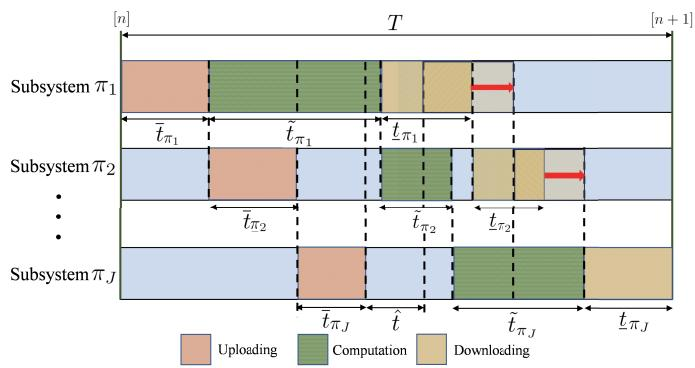

stacked bar chart

| Subsystem     | Uploading | Computation | Downloading |
| ------------- | --------- | ----------- | ----------- |
| Subsystem π₁  | t̄_π₁      | t̃_π₁       | t̄_π₁       |
| Subsystem π₂  | t̄_π₂      | t̃_π₂       | t̄_π₂       |
| Subsystem πⱼ   | t̄_πⱼ      | t̂          | t̃_πⱼ       |

Fig. 3. Equivalent protocol with flow-shop scheduling.

## B. Flow-Shop Scheduling Based Algorithm

To reduce the complexity caused by exhaustive search, in this subsection, we propose an alternative low-complexity solution to problem (P1), which determines the task scheduling based on flow-shop scheduling. Towards this end, we first show that under given communication and computation resource allocation, the task scheduling problem can be equivalently formulated as a flow-shop scheduling problem. Accordingly, we optimize the task scheduling based on the flow-shop scheduling and design the resource allocation via Algorithm 1 in an alternating manner, by assuming the other to be given in each iteration.

In order to formulate the task scheduling into a flow-shop scheduling problem, we first show that the TDMA protocol in Fig. 2 is equivalent to the flow-shop scheduling protocol in Fig. 3, in which the edge computation of BS is performed for each plant sequentially by using the maximum CPU frequency.

In the equivalent protocol of Fig. 3, suppose that the command signal downloading happens sequentially at the end of the sample period with duration $\underline { { t } } _ { \pi _ { 1 } } , \dots , \underline { { t } } _ { \pi _ { J } }$ for the J subsystems, respectively. It is equivalent to assume that the edge computation for each subsystem $\pi _ { j }$ is implemented independently over time by using the maximum frequency $F _ { \mathrm { m a x } }$ , with the computation duration being denoted as

$$
\tilde {t} _ {\pi_ {j}} = \frac {S _ {\pi_ {j}} \hat {\lambda} _ {\pi_ {j}}}{F _ {\max}}. \tag {37}
$$

Based on such equivalent transformation, we derive the closed-loop control latency T w.r.t. the time allocation $\{ \bar { t } _ { \pi _ { j } } , \tilde { t } _ { \pi _ { j } } , \underline { { t } } _ { \pi _ { j } } \} , \forall j \in \mathcal { I }$ . For simplicity, let $\overline { { T } } _ { \pi _ { j } }$ denote the time duration from the beginning of sample period to the end of computation for subsystem $\pi _ { j }$ . We have

$$
\overline {{T}} _ {\pi_ {j}} = \left\{ \begin{array}{l l} \bar {t} _ {\pi_ {1}} + \tilde {t} _ {\pi_ {1}}, & \text { if   } j = 1, \\ \max \left\{\sum_ {k = 1} ^ {j} \bar {t} _ {\pi_ {j}}, \overline {{T}} _ {\pi_ {j - 1}} \right\} + \tilde {t} _ {\pi_ {j}}, & \text { if   } j > 1. \end{array} \right. \tag {38}
$$

It thus follows that the dedicated computation time duration is

$$
\hat {t} = \overline {{{T}}} _ {\pi_ {1}} - \sum_ {j = 1} ^ {J} \bar {t} _ {\pi_ {j}}. \tag {39}
$$

Furthermore, let $\hat { T } _ { \pi _ { j } }$ denote the time duration from the beginning of sample period to the end of downloading for subsystem $\pi _ { j }$ . We have

$$
\hat {T} _ {\pi_ {j}} = \left\{ \begin{array}{l l} \overline {{T}} _ {\pi_ {1}} + \underline {{t}} _ {\pi_ {1}}, & \text { if   } j = 1, \\ \max \{\overline {{T}} _ {\pi_ {j}}, \hat {T} _ {\pi_ {j - 1}} \} + \underline {{t}} _ {\pi_ {j}}, & \text { if   } j > 1. \end{array} \right. \tag {40}
$$

Accordingly, we have the closed-loop control latency as $T =$ TˆπJ . $\hat { T } _ { \pi _ { J } }$

Based on the above changes of variables, we equivalently formulate the task scheduling problem with given resource allocations based on equivalent time allocations $\overset { \mathbf { \bar { \mathbf { \rho } } } } { \mathbf { \Sigma } } \mathbf { t ^ { F } = }$ $\{ \bar { t } _ { \pi _ { j } } , \underline { { t } } _ { \pi _ { j } } , \tilde { t } _ { \pi _ { j } } , T \}$ as

$$
\text {(P8)}: \min _ {\pi} T
$$

$$
\mathrm{s.t.} T = \hat {T} _ {\pi_ {J}},
$$

$$
(2 1 \mathrm{j}), (3 8), \text { and } (4 0). \tag {41}
$$

Problem (P8) is a combinatorial optimization w.r.t. $\pi ,$ with the objective of finding an optimal order of task scheduling among subsystems to minimize the overall closed-loop control latency. It is evident that problem (P8) is a flow-shop scheduling problem.10 More specifically, it can be shown that problem (P8) is a type of $F / J / 3 \mid ( \mathrm { p e r m } ) , ( \mathrm { p m t n } ) \mid C _ { \mathrm { m a x } }$ flow-shop scheduling problem [37], defined in the following.

Definition $\boldsymbol { l } \colon \boldsymbol { F } / J / 3$ | (perm), (pmtn) | $C _ { \mathrm { m a x } }$ refers to the type of flow-shop scheduling problems characterized by the following properties [37]:

a) There are J independent tasks, each requiring sequential processing by three machines $M _ { 1 } , M _ { 2 }$ , and $M _ { 3 }$ .  
b) All tasks are initially available for processing at $M _ { 1 }$ , followed by their availability for processing at $M _ { 2 }$ upon completion of $M _ { 1 }$ processing. Subsequently, tasks become available for processing at $M _ { 3 }$ after completion of $M _ { 2 }$ processing.  
c) Each machine can process only one task at a time.  
d) Permutation scheduling is employed, wherein tasks follow the same order of processing through the three machines, denoted as (perm) in the notation.  
e) Non-preemptive processing is mandated, meaning that once the processing of a task commences, interruption

10Flow-shop scheduling problems are defined as a class of problems that aims to schedule multiple tasks with multiple operations on corresponding machines with same numbers for optimizing one or multiple objective functions. A machine can deal with only one task at a time. All tasks need to be processed on each machine requiring a non-negative processing time. They have the same process route, i.e., the machines in a flow shop have a predetermined sequence that cannot be changed [36].

is not permitted. This constraint is denoted as (pmtn) in the notation.

f) Each machine is equipped with a buffer of infinite capacity to accommodate tasks that have arrived but are not yet processed.  
g) The objective is to minimize the makespan of the J tasks, denoted as $C _ { \mathrm { m a x } }$ in the definition.

The following proposition shows that problem (P8) is a $F / J / 3 \mid$ (perm), (pmtn) $\mid C _ { \mathrm { m a x } }$ problem.

Proposition 3: The task scheduling optimization of $\pi$ in problem (P8) is a $F / J / 3 \mid$ (perm), (pmtn) | $C _ { \mathrm { m a x } }$ type of flow-shop scheduling problem.

Proof: In the task offloading scheduling problem, each computation task undergoes three sequential procedures before its completion, namely uploading of the sensing signals, computation of control feedback at the edge server, and downloading of the control command back to the plant. The time durations of the three procedures are $\bar { t } _ { \pi _ { j } } , \tilde { t } _ { \pi _ { j } }$ , and $\underline { { t } } _ { \pi _ { j } } ,$ respectively. Consequently, the transmitter of plant, the edge server, and the transmitter of edge server correspond to $M _ { 1 }$ , $M _ { 2 } ,$ , and $M _ { 3 } ,$ , respectively, as defined in Definition 1. Hence, the task processing durations in the three machines correspond to $\bar { t } _ { \pi _ { j } } , \tilde { t } _ { \pi _ { j } } ,$ , and $\underline { { t } } _ { \pi _ { i } }$ , respectively. It can be verified that the other properties outlined in Definition 1 also apply to the task offloading scheduling problem. Consequently, problem (P8) constitutes a $F / J / 3 \mid$ (perm), (pmtn) $\mid \ C _ { \mathrm { m a x } }$ type of flowshop scheduling problem.

Since the task scheduling problem (P8) is a $F / J / 3 \mid$ (perm), (pmtn) | $C _ { \mathrm { m a x } }$ type of flow-shop scheduling problem, the Peter Rof-Hamm Algorithm’s (developed from the Johnson’s Algorithm, which is used to solve $F / J / 2 \quad |$ (perm), (pmtn) $C _ { \mathrm { m a x } }$ problem [19]) can be applied to find an efficient suboptimal solution [37].

In the Peter Rof-Hamm’s Algorithm, the three machines are regarded as two virtual machines, where $M _ { 1 } , M _ { 2 }$ are regarded as virtual machine $M _ { 1 } ^ { \prime }$ , and $M _ { 2 } , M _ { 3 }$ are regarded as virtual machine $M _ { 2 } ^ { \prime }$ . Then we apply the Johnson’s Algorithm to the newly formed $F / J / 2 \mid ( \mathrm { p e r m } ) , ( \mathrm { p m t n } ) \mid C _ { \mathrm { m a x } }$ problem. In particular, we divide the set of control subsystems $\mathcal { I }$ into two disjoint subsets $\mathcal { F }$ and $\mathcal { G }$ , where ${ \mathcal F } = \{ \pi _ { j } \in { \mathcal J } \mid \bar { t } _ { \pi _ { j } } + \tilde { t } _ { \pi _ { j } } <$ $\tilde { t } _ { \pi _ { j } } + \underline { { t } } _ { \pi _ { i } } \}$ and $\mathcal { G } = \{ \pi _ { j } \in \mathcal { I } \mid \bar { t } _ { \pi _ { j } } + \tilde { t } _ { \pi _ { j } } \geq \tilde { t } _ { \pi _ { j } } + \underline { { t } } _ { \pi _ { i } } \}$ . Then, we schedule set $\mathcal { F }$ based on the ascending order of $\bar { t } _ { \pi _ { j } } + \tilde { t } _ { \pi _ { j } }$ , and schedule the set $\mathcal { G }$ based on the descending order of $\tilde { t } _ { \pi _ { j } } + \underline { { t } } _ { \pi _ { i } }$ . Finally, we get the task scheduling as $\pi ^ { * } = [ \mathcal { F } , \mathcal { G } ]$ ]. The detail of the Peter Rof-Hamm Algorithm is summarized in Algorithm 3.

Finally, we summarize the algorithm based on flow-shop scheduling to solve the problem (P1), as Algorithm 4. At each iteration $t \geq 1$ , we first obtain the updated solution $\{ \pi \}$ via solving problem (P8) under given transmit power $\{ p \}$ and time allocation $\{ t ^ { \mathrm { F } } \}$ based on Algorithm 3. Then we obtain the updated solution $\{ t , p \}$ under given scheduling $\{ \pi \}$ by solving problem (P6). Based on the updated t, we obtain $t ^ { \dot { \mathrm { F } } }$ based on (39) and proceed with the next iteration. The above iterations terminate until converge.

It is worth noting that Algorithm 4 only needs to solve problem (P8) at most $\operatorname { c e i l } ( J \log _ { 2 } J )$ times, which is much

## Algorithm 3 for Solving Problem (P8)

## Initialize: The latency allocation $t ^ { \mathrm { F } } ;$ ;

1: Divide subsystem set $\mathcal { I }$ into two disjoint subsets, i.e., set $\mathcal { F } = \{ \pi _ { j } \in \mathcal { I } \mid \bar { t } _ { \pi _ { j } } + \tilde { t } _ { \pi _ { j } } < \tilde { t } _ { \pi _ { j } } + \underline { { t } } _ { \pi _ { j } } \}$ and set $\mathcal { G } = \{ \pi _ { j } \in \mathcal { I } \mid \overline { { t } } _ { \pi _ { j } } + \tilde { t } _ { \pi _ { j } } \geq \tilde { t } _ { \pi _ { j } } + \underline { { t } } _ { \pi _ { j } } \} ;$  
2: Sort the index of subsystems in set $\mathcal { F }$ according to the ascending order of $\bar { t } _ { \pi _ { j } } + \tilde { t } _ { \pi _ { j } }$ , i.e., ${ \bar { t } } _ { [ 1 ] } + { \tilde { t } } _ { [ 1 ] } \leq \cdots \leq$ ${ \bar { t } } _ { [ | \mathcal { F } | ] } + { \tilde { t } } _ { [ | \mathcal { F } | ] } , [ i ] \in \mathcal { F } , \dot { i } = 1 , \dot { \cdots } , | \mathcal { F } | ;$  
3: Sort the index of subsystems in set $\mathcal { G }$ according to the descending order of $\tilde { t } _ { \pi _ { j } } + \underline { { { t } } } _ { \pi _ { j } } , \mathrm { i . e . , } \tilde { t } _ { < 1 > } + \underline { { { t } } } _ { < 1 > } \geq \cdots \geq$ $\tilde { t } _ { < | \mathcal { G } | > } + \underline { { t } } _ { < \mathcal { G } > } , [ j ] \in \mathcal { G } , j = \mathcal { \bar { 1 } } , \cdots , | \mathcal { G } | ;$

Output: The optimal scheduling of tasks $\pi ^ { * } \quad =$ $[ [ 1 ] , \cdots , [ | { \mathcal { F } } | ] , < 1 > , \cdots , < | { \mathcal { G } } | > ] .$ .

## Algorithm 4 for Solving Problem (P1) Based on Flow-Shop Scheduling

Initialize: Set iteration index $t = 0 ,$ threshold for convergence , and initial feasible solution for p(t) and tF(t); $\mathbf { \boldsymbol { p } } ^ { ( t ) }$ $t ^ { \mathrm { F ( t ) } }$

1: repeat  
2: Obtain the updated solution $\{ \pi ^ { ( t + 1 ) } \}$ given $\{ p ^ { ( t ) } \}$ and $\{ t ^ { \mathrm { F ( t ) } } \}$ by solving problem (P8) via Algorithm 3;  
3: Obtain the updated solution $\{ \pmb { p } ^ { ( t + 1 ) } , \pmb { t } ^ { ( t + 1 ) } \}$ by solving problem (P4) with given $\scriptstyle { \left\{ \pi ^ { ( t + 1 ) } \right\} }$ , and obtain the objective value as $T ^ { ( \overline { { t } } + 1 ) }$ ;  
4: Determine $t ^ { \mathrm { F ( t + 1 ) } }$ based on $\pmb { t } ^ { ( t + 1 ) }$ via (39);  
5: Update $t = t + 1 ;$  
6: until $T ^ { ( t - 1 ) } - T ^ { ( t ) } \leq \epsilon ;$

Output: The solution of problem (P1) $\{ \pi ^ { ( t ) } , p ^ { ( t ) } , t ^ { ( t ) } \}$ and the corresponding closed-loop control latency $T ^ { ( t ) }$ .

smaller than that in Algorithm 2. Here, ceil(·) denotes the upward rounding function.

Complexity analysis: Since Algorithm 2 for solving problem (P1) exhaustively enumerates all J! possible task sequences, its algorithm complexity√ is $\mathcal { O } \left( J ! \ln ( 1 / \epsilon ) \bar { \sqrt { J ^ { 2 } + M J } } \left( J ^ { 6 } \bar { + } M ^ { 2 } J ^ { 5 } + \bar { M ^ { 3 } } J ^ { 3 } \right) \right)$ . Algorithm 3 is designed for solving problem (P8) based on the Peter Rof-Hamm Algorithm’s developed from Johnson’s Algorithm, and thus the algorithm complexity is $\mathcal { O } \left( J \log J \right)$ . Since Algorithm 4 requires alternately solving problem (P8) (using Algorithm 3) and problem (P4) (approximated as problem (P5.r)), its algorithm complexity is√ $\hat { \mathcal { O } } ( J \log J + \ln ( 1 \hat { / } \epsilon ) \sqrt { J ^ { 2 } + M J } ( J ^ { 6 } \overset {  } { + } M ^ { 2 } J ^ { 5 } + M ^ { \hat { 3 } } J ^ { 3 } ) )$ .

## VI. NUMERICAL RESULTS

In this section, we provide numerical results to demonstrate the performance of our proposed design. Suppose that there are $J = 3$ subsystems and $m = 2$ state values. We set ${ \bf R } _ { 1 } =$ $\mathbf { R } _ { 2 } = \mathbf { R } _ { 3 } = [ 1 , 0 ; 0 , 1 ] , \mathbf { A } _ { 1 } = [ 2 , 1 ; 2 , 1 ] , \mathbf { B } _ { 1 } = [ 1 , 0 ; 0 , 1 ]$ , $\mathbf Q _ { 1 } = [ 1 , 0 ; 0 , 1 ] , ~ \mathbf A _ { 2 } = [ 1 , 1 ; 0 , 1 ] , ~ \mathbf B _ { 2 } = [ 1 , 0 ; 0 , 1 ] , ~ \mathbf Q _ { 2 } =$ $[ 1 , 0 ; 0 , 1 ] , \mathbf { A } _ { 3 } = [ 1 , 1 ; 1 , 1 ] , \mathbf { B } _ { 3 } = [ 1 , 0 ; 0 , 1 ] , \mathbf { Q } _ { 3 } = [ 1 , 0 ; 0 , 1 ] .$ , $P _ { \mathrm { m a x } } = 1 \mathrm { W }$ , and $B = 1 0 \mathrm { M H z } .$ The path loss between BS and plant is modeled as $\begin{array} { r } { \beta _ { 0 } \left( \frac { d _ { j } } { d _ { 0 } } \right) ^ { - \xi } } \end{array}$ d , where $\beta _ { 0 } = - 3 0 \mathrm { d B }$ denotes the path loss at the reference distance $d _ { 0 } = 1 \mathrm { m } , d _ { j }$ denotes the distance between them, and $\xi = 2$ denotes the path loss exponent. The noise power spectral density is set as $N _ { 0 } =$ $- 1 1 0 \mathrm { d B m / H z }$ and the threshold of outage probability is set as $\varepsilon _ { \mathrm { t h } } = 1 0 ^ { - 7 }$ , satisfying the requirements of HRLLC. The threshold for convergence $\epsilon = 1 0 ^ { - 6 } \mathrm { s }$ .

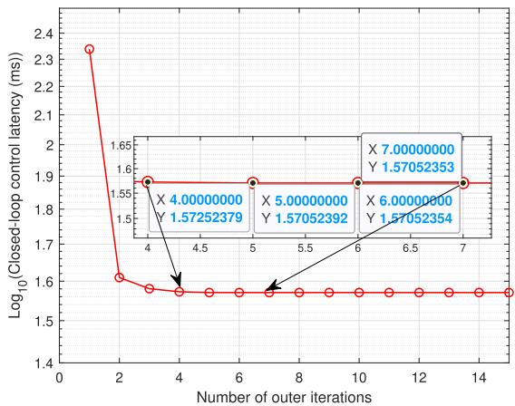

line chart

| Number of outer iterations | Log₁₀(Closed-loop control latency (ms)) |
| -------------------------- | ---------------------------------------- |
| 4                          | 1.57252379                               |
| 5                          | 1.57052392                               |
| 6                          | 1.57052354                               |
| 7                          | 1.57052353                               |

Fig. 4. Convergence behavior of the proposed Algorithm 1 with given π.

We consider the following three benchmark schemes for comparison:

Communication optimization only: We optimize transmit power and time allocation with uniformly allocated computing frequency for the subsystems with $f _ { 1 , 2 } = f _ { 2 , 1 } =$ $\begin{array} { r } { \frac { F _ { \mathrm { m a x } } } { 2 } , \ f _ { 1 , 3 } = \ f _ { 2 , 2 } = \ f _ { 3 , 1 } = \ \frac { F _ { \mathrm { m a x } } } { 3 } } \end{array}$ , in which the task scheduling is given as $\pi = [ 1 ~ 2 ~ 3 ] .$ .  
• Computation optimization only: We optimize the computing frequency and time allocation with equal transmit power $\overline { { p } } _ { 1 } = \underline { { p } } _ { 1 } = \overline { { p } } _ { 2 } = \underline { { p } } _ { 2 } = \overline { { p } } _ { 3 } = \underline { { p } } _ { 3 } = 0 . 5 \mathrm { W }$ , where the task scheduling order is given as $\overset { \vartriangle } { \boldsymbol { \pi } } = [ 1 \ 2 \ 3 ]$ .  
• Equal resource allocation: Both computing and communication resources are equally allocated over different subsystems with $\begin{array} { r } { f _ { 1 , 2 } = f _ { 2 , 1 } = \frac { F _ { \mathrm { m a x } } } { 2 } , f _ { 1 , 3 } = f _ { 2 , 2 } = } \end{array}$ $\begin{array} { r } { f _ { 3 , 1 } = \frac { F _ { \mathrm { m a x } } } { 3 } } \end{array}$ , and $\overline { { { p } } } _ { 1 } = \underline { { { p } } } _ { 1 } = \overline { { { p } } } _ { 2 } = \underline { { { p } } } _ { 2 } = \overline { { { p } } } _ { 3 } = \underline { { { p } } } _ { 3 } =$ 0.5W, and $\pi = [ 1 2 3 ]$ .  
• Joint design without task scheduling: The computation and communication resources are optimized jointly, in which the task scheduling order is given as $\pi = [ 1 ~ 2 ~ 3 ]$ .

Fig. 4 shows the convergence behavior of our proposed alternating optimization based Algorithm 1 for solving problem (P2), where $d _ { 1 } = d _ { 2 } = d _ { 3 } = 1 0 \mathrm { m }$ , $\begin{array} { r l } { F _ { \operatorname* { m a x } } } & { { } = } \end{array}$ 2Gcycles/s, S1 = 10000cycles/bit, $S _ { 2 } = 1 0 0 0 \mathrm { { c y c l e s } / \mathrm { { b i t } , } }$ S3 = 100cycles/bit, $\overline { { { \lambda } } } _ { 1 } = \hat { \lambda } _ { 1 } = \underline { { { \lambda } } } _ { 1 } = 1 0 0 \mathrm { b i t s }$ , $\bar { \lambda _ { 2 } } = \hat { \lambda _ { 2 } } =$ $\underline { { \lambda } } _ { 2 } = 1 0 0 0 \mathrm { { b i t s } , }$ and $\begin{array} { r } { \overline { { \lambda } } _ { 3 } = \hat { \lambda } _ { 3 } = \underline { { \lambda } } _ { 3 } = 1 0 0 0 0 \mathrm { b i t s } . } \end{array}$ . It is observed that the proposed algorithm converges within around 5 outer iterations, thus validating its effectiveness.

Fig. 5 shows the convergence behavior of our proposed Algorithm 4 for solving problem (P1) based on flow-shop scheduling, where the simulation setup is the same as Fig. 4. It is observed that the proposed algorithm based on flow-shop scheduling converges within around 3 outer iterations.

Fig. 6 shows the closed-loop control latency of the proposed design versus payloads $\lambda _ { 2 } = \overline { { { \lambda } } } _ { 2 } = \hat { \lambda } _ { 2 } = \underline { { { \lambda } } } _ { 2 }$ of subsystem 2, where $d _ { 1 } = d _ { 2 } = d _ { 3 } = 1 0 \mathrm { m } , F _ { \mathrm { m a x } } = 1 \mathrm { G c y c l e s } / \mathrm { s } , S _ { 1 } = S _ { 2 } =$ $S _ { 3 } = \mathrm { 5 0 0 c y c l e s } / \mathrm { b i t } , \ \overline { { { \lambda } } } _ { 1 } = \hat { \lambda } _ { 1 } = \underline { { { \lambda } } } _ { 1 } = \mathrm { 8 0 0 b i t s } ,$ and $\overline { { { \lambda } } } _ { 3 } ~ =$ $\hat { \lambda } _ { 3 } = \lambda _ { 3 } = 1 6 0 0 \mathrm { b i t s }$ . It is observed that with $\lambda _ { 2 }$ increasing, the optimal permutation of proposed joint design changes, e.g., the permutation [1 3 2] achieves the lowest closed-loop control latency when $\lambda _ { 2 } ~ = ~ 4 0 0 \mathrm { b i t s }$ , while the permutation [3 2 1] achieves the lowest closed-loop control latency when $\lambda _ { 2 } =$ 2000bits. This shows that payloads of a subsystem affect the optimal scheduling order to achieve the lowest closed-loop control latency.

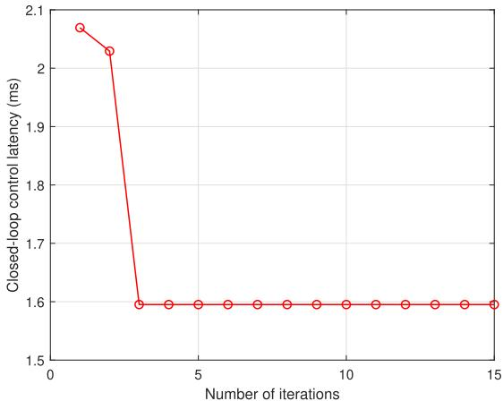

line chart

| Number of iterations | Closed-loop control latency (ms) |
| -------------------- | -------------------------------- |
| 1                    | 2.08                             |
| 2                    | 2.03                             |
| 3                    | 1.60                             |
| 4                    | 1.60                             |
| 5                    | 1.60                             |
| 6                    | 1.60                             |
| 7                    | 1.60                             |
| 8                    | 1.60                             |
| 9                    | 1.60                             |
| 10                   | 1.60                             |
| 11                   | 1.60                             |
| 12                   | 1.60                             |
| 13                   | 1.60                             |
| 14                   | 1.60                             |
| 15                   | 1.60                             |

Fig. 5. Convergence behavior of the proposed flow-shop scheduling based Algorithm 4.

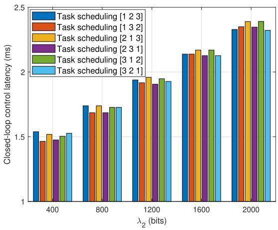

bar chart

| λ₂ (bits) | Task scheduling [1 2 3] | Task scheduling [1 3 2] | Task scheduling [2 1 3] | Task scheduling [2 3 1] | Task scheduling [3 1 2] | Task scheduling [3 2 1] |
| --------- | ------------------------ | ------------------------ | ------------------------ | ------------------------ | ------------------------ | ------------------------ |
| 400       | 1.55                     | 1.48                     | 1.52                     | 1.49                     | 1.51                     | 1.54                     |
| 800       | 1.75                     | 1.68                     | 1.76                     | 1.70                     | 1.74                     | 1.75                     |
| 1200      | 1.95                     | 1.90                     | 1.98                     | 1.92                     | 1.96                     | 1.94                     |
| 1600      | 2.15                     | 2.13                     | 2.18                     | 2.14                     | 2.20                     | 2.16                     |
| 2000      | 2.35                     | 2.33                     | 2.40                     | 2.36                     | 2.42                     | 2.38                     |

Fig. 6. Closed-loop control latency versus payloads of subsystem 2 under different task scheduling order.

Fig. 7 shows the closed-loop control latency achieved by different designs versus $F _ { \mathrm { m a x } } ,$ , where the settings of parameters are the same as Fig. 4. It is observed that with $F _ { \mathrm { m a x } }$ increasing, the closed-loop control latency obtained by different designs decrease, in which the proposed algorithm based on exhaustive search achieves the lowest latency. Moreover, the latency achieved by the proposed algorithm based on flow-shop scheduling is close to the proposed design with exhaustive search and outperforms other benchmark schemes. This shows that the proposed algorithm based on flow-shop scheduling is able to perform close to the algorithm based on exhaustive search, with much lower complexity. On the other hand, it is observed that the gaps between the algorithm based on exhaustive search (and flow-shop scheduling) and other benchmark schemes decreases as the capability of edge server $F _ { \mathrm { m a x } }$ becomes larger.

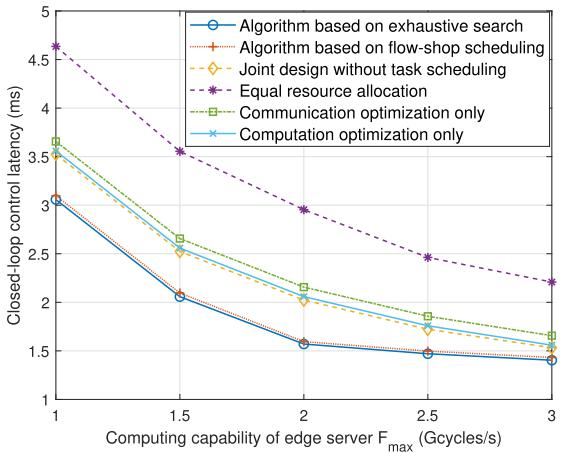

line chart

| Computing capability of edge server F_max (Gcycles/s) | Algorithm based on exhaustive search | Algorithm based on flow-shop scheduling | Joint design without task scheduling | Equal resource allocation | Communication optimization only | Computation optimization only |
| --------------------------------------------------- | -------------------------------------- | ----------------------------------------- | --------------------------------------- | -------------------------- | ------------------------------- | ----------------------------- |
| 1                                                   | 3.0                                    | 3.0                                       | 3.0                                     | 4.7                        | 3.7                             | 3.0                           |
| 1.5                                                 | 2.1                                    | 2.1                                       | 2.5                                     | 3.6                        | 2.7                             | 2.5                           |
| 2                                                   | 1.6                                    | 1.6                                       | 2.0                                     | 3.0                        | 2.2                             | 2.0                           |
| 2.5                                                 | 1.5                                    | 1.5                                       | 1.8                                     | 2.5                        | 1.9                             | 1.8                           |
| 3                                                   | 1.4                                    | 1.4                                       | 1.6                                     | 2.2                        | 1.7                             | 1.6                           |

Fig. 7. Closed-loop control latency versus $F _ { \mathrm { m a x } }$ of different designs.

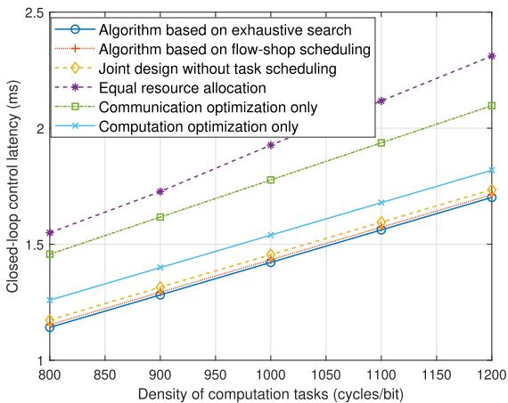

line chart

| Density of computation tasks (cycles/bit) | Algorithm based on exhaustive search | Algorithm based on flow-shop scheduling | Joint design without task scheduling | Equal resource allocation | Communication optimization only | Computation optimization only |
| ----------------------------------------- | -------------------------------------- | ---------------------------------------- | ------------------------------------- | -------------------------- | ------------------------------- | ------------------------------ |
| 800                                       | 1.15                                   | 1.2                                      | 1.25                                  | 1.5                        | 1.45                            | 1.3                            |
| 900                                       | 1.3                                    | 1.35                                     | 1.4                                   | 1.7                        | 1.6                             | 1.4                            |
| 1000                                      | 1.45                                   | 1.5                                      | 1.5                                   | 1.9                        | 1.8                             | 1.5                            |
| 1100                                      | 1.6                                    | 1.65                                     | 1.65                                  | 2.1                        | 2.0                             | 1.6                            |
| 1200                                      | 1.7                                    | 1.75                                     | 1.75                                  | 2.3                        | 2.1                             | 1.7                            |

Fig. 8. Closed-loop control latency versus density.

Fig. 8 shows the closed-loop control latency of different designs versus density of computation tasks $S _ { 1 } = S _ { 2 } = S _ { 3 }$ , where $d _ { 1 } = d _ { 2 } = d _ { 3 } = 1 0 \mathrm { m } , F _ { \mathrm { m a x } } = 1 \mathrm { G c y c l e s / s } $ , and ${ \overline { { \lambda } } } _ { 1 } ~ = ~ { \hat { \lambda } } _ { 1 } ~ = ~ { \underline { { \lambda } } } _ { 1 } ~ = ~ 2 0 0 \mathrm { b i t s , ~ } ~ { \overline { { \lambda } } } _ { 2 } ~ = ~ { \hat { \lambda } } _ { 2 } ~ = ~ { \underline { { \lambda } } } _ { 2 } ~ = ~ 4 0 0 \mathrm { b i t s . }$ , $\overline { { \lambda } } _ { 3 } = \hat { \lambda } _ { 3 } = \underline { { \lambda } } _ { 3 } = 8 0 0 \mathrm { b i t s }$ . It is observed that the closed-loop control latency increases with the rise of the task density for all the designs, and the proposed algorithm based on exhaustive search achieves the lowest latency. Moreover, the latency achieved by the algorithm based on flow-shop scheduling is much closer to that based on exhaustive search than other benchmark schemes.

Fig. 9 shows the closed-loop control latency of different designs versus the distance between plants and BS $d = d _ { 1 } =$ $d _ { 2 } \ = \ d _ { 3 }$ , where $F _ { \mathrm { m a x } } ~ { = } ~ 1 \mathrm { G c y c l e s / s }$ and other simulation settings are the same as Fig. 4. It is observed that the closedloop latency increases with d increasing. Furthermore, the proposed algorithm based on exhaustive search achieves the lowest latency than other benchmark schemes, followed by the algorithm based on flow-shop scheduling. The gaps between proposed algorithm based on exhaustive search and flowshop scheduling, equal resource allocation design are nearly unchanged. Furthermore, the gaps between the algorithm based on exhaustive search and communication optimization only and computation optimization only increase at first, then decrease, at last nearly unchanged.

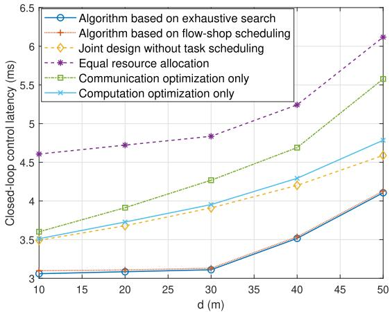

line chart

| d (m) | Algorithm based on exhaustive search | Algorithm based on flow-shop scheduling | Joint design without task scheduling | Equal resource allocation | Communication optimization only | Computation optimization only |
|-------|----------------------------------------|------------------------------------------|----------------------------------------|---------------------------|----------------------------------|-------------------------------|
| 10    | 3.0                                    | 3.0                                      | 3.5                                    | 4.6                       | 3.6                              | 3.5                           |
| 20    | 3.0                                    | 3.0                                      | 3.7                                    | 4.7                       | 3.9                              | 3.7                           |
| 30    | 3.1                                    | 3.1                                      | 3.9                                    | 4.8                       | 4.3                              | 3.9                           |
| 40    | 3.5                                    | 3.5                                      | 4.2                                    | 5.2                       | 4.7                              | 4.3                           |
| 50    | 4.1                                    | 4.1                                      | 4.6                                    | 6.1                       | 5.6                              | 4.8                           |

Fig. 9. Closed-loop control latency versus distance d.

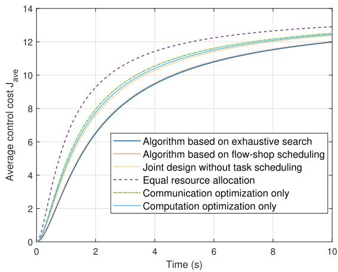

line chart

| Time (s) | Algorithm based on exhaustive search | Algorithm based on flow-shop scheduling | Joint design without task scheduling | Equal resource allocation | Communication optimization only | Computation optimization only |
| -------- | -------------------------------------- | ----------------------------------------- | -------------------------------------- | -------------------------- | -------------------------------- | ----------------------------- |
| 0        | 0.0                                    | 0.0                                       | 0.0                                    | 0.0                        | 0.0                            | 0.0                           |
| 2        | 6.5                                    | 7.0                                       | 7.5                                    | 9.0                        | 8.5                            | 8.0                           |
| 4        | 9.5                                    | 10.0                                      | 10.5                                   | 11.5                       | 11.0                           | 10.5                          |
| 6        | 11.0                                   | 11.5                                      | 12.0                                   | 12.5                       | 12.0                           | 11.5                          |
| 8        | 11.8                                   | 12.2                                      | 12.5                                   | 13.0                       | 12.5                           | 12.0                          |
| 10       | 12.2                                   | 12.5                                      | 12.8                                   | 13.2                       | 12.8                           | 12.5                          |

Fig. 10. Average control cost over time.

Then, we evaluate the control performance of this system in terms of average control cost $J _ { a v e }$ which is expressed as $\begin{array} { r } { J _ { a v e } \ = \ \frac { \sum _ { n = 1 } ^ { N } | | \mathbf { x } [ \breve { n } ] | | ^ { 2 } } { N } } \end{array}$ control cost $\overset { N } { J _ { a v e } }$ N under different designs for subsystem 1, [38], [39]. Fig. 10 shows the average where the simulation settings are the same as Fig. 4. It is observed that for all the schemes, the obtained $J _ { a v e }$ increases at the initial time since the control system has not yet reached a steady state. With time increasing, the state of the system and accordingly the average control cost converge. Furthermore, it is observed that the proposed algorithm based on exhaustive search has a lower average control cost than other benchmark schemes, thus showing the benefit of our proposed solution. Moreover, it is observed that the proposed algorithm based on flow-shop scheduling achieves much lower closed-loop control latency than other schemes, which means it is a good alternative to the exhaustive search based design.

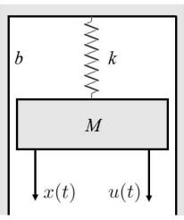

text_image

b
k
M
x(t)
u(t)

Fig. 11. Spring-mass-damping (SMD) system.

## VII. CONCLUSION

In this paper, we proposed a joint wireless communication, computation, and control system design for a wireless networked control system with multiple subsystems sharing the communication and computing resources. We took into account the HRLLC by considering the short-packet communication, and formulated the closed-loop latency minimization problem, in which the task scheduling, transmitting power of uploading and offloading, computing frequency of edge server’s CPU, and allocation of time slots are jointly optimized subject to corresponding communication, computation and control stability constraints. To tackle this non-convex problem, we first optimized the communication and computation resource allocations under given task scheduling by using the techniques of alternating optimization and SCA, and then designed the task scheduling based on the exhaustive search or the low-complexity flow-shop scheduling. Numerical results showed that the proposed algorithm resulted in lower closed-loop latency and lower control cost than other benchmark schemes, and the proposed flow-shop scheduling based low-complexity solution achieved performance close to the exhaustive search based design.

## APPENDIX SMD SYSTEM

We provide a specific example of a control system, the classic spring-mass-damping (SMD) system as shown in Fig. 11, to explain the state space equation used in (1). In the SMD system, the displacement and velocity are treated as state parameters

$$
\hat {\mathbf {x}} (t) = \left[ \begin{array}{l} x _ {1} (t) \\ x _ {2} (t) \end{array} \right] = \left[ \begin{array}{l} x (t) \\ \frac {\mathrm{d} x (t)}{\mathrm{d} t} \end{array} \right]. \tag {42}
$$

We denote $\tilde { M }$ as the mass of the block, b as the fraction of the wall, and k as the stiffness coefficient of the spring. Then we derive the following mechanical differential equation

$$
\tilde {M} \frac {\mathrm{d} ^ {2} x (t)}{\mathrm{d} t ^ {2}} + b \frac {\mathrm{d} x (t)}{\mathrm{d} t} + k x (t) = u (t), \tag {43}
$$

where $u ( t )$ is the force applied to the system. Based on the above differential equation, we derive the continuous control function of SMD system as

$$
\left[ \begin{array}{c} \frac {\mathrm{d} x _ {1} (t)}{\mathrm{d} t} \\ \frac {\mathrm{d} x _ {2} (t)}{\mathrm{d} t} \end{array} \right] = \left[ \begin{array}{c c} 0 & 1 \\ - \frac {k}{\tilde {M}} & - \frac {b}{\tilde {M}} \end{array} \right] \left[ \begin{array}{c} x _ {1} (t) \\ x _ {2} (t) \end{array} \right] + \left[ \begin{array}{c} 0 \\ \frac {1}{\tilde {M}} \end{array} \right] u (t). \tag {44}
$$

So far, we have completed the modeling of the state space equation of the SMD system. In this case, if subsystem $\pi _ { j }$ is a SMD system, we have $\mathbf { A } _ { \pi _ { j } }$ and $\mathbf { B } _ { \pi _ { j } }$ in (1), in which

$$
\mathbf {A} _ {\pi_ {j}} = \left[ \begin{array}{c c} 0 & 1 \\ - \frac {k}{\tilde {M}} & - \frac {b}{\tilde {M}} \end{array} \right], \mathbf {B} _ {\pi_ {j}} = \left[ \begin{array}{c} 0 \\ \frac {1}{\tilde {M}} \end{array} \right]. \tag {45}
$$

## REFERENCES

Y. Li, X. Song, Z. Wei, Z. Feng, and J. Xu, “Joint communication and computation optimization for wireless networked control with URLLC,” in Proc. IEEE 98th Veh. Technol. Conf. (VTC-Fall), Hong Kong, Oct. 2023, pp. 1–5.  
[2] W. Tong and P. Zhu, 6G: The Next Horizon: From Connected People and Things To Connected Intelligence. Cambridge, U.K.: Cambridge Univ. Press, 2021.  
[3] H. Ji, S. Park, J. Yeo, Y. Kim, J. Lee, and B. Shim, “Ultra-reliable and low-latency communications in 5G downlink: Physical layer aspects,” IEEE Wireless Commun., vol. 25, no. 3, pp. 124–130, Jun. 2018.  
[4] IMT.framework for 2030 and Beyond, Standard ITU-R WP5D, Feb. 2023. [Online]. Available: https://www.itu.int/dms ties/itur/md/19/wp5d/c/R19-WP5D-C-1668!H3-N3.07!MSW-E.docx  
[5] A. Mahmood et al., “Industrial IoT in 5G-and-Beyond networks: Vision, architecture, and design trends,” IEEE Trans. Ind. Informat., vol. 18, no. 6, pp. 4122–4137, Jun. 2022.  
[6] W. Liu, G. Nair, Y. Li, D. Nesic, B. Vucetic, and H. V. Poor, “On the latency, rate, and reliability tradeoff in wireless networked control systems for IIoT,” IEEE Internet Things J., vol. 8, no. 2, pp. 723–733, Jan. 2021.  
[7] G. Zhu et al., “Pushing AI to wireless network edge: An overview on integrated sensing, communication, and computation towards 6G,” Sci. China Inf. Sci., vol. 66, no. 3, Feb. 2023, Art. no. 130301.  
[8] Y. Mao, C. You, J. Zhang, K. Huang, and K. B. Letaief, “A survey on mobile edge computing: The communication perspective,” IEEE Commun. Surveys Tuts., vol. 19, no. 4, pp. 2322–2358, 4th Quart., 2017.  
[9] F. Spinelli and V. Mancuso, “Toward enabled industrial verticals in 5G: A survey on MEC-based approaches to provisioning and flexibility,” IEEE Commun. Surveys Tuts., vol. 23, no. 1, pp. 596–630, 1st Quart., 2021.  
[10] Y. Sun, J. Xu, and S. Cui, “User association and resource allocation for MEC-enabled IoT networks,” IEEE Trans. Wireless Commun., vol. 21, no. 10, pp. 8051–8062, Oct. 2022.  
[11] M. Zhan, Z. Pang, M. Xiao, M. Luvisotto, and D. Dzung, “Wireless high-performance communications: Improving effectiveness and creating ultrahigh reliability with channel coding,” IEEE Ind. Electron. Mag., vol. 12, no. 3, pp. 32–37, Sep. 2018.  
[12] G. Durisi, T. Koch, and P. Popovski, “Toward massive, ultrareliable, and low-latency wireless communication with short packets,” Proc. IEEE, vol. 104, no. 9, pp. 1711–1726, Sep. 2016.  
[13] P. Popovski et al., “Wireless access in ultra-reliable low-latency communication (URLLC),” IEEE Trans. Commun., vol. 67, no. 8, pp. 5783–5801, Aug. 2019.  
[14] Y. Mao, J. Zhang, S. H. Song, and K. B. Letaief, “Stochastic joint radio and computational resource management for multi-user mobile-edge computing systems,” IEEE Trans. Wireless Commun., vol. 16, no. 9, pp. 5994–6009, Sep. 2017.  
[15] C. You, K. Huang, H. Chae, and B.-H. Kim, “Energy-efficient resource allocation for mobile-edge computation offloading,” IEEE Trans. Wireless Commun., vol. 16, no. 3, pp. 1397–1411, Mar. 2017.  
[16] X. Cao, F. Wang, J. Xu, R. Zhang, and S. Cui, “Joint computation and communication cooperation for energy-efficient mobile edge computing,” IEEE Internet Things J., vol. 6, no. 3, pp. 4188–4200, Jun. 2019.  
[17] F. Wang, J. Xu, X. Wang, and S. Cui, “Joint offloading and computing optimization in wireless powered mobile-edge computing systems,” IEEE Trans. Wireless Commun., vol. 17, no. 3, pp. 1784–1797, Mar. 2018.  
[18] F. Wang, J. Xu, and Z. Ding, “Multi-antenna NOMA for computation offloading in multiuser mobile edge computing systems,” IEEE Trans. Commun., vol. 67, no. 3, pp. 2450–2463, Mar. 2019.  
[19] Y. Mao, J. Zhang, and K. B. Letaief, “Joint task offloading scheduling and transmit power allocation for mobile-edge computing systems,” in Proc. IEEE Wireless Commun. Netw. Conf. (WCNC), Mar. 2017, pp. 1–6.  
[20] J. Yan, S. Bi, Y. J. Zhang, and M. Tao, “Optimal task offloading and resource allocation in mobile-edge computing with inter-user task dependency,” IEEE Trans. Wireless Commun., vol. 19, no. 1, pp. 235–250, Jan. 2020.  
[21] C. Feng, Q. Yang, T. Q. S. Quek, W. Wu, and K. Guo, “Spatially-temporally collaborative service placement and task scheduling in MEC networks,” IEEE Trans. Veh. Technol., vol. 72, no. 12, pp. 16650–16666, Dec. 2023.  
[22] K. Gatsis, M. Pajic, A. Ribeiro, and G. J. Pappas, “Opportunistic control over shared wireless channels,” IEEE Trans. Autom. Control, vol. 60, no. 12, pp. 3140–3155, Dec. 2015.  
[23] P. Park, J. Araujo, and K. H. Johansson, “Wireless networked control ´ system co-design,” in Proc. Int. Conf. Netw., Sens. Control, Delft, Netherlands, Apr. 2011, pp. 486–491.  
[24] B. Chang, L. Zhang, L. Li, G. Zhao, and Z. Chen, “Optimizing resource allocation in URLLC for real-time wireless control systems,” IEEE Trans. Veh. Technol., vol. 68, no. 9, pp. 8916–8927, Sep. 2019.  
[25] L. Chen, J. Zhou, Z. Chen, N. Liu, and M. Tao, “Resource allocation for deterministic delay in wireless control networks,” IEEE Wireless Commun. Lett., vol. 10, no. 11, pp. 2340–2344, Nov. 2021.  
[26] M. Zheng, L. Zhang, and W. Liang, “Control-aware resource scheduling method for wireless networked control systems,” IEEE Sensors J., vol. 23, no. 18, pp. 21946–21955, Sep. 2023.  
[27] P. Park, S. Coleri Ergen, C. Fischione, C. Lu, and K. H. Johansson, “Wireless network design for control systems: A survey,” IEEE Commun. Surveys Tuts., vol. 20, no. 2, pp. 978–1013, 2nd Quart., 2017.  
[28] R. C. D. R. H. Bishop, Modern Control Systems. Upper Saddle River, NJ, USA: Prentice-Hall, 2011.  
[29] M. W. Spong, “The swing up control problem for the acrobot,” IEEE Control Syst. Mag., vol. 15, no. 1, pp. 49–55, Feb. 1995.  
[30] G. F. Franklin, J. D. Powell, A. Emami-Naeini, and J. D. Powell, Feedback Control of Dynamic Systems, vol. 4. Upper Saddle River, NJ, USA: Prentice-Hall, 2002.  
[31] C. Peng, D. Yue, and Q.-L. Han, Communication and Control for Networked Complex Systems. Cham, Switzerland: Springer, 2015.  
[32] W. Yang, G. Durisi, T. Koch, and Y. Polyanskiy, “Quasi-static multipleantenna fading channels at finite blocklength,” IEEE Trans. Inf. Theory, vol. 60, no. 7, pp. 4232–4265, Jul. 2014.  
[33] E. B. Lee and L. Markus, Foundations of Optimal Control Theory, vol. 87. Hoboken, NJ, USA: Wiley, 1967.  
[34] M. Grant and S. Boyd. (2014). CVX: MATLAB Software for Disciplined Convex Programming, Version 2.1. [Online]. Available: https://cvxr.com/ cvx/citing/  
[35] K.-Y. Wang, A. M.-C. So, T.-H. Chang, W.-K. Ma, and C.-Y. Chi, “Outage constrained robust transmit optimization for multiuser MISO downlinks: Tractable approximations by conic optimization,” IEEE Trans. Signal Process., vol. 62, no. 21, pp. 5690–5705, Nov. 2014.  
[36] Z. Zhao, M. Zhou, and S. Liu, “Iterated greedy algorithms for flow-shop scheduling problems: A tutorial,” IEEE Trans. Autom. Sci. Eng., vol. 19, no. 3, pp. 1941–1959, Jul. 2022.  
[37] H. Emmons and G. Vairaktarakis, Flow Shop Scheduling: Theoretical Results, Algorithms, and Applications, vol. 182. Cham, Switzerland: Springer, 2012.  
[38] B. Chang, L. Li, G. Zhao, Z. Chen, and M. A. Imran, “Autonomous D2D transmission scheme in URLLC for real-time wireless control systems,” IEEE Trans. Commun., vol. 69, no. 8, pp. 5546–5558, Aug. 2021.  
[39] J. Sarangapani, Neural Network Control of Nonlinear Discrete-time Systems. Boca Raton, FL, USA: CRC Press, 2018.

natural_image

Portrait photo of a young man in formal attire against a blue background (no text or symbols visible)

Yiyang Li (Graduate Student Member, IEEE) received the B.Eng. degree from Shanghai University, Shanghai, China, in 2019, and the M.Eng. degree from the University of Science and Technology of China, Hefei, China, in 2022. He is currently pursuing the Ph.D. degree in computer and information engineering with The Chinese University of Hong Kong, Shenzhen, China. His research interests include uncrewed aerial vehicle communication, mobile edge computing, reinforcement learning, and wireless networked control.

natural_image

Portrait photo of a young man in a dark blue collared shirt (no text or symbols visible)

Xianxin Song (Member, IEEE) received the B.Eng. degree from the University of Electronic Science and Technology of China, Chengdu, China, in 2017, the M.Eng. degree from Beijing University of Posts and Telecommunications, Beijing, China, in 2020, and the Ph.D. degree in computer and information engineering from The Chinese University of Hong Kong, Shenzhen, China, in 2024. He is currently a Post-Doctoral Research Fellow with the Department of Electrical Engineering, City University of Hong Kong, Hong Kong, SAR, China. His research

interests include integrated sensing and communication, intelligent reflecting surface, and edge intelligence.

natural_image

Portrait photo of a woman with dark hair wearing a blue top (no text or symbols visible)

Zhiyong Feng (Senior Member, IEEE) received the B.E., M.E., and Ph.D. degrees from the Beijing University of Posts and Telecommunications (BUPT), Beijing, China. She is currently a Professor with BUPT and the Director of the Key Laboratory of the Universal Wireless Communications, Ministry of Education, China. Her main research interests include wireless network architecture design and radio resource management in 5th generation mobile networks (5G), spectrum sensing and dynamic spectrum management in cognitive wireless networks,

and universal signal detection and identification. She is the Vice Chair of the Information and Communication Test Committee of Chinese Institute of Communications (CIC). She is serving as the Associate Editor-in-Chief for China Communications and a Technological Advisor for the international forum on NGMN.

natural_image

Portrait photo of a young man in formal attire against a blue background (no text or symbols visible)

Zhiqing Wei (Member, IEEE) received the B.E. and Ph.D. degrees from Beijing University of Posts and Telecommunications (BUPT), Beijing, China, in 2010 and 2015, respectively. He is currently an Associate Professor with BUPT. He has authored one book, three book chapters, and more than 50 articles. His research interests include the performance analysis and optimization of intelligent machine networks. He was granted the Exemplary Reviewer of IEEE WIRELESS COMMUNICATIONS LETTERS in 2017 and the Best Paper Award of

WCSP 2018. He was the Registration Co-Chair of IEEE/CIC ICCC 2018 and the Publication Co-Chair of IEEE/CIC ICCC 2019 and IEEE/CIC ICCC 2020.

natural_image

Portrait of a man wearing glasses and a suit (no text or symbols visible)

Jie Xu (Fellow, IEEE) received the B.E. and Ph.D. degrees from the University of Science and Technology of China. He is currently an Associate Professor (Tenured) with the School of Science and Engineering, Shenzhen Future Network of Intelligence Institute (FNii-Shenzhen), and Guangdong Provincial Key Laboratory of Future Networks of Intelligence, The Chinese University of Hong Kong, Shenzhen. His research interests include wireless communications, wireless information and power transfer, UAV communications, edge computing and

intelligence, and integrated sensing and communication (ISAC). He was a recipient of the 2017 IEEE Signal Processing Society Young Author Best Paper Award, the IEEE/CIC ICCC 2019 Best Paper Award, the 2019 IEEE Communications Society Asia–Pacific Outstanding Young Researcher Award, and the 2019 Wireless Communications Technical Committee Outstanding Young Researcher Award. He is the Symposium Co-Chair of the IEEE GLOBECOM 2019 Wireless Communications Symposium and the IEEE ICC 2025 Communication Theory Symposium, the Workshop Co-Chair of several IEEE ICC and GLOBECOM workshops, the Tutorial Co-Chair of IEEE/CIC ICCC 2019/2022, the Chair of the IEEE Wireless Communications Technical Committee (WTC), and the Vice Co-Chair of the IEEE Emerging Technology Initiative (ETI) on ISAC. He served or is serving as the Associate Editor-in-Chief for IEEE TRANSACTIONS ON MOBILE COMPUTING, an Editor for IEEE TRANSACTIONS ON WIRELESS COMMUNICATIONS, IEEE TRANSACTIONS ON COMMUNICATIONS, IEEE WIRELESS COMMUNICA-TIONS LETTERS, and Journal of Communications and Information Networks, an Associate Editor for IEEE ACCESS, and a Guest Editor for IEEE WIRELESS COMMUNICATIONS, IEEE JOURNAL ON SELECTED AREAS IN COMMUNICATIONS, IEEE Internet of Things Magazine, Science China Information Sciences, and China Communications. He is a Distinguished Lecturer of the IEEE Communications Society.