# Joint Trajectory and Resource Optimization for HAPs-SAR Systems With Energy-Aware Constraints

Bang Huang , Member, IEEE, Ki-Hong Park , Senior Member, IEEE, Xiaowei Pang , and Mohamed-Slim Alouini , Fellow, IEEE

Abstract—This paper investigates the joint optimization of trajectory planning and resource allocation for a high-altitude platform stations synthetic aperture radar (HAPs-SAR) system. To support real-time sensing and conserve the limited energy budget of the HAPs, the proposed framework assumes that the acquired radar data are transmitted in real time to a ground base station for SAR image reconstruction. A dynamic trajectory model is developed, and the power consumption associated with radar sensing, data transmission, and circular flight is comprehensively analyzed. In addition, solar energy harvesting is considered to enhance system sustainability. An energy-aware mixed-integer nonlinear programming problem is formulated to maximize radar beam coverage while satisfying operational constraints. To solve this challenging problem, a sub-optimal successive convex approximation (SCA)-based framework is proposed, incorporating iterative optimization and finite search. Simulation results validate the convergence of the proposed algorithm and demonstrate its effectiveness in balancing SAR performance, backhaul communication reliability, and energy efficiency. A final SAR imaging simulation on a 9-target lattice scenario further confirms the practical feasibility of the proposed solution.

Index Terms—Communication, high-altitude platform stations, mixed-integer nonlinear programming, SAR, successive convex approximations.

## I. INTRODUCTION

lights the transformative potential of high-altitude platform stations (HAPs) in extending wireless connectivity to regions underserved by conventional terrestrial and satellite infrastructure [1], [2]. As a key enabler of non-terrestrial networks (NTNs) [3], HAPs are increasingly regarded as a foundational technology for future wireless communication systems. Operating in the stratosphere at altitudes of 20–30 km, HAPs uniquely combine the broad-area coverage of satellites with the maneuverability and flexible deployment of uncrewed aerial vehicles (UAVs), making them especially suitable for longendurance missions such as persistent connectivity, environmental monitoring, and real-time observation.

Driven by the growing global demand for ubiquitous, high-throughput, and low-latency wireless services, HAPs are poised to play a pivotal role in the development of integrated satellite–airborne–terrestrial communication networks. Compared with conventional satellite constellations, HAPs offer several key advantages, including lower deployment costs, shorter deployment timelines, and significantly reduced communication latency [4]. These benefits have placed HAPs at the forefront of both academic research [5] and industrial innovation [6], [7], [8], reinforcing their strategic relevance in the evolution of next-generation wireless ecosystems.

Although the concept of HAPs has been around for nearly three decades [9], [10], [11], its large-scale deployment has long been constrained by technological limitations. Earlier efforts were hindered by low solar energy conversion efficiency, the absence of lightweight structural materials, and inadequate avionics and control capabilities. However, recent advances in enabling technologies, such as highperformance composite materials, high-efficiency solar energy systems, antenna beamforming, and autonomous avionics, have collectively revived momentum in HAPs development [5]. Depending on mission-specific requirements, such as payload, power demand, and coverage objectives, modern HAPs platforms can be realized in the form of balloons, airships, or fixed-wing solar-powered aircraft [12].

Recent works have proposed architectural visions and communication frameworks for future HAPs-based systems [13], while surveys and technology trend analyses have highlighted the maturity of airframe, power, and payload subsystems required for sustained high-altitude operations [2]. Large-scale stochastic-geometry analyses further show that directional HAPs beams can deliver reliable wide-area coverage even under dense spatial reuse [14]. Complementary cellular enhancements, such as two-tier terrestrial/HAPs architectures [15] and non-orthogonal multiple access (NOMA)-assisted remote-coverage schemes [16], underscore the role of HAPs in extending service to underserved regions.

Beyond radio access, the stratosphere is evolving into a compute continuum. Hierarchical aerial-edge frameworks now coordinate task off-loading, user association, and resource orchestration across cooperating UAVs and HAPs [17], [18], [19], while multi-HAPs clusters embedded in space–air–ground–sea (SAGS) networks reduce latency for maritime and polar users [18]. Physicallayer innovations reinforce this evolution. Laser relays that exploit Fresnel–Poincare–Kummer optics for terrestrial-HAPs-´ satellite links [20], adaptive beam-switching protocols for high-speed rail [21], hemispherical antenna arrays that equalize capacity across footprints [22], reconfigurable intelligent surfaces (RIS)-assisted terahertz (THz) NTNs links [23], and multi-HAPs THz relays robust to I/Q imbalance [24] demonstrate the feasibility of ultra-high-capacity stratospheric links, while optical inter-HAPs backbones boost reliability for integrated space–air–ground networks [25].

Sustainability threads permeate these advances. Energyaware radio-access planning [26], data-centre-enabled HAPs concepts [27], and cloud-enabled HAPs delivering equitable 6G access [28] illustrate the shift toward carbon-neutral, service-oriented NTNs. Power-allocation strategies for HAPsassisted LEO backhauls [29], efficient data-transmission protocols for massive HAPs constellations [30], and joint userassociation/beamforming designs in satellite–HAPs–ground networks [31] complete the picture of a maturing ecosystem in which HAPs evolve from simple airborne relays to fully integrated compute-and-sensing hubs orchestrating resources across the SAGS continuum.

HAPs combine cost-effective deployment with wide-area coverage, agile repositioning, and multi-month endurance, making them attractive not only for bridging the digital divide but also for mission-critical services such as disaster relief, environmental monitoring, and smart agriculture [12], [32]. Among the sensing modalities that can unlock these services, synthetic-aperture radar (SAR) is particularly compelling because it delivers high-resolution images day or night, in virtually any weather. After earthquakes, landslides, or floods, events that often coincide with heavy cloud cover or rain, SAR can rapidly map damage, track terrain deformation, and guide emergency response. Equipping HAPs with SAR sensors therefore provides a practical path to real-time, resilient situation awareness at continental scales. Recent work extends this concept even further. HAPs-assisted integrated sensing-and-communication (ISAC) architectures couple highresolution surveillance with secure data delivery [33], while mission-oriented schedulers that coordinate satellites, HAPs, and ground nodes enable specialised applications ranging from oil-spill monitoring [34] to uninterrupted connectivity along high-speed-rail corridors [35]. Our recent work [36] focuses on waveform-level design for HAPs-enabled integrated SAR and communications, whereas the present study addresses systemlevel design considerations for sensing.

Motivated by the need for an integrated design that simultaneously exploits the wide-area connectivity of HAPs and the all-weather, high-resolution sensing of SAR, this paper proposes a joint trajectory-and-resource optimization framework for HAPs-SAR missions. Moreover, the contributions of this paper can be summarized as follows:

• While most existing HAPs research has focused primarily on communication-oriented applications, this paper explicitly incorporates SAR imaging into the system-level design of HAPs platforms. By exploiting the inherent circular loitering characteristics of stratospheric platforms, we propose a novel dual-mode SAR sensing framework that integrates small-circle circular SAR (CSAR) and large-circle circular trace scanning SAR (CTSSAR). This hybrid sensing architecture enables feasible and efficient wide-area SAR imaging by balancing high-resolution sensing and coverage extension, and is, to the best of the authors’ knowledge, the first coordinated SAR sensing framework tailored to the operational characteristics of HAPs.

Building upon the proposed sensing architecture, we develop a comprehensive system model that jointly characterizes the HAPs trajectory, SAR sensing geometry, and the conditions required for successful image acquisition. Recognizing the stringent energy and payload constraints of stratospheric platforms, we explicitly account for realtime offloading of raw SAR echo data to a ground base station (BS) for image reconstruction, together with the associated communication link. From a system perspective, the HAPs must judiciously allocate its limited solar-harvested energy among propulsion, energyintensive SAR sensing, and long-range data transmission. These tightly coupled factors are captured through a mixed-integer nonlinear programming (MINLP) formulation that jointly optimizes trajectory design, sensing performance, real-time backhaul rate satisfaction, and energy sustainability.

• To efficiently solve the resulting joint optimization problem, we adopt a successive convex approximation (SCA)-based solution framework augmented with a finite search over SAR sweeps. This approach yields a sequence of tractable subproblems with guaranteed convergence to a high-quality solution, enabling practical implementation of the proposed HAPs-SAR system design.

Extensive simulation results validate the proposed framework from a system-level perspective. The HAPs is shown to adaptively adjust its altitude and flight configuration to balance SAR coverage, energy utilization, and backhaul communication reliability, thereby enabling real-time off-board SAR image reconstruction. A final simulation over a nine-target lattice further demonstrates accurate SAR imaging performance and confirms the practical feasibility of the proposed joint design.

The remainder of this paper is structured as follows. Section II introduces the system model, including the HAPs trajectory, SAR sensing geometry, communication link, and energy supply, all of which are mathematically characterized. In Section III, the joint optimization problem is formulated as an MINLP, and a solution approach is developed based on the SCA method. Section IV presents simulation results that validate the proposed framework. Finally, Section V concludes the paper and discusses future research directions.

## II. SYSTEM MODEL

Fig. 1 illustrates the schematic of the proposed SAR imaging framework for ground observation using a HAPs. The

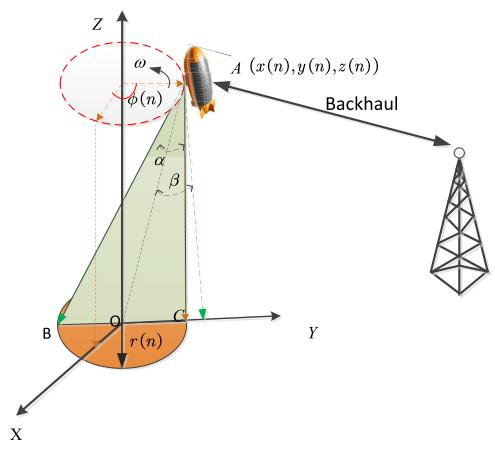

(a)  
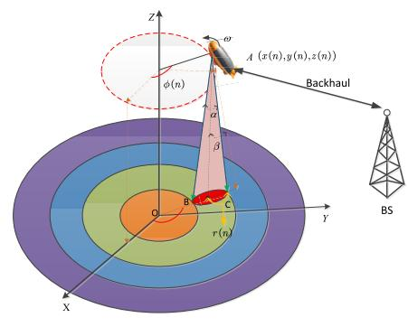  
(b)  
Fig. 1. Imaging scenario for HAPs-SAR with a backhaul communication link. (a) Circular SAR mode. (b) Circular Trace Scanning SAR mode.

HAPs performs a circular flight around the vertical (z) axis and operates in two distinct SAR modes to balance resolution and coverage. As shown in Fig. 1(a), the platform initially flies along a small-radius circular trajectory and performs CSAR imaging [37], which enables high-resolution, full-azimuth imaging of the target scene. To expand the sensing range, the platform gradually increases its flight radius, transitioning into the CTSSAR mode [38], as illustrated in Fig. 1(b). This mode enables scene-wide mapping by scanning concentric circular rings. This design naturally aligns with the loitering operation of HAPs, which are typically deployed to provide persistent and stable coverage over a designated service area. From a sensing perspective, such circular trajectories further offer a favorable trade-off between imaging resolution and coverage, namely small-radius circular motion enables high-resolution full-azimuth imaging, while progressively increasing the radius allows wide-area mapping through concentric scans.

Throughout the flight, SAR echo data is transmitted to nearby ground BS for real-time image reconstruction. This design avoids performing onboard SAR processing, which is generally infeasible due to the HAPs’s limited energy and computational resources. To ensure high-quality image acquisition, the CSAR mode requires that the radar beam fully illuminates the entire circular track, enabling full-perspective imaging. In contrast, the CTSSAR mode demands that each circular ring is fully covered to guarantee complete scene mapping. Additionally, to ensure seamless coverage over extended ground areas, it is essential that adjacent circular sweeps are contiguous, without any gaps between beam footprints.

## A. Design Trajectory

Consider a HAPs operating above the ground and moving along a circular trajectory of radius R in a plane parallel to the xy plane. The platform rotates with a constant angular velocity denoted by ω. At the initial slow-time instant $\eta = 0 ,$ , the HAPs is assumed to be located on the positive side of the x-axis. Accordingly, the azimuth angle relative to the x-axis is given by $\varphi ( \eta ) = \omega \eta$ . Let T represent the time required for the HAPs to complete one full circular rotation. This period is uniformly discretized into N time intervals, where the time step for each segment is defined as $\begin{array} { r } { \Delta \ = \ \frac { T } { N } } \end{array}$ . To ensure consistent discretization, ∆ should be selected such that $N = T / \Delta$ is an integer.

To complete the prescribed ground mapping strip, the HAPs is assumed to perform M full circular rotations. To more precisely characterize the temporal evolution of the HAPs trajectory over these circular sweeps, we define the following set of time slots:

$$
\mathbb { A } = \left\{ 1 , N + 1 , \ldots , \left( M - 1 \right) N + 1 \right\} ,\tag{1}
$$

and

$$
\mathbb { B } = \left\{ N , 2 N , \cdots , M N \right\} ,\tag{2}
$$

to represent the indices corresponding to the start and end time slots of each circular motion, respectively. Subsequently, define the set C as

$$
\begin{array} { l } { \mathbb { C } = \{ 1 , 2 , \cdots , N M \} \setminus \{ \mathbb { A } \cup \mathbb { B } \} } \\ { = \{ n \in \{ 1 , 2 , \cdots , N M \} | ( n - 1 ) m o d N \neq 0 , n \ m o d N \neq 0 \} } \end{array}\tag{3}
$$

which corresponds to the indices of all remaining time intervals. The position of the HAPs at time slot n is represented as $\left( x \left( n \right) , y \left( n \right) , z \left( n \right) \right)$ in the three-dimensional (3D) Cartesian coordinate system. Here, $x \left( n \right)$ and $y \left( n \right)$ represent the coordinates in the xy-plane, while $z \left( n \right)$ denotes the height of the HAPs above the ground.

The HAPs performs a circular motion around the z-axis, returning to the starting point along the x-axis. In other words, to ensure the completeness of the ground mapping strip, the HAPs must align the start and end points during each circular motion. It is important to note that the time indices in set A typically correspond to the time slots in which the distance between the HAPs platform and the z-axis changes. It should be noted that, for tractability, altitude changes between successive circular trajectories are abstracted at the system level and incorporated into the energy consumption model, rather than being explicitly modeled as transient climbing or descending dynamics.

Further, the angle traversed by the HAPs at time slots n can be represented as

$$
\phi ( n ) = 2 \pi { \frac { n - 1 } { N } } , n \in \mathbb { A } ,\tag{4}
$$

$$
\phi ( n ) = 2 \pi { \frac { n } { N } } , n \in \mathbb { B } ,\tag{5}
$$

$$
\phi ( n ) = \omega n \Delta , n \in \mathbb { C } ,\tag{6}
$$

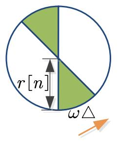

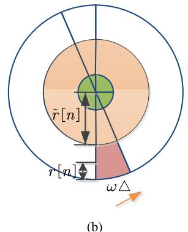  
Fig. 2. Covering area for HAPs. (a) CSAR mode. (b) CTSSAR mode.

where $n = 1 , 2 , \ldots , M N .$ . (4)-(5) ensure that the start and end points of each circular motion coincide, while (6) guarantees that the HAPs performs circular motion.

Assume that the center of the SAR signal beam emitted by the HAPs forms an angle $\beta$ with the vertical axis of the HAPs projected onto the xy plane. The width of the signal beam emitted by the HAPs is α. In this case, it is easy to determine that the distance from the center of the beam to the edge of the beam on the ground can be expressed as

$$
r \left( n \right) = \frac { 1 } { 2 } z \left( n \right) \left( \tan \alpha _ { 1 } - \tan \alpha _ { 2 } \right) ,\tag{7}
$$

where the angles $\alpha _ { 1 }$ and $\alpha _ { 2 }$ are given by $\begin{array} { r } { \alpha _ { 1 } = \beta + \frac { \alpha } { 2 } } \end{array}$ and $\begin{array} { r } { \alpha _ { 2 } = \beta - \frac { \alpha } { 2 } } \end{array}$ , respectively.

Furthermore, the 3D position coordinates of the HAPs at time slot n can be represented as

$$
C 1 : x \left( 1 \right) = z \left( 1 \right) \tan \beta ,\tag{8}
$$

$$
C 2 : x \left( n \right) = x \left( n - 1 \right) + 2 r \left( n \right) + \dot { z } \left( n \right) , \forall n \in \mathbb { A } \backslash \left\{ 1 \right\} ,\tag{9}
$$

$$
C 3 : x \left( n \right) = x \left( \left( \lceil \frac { n } { N } \rceil - 1 \right) N + 1 \right) \cos \left( \varphi \left( n \right) \right) , \forall n \in \mathbb { B \cup \mathbb { C } } ,\tag{10}
$$

$$
C 4 : y \left( n \right) = x \left( \left( \lceil \frac { n } { N } \rceil - 1 \right) N + 1 \right) \sin \left( \varphi \left( n \right) \right) ,\tag{11}
$$

$$
C 5 : z \left( n \right) = z \left( n - 1 \right) , \forall n \in \mathbb { B } \cup \mathbb { C } .\tag{12}
$$

where d·e denotes the ceiling function and $\begin{array} { r l } { \dot { z } \left( n \right) } & { { } = } \end{array}$ $\left[ z \left( n \right) - z \left( n - 1 \right) \right]$ tan α2. The constraint C2 ensures there are no gaps between the beam coverage areas of adjacent sweeps. Meanwhile, C3 and C4 ensure that the HAPs follows a circular trajectory.

## B. SAR Analysis

This subsection will analyze the ground coverage area for SAR imaging using HAPs. Note that this paper considers a conventional monostatic SAR configuration, in which the HAPs transmits the radar signal and receives the reflected echoes, while the synthetic aperture is formed through the platform’s motion along the designed trajectory. Furthermore, when HAPs operates in CSAR mode, specifically mapping the smallest circle as shown in Fig. 2(a), it is straightforward to derive that the area covered by the SAR beam within each time interval $\Delta$ can be expressed as

$$
S _ { 1 } = \omega \triangle r ^ { 2 } ( n ) .\tag{13}
$$

Fig. 2(b) shows the imaging results of the HAPs operating in CTSSAR mode for the ground surface. The area scanned by SAR within the time interval $\Delta$ can be calculated as

$$
\begin{array} { c } { { S _ { 2 } = \displaystyle \frac 1 2 \left[ 2 r \left( n \right) + \tilde { r } \left( n \right) \right] ^ { 2 } \omega \bigtriangleup - \displaystyle \frac 1 2 \tilde { r } ^ { 2 } \left( n \right) \omega \bigtriangleup } } \\ { { = 2 \left\{ r ^ { 2 } \left( n \right) + r \left( n \right) \tilde { r } \left( n \right) \right\} \omega \bigtriangleup } } \end{array}\tag{14}
$$

with expression of r˜(n) is given by

$$
\tilde { r } \left( n \right) = \left\{ \begin{array} { l l } { r \left( n - N \right) , \lceil \displaystyle \frac { n } { N } \rceil = 2 , } \\ { \lceil \displaystyle { n - N } \rceil + \sum _ { m = 2 } ^ { \lceil \frac { n } { N } \rceil - 1 } 2 r \left( n - m N \right) , \lceil \displaystyle \frac { n } { N } \rceil > 2 . } \end{array} \right.\tag{15}
$$

Hence, the area observed by HAPs during the entire surveying period can be represented as

$$
S = \sum _ { n = 2 } ^ { N } S _ { 1 } + \sum _ { n = N + 1 , n \not \in \mathbb { A } } ^ { M N } S _ { 2 } .\tag{16}
$$

The preceding discussion has analyzed the entire imaging coverage area of the HAPs. Next, we will introduce two parameters in detail, the SAR data rate and the minimum signal-to-noise ratio (SNR) required to achieve effective SAR imaging. In this respect, based on the results from [39], [40], the data rate generated by SAR imaging in time slot n can be expressed as

$$
\begin{array} { r l } & { D _ { \operatorname* { m i n } } \left( n \right) } \\ & { = B _ { w } \left[ \frac { 2 } { c } \left( R _ { \mathrm { f a r } } \left( n \right) - R _ { \mathrm { n e a r } } \left( n \right) \right) + T _ { p } \right] \cdot P R F \left[ \mathrm { b i t / s } \right] , } \end{array}\tag{17}
$$

where $B _ { w }$ represents the bandwidth of the SAR transmitted pulse, and $T _ { p }$ denotes the pulse width. The symbol c stands for the speed of light, and PRF refers to the pulse repetition frequency. $R _ { \mathrm { f a r } } \left( n \right)$ and $R _ { \mathrm { n e a r } } \left( n \right)$ indicate the radar’s maximum unambiguous range and minimum unambiguous range, respectively, which are given by

$$
R _ { \mathrm { f a r } } \left( n \right) = \frac { z \left( n \right) } { \cos \alpha _ { 1 } } , R _ { \mathrm { n e a r } } \left( n \right) = \frac { z \left( n \right) } { \cos \alpha _ { 2 } } .\tag{18}
$$

Furthermore, based on the radar equation [41], the SNR received by the HAPs receiver is given by1

$$
\mathrm { S N R } \left( n \right) = \frac { P _ { \mathrm { R a d } } ( n ) G _ { t } G _ { r } \lambda ^ { 3 } \sigma _ { 0 } c T _ { p } \mathrm { P R F } } { 2 5 6 \pi ^ { 3 } R _ { 0 } ^ { 3 } K \tilde { T } F _ { n } B _ { w } L _ { s } V ( n ) \sin \delta }\tag{19}
$$

where $P _ { \mathrm { R a d } } ( n )$ denotes the radar transmission power at the n-th time slot. $G _ { t }$ and $G _ { \tau }$ represent the transmit and receive gains, respectively. λ is the wavelength, while $\sigma _ { 0 }$ signifies the backscatter coefficient. $R _ { 0 }$ refers to the distance between the radar and the center of the scene, commonly known as the reference distance. K stands for Boltzmann’s constant, and $\tilde { T }$ represents the receiver temperature. $F _ { n }$ denotes the receiver noise, $L _ { s }$ indicates system loss, and $V ( n )$ is platform velocity, whose expression $\mathrm { i } \mathrm { s } ^ { \bar { 2 } }$

TABLE I  
SYMBOLS USED IN (30) AND (31)
<table><tr><td>Symbol</td><td>Explanation</td><td>Value</td><td>Unit</td></tr><tr><td>pb1</td><td>base static pressures</td><td>5474.889</td><td> $\overline { { \mathrm { P a } } }$ </td></tr><tr><td> $\underline { { \boldsymbol { g } } }$ </td><td>gravitational acceleration</td><td>9.8</td><td> $\mathrm { m } / \mathrm { s } ^ { 2 }$ </td></tr><tr><td> $\bar { M }$ </td><td>molar mass of Earth&#x27;s air</td><td>0.0289644</td><td> $\mathrm { k g / m o l }$ </td></tr><tr><td> $T _ { b }$ </td><td>base temperature</td><td>216.65</td><td> $\mathrm { \Delta \ddot { K } \Omega }$ </td></tr><tr><td> $L _ { b }$ </td><td>base temperature lapse rate</td><td>6.7</td><td>K/km</td></tr><tr><td> $R$ </td><td>universal gas constant</td><td>8.31432</td><td> $\mathrm { N \cdot m / m o l \cdot K }$ </td></tr><tr><td> $R _ { s }$ </td><td>specific gas constant</td><td>287.052</td><td> $\mathrm { J } / \mathrm { i g } \cdot \mathrm { K }$ </td></tr><tr><td> $H _ { 1 }$ </td><td>height (lower limit)</td><td>20</td><td>km</td></tr><tr><td> $H _ { 2 }$ </td><td>height (upper limit)</td><td>32</td><td>km</td></tr></table>

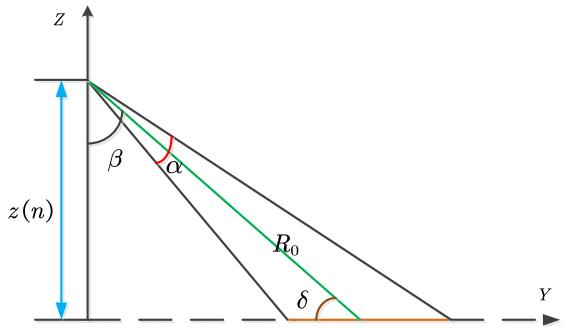  
Fig. 3. Geometric schematic of the HAPs within the yz plane.

$$
C 6 : V \left( n \right) = \sqrt { x \left( n \right) g \tan \zeta } , \forall n \in \mathbb { A }\tag{20}
$$

$$
C 7 : V \left( n \right) = V \left( n - 1 \right) , \forall n \in \mathbb { B } \cup \mathbb { C } .\tag{21}
$$

Here, the definition of the symbol $g$ is provided in Table I and $\zeta$ denotes the banking angle. Moreover, δ represents the beam incidence angle, the angle between the antenna line-ofsight (LOS) vector and its intersection with the xy plane. In addition, the following relationship can be easily derived from Fig. 3, namely

$$
\delta + \beta = { \frac { \pi } { 2 } } , z \left( n \right) = R _ { 0 } \sin \delta .\tag{22}
$$

Moreover, inserting (22) into (19) yields

$$
\mathrm { S N R } \left( n \right) = \frac { { { P _ { R a d } } \left[ n \right] { G _ { t } } { G _ { r } } { \lambda ^ { 3 } } \sigma _ { 0 } c T _ { p } \mathrm { P R F } \cos ^ { 2 } \beta } } { { 2 5 6 { \pi ^ { 3 } } { z ^ { 3 } } \left( n \right) K \tilde { T } { F _ { n } } { B _ { w } } { L _ { s } } V \left( n \right) } } .\tag{23}
$$

## C. Communication Link

HAPs platforms are expected to primarily rely on renewable energy sources, such as solar or wind power, for their longterm energy supply [2]. Given the limited onboard power and processing capabilities, real-time SAR image reconstruction directly on the HAPs is generally infeasible. Instead, the raw ground-scattered SAR echoes must be transmitted to a ground BS for post-processing. This requirement establishes a data backhaul link between the HAPs and the BS.3

To conserve onboard storage and support real-time groundbased imaging, it is crucial that the SAR echo data should be transmitted promptly to the BS, rather than accumulated and sent only after the entire mapping operation is complete. This subsection analyzes the characteristics of this air-to-ground communication link.

For modeling purposes, we assume that the HAPs-to-BS backhaul link consists solely of an LOS channel, and the airto-ground propagation adheres to a free-space path loss model. The channel power gain at time slot n is then expressed as

$$
\rho \left( n \right) = \frac { \rho _ { 0 } } { d ^ { 2 } \left( n \right) } .\tag{24}
$$

Here, $\rho _ { 0 }$ denotes the channel gain at a reference distance of 1m, while $d ( n )$ represents the LOS distance between the HAPs and the BS at time slot n. Assuming the BS is positioned at $( x _ { s } , y _ { s } , z _ { s } )$ in a 3D Cartesian coordinate system, the expression for d(n) can be written as

$$
d \left( n \right) = \sqrt { \left( x \left( n \right) - x _ { s } \right) ^ { 2 } + \left( y \left( n \right) - y _ { s } \right) ^ { 2 } + \left( z \left( n \right) - z _ { s } \right) ^ { 2 } } .\tag{25}
$$

If the SAR’s transmitted communication power at time slot n is denoted as $P _ { \mathrm { C o m } } ( n )$ , the received SNR at the BS can be expressed as

$$
\gamma \left( n \right) = \frac { P _ { \mathrm { C o m } } \left( n \right) \rho \left( n \right) } { \sigma _ { 0 } ^ { 2 } }\tag{26}
$$

with $\sigma _ { 0 } ^ { 2 }$ denoting the receiver’s noise power. Furthermore, based on the above analysis, the instantaneous backhaul throughput from the HAPs to the BS can be readily given by

$$
D _ { c } \left( n \right) = B _ { c } \log _ { 2 } \left( 1 + \gamma \left( n \right) \right)\tag{27}
$$

where $B _ { c }$ represents the bandwidth of communicating signal. To enable the real-time transmission of SAR sensing data, the following condition must be satisfied

$$
C 8 : D _ { c } \left( n \right) > D _ { \mathrm { m i n } } \left( n \right) .\tag{28}
$$

The reason for using $>$ instead of $\geqslant$ in C8 is that this paper does not account for essential signals, such as clock synchronization and the positional information of the HAPs, which are transmitted alongside the SAR raw echo.

## D. Energy Analysis

The proposed HAPs concept involves operating at higher stratospheric altitudes during daylight hours, serving as an airborne BS for ground-based communication while simultaneously performing sensing tasks by receiving echo signals from the surface. During flight, the HAPs is equipped with solar panels to continuously harvest solar energy, which powers its real-time operations, such as propulsion and data transmission, and stores surplus energy to support nighttime activity.

In typical communication-only configurations, a HAPs may remain quasi-static during nighttime to minimize energy consumption. However, when sensing is included, the platform must remain fully operational 24/7. This requirement is particularly important in emergency scenarios, such as earthquakes, where the HAPs must perform real-time SAR imaging over disaster-stricken areas and immediately transmit sensing data to the ground BS. Such real-time capabilities are essential for enabling timely and accurate decision-making by rescue teams.

In this respect, based on the findings of [44], the propulsion power necessary to ensure that the HAPs maintains stable circular motion at time slot n can be expressed as

$$
\begin{array} { l } { { \displaystyle P _ { \mathrm { M o t } } \left( n \right) = \frac 1 { \cos ^ { 2 } \left( \zeta \right) \eta _ { p } \eta _ { e } } \left[ \frac 1 2 \rho \left( z \left( n \right) \right) V ^ { 3 } \left( n \right) \tilde { S } C \right. } } \\ { { \displaystyle ~ + \left. \varepsilon \frac { 2 W ^ { 2 } } { \rho \left( z \left( n \right) \right) \tilde { S } V \left( n \right) } \right] } } \end{array}\tag{29}
$$

where $\eta _ { p }$ and $\eta _ { e }$ represent the efficiencies of propeller and engine, respectively. Meanwhile, S˜ and W are the total area of the wing and the weight of HAPs, respectively. The Zerolift drag is defined by C and the expression of coefficient is $\varepsilon = 1 / \left( \pi e R _ { w } \right)$ with e and $R _ { w }$ being the Oswald’s efficiency factor [45] and wing aspect ratio [46], respectively. Besides, $\rho \left( z \left( n \right) \right)$ is the air density at an altitude z (n), given by

$$
\rho \left( z \left( n \right) \right) = \frac { p _ { h } \left( z \left( n \right) \right) } { R _ { s } T _ { p } \left( z \left( n \right) \right) }\tag{30}
$$

with the expressions of $p _ { h } \left( z \left( n \right) \right)$ and $T _ { p } ( z ( n ) )$ [47] being

$$
\begin{array} { l } { p _ { h } \left( z \left( n \right) \right) } \\ { = p _ { b 1 } \left( \frac { T _ { b } } { T _ { b } + L _ { b } \left( z \left( n \right) - H _ { 1 } \right) } \right) ^ { \frac { g \bar { M } } { R L _ { b } } } , H _ { 1 } \leqslant z \left( n \right) \leqslant H _ { 2 } } \end{array}\tag{31}
$$

and

$$
T _ { p } ( z \left( n \right) ) = T _ { b } + L _ { b } \left( z \left( n \right) - H _ { 1 } \right) , H _ { 1 } \leqslant z \left( n \right) \leqslant H _ { 2 }\tag{32}
$$

Here, all used symbols in (30) and (31) are summarized in Table I.

Therefore, we can model the combined energy requirements for maintaining the HAPs’s operations across its propulsion system, radar sensing capabilities, and communication tasks in the given time slot $n ,$ as

$$
P _ { \mathrm { T o t a l } } ( n ) = P _ { \mathrm { M o t } } ( n ) + P _ { \mathrm { R a d } } ( n ) + P _ { \mathrm { C o m } } ( n ) .\tag{33}
$$

Next, we proceed to analyze the solar power $P _ { \mathrm { H a r } } ( n )$ harvested by the solar panels of HAPs. Drawing upon the findings presented in [48] and [49], the expression for $P _ { \mathrm { H a r } } ( n )$ can be elegantly derived as4

$$
P _ { \mathrm { H a r } } ( n ) = \eta _ { h } A I ( z ( n ) )\tag{34}
$$

where the symbol $\eta _ { h }$ denotes the energy conversion efficiency of the solar panel and A is the effective solar energy collection area of the solar panel. $I ( z ( n ) )$ represents the solar radiation intensity per unit area, which depends on factors such as the season, date/time, geographical location, and the operational altitude of the HAPs. However, this paper primarily investigates the impact of varying flight altitudes on $I ( z ( n ) )$ disregarding the influences of observer geographical latitude, solar declination, and local hour angle [48] on radiation intensity. Hence, based on the above analysis and the conclusions from [44], [48], and [49], an approximate expression for $I ( z ( n ) )$ can be given by5

$$
\begin{array} { r } { I ( z \left( n \right) ) = I _ { 0 } \exp \left\{ - p _ { \mathrm { R } } ( z \left( n \right) ) \alpha _ { \mathrm { i n t } } \right\} . } \end{array}\tag{35}
$$

Here, $I _ { 0 }$ represents the standard solar constant at zero air mass, with a value of 1367 $\mathrm { W } / \mathrm { m } ^ { 2 }$ . The extinction coefficient, denoted as $\alpha _ { \mathrm { i n t } } = 0 . 3 2$ , represents the attenuation of light in clear sky conditions. This value is indicative of the combined effects of scattering and absorption by atmospheric molecules and aerosols under standard clear-sky scenarios. Moreover, the parameter $p _ { \mathrm { R } } ( z \left( n \right) )$ is defined as the ratio between the atmospheric pressure at a given altitude $z \left( n \right)$ and the pressure at ground level. It quantifies the relative pressure at altitude $z \left( n \right)$ compared to the ground, and is expressed as $\begin{array} { r l } { p _ { \mathrm { R } } ( z \left( n \right) ) = } \end{array}$ ph(z(n)) . Here, p $p _ { h } \left( z \left( n \right) \right)$ is the pressure at altitude $z \left( n \right)$ and $p _ { 0 } \mathrm { \Delta i s }$ the pressure at ground level, whose value is 101325Pa.

Based on the above analysis, we can easily deduce that the remaining power in time slot $n ,$ after accounting for the power $P _ { \mathrm { H a r } } ( n )$ obtained from solar energy, the power required to maintain HAPs aerodynamics $P _ { \mathrm { M o t } } ( n )$ , the power used for radar sensing $P _ { \mathrm { R a d } } ( n )$ , and the power used for communication back to the BS $P _ { \mathrm { C o m } } ( n )$ , can be expressed as

$$
\begin{array} { r l } & { P _ { \mathrm { R e } } ( n ) = P _ { \mathrm { H a r } } ( n ) - P _ { \mathrm { T o t a l } } ( n ) } \\ & { \qquad = P _ { \mathrm { H a r } } ( n ) - P _ { \mathrm { M o t } } ( n ) - P _ { \mathrm { R a d } } ( n ) - P _ { \mathrm { C o m } } ( n ) . } \end{array}\tag{36}
$$

The variation in the battery energy carried by the HAPs from time slot n − 1 to time slot n can be formulated as

$$
C 9 : E \left( n \right) = E \left( n - 1 \right) + \eta _ { a } P _ { \mathrm { R e } } ( n ) \triangle , \forall n \neq 1\tag{37}
$$

where the parameter $\eta _ { a }$ is defined by

$$
\eta _ { a } = \left\{ \eta _ { b } , P _ { \mathrm { R e } } ( n ) > 0 \right.\tag{38}
$$

with $\eta _ { b }$ and $\eta _ { c }$ representing the efficiencies of battery charging and discharging, respectively.

Constraint C9 defines the energy allocation framework for the HAPs system, ensuring that energy usage remains within sustainable limits while maximizing overall system performance under available power constraints.

## III. TRAJECTORY AND RESOURCE ALLOCATION OPTIMIZATION

In this section, we first formulate the problem of maximizing the SAR-sensed ground area S, subject to the HAPs trajectory and resource allocation constraints. We then develop a tractable solution based on SCA to address this optimization problem.

## A. Objective Formulation

The objective of this paper is to maximize the SAR ground coverage while satisfying the constraints associated with radar sensing, data transmission, and HAPs mobility. To this end, we jointly optimize the HAPs trajectory parameters, denoted by $\{ z , N \}$ , and the power allocation variables, denoted by $\{ P _ { \mathrm { M o t } } , P _ { \mathrm { R a d } } , P _ { \mathrm { C o m } } , E \}$ . Specifically, $z = \{ z ( n ) \}$ represents the altitude profile of the HAPs, while $P _ { \mathrm { M o t } } , P _ { \mathrm { R a d } } , P _ { \mathrm { C o m } }$ and ${ \cal E } = \{ { \cal E } ( n ) \}$ denote the time-varying power allocated for mobility, radar sensing, communication, and the remaining onboard energy, respectively, for each time slot n. Based on these definitions, the overall optimization problem can be formulated as

$$
\begin{array} { r l } { ( P 1 ) : _ { z , N , P u , z } \mathrm { ~ n u m } _ { x , P o w , z } S } & { } \\ { s . t . } & { C 1 } \\ { c . t 1 0 : P u , } \\ { n \in \{ \mathbf { A } _ { \mathrm { N } } ^ { t } \} : 1 1 } \\ & { \ C 1 : 0 \leqslant P _ { \mathrm { R a d } } ( n ) \leqslant P _ { \mathrm { R a d } } ^ { \mathrm { R a n } } , } \\ & { \ C 1 1 : 0 \leqslant P _ { \mathrm { R a d } } ( n ) \leqslant P _ { \mathrm { R a d } } ^ { \mathrm { R a n } } , } \\ & { \qquad 0 \leqslant P \mathrm { G r o n } ( n ) \leqslant P _ { \mathrm { P C o m } } ^ { \mathrm { R a n } } , } \\ & { \ C 1 2 : 5 \mathrm { N R } ( n ) > \mathrm { S W n } _ { \mathrm { n u m } } \mathrm { , } } \\ & { C 1 3 : E ( 1 ) = E _ { \mathrm { I n i } } , } \\ & { C 1 4 : E ( n ) > 0 , \forall n \neq 1 , } \\ & { C 1 5 : z _ { \mathrm { a n d } } \in \{ n \} \leqslant z _ { \mathrm { a n d } } \forall : 2 \mathrm { n u m } , } \\ & { C 1 6 : 5 \mathrm { F r u n } \leqslant V ( n ) \leqslant V _ { \mathrm { R a d } } \forall n . } \end{array}\tag{39}
$$

Constraints C1 − C5 define the motion trajectory of the HAPs, while C6 and C7 give the definition of the speed for the HAPs at time index. C8 ensures seamless and realtime transmission of the SAR raw data collected by the HAPs to the BS. The energy limitation of HAPs is encapsulated by constraint C9. Constraint C10 specifies that the radar’s transmitted power remains constant at each moment, ensuring consistency in the radar’s operational output. Constraint C11 indicates that the transmission power of both radar and communication systems must be non-negative and not exceed their respective maximum allowable transmission powers. Constraint C12 ensures that the echo SNR (n) at the HAPs satisfies the minimum SNR threshold required for successful imaging,6 denoted as $\mathrm { S N R } _ { \operatorname* { m i n } } .$ . Constraints C13 and C14 characterize the energy levels of the HAPs at the initial moment and at time $n ,$ respectively.7 C15 and C16 represent the operational altitude of HAPs and the speed limit of HAPs, respectively. It is important to note that $z _ { \operatorname* { m i n } } , z _ { \operatorname* { m a x } } ,$ and $V _ { \mathrm { m a x } }$ are fixed constants, whereas $V _ { \mathrm { m i n } }$ denotes the stalling speed, requiring HAPs to sustain a speed no lower than this threshold at the current altitude $z ( n )$ to ensure adequate lift for steadylevel flight. Its expression is given by $\begin{array} { r } { V _ { \mathrm { m i n } } = \sqrt { \frac { 2 W } { p _ { h } ( z ( n ) ) S C _ { L } ^ { \mathrm { m a x } } } } } \end{array}$ where $C _ { L } ^ { \mathrm { m a x } }$ denotes the maximum lift coefficient.

The problem (P1) is a joint non-convex MINLP problem under the given optimization parameters. While the integer constraint on N does not directly affect the objective function, it influences the dimensionality of other parameters.

Consequently, N cannot be optimized jointly with the other parameters. Therefore, the non-convex problem (P1), involving the integer variable $N \in \mathbb { N } ,$ , is difficult to solve. In light of this, this paper proposes a suboptimal solution based on SCA to address problem (P1).

## B. Solution for the Built Problem

By fixing the variable N in the first step, we can optimize the problem (P1). In this respect, for a given N, (P2) can be reformulated as

$$
( P 2 ) : \operatorname* { m a x } _ { z , P _ { \mathrm { M o t } } , P _ { \mathrm { R a d } } , P _ { \mathrm { C o m } } , P _ { \mathrm { H a r } } , E } S\tag{40}
$$

Even with N fixed, the presence of constraints C8, C9 and C12, continues to render (P2) a non-convex problem. To address the non-convexity of problem (P2), we adopt the SCA technique to transform it into a tractable sub-optimal convex problem. Furthermore, by proving that the variable N resides in a finite search space, the optimal value of N can be efficiently determined via exhaustive search.

We begin by reformulating constraint C8 into a convex form. Subsequently, it can be further simplified and equivalently rewritten as

$$
\begin{array} { r l r } & { } & { C 8 : \left( { \mathfrak b } 2 ^ { { \mathfrak a } z ( n ) } - 1 \right) \Big [ ( x \left( n \right) - x _ { s } ) ^ { 2 } + ( y \left( n \right) - y _ { s } ) ^ { 2 } \quad } \\ & { } & { \qquad + \left( z \left( n \right) - z _ { s } \right) ^ { 2 } \Big ] < \displaystyle \frac { \rho _ { 0 } } { \sigma _ { 0 } ^ { 2 } } P _ { \mathrm { C o m } } \left( n \right) , \forall n , } \end{array}\tag{41}
$$

with $\begin{array} { r } { \texttt { a } = \frac { 2 B _ { w } P R F } { c B _ { c } } \left( \frac { 1 } { \cos \alpha _ { 1 } } - \frac { 1 } { \cos \alpha _ { 2 } } \right) } \end{array}$ and $\begin{array} { r } { \mathrm { ~  ~ { ~ \sf ~ b ~ } ~ } = \mathrm { ~ 2 ~ } ^ { \frac { B _ { w } T _ { p } P R F } { B _ { c } } } } \end{array}$ being all positive.

To further streamline the resolution of the optimization problem (P2), this paper introduces three slack vectors, $\begin{array} { r l r } { \pmb { p } } & { { } = } & { \left[ p \left( 1 \right) , p \left( 2 \right) , \cdots , p \left( M N \right) \right] ^ { T } \quad \in \quad \mathbb { R } ^ { M N } } \end{array}$ $\begin{array} { r l r } { \pmb { q } } & { = } & { \left[ q \left( 1 \right) , q \left( 2 \right) , \cdots , q \left( M N \right) \right] ^ { T } \quad \in \quad \mathbb { R } ^ { \dot { M } N } } \end{array}$ and r = $\left[ r \left( 1 \right) , \bar { r \left( 2 \right) } , \cdots , r \left( M N \right) \right] ^ { T } \ \in \ \bar { \mathbb R } ^ { M N }$ , at this juncture. As derived in Appendix A, the constraint C8 can be reformulated as

$$
\begin{array} { c } { { \displaystyle \widetilde { C 8 } : p ^ { 2 } \left( n \right) + q ^ { 2 } \left( n \right) + r ^ { 2 } \left( n \right) } } \\ { { - 3 \left[ g _ { 1 } ^ { 2 } \left( \varsigma _ { 4 } ^ { k } \right) + \left[ g _ { 1 } ^ { 2 } \left( \varsigma _ { 4 } ^ { k } \right) \right] ^ { \prime } \left( \varsigma _ { 4 } - \varsigma _ { 4 } ^ { k } \right) \right] } } \\ { { - \displaystyle \sum _ { i = 2 } ^ { 4 } \left\{ g _ { i } ^ { 2 } \left( \varsigma _ { i } ^ { k } \right) + \left[ g _ { i } ^ { 2 } \left( \varsigma _ { i } ^ { k } \right) \right] ^ { \prime } \left( \varsigma _ { i } - \varsigma _ { i } ^ { k } \right) \right\} } } \end{array}
$$

$$
< \frac { 2 \rho _ { 0 } } { \sigma _ { 0 } ^ { 2 } } P _ { \mathrm { C o m } } \left( n \right) , \forall n ,\tag{42}
$$

$$
\widetilde { C 8 a } : g _ { 1 } \left( z \left( n \right) \right) + g _ { 2 } \left( x \left( n \right) \right) \leqslant p \left( n \right) , \ \forall n ,\tag{43}
$$

$$
\widetilde { C 8 b } : g _ { 1 } \left( z \left( n \right) \right) + g _ { 3 } \left( y \left( n \right) \right) \leqslant q \left( n \right) , \ \forall n ,\tag{44}
$$

$$
\widetilde { C 8 c } : g _ { 1 } \left( z \left( n \right) \right) + g _ { 4 } \left( z \left( n \right) \right) \leqslant r \left( n \right) , \ \forall n .\tag{45}
$$

Now, the subproblem (P2) can thus be approximated as the following optimization problem

$$
\begin{array} { r l } & { ( P 3 ) : \underset { z , P _ { \mathrm { M o t } } , P _ { \mathrm { R a d } } , P _ { \mathrm { C o m } } , P _ { \mathrm { H a r } } , E } { \operatorname* { m a x } } S } \\ & { s . t . C 1 - C 7 , \widetilde { C 8 } , \widetilde { C 8 } a , \widetilde { C 8 } b , \widetilde { C 8 } c , C 9 - C 1 6 . } \end{array}\tag{46}
$$

Note that problem (P3) remains non-convex due to the presence of constraints C9 and C12. In the following, we focus on addressing the non-convexity introduced by constraint C9. Accordingly, constraint C9 can be equivalently reformulated as:

$$
\begin{array} { l } { \overrightarrow { C 9 } : P _ { \mathrm { M o t } } ( n ) - P _ { \mathrm { H a r } } ( n ) } \\ { = \frac { E ( n - 1 ) } { \triangle \eta _ { a } } } \\ { \quad - \frac { E ( n ) } { \triangle \eta _ { a } } - P _ { \mathrm { R a d } } ( n ) - P _ { \mathrm { C o m } } ( n ) , \forall n \not = 1 . } \end{array}\tag{47}
$$

At this stage, our attention can be directed toward $P _ { \mathrm { M o t } } ( n )$ Accordingly, define

$$
h _ { 4 } \left( z \left( n \right) , V \left( n \right) \right) = \frac { 1 } { 2 \cos ^ { 2 } \left( \zeta \right) \eta _ { p } \eta _ { e } } \rho \left( z \left( n \right) \right) V ^ { 3 } \left( n \right) S C ,\tag{48}
$$

$$
h _ { 5 } \left( z \left( n \right) , V \left( n \right) \right) = \frac { 2 \varepsilon W ^ { 2 } } { \cos ^ { 2 } \left( \zeta \right) \eta _ { p } \eta _ { e } \rho \left( z \left( n \right) \right) S V \left( n \right) } .\tag{49}
$$

Furthermore, utilizing the results [44] clearly reveals that $h _ { 4 } ( z ( n ) , V ( n ) )$ and $h _ { 5 } ( z ( n ) , V ( n ) )$ are jointly nonconvex functions with respect to $z ( n )$ and $V ( n )$ , respectively. To obtain a convex and numerically stable approximation, we upper-bound the bilinear structure in $P _ { \mathrm { M o t } } ( n )$ via Young’s inequality. Specifically, define the following functions $\begin{array} { r } { g _ { 5 } ( z ( n ) ) \ = \ \rho ( z ( n ) ) , \ g _ { 6 } ( V ( n ) ) \ = \ \frac { S C V ^ { 3 } ( n ) } { 2 \cos ^ { 2 } ( \zeta ) \eta _ { v } \eta _ { e } } , } \end{array}$ $\begin{array} { r } { g _ { 7 } ( z ( n ) ) ~ = ~ \frac { 1 } { \rho ( z ( n ) ) } } \end{array}$ , and $\begin{array} { r } { g _ { 8 } ( V ( n ) ) ~ = ~ \frac { 2 \varepsilon W ^ { 2 } } { \cos ^ { 2 } ( \zeta ) \eta _ { p } \eta _ { e } S V ( n ) } . ~ \mathrm { A s } } \end{array}$ demonstrated in Appendix A of [44], the functions g5 (z(n)), $g _ { 6 } \left( V ( n ) \right) , g _ { 7 } \left( z ( n ) \right)$ , and $g _ { 8 } \left( V ( n ) \right)$ ) are all proven to be convex. Then $P _ { \mathrm { M o t } } ( n )$ can be written as the sum of two bilinear terms $h _ { 4 } \left( z \left( n \right) , V \left( n \right) \right) \ = \ g _ { 5 } ( z ( n ) ) g _ { 6 } ( V ( n ) )$ and $h _ { 5 } \left( z \left( n \right) , V \left( n \right) \right) = g _ { 7 } ( z ( n ) ) g _ { 8 } ( V ( n ) )$

To facilitate the convexification of the propulsion power model, we introduce two slack variables t(n) and u(n), which are collected into the slack vectors $\begin{array} { r l r } { { \bf { \delta t } } } & { { } = } & { [ t ( 1 ) , t ( 2 ) , \cdots , t ( M N ) ] ^ { T } \quad \in \quad \mathbb { R } ^ { M N } } \end{array}$ and $\textbf { \textit { u } } = \mathbf { \beta } [ u ( 1 ) , u ( 2 ) , \cdot \cdot \cdot , u ( M N ) ] ^ { T } \mathbf { \beta } \in \mathbf { \beta } \mathbb { R } ^ { M N }$ . These slack variables are introduced to enhance the tractability of the optimization problem (P3) and are constrained as

$$
\widetilde { C 9 a } : g _ { 5 } ( z ( n ) ) + g _ { 6 } ( V ( n ) ) \leq t ( n ) ,\tag{50}
$$

$$
{ \overline { { C 9 b } } } \colon g _ { 7 } ( z ( n ) ) + g _ { 8 } ( V ( n ) ) \leq u ( n ) , \quad \forall n .\tag{51}
$$

By Young’s inequality [50], for any $a \geq 0$ and $b \geq 0$ , it holds that $\bar { a } \bar { b } \leq \frac { ( a + b ) ^ { 2 } } { 2 }$ , which yields

$$
g _ { 5 } ( z ( n ) ) g _ { 6 } ( V ( n ) ) \leq { \frac { 1 } { 2 } } { \big ( } g _ { 5 } ( z ( n ) ) + g _ { 6 } ( V ( n ) ) { \big ) } ^ { 2 } \leq { \frac { 1 } { 2 } } t ^ { 2 } ( n ) ,\tag{52}
$$

$$
g _ { 7 } ( z ( n ) ) g _ { 8 } ( V ( n ) ) \leq { \frac { 1 } { 2 } } { \big ( } g _ { 7 } ( z ( n ) ) + g _ { 8 } ( V ( n ) ) { \big ) } ^ { 2 } \leq { \frac { 1 } { 2 } } u ^ { 2 } ( n ) .\tag{53}
$$

Consequently, a convex upper bound of the propulsion power can be obtained as

$$
P _ { \mathrm { M o t } } ( n ) \leq \frac { 1 } { 2 } t ^ { 2 } ( n ) + \frac { 1 } { 2 } u ^ { 2 } ( n ) .\tag{54}
$$

By replacing $P _ { \mathrm { M o t } } ( n )$ in (47) with its convex upper bound in (54), a sufficient convex relaxation of constraint C9 can be obtained as

$$
\begin{array} { r l } & { \widetilde { C 9 } : \ \frac { 1 } { 2 } \big [ t ^ { 2 } ( n ) + u ^ { 2 } ( n ) \big ] - P _ { \mathrm { H a r } } ( n ) + P _ { \mathrm { R a d } } ( n ) } \\ & { \quad \le \displaystyle \frac { E ( n - 1 ) } { \Delta \eta _ { a } } - \frac { E ( n ) } { \Delta \eta _ { a } } - P _ { \mathrm { C o m } } ( n ) , \ \forall n \ne 1 . } \end{array}\tag{55}
$$

Constraint $\widetilde { C 9 }$ serves as a conservative convex surrogate of the original energy balance constraint C9, which guarantees feasibility of the obtained solution.

Therefore, the optimization problem (P3) can be approximated as

$$
\begin{array} { r } { ( P 4 ) : \underset { z , P _ { \mathrm { M o t } } , P _ { \mathrm { R a d } } , P _ { \mathrm { C o m } } , P _ { \mathrm { H a r } } , E } { \mathrm { m a x } } S \qquad } \\ { s . t . \quad C 1 - C 7 , \widetilde { C 8 } , \widetilde { C 8 } a , \widetilde { C 8 } b , \widetilde { C 8 } c , } \\ { \widetilde { C 9 } , \widetilde { C 9 a } , \widetilde { C 9 b } , C 1 0 - C 1 6 . } \end{array}\tag{56}
$$

It is worth noting that constraint C12 renders the optimization problem (P4) non-convex. In this regard, our primary focus is on reformulating constraint C12 into a convex form to facilitate efficient optimization. Specifically, because the constraint C12 involves a cubic polynomial in the HAPs altitude z, we can employ second-order cone programming (SOCP) to reformulate C12 accordingly. Hence, two slack variables $\varphi \left( n \right) , \psi \left( n \right)$ are introduced here in vectors $\varphi ~ = ~ [ \varphi ( 1 ) , \dot { } \dot { } \dot { } \dot { } \cdot  \dot { } \varphi ( M \dot { } N ) ] ^ { T } ~ \in ~ \mathbb { R } ^ { M N \times 1 }$ and $\begin{array} { r l } { \psi } & { { } = } \end{array}$ $\left[ \psi \left( 1 \right) , \cdot \cdot \cdot , \bar { \psi } \left( M N \right) \right] ^ { T } \in \mathbb { R } ^ { M N \times 1 }$ to rewrite the constraint C12 as [50]

$$
\exists \varphi \left( n \right) \geqslant 0 \in \mathbb { R } , \widetilde { C 1 2 a } : \left[ \varphi \left( n \right) z \left( n \right) \right] \succeq \mathbf { 0 } , \forall n\tag{57}
$$

$$
\exists \psi \left( n \right) \geqslant 0 \in \mathbb { R } , \widetilde { C 1 2 b } : \left[ \psi \left( n \right) \varphi \left( n \right) \right] \succeq \mathbf { 0 } , \forall n\tag{58}
$$

$$
\widetilde { C 1 2 c } : \left[ \begin{array} { c c } { P _ { \mathrm { R a d } } \left[ n \right] \mathrm { c o n . } \ V \left( n \right) } \\ { \psi \left( n \right) } & { 1 } \end{array} \right] \succeq \mathbf { 0 } , \ \forall n\tag{59}
$$

where the symbol con. denoting the constant, whose expression is $\begin{array} { r } { \mathrm { c o n . } \dot { = } \frac { G _ { t } G _ { r } \lambda ^ { 3 } \sigma _ { 0 } c T _ { p } \mathrm { P R F } \cos ^ { 2 } \beta } { 2 5 6 \pi ^ { 3 } K \tilde { T } F _ { n } B _ { w } L _ { s } \mathrm { S N R } _ { \mathrm { m i n } } } } \end{array}$

As a result of the aforementioned transformations, the subproblem (P1) can be equivalently reformulated into a convex optimization problem, denoted as (P5), namely

$$
\begin{array} { r l } { ( P 5 ) : \operatorname* { m a x } } & { \operatorname* { m a x } } \\ { z , P _ { \mathrm { M o t } } , P _ { \mathrm { R a d } , } P _ { \mathrm { C o m } , } P _ { \mathrm { H a r } } , E } \\ { s . t . } & { C 1 - C 7 , \widetilde { C 8 } , \widetilde { C 8 } a , \widetilde { C 8 } b , \widetilde { C 8 } c , } \\ & { \widetilde { C 9 } , \widetilde { C 9 } a , \widetilde { C 9 } b , C 1 0 - C 1 1 , } \\ & { \widetilde { C 1 2 a } , \widetilde { C 1 2 b } , \widetilde { C 1 2 c } , C 1 3 - C 1 6 . } \end{array}\tag{60}
$$

## C. Method for Optimal Number $N ^ { * }$

To tackle problem (P1), we proceed in two steps. First, we solve sub-problem (P5) for every admissible fixed value of N. Next, from the resulting solutions we select the smallest N that still attains the maximum coverage area, thereby minimizing energy consumption. We can now invoke the following proposition to rigorously demonstrate that N admits only a finite number of feasible values. Consequently, the optimal $N ^ { * }$ can be efficiently determined by performing a finite search.

TABLE II SYSTEM PARAMETERS [52], [53]
<table><tr><td colspan="4">SYSTEM PARAMETERS [52], [53]</td></tr><tr><td>Parameter</td><td>Value</td><td>Parameter</td><td>Value</td></tr><tr><td>M</td><td>3</td><td>f</td><td>2GHz</td></tr><tr><td> $G _ { t }$ </td><td>20dB</td><td> $\dot { G } _ { r }$ </td><td>20dB</td></tr><tr><td> $T _ { p }$ </td><td>10⁻6</td><td> $\mathrm { P R F }$ </td><td>1000</td></tr><tr><td> $B _ { w }$ </td><td>100MHz</td><td> $B _ { c }$ </td><td>100MHz</td></tr><tr><td> $( x _ { s } , y _ { s } , z _ { s } )$ </td><td>(0, 0, 0)</td><td> $_ \alpha$ </td><td> $1 5 ^ { \circ }$ </td></tr><tr><td> $\beta$ </td><td>25°</td><td> $P _ { \textrm { \tiny B d } } ^ { \mathrm { m a x } }$   $\therefore \mathrm { R a d }$ </td><td>46dBm</td></tr><tr><td> $P _ { \mathrm { C o m } } ^ { \mathrm { m a x } }$ </td><td>40dBm</td><td> $\mathrm { { S N R } _ { \operatorname* { m i n } } }$ </td><td>-10dB</td></tr></table>

Proposition 1: The sweep N is subject to an upper bound.

Proof: Based on the results of Appendix B, we can readily derive8

$$
N \leqslant \frac { E _ { \mathrm { I n i } } } { \triangle \eta _ { a } \sum _ { m = 1 } ^ { M } \left[ P _ { \mathrm { M o t } } ( m ) - P _ { \mathrm { H a r } } ( m ) \right] } .\tag{61}
$$

(61) suggests that a feasible upper bound for N can be determined by solving for the minimum value of $\begin{array} { r } { \sum _ { m = 1 } ^ { M } \left[ P _ { \mathrm { M o t } } ( m ) \stackrel { \bullet } { - } P _ { \mathrm { H a r } } ( m ) \right] } \end{array}$ ]. Hence, we can build the following problem, as

(P6) : min t˜   
z(m),V (m),t˜   
s.t. C15 : zmin 6 z (m) 6 zmax,   
C16 : Vmin 6 V (m) 6 Vmax,   
M   
C17 : X [PMot(m) − PHar(m)] 6 t.˜ (6   
m=1

2)

The non-convexity of problem (P6) arises from the presence of constraint C17. To tackle this challenge, we adopt the SCA method, as previously employed. In this manner, problem (P6) can be conservatively approximated by the following convex problem (P7), as

$$
\begin{array} { r l r } {  { \big ( P 7 \big ) : \operatorname* { m i n } _ { z ( m ) , V ( m ) , \tilde { t } } } } \\ & { } & \\ & { \quad \quad \quad s . t . \quad \widetilde { C 9 a } , \widetilde { C 9 b } , C 1 5 , C 1 6 , } \\ & { } & { \quad \quad \widetilde { C 1 7 } : \displaystyle \sum _ { m = 1 } ^ { M } [ \frac { 1 } { 2 } [ t ^ { 2 } ( m ) + u ^ { 2 } ( m ) ] - P _ { \mathrm { H a r } } ( m ) ] } \\ & { } & { \quad \quad \quad \quad \quad \quad \quad \quad \quad \quad \quad \quad \quad \quad \quad \quad ( 6 3 ) } \end{array}
$$

An upper bound for the sweep number N can be further determined by solving the optimization problem (P7). Thus, the proposition is proved. 

To address problem (P1), the SCA method is employed to iteratively solve the subproblems (P5) and (P7), as outlined in Algorithm 1. Both subproblems can be efficiently handled using the conventional solvers, for example the CVX [51]. Accordingly, the subproblems (P5) and (P7) enable the joint allocation of radar and communication transmit powers over time under the assumption of continuous SAR sensing and real-time backhaul transmission to the ground BS.

Algorithm 1 Overall Optimization Framework Based on SCA   
1 Initialization: $k = 1$ , and the initial point $\left( z ^ { 1 } , V ^ { 1 } \right) \in$   
$\mathbb { R } ^ { M \times 2 }$ , obtain the upper bound $N ^ { 1 }$ by solving (P7)   
around the point $( z ^ { \bar { 1 } } , V ^ { 1 } ) , \xi _ { 1 } = \infty , \bar { \xi } _ { 2 } = \infty ,$ Set   
tolerance $\delta _ { 1 } , \delta _ { 2 }$   
2 while $\xi _ { 1 } \geqslant \delta _ { 1 }$ do   
3 Set $k = k + 1$   
4 Get the upper bound $N ^ { k }$ and solutions $\left( z ^ { k } , V ^ { k } \right)$ by   
solving (P7) around the point $\left( z ^ { k - 1 } , V ^ { k - 1 } \right)$   
5 Update $\begin{array} { r } { \xi _ { 1 } = \left| \frac { N ^ { k } - N ^ { k - 1 } } { N ^ { k } } \right| } \end{array}$   
6 end while   
7 Set $N ^ { u p } = N ^ { k } , S ^ { * } = - \infty$   
8 for $N = 1$ to $N ^ { u p }$ do   
9 Set $k \ = \ 1 .$ and the initial point $\left( { \pmb x } ^ { 1 } , { \pmb y } ^ { 1 } , { \pmb z } ^ { 1 } , { \pmb V } ^ { 1 } \right) \ \in$   
$\mathbb { R } ^ { N \times 4 }$ , calculate the coverage $S ^ { 1 }$ by solving (P5)   
around the point $\left( \pmb { x } ^ { 1 } , \pmb { y } ^ { 1 } , \pmb { z } ^ { 1 } , \mathbf { \check { V } } ^ { 1 } \right) \in \mathbb { R } ^ { \mathbf { \check { N } } \times 4 }$   
10 repeat   
11 Set $k = k + 1$   
12 Get the coverage $S ^ { k }$ and solutions   
$( x , y , z , V , P _ { \mathrm { M o t } } , P _ { \mathrm { R a d } } , P _ { \mathrm { C o m } } , P _ { \mathrm { H a r } } , E )$ by solving   
(P5) around the point $\left( { \pmb x } ^ { k - 1 } , { \pmb y } ^ { k - 1 } , z ^ { k - 1 } , V ^ { k - 1 } \right)$   
13 Set $\Bigl ( x ^ { k } , y ^ { k } , z ^ { k } , V ^ { k } \Bigr ) = ( x , y , z , V )$   
14 Computate $\begin{array} { r } { \xi _ { 2 } = \left| \frac { S ^ { k ^ { \prime } } - S ^ { k - 1 } } { S ^ { k } } \right| } \end{array}$   
15 until $\xi _ { 2 } \leqslant \delta _ { 2 }$   
16 Set $\xi _ { 2 } = \infty$   
17 if $S ^ { k } > S ^ { * }$ then   
18 Set $S ^ { * } = S ^ { k }$   
19 Set $( x ^ { * } , y ^ { * } , z ^ { * } , V ^ { * } , P _ { \mathrm { M o t } } ^ { * } , P _ { \mathrm { R a d } } ^ { * } , P _ { \mathrm { C o m } } ^ { * } , P _ { \mathrm { H a r } } ^ { * } , E ^ { * } ) =$   
$\left( x ^ { k } , y ^ { k } , z ^ { k } , V ^ { k } , P _ { \mathrm { M o t } } ^ { k } , P _ { \mathrm { R a d } } ^ { k } , P _ { \mathrm { C o m } } ^ { k } , P _ { \mathrm { H a r } } ^ { k } , E ^ { k } \right)$   
20 end if   
21 end for   
22 return $S ^ { * } , ( x ^ { * } , y ^ { * } , z ^ { * } , V ^ { * } , P _ { \mathrm { M o t } } ^ { * } , P _ { \mathrm { R a d } } ^ { * } , P _ { \mathrm { C o m } } ^ { * } , P _ { \mathrm { H a r } } ^ { * } , E ^ { * } )$

Although the SCA method is used as a solution tool, its role in this work is to expose the intrinsic coupling between trajectory design, SAR illumination quality, communication backhaul requirements, and energy consumption. In particular, the optimization reveals that altitude and trajectory adjustments simultaneously affect sensing geometry and communication path loss, making joint optimization essential for energy-efficient HAPs-SAR missions.

## IV. SIMULATION RESULTS

In this section, we employ numerical simulations to rigorously validate the proposed approach, focusing on threedimensional HAPs trajectory planning, resource allocation, and algorithm convergence. Unless otherwise specified, the system parameters are listed in Table II.

To the best of the authors’ knowledge, this work represents the first attempt to jointly investigate resource allocation and trajectory optimization for HAPs-enabled SAR systems. Due to the absence of established benchmark schemes in the existing literature, we construct two baseline approaches to facilitate comparative performance evaluation, in line with the practices adopted in related works [54]:

(a)  
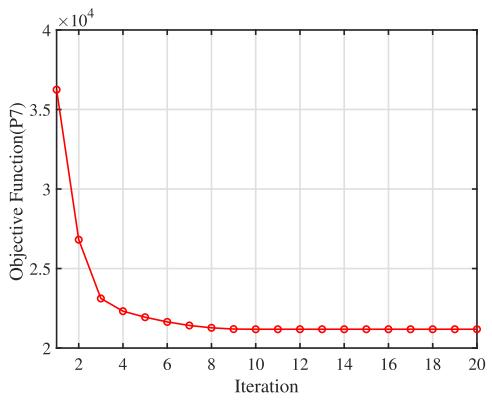

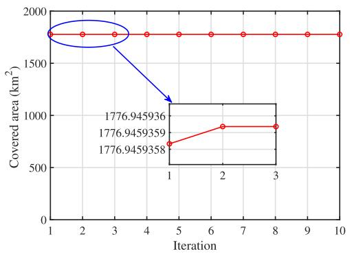  
(b)  
Fig. 4. Convergence of algorithm 1. (a) Convergence of problem (P7), (b) Convergence of problem (P5).

Benchmark 1: In this benchmark, the communication transmit power is fixed. Under this setting, problem (P5) is re-solved to optimize the remaining variables. This benchmark evaluates the performance degradation caused by decoupling communication power allocation from the joint trajectory–resource optimization.

Benchmark 2: In this benchmark, the radar transmit power is fixed, while the remaining variables are re-optimized by solving problem (P5). This benchmark quantifies the performance loss when radar power allocation is not jointly optimized with the trajectory and backhaul communication design.

Fig. 4 presents the convergence behavior of Algorithm 1, where Figs. 4(a) and 4(b) illustrate the convergence trajectories corresponding to optimization problems (P7) and (P5), respectively. It can be observed from Fig. 4(a) that the objective value decreases monotonically with the iteration index and converges within a small number of iterations. This monotonic descent is expected, since each SCA subproblem yields a convex inner approximation. The rapid convergence indicates that the proposed algorithm is numerically stable and well suited for practical implementation. Since the optimization over N involves a finite search, it suffices to demonstrate the convergence of (P7) and (P5) to ensure the convergence of Algorithm 1. The results clearly indicate that the proposed algorithm converges rapidly, confirming the efficiency and effectiveness of the proposed optimization framework.

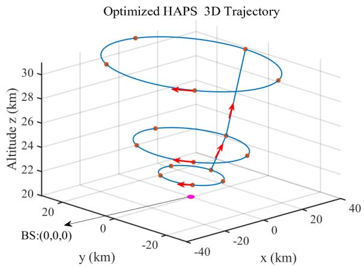

Fig. 5. Optimized HAPs-SAR 3D trajectory.  
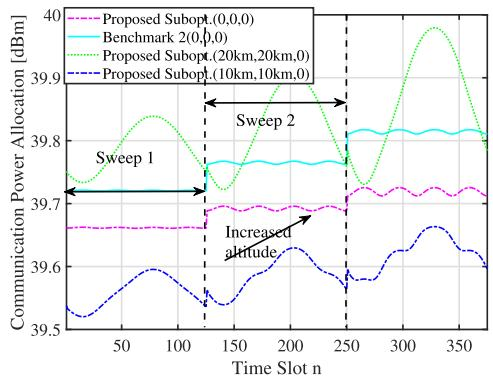  
Fig. 6. Communication power allocation versus the time slot n under different BS locations, i.e., (0, 0, 0), (10 km, 10 km, 0), and (20 km, 20 km, 0), illustrating the sensitivity of the proposed optimization framework to BS position variations.

Fig. 5 illustrates the optimized three-dimensional trajectory of the HAPs, where the red arrows denote its flight direction and the magenta marker at the origin represents the ground BS location. The resulting trajectory configuration is governed by the trajectory constraints C1–C4, while the altitude variations arise from the sweep-wise adaptability permitted under constraint C5. From a system design perspective, although higher altitudes allow for broader beam coverage, they also incur significantly greater energy consumption. Despite the incorporation of solar energy harvesting via solar panels, the HAPs platform faces stringent energy limitations due to the substantial energy demands associated with sustained operation. As a result, it is not feasible for the HAPs to continuously operate at maximum altitude throughout the mission. Therefore, an adaptive altitude strategy is essential, balancing between extended coverage area and energy efficiency. The derived trajectory reflects a trade-off that maximizes SAR coverage while ensuring operational sustainability under energy constraints.

Fig. 6 illustrates the communication power allocation under different BS deployment scenarios. It can be observed that when the HAPs operates at a higher altitude (i.e., during later sweeps), a higher communication transmit power is required to satisfy the communication rate constraint. This is mainly due to the increased path loss associated with a larger HAPs–BS distance, which necessitates additional transmit power to maintain reliable data transmission.

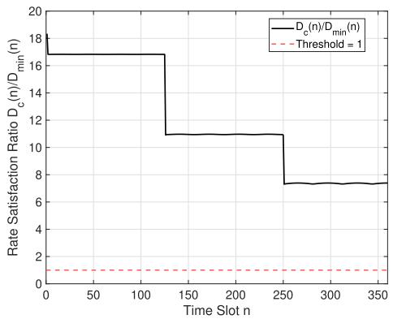  
Fig. 7. Backhaul rate satisfaction ratio $D _ { c } ( n ) / D _ { \mathrm { m i n } } ( n )$ versus the time slot n, where the threshold value of one indicates the minimum requirement for real-time SAR raw-data offloading.

When the radar transmit power is fixed at its optimized value, the communication power can be further optimized to adapt to the varying channel conditions, as reflected by the benchmark curve. The comparison with Benchmark 2 further highlights the benefit of joint optimization. Although the communication power in Benchmark 2 is still optimized, fixing the radar transmit power restricts the joint coordination among sensing, communication, and trajectory variables. This reduced flexibility can lead to higher communication power consumption in certain time slots. In contrast, the proposed joint optimization framework adaptively balances sensing and communication power under energy constraints, resulting in more efficient overall power allocation. It is also worth noting that the communication power does not depend solely on the minimum HAPs–BS distance. For example, although the BS located at (10 km, 10 km, 0) is farther from the HAPs than the origin (0, 0, 0) in terms of the minimum distance, the required communication power can be lower. This is because the HAPs follows a circular trajectory, and the communication power is dominated by the worst-case (rate-limiting) time slots along the trajectory rather than the minimum distance alone. When the BS is slightly offset from the trajectory center, the distance variation over a sweep becomes more balanced, which alleviates the rate constraint in the farthest time slots and leads to a lower overall communication power requirement. Overall, while the communication power generally increases as the BS is located farther away, the allocation trends remain consistent across different sweeps, demonstrating the robustness of the proposed optimization framework with respect to BS position variations.

Fig. 7 evaluates the communication-side performance of the proposed HAPs-SAR design by showing the backhaul rate satisfaction ratio $D _ { c } ( n ) / D _ { \mathrm { m i n } } ( n )$ . The threshold value of one represents the minimum requirement for real-time SAR raw-data offloading, since constraint C8 requires the achievable backhaul rate $D _ { c } ( n )$ to be larger than the required SAR raw-data rate $D _ { \mathrm { m i n } } ( n )$ . It can be observed that the rate satisfaction ratio remains larger than one throughout the mission, which directly verifies that the real-time offboard SAR data transmission requirement imposed by C8 is satisfied. Moreover, the stepwise decrease of $D _ { c } ( n ) / D _ { \mathrm { m i n } } ( n )$ is consistent with the sweep-wise altitude increase of the HAPs trajectory. As the HAPs moves to higher-altitude sweeps, the HAPs–BS distance increases, resulting in larger path loss and a reduced backhaul rate margin. Nevertheless, the ratio remains above the threshold for all time slots, confirming that sufficient communication margin is maintained throughout the mission. Therefore, the communication-side benefit of the proposed design lies in maintaining reliable real-time SAR raw-data offloading with sufficient rate margin under energy-aware trajectory and resource optimization, rather than maximizing the backhaul throughput.

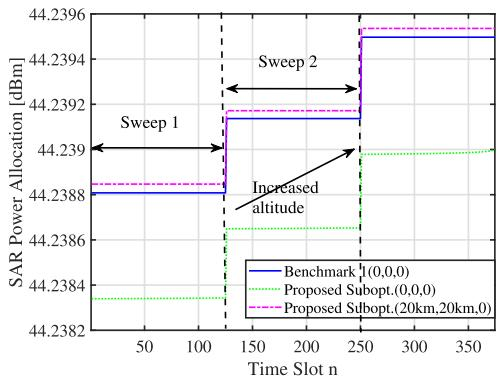  
Fig. 8. SAR power allocation vs the time slot n.

Fig. 8 illustrates the SAR power allocation as a function of the time slot index. Unlike the communication power, which varies dynamically, the SAR transmission power remains constant within each sweep due to the enforcement of constraint C10. This constraint ensures that the radar system operates with uniform power across individual sweeps, maintaining consistency in SAR illumination. Nonetheless, a similar trend is observed with respect to altitude. Namely as the HAPs ascends, the SAR system requires higher transmission power to ensure sufficient ground coverage and signal strength, owing to increased propagation losses at higher altitudes, which can be more clearly in (23). Furthermore, the location of the ground BS indirectly influences SAR power allocation. Variations in communication power, driven by the BS position and its associated rate constraints C8, can impose limitations on the total available power budget, thereby affecting the power allocated to SAR operations. This dependency is reflected by the magenta dashed line in the figure, highlighting the interplay between communication demands and radar resource allocation.

Fig. 9 illustrates the temporal profiles of both the power consumed for maintaining HAPs mobility and the power harvested via onboard solar panels. Under the parameter configuration adopted in this paper, it is evident that the energy consumption consistently exceeds the harvested energy. This is primarily due to the analytical focus on the discharge phase of the solar-powered system, wherein the solar batteries are assumed to be fully charged, allowing for an isolated assessment of the HAPs-SAR system performance under energy depletion conditions. Although this paper focuses on the energy-limited operation scenario, it is important to acknowledge that in practical deployments, the HAPs must also harvest sufficient energy to sustain prolonged operation. Future investigations may explore joint charging and operational strategies to ensure system sustainability, as discussed in [16] and [44]. Furthermore, it can be observed that within each sweep, the energy harvested and the energy consumed for propulsion are balanced. This is a direct consequence of constraints C5–C7, which enforce an energy neutrality condition over each sweep. Additionally, as the HAPs altitude increases, both the propulsion energy consumption and solar energy harvesting rise, driven respectively by increased aerodynamic resistance and enhanced solar irradiance at higher altitudes.

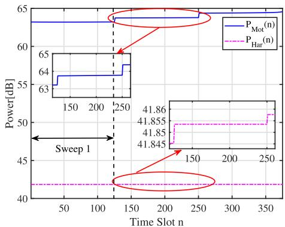  
Fig. 9. Motion and harvesting power allocation.

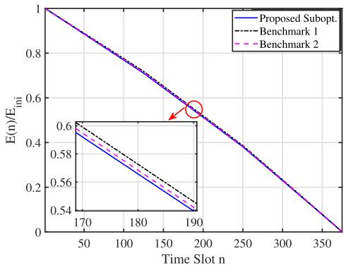  
Fig. 10. Ratio of remaining energy to initial energy over time for the HAPs.

Fig. 10 presents the ratio of the remaining energy to the initial energy of the HAPs at each time slot n. Although the remaining energy reaches zero upon completion of the prescribed sensing mission, which is mathematically permissible, this condition is impractical for real-world systems. In practice, the HAPs must retain sufficient energy to either return to base or remain in standby mode for future tasks. Nevertheless, since this paper focuses solely on the discharging process and only requires satisfaction of constraint C14, the results depicted in Fig. 10 are considered feasible within the context of the proposed model. Furthermore, it is evident that the energy ratio decreases approximately linearly over time, with proposed method exhibiting the most rapid energy consumption among the compared schemes.

Fig. 11. SAR imaging scenario with a 9-target lattice configuration.  
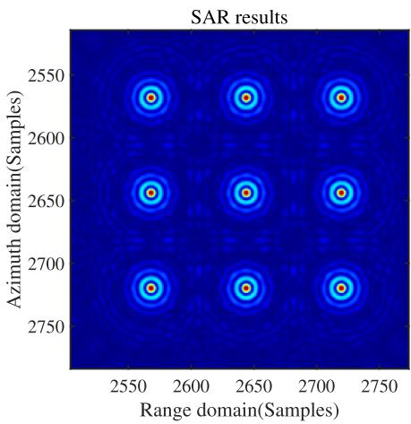  
Fig. 12. SAR imaging results corresponding to the 9-target lattice configuration.

To further verify the feasibility of the proposed trajectory and resource allocation strategy for SAR imaging, a simulation was conducted on the 9-target lattice scenario depicted in Fig. 11, using the parameters outlined in this paper and a wellestablished polar formatting algorithm (PFA) [37], [55], [56]. The corresponding imaging results are shown in Fig. 12. It can be clearly seen that all targets, both in the center of the scene and in the periphery, are accurately focused. These results provide additional evidence supporting the effectiveness of the proposed optimization framework.

## V. CONCLUSION

In this work, we proposed a joint trajectory and resource optimization framework for HAPs-SAR systems aimed at real-time sensing and energy efficiency. By offloading SAR image reconstruction to a ground BS, the HAPs can operate with reduced onboard processing and energy costs. We developed a detailed flight model and performed energy analysis considering solar power harvesting and consumption from radar sensing, communication, and motion. A MINLP problem was formulated to maximize beam coverage under system constraints, and an SCA-based sub-optimal solution was proposed. Extensive simulations verified the convergence and effectiveness of the proposed algorithm across multiple performance dimensions. The SAR imaging results for a

9-target lattice scenario further validated the practicality and robustness of the optimization framework.

Future work will extend this framework along several directions. First, environmental uncertainties such as wind disturbances and cloud-induced variations in solar irradiance will be incorporated, as they may cause deviations between the planned and actual HAPs trajectories. Robust optimization or stochastic control techniques will be investigated to enhance system reliability under such practical conditions. In addition, the framework can be further expanded to include adaptive scheduling, multi-HAPs cooperative operation, and validation using real-world measurement data.

## APPENDIX A PROOF OF CONSTRAINTS Cf8, Cg8a,Cg8b,Cg8c

Denote

$$
h _ { 1 } \left( x \left( n \right) , z \left( n \right) \right) = \left( { \mathfrak { b } } 2 ^ { { \mathfrak { a } } z \left( n \right) } - 1 \right) \left( x \left( n \right) - x _ { s } \right) ^ { 2 } ,\tag{64}
$$

$$
h _ { 2 } \left( y \left( n \right) , z \left( n \right) \right) = \left( { \mathfrak { b } } 2 ^ { { \mathfrak { a } } z \left( n \right) } - 1 \right) \left( y \left( n \right) - y _ { s } \right) ^ { 2 } ,\tag{65}
$$

$$
h _ { 3 } \left( z \left( n \right) \right) = \left( { \mathfrak { b } } 2 ^ { { \mathfrak { a } } z \left( n \right) } - 1 \right) \left( z \left( n \right) - z _ { s } \right) ^ { 2 } .\tag{66}
$$

Hence, (41) can be rewritten as

$$
\begin{array} { r l r } & { C 8 : h _ { 1 } \left( x \left( n \right) , z \left( n \right) \right) + } & { h _ { 2 } \left( y \left( n \right) , z \left( n \right) \right) + h _ { 3 } \left( z \left( n \right) \right) } \\ & { < \frac { \rho _ { 0 } } { \sigma _ { 0 } ^ { 2 } } P _ { \mathrm { C o m } } \left( n \right) , \forall n . } & { \left( \mathrm { ~ \ } \left( \sigma _ { 0 } ^ { 2 } \left( n \right) \right) , z \left( n \right) \right) } \end{array}\tag{67}
$$

Through the analysis of the Hessian matrix of the function $h _ { 1 } \left( x \left( n \right) , z \left( n \right) \right)$ , it can be concluded that $h _ { 1 } \left( x \left( n \right) , z \left( n \right) \right)$ is not a convex function. However, we find that $h _ { 1 } \left( x \left( n \right) , z \left( n \right) \right)$ can be expressed as the difference of convex functions (DC decomposition). Specifically, we have

$$
\begin{array} { c } { { h _ { 1 } \left( x \left( n \right) , z \left( n \right) \right) = \displaystyle \frac 1 2 \left[ g _ { 1 } \left( z \left( n \right) \right) + g _ { 2 } \left( x \left( n \right) \right) \right] ^ { 2 } } } \\ { { - \displaystyle \frac 1 2 \left[ g _ { 1 } ^ { 2 } \left( z \left( n \right) \right) + g _ { 2 } ^ { 2 } \left( x \left( n \right) \right) \right] , } } \end{array}\tag{68}
$$

with $g _ { 1 } \left( z \left( n \right) \right) ~ = ~ { \sf b 2 ^ { a z ( n ) } } - 1 , g _ { 2 } \left( x \left( n \right) \right) ~ = ~ \left( x \left( n \right) - x _ { s } \right) ^ { 2 }$ Note that $g _ { 1 } \left( z \left( n \right) \right)$ and $g _ { 2 } \left( x \left( n \right) \right)$ are both convex functions. Building upon this, by employing the first-order Taylor expansion, the approximate representations of $g _ { 1 } ^ { 2 } { \left( z { \left( n \right) } \right) } , g _ { 2 } ^ { 2 } { \left( x { \left( n \right) } \right) }$ around point $\left\{ x ^ { k } \left( n \right) , y ^ { \dot { k } } \left( n \right) , z ^ { k } \left( n \right) \right\}$ are derived as

$$
g _ { 1 } ^ { 2 } \left( z \left( n \right) \right) \approx g _ { 1 } ^ { 2 } \left( z ^ { k } \left( n \right) \right) + \left[ g _ { 1 } ^ { 2 } \left( z ^ { k } \left( n \right) \right) \right] ^ { \prime } \left[ z \left( n \right) - z ^ { k } \left( n \right) \right]\tag{69}
$$

$$
g _ { 2 } ^ { 2 } \left( x \left( n \right) \right) \approx g _ { 2 } ^ { 2 } \left( x ^ { k } \left( n \right) \right) + \left[ g _ { 2 } ^ { 2 } \left( x ^ { k } \left( n \right) \right) \right] ^ { \prime } \left[ x \left( n \right) - x ^ { k } \left( n \right) \right] .\tag{70}
$$

Here, the superscript $\left( \cdot \right) ^ { \prime }$ signifies the operation of computing the first derivative of a function.

Similarly, we have

$$
\begin{array} { c } { { \displaystyle h _ { 2 } \left( y \left( n \right) , z \left( n \right) \right) = \frac 1 2 \left[ g _ { 1 } \left( z \left( n \right) \right) + g _ { 3 } \left( y \left( n \right) \right) \right] ^ { 2 } } } \\ { { \displaystyle - \frac 1 2 \left[ g _ { 1 } ^ { 2 } \left( z \left( n \right) \right) + g _ { 3 } ^ { 2 } \left( y \left( n \right) \right) \right] , } } \end{array}\tag{71}
$$

$$
\begin{array} { c } { { h _ { 3 } \left( z \left( n \right) \right) = \displaystyle \frac 1 2 \left[ g _ { 1 } \left( z \left( n \right) \right) + g _ { 4 } \left( z \left( n \right) \right) \right] ^ { 2 } } } \\ { { - \displaystyle \frac 1 2 \left[ g _ { 1 } ^ { 2 } \left( z \left( n \right) \right) + g _ { 4 } ^ { 2 } \left( z \left( n \right) \right) \right] } } \end{array}\tag{72}
$$

where g3 $\begin{array} { r l r } { \left( y \left( n \right) \right) } & { { } = } & { \left( y \left( n \right) - y _ { s } \right) ^ { 2 } } \end{array}$ and $\begin{array} { r l } { g _ { 4 } \left( z \left( n \right) \right) } & { { } = } \end{array}$ $\left( z \left( n \right) - z _ { s } \right) ^ { 2 } .$ Moreover, the first-order Taylor expansions of $g _ { 3 } \left( y \left( n \right) \right)$ ) and $g _ { 4 } \left( z \left( n \right) \right)$ around the point $\left\{ \dot { x ^ { k } } \left( n \right) , y ^ { k } \left( n \right) , z ^ { k } \left( n \right) \right\}$ can be elegantly given by

$$
g _ { 3 } ^ { 2 } \left( y \left( n \right) \right) \approx g _ { 3 } ^ { 2 } \left( y ^ { k } \left( n \right) \right) + \left[ g _ { 3 } ^ { 2 } \left( y ^ { k } \left( n \right) \right) \right] ^ { \prime } \left[ y \left( n \right) - y ^ { k } \left( n \right) \right] ,\tag{73}
$$

$$
g _ { 4 } ^ { 2 } \left( z \left( n \right) \right) \approx g _ { 4 } ^ { 2 } \left( z ^ { k } \left( n \right) \right) + \left[ g _ { 4 } ^ { 2 } \left( z ^ { k } \left( n \right) \right) \right] ^ { \prime } \left[ z \left( n \right) - z ^ { k } \left( n \right) \right] .\tag{74}
$$

Inserting (68)-(74) into (67) results in

$$
\sum _ { i = 2 } ^ { 4 } \left[ g _ { 1 } \left( \varsigma _ { 4 } \right) + g _ { i } \left( \varsigma _ { i } \right) \right] ^ { 2 } - 3 \left[ g _ { 1 } ^ { 2 } \left( \varsigma _ { 4 } ^ { k } \right) + \left[ g _ { 1 } ^ { 2 } \left( \varsigma _ { 4 } ^ { k } \right) \right] ^ { \prime } \left( \varsigma _ { 4 } - \varsigma _ { 4 } ^ { k } \right) \right]
$$

$$
- \sum _ { i = 2 } ^ { 4 } \left\{ g _ { i } ^ { 2 } \left( \varsigma _ { i } ^ { k } \right) + \left[ g _ { i } ^ { 2 } \left( \varsigma _ { i } ^ { k } \right) \right] ^ { \prime } \left( \varsigma _ { i } - \varsigma _ { i } ^ { k } \right) \right\}
$$

$$
< \frac { 2 \rho _ { 0 } } { \sigma _ { 0 } ^ { 2 } } P _ { \mathrm { C o m } } \left( n \right) , \forall n\tag{75}
$$

with ${ \mathsf { S } } _ { 2 } = x \left( n \right) , { \mathsf { S } } _ { 3 } = y \left( n \right)$ and $\varsigma _ { 4 } = z \left( n \right)$

Finally, using all the aforementioned results together with the definitions of $p , q , r ,$ , we obtain the constraints Cf8, $\widetilde { C 8 a } , \widetilde { C 8 b } , \widetilde { C 8 c }$

## APPENDIX B PROOF OF EQ. (63)

By leveraging constraint C11, a lower bound for the righthand side of constraint $\overrightarrow { C 9 }$ can readily be established as

$$
P _ { \mathrm { M o t } } ( n ) - P _ { \mathrm { H a r } } ( n ) \leqslant \frac { E \left( n - 1 \right) } { \triangle \eta _ { a } } - \frac { E \left( n \right) } { \triangle \eta _ { a } } , \forall n \neq 1 .\tag{76}
$$

Subsequently, by summing both sides of the inequality, gives

$$
\sum _ { n = 2 } ^ { N M } \left[ P _ { \mathrm { M o t } } ( n ) - P _ { \mathrm { H a r } } ( n ) \right] \leqslant \sum _ { n = 2 } ^ { N M } \left[ \frac { E \left( n - 1 \right) } { \bigtriangleup \eta _ { a } } - \frac { E \left( n \right) } { \bigtriangleup \eta _ { a } } \right] .\tag{77}
$$

Observing (77), the expression on the right-hand side can be rewritten as

$$
\sum _ { n = 2 } ^ { N M } \left[ \frac { E \left( n - 1 \right) } { \triangle \eta _ { a } } - \frac { E \left( n \right) } { \triangle \eta _ { a } } \right] = \frac { E \left( 1 \right) } { \triangle \eta _ { a } } - \frac { E \left( N M \right) } { \triangle \eta _ { a } } .\tag{78}
$$

Inserting (78) into (77) results in

$$
\sum _ { n = 2 } ^ { N M } \left[ P _ { \mathrm { M o t } } ( n ) - P _ { \mathrm { H a r } } ( n ) \right] \leqslant \frac { E \left( 1 \right) } { \triangle \eta _ { a } } - \frac { E \left( N M \right) } { \triangle \eta _ { a } } \leqslant \frac { E _ { \mathrm { I n i } } } { \triangle \eta _ { a } } .\tag{79}
$$

It is worth noting that during each sweep, the altitude and velocity remain constant, leading to fixed values for both power consumption and energy harvesting. Therefore, by applying the above conclusions together with (79), (63) can be readily obtained.

## REFERENCES

[1] World Economic Forum.(2024). Top 10 Emerging Technologies of 2024. Accessed: May 10, 2025. [Online]. Available: https://www.weforum.org/ publications/top-10-emerging-technologies-2024/

[2] B. E. Y. Belmekki et al., “Cellular network from the sky: Toward peoplecentered smart communities,” IEEE Open J. Commun. Soc., vol. 5, pp. 1916–1936, 2024.

[3] O. Anicho, P. Charlesworth, G. Baicher, and A. Nagar, “Multi-HAPS network implementation within 3GPP’s NTN framework for 5G and beyond,” Int. J. Inf., Commun. Technol. Appl., vol. 7, no. 1, pp. 7–12, Dec. 2021.

[4] Y. Shibata, N. Kanazawa, K. Hoshino, Y. Ohta, and A. Nagate, “A study on cell configuration for HAPS mobile communications,” in Proc. IEEE 89th Veh. Technol. Conf. (VTC-Spring), Kuala Lumpur, Malaysia, Apr. 2019, pp. 1–6.

[5] F. A. d’Oliveira, F. C. L. d. Melo, and T. C. Devezas, “High-altitude platforms–present situation and technology trends,” J. Aerosp. Technol. Manage., vol. 8, no. 3, pp. 249–262, 2016.

[6] Airbus. (2024). Zephyr: The World’s Leading Solar-Electric Stratospheric Unmanned Aerial System (UAS). Accessed: May 10, 2025. [Online]. Available: https://www.airbus.com/en/products-services/ defence/uas/zephyr

[7] M. Jirousek, M. Peichl, S. Anger, S. Dill, and M. Engel, “Design of a synthetic aperture radar instrument for a high-altitude platform,” in Proc. IEEE Int. Geosci. Remote Sens. Symp., Pasadena, CA, USA, Jul. 2023, pp. 2045–2048.

[8] M. Jirousek, M. Peichl, S. Anger, S. Dill, and M. Limbach, “The DLR high altitude platform synthetic aperture radar instrument HAPSAR,” in Proc. EUSAR 15th Eur. Conf. Synth. Aperture Radar, Munich, Germany, 2024, pp. 1244–1248.

[9] W.-Q. Wang and H. Shao, “High altitude platform multichannel SAR for wide-area and staring imaging,” IEEE Aerosp. Electron. Syst. Mag., vol. 29, no. 5, pp. 12–17, May 2014.

[10] A. A. Aragon-Zavala, J. L. Cuevas-Ru´ ´ız, and J. A. Delgado-Pen´ın, High-Altitude Platforms for wireless Communications. Hoboken, NJ, USA: Wiley, 2008.

[11] D. W. Hall, C. D. Fortenbach, E. V. Dimiceli, and R. W. Parks, “A preliminary study of solar powered aircraft and associated power trains,” Lockheed Missiles Space Co., Sunnyvale, CA, USA, Tech. Rep. NASA CR-3699, Dec. 1983.

[12] O. Abbasi, A. Yadav, H. Yanikomeroglu, N.-D. ao, G. Senarath, and\` P. Zhu, “HAPS for 6G networks: Potential use cases, open challenges, and possible solutions,” IEEE Wireless Commun., vol. 31, no. 3, pp. 324–331, Jun. 2024.

[13] G. K. Kurt et al., “A vision and framework for the high altitude platform station (HAPS) networks of the future,” IEEE Commun. Surveys Tuts., vol. 23, no. 2, pp. 729–779, 2nd Quart., 2021.

[14] Z. Lou, B. E. Y. Belmekki, and M.-S. Alouini, “Coverage analysis of large-scale HAPS networks using directional beams,” IEEE Trans. Aerosp. Electron. Syst., vol. 61, no. 4, pp. 9260–9275, Aug. 2025.

[15] S. C. Arum and H. Yanikomeroglu, “Extending coverage and capacity from high altitude platforms with a two-tier cellular architecture,” IEEE Trans. Mobile Comput., vol. 23, no. 2, pp. 1942–1953, Feb. 2024.

[16] S. Javed and M.-S. Alouini, “System design and parameter optimization for remote coverage from NOMA-based high-altitude platform stations (HAPS),” IEEE Trans. Wireless Commun., vol. 24, no. 2, pp. 1387–1400, Feb. 2025.

[17] A. Nabi and S. Moh, “Joint offloading decision, user association, and resource allocation in hierarchical aerial computing: Collaboration of UAVs and HAP,” IEEE Trans. Mobile Comput., vol. 24, no. 8, pp. 7267–7282, Aug. 2025.

[18] W. Wu, W. Feng, Y. Fang, Z. Lin, and X. Lu, “Multi-HAP-assisted computation offloading in space–air–ground–sea integrated network,” IEEE Internet Things J., vol. 12, no. 12, pp. 21806–21818, Jun. 2025.

[19] X. Yu, X. Zhang, Y. Rui, K. Wang, X. Dang, and M. Guizani, “Joint resource allocations for energy consumption optimization in HAPSaided MEC-NOMA systems,” IEEE J. Sel. Areas Commun., vol. 42, no. 12, pp. 3632–3646, Dec. 2024.

[20] W. Lu, S. Tu, D. Yan, and Y. Wang, “Performance analysis of EFPK laser communication in terrestrial-HAP-satellite links with MRR array,” IEEE Photon. Technol. Lett., vol. 37, no. 12, pp. 651–654, Jun. 15, 2025.

[21] W. Li, B. Ai, Y. Niu, Z. Han, Z. Zhong, and N. Wang, “High altitude platform beam switching and time slot allocation in high-speed railway communications,” IEEE Trans. Veh. Technol., vol. 74, no. 3, pp. 5217–5222, Mar. 2025.

[22] O. Abbasi, H. Yanikomeroglu, and G. Kaddoum, “Hemispherical antenna array architecture for high-altitude platform stations (HAPS) for uniform capacity provision,” IEEE Trans. Wireless Commun., vol. 23, no. 12, pp. 19489–19504, Dec. 2024.

[23] O. A. Amodu et al., “Technical advancements toward RIS-assisted NTNbased THz communication for 6G and beyond,” IEEE Access, vol. 12, pp. 183153–183181, 2024.

[24] E. S. Ahrazoglu, I. Altunbas, and E. Erdogan, “Multi-HAPS THz satellite communication: Error and capacity analyses under I/Q imbalance,” IEEE Sensors J., vol. 24, no. 23, pp. 39845–39855, Dec. 2024.

[25] Z. Niu et al., “HAP networking enables highly reliable space-air-ground optical interconnect: An integrated network perspective,” IEEE Netw., vol. 39, no. 2, pp. 224–231, Mar. 2025.

[26] M. Salamatmoghadasi, A. Mehrabian, and H. Yanikomeroglus, “Energy sustainability in dense radio access networks via high altitude platform stations,” IEEE Netw. Lett., vol. 6, no. 1, pp. 21–25, Mar. 2024.

[27] W. Abderrahim, O. Amin, and B. Shihada, “Data center-enabled high altitude platforms: A green computing alternative,” IEEE Trans. Mobile Comput., vol. 23, no. 5, pp. 6149–6162, May 2024.

[28] R. Alghamdi, H. Dahrouj, T. Y. Al-Naffouri, and M.-S. Alouini, “Equitable 6G access service via cloud-enabled HAPS for optimizing hybrid air-ground networks,” IEEE Trans. Commun., vol. 72, no. 5, pp. 2959–2973, May 2024.

[29] Z. Ali, Z. Rezki, and M.-S. Alouini, “Optimizing power allocation in HAPs assisted LEO satellite communications,” IEEE Trans. Mach. Learn. Commun. Netw., vol. 2, pp. 1661–1677, 2024.

[30] Y. Wang, C. Zhang, T. Ge, and M. Pan, “Efficient data transmission scheme for massive high altitude platform networks,” IEEE Trans. Netw. Sci. Eng., vol. 11, no. 3, pp. 2837–2848, May 2024.

[31] S. Liu, H. Dahrouj, and M.-S. Alouini, “Joint user association and beamforming in integrated satellite-HAPS-ground networks,” IEEE Trans. Veh. Technol., vol. 73, no. 4, pp. 5162–5178, Apr. 2024.

[32] Z. Lou, B. E. Youcef Belmekki, and M.-S. Alouini, “HAPS in the non-terrestrial network nexus: Prospective architectures and performance insights,” IEEE Wireless Commun., vol. 30, no. 6, pp. 52–58, Dec. 2023.

[33] A. M. Benaya, M. S. Hassan, M. H. Ismail, and T. Landolsi, “Aerial ISAC: A HAPS-assisted integrated sensing, communications and computing framework for enhanced coverage and security,” IEEE Trans. Green Commun. Netw., vol. 9, no. 4, pp. 2101–2114, Dec. 2025.

[34] S. B. Son and S. Park, “Hierarchical scheduling for oil spill SAR image detection in space–air–ground integrated networks,” IEEE Trans. Veh. Technol., vol. 74, no. 6, pp. 9689–9703, Jun. 2025.

[35] W. Li, B. Ai, Y. Niu, Z. Han, N. Wang, and L. Xiong, “End-toend scheduling of space–air–ground integrated networks for high-speed railways,” IEEE Trans. Veh. Technol., vol. 74, no. 6, pp. 9591–9603, Jun. 2025.

[36] B. Huang, S. Ahmed, and M.-S. Alouini, “Design of frequency index modulated waveforms for integrated SAR and communication on highaltitude platforms (HAPs),” IEEE Trans. Commun., vol. 73, no. 11, pp. 12869–12883, Nov. 2025.

[37] Y. Lin, W. Hong, W. Tan, and Y. Wu, “Extension of range migration algorithm to squint circular SAR imaging,” IEEE Geosci. Remote Sens. Lett., vol. 8, no. 4, pp. 651–655, Jul. 2011.

[38] Y. Liao, W.-Q. Wang, and Q. H. Liu, “Two-dimensional spectrum for circular trace scanning SAR based on an implicit function,” IEEE Geosci. Remote Sens. Lett., vol. 13, no. 7, pp. 887–891, Jul. 2016.

[39] M. Younis, “Digital beam-forming for high resolution wide swath real and synthetic aperture radar,” Ph.D. dissertation, Dept. High-Freq. Eng. Electron. (IHE), Universitat Karlsruhe (TH), Karlsruhe, Germany, 2004.¨

[40] A. Currie and M. A. Brown, “Wide-swath SAR,” IEE Proc. F (Radar Signal Process.), vol. 139, no. 2, pp. 122–135, 1992.

[41] M. A. Richards et al., Fundamentals of Radar Signal Processing, vol. 1. New York, NY, USA: McGraw-Hill, 2005.

[42] R. W. Beard and T. W. McLain, Small Unmanned Aircraft: Theory and Practice. Princeton, NJ, USA: Princeton Univ. Press, 2012.

[43] R. Austin, Unmanned Aircraft Systems: UAVS Design, Development and Deployment. Hoboken, NJ, USA: Wiley, 2011.

[44] S. Javed, M.-S. Alouini, and Z. Ding, “An interdisciplinary approach to optimal communication and flight operation of high-altitude longendurance platforms,” IEEE Trans. Aerosp. Electron. Syst., vol. 59, no. 6, pp. 8327–8341, Dec. 2023.

[45] A. J. Oswald, “Efficient contracts are on the labour demand curve: Theory and facts,” Labour Econ., vol. 2, no. 1, p. 102, Mar. 1995.

[46] R. T. Jones, “The unsteady lift a wing finite aspect ratio,” Nat. Advisory Committee Aeronaut., Washington, DC, USA, NACA Rep. 681, 1940.

[47] US Standard Atmosphere, A. Administration and U. S. A. Force, National Oceanic and Atmospheric Administration, Washington, DC, USA, 1976, no. 1562, vol. 76.

[48] I. Reda and A. Andreas, “Solar position algorithm for solar radiation applications,” Sol. Energy, vol. 76, no. 5, pp. 577–589, 2004.

[49] G. S. Aglietti, S. Redi, A. R. Tatnall, and T. Markvart, “Harnessing high-altitude solar power,” IEEE Trans. Energy Convers., vol. 24, no. 2, pp. 442–451, Jun. 2009.

[50] S. P. Boyd and L. Vandenberghe, Convex Optimization. Cambridge, U.K.: Cambridge Univ. Press, 2004.

[51] M. Grant and S. Boyd. (2014). CVX: MATLAB Software for Disciplined Convex Programming, Version 2.1. [Online]. Available: https://cvxr.com/ cvx/

[52] Y. Zeng, J. Xu, and R. Zhang, “Energy minimization for wireless communication with rotary-wing UAV,” IEEE Trans. Wireless Commun., vol. 18, no. 4, pp. 2329–2345, Apr. 2019.

[53] M.-A. Lahmeri, W. R. Ghanem, C. Bonfert, and R. Schober, “Robust trajectory and resource optimization for communication-assisted UAV SAR sensing,” IEEE Open J. Commun. Soc., vol. 5, pp. 3212–3228, 2024.

[54] M.-A. Lahmeri, W. Ghanem, C. Knill, and R. Schober, “Trajectory and resource optimization for UAV synthetic aperture radar,” in Proc. IEEE Globecom Workshops, Dec. 2022, pp. 897–903.

[55] H. Zhang, Y. Lin, F. Teng, S. Feng, and W. Hong, “Holographic SAR volumetric imaging strategy for 3-D imaging with single-pass circular InSAR data,” IEEE Trans. Geosci. Remote Sens., vol. 61, 2023, Art. no. 5219816.

[56] Q. Zhang, J. Sun, Y. Lin, S. Han, Y. Wang, and W. Hong, “Large-scene polar format algorithm for circular SAR subaperture imaging,” IEEE J. Sel. Topics Appl. Earth Observ. Remote Sens., vol. 18, pp. 6336–6349, 2025.

Bang Huang (Member, IEEE) received the M.S. degree (Hons.) in electrical engineering and the Ph.D. degree (Hons.) in information and communication engineering from the School of Information and Communication Engineering (SICE), University of Electronic Science and Technology of China (UESTC), Chengdu, China, in 2020 and 2023, respectively.

Since 2024, he has been a Post-Doctoral Research Fellow with the Communication Theory Laboratory, Computer, Electrical and Mathematical Science and

Engineering (CEMSE) Division, King Abdullah University of Science and Technology (KAUST). His research focuses on waveform design, array signal processing and optimization for integrated sensing and communications, with applications to frequency diverse arrays, high-altitude platform stations, and synthetic aperture radar. He received the Excellent Academic Presentation Award at the 3rd Radar Journal Ph.D. Forum.

Ki-Hong Park (Senior Member, IEEE) received the M.S. and Ph.D. degrees from the School of Electrical Engineering, Korea University, Seoul, South Korea, in 2005 and 2011, respectively. He joined as a Post-Doctoral Fellow with the King Abdullah University of Science and Technology, Thuwal, Saudi Arabia, in 2011. He is currently a Senior Research Scientist of electrical and computer engineering with the Division of Computer, Electrical, Mathematical Science and Engineering. His research interests include communication theory and its application to the design and performance evaluation of wireless communication systems and networks, non-terrestrial networks, near-field communications, physical-layer secrecy, and optical wireless communications.

Xiaowei Pang received the B.S. degree in telecommunication engineering from Northwestern Polytechnical University, Xi’an, China, in 2018, and the Ph.D. degree in information and communication engineering from Dalian University of Technology, Dalian, China, in 2024. She was a Visiting Ph.D. Student with the National University of Singapore, Singapore, from 2021 to 2022. She is currently a Post-Doctoral Research Fellow with the Communication Theory Laboratory, King Abdullah University of Science and Technology, Thuwal, Saudi Arabia.

Her research interests include integrated sensing and communications (ISAC), non-terrestrial networks (NTNs), UAV communications, physical layer security, and wireless resource optimization.

Mohamed-Slim Alouini (Fellow, IEEE) was born in Tunis, Tunisia. He received the Ph.D. degree from California Institute of Technology (Caltech) in 1998. He was a Faculty Member with the University of Minnesota and later with Texas A&M University, Qatar. In 2009, he became a Founding Faculty Member with the King Abdullah University of Science and Technology (KAUST), where he currently is the Al-Khawarizmi Distinguished Professor of electrical and computer engineering and the holder of the UNESCO Chair on Education to

Connect the Unconnected. His research interests encompass a wide array of research topics in wireless and satellite communications. He is currently particularly focusing on addressing the technical challenges associated with the deployment of information and communication technologies (ICT) in underserved and disaster-prone areas. He is a fellow of OPTICA and SPIE.