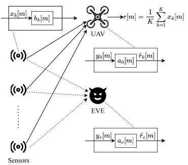
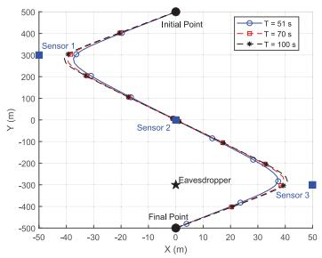
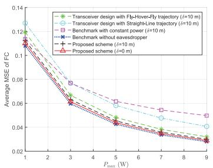

# Joint Transceiver and Trajectory Design for Secure UAV-Enabled Over-the-Air Computation

Yuxia Gong, Jianping Yao , Member, IEEE, Jie Xu , Fellow, IEEE, Yi Fang , Senior Member, IEEE, Guojun Han , Senior Member, IEEE, and Tony Q. S. Quek , Fellow, IEEE

Abstract—This letter investigates a secure uncrewed aerial vehicle (UAV)-enabled over-the-air computation (AirComp) network, where a UAV acts as a mobile fusion center (FC) to aggregate data from multiple ground sensors. At the same time, an eavesdropper (EVE) attempts to intercept the transmitted signals. To ensure secure and efficient computation, we aim to jointly optimize the UAV’s receiver coefficients, the sensors’ transmitter scaler factors, and the UAV trajectory to minimize the mean square error (MSE) at the UAV, while satisfying the MSE constraint at the EVE, the maximum transmit power constraint, and the UAV trajectory constraint. Given the nonconvexity of the formulated problem, we propose an efficient algorithm that leverages alternating optimization combined with the successive convex approximation (SCA) technique. Numerical results validate the superiority of our proposed scheme over benchmark approaches.

Index Terms—Over-the-air computation (AirComp), uncrewed aerial vehicle (UAV), physical layer security (PLS), mean square error (MSE) minimization, trajectory design.

## I. INTRODUCTION

O VER-THE-AIR computation (AirComp) has emergedas a promising technique for enabling low-latency and as a promising technique for enabling low-latency and efficient data aggregation in wireless networks. By exploiting the signal superposition property of wireless multiple access channels (MAC), AirComp directly computes functions of distributed sensor data during transmission, thereby breaking the traditional “communication-then-computation” paradigm. This paradigm shift allows AirComp to achieve high spectral efficiency and eliminate multiple access delays, which makes it well-suited for large-scale data fusion scenarios [1].

Received 25 April 2025; revised 6 August 2025; accepted 23 October 2025. Date of publication 30 October 2025; date of current version 18 December 2025. This work was supported in part by the National Natural Science Foundation of China under Grant 62471424, Grant 92267202, and Grant 62571142; in part by the Basic Research Project of Hetao Shenzhen-HK S&T Cooperation Zone under Grant HZQB-KCZYZ-2021067; in part by the Guangdong Provincial Key Laboratory of Future Networks of Intelligence under Grant 2022B1212010001; and in part by the Guangdong Major Project of Basic and Applied Basic Research under Grant 2023B0303000001. The associate editor coordinating the review of this article and approving it for publication was S.-F. Chou. (Corresponding authors: Jianping Yao; Jie Xu.)

Yuxia Gong, Jianping Yao, Yi Fang, and Guojun Han are with the School of Information Engineering, Guangdong University of Technology, Guangzhou 510006, China, and also with the Guangdong Provincial Key Laboratory of Future Networks of Intelligence, The Chinese University of Hong Kong at Shenzhen, Shenzhen 518172, China (e-mail: 2112303044@mail2.gdut.edu.cn; yaojp@gdut.edu.cn; fangyi@gdut.edu.cn; gjhan@gdut.edu.cn).

Jie Xu is with the School of Science and Engineering, Shenzhen Future Network of Intelligence Institute, and the Guangdong Provincial Key Laboratory of Future Networks of Intelligence, The Chinese University of Hong Kong (Shenzhen), Shenzhen 518172, Guangdong, China (e-mail: xujie@cuhk.edu.cn).

Tony Q. S. Quek is with the Information Systems Technology and Design Pillar, Singapore University of Technology and Design, Singapore 487372 (e-mail: tonyquek@sutd.edu.sg).

Digital Object Identifier 10.1109/LWC.2025.3626954

Recent works on AirComp have primarily focused on optimizing transmission strategies with a particular emphasis on power allocation to minimize the mean square error (MSE) at the fusion center (FC) [2]. However, the overall performance of AirComp is usually bottlenecked by the worst-case channel condition among all links between the sensors and FC. This vulnerability can severely degrade performance, even if most links exhibit favorable conditions.

To address this issue, uncrewed aerial vehicles (UAVs) have been introduced as mobile FCs due to their high mobility and flexible deployment capabilities [3]. UAVs can dynamically adjust their trajectories to improve line-of-sight (LoS) connections, avoid obstacles, and enhance overall channel quality [4]. Moreover, UAVs offer low-latency communication and reliable command and control while meeting the data rate requirements of real-time applications [5].

Despite these advantages, the integration of UAVs into AirComp networks raises critical security concerns. Specifically, the open and broadcast nature of wireless channels makes UAV communications susceptible to eavesdropping by malicious third parties (referred to as eavesdroppers or EVEs) [6]. To address this, physical layer security (PLS) has been recognized as an effective means to safeguard sensitive information without relying on higher-layer encryption.

Several PLS-enhanced AirComp strategies have been proposed to safeguard data aggregation. For example, the authors in [7] investigated transmitting artificial noise (AN) from sensors to disrupt potential EVE and employed a selective sensor activation strategy to balance security and aggregation accuracy. The authors in [8] introduced a fullduplex scheme where the FC emits jamming signals while receiving data, to ensure the EVE’s MSE exceeding a predefined threshold. The authors in [9] adopted beamformingbased null-space projection to suppress the EVE’s reception by steering nulls in its direction. The authors in [10] considered an untrusted relay acting as both a base station and a potential EVE, with the access point (AP) sending interference to hinder eavesdropping. The authors in [11] proposed a secure multiple-input-multiple-output (MIMO) two-way relay-assisted AirComp scheme that leverages multicasting and AN to enhance secrecy. Furthermore, the authors in [12] developed an AN-assisted relay protocol that employs power splitting and a two-phase transmission strategy to prevent eavesdropping while supporting energy harvesting. Although PLS has been extensively applied to UAV-assisted wireless networks by employing methods such as UAV trajectory optimization, artificial noise injection, cooperative jamming, and power control to defend against eavesdropping [5], [13], those efforts have largely addressed traditional communication setups rather than AirComp frameworks.



<details>
<summary>flowchart</summary>

```mermaid
graph TD
  A["x_k[m"]] --> B["b_k[m"]]
  B --> C["Robot"]
  D["(o)"] --> E["EVE"]
  F["(o)"] --> E
  G["(o)"] --> E
  H["(o)"] --> I["Sensors"]
  J["y_0[m"]] --> K["a_0[m"]]
  K --> L["r̂_0[m"]]
  M["y_e[m"]] --> N["a_e[m"]]
  N --> O["r̂_e[m"]]
  P["1/K Σ_{k=1}^K x_k[m"]] --> C
  Q["1/K Σ_{k=1}^K x_k[m}"] --> C
```
</details>

Fig. 1. System Model.

Building upon these advancements, this letter investigates a UAV-enabled AirComp network with integrated PLS. Our goal is to jointly optimize the transceiver parameters and the UAV trajectory to minimize the MSE at the UAV, while ensuring that the EVE’s MSE remains above a specified security threshold. Our work uniquely integrates secure AirComp with UAV trajectory and transceiver co-design under EVE constraints, an intersection not addressed in the existing literature. Although the resulting optimization problem is inherently non-convex, we develop an efficient solution approach based on alternating optimization and the successive convex approximation (SCA) method. Numerical results demonstrate the effectiveness of the proposed design in enhancing both the computation performance and the security level of UAV-assisted AirComp networks.

## II. SYSTEM MODEL

As shown in Fig. 1, we investigate a secure UAV-enabled AirComp network, where a UAV functions as a mobile FC to aggregate sensory data from K ground sensors. During this process, a suspicious EVE seeks to intercept the aggregated message. Each node in the network is equipped with a single antenna. The network is modeled in a three-dimensional (3D) Cartesian coordinate space. Specifically, each sensor $k \in \mathcal { K } \triangleq$ $\{ 1 , \ldots , K \}$ kis placed at a fixed horizontal coordinate $\mathbf { w } _ { k } ~ =$ $[ x _ { k } , y _ { k } ] ^ { T } .$ k while the EVE is positioned at a fixed horizontal xk yklocation $\mathbf { w } _ { e } ~ = ~ [ x _ { e } , y _ { e } ] ^ { T }$ . We assume the UAV has precise e xe yeknowledge of each sensor’s location ${ \mathbf w } _ { k }$ , obtained through kreliable information exchange. In contrast, the EVE’s location ${ \bf w } _ { e }$ is only partially known. The UAV obtains an estimate, edenoted $\tilde { \mathbf { w } } _ { e } ,$ , via indirect observations, such as monitoring eanomalous signal leakage [14] or utilizing onboard sensors like optical cameras and synthetic aperture radar (SAR) to detect and approximate potential EVEs based on image and pattern recognition techniques [15]. Let $\delta$ represent the maximum uncertainty in the estimated location; consequently, the true EVE location obeys $\left\| \tilde { \mathbf { w } } _ { e } - \mathbf { w } _ { e } \right\| \leq \delta .$ , which models a bounded e elocalization error region as adopted in robust secrecy design frameworks [13]. All sensors are located at ground level $( \mathrm { i . e . }$ , zero altitude), whereas the EVE is assumed to hover at a fixed altitude $H _ { e }$ .

HeWe consider a finite UAV operation interval of duration $T ,$ divided evenly into M time slots, each with duration $t _ { s } ~ =$ $T / M$ ts. We assume that the UAV maintains a constant altitude $H _ { 0 }$ Mand denote its time-vary horizontal position at slot $m \in$ $\mathcal { M } \ \triangleq \ \{ 1 , . . . , M \}$ as ${ \bf q } [ \dot { m } ] = [ x [ m ] , y [ m ] ] ^ { T }$ m. The UAV M m x mis subject to a maximum speed limit $V ,$ y m which restricts its movement between consecutive slots by $L ~ = ~ V t _ { s }$ . It then

follows that

$$
\left\| \mathbf {q} [ m + 1 ] - \mathbf {q} [ m ] \right\| \leq L, \forall m \in \{0 \} \cup \mathcal {M}, \tag {1}
$$

$$
\mathbf {q} [ 0 ] = \mathbf {q} _ {S}, \mathbf {q} [ M + 1 ] = \mathbf {q} _ {E}, \tag {2}
$$

where $\mathbf { q } _ { S }$ and $\mathbf q _ { E }$ represent the UAV’s starting and ending S Ehorizontal positions, respectively.

We model the ground-to-air link as the free space model. Accordingly, the channel coefficient between sensor $k \in \mathcal { K }$ and the UAV at any slot $\in \mathcal { M }$ is expressed as

$$
h _ {k} [ m ] = \sqrt {\frac {\rho_ {0}}{\| \mathbf {q} [ m ] - \mathbf {w} _ {k} \| ^ {2} + H _ {0} ^ {2}}} e ^ {j \omega_ {k} [ m ]}, \tag {3}
$$

where $\rho _ { 0 }$ is the reference channel power gain at 1 meter for the legitimate channel, $\omega _ { k } [ m ]$ signifies the channel phase shift at any given slot.

Similarly, the channel coefficient between sensor $k \in \mathcal { K }$ and the EVE is given by

$$
g _ {k} [ m ] = \sqrt {\frac {\rho_ {e}}{\left(\left\| \mathbf {w} _ {e} - \mathbf {w} _ {k} \right\| ^ {2} + H _ {e} ^ {2}\right) ^ {\frac {\alpha}{2}}}} e ^ {j \mu_ {k} [ m ]}, \tag {4}
$$

where $\rho _ { e }$ represents the reference channel power gain at 1 meter efor the eavesdropping channel, α is the path loss exponent, $\mu _ { k } [ m ]$ signifies the channel phase shift at any given slot.

Assuming sensor $k \in \mathcal { K }$ transmitting a pre-processed signal $x _ { k } [ m ]$ k, the target function computable over-the-air at the UAV xk mand EVE is expressed as

$$
r [ m ] = \frac {1}{K} \sum_ {k = 1} ^ {K} x _ {k} [ m ], \tag {5}
$$

where the pre-processed signals are normalized such that $\mathrm { E } ( | x _ { k } [ m ] | ^ { 2 } ) = \bar { 1 }$ .

xk mHence, the received signals at UAV and EVE through concurrent transmissions are

$$
y _ {0} [ m ] = \sum_ {k = 1} ^ {K} h _ {k} [ m ] b _ {k} [ m ] x _ {k} [ m ] + n _ {0} [ m ], \tag {6}
$$

$$
y _ {e} [ m ] = \sum_ {k = 1} ^ {K} g _ {k} [ m ] b _ {k} [ m ] x _ {k} [ m ] + n _ {e} [ m ], \tag {7}
$$

where $b _ { k } [ m ]$ kdenotes the transmitter scaler; $n _ { 0 } [ m ] \sim$ $\mathcal { C N } ( 0 , \sigma ^ { 2 } )$ mand $n _ { e } [ m ] ~ \sim ~ \mathcal { C N } ( 0 , \sigma ^ { 2 } )$ n mrepresent the addine mtive white Gaussian noise (AWGN) at the UAV and EVE, respectively.

Assume that each sensor $k \mathrm { { s } }$ transmit power at any slot $m \in$ mM must not exceed the allowable maximum transmit power $P _ { \mathrm { m a x } } ,$ given as

$$
b _ {k} ^ {2} [ m ] \leq P _ {\max}. \tag {8}
$$

Therefore, the estimated functions before post-processing at the UAV and EVE are given as

$$
\begin{array}{l} \hat {r} _ {0} [ m ] = \frac {1}{K} a _ {0} [ m ] y _ {0} [ m ] \\ = \frac {1}{K} a _ {0} [ m ] \sum_ {k = 1} ^ {K} h _ {k} [ m ] b _ {k} [ m ] x _ {k} [ m ] + \frac {1}{K} a _ {0} [ m ] n _ {0} [ m ], \tag {9} \\ \end{array}
$$

$$
\hat {r} _ {e} [ m ] = \frac {1}{K} a _ {e} [ m ] y _ {e} [ m ]
$$

$$
= \frac {1}{K} a _ {e} [ m ] \sum_ {k = 1} ^ {K} g _ {k} [ m ] b _ {k} [ m ] x _ {k} [ m ] + \frac {1}{K} a _ {e} [ m ] n _ {e} [ m ], \tag {10}
$$

where $a _ { 0 } [ m ]$ and $a _ { e } [ m ]$ denote the receiver coefficients of the aUAV and $\mathrm { E V E } ,$ ae m respectively.

We utilize the computation distortion at the UAV and EVE to quantify the AirComp performance by measuring the MSE between $\hat { r } _ { 0 } [ m ]$ (or $\hat { r } _ { e } [ m ] )$ and $r [ m ]$ , given as

$$
\begin{array}{l} \mathrm{MSE} _ {0} (a _ {0} [ m ], b _ {k} [ m ], \mathbf {q} [ m ]) = \mathrm{E} \Big (\left| \hat {r} _ {0} [ m ] - r [ m ] \right| ^ {2} \Big) (11) \\ = \frac {1}{K ^ {2}} \sum_ {k = 1} ^ {K} \left(\frac {a _ {0} [ m ] b _ {k} [ m ] \sqrt {\rho_ {0}}}{\sqrt {\| \mathbf {q} [ m ] - \mathbf {w} _ {k} \| ^ {2} + H _ {0} ^ {2}}} - 1\right) ^ {2} + \frac {1}{K ^ {2}} a _ {0} ^ {2} [ m ] \sigma^ {2}, \\ \mathrm{MSE} _ {e} (a _ {e} [ m ], b _ {k} [ m ], \mathbf {q} [ m ]) = \mathrm{E} \Big (\big | \hat {r} _ {e} [ m ] - r [ m ] \big | ^ {2} \Big) (12) \\ = \frac {1}{K ^ {2}} \sum_ {k = 1} ^ {K} (a _ {e} [ m ] \hat {g} _ {k} [ m ] b _ {k} [ m ] - 1) ^ {2} + \frac {1}{K ^ {2}} a _ {e} ^ {2} [ m ] \sigma^ {2}, \\ \end{array}
$$

where $\begin{array} { r } { \hat { g } _ { k } [ m ] \triangleq \sqrt { \frac { \rho _ { e } } { ( \| \mathbf { w } _ { e } - \mathbf { w } _ { k } \| ^ { 2 } + H _ { e } ^ { 2 } ) ^ { \frac { \alpha } { 2 } } } } . } \end{array}$ which corresponds to H a worst-case scenario in which the true EVE location ${ \bf w } _ { e }$ elies on the boundary of the known uncertainty region around the estimated location $\tilde { \mathbf { w } } _ { e } .$ . More precisely, ${ \bf w } _ { e }$ is assumed e eto maximize the channel gain when it is placed at $\begin{array} { r l } { \mathbf { w } _ { e } } & { { } = } \end{array}$ $\begin{array} { r } { \tilde { \mathbf { w } } _ { e } + \frac { \mathbf { w } _ { k } - \tilde { \mathbf { w } } _ { e } } { \| \mathbf { w } _ { k } - \tilde { \mathbf { w } } _ { e } \| } \delta . } \end{array}$ ewk −w˜e-w −w˜ - δ. Additionally, the phases are also aligned at k e ethe $\mathrm { E V E } , ^ { \cdot }$ while it is difficult to align at the EVE in practice. This choice yields the highest possible gain consistent with the bounded-location-error model, and thus is adopted in our robust secrecy-constraint formulation. To achieve the maximum received signal power at the UAV, the phases are aligned at the UAV by setting the sensor k’s signal phase as $- \omega _ { k } [ m ]$ .

k mWe seek to minimize the average MSE at the UAV throughout the entire operation duration by jointly optimizing the $\mathrm { U A V } _ { \mathrm { \Delta } }$ receiver coefficient $a _ { 0 } [ m ]$ , the sensor’s transmitter scaler $b _ { k } [ m ]$ a m, and the UAV trajectory ${ \bf q } [ m ]$ , subject to the kEVE’s minimum MSE constraint, the maximum transmit power constraint, as well as the UAV trajectory constraint. Accordingly, this leads to the following optimization problem, given as

$$
\text {(P0):} \quad \min _ {a _ {0} [ m ], b _ {k} [ m ], \mathbf {q} [ m ]} \frac {1}{M} \sum_ {m \in \mathcal {M}} \mathrm{MSE} _ {0} (a _ {0} [ m ], b _ {k} [ m ], \mathbf {q} [ m ]), \tag {13a}
$$

$$
\text { s.t. } \quad \min _ {a _ {e} [ m ]} \mathrm{MSE} _ {e} (a _ {e} [ m ], b _ {k} [ m ], \mathbf {q} [ m ]) \geq \xi , \forall m \in \mathcal {M}, \tag {13b}
$$

$$
b _ {k} ^ {2} [ m ] \leq P _ {\max}, \forall m \in \mathcal {M}, k \in \mathcal {K}, \tag {13c}
$$

$$
\| \mathbf {q} [ m + 1 ] - \mathbf {q} [ m ] \| \leq L, \forall m \in \{0 \} \cup \mathcal {M}, \tag {13d}
$$

$$
\mathbf {q} [ 0 ] = \mathbf {q} _ {S}, \mathbf {q} [ M + 1 ] = \mathbf {q} _ {E}, \tag {13e}
$$

where $\xi$ serves as the minimum allowable MSE at the EVE in each slot.

## III. PROPOSED SCHEME

In this section, we first handle the MSE constraint of the EVE. Then, we introduce the alternating optimization approach to iteratively optimize the $\mathrm { U A V } _ { \mathrm { \Delta } }$ receiver coefficient $a _ { 0 } [ m ]$ , the sensor’s transmitter scaler $b _ { k } [ m ]$ , and the UAV a mtrajectory $\mathbf { q } [ m ] .$ bk m, while treating the remaining variables as fixed.

## A. Transformation of EVE’s MSE Constraint

For given $a _ { 0 } [ m ] , ~ b _ { k } [ m ]$ and ${ \bf q } [ m ] .$ , constraint (13b) is a m bk m mdecomposed into a set of subproblems, each for one time instant, which is presented as the following unconstrained optimization problem

$$
\min _ {a _ {e} [ m ]} \frac {1}{K ^ {2}} \sum_ {k = 1} ^ {K} (a _ {e} [ m ] \hat {g} _ {k} [ m ] b _ {k} [ m ] - 1) ^ {2} + \frac {1}{K ^ {2}} a _ {e} ^ {2} [ m ] \sigma^ {2}. \tag {14}
$$

By checking the first-derivative of $\mathrm { M S E } _ { e } ( a _ { e } [ m ] , b _ { k } [ m ] , \mathbf { q } [ m ] )$ with respect to $a _ { e } [ m ]$ e ae m bk m m, the closed-form optimal solution to ae mproblem (14) can be derived as

$$
a _ {e} ^ {*} [ m ] = \left(\sigma^ {2} + \sum_ {k = 1} ^ {K} b _ {k} ^ {2} [ m ] \hat {g} _ {k} ^ {2} [ m ]\right) ^ {- 1} \sum_ {k = 1} ^ {K} b _ {k} [ m ] \hat {g} _ {k} [ m ]. \tag {15}
$$

Substituting (15) into (13b), constraint (13b) is rewritten as

$$
\xi K ^ {2} - K + \frac {\left(\sum_ {k = 1} ^ {K} b _ {k} [ m ] \hat {g} _ {k} [ m ]\right) ^ {2}}{\sigma^ {2} + \sum_ {k = 1} ^ {K} b _ {k} ^ {2} [ m ] \hat {g} _ {k} ^ {2} [ m ]} \leq 0, \forall m \in \mathcal {M}. (1 6)
$$

Then, problem (P0) is re-expressed as

$$
\text {(P1)} \colon \min _ {a _ {0} [ m ], b _ {k} [ m ], \mathbf {q} [ m ]} \sum_ {m \in \mathcal {M}} \mathrm{MSE} _ {0} (a _ {0} [ m ], b _ {k} [ m ], \mathbf {q} [ m ]), \tag {17a}
$$

$$
\begin{array}{l l} \text { s.t. } & \xi K ^ {2} - K + \frac {\left(\sum_ {k = 1} ^ {K} b _ {k} [ m ] \hat {g} _ {k} [ m ]\right) ^ {2}}{\sigma^ {2} + \sum_ {k = 1} ^ {K} b _ {k} ^ {2} [ m ] \hat {g} _ {k} ^ {2} [ m ]} \leq 0,   \forall m \in \mathcal {M}, (1 7 \mathrm{b}) \\ & (1 3 \mathrm{c}), (1 3 \mathrm{d}), (1 3 \mathrm{e}). \end{array}
$$

## B. Optimization of $a _ { 0 } [ m ]$

For given $b _ { k } [ m ]$ and q[ ], problem (P1) is decomposed bk m minto a set of subproblems, each for one time instant, which is simplified as

$$
(\mathbf {P 2}): \min _ {a _ {0} [ m ]} \sum_ {k = 1} ^ {K} \left(\frac {a _ {0} [ m ] b _ {k} [ m ] \sqrt {\rho_ {0}}}{\sqrt {\| \mathbf {q} [ m ] - \mathbf {w} _ {k} \| ^ {2} + H _ {0} ^ {2}}} - 1\right) ^ {2} + a _ {0} ^ {2} [ m ] \sigma^ {2}. \tag {18}
$$

By checking the first-derivative of $\mathrm { M S E } _ { 0 } ( a _ { 0 } [ m ] , b _ { k } [ m ] , \mathbf { q } [ m ] )$ with respect to $a _ { 0 } [ m ]$ , the optimal $a _ { 0 } [ m ]$ kto problem (P2) is obtained as

$$
a _ {0} ^ {*} [ m ] = \sum_ {k = 1} ^ {K} \frac {b _ {k} [ m ] \sqrt {\rho_ {0}}}{\sqrt {\| \mathbf {q} [ m ] - \mathbf {w} _ {k} \| ^ {2} + H _ {0} ^ {2}}} \left(\sigma^ {2} + \sum_ {k = 1} ^ {K} \frac {b _ {k} ^ {2} [ m ] \rho_ {0}}{\| \mathbf {q} [ m ] - \mathbf {w} _ {k} \| ^ {2} + H _ {0} ^ {2}}\right) ^ {- 1}. \tag {19}
$$

## C. Optimization of $b _ { k } [ m ]$

For given $a _ { 0 } [ m ]$ and ${ \bf q } [ m ]$ , problem (P1) in terms of $b _ { k } [ m ]$ kis decomposed into a set of subproblems, each for one time instant, which is rewritten as

$$
\text {(P3)} \colon \min _ {b _ {k} [ m ]} \sum_ {k \in \mathcal {K}} \left(\frac {a _ {0} [ m ] b _ {k} [ m ] \sqrt {\rho_ {0}}}{\sqrt {\| \mathbf {q} [ m ] - \mathbf {w} _ {k} \| ^ {2} + H _ {0} ^ {2}}} - 1\right) ^ {2}, (2 0 a)
$$

$$
\text { s.t. } \quad b _ {k} ^ {2} [ m ] \leq P _ {\max}, \forall k \in \mathcal {K}, \tag {20b}
$$

$$
\xi K ^ {2} - K + \frac {\left(\sum_ {k = 1} ^ {K} b _ {k} [ m ] \hat {g} _ {k} [ m ]\right) ^ {2}}{\sigma^ {2} + \sum_ {k = 1} ^ {K} b _ {k} ^ {2} [ m ] \hat {g} _ {k} ^ {2} [ m ]} \leq 0. (2 0 c)
$$

k k kIt is worth noting that the constraint in (20c) is nonconvex with respect to $b _ { k } [ m ]$ , we adopt the SCA technique to bk miteratively solve problem (P3). Specifically, at each iteration $n \geq 1$ , we perform the first-order Taylor on function $( \xi K ^ { 2 } -$ $\begin{array} { r } { K ) \sum _ { k = 1 } ^ { K } b _ { k } ^ { 2 } [ m ] \hat { g } _ { k } ^ { 2 } [ m ] } \end{array}$ at the initial value $b _ { k } ^ { ( n ) } [ m ]$ Kto obtain K k bk m gkthe upper bounds as

$$
\left(\xi K ^ {2} - K\right) \sum_ {k = 1} ^ {K} b _ {k} ^ {2} [ m ] \hat {g} _ {k} ^ {2} [ m ] \leq Z ^ {(n)} [ m ], \tag {21}
$$

where

$$
\begin{array}{l} Z ^ {(n)} [ m ] \triangleq - \left(\xi K ^ {2} - K\right) \sum_ {k = 1} ^ {K} \left(b _ {k} ^ {(n)} [ m ]\right) ^ {2} \hat {g} _ {k} ^ {2} [ m ] \\ + 2 \left(\xi K ^ {2} - K\right) \sum_ {k = 1} ^ {K} b _ {k} ^ {(n)} [ m ] b _ {k} [ m ] \hat {g} _ {k} ^ {2} [ m ]. \tag {22} \\ \end{array}
$$

By replacing the function $\begin{array} { r } { ( \xi K ^ { 2 } - K ) \sum _ { k = 1 } ^ { K } b _ { k } ^ { 2 } [ m ] \hat { g } _ { k } ^ { 2 } [ m ] } \end{array}$ in constraint (20c) with $Z ^ { ( n ) } [ m ]$ K k bk m gk m, problem (P3) can be Z mapproximated by the following convex optimization problem, which can be readily handled using CVX.

$$
\min _ {b _ {k} [ m ]} \sum_ {k \in \mathcal {K}} \left(\frac {a _ {0} [ m ] b _ {k} [ m ] \sqrt {\rho_ {0}}}{\sqrt {\| \mathbf {q} [ m ] - \mathbf {w} _ {k} \| ^ {2} + H _ {0} ^ {2}}} - 1\right) ^ {2}, \tag {23a}
$$

$$
\text { s.t. } b _ {k} ^ {2} [ m ] \leq P _ {\max}, \forall k \in \mathcal {K}, \tag {23b}
$$

$$
\big (\xi K ^ {2} - K \big) \sigma^ {2} + Z ^ {(n)} [ m ] + \left(\sum_ {k = 1} ^ {K} b _ {k} [ m ] \hat {g} _ {k} [ m ]\right) ^ {2} \leq 0. (2 3 c)
$$

## D. UAV Trajectory Design

Next, we optimize the UAV trajectory ${ \bf q } [ m ]$ under given $a _ { 0 } [ m ]$ and $b _ { k } [ m ]$ m, for which problem (P1) is a mrephrased as

$$
\min _ {\mathbf {q} [ m ]} \sum_ {m \in \mathcal {M}} \sum_ {k \in \mathcal {K}} \left(\frac {a _ {0} [ m ] b _ {k} [ m ] \sqrt {\rho_ {0}}}{\sqrt {\| \mathbf {q} [ m ] - \mathbf {w} _ {k} \| ^ {2} + H _ {0} ^ {2}}} - 1\right) ^ {2}, \tag {24a}
$$

$$
\text { s.t. } \quad \| \mathbf {q} [ m + 1 ] - \mathbf {q} [ m ] \| \leq L, \forall m \in \{0 \} \cup \mathcal {M}, \tag {24b}
$$

$$
\mathbf {q} [ 0 ] = \mathbf {q} _ {S}, \mathbf {q} [ M + 1 ] = \mathbf {q} _ {E}. \tag {24c}
$$

By defining $\begin{array} { r } { F ( \mathbf { q } [ m ] ) = \frac { 2 a _ { 0 } [ m ] b _ { k } [ m ] \sqrt { \rho _ { 0 } } } { \sqrt { \| \mathbf { q } [ m ] - \mathbf { w } _ { k } \| ^ { 2 } + H _ { 0 } ^ { 2 } } } } \end{array}$ and introducing slack variables ${ \bf L } _ { 0 } \ \triangleq \ \mathrm { \backslash } \ \mathrm { \backslash } \ l _ { k } [ m ] \ = \ \| { \bf q } [ m ] - { \bf w } _ { k } \| ^ { 2 } , m \ \in \ \mathrm { \backslash }$ $\mathcal { M } , k \in \mathcal { K } \}$ lk m m k m, problem (P5) is equivalently transformed into

$$
\min _ {\mathbf {L} _ {0}, \mathbf {q} [ m ]} \sum_ {m \in \mathcal {M}} \sum_ {k \in \mathcal {K}} \left(\frac {a _ {0} ^ {2} [ m ] b _ {k} ^ {2} [ m ] \rho_ {0}}{l _ {k} [ m ] + H _ {0} ^ {2}} - F (\mathbf {q} [ m ]) + 1\right), \tag {25a}
$$

$$
\text { s.t. } \quad l _ {k} [ m ] \leq \| \mathbf {q} [ m ] - \mathbf {w} _ {k} \| ^ {2}, \forall m \in \mathcal {M}, k \in \mathcal {K}, \tag {25b}
$$

$$
l _ {k} [ m ] \geq 0, \forall m \in \mathcal {M}, k \in \mathcal {K}, \tag {25c}
$$

$$
(2 4 \mathrm{b}), (2 4 \mathrm{c}).
$$

Although $F ( \mathbf { q } [ m ] )$ is non-convex with respect to ${ \bf q } [ m ]$ , it F m mexhibits convexity with respect to the squared distance term $\| \mathbf { q } [ m ] - \mathbf { w } _ { k } \| ^ { 2 }$ . To tackle the non-convexity of $\dot { \mathbf { \theta } } - F ( \mathbf { q } [ m ] )$ ) and m k F mconstraint (25b), we employ the SCA technique to derive a more tractable problem. Specifically, under the given local point ${ \bf q } ^ { ( n ) } [ m ]$ in the n-th iteration, we apply the first-order mTaylor expansion to obtain tight convex lower bounds for both $F ( \mathbf { q } [ m ] )$ and $\| \mathbf { q } [ m ] - \mathbf { w } _ { k } \| ^ { 2 }$ as

$$
\begin{array}{l} F (\mathbf {q} [ m ]) \geq F ^ {(n)} (\mathbf {q} [ m ]) \triangleq \frac {2 a _ {0} [ m ] b _ {k} [ m ] \sqrt {\rho_ {0}}}{\sqrt {\left\| \mathbf {q} ^ {(n)} [ m ] - \mathbf {w} _ {k} \right\| ^ {2} + H _ {0} ^ {2}}} \\ - \frac {a _ {0} [ m ] b _ {k} [ m ] \sqrt {\rho_ {0}}}{\sqrt {\left(\left\| \mathbf {q} ^ {(n)} [ m ] - \mathbf {w} _ {k} \right\| ^ {2} + H _ {0} ^ {2}\right) ^ {3}}} \\ \times \left(\left\| \mathbf {q} [ m ] - \mathbf {w} _ {k} \right\| ^ {2} - \left\| \mathbf {q} ^ {(n)} [ m ] - \mathbf {w} _ {k} \right\| ^ {2}\right), (26) \\ \left\| \mathbf {q} [ m ] - \mathbf {w} _ {k} \right\| ^ {2} \geq \left\| \mathbf {q} ^ {(n)} [ m ] - \mathbf {w} _ {k} \right\| ^ {2} + 2 \Big (\mathbf {q} ^ {(n)} [ m ] - \mathbf {w} _ {k} \Big) ^ {T} \\ \times \left(\mathbf {q} [ m ] - \mathbf {q} ^ {(n)} [ m ]\right). (27) \\ \end{array}
$$

$$
\begin{array}{l} \left\| \mathbf {q} [ m ] - \mathbf {w} _ {k} \right\| ^ {2} \geq \left\| \mathbf {q} ^ {(n)} [ m ] - \mathbf {w} _ {k} \right\| ^ {2} + 2 \Big (\mathbf {q} ^ {(n)} [ m ] - \mathbf {w} _ {k} \Big) ^ {T} \\ \times \left(\mathbf {q} [ m ] - \mathbf {q} ^ {(n)} [ m ]\right). \tag {27} \\ \end{array}
$$

Then problem (P6) can be rewritten as

$$
(\mathbf {P 7}. n): \min _ {\mathbf {L} _ {0}, \mathbf {q} [ m ]} \sum_ {m \in \mathcal {M}} \sum_ {k \in \mathcal {K}} \left(\frac {a _ {0} ^ {2} [ m ] b _ {k} ^ {2} [ m ] \rho_ {0}}{l _ {k} [ m ] + H _ {0} ^ {2}} - F ^ {(n)} (\mathbf {q} [ m ])\right), \tag {28a}
$$

$$
\begin{array}{l} \text { s.t. } \quad l _ {k} [ m ] \leq \left\| \mathbf {q} ^ {(n)} [ m ] - \mathbf {w} _ {k} \right\| ^ {2} + 2 \Big (\mathbf {q} ^ {(n)} [ m ] - \mathbf {w} _ {k} \Big) ^ {T} \\ \times \left(\mathbf {q} [ m ] - \mathbf {q} ^ {(n)} [ m ]\right), \forall m \in \mathcal {M}, k \in \mathcal {K}, \tag {28b} \\ \end{array}
$$

$$
l _ {k} [ m ] \geq 0, \forall m \in \mathcal {M}, k \in \mathcal {K}, \tag {28c}
$$

$$
(2 4 \mathrm{b}), (2 4 \mathrm{c}).
$$

By iteratively updating the local UAV trajectory point ${ \bf q } ^ { ( n \mathrm { + 1 } ) } [ m ]$ at the (n+1)-th iteration as the optimal solution to mthe approximate problem in the previous iteration n, we can achieve a converged solution to problem (P5).

In summary, we iterate to solve for the UAV’s receiver coefficient $a _ { 0 } [ m ]$ , the sensor’s transmitter scaler $b _ { k } [ m ]$ , and a m bk mthe UAV trajectory q[ ] as above. By following this iterative mprocess, we can efficiently find a solution to problem (P1). As the objective value of problem (P1) is finite and nondecreasing across iterations, the convergence of the proposed alternating optimization based algorithm is guaranteed.

The total computational complexity of the proposed scheme is primarily influenced by solving the subproblems $( \mathbf { P } 4 . n )$ and $\left( \mathbf { P } 7 . n \right)$ , both of which are solved using n nthe interior point method combined with the SCA technique. Specifically, (P4. ) optimize $b _ { k } [ m ]$ with complexity $\mathbb { O } \dot { ( } M K ^ { 1 . 5 } )$ n, while (P7. ) optimize ${ \bf q } [ m ]$ with complexity $\mathbb { O } ( M ^ { 3 . 5 } K ^ { 1 . 5 } )$ n m. Consequently, the overall complexity of the M Kproposed scheme is ${ \mathbb O } ( \dot { \psi } _ { a l t } ( \dot { \psi } _ { s c a 1 } M K ^ { 1 . 5 } + \psi _ { s c a 2 } \dot { M } ^ { 3 . 5 } K ^ { 1 . 5 } ) )$ , where $\psi _ { a l t } , ~ \psi _ { s c a 1 }$ , and $\psi _ { s c a 2 }$ ca MK sca M Krepresent the number of iteralt sca scaations required for the alternating optimization framework, SCA procedure in solving (P4. ), and the SCA procedure in solving (P7. ), respectively.

## IV. NUMERICAL RESULTS

In this section, we provide numerical simulations to demonstrate the effectiveness of the proposed scheme. Unless stated otherwise, the following parameters are adopted: $K = 3 , H _ { 0 } =$ 100 m, $H _ { e } = 1 0 0 \mathrm { ~ m } , V = 2 0 \mathrm { ~ m } / \mathrm { s } , \rho _ { 0 } = 1 0 ^ { - 3 } , \rho _ { e } = 1 0 ^ { - 3 }$ $\xi = 0 . 2 , P _ { \operatorname* { m a x } } = 4 \mathrm { W } , \sigma ^ { 2 } = 1 0 ^ { - 9 } \mathrm { W } , \epsilon = 1 0 ^ { - 6 } , \mathbf { q } _ { S } = [ 0 , 5 0 0 ]$ m, $\mathbf q _ { E } = [ 0 , - 5 0 0 ]$ m, $\tilde { \mathbf { w } } _ { e } = [ 0 , - 3 0 0 ]$ m, $\mathbf { w } _ { 1 } = [ - 5 0 , 3 0 0 ]$ m, $\mathbf { w } _ { 2 } = [ 0 , 0 ]$ em, w3 = [50, −300] m, δ = 10 m.

To evaluate the performance of the proposed scheme, we compare it with the following four benchmark schemes:

• Transceiver design with Fly-Hover-Fly trajectory: The UAV initially flies from its starting position to an optimized hovering location $\mathbf { \widetilde { q } } _ { \mathrm { h o v } } { : }$ , remains there for the maximum possible duration, and then proceeds to its ending position at maximum speed. The optimized hovering location ${ \pmb q } _ { \mathrm { h o v } }$ is determined via a two-dimensional exhaustive search over the feasible region to minimize the UAV’s MSE. Then, the total flight time is calculated as $T _ { \mathrm { f l y } } = \| q _ { S } - q _ { \mathrm { h o v } } \| / V + \| q _ { \mathrm { h o v } } - q _ { E } \| / V$ and the T S V E Vhovering duration at the optimized hovering location is obtained as $T _ { \mathrm { h o v } } ~ { = } ~ T - ~ T _ { \mathrm { f l y } }$ . Given this trajectory, the T T Ttransceiver parameters are optimized by solving problems (P3) and (P4).

• Transceiver design with Straight-Line trajectory: The UAV travels directly from its starting position to its ending position along a straight path with constant speed $\| { \mathbf q } _ { E } \mathrm { ~ - ~ } { \mathbf q } _ { S } \| / T$ . Given this trajectory, the transceiver E S Tparameters are optimized by solving problems (P3) and (P4).  
• Benchmark with constant power: The transceiver and UAV trajectory are jointly optimized by solving problem (P0) by simplifying the power constraint (13c) to $b _ { k } ^ { 2 } [ m ] = \bar { P } _ { \operatorname* { m a x } } , \forall \bar { m } \in \bar { \mathcal { M } } , k \in \bar { \mathcal { K } }$ .



<details>
<summary>line chart</summary>

| Point        | X (m) | Y (m) |
| ------------ | ----- | ----- |
| Initial Point| -40   | 300   |
| Initial Point| -30   | 200   |
| Initial Point| -20   | 100   |
| Initial Point| -10   | 0     |
| Initial Point| 0     | -100  |
| Initial Point| 10    | -200  |
| Initial Point| 20    | -300  |
| Initial Point| 30    | -400  |
| Initial Point| 40    | -500  |
| Eavesdropper | -40   | 300   |
| Eavesdropper | -30   | 200   |
| Eavesdropper | -20   | 100   |
| Eavesdropper | -10   | 0     |
| Eavesdropper | 0     | -100  |
| Eavesdropper | 10    | -200  |
| Eavesdropper | 20    | -300  |
| Eavesdropper | 30    | -400  |
| Eavesdropper | 40    | -500  |
| Final Point  | -40   | -500  |
| Final Point  | -30   | -400  |
| Final Point  | -20   | -300  |
| Final Point  | -10   | -200  |
| Final Point  | 0     | -100  |
| Final Point  | 10    | 0     |
| Final Point  | 20    | 100   |
| Final Point  | 30    | 200   |
| Final Point  | 40    | 300   |
| Final Point  | 50    | -300  |
</details>

Fig. 2. Optimized UAV trajectories by the proposed scheme with $\delta = 0$ m under varying operation durations T.

• Benchmark without eavesdropper: The transceiver and UAV trajectory are jointly optimized by solving problem (P0) by removing the EVE’s minimum MSE constraint (13b).

Fig. 2 illustrates the optimized UAV trajectories by the proposed scheme under different operation durations T. The UAV is observed to move consistently towards the sensors’ locations to improve data aggregation accuracy, regardless of the value of T. When the duration T is sufficiently large, the UAV adopts a fly-hover-fly structure. Specifically, the UAV departs from its starting position, first flying toward sensor 1, then proceeds to a hovering position located above sensor 2 via a curved path. After hovering at this position for as long as possible, it resumes its flight to pass near sensor 3 before reaching the ending position along a symmetric curved trajectory.

Fig. 3 compares the average MSE of the FC for different schemes versus the maximum transmit power $P _ { \mathrm { m a x } }$ with a fixed operation duration $T = 1 0 0 ~ \mathrm { s }$ P. In contrast, we also examine the idealized scenario in which the estimated EVE location exactly matches the true one (i.e., the uncertainty radius δ is zero), effectively modeling the case of perfectly known EVE location. It is observed that the average MSE decreases for all schemes as $P _ { \mathrm { m a x } }$ increases. This trend is expected Psince higher transmit power improves the network’s ability to combat channel fading. It is also observed that the proposed scheme consistently achieves lower MSE compared to the three benchmark schemes, including transceiver design with Fly-Hover-Fly trajectory, transceiver design with Straight-Line trajectory, and benchmark with constant power. These results confirm the advantage of jointly optimizing the transceiver parameters and UAV trajectory. Additionally, it is observed that the proposed scheme slightly underperforms benchmark without eavesdropper. This is because, to counteract eavesdropping, part of the network’s resources must be dedicated to maintaining a secure communication environment, thereby limiting the resources available for minimizing the MSE at the FC. Furthermore, it is observed that the performance difference between the scenario with fully accurate EVE location (δ = 0 m) and the scenario with bounded localization error $( \delta = 1 0 ~ \mathrm { m } )$ for the proposed design is minimal. This suggests that our proposed approximation effectively captures the worst-case channel behavior, which validates its robustness properties even under moderate location uncertainty.

## V. CONCLUSION

In this letter, we proposed a PLS enhanced UAV-enabled AirComp framework to minimize the MSE at the UAV by jointly optimizing the UAV’s receiver coefficients, the sensors’ transmitter scaler factors, and the UAV trajectory, while ensuring the EVE’s MSE remains above a predefined threshold. To tackle the resulting non-convex problem, we designed an alternating optimization algorithm that iteratively updates the transceiver parameters and UAV trajectory. Numerical results demonstrated that the proposed approach significantly outperforms the benchmark schemes. Expanding the current work to more advanced scenarios, such as incorporating multiple UAVs or utilizing multi-antenna transceivers, presents promising directions for future research.



<details>
<summary>line chart</summary>

| P_max (W) | Transceiver design with Fb-Hover-Fy trajectory (±10 m) | Transceiver design with Straight-Line trajectory (±10 m) | Benchmark with constant power (±10 m) | Benchmark without eavesdropper | Proposed scheme (±10 m) | Proposed scheme (±6 m) |
| --------- | ---------------------------------------------------- | ------------------------------------------------------ | ------------------------------------- | ------------------------------ | ------------------------ | ----------------------- |
| 1         | 0.125                                                | 0.13                                                   | 0.12                                  | 0.11                           | 0.11                     | 0.11                    |
| 2         | 0.08                                                 | 0.09                                                   | 0.07                                  | 0.06                           | 0.06                     | 0.06                    |
| 3         | 0.05                                                 | 0.06                                                   | 0.04                                  | 0.04                           | 0.04                     | 0.04                    |
| 4         | 0.04                                                 | 0.05                                                   | 0.03                                  | 0.03                           | 0.03                     | 0.03                    |
| 5         | 0.035                                                | 0.045                                                  | 0.025                                 | 0.025                          | 0.025                    | 0.025                   |
| 6         | 0.03                                                 | 0.04                                                   | 0.02                                  | 0.02                           | 0.02                     | 0.02                    |
| 7         | 0.025                                                | 0.035                                                  | 0.015                                 | 0.015                          | 0.015                    | 0.015                   |
| 8         | 0.02                                                 | 0.03                                                   | 0.01                                  | 0.01                           | 0.01                     | 0.01                    |
| 9         | 0.015                                                | 0.025                                                  | 0.005                                 | 0.005                          | 0.005                    | 0.005                   |
</details>

Fig. 3. Average MSE of the FC versus the maximum transmit power $P _ { \mathrm { m a x } }$ under operation duration $T = 1 0 0$ s.

## REFERENCES

[1] X. Xie et al., “Communication efficient ciphertext-field aggregation in wireless networks via over-the-air computation,” IEEE Trans. Inf. Forensics Security, vol. 20, pp. 31–45, 2024.  
[2] X. Huang et al., “Low-complexity OTFS-based over-the-air computation design for time-varying channels,” IEEE Trans. Wireless Commun., vol. 24, no. 3, pp. 2483–2497, Mar. 2025.  
[3] A. ¸Sahin and X. Wang, “Reliable majority vote computation with complementary sequences for UAV waypoint flight control,” IEEE Trans. Wireless Commun., vol. 23, no. 10, pp. 12608–12621, Oct. 2024.  
[4] M. Fu et al., “UAV-assisted multi-cluster over-the-air computation,” IEEE Trans. Wireless Commun., vol. 22, no. 7, pp. 4668–4682, Jul. 2023.  
[5] Y. Li and Y. Liu, “An online federated learning framework via over-theair computing for UAV object detection,” IEEE Trans. Veh. Technol., vol. 74, no. 1, pp. 1770–1775, Jan. 2025.  
[6] J. M. Hamamreh et al., “Classifications and applications of physical layer security techniques for confidentiality: A comprehensive survey,” IEEE Commun. Surveys Tuts., vol. 21, no. 2, pp. 1773–1828, 2nd Quart., 2019.  
[7] B. He et al., “Secure over-the-air computation for wireless sensor network,” IEEE Commun. Lett., vol. 28, no. 11, pp. 2503–2507, Nov. 2024.  
[8] C. Hu et al., “Secure transceiver design and power control for overthe-air computation networks,” IEEE Wireless Commun. Lett., vol. 26, no. 7, pp. 1509–1513, Jul. 2022.  
[9] U. Iqbal et al., “Performance analysis of physical layer security for overthe-air computation using distributed null-steering beamforming,” IEEE Commun. Lett., vol. 29, no. 2, pp. 303–307, Feb. 2025.  
[10] H. Luo et al., “Joint secure transceiver design for an untrusted MIMO relay assisted over-the-air computation networks with perfect and imperfect CSI,” IEEE Trans. Inf. Forensics Security, vol. 18, pp. 2508–2523, 2023.  
[11] Q. Li et al., “Joint optimization of secure over-the-air computation and reliable multicasting assisted by a MIMO untrusted two-way relay,” IEEE Internet Things J., vol. 10, no. 19, pp. 17500–17514, Oct. 2023.  
[12] H. Luo et al., “Joint secure beamforming and power splitting design for MIMO relay assisted over-the-air computation networks with imperfect CSI,” IEEE Trans. Inf. Forensics Security, vol. 19, pp. 7075–7090, 2024.  
[13] C. Zhong et al., “Secure UAV communication with cooperative jamming and trajectory control,” IEEE Commun. Lett., vol. 23, no. 2, pp. 286–289, Feb. 2019.  
[14] A. Mukherjee and A. L. Swindlehurst, “Detecting passive eavesdroppers in the MIMO wiretap channel,” in Proc. IEEE Int. Conf. Acoustics, Speech, Signal Process., Mar. 2012, pp. 2809–2812.  
[15] B. Shang et al., “Unmanned aerial vehicle meets vehicle-to-everything in secure communications,” IEEE Commun. Mag., vol. 57, no. 10, pp. 98–103, Oct. 2019.