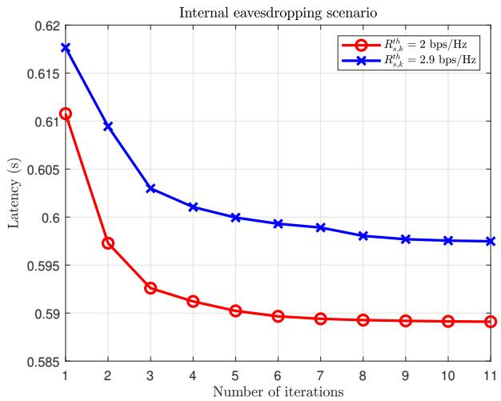
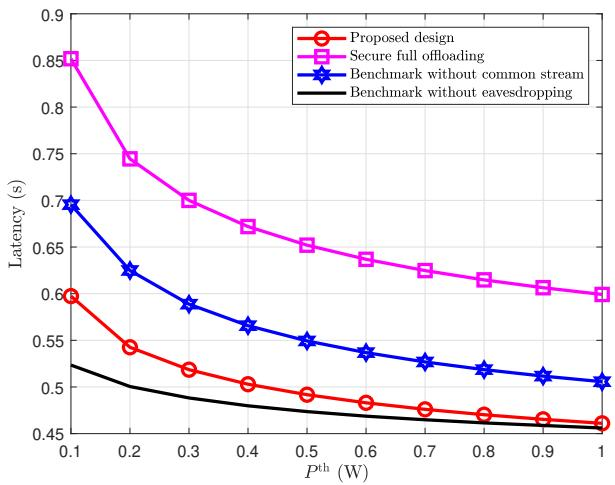
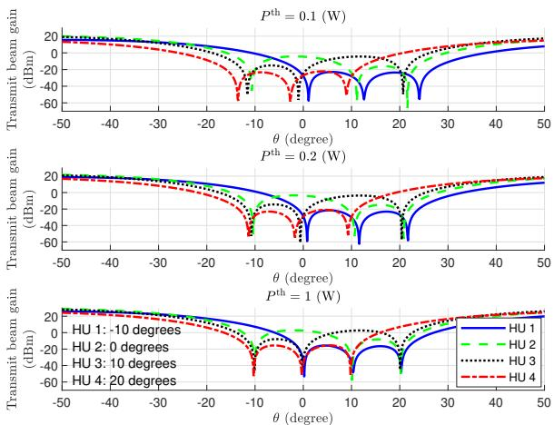

# Latency Minimization for Secure RSMA-Assisted Mobile Edge Computing Networks

Jianping Yao∗†, Chao Tang∗, Jie Xu†‡, Yi Fang∗, Guojun Han∗, and Tony Q. S. Quek§

∗School of Information Engineering, Guangdong University of Technology

†Guangdong Provincial Key Laboratory of Future Networks of Intelligence

‡Future Network of Intelligence Institute (FNii) and School of Science and Engineering,

The Chinese University of Hong Kong, Shenzhen

§Information Systems Technology and Design, Singapore University of Technology and Design

Email: yaojp@gdut.edu.cn, 2112303042@mail2.gdut.edu.cn, xujie@cuhk.edu.cn,

fangyi@gdut.edu.cn, gjhan@gdut.edu.cn, tonyquek@sutd.edu.sg

Abstract—In this paper, we investigate a rate-splitting multiple access (RSMA)-assisted secure mobile edge computing (MEC) network, where an edge user (EU) employs the RSMA technique to securely offload its computation task to multiple helper users (HUs) that may act as internal eavesdroppers. Specifically, to ensure the confidentiality of task segments, each offloaded task segment to one HU must remain confidential from unauthorized access by other HUs. In other words, each HU not only functions as a legitimate receiver to decode its desired message but also as a potential internal eavesdropper to intercept other HUs’ messages. Under this setup, we aim to minimize the total system latency by jointly optimizing the task offloading ratio, commonmessage transmission rate, and precoder matrix, while satisfying the secure offloading and power constraints. To address the resulting non-convex problem, we develop an iterative algorithm that integrates block coordinate descent (BCD) and successive convex approximation (SCA). Numerical results demonstrate that the proposed design outperforms existing benchmark schemes.

## I. INTRODUCTION

With the rapid development of the mobile Internet and the Internet of Things (IoT), an unprecedented amount of data is being generated and transmitted over networks. Traditional cloud computing architectures, which rely on centralized data centers, struggle to meet the stringent requirements of delaysensitive and computationally intensive applications and services. To address these challenges, mobile edge computing (MEC) has emerged as a promising solution [1]. By deploying computational and storage resources at the network edge, MEC allows resource-constrained devices to offload delay-sensitive and computationally intensive tasks to nearby MEC servers for remote processing (see, e.g., [2], [3]). This significantly reduces the computational burden on the device, extends the device’s battery life, minimizes communication latency, and ultimately improves network efficiency.

Despite its benefits, the broadcast nature of wireless communication poses significant security risks in MEC networks. Traditional cryptographic methods often introduce high computational complexity, which can lead to excessive latency. To

The work was supported in part by the National Natural Science Foundation of China under grants Nos. 62471424, 92267202, 62571142, and U25A20390, in part by the Shenzhen Fundamental Research Program under grant No. JCYJ20250604141209012, and in part by the Guangdong Provincial Key Laboratory of Future Networks of Intelligence under grant No. 2022B1212010001. J. Xu is the corresponding author.

address this, physical layer security (PLS) offers a lightweight alternative by exploiting wireless channel characteristics [4]. Recent works have applied PLS to enhance secure task offloading in MEC, including multiuser offloading [5], UAV trajectory design [6], active aerial eavesdropping [7], fairnessaware scheduling [8], secrecy rate maximization [9], user satisfaction optimization [10], and reconfigurable intelligent surfaces (RIS) assisted secure computing [11].

With the surge in wireless devices and data demands, traditional multiple access methods face challenges. Traditional orthogonal multiple access (OMA) suffers from low efficiency in dense networks, while power-domain non-orthogonal multiple access (PD-NOMA) improves spectral use but increases interference. Rate-splitting multiple access (RSMA) offers a balanced solution by splitting signals into common and private parts, which enhances spectral efficiency and interference management [12]. In MEC systems, RSMA has shown potential in latency reduction, fairness, and energy efficiency across various scenarios (see, e.g., [13]–[15]). RSMA also boosts physical layer security (PLS) by enlarging the signal quality gap between users and eavesdroppers [16], [17]. Studies have applied RSMA to secrecy rate optimization, colluding eavesdropper defense, and RIS integration for wireless secure communication (see, e.g., [18]–[21]). To the best of our knowledge, the resistance of the RSMA-assisted MEC network to internal eavesdroppers has not been studied before.

Motivated by these advancements, we investigate an RSMAassisted secure MEC network where an edge user (EU) offloads its computational tasks to multiple helper users (HUs), some of whom act as internal eavesdroppers. We aim to minimize the total system latency by jointly optimizing the task offloading ratio, common-message transmission rate, and precoder matrix while ensuring secure offloading of private messages and satisfying the maximum transmission power constraints. To address the resulting non-convex problem, we propose an iterative algorithm by combining block coordinate descent (BCD) and successive convex approximation (SCA) to find an efficient solution. Numerical results demonstrate that the proposed design outperforms benchmark schemes and highlight the superiority of incorporating RSMA into secure MEC systems.

## II. SYSTEM MODEL

We consider an RSMA-assisted secure MEC system, where an EU offloads the delay-sensitive computation task to K HUs denoted as ${ \cal K } \triangleq \{ 1 , \ldots , K \}$ , for remote processing. The EU is equipped with $N _ { t }$ antennas, while each HU is equipped with a single antenna and integrated with MEC computational capabilities. We consider that the EU needs to perform a computation task with D input bits, which will be partially offloaded to the HUs for computation, and the computation task can be segmented into independent parts of any desired size [5], [9]. Specifically, let $\beta _ { k } \in [ 0 , 1 ]$ denote the offloading ratio of the computation task to HU $k \in \mathcal { K }$ , so that $\beta _ { k } D$ bits of the computation task are offloaded to HU $k \in \mathcal { K }$ for computation, and the remaining $\textstyle { \big ( } 1 - \sum _ { k = 1 } ^ { K } \beta _ { k } { \big ) } D$ bits will be computed at the EU locally. We assume that the segmented task offloaded to HU $k \in \mathcal { K }$ must be kept confidential from the other $K - 1 \mathrm { \ H U s }$ . In other words, each HU not only decodes its desired message as a legitimate receiver but also needs to prevent other HUs from eavesdropping on it as potential internal eavesdroppers.

## A. Communication Model

We denote the transmitted message from the EU to HU $k \in \mathcal { K }$ as $M _ { k }$ , which includes the corresponding allocated computation task $\beta _ { k } D$ . According to the one-layer RSMA strategy [12], each message $M _ { k }$ is split into a common message $M _ { c , k }$ and a private message $M _ { p , k }$ . The common messages $M _ { c , 1 } , \ldots , M _ { c , K }$ for all HUs are combined into one common message $M _ { c } .$ . By employing a shared codebook among all ${ \mathrm { H U s } } ,$ the common message $M _ { c }$ is then encoded into a common stream $x _ { c } .$ All HUs need to decode the common stream $x _ { c }$ since it contains part of the message from each HU. While the private messages $M _ { p , 1 } , \ldots , M _ { p , K }$ from all HUs are separately encoded into private streams $x _ { 1 } , \ldots , x _ { K }$ , each of which is exclusively decoded by its intended HUs, but keep confidential to the other $K - 1 \mathrm { \ H U s }$ . Therefore, the computation tasks requiring secure transmission are placed in private messages, while the remaining computation tasks are placed in common messages for transmission [17]. Then, let $\mathbf { \bar { x } } \triangleq [ x _ { c } , x _ { 1 } , \ldots , x _ { K } ] ^ { \mathrm { T } } \ \in \ \mathbb { C } ^ { ( K + 1 ) \times 1 }$ denote the signal vector, whose components are independently drawn from a circularly symmetric complex Gaussian (CSCG) distribution and satisfied $\mathbb { E } ( { \pmb { x } } { \pmb { x } } ^ { H } ) = { \bar { \pmb { I } } } .$ By considering linear precoding at the transmitter, the signal transmitted by the EU is expressed as

$$
\boldsymbol {s} = \boldsymbol {W} \boldsymbol {x} = \boldsymbol {w} _ {c} x _ {c} + \sum_ {k = 1} ^ {K} \boldsymbol {w} _ {k} x _ {k}, \tag {1}
$$

where $\pmb { W } \triangleq [ \pmb { w } _ { c } , \pmb { w } _ { 1 } , \dots , \pmb { w } _ { K } ] \in \mathbb { C } ^ { N _ { t } \times ( K + 1 ) }$ is precoder matrix; ${ \pmb w } _ { c }$ and $\boldsymbol { w } _ { k } \in \mathbb { C } ^ { N _ { t } \times 1 }$ are the precoders associated with the common stream and the k-th private stream, respectively. Hence, the received signal at each HU $k \in \mathcal { K }$ is represented by

$$
y _ {k} = \boldsymbol {h} _ {k} ^ {\mathrm{H}} \boldsymbol {s} + z _ {k}, \tag {2}
$$

where $\boldsymbol { h } _ { k } \in \mathbb { C } ^ { N _ { t } \times 1 }$ denotes the channel coefficient between the EU and HU $k ; ~ z _ { k }$ is the additive white Gaussian noise (AWGN) with a mean of zero and a variance of $\sigma ^ { 2 }$ , i.e., $z _ { k } \sim$ ${ \mathcal { C N } } ( 0 , \sigma ^ { 2 } )$ .

At the receiver, each HU $k \in \mathcal { K }$ first decodes the common stream $x _ { c }$ by treating all private streams $x _ { 1 } , \ldots , x _ { K }$ as interference. After decoding the common message, the HU extracts its own portion and removes the common message through the successive interference cancellation (SIC) technique. Subsequently, HU k proceeds to decode its private stream $x _ { k }$ by treating the remaining $K - 1$ private streams as interference. Hence, the achievable rate for decoding common stream $x _ { c }$ and private stream $x _ { k }$ at HU $k \in \mathcal { K }$ are respectively given as

$$
R _ {c, k} (\boldsymbol {W}) = B \log_ {2} \left(1 + \frac {\left| \boldsymbol {h} _ {k} ^ {\mathrm{H}} \boldsymbol {w} _ {c} \right| ^ {2}}{\sum_ {j = 1} ^ {K} \left| \boldsymbol {h} _ {k} ^ {\mathrm{H}} \boldsymbol {w} _ {j} \right| ^ {2} + \sigma^ {2}}\right), \tag {3}
$$

$$
R _ {p, k} (\boldsymbol {W}) = B \log_ {2} \left(1 + \frac {\left| \boldsymbol {h} _ {k} ^ {\mathrm{H}} \boldsymbol {w} _ {k} \right| ^ {2}}{\sum_ {j = 1 , j \neq k} ^ {K} \left| \boldsymbol {h} _ {k} ^ {\mathrm{H}} \boldsymbol {w} _ {j} \right| ^ {2} + \sigma^ {2}}\right), \tag {4}
$$

where B represents the bandwidth.

We adopt the adaptive rate transmission with the actual transmission rate of the common stream allocated to each HU $k \in \mathcal { K }$ as $r _ { k } \ge 0 .$ which is a variable to be optimized later. For each HU $k \in \mathcal { K }$ to successfully decode the common stream, it must follow that

$$
\sum_ {j = 1} ^ {K} r _ {j} \leq \min _ {k \in \mathcal {K}} R _ {c, k} (\boldsymbol {W}). \tag {5}
$$

The other $K - 1$ HUs may attempt to intercept the private messages of HU $k \in \mathcal { K }$ by applying an additional layer of SIC to remove their private stream. Therefore, the achievable eavesdropping rate at HU $j \in \mathcal { K } \backslash \{ k \}$ for decoding the private stream for HU $k \in \mathcal { K }$ is given as

$$
R _ {k, j} ^ {e} (\boldsymbol {W}) = B \log_ {2} \left(1 + \frac {\left| \boldsymbol {h} _ {j} ^ {\mathrm{H}} \boldsymbol {w} _ {k} \right| ^ {2}}{\sum_ {k ^ {\prime} = 1 , k ^ {\prime} \neq k , j} ^ {K} \left| \boldsymbol {h} _ {j} ^ {\mathrm{H}} \boldsymbol {w} _ {k ^ {\prime}} \right| ^ {2} + \sigma^ {2}}\right). \tag {6}
$$

Furthermore, the secrecy rate of HU $k \in \mathcal { K }$ to transmit the private stream is limited by the eavesdropper with the strongest eavesdropping capability, i.e., [22]

$$
R _ {s, k} (\boldsymbol {W}) = \left[ R _ {p, k} (\boldsymbol {W}) - \max _ {j \in \mathcal {K} \backslash \{k \}} \left\{R _ {k, j} ^ {e} (\boldsymbol {W}) \right\} \right] ^ {+}, \tag {7}
$$

where $[ x ] ^ { + }$ represents the operation max(x, 0). Accordingly, the transmission delay of HU $k \in K$ is given as

$$
t _ {o, k} (\boldsymbol {r}, \boldsymbol {W}, \boldsymbol {\beta}) = \frac {\beta_ {k} D}{r _ {k} + R _ {s , k} (\boldsymbol {W})}. \tag {8}
$$

## B. Computation Model

1) Local Computing: Let ϕ0 represent the number of CPU cycles needed by the EU to handle one bit of computation task and $f _ { 0 }$ as the computational resources of the EU. Hence, the local computing time $t _ { l }$ is defined as

$$
t _ {l} (\boldsymbol {\beta}) = \frac {\left(1 - \sum_ {k = 1} ^ {K} \beta_ {k}\right) D \phi_ {0}}{f _ {0}}. \tag {9}
$$

2) HUs Computing: Let $\phi _ { k }$ represent the number of CPU cycles needed by HUs to handle one bit of computation task and $f _ { k }$ as computational resources of HU $k \in \mathcal { K }$ . Hence, the processing delay to handle the offloaded $\beta _ { k } D$ computation bits at HU $k \in \mathcal { K }$ is defined as

$$
t _ {c, k} (\boldsymbol {\beta}) = \frac {\beta_ {k} D \phi_ {k}}{f _ {k}}. \tag {10}
$$

Note that we disregard the time taken to transmit computation results from the HUs back to the EU, as commonly assumed in the literature [5], [9]. Then, the total delay is calculated as

$$
t \left(\boldsymbol {r}, \boldsymbol {W}, \boldsymbol {\beta}\right)
$$

$$
= \max \left\{t _ {l} (\boldsymbol {\beta}), \max _ {k \in \mathcal {K}} \left\{t _ {o, k} (\boldsymbol {r}, \boldsymbol {W}, \boldsymbol {\beta}) + t _ {c, k} (\boldsymbol {\beta}) \right\} \right\}. \tag {11}
$$

Under this setup, our objective is to minimize the total system latency, while ensuring secure transmissions from the EU to the HUs. The decision variables include the task offloading ratio $\beta \triangleq \left[ \beta _ { 1 } , \ldots , \beta _ { K } \right]$ , common-message transmission rate $r \triangleq [ r _ { 1 } , \ldots , r _ { K } ] .$ , and precoder matrix $\bar { \boldsymbol { W } } .$ Mathematically, the mean latency minimization problem is formulated as

$$
\text {(P1)}: \min _ {\boldsymbol {r}, \boldsymbol {W}, \boldsymbol {\beta}} t (\boldsymbol {r}, \boldsymbol {W}, \boldsymbol {\beta}) \tag {12a}
$$

$$
\text { s.t. } \sum_ {j = 1} ^ {K} r _ {j} \leq R _ {c, k} (\boldsymbol {W}), \forall k \in \mathcal {K}, \tag {12b}
$$

$$
\operatorname{tr} \left(\boldsymbol {W} \boldsymbol {W} ^ {\mathrm{H}}\right) \leq P ^ {\text {th}}, \tag {12c}
$$

$$
\sum_ {k = 1} ^ {K} \beta_ {k} \leq 1, 0 \leq \beta_ {k} \leq 1, \forall k \in \mathcal {K}, \tag {12d}
$$

$$
R _ {s, k} (\boldsymbol {W}) \geq R _ {s, k} ^ {\text {th}}, \forall k \in \mathcal {K}, \tag {12e}
$$

where $P ^ { \mathrm { t h } }$ represent the power budget limit of the EU; ${ R } _ { s , k } ^ { \mathrm { t h } }$ is the secrecy rate threshold for each private stream. Notice that the objective function (12a), constraints (12b) and (12e) are non-convex. Additionally, the parameters of the commonmessage transmission rate, task offloading ratio, and precoder matrix are closely linked in the formulation of the objective function and the constraints. Thus, problem (P1) is a nonconvex optimization problem that is generally difficult to be optimally solved.

## III. PROPOSED METHOD

In this section, we present an effective algorithm to address problem (P1) under the scenario of the internal eavesdroppers, where each HU not only decodes its desired message as a legitimate receiver but also needs to prevent other HUs from independently eavesdropping on it as potential internal eavesdroppers.

To simplify problem (P1) and make it more manageable, we introduce an auxiliary variable T and equivalently transform problem (P1) as

$$
\text {(P2)}: \min _ {T, r, W, \beta} T \tag {13a}
$$

$$
\text { s.t. } T \geq \frac {\beta_ {k} D}{r _ {k} + R _ {s , k} (\boldsymbol {W})} + \frac {\beta_ {k} D \phi_ {k}}{f _ {k}}, \forall k \in \mathcal {K}, \tag {13b}
$$

$$
T \geq \frac {\left(1 - \sum_ {k = 1} ^ {K} \beta_ {k}\right) D \phi_ {0}}{f _ {0}}, \tag {13c}
$$

$$
\sum_ {j = 1} ^ {K} r _ {j} \leq R _ {c, k} (\boldsymbol {W}), \forall k \in \mathcal {K}, \tag {13d}
$$

$$
\operatorname{tr} \left(\boldsymbol {W} \boldsymbol {W} ^ {\mathrm{H}}\right) \leq P ^ {\text {th}}, \tag {13e}
$$

$$
\sum_ {k = 1} ^ {K} \beta_ {k} \leq 1, 0 \leq \beta_ {k} \leq 1, \forall k \in \mathcal {K}, \tag {13f}
$$

$$
R _ {s, k} (\boldsymbol {W}) \geq R _ {s, k} ^ {\mathrm{th}}, \forall k \in \mathcal {K}. \tag {13g}
$$

However, problem (P2) is still non-convex, which is difficult to be solved. In the following, we propose an iterative algorithm by combining BCD and SCA methods to address problem (P2). In particular, for given task offloading ratio $\beta ,$ we optimize the common-message transmission rate r and precoder matrix W based on SCA. Then, for given commonmessage transmission rate r and precoder matrix W , we optimize the task offloading ratio $\beta$ by addressing a linear programming (LP) problem. The two subproblems are solved iteratively until convergence.

## A. Joint Common-Message Transmission Rate and Precoder Matrix Optimization

For given task offloading ratio $\beta ,$ we jointly design the common-message transmission rate r and precoder matrix W for problem (P2) by addressing the following optimization problem:

$$
\text {(P3)}: \min _ {T, r, W} T \tag {14a}
$$

$$
\text { s.t. } T \geq \frac {\beta_ {k} D}{r _ {k} + R _ {s , k} (\boldsymbol {W})} + \frac {\beta_ {k} D \phi_ {k}}{f _ {k}}, \forall k \in \mathcal {K}, \tag {14b}
$$

$$
T \geq \frac {\left(1 - \sum_ {k = 1} ^ {K} \beta_ {k}\right) D \phi_ {0}}{f _ {0}}, \tag {14c}
$$

$$
\sum_ {j = 1} ^ {K} r _ {j} \leq R _ {c, k} (\boldsymbol {W}), \forall k \in \mathcal {K}, \tag {14d}
$$

$$
\operatorname{tr} \left(\boldsymbol {W} \boldsymbol {W} ^ {\mathrm{H}}\right) \leq P ^ {\text {th}}, \tag {14e}
$$

$$
R _ {s, k} (\boldsymbol {W}) \geq R _ {s, k} ^ {\text {th}}, \forall k \in \mathcal {K}. \tag {14f}
$$

Note that constraints (14b), (14d), and (14f) exhibit nonconvexity. Generally, there are no effective ways to acquire the optimal solution for problem (P3). We employ an SCA-based algorithm for optimizing the common-message transmission rate r and precoder matrix W .

By introducing a set of nonnegative auxiliary variables $\alpha =$ $\{ \alpha _ { c , k } , \alpha _ { p , k } , \alpha _ { e , k } | \forall k \in \mathcal { K } \}$ , constraints (14b), (14d), and (14f) are rewritten as

$$
T \geq \frac {\beta_ {k} D}{r _ {k} + \alpha_ {p , k} - \alpha_ {e , k}} + \frac {\beta_ {k} D \phi_ {k}}{f _ {k}}, \forall k \in \mathcal {K}, \tag {15a}
$$

$$
\alpha_ {p, k} \leq B \log_ {2} \left(1 + \frac {\left| \boldsymbol {h} _ {k} ^ {\mathrm{H}} \boldsymbol {w} _ {k} \right| ^ {2}}{\sum_ {j = 1 , j \neq k} ^ {K} \left| \boldsymbol {h} _ {k} ^ {\mathrm{H}} \boldsymbol {w} _ {j} \right| ^ {2} + \sigma^ {2}}\right), \forall k \in \mathcal {K}, \tag {15b}
$$

$$
\alpha_ {e, k} \geq B \mathrm{log} _ {2} \left(1 + \frac {| \boldsymbol {h} _ {j} ^ {\mathrm{H}} \boldsymbol {w} _ {k} | ^ {2}}{\sum_ {k ^ {\prime} = 1 , k ^ {\prime} \neq j , k} ^ {K} | \boldsymbol {h} _ {j} ^ {\mathrm{H}} \boldsymbol {w} _ {k ^ {\prime}} | ^ {2} + \sigma^ {2}}\right),
$$

$$
\forall k \in \mathcal {K}, j \in \mathcal {K} \backslash \{k \}, (1 5 c)
$$

$$
\sum_ {j = 1} ^ {K} r _ {j} \leq \alpha_ {c, k}, \forall k \in \mathcal {K}, \tag {15d}
$$

$$
\alpha_ {c, k} \leq B \log_ {2} \left(1 + \frac {\left| \boldsymbol {h} _ {k} ^ {\mathrm{H}} \boldsymbol {w} _ {c} \right| ^ {2}}{\sum_ {j = 1} ^ {K} \left| \boldsymbol {h} _ {k} ^ {\mathrm{H}} \boldsymbol {w} _ {j} \right| ^ {2} + \sigma^ {2}}\right), \forall k \in \mathcal {K}, (1 5 e)
$$

$$
\alpha_ {p, k} - \alpha_ {e, k} \geq R _ {s, k} ^ {\mathrm{th}}, \forall k \in \mathcal {K}. \tag {15f}
$$

Note that the operator $[ \cdot ] ^ { + }$ is equivalently removed from the left-hand-side (LHS) term of constraint (15f). At this point, constraints (15a), (15b), (15c), and (15e) are still non-convex. To make them more tractable, we further introduce a series of nonnegative auxiliary variables $\pmb { \vartheta } = \{ \vartheta _ { k } | \forall k \in K \}$ and $\mathbf { \eta } _ { \eta } =$ $\{ \eta _ { c , k } , \eta _ { p , k } , \eta _ { k , j } | \forall k \in \mathcal { K } , j \in \mathcal { K } \backslash \{ k \} \}$ to transform constraints (15a), (15b), (15c), and (15e) as

$$
T \geq \frac {\beta_ {k} D}{\vartheta_ {k}} + \frac {\beta_ {k} D \phi_ {k}}{f _ {k}}, \forall k \in \mathcal {K}, \tag {16a}
$$

$$
\vartheta_ {k} \leq r _ {k} + \alpha_ {p, k} - \alpha_ {e, k}, \forall k \in \mathcal {K}, \tag {16b}
$$

$$
\alpha_ {p, k} \leq B \log_ {2} (1 + \eta_ {p, k}), \forall k \in \mathcal {K}, \tag {16c}
$$

$$
\eta_ {p, k} \leq \frac {\left| \boldsymbol {h} _ {k} ^ {\mathrm{H}} \boldsymbol {w} _ {k} \right| ^ {2}}{\sum_ {j = 1 , j \neq k} ^ {K} \left| \boldsymbol {h} _ {k} ^ {\mathrm{H}} \boldsymbol {w} _ {j} \right| ^ {2} + \sigma^ {2}}, \forall k \in \mathcal {K}, \tag {16d}
$$

$$
\alpha_ {e, k} \geq B \log_ {2} (1 + \eta_ {k, j}), \forall k \in \mathcal {K}, j \in \mathcal {K} \backslash \{k \}, \tag {16e}
$$

$$
\eta_ {k, j} \geq \frac {\left| \boldsymbol {h} _ {j} ^ {\mathrm{H}} \boldsymbol {w} _ {k} \right| ^ {2}}{\sum_ {k ^ {\prime} = 1 , k ^ {\prime} \neq j , k} ^ {K} \left| \boldsymbol {h} _ {j} ^ {\mathrm{H}} \boldsymbol {w} _ {k ^ {\prime}} \right| ^ {2} + \sigma^ {2}}, \forall k \in \mathcal {K}, j \in \mathcal {K} \backslash \{k \}, \tag {16f}
$$

$$
\alpha_ {c, k} \leq B \log_ {2} (1 + \eta_ {c, k}), \forall k \in \mathcal {K}, \tag {16g}
$$

$$
\eta_ {c, k} \leq \frac {\left| \boldsymbol {h} _ {k} ^ {\mathrm{H}} \boldsymbol {w} _ {c} \right| ^ {2}}{\sum_ {j = 1} ^ {K} \left| \boldsymbol {h} _ {k} ^ {\mathrm{H}} \boldsymbol {w} _ {j} \right| ^ {2} + \sigma^ {2}}, \forall k \in \mathcal {K}. \tag {16h}
$$

For the use of first-order Taylor expansion, we introduce a collection of nonnegative auxiliary variables $\xi \ =$ $\{ \xi _ { c , k } , \xi _ { p , k } , \xi _ { k , j } | \forall k \in K , j \in K \backslash \{ k \} \}$ once again to represent the non-convex constraints (16d), (16f), and (16h) as

$$
\eta_ {p, k} \leq \frac {\left| \boldsymbol {h} _ {k} ^ {\mathrm{H}} \boldsymbol {w} _ {k} \right| ^ {2}}{\xi_ {p , k}}, \forall k \in \mathcal {K}, \tag {17a}
$$

$$
\xi_ {p, k} \geq \sum_ {j = 1, j \neq k} ^ {K} | \boldsymbol {h} _ {k} ^ {\mathrm{H}} \boldsymbol {w} _ {j} | ^ {2} + \sigma^ {2}, \forall k \in \mathcal {K}, \tag {17b}
$$

$$
\eta_ {k, j} \geq \frac {\left| \boldsymbol {h} _ {j} ^ {\mathrm{H}} \boldsymbol {w} _ {k} \right| ^ {2}}{\xi_ {k , j}}, \forall k \in \mathcal {K}, j \in \mathcal {K} \backslash \{k \}, \tag {17c}
$$

$$
\xi_ {k, j} \leq \sum_ {k ^ {\prime} = 1, k ^ {\prime} \neq j, k} ^ {K} \left| \boldsymbol {h} _ {j} ^ {\mathrm{H}} \boldsymbol {w} _ {k ^ {\prime}} \right| ^ {2} + \sigma^ {2}, \forall k \in \mathcal {K}, j \in \mathcal {K} \backslash \{k \}, \tag {17d}
$$

$$
\eta_ {c, k} \leq \frac {\left| \boldsymbol {h} _ {k} ^ {\mathrm{H}} \boldsymbol {w} _ {c} \right| ^ {2}}{\xi_ {c , k}}, \forall k \in \mathcal {K}, \tag {17e}
$$

$$
\xi_ {c, k} \geq \sum_ {j = 1} ^ {K} | \boldsymbol {h} _ {k} ^ {\mathrm{H}} \boldsymbol {w} _ {j} | ^ {2} + \sigma^ {2}, \forall k \in \mathcal {K}. \tag {17f}
$$

Note that $\frac { | \bar { h } _ { k } ^ { \mathrm { H } } w _ { k } | ^ { 2 } } { \xi _ { P , k } }$ ξp,k is a quadratic-over-linear form that is convex. Through the introduction of the aforementioned auxiliary variables, problem (P3) is equivalently transformed into

$$
\text{(P4)}:\min_{\substack{T,r,w,\\ \boldsymbol {\alpha},\boldsymbol {\eta},\boldsymbol{\vartheta},\boldsymbol{\xi}}}T
$$

$$
\text { s   .   t   . } (1 4 \mathrm{c}), (1 4 \mathrm{e}), (1 5 \mathrm{d}), (1 5 \mathrm{f}), (1 6 \mathrm{a}), (1 6 \mathrm{b}), (1 6 \mathrm{c}), (1 6 \mathrm{e}),
$$

$$
(1 6 \mathrm{g}), (1 7 \mathrm{a}), (1 7 \mathrm{b}), (1 7 \mathrm{c}), (1 7 \mathrm{d}), (1 7 \mathrm{e}), (1 7 \mathrm{f}).
$$

In problem $( \bar { \mathbf { P } } 4 )$ , constraints (16e), (17a), (17d), and (17e) are still non-convex. Next, we address the non-convexity of the constraints by using the first-order Taylor expansion.

As the right-hand-side (RHS) term of constraint (16e) is concave, we thus obtain the upper bound of the RHS term of constraint (16e) by its first-order Taylor expansion under given $\eta _ { k , i } ^ { ( n ) }$ at the n-th iteration as [24]

$$
B \log_ {2} \left(1 + \eta_ {k, j}\right) \leq B \log_ {2} \left(1 + \eta_ {k, j} ^ {(n)}\right)
$$

$$
+ \frac {B \left(\eta_ {k , j} - \eta_ {k , j} ^ {(n)}\right)}{\left(1 + \eta_ {k , j} ^ {(n)}\right) \ln 2} \triangleq \Omega_ {k, j} ^ {(n)} (\eta_ {k, j}). \tag {19}
$$

Similarly, since the right-hand-side (RHS) terms of constraints (17a), (17d), and (17e) are convex, we derive their lower bounds by applying the first-order Taylor expansion under the corresponding local points at the n-th iteration as

$$
\begin{array}{l} \frac {\left| \boldsymbol {h} _ {k} ^ {\mathrm{H}} \boldsymbol {w} _ {k} \right| ^ {2}}{\xi_ {p , k}} \geq \frac {2 \Re \left(\left(\boldsymbol {w} _ {k} ^ {(n)}\right) ^ {\mathrm{H}} \boldsymbol {h} _ {k} \boldsymbol {h} _ {k} ^ {\mathrm{H}} \boldsymbol {w} _ {k}\right)}{\xi_ {p , k} ^ {(n)}} \\ - \left(\frac {\left| \boldsymbol {h} _ {k} ^ {\mathrm{H}} \boldsymbol {w} _ {k} ^ {(n)} \right|}{\xi_ {p , k} ^ {(n)}}\right) ^ {2} \xi_ {p, k} \triangleq \Psi_ {p, k} ^ {(n)} (\boldsymbol {w} _ {k}, \xi_ {p, k}), \tag {20} \\ \end{array}
$$

$$
\sum_ {k ^ {\prime} = 1, k ^ {\prime} \neq j, k} ^ {K} | \boldsymbol {h} _ {j} ^ {\mathrm{H}} \boldsymbol {w} _ {k ^ {\prime}} | ^ {2} \geq
$$

$$
\sum_ {k ^ {\prime} = 1, k ^ {\prime} \neq k, j} ^ {K} \left(2 \Re \left(\left(\boldsymbol {w} _ {k ^ {\prime}} ^ {(n)}\right) ^ {\mathrm{H}} \boldsymbol {h} _ {j} \boldsymbol {h} _ {j} ^ {\mathrm{H}} \boldsymbol {w} _ {k ^ {\prime}}\right) - | \boldsymbol {h} _ {j} ^ {\mathrm{H}} \boldsymbol {w} _ {k ^ {\prime}} ^ {(n)} | ^ {2}\right)
$$

$$
\triangleq \Psi_ {k, j} ^ {(n)} (\boldsymbol {w} _ {k ^ {\prime}}), \tag {21}
$$

$$
\frac {\left| \boldsymbol {h} _ {k} ^ {\mathrm{H}} \boldsymbol {w} _ {c} \right| ^ {2}}{\xi_ {c , k}} \geq \frac {2 \Re \left(\left(\boldsymbol {w} _ {c} ^ {(n)}\right) ^ {\mathrm{H}} \boldsymbol {h} _ {k} \boldsymbol {h} _ {k} ^ {\mathrm{H}} \boldsymbol {w} _ {c}\right)}{\xi_ {c , k} ^ {(n)}}
$$

$$
- \left(\frac {\left| \boldsymbol {h} _ {k} ^ {\mathrm{H}} \boldsymbol {w} _ {c} ^ {(n)} \right|}{\xi_ {c , k} ^ {(n)}}\right) ^ {2} \xi_ {c, k} \triangleq \Psi_ {c, k} ^ {(n)} (\boldsymbol {w} _ {c}, \xi_ {c, k}). \tag {22}
$$

By replacing the RHS terms of constraints (16e), (17a), (17d), and (17e) with their approximations (19)-(22), problem (P4) is approximated as

$$
\text {(P5.} n): \quad \min_ {\substack {T, r, w, \\ \alpha , \eta , \vartheta , \xi}} T \tag{23a}
$$

$$
\text { s.t. } \alpha_ {e, k} \geq \Omega_ {k, j} ^ {(n)} (\eta_ {k, j}), \forall k \in \mathcal {K}, j \in \mathcal {K} \backslash \{k \}, \tag {23b}
$$

$$
\eta_ {p, k} \leq \Psi_ {p, k} ^ {(n)} (\boldsymbol {w} _ {k}, \xi_ {p, k}), \forall k \in \mathcal {K}, \tag {23c}
$$

$$
\xi_ {k, j} \leq \Psi_ {k, j} ^ {(n)} (\boldsymbol {w} _ {k ^ {\prime}}) + \sigma^ {2}, \forall k \in \mathcal {K}, j \in \mathcal {K} \backslash \{k \}, (2 3 d)
$$

$$
\eta_ {c, k} \leq \Psi_ {c, k} ^ {(n)} (\boldsymbol {w} _ {c}, \xi_ {c, k}), \forall k \in \mathcal {K}, \tag {23e}
$$

$$
(1 4 \mathrm{c}), (1 4 \mathrm{e}), (1 5 \mathrm{d}), (1 5 \mathrm{f}), (1 6 \mathrm{a}), (1 6 \mathrm{b}), (1 6 \mathrm{c}),
$$

$$
(1 6 \mathrm{g}), (1 7 \mathrm{b}), (1 7 \mathrm{c}), (1 7 \mathrm{f}).
$$

Problem (P5.n) is a convex optimization problem, which is efficiently handled through CVX. By solving problem (P5.n) iterately, we obtain a converged solution of problem (P3).

## B. Task Offloading Ratio Optimization

For given common-message transmission rate r and precoder matrix W , we optimize the task offloading ratio β for problem (P2) by addressing the following optimization problem:

$$
\text {(P6)}: \min _ {T, \boldsymbol {\beta}} T \tag {24a}
$$

$$
\text { s.t. } T \geq \frac {\beta_ {k} D}{r _ {k} + R _ {s , k} (\boldsymbol {W})} + \frac {\beta_ {k} D \phi_ {k}}{f _ {k}}, \forall k \in \mathcal {K}, \tag {24b}
$$

$$
T \geq \frac {\left(1 - \sum_ {k = 1} ^ {K} \beta_ {k}\right) D \phi_ {0}}{f _ {0}}, \tag {24c}
$$

$$
\sum_ {k = 1} ^ {K} \beta_ {k} \leq 1, 0 \leq \beta_ {k} \leq 1, \forall k \in \mathcal {K}. \tag {24d}
$$

Problem (P6) is an LP problem that is efficiently handled using CVX.

## C. Complexity Analysis

The computational complexity of the proposed method is primarily determined by problems (P5.n) and (P6), which is solved using the interior-point method via CVX. It is known that the cothe interior-point method is $\mathcal { \bar { O } } \left( ( V _ { \mathrm { n u m } } + C _ { \mathrm { n u m } } ) ^ { 1 . 5 } V _ { \mathrm { n u m } } ^ { 2 } \right)$ where $V _ { \mathrm { n u m } }$ is the dimension of variables and $C _ { \mathrm { n u m } }$ is the number of constraints. For problem $( \mathrm { P } 5 . n )$ , we have $V _ { \mathrm { n u m } } = 2 K ^ { 2 } + N _ { t } K + 7 K + N _ { t } + 1$ and $C _ { \mathrm { n u m } } = 3 K ^ { 2 } + 7 K + 2$ , so the computational complexity for solving problems (P5.n) is $\mathcal { O } ( K ^ { 7 } ) ^ { - } + N _ { t } ^ { 2 } K ^ { 5 } + N _ { t } ^ { \dot { 1 } . 5 } K ^ { 5 . \dot { 5 } } + N _ { t } ^ { 3 . 5 } K ^ { \widetilde { 3 } . 5 \dot { 5 } } )$ . For problem (P6), we have $V _ { \mathrm { n u m } } ~ = ~ K + 1$ and $C _ { \mathrm { n u m } } ~ = ~ 2 K + 1$ , so the computational complexity for solving problems (P6) is $\mathcal { O } \left( \bar { K } ^ { 3 . 5 } \right)$ . In summary, the total computational complexity of the proposed method for solving problem (P2) is O LBCDLSCA $\left( \dot { K ^ { 7 } } + N _ { t } ^ { 2 } K ^ { 5 } + N _ { t } ^ { 1 . 5 } K ^ { 5 . 5 } + \dot { N } _ { t } ^ { 3 . 5 } K ^ { 3 . 5 } \right) )$ , where LBCD and LSCA represent the iteration numbers of BCD for problem (P2) and SCA for problem (P5.n), respectively.

## IV. NUMERICAL RESULTS

In this section, we validate the performance of our proposed design through numerical results. Unless otherwise specified, the following parameters are used: The wireless channels are modeled as Rayleigh-fading with the average channel power gain $\rho ( d / d _ { 0 } ) ^ { - \lambda }$ , where $\rho = - 4 0$ dB represents the path loss at the reference distance $d _ { 0 } = 1 \mathrm { ~ m ~ }$ , d denotes the distance between the HUs and the EU, and $\lambda ~ = ~ 3$ represents the pathloss exponent. Besides, we set $K = 4 , \ N _ { t } = 4 , P ^ { \mathrm { t h } } = 0 . 1$ W, $B \ = \ 1$ MHz, $\sigma ^ { 2 } ~ = ~ - 1 1 0$ dBm, D = 10 Mbits, $\phi _ { k } ~ = ~ \phi _ { 0 } ~ = ~ 1 0 0$ CPU/bit, $f _ { k } ~ = ~ 2 f _ { 0 } ~ = ~ 1$ GHz, and $R _ { s , k } ^ { \mathrm { t h } } ~ = ~ 2 . 9$ bps/Hz. Furthermore, the angular separation θ between adjacent HUs and the EU is assumed to be 10 degrees. The distances from the two outermost users to the EU are set to 100 m, while the distances from the two middle users to the EU are set to 75 m.

For comparison, we consider the following three benchmark schemes:

• Benchmark without common stream: The message $M _ { k }$ is no longer split into common and private messages. Instead, the total system latency is minimized by jointly optimizing the task offloading ratio and the power allocation over message $M _ { k }$ . This scheme is achieved by solving problem (P1) under the fixed settings $\mathbf { \nabla } \mathbf { r } = \mathbf { 0 }$ and ${ \pmb w } _ { c } = { \bf 0 }$ .  
• Secure full offloading: The EU offloads all its computation tasks to the HUs without local computing. In this case, the total system latency minimization corresponds to solving problem (P1) by reformulating constraint $\textstyle \sum _ { k = 1 } ^ { K } \beta _ { k } \stackrel { \textstyle \smile } { \leq } \bar { 1 }$ in (12d) as $\begin{array} { r } { \sum _ { k = 1 } ^ { \bar { K } } \beta _ { k } = 1 } \end{array}$ .  
• Benchmark without eavesdropping: HUs only decode their intended messages and are not interested in decoding messages intended for others. This scheme serves as a performance upper bound (i.e., latency lower bound).

line chart

| Number of iterations | R_s,k^th = 2 bps/Hz | R_s,k^th = 2.9 bps/Hz |
| -------------------- | ------------------- | --------------------- |
| 1                    | 0.611               | 0.618                 |
| 2                    | 0.597               | 0.609                 |
| 3                    | 0.593               | 0.603                 |
| 4                    | 0.591               | 0.601                 |
| 5                    | 0.590               | 0.600                 |
| 6                    | 0.589               | 0.599                 |
| 7                    | 0.589               | 0.598                 |
| 8                    | 0.589               | 0.597                 |
| 9                    | 0.589               | 0.597                 |
| 10                   | 0.589               | 0.597                 |
| 11                   | 0.589               | 0.597                 |

Fig. 1. Convergence performance of our proposed design.

Fig. 1 demonstrates the convergence performance of our proposed design by depicting the total system latency versus the number of iterations. The numerical results reveal that the optimization process converges within 10 iterations for $R _ { s , k } ^ { \mathrm { t h } } ~ = ~ 2$ $R _ { s , k } ^ { \mathrm { t h } } ~ = ~ 2 . 9$ bps/Hz. This confirms both the reliability and convergence of the proposed optimization framework.

line chart

| Pth (W) | Proposed design | Secure full offloading | Benchmark without common stream | Benchmark without eavesdropping |
| ------- | --------------- | ---------------------- | -------------------------------- | -------------------------------- |
| 0.1     | 0.60            | 0.85                   | 0.70                             | 0.53                             |
| 0.2     | 0.54            | 0.75                   | 0.63                             | 0.50                             |
| 0.3     | 0.52            | 0.70                   | 0.59                             | 0.49                             |
| 0.4     | 0.51            | 0.68                   | 0.57                             | 0.48                             |
| 0.5     | 0.50            | 0.66                   | 0.55                             | 0.47                             |
| 0.6     | 0.49            | 0.64                   | 0.54                             | 0.46                             |
| 0.7     | 0.48            | 0.63                   | 0.53                             | 0.46                             |
| 0.8     | 0.47            | 0.62                   | 0.52                             | 0.46                             |
| 0.9     | 0.46            | 0.61                   | 0.51                             | 0.46                             |
| 1.0     | 0.46            | 0.60                   | 0.51                             | 0.46                             |

Fig. 2. Total system latency versus power budget limit $P ^ { \mathrm { t h } }$ of the EU.

Fig. 2 illustrates the total system latency versus power budget limit $P ^ { \mathrm { t h } }$ of the EU under the internal eavesdropping scenario. It is observed that as $P ^ { \mathrm { t h } }$ increases, the total system latency of all schemes decreases. This is due to the fact that a higher power budget leads to increased task transmission rates, thereby reducing latency. It is also observed that the proposed design significantly outperforms the benchmark without common stream. This is because RSMA can dynamically adjust the splitting of common and private messages to control interference. Specifically, the network can dynamically adjust the power allocation for private messages to ensure secure task offloading, while determining the transmit power of the common message to mitigate interference, thereby optimizing the total system latency. Furthermore, it is observed that when $P ^ { \mathrm { t h } }$ is sufficiently large (e.g., $P ^ { \mathrm { t h } } \ge 0 . 9 ~ \mathrm { W } )$ , the proposed design approaches the performance upper bound achieved by the benchmark without eavesdropping. This is because, as illustrated in Fig. 3, the minimum beam gain of the private stream for each HU becomes increasingly concentrated toward the directions of the other HUs (i.e., the potential eavesdroppers’ directions) with increasing P th.

line chart

| θ (degree) or Angle (degrees) | Transmit beam gain (dBm) - HU 1 | Transmit beam gain (dBm) - HU 2 | Transmit beam gain (dBm) - HU 3 | Transmit beam gain (dBm) - HU 4 |
| --- | --- | --- | --- | --- |
| -50 | ~15 | ~15 | ~15 | ~15 |
| -40 | ~15 | ~15 | ~15 | ~15 |
| -30 | ~15 | ~15 | ~15 | ~15 |
| -20 | ~15 | ~15 | ~15 | ~15 |
| -10 | ~-35 | ~-35 | ~-35 | ~-35 |
| 0 | -65 | -65 | -65 | -65 |
| 1 | -65 | -65 | -65 | -65 |
| 2 | -65 | -65 | -65 | -65 |
| 3 | -35 | -35 | -35 | -35 |
| 4 | -35 | -35 | -35 | -35 |
| 5 | -35 | -35 | -35 | -35 |
| 6 | -35 | -35 | -35 | -35 |
| 7 | -35 | -35 | -35 | -35 |
| 8 | -35 | -35 | -35 | -35 |
| 9 | -35 | -35 | -35 | -35 |
| 10 | -35 | -35 | -35 | -35 |
| 11 | -35 | -35 | -35 | -35 |
| 12 | -35 | -35 | -35 | -35 |
| 13 | -35 | -35 | -35 | -35 |
| 14 | -35 | -35 | -35 | -35 |
| 15 | -35 | -35 | -35 | -35 |
| 16 | -35 | -35 | -35 | -35 |
| 17 | -35 | -35 | -35 | -35 |
| 18 | -35 | -35 | -35 | -35 |
| 19 | -35 | -35 | -35 | -35 |
| 20 | -65 | -65 | -65 | -65 |
| 21 | -65 | -65 | -65 | -65 |
| 22 | -65 | -65 | -65 | -65 |
| 23 | -65 | -65 | -65 | -65 |
| 24 | -65 | -65 | -65 | -65 |
| 25 | -65 | -65 | -65 | -65 |
| 26 | -65 | -65 | -65 | -65 |
| 27 | -65 | -65 | -65 | -65 |
| 28 | -65 | -65 | -65 | -65 |
| 29 | -65 | -65 | -65 | -65 |
| 30 | -65 | -65 | -65 | -65 |
| 31 | -65 | -65 | -65 | -65 |
| 32 | -65 | -65 | -65 | -65 |
| 33 | -65 | -65 | -65 | -65 |
| 34 | -65 | -65 | -65 | -65 |
| 35 | -65 | -65 | -65 | -65 |
| 36 | -65 | -65 | -65 | -65 |
| 37 | -65 | -65 | -65 | -65 |
| 38 | -65 | -65 | -65 | -65 |
| 39 | -65 | -65 | -65 | -65 |
| 40 | -65 | -65 | -65 | -65 |
| 41 | -65 | -65 | -65 | -65 |
| 42 | -65 | -65 | -65 | -65 |
| 43 | -65 | -65 | -65 | -65 |
| 44 | -65 | -65 | -65 | -65 |
| 45 | -65 | -65 | -65 | -65 |

Fig. 3. Transmit beampatterns of the private streams for all HUs in our proposed design.

## V. CONCLUSIONS

In this paper, we investigated an RSMA-assisted secure MEC network comprising an EU and multiple HUs, some of which may act as internal eavesdroppers. We minimized the total system latency, by jointly optimizing the task offloading ratio, common-message transmission rate, and precoder matrix, while ensuring secure offloading and transmit power constraints. Due to the high coupling between the optimization parameters, we developed an iterative algorithm that integrates BCD and SCA. Simulation results indicated the superiority of RSMA to improve security and efficiency in MEC networks.

## REFERENCES

[1] N. Yang, S. Chen, H. Zhang, and R. Berry, “Beyond the edge: An advanced exploration of reinforcement learning for mobile edge computing, its applications, and future research trajectories,” IEEE Commun. Surveys Tuts., vol. 27, no. 1, pp. 546-594, Feb. 2025.  
[2] F. Pervez, A. Sultana, C. Yang, and L. Zhao, “Energy and latency efficient joint communication and computation optimization in a multi-UAV-assisted MEC network,” IEEE Trans. Wireless Commun., vol. 23, no. 3, pp. 1728-1741, Mar. 2024.  
[3] B. Liang, R. Fan, H. Hu, H. Jiang, J. Xu, and N. Zhang, “Joint task offloading and resource allocation in multi-user mobile edge computing with continuous spectrum sharing,” IEEE Trans. Veh. Technol., vol. 73, no. 5, pp. 7234-7249, May. 2024.  
[4] J. Yao, S. Feng, X. Zhou, and Y. Liu, “Secure routing in multihop wireless ad-hoc networks with decode-and-forward relaying,” IEEE Trans. Commun., vol. 64, no. 2, pp. 753-764, Feb. 2016.  
[5] J. Xu and J. Yao, “Exploiting physical-layer Security for multiuser multicarrier computation offloading,” IEEE Wireless Commun. Lett., vol. 8, no. 1, pp. 9-12, Feb. 2019.  
[6] J. Jung, S. Ahn, S. Kwon, S. I. Park, and J. Kang, “Optimal UAV 3D trajectory design and resource allocation for secure mobile edge computing,” IEEE Trans. Veh. Technol., vol. 74, no. 3, pp. 5281-5286, Mar. 2025.  
[7] Y. Ding et al., “Collaborative communication and computation for secure UAV-enabled MEC against active aerial eavesdropping,” IEEE Trans. Wireless Commun., vol. 23, no. 11, pp. 15915-15929, Nov. 2024.  
[8] Y. He, K. Xiang, X. Cao, and M. Guizani, “Task scheduling and trajectory optimization based on fairness and communication security for multi-UAV-MEC system,” IEEE Internet Things J., vol. 11, no. 19, pp. 30510-30523, Oct. 2024.  
[9] M. Zhao, H. Bao, L. Yin, J. Yao, and T. Quek, “Secrecy offloading rate maximization for multi-access mobile edge computing networks,” IEEE Commun. Lett., vol. 25, no. 12, pp. 3800-3804, Dec. 2021.  
[10] S. Liu et al., “Satisfaction-maximized secure computation offloading in multi-eavesdropper MEC networks,” IEEE Trans. Wireless Commun., vol. 21, no. 6, pp. 4227-4241, Jun. 2022.  
[11] E. T. Michailidis, M. G. Volakaki, N. I. Miridakis, and D. Vouyioukas, “Optimization of secure computation efficiency in UAV-enabled RISassisted MEC-IoT networks with aerial and ground eavesdroppers,” IEEE Trans. Commun., vol. 72, no. 7, pp. 3994-4009, Jul. 2024,  
[12] Y. Mao, O. Dizdar, B. Clerckx, R. Schober, P. Popovski, and H. V. Poor, “Rate-splitting multiple access: Fundamentals, survey, and future research trends,” IEEE Commun. Surveys Tuts., vol. 24, no. 4, pp. 2073- 2126, 4th Quart. 2022.  
[13] D. Xu, L. Duan, H. Zhao, and H. Zhu, “Fair computation offloading for RSMA-assisted mobile edge computing networks,” IEEE Trans. Wireless Commun., vol. 23, no. 12, pp. 19505-19521, Dec. 2024.  
[14] N. Su et al., “Rate splitting for mobile edge computing assisted multiuser virtual reality systems,” IEEE Trans. Commun., vol. 73, no. 1, pp. 303-316, Jan. 2025.  
[15] P. Chen, H. Liu, Y. Ye, L. Yang, K. J. Kim, and T. A. Tsiftsis, “Ratesplitting multiple access aided mobile edge computing with randomly deployed users,” IEEE J. Sel. Areas Commun., vol. 41, no. 5, pp. 1549- 1565, May. 2023.  
[16] H. Fu, S. Feng, W. Tang, and D. W. K. Ng, “Robust secure beamforming design for two-user downlink MISO rate-splitting systems,” IEEE Trans. Wireless Commun., vol. 19, no. 12, pp. 8351-8365, Dec. 2020.  
[17] D. Li, Z. Yang, N. Zhao, Y. Chen, Z. Wu, and Y. Li, “A unified ratesplitting framework for secure spectrum sharing via joint precoding optimization,” IEEE Syst J., vol. 17, no. 4, pp. 5580-5591, Dec. 2023.  
[18] H. Xia, Y. Mao, X. Zhou, B. Clerckx, S. Han, and C. Li, “Weighted sum-rate maximization of rate-splitting multiple access with confidential messages,” IEEE Trans. Wireless Commun., vol. 23, no. 10, pp. 13738-13751, Oct. 2024.  
[19] A. Salem, C. Masouros, and B. Clerckx, “Secure rate splitting multiple access: How much of the split signal to reveal?” IEEE Trans. Wireless Commun., vol. 22, no. 6, pp. 4173-4187, Jun. 2023.  
[20] H. Peng, C. He, Z. Zhang, C. Han, and L. Wang, “Robust secure beamforming for integrated sensing and communication systems with the active RIS,” IEEE Trans. Veh. Technol., vol. 74, no. 3, pp. 5158- 5163, Mar. 2025.  
[21] D. Wang et al., “Integrating reconfigurable intelligent surface and UAV for enhanced secure transmissions in IoT-enabled RSMA networks,” IEEE Internet Things J., early access, Dec. 2024.  
[22] J. Yao and J. Xu, “Joint 3D maneuver and power adaptation for secure UAV communication with CoMP reception,” IEEE Trans. Wireless Commun., vol. 19, no. 10, pp. 6992-7006, Oct. 2020.  
[23] C. Zhong, J. Yao, and J. Xu, “Secure UAV communication with cooperative jamming and trajectory control,” IEEE Commun. Lett., vol. 23, no. 2, pp. 286-289, Feb. 2019.  
[24] S. Boyd and L. Vandenberghe, Convex Optimization. Cambridge, U.K.: Cambridge Univ. Press, 2004.  
[25] F. Alavi, K. Cumanan, Z. Ding, and A. G. Burr, “Beamforming techniques for nonorthogonal multiple access in 5G cellular networks,” IEEE Trans. Veh. Technol., vol. 67, no. 10, pp. 9474-9487, Oct. 2018.