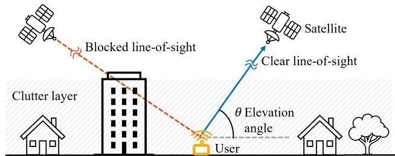
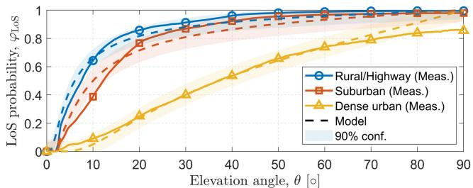
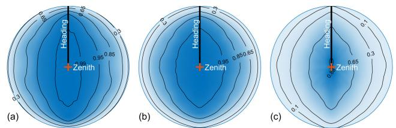
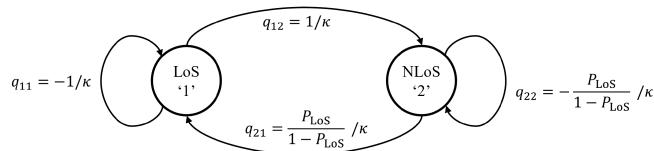
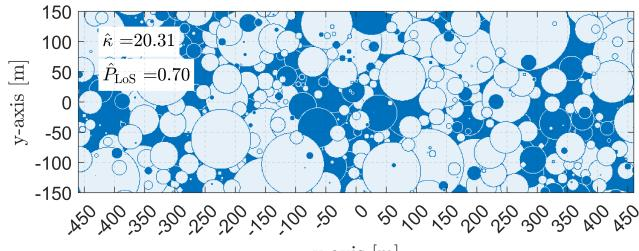
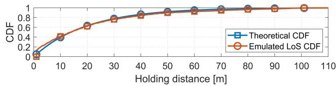
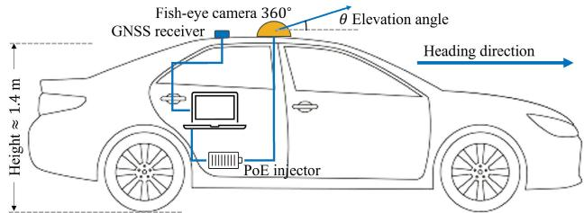
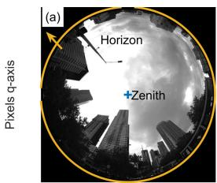
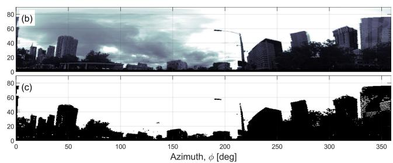
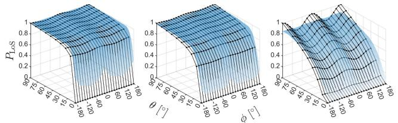

# Line-of-Sight Probability and Holding Distance in Non-Terrestrial Networks

Akram Al-Hourani , Senior Member, IEEE

Abstract— Modeling the stochastic behavior of Line-of-Sight (LoS) availability holds significant importance in evaluating the performance of non-terrestrial networks (NTN), encompassing both satellite and UAV links. This letter presents a novel framework for quantifying LoS probability in diverse urban settings, utilizing a practical visual (camera-based) approach across varying elevation angles. Additionally, a novel technique is introduced to characterize LoS states through a continuous-space Markov chain. This approach incorporates key parameters such as the mean holding distance of LoS state and its distribution. Furthermore, the letter outlines a practical methodology for emulating transitions between LoS and non-LoS states as users move through the propagation environment. Such emulation is essential for accurately modeling the performance of nextgeneration NTN networks across different urban scenarios.

Index Terms— Line-of-sight probability, UAV-to-ground, satellite-to-ground channel, optical wireless, THz/mmWave, radio channel modeling, land mobile satellite.

## I. INTRODUCTION

NEW generation of satellite communication networks has recently been deployed to establish direct satelliteto-ground mobile connections. However, due to the extensive distances involved, this type of link inherently faces significant path loss challenges. The quality of such a link can be notably enhanced by ensuring an unobstructed Line-of-Sight (LoS) connection between the satellite and the user, particularly for frequencies above the conventional S/C-bands including optical wireless and THz/mmWave bands, where a simplified illustration of the satellite-to-ground LoS concept is shown in Fig. 1. The characterization of LoS behavior in urban environments is not a novel pursuit; a notable example is the empirical model for LoS probability in terrestrial systems presented by the International Telecommunication Union (ITU-R M.2135-1), which is based on a particular geometric configuration. Another important initiative is being led by the 3GPP group, focusing on the standardization of non-terrestrial networks (NTN) and including initial LoS probability modeling [1]. The literature also encompasses several valuable works investigating distinct facets of LoS availability, often rooted in deterministic geometric building layouts; illustrative cases are discussed in [2] and [3]. Complementing these efforts, we have previously developed a theoretical framework based on stochastic geometry modeling that closely aligns with 3GPP measurements [4], [5]. Furthermore, it is imperative to understand the transition behavior between LoS and

  
Fig. 1. An overview illustration of the line-of-sight between an NTN platform (Satellite or a UAV) and a ground terminal user.

Non-Line-of-Sight (NLoS) conditions in a given propagation environment. While there appears to be no explicit endeavor to model LoS transitions, terrestrial land-mobile-satellite models have long employed ‘good’ / ‘bad’ states to indirectly capture transitions between ‘LoS’ / ‘NLoS’. These models are detailed in the ITU recommendation (ITU-R P.681-11), which employs a two-state Markov chain and utilizes log-normal holding times in lieu of holding distances.

To contribute to this vital research domain, this letter introduces a comprehensive modeling approach that covers both LoS probability and holding distance. This approach has been validated through an extensive measurement campaign. The methodology is rooted in the well-established theory outlined in [4], further leveraging it to develop a novel framework based on the continuous-space Markov chain (CSMC) for describing state transitions. The letter’s primary contributions are: (i) Validation and Enhancement: The existing model from [4] is not only validated against extensive empirical measurements but is also expanded to encompass the directional scenario, which holds particular significance for vehicular applications. (ii) State Transition Model: A novel model for state transitions is introduced, grounded in the CSMC framework and validated using empirical measurements. (iii) 2D CSMC Emulation: A novel emulation approach is presented for the two-dimensional CSMC, facilitating the generation of LoS and NLoS states within a two-dimensional map layout. And (iv) Practical Line-of-Sight Statistics: This work additionally introduces a practical methodology to capture line-of-sight statistics through the utilization of optical sky images. The implementation of the proposed model is made accessible to the public via GitHub [6], inclusive of LoS/NLoS state generators that augment the Non-Terrestrial Network (NTN) radio channel model [4].

## II. MODELING APPROACH

## A. Omni-Directional LoS Model

Using stochastic geometry analysis, it can be shown that for a random field of cylindrical-shaped clutter the LoS probability is captured using the following simple relation based on the derivation in [4],



Fig. 2. The model-based LoS probability compared with the collected measurements (averaged across azimuth samples), model parameters: $\beta = \{ 0 . 0 7 4 , 0 . 1 2 , 0 . 5 3 \}$ for rural, suburban, dense urban respectively.  
  
Fig. 3. A polar plot of the line-of-sight probability measurements for the non-isotropic case, for (a) rural, (b) suburban, (c) dense urban.

$$
\overline {{P}} _ {\mathrm{LoS}} (\theta) = \exp (- \beta \cot \theta),\tag{1}
$$

where θ denotes the elevation angle (see Fig. 1), and $\beta$ is an environment-dependent parameter related to the clutter density. As it can be noted from Fig. 2, the collected measurements compares well against the model with a total RMSE of 4.4%.

## B. Directional LoS Model

The model presented in (1) implicitly assumes an isotropic property of the surrounding environment, disregarding the azimuth angle. This assumption is suitable for pedestrians in urban environments, where the orientation of mobile terminals is arbitrary. However, in vehicular applications, as vehicles traverse roads with clutter concentrated mostly along the road’s sides, a distinct behavior emerges. Consequently, a higher LoS probability is anticipated along the forward-backward axis compared to the left-right axis. This trend is observable in the measurement results displayed in Fig. 3 and is consistent across all environments. The figure clearly indicates how the probability contours are elongated along the forwardbackward axis. Hence, a directional LoS model that accounts for both azimuth and elevation effects becomes imperative for applications like UAV-to-vehicle or Satellite-to-vehicle communication. It’s reasonable to state that azimuth impact possesses a 4-fold rotational symmetry. Thus, applying a sinusoidal modulating function in the shape of cos(2ϕ) to the equation in (1), where $\phi$ denotes the azimuth angle relative to the vehicle’s heading, proves logical. Accordingly, an enhanced model, built upon (1), takes the following form:

$$
P _ {\mathrm{LoS}} (\phi , \theta) = \exp (- a \cot \theta) [ b \cos (2 \phi) + 1 - b ],\tag{2}
$$

where a and b are two model parameters dependent on the clutter environment, which can be fitted based on empirical measurements as it will be explained in Sec. IV, with typical values are provided in Table I.

  
Fig. 4. The binary states of a continuous-space Markov chain model for the line-of-sight, illustrating the transition rate between the states.

## C. LoS Continuous-Space Markov Model

As a ground user traverses various shadowing objects such as buildings and trees, it transitions LoS and NLoS states multiple times. Hence, the visibility of satellites or UAVs becomes a stochastic process characterized by these two states, as depicted in Fig. 4. To model this behavior, Markov chains are commonly employed due to their ability to capture the stochastic transitions by assuming a memory-less property, where future states only depend on the current state and transition probabilities. Unlike conventional discrete Markov chains, where state transitions occur at regular time intervals, Continuous-Time Markov Chains (CTMC) allow for state transitions to occur after a user spends a certain holding-time in a given state. In our context, instead of considering ‘time’ as the continuous variable, we use traversed distance as the driving factor for state transitions. Thus, we define the LoS holding distance as the distance d at which the LoS condition persists, indicating how far the user remains in the LoS state. This distance is a random variable, dependent on both the ground clutter and the elevation angle of the satellite/UAV. It can be proven, the only distribution that maintains the memoryless feature is that of the exponential random variable, characterized by a probability density function (PDF) $f ( d ; \lambda ) = \lambda e ^ { - \lambda d }$ where λ is the rate parameter, and $\kappa = 1 / \lambda = \overline { d }$ represents the mean holding distance. The rate matrix, also known as the infinitesimal generator, describes the CSMC process through its elements:

$$
Q = \left[ \begin{array}{c c} q _ {1 1} & q _ {1 2} \\ q _ {2 1} & q _ {2 2} \end{array} \right],\tag{3}
$$

where we represent here LoS with index 1 and NLoS with 2 for brevity. For instance, $q _ { 1 1 } = - 1 / \kappa$ represents the rate at which a user exits from the LoS state. Or, more intuitively to define $- 1 / q _ { 1 1 } = \kappa$ as the LoS holding distance. Using the properties of MCMC; we have $q _ { 1 2 } = - q _ { 1 1 } , q _ { 2 2 } = - q _ { 2 1 }$ since also our chain is reversible, i.e., the direction of travel is irrelevant, we get $P _ { \mathrm { L o S } ~ q _ { 1 2 } } = P _ { \mathrm { N L o S } ~ q _ { 2 1 } }$ . Accordingly the Q-matrix reduces to the following solution,

$$
Q = \left[ \begin{array}{c c} - 1 / \kappa & 1 / \kappa \\ \frac {P _ {L o S}}{1 - P _ {L o S}} / \kappa & - \frac {P _ {L o S}}{1 - P _ {L o S}} / \kappa \end{array} \right],\tag{4}
$$

where $P _ { \mathrm { N L o S } } = 1 - P _ { \mathrm { L o S } }$ , the Q-matrix can then be utilized to regenerate the CSMC process. Note that the mean LoS holding distance κ depends not only on the environment but also on the elevation angle. In the case of satellites, the CSMC model gradually tracks changes in elevation angle, contingent on the geometric configuration. For instance, in geostationary (GEO) orbit applications, the elevation angle θ remains relatively constant over a vast region. Conversely, for low-altitude UAVs, notable elevation angle variations need consideration even in a small coverage region. A suitable model that can capture the dependence is given below (here A denotes the area),

```csv
Mean holding distance, κ [m]
Elevation angle, θ [o]
Rural/Highway (Meas.), Suburban (Meas.), Dense urban (Meas.), Model 90% conf.
Figure 5. Mean holding distance κ comparing the measurement results and the model with κ₀ = {103, 74, 28} for rural, suburban, dense urban respectively.
Travel distance [m]
LoS state
NLoS
Mean hold. dist., κ [m]
100
100
150
200
250
50
60
70
80
90
100
110
120
130
140
150
160
170
180
190
200
210
220
230
240
250
260
270
280
290
300
310
320
330
340
350
360
370
380
390
400
410
420
430
440
450
460
470
480
490
500
510
520
530
540
550
560
570
580
590
600
```  
Fig. 6. Example emulation of 1D model with $P _ { \mathrm { L o S } } = 0 . 7$ and $\kappa = 2 0$ m.

$$
\kappa (\theta) = \kappa_ {\mathrm{o}} \tan \theta ,\tag{5}
$$

where $\kappa _ { 0 }$ is an empirical parameter that depends on the clutter environment and represent the holding distance at the elevation angle $\theta \ = \ 4 5 ^ { \circ }$ . In environments with higher density, LoS holding distance is inherently lower, yielding a decreased $\kappa _ { \mathrm { o } }$ as evident in Fig. 5. It is important to note that the elevation angle is assumed to be locally constant, i.e. the limited movement of the user within the holding distance does not significantly change the elevation angle. Such scenario is directly applicable to NTN networks served by geostationary orbits (GEO), hovering UAVs, and LEO satellites with low angular rate.

## III. MODEL EMULATION

The proposed LoS model presented in this letter serves both analytical and simulation purposes of NTN radio channels. It’s important to note that the LoS model itself is not a complete channel model, but rather a crucial component for emulating the NTN channel. For detailed insights on how to utilize the LoS state to further simulate an NTN channel, refer to [4]. To facilitate NTN channel emulation, a Matlab-based code is provided in the following link [6]. In this section, we outline the application of a one-dimensional (1D-CSMC) for generating LoS/NLoS states based on the provided model. Additionally, we present a CSMC extension algorithm for the two-dimensional (2D) case, given that most coverage simulations typically require 2D-planer analysis.

## A. 1D LoS Model

Emulating LoS conditions along a one-dimensional (1D) travel path is quite relevant for typical vehicular and pedestrian applications. The algorithm essentially examines the current state and generates a random holding distance utilizing the exponential distribution. The commented steps are detailed in Alg. 1, with an illustrative outcome depicted in Fig. 6.

## B. 2D LoS Model

In practical scenarios a 2D coverage map is needed to study the performance of a wireless network. In this case, we need to employ the proposed model to create a 2D LoS/NLoS map to form the basis for further radio channel simulations. We propose a heuristic algorithm to extend the typical 1D CSMC into 2D using an overlap of circular patches. The algorithm iteratively places circular patches of LoS and NLoS with random radii until the target simulation region is filled. In essence, it is similar to $\mathrm { A l g }$ 1 but with two main differences: (i) instead of creating 1D intervals, the 2D algorithm creates circular patches with random radii $r _ { \mathrm { L o S } }$ and $r _ { \mathrm { N L o S } }$ , (ii) since the target space in 2D, the algorithm adjusts the mean radii in order to maintain a desired global $P _ { \mathrm { L o S } }$ . The algorithm is expressed in Alg. 2 as a commented pseudo-code given an input set of points P, desired $P _ { \mathrm { L o S } }$ and $\kappa .$ For obtaining the patches radii, lets assume a chord $C$ in such patch; this chord has a length $C = 2 { \sqrt { r ^ { 2 } + g ^ { 2 } } }$ , where r is the radius of the patch and g is the distance between the chord and the patch’s center. The chord length represents the distance traversed by the user within the patch which occurs at random entry points with random chord distances $g \ \sim \mathcal { U } [ - r , r ]$ . Accordingly the average length is,

<div class="mineru-algorithm" style="white-space: pre-wrap; font-family:monospace;">
Algorithm 1 1D-Travel LoS State Generator
$S_1 \leftarrow 1 \%$ Initialize the state, $k \leftarrow 2 \%$ State counter
while $k &lt; N$ do
    if $S_{k-1} = 1$ then
    $r \leftarrow \lfloor \sim \text{Exp}(\kappa) \rfloor \%$ Random draw
    $S(k - 1 : k + r - 2) = 1 \%$ Keep LoS for $r$ $S(k + r - 1) = 0 \%$ Assign NLoS for next
    else
    $r \leftarrow \lfloor \sim \text{Exp}(\frac{1 - P_{\text{LoS}}}{P_{\text{LoS}}} \kappa) \rfloor$ $S(k - 1 : k + r - 2) = 0 \%$ Keep NLoS for $r$ $S(k + r - 1) = 1 \%$ Assign LoS for next
    $k \leftarrow k + r \%$ Advance $r$ steps
</div>

<div class="mineru-algorithm" style="white-space: pre-wrap; font-family:monospace;">
Algorithm 2 2D-Map LoS State Generator

$r_{LoS} \leftarrow 0.637\kappa \%$ Calculate the LoS patch radius
$\mathcal{A} \leftarrow \emptyset \%$ Initialize the set of assigned points
while $|\mathcal{P} \setminus \mathcal{A}| &gt; 0 \%$ Repeat until all points are assigned do
    $r_{NLoS} \leftarrow \frac{1 - P_{LoS}}{P_{LoS}} r_{LoS} \%$ Calculate the NLoS patch radius
    $u \in \mathcal{P} \setminus \mathcal{A} \%$ Pick an unassugned point
    $d(x) \leftarrow \|x - u\|, \forall x \in |\mathcal{P} \setminus \mathcal{A}| \%$ Dist. to all $\mathcal{A}$ points
    $p \leftarrow \sim \text{Bern}(P_{LoS}) \%$ Draw a Bernoulli
    if $p = 1 \%$ When current state is LoS then
    $r \leftarrow \sim \text{Exp}(r_{LoS}) \%$ Random draw
    $S(x) \leftarrow 1 : d(x) &lt; r \%$ Apply LoS state
    $S(x) \leftarrow 0 : r &lt; d(x) \leq r + 1 \%$ Apply NLoS rim
    else
    $r \leftarrow \sim \text{Exp}(r_{NLoS})$ $S(x) \leftarrow 0 : d(x) &lt; r$ $S(x) \leftarrow 1 : r &lt; d(x) \leq r + 1$ $\mathcal{A} \leftarrow \mathcal{A} \cup \{x\}, \forall d(x) &lt; r \%$ Assign points
</div>

$$
\overline {{{C}}} = \frac {1}{2 r} \int_ {- r} ^ {r} 2 \sqrt {r ^ {2} + g ^ {2}} \mathrm{d} x \approx 1. 5 7 1 r \Rightarrow r = 0. 6 3 7 \overline {{{C}}}.\tag{6}
$$



Fig. 7. An example outcome of the line-of-sight state generating algorithm extending continuous-space Markov chain in 2D-space. LoS and NLoS states are represented in light and dark colors respectively. The desired input parameters are $P _ { \mathrm { L o S } } \bar { = } 0 . 7$ and $\kappa = 2 0$ m.  
  
Fig. 8. The cumulative probability density function (CDF) of the emulated 2D state map in Fig. 7 using Alg. 2.

Since the desired mean holding distance is κ, we equate $\overline { { C } } = \kappa$ and obtain the average LoS/NLoS patch radii accordingly,

$$
r _ {\mathrm{LoS}} = 0. 6 3 7 \kappa , r _ {\mathrm{NLoS}} = \sqrt {\frac {1 - P _ {\mathrm{LoS}}}{P _ {\mathrm{LoS}}}} r _ {\mathrm{LoS}},\tag{7}
$$

where the derivation of $r _ { \mathrm { N L o S } }$ can be performed starting from the desired $P _ { \mathrm { L o S } }$ as follows:

$$
\begin{array}{r} P _ {\mathrm{LoS}} = E \left[ \frac {A _ {\mathrm{LoS}}}{A _ {\mathrm{LoS}} + A _ {\mathrm{NLoS}}} \right] \overset {\mathrm{(a)}} {=} \frac {E [ A _ {\mathrm{LoS}} ]}{E [ A _ {\mathrm{LoS}} ] + E [ A _ {\mathrm{NLoS}} ]}, \\ = \frac {E [ \pi R _ {\mathrm{LoS}} ^ {2} ]}{E [ \pi R _ {\mathrm{LoS}} ^ {2} ] + E [ \pi R _ {\mathrm{NLoS}} ^ {2} ]} = \frac {r _ {\mathrm{LoS}} ^ {2}}{r _ {\mathrm{LoS}} ^ {2} + r _ {\mathrm{NLoS}} ^ {2}}, \end{array}\tag{8}
$$

where (a) follows from the independent generation of the random variables, $R _ { ( . ) }$ represents the radii random variables. We provided Alg. 2 as an open source (using Matlab code) in this link [6]. An illustrative example of the algorithm output is shown in Fig. 7 with its corresponding empirical Cumulative Distribution Function (CDF) of the holding distance comparing it with the theoretical exponential distribution. In this example, the resulting error in the mean holding distance κˆ is only 1.6%, and the error in the $P _ { \mathrm { L o S } }$ is $< 0 . 0 0 1 \%$ . Furthermore, the Kolmogorov-Smirnov test returns an arbitrary small p-value indicating that the empirical CDF and the exponential distribution can be considered from the same distribution with a probability close to 1.

## IV. MEASUREMENTS AND RESULTS

To showcase the efficacy of the modeling framework, we employed a $3 6 0 ^ { \circ }$ fish-eye camera to capture visual LoS measurements to the sky background across urban scenarios, this is particularly applicable for GEO orbits or when the relative motion of the platform can be ignored compared with the time required for the user to traverse the holding distance.

## A. Data Collection

The chosen fish-eye camera offered a true $0 ^ { \circ }$ to 90<sup>◦</sup> elevation range and a complete 360<sup>◦</sup> azimuth coverage. This enabled the camera to capture the entire local sky hemisphere without requiring mechanical rotation. Images were acquired at an approximate frame rate of 16 frames per second, while geolocation data was concurrently recorded using a GNSS receiver, capturing latitude and longitude at approximately 1- second intervals. Mounted on the roof of a sedan car at a height of ≈1.4 m (as depicted in Fig. 9). The driving route encompassed a variety of environments within the Melbourne metropolitan area, roughly classified into three distinct categories (rural/highway, suburban, and dense urban).

  
Fig. 9. The setup of the data collection platform utilized in this experiment.

## B. Data Preprocessing

The preprocessing of the collected measurements involves several essential steps:

• Geolocation tagging and synchronization: Since the image sequence and the geolocation are inherently collected using separate devices at different sampling rates, this step is required to align the frames with the geolocation. Typically, commercial GNSS loggers offer a frequency of 1 - 10 Hz, thus geolocation data needs to be interpolated to match the video framerate which is typically taken at much higher sampling rate.

• Image projection: In typical fish-eye cameras the image is represented in the pixel domain, i.e., the horizontal $p$ and vertical $q$ axis as indicated in Fig. 10-(a). As such, we transform the pixel domain $p - q$ to the local polar coordinates system (azimuth-elevation) $\phi - \theta$ . This transformation is based on the camera’s intrinsic parameters that needs to be calibrated using a predefined pattern, typically a checkerboard printout with a known step width. In this experiment, we performed the calibration based on the established method explained in [7].

• Image binarization: Given that sky brightness is typically much higher than the clutter, we apply an adaptive threshold to binarize the image value, i.e., $\cdot _ { 0 } \cdot \mathrm { ~ }$ or $\cdot _ { 1 } \cdot$ instead of the typical range 0-255. The observed ratio of sky brightness $L _ { \mathrm { s k y } }$ over clutter $L _ { \mathrm { c l u t t e r } }$ had a mean of $\frac { \bar { L _ { \mathrm { s k y } } } } { L _ { \mathrm { c l u t t e r } } } \stackrel { - } { = } 1 7 \pm 6$ , where the brightness here is inferred based on the average pixels values. The threshold is automatically optimized taking the histogram of all pixels into account in each frame, this was done based on the method described in [8], an example plot of the binarization is in Fig. 10-(c). Accordingly, the transformed binary image now represents the LoS/NLoS stored as $\cdot _ { 0 } \cdot \mathrm { \ }$ and $\cdot _ { 1 } \cdot$ respectively.

## C. Post-Processing and Model

Following preprocessing, the LoS state is stored in a stack of 2D matrices denoted as $M ( \phi , \theta , i )$ , where i represents the index of the measurement frame. Starting with the omnidirectional model, for a given class of environment $k ,$ the measured LoS probability can be computed by averaging across all azimuth angles and all measurements belonging to the desired class. This is expressed as follows:





Fig. 10. Image processing steps: (a) monochrome image from the sensor, (b) transformed image to the azimuth / elevation domain, (c) binarized image.  
  
Fig. 11. Comparison between the directional LoS measurements $\widetilde { P } _ { \mathrm { L o S } } ( \phi , \theta )$ (solid surface) and the $P _ { \mathrm { L o S } }$ model in (2) (mesh surface).

$$
\widetilde {P} _ {\mathrm{LoS}} (\theta) = \frac {1}{I _ {k}} \frac {1}{N _ {\phi}} \sum_ {i \in \mathcal {I} _ {k}} \sum_ {\phi = 1} ^ {N _ {\phi}} M (\phi , \theta , i),\tag{9}
$$

where $\mathcal { T } _ { k }$ represents the set of measurements classified within environment k. The obtained results are then utilized to determine the environment-dependent parameter $\beta$ in (1). This parameter can be found by minimizing the RMSE of the fitting. The resulting $\beta$ parameters are presented in Table I.

In a vehicular application, it is typical to have a better LoS condition along the direction of heading. This breaks the full rotational symmetry around the zenith axis and it would be beneficial to represent the probability of LoS as a function of both the elevation angle and the azimuth (measured with respect to the heading). As such, similar to (9), we average the state results separately for each class as follows,

$$
\widetilde {P} _ {\mathrm{LoS}} (\theta , \phi) = \frac {1}{I _ {k}} \sum_ {i \in \mathcal {I} _ {k}} M (\phi , \theta , i),\tag{10}
$$

where a and b are listed in Table I. The comparison between the collected measurements and the model is shown in Fig. 11.

To calculate the mean holding distance $\widetilde { \kappa }$ we first extract the list of holding intervals between the start and the end of each LoS state at a given elevation angle, after that we take the mean across each elevation angle. The results were shown in Fig. 5 and the model parameter ${ \widetilde { \kappa } } _ { \mathrm { o } }$ is listed in Table I.

TABLE I  
SIMULATION PARAMETERS

<table><tr><td>Sym.</td><td>Parameter</td><td>Quantity</td></tr><tr><td> $\theta$ </td><td>Elevation angle</td><td>0-90°</td></tr><tr><td> $\phi$ </td><td>Azimuth angle w.r.t. heading</td><td>0-360°</td></tr><tr><td> $\beta$ </td><td>Omni-directional parameter</td><td>Highway 0.074Suburban 0.12Dense 0.53</td></tr><tr><td>a,b</td><td>Directional parameter</td><td>Highway 0.038, 0.017Suburban 0.084, 0.009Dense 0.40, 0.10</td></tr><tr><td> $\kappa$ </td><td>LoS mean holding distance</td><td>-</td></tr><tr><td> $\kappa_{o}$ </td><td>LoS  $\kappa$  at 45°</td><td>Highway 103Suburban 74Dense 28</td></tr><tr><td>k</td><td>Environment class</td><td>Highway, Suburban, Urban</td></tr><tr><td> $N_{\phi}$ </td><td>No of samples in each azimuth</td><td>720</td></tr><tr><td> $I_{k}$ </td><td>No of frames per class k</td><td>-</td></tr></table>

## V. CONCLUSION

This letter presented a novel modeling approach for the line-of-sight probability and the mean holding distance across urban environments with varying clutter densities. The LoS probability was based on stochastic geometry analytic equation, while the holding distance distribution and transition behavior were captured using a continuous-space Markov chain model. The efficacy of the approach was validated through practical measurements, providing a tangible numeric example that not only affirmed the approach’s validity but also clarified the data collection and processing methods. Furthermore, the letter contributed two open-source algorithms designed to replicate LoS conditions; an algorithm for simulating LoS state in a linear 1D travel scenario and another for generating a 2D LoS map. These contributions have the potential to assist both researchers and practitioners in analyzing and designing next generation wireless non-terrestrial networks.

## REFERENCES

[1] Study on New Radio (NR) to Support Non Terrestrial Networks (Release 15), 3GPP, document TR 38.811, 2018.

[2] J. Järveläinen, S. L. H. Nguyen, K. Haneda, R. Naderpour, and U. T. Virk, “Evaluation of millimeter-wave line-of-sight probability with point cloud data,” IEEE Wireless Commun. Lett., vol. 5, no. 3, pp. 228–231, Jun. 2016.

[3] I. Mohammed, S. Gopalam, I. B. Collings, and S. V. Hanly, “Closed form approximations for UAV line-of-sight probability in urban environments,” IEEE Access, vol. 11, pp. 40162–40174, 2023.

[4] A. Al-Hourani and I. Guvenc, “On modeling satellite-to-ground pathloss in urban environments,” IEEE Commun. Lett., vol. 25, no. 3, pp. 696–700, Mar. 2021.

[5] A. Al-Hourani, “On the probability of line-of-sight in urban environments,” IEEE Wireless Commun. Lett., vol. 9, no. 8, pp. 1178–1181, Aug. 2020.

[6] A. Al-Hourani. (2023). Non-Terrestrial Radio Channel Simulator. GitHub. [Online]. Available: https://github.com/AkramHourani/ NTNChannelSimulator

[7] Z. Zhang, “A flexible new technique for camera calibration,” IEEE Trans. Pattern Anal. Mach. Intell., vol. 22, no. 11, pp. 1330–1334, Jan. 2000.

[8] N. Otsu, “A threshold selection method from gray-level histograms,” IEEE Trans. Syst., Man, Cybern., vol. SMC-9, no. 1, pp. 62–66, Jan. 1979.