# Load-Balanced Recipient Assignment and Time-Constrained Scheduling of Multiple Battery Mules for UAV Swarm Service Prolongation

MINGYU LI

XIANGLIN WEI

XIAOLONG XU

YANGANG WANG

National University of Defense Technology, Nanjing, China

The potential of unmanned aerial vehicle (UAV) collaboration extends far beyond traditional applications, offering versatile solutions across a wide range of scenarios. However, limited battery capacity of UAVs significantly restricts their continuous operational capabilities. On-board battery swapping by battery “refueler” or mule is a method that can effectively extend the service time ofUAVs. However, it is still a challenging task for scheduling multiple battery mules to serve a UAV swarm. This article formulates multimule scheduling as a 0–1 mixed integer programming problem. Then, a two-stage framework was put forward to schedule multiple battery mules for swapping batteries in a UAV swarm, in which the UAVs receiving battery swapping service are referred to as “recipients.” In the first stage, a greedy algorithm is leveraged to cluster recipients and assign them to all mules, achieving load balance and decomposing the original problem into multiple single-mule scheduling subproblems. To address the nonconvexity of mixed integer programming in the second stage for single-mule scheduling, a heuristic algorithm was designed that integrates time constraints into traveling salesman problem. A series of simulation experiments has been conducted. Results show that the proposed

Received 17 June 2025; revised 24 November 2025 and 9 January 2026; accepted 7 February 2026. Date of publication 16 February 2026; date of current version 20 April 2026.

DOI. No. 10.1109/TAES.2026.3664811

Refereeing of this contribution was handled by H. Hong.

This work was supported by the National Natural Science Foundation of China under Grant 62571539.

Authors’ address: Mingyu Li, Xianglin Wei, Xiaolong Xu, and Yangang Wang are with the 63rd Research Institute, National University of Defense Technology, Nanjing 210007, China, E-mail: (limingyu@ nudt.edu.cn; weixianglin@nudt.edu.cn; xuxiaolonggfkd@nudt.edu.cn; wangyangang17@nudt.edu.cn), (Corresponding author: Xianglin Wei.)

framework achieves at least 30.70% higher average continuous service ratio of UAVs than other benchmarks.

## NOMENCLATURE

Symbol Description   
$\mathcal { U }$ UAV swarm.   
$\mathcal { U } _ { i }$ ith subswarm of .   
$U _ { j }$ jth UAV in .   
$P _ { U _ { j } } ( \tau )$ Deployment position of $U _ { j }$ in timeslot τ .   
$P _ { \mathrm { G S } }$ Deployment position of GS.   
$\mathcal { M }$ multiple battery mules set.   
$M _ { i }$ ith mule in $\mathcal { M } .$   
$P _ { M _ { i } } ( 0 )$ Initial position of the ith mule.   
$\mathcal { P } _ { i } ( \tau )$ Flying path of $M _ { i }$ in timeslot τ .   
$\mathcal { T } _ { i } ( \tau )$ Arrival time for $M _ { i }$ to reach each UAV in $\mathcal { P } _ { i } ( \tau )$   
$v _ { i } ^ { h }$ Horizontal flying velocity of $M _ { i } .$   
$\ v _ { i } ^ { h }$ Horizontal flying velocity of $U _ { j } .$   
$v _ { a }$ Fixed ascending flying velocity of a UAV or mule.   
$v _ { d }$ Fixed descending flying velocity of a UAV or mule.   
g Gravitational acceleration.   
$E _ { j } ^ { \mathrm { h o v e r } } ( \tau )$ $U _ { j }$ ’s energy consumption on hovering in timeslot τ .   
$E _ { j } ^ { \mathrm { { f l y } } } ( \tau )$ $U _ { j } \mathrm { ' s }$ energy consumption on flying in timeslot τ .   
$d _ { j } ^ { t a s k }$ Execution time of $m _ { j }$ in each timeslot.   
$\dot { E } _ { i } ^ { t a s k }$ $U _ { j } { ' } \mathrm { s }$ energy consumption for task execution.   
$E _ { j } ( \tau )$ Energy consumption of $U _ { j }$ in timeslot τ .   
${ B } _ { i } ^ { 0 }$ Battery capacity of $U _ { j } .$   
$\dot { B _ { j } } ( \tau )$ Battery level of $U _ { j }$ in timeslot $\tau .$   
$B _ { j } ^ { s } ( \tau )$ Battery level of $U _ { j }$ at the beginning of timeslot $\tau .$   
$B _ { j } ^ { r } ( \tau )$ Battery level of $U _ { j }$ when it must start to return to GS in timeslot τ.   
$B _ { i } ^ { b } ( \tau )$ Battery level of $U _ { j }$ returning to $P _ { U _ { j } } ( \tau )$ from GS.   
$B _ { j } ^ { ' } ( \tau )$ Threshold for $U _ { j } { ' } \mathrm { s }$ battery level to stop service.   
$B _ { j } ^ { h o v e r }$ Electricity consumption per second in hovering.   
$B _ { j } ^ { h }$ Electricity consumption per second in horizontal flight.   
$B _ { j } ^ { a }$ Electricity consumption per second in ascending flight.   
$B _ { j } ^ { d }$ Electricity consumption per second in descending flight.   
$\Delta ( \tau )$ Length of timeslot $\tau .$   
$t _ { s w a p }$ Fixed battery swapping time.   
$\chi _ { i j } ( \tau )$ An indicator represents whether $M _ { i }$ conducts onboard battery swapping for $U _ { j } .$   
$C _ { j } ( \tau )$ CSR value of $U _ { j }$ in timeslot τ .   
$C _ { v a r } ( \tau )$ CSR variance of all sub-swarms in timeslot τ.   
$G _ { j } ( \tau )$ GTR value of $U _ { j }$ in timeslot τ .   
$K$ Number of batteries carried by the mule at one flight.   
$Q$ Number of timeslots.   
$P$ Number of selectable horizontal velocities.   
$N _ { B }$ Number of the mule’s remaining charged batteries.

## I. INTRODUCTION

Unmanned aerial vehicles (UAVs), or called drones, play an increasingly important role in fields, such as communications, geographic mapping, and delivery, due to their mobility and low cost [1], [2], [3]. UAV-assisted wireless communication utilizes UAVs as mobile base stations or relays, delivering mobile edge computing (MEC) services to ground users in situations, such as terrestrial infrastructure failure or high-demand traffic scenarios [4], [5]. Cellular-connected UAV takes UAVs as aerial users, achieving aerial–ground communications with higher reliability, coverage, and throughput [4], [6]. The combination of UAV and radar allows for rapid remote sensing monitoring of forests [7]. The integration of UAVs and trucks has become a new paradigm for solving urban logistical delivery [8].

However, battery capacity greatly limits the endurance time of UAVs [9], [10], [11]. UAV can be divided into fixedwing and rotor-wing types, and fixed-wing UAV typically offers longer operational duration, larger payload capacity, higher flying altitude, and wider coverage [12]. Although fixed-wing UAV has advantages over rotor-wing UAV in a number of facets, it is difficult to achieve rapid deployment and cannot hover in the air [13]. Moreover, rotor-wing UAV is more widely used in various fields because of its flexible and portable characteristics. Nevertheless, the duration of a rotor-wing UAV is about 40 min [14], and UAV has to return to the ground for battery replacement when its battery runs out, so how to extend the service time of UAVs is a pressing issue.

Several studies have considered battery capacity as a constraint to optimize UAV task scheduling, but they primarily focus on maximizing energy utilization without addressing the fundamental issue of battery limitations [15], [16]. There are some studies that make improvements to the power system or fuel of UAVs, but as well they only extend the endurance time of UAVs limitedly [14], [17]. Huang and Ebeid [18] designed a magnetic manipulating circuit to control a gripper that holds a drone and recharges its battery simultaneously, but it only applies to inspect overhead transmission lines. Kishk et al. [19] proposed tethered UAV, which connects to a ground base station through a 120-m tether for both power supply and data transmission, but the tether seriously affects the mobility of UAV. Some researches focus on utilizing wireless power transfer technology to charge the battery of UAV, but the transferred energy decays rapidly as distance increases [20], [21]. Protocols of replacing UAVs that run out of battery to maintain continuous service were developed in [22] and [23], but these methods require a larger reserve of UAVs and are cost-conscious.

Jacobsen et al. [24] developed a program to control two UAVs in mid-air: one carrying a fully charged battery, and the other with a battery nearing exhaustion. After two UAVs had been attached, instructed mechanical parts would swap out an exhausted battery with a charged one. Jain and Mueller [25] installed a docking platform on one primary quadcopter and docking legs on the other small quadcopter, called “flight battery,” and the flight battery could transmit power to primary quadcopter in the air when docking legs were connected. Guetta and Shapiro [26] proposed a flying hot-swap battery (FHSB) system that kept a drone in midair while maintaining a continuous power supply during battery replacement process. First, a “refueler” UAV, or called mule in this article, flies above the FHSB drone and scrolls a charged battery cartridge. FHSB drone receives battery cartridge and starts battery replacement. Finally, the mule flies beneath FHSB drone and collects discharged battery cartridge. “Refueler” UAV has a device for the transportation of batteries and a precision delivery system. FHSB system consists of a cartridge receiving compartment and a structure of three identical units, each with a cartridge stopping mechanism and an electrical connection mechanism. Seth et al. [27] designed an AeroBridge to connect two UAVs, one of the UAVs passing a charged battery to another UAV with a depleted battery. The above studies leverage the hovering capability of rotor-wing UAVs to enable mid-air battery swapping, thereby realizing continuous UAV operation. However, even with in-flight battery swapping technology for UAVs, scheduling multiple mules to provide battery swapping services for a UAV swarm remains a significant challenge.

Airborne battery swapping represents a novel deliverylike UAV application that falls under the broader category of UAV scheduling. Unlike traditional drone delivery systems, which focus on single-decision scheduling to deliver all parcels to individual customers, the multimule scheduling problem presents three distinct characteristics. First, conventional delivery operations require UAVs to visit each customer’s designated location exactly once for package delivery [28]. In contrast, for battery swapping scenario, it is not guaranteed that all UAVs awaiting battery swapping will be able to receive the service from mules. Instead, these UAVs receive only a best-effort service with strict time constraints. UAVs whose batteries cannot be swapped in the air have to return to the ground station (GS) to get their batteries replaced. Second, battery swapping time of a UAV is variable, which leads to an uncertain or infinite search space rather than a static decision-making space. Third, multimule scheduling adopts a sustained serving and decision-making paradigm where battery swapping operations span multiple consecutive timeslots, such as 100 timeslots utilized in Section VII, differing from existing methods that rely on a decision-once framework. This ensures that multimule scheduling adapts to dynamic UAV battery level and UAV deployment position. Here, a “timeslot” corresponds to the complete cycle during which a mule initiates battery swapping for the first UAV on its planned path, services subsequent UAVs along the path, and finally returns to the initial UAV. The detailed comparison of this work and existing efforts is listed in Table I.

To address these challenges, we formulate multimule scheduling as a 0–1 mixed integer programming problem and propose a two-stage framework. The first stage leverages clustering to partition UAVs, termed “recipients,” into balanced subswarms, ensuring equitable workload distribution across mules, which is a critical step to avoid service disruptions from overloaded mules. After this stage, a correspondence is established between each mule and each subswarm. The second stage focuses on single-mule scheduling in each subswarm, involving recipient selection and mule trajectory planning, which integrates time constraints into the traveling salesman problem (TSP) to optimize battery swapping efficiency. To evaluate the performance of algorithm, continuous service ratio (CSR) is proposed as a performance metric, which is the ratio of service time of a UAV to the total time. The objective of the article is to solve the optimal multimule scheduling scheme for airborne battery swapping to maximize the overall CSR of a UAV swarm. The main contributions of this article are summarized as follows.

TABLE I  
Related Work About UAV Scheduling
<table><tr><td rowspan=1 colspan=1>Reference</td><td rowspan=1 colspan=1>Decision making</td><td rowspan=1 colspan=1>Access constrain</td><td rowspan=1 colspan=1>Environment</td></tr><tr><td rowspan=1 colspan=1>[29]</td><td rowspan=1 colspan=1>Once</td><td rowspan=1 colspan=1>Optional access</td><td rowspan=1 colspan=1>Static</td></tr><tr><td rowspan=1 colspan=1>[30]</td><td rowspan=1 colspan=1>Once</td><td rowspan=1 colspan=1>All nodes</td><td rowspan=1 colspan=1>Static</td></tr><tr><td rowspan=1 colspan=1>[31]</td><td rowspan=1 colspan=1>Once</td><td rowspan=1 colspan=1>All nodes</td><td rowspan=1 colspan=1>Static</td></tr><tr><td rowspan=1 colspan=1>[32]</td><td rowspan=1 colspan=1>Once</td><td rowspan=1 colspan=1>All nodes</td><td rowspan=1 colspan=1>Static</td></tr><tr><td rowspan=1 colspan=1>[33]</td><td rowspan=1 colspan=1>Once</td><td rowspan=1 colspan=1>All nodes</td><td rowspan=1 colspan=1>Static</td></tr><tr><td rowspan=1 colspan=1>[34]</td><td rowspan=1 colspan=1>Once</td><td rowspan=1 colspan=1>All nodes</td><td rowspan=1 colspan=1>Static</td></tr><tr><td rowspan=1 colspan=1>[35]</td><td rowspan=1 colspan=1>Once</td><td rowspan=1 colspan=1>All nodes</td><td rowspan=1 colspan=1>Static</td></tr><tr><td rowspan=1 colspan=1>[36]</td><td rowspan=1 colspan=1>Once</td><td rowspan=1 colspan=1>All nodes</td><td rowspan=1 colspan=1>Static</td></tr><tr><td rowspan=1 colspan=1>[37]</td><td rowspan=1 colspan=1>Once</td><td rowspan=1 colspan=1>All nodes</td><td rowspan=1 colspan=1>Static</td></tr><tr><td rowspan=1 colspan=1>[38]</td><td rowspan=1 colspan=1>Once</td><td rowspan=1 colspan=1>All nodes</td><td rowspan=1 colspan=1>Static</td></tr><tr><td rowspan=1 colspan=1>[39]</td><td rowspan=1 colspan=1>Once</td><td rowspan=1 colspan=1>All nodes</td><td rowspan=1 colspan=1>Static</td></tr><tr><td rowspan=1 colspan=1>[40]</td><td rowspan=1 colspan=1>Once</td><td rowspan=1 colspan=1>Optional access</td><td rowspan=1 colspan=1>Static</td></tr><tr><td rowspan=1 colspan=1>[41]</td><td rowspan=1 colspan=1>Once</td><td rowspan=1 colspan=1>All nodes</td><td rowspan=1 colspan=1>Dynamic</td></tr><tr><td rowspan=1 colspan=1>This paper</td><td rowspan=1 colspan=1>Sustained</td><td rowspan=1 colspan=1>Optional access</td><td rowspan=1 colspan=1>Dynamic</td></tr></table>

1) Multimule scheduling for a UAV swarm is formulated as a 0–1 mixed integer programming model. The scheduling of mules employs a centralized control solution. The optimization goal consists of two components, i.e., accumulative CSR and its variance. In contrast to previous UAV scheduling algorithms, the optimization objective is subjected to time constraints tied to UAV’s latest battery swapping time (LBST) and the optimization algorithm is equipped with the ability to make sustained decisions over a consecutive time domain. To the best of the authors knowledge, this is the first work on scheduling multiple battery mules for swapping batteries in a UAV swarm.

2) The formulated multimule scheduling problem is decoupled into two subproblems: recipient assignment and single-mule scheduling. Then, a two-stage multimule scheduling framework is proposed. In the first stage, a greedy equal and nearest strategy-based recipient assignment (ENS-RA) algorithm is developed. It assigns candidate UAVs to each mule in a load-balanced manner, decomposing the multimule scheduling into single-mule scheduling within multiple subswarms. In the second stage, an improved

TSP-based mule scheduling (ITSP-MS) algorithm is designed. ITSP-MS combines the temporal characteristic of battery swapping with TSP solution. It picks out the UAVs whose batteries will be swapped in the air and plans trajectory for each mule within a number of timeslots.

3) A series of simulation experiments is conducted to evaluate the proposal. We compare ITSP-MS with five methods, and compare ENS-RA with two benchmarks. Simulation results show that our proposal can at least achieve a 30.70% higher average CSR than comparison benchmarks.

The rest of this article is organized as follows. Section II summarizes current related work. The problem preliminaries are established in Section III. Section IV presents ENS-RA algorithm. Section V introduces ITSP-MS algorithm. Simulations and results analysis are illustrated in Section VI. Finally, Section VII concludes this article.

## II. RELATED WORK

Clustering, which organizes UAVs into subswarms based on spatial proximity and operational requirements, establishes the foundation for recipient assignment stage. It reduces computational complexity and minimizes mule flight distances, effectively addressing the unique constraint of timely battery swapping. However, existing clustering methods prioritize spatial compactness or specific performance metrics while neglecting load balance across mules, which our ENS-RA algorithm explicitly optimizes for. Trajectory planning is central to mule scheduling stage. Unlike standard TSP variants for static delivery routes, our approach integrates dynamic constraints to ensure feasible and efficient paths, such as UAV’s battery level and the number of mule’s remaining carried batteries. UAV scheduling can be regarded as the integration of task assignment and trajectory planning. In this article, task assignment refers to the selection of UAVs for mid-air battery swapping. Our work extends this area by focusing on sustained scheduling rather than one-time task allocation. Existing clustering studies can provide a reference for recipient assignment, and trajectory planning and scheduling researches can contribute to mule scheduling. This section concisely presents related work on clustering, trajectory planning, and UAV scheduling.

1) Clustering: A bisection clustered cell-free networking algorithm was proposed in [42], aiming to maximize the sum ergodic capacity by jointly optimizing the number of subnetworks and network decomposition under the joint processing constraint. To solve multiple visits TSP with multiple heterogeneous drones, an approach that combines K-Means++ clustering, nearest neighbor search, and greedy strategies was developed in [43]. A voting sorting clustering mechanism based on group signatures was designed in [44] to enhance the practical Byzantine fault tolerance consensus mechanism. This approach realizes privacy protection between Internet of Things nodes, increases throughput, and reduces communication overhead and bandwidth occupation. Long-term average age of information-minimal problem in a UAV-assisted wireless-powered communication network was considered in [45]. A merging-aided K-Means clustering algorithm was utilized to cluster islands containing sensor nodes (SNs), jointly optimizing the transmit power of SNs, clustering of islands, and UAV’s flight trajectory.

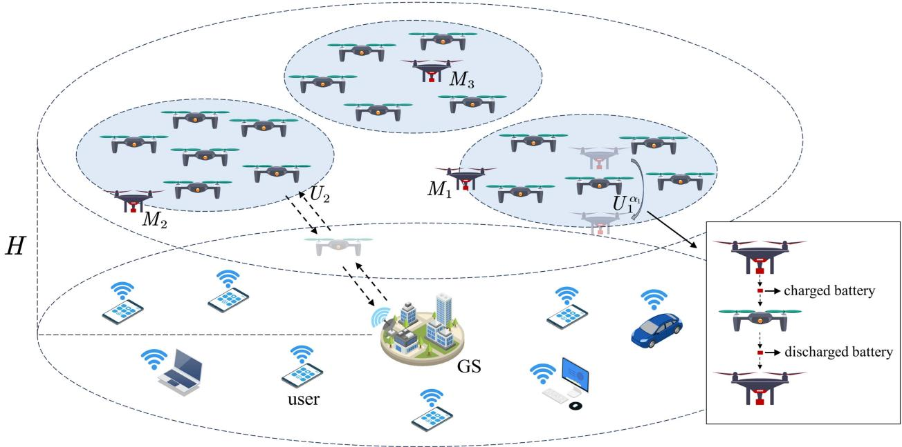  
Fig. 1. Example of multiple mules conduct battery swapping mission for a UAV swarm. There are three mules, $M _ { 1 } , M _ { 2 } ,$ and $M _ { 3 }$ . The UAV swarm is divided into three subswarms, all operating at an altitude H. $U _ { 1 } ^ { \alpha _ { 1 } }$ is the first UAV to be battery swapped by $M _ { 1 }$ in one timeslot. $U _ { 2 }$ belongs to the subswarm with $M _ { 2 } .$ but it is not within $M _ { 2 } ^ { \cdot } \mathrm { s }$ path during this timeslot. $M _ { 1 }$ and $U _ { 1 } ^ { \alpha _ { 1 } }$ are used as an example to illustrate the process of aerial battery swapping. When $M _ { 1 }$ flies to $U _ { 1 } ^ { \alpha _ { 1 } , } { \mathbf { \bar { s } } }$ deployment position, $M _ { 1 }$ first moves over $U _ { 1 } ^ { \alpha _ { 1 } }$ and sends a charged battery. $U _ { 1 } ^ { \alpha _ { 1 } }$ receives the battery and starts the swapping process. Then, $M _ { 1 }$ moves underneath $\dot { \boldsymbol { U } } _ { 1 } ^ { \alpha _ { 1 } }$ and collects the discharged battery. The GS is located at $( 0 , \dot { 0 } , 0 ) . U _ { 2 }$ needs to travel to and from GS for battery replacement.

2) Trajectory Planning: UAV is considered as a significant part to solve the “last-mile” parcel delivery. In delivery, UAV trajectory can be derived by solving different variants of TSP, such as flying sidekick TSP [31], parallel drone scheduling TSP [31], TSP with drone [32], and vehicle routing problem with drones [46]. Heuristic [33], metaheuristic [34], and deep reinforcement learning (DRL) [35] were adopted for determining delivery trajectory. In addition to parcel delivery, UAV trajectory planning is also a challenge in areas, such as search and rescue and data collection. Fu et al. [36] combined bundling ant colony optimization (ACO) and adaptive window probabilistic roadmap algorithm to solve multi-UAV search and rescue problem with obstacles. Chai et al. [37] used simulated annealing (SA) algorithm in UAV-assisted wireless sensor networks to solve the trajectory of UAV visiting SN cluster heads. A hybrid tabu search and variable neighborhood descent (VND) algorithm was developed in [38] for solving the UAV data collection problem with time constraints.

3) UAV Scheduling: Zhao et al. [30] proposed a multiple traveling salesman transformation algorithm for task allocation, and a multiagent reinforcement learning algorithm for conflict-free path finding in warehouse cargo inspection scenario with multiple UAVs. Park et al. [39] studied delivery point selection and trajectory planning for multiple times of single UAV under load constraints, and proposed an iterative algorithm based on block decent to solve nonconvex mixed integer nonlinear programming problem. A twophase multi-UAV task scheduling framework was proposed in [40]. In the first phase, multiple scheduling subproblems are generated. In the second phase, scheduling schemes with sequential tasks are created for each UAV, considering constraints involving UAV capabilities and task demands. A two-layer optimization mechanism-based multiple UAV dynamic task planning method was developed in [41] to cope with the problem of rescue material delivery. The first layer was a global task allocation, using DRL to solve a VRP problem, and the second layer was a local path planning based on a trust network to maximize regional coverage rate while minimizing the total flight path length.

## III. PRELIMINARIES

## A. Problem Definition

This article leverages the battery swapping model from [26]. It considers a scenario, as shown in Fig. 1, where a UAV swarm is performing aerial MEC tasks and multiple mules are simultaneously performing battery swapping tasks for the swarm. It is worth noting that by taking advantage of the ability of rotor-wing UAVs to hover, the models and algorithms proposed in this article can be extended to a wide range of UAV mission types and are not confined to MEC.

UAVs are limited by their battery capacity. When a UAV’s power is about to run out, it must return to GS for battery replacement if no mule is scheduled to replace its battery in the air, leading to a service interruption. The whole mission period of each mule is composed of Q timeslots. Consequently, the timeslot is also used as an index in subsequent discussion to denote scheduling strategy of mules across different episodes.

## B. UAV Swarm Model

There are N UAVs in UAV swarm, denoted as $\mathcal { U } =$ $\{ U _ { 1 } , U _ { 2 } , \dots , U _ { N } \}$ . Each UAV provides MEC services for a different geographical area. For simplicity of the problem and without loss of generality, it is assumed that UAVs are at the same altitude H. The position set of in Q timeslots is defined as

$$
\mathcal { P } _ { \mathcal { U } } ( \tau ) = \{ P _ { U _ { 1 } } ( \tau ) , P _ { U _ { 2 } } ( \tau ) , \dots , P _ { U _ { N } } ( \tau ) \} , 0 \le \tau \le Q .\tag{1}
$$

Timeslot 0 is the initial time. The position of $U _ { j }$ in timeslot τ is $P _ { U _ { j } } ( \tau ) = ( x _ { i } ^ { \mathrm { u a v } } ( \tau ) , y _ { j } ^ { \mathrm { u a v } } ( \tau ) , H )$ . The expression of $P _ { U _ { j } }$ here is to distinguish it from the position of mules. For the sake of brevity, other parameters of $U _ { j }$ except its position are represented by subscript j in the following article.

The position of GS is fixed at $P _ { G S } = ( 0 , 0 , 0 )$ . Each UAV can return to GS for battery replacement, and GS supports parallel landing of multiple UAVs. Multiple UAVs can replace batteries at GS at the same time. While there has been research on mounting a UAV battery changer on the truck [33], it is very limited in the number of battery replacements it can support simultaneously and is not applicable to the scenario discussed in this article. For ease of reference, the main symbols adopted in this article are listed in Nomenclature.

## C. Battery Mule Model

The mule is typically a type of quadcopter with a relatively high payload capacity, capable of carrying multiple batteries to perform battery swapping for UAVs in the air. Consider a total ofL mules, and the set ofmules is denoted as $\mathcal { M } = \{ M _ { 1 } , M _ { 2 } , \dots , M _ { L } \}$ . Each mule chooses a direction of liftoff from GS, and after reaching altitude H, their position set in timeslot 0 is defined as

$$
\mathcal { P } _ { M } ( 0 ) = \{ P _ { M _ { 1 } } ( 0 ) , P _ { M _ { 2 } } ( 0 ) , . . . , P _ { M _ { L } } ( 0 ) \} .\tag{2}
$$

For the ith mule, $1 \leq i \leq L$ , its position in timeslot 0 is $P _ { M _ { i } } ( 0 ) = ( x _ { i } ^ { \mathrm { m u l e } } ( 0 ) , y _ { i } ^ { \mathrm { m u l e } } ( 0 ) , H )$ . Therefore, we can obtain a distance matrix $D ( 0 )$ that includes the distance from each mule to each UAV based on $\mathcal { P } _ { \mathcal { U } } ( 0 )$ and ${ \mathcal { P } } _ { { \mathcal { M } } } ( 0 )$ . The element of the ith row and jth column of D(0) is $D ( P _ { M _ { i } } ( 0 ) , P _ { U _ { i } } ( 0 ) )$ which represents the distance between $P _ { M _ { i } } ( 0 )$ and $\dot { P _ { U _ { i } } } ( 0 )$ where $D ( . , . )$ denotes 3-D Euclidean distance. Each mule can carry at most K batteries. There are airborne wireless communication networks consisting of and . The system employs a centralized scheduling architecture via airborne wireless communication networks that connect $u ,$ , and GS. All UAVs and mules maintain bidirectional communication with GS, which functions as the central decision-making entity. Based on the information from and , GS generates control commands for coordinated execution by  and . This article focuses on scheduling decisions of multiple mules. The study ofairborne communication networks and air-to-ground communication channels is beyond the scope ofthis article.

is divided into subswarms based on some policies. Each mule executes battery swapping task of a subswarm. These subswarms are denoted as $\{ \mathcal { U } _ { 1 } , \mathcal { U } _ { 2 } , \dots , \mathcal { U } _ { L } \}$ , where

$$
\forall \mathcal { U } _ { i } \cap \mathcal { U } _ { j } = \emptyset , 1 \le i , j \le L , i \ne j .\tag{3}
$$

The set of UAVs’ number in each subswarm is $\{ N _ { 1 } , N _ { 2 } , \dots , N _ { L } \}$ . Each mule is in charge of battery swapping mission for one subswarm and swaps batteries for several UAVs selected from it. At the beginning of each timeslot, GS calculates flying trajectories for each mule. Each trajectory consists of two parts: flying path and arrival time. A flying path contains some UAV deployment positions and the arrival time indicates when the mule arrives at each position. We ignore the subtle height difference between mules and UAVs during battery swapping, considering that if the mule flies to a UAV deployment position, it will perform battery swapping for that UAV. Moreover, battery reloading time for mules at GS is negligible and thus omitted. When charged batteries carried by the mule are depleted, but there are still UAVs on the path that have not had their batteries swapped, the mule will return to GS to reload batteries and continue battery swapping mission. As shown in Fig. 1, the mule loads a charged battery for the UAV and receives a discharged battery, so the weight of the mule and UAV remains constant. At the end of each timeslot, the mule will behave differently depending on the number of remaining charged batteries. If the number of remaining charged batteries is 0, then the mule will return to GS with discharged batteries, reload batteries, and then carry out the task for next timeslot. Otherwise, the mule will fly to the deployment location of the first UAV requiring a battery swapping in next timeslot.

$M _ { i }$ is responsible for the battery swapping task in subswarm $\mathcal { U } _ { i } ,$ which is derived from task assignment algorithm. In the following timeslots, Mi will execute the battery swap-ping mission for Ui according to the precalculated trajectory by GS. For example, in timeslot τ , there are ξi UAVs whose deployment positions are on the flying path $\mathcal { P } _ { i } ( \tau )$ of $M _ { i }$ where

$$
\mathcal { P } _ { i } ( \tau ) = \{ P _ { i } ^ { \alpha _ { 1 } } ( \tau ) , P _ { i } ^ { \alpha _ { 2 } } ( \tau ) , \ldots , P _ { i } ^ { \alpha _ { \xi _ { i } } } ( \tau ) \} .\tag{4}
$$

$\mathcal { P } _ { i } ( \tau )$ contains information about the order of visiting these ξi UAVs. $P _ { i } ^ { \alpha _ { j } } ( \tau )$ means the $\alpha _ { j }$ -th UAV’s deployment position in $\mathcal { P } _ { \mathcal { U } } ( \tau ) , 1 \le j \le \xi _ { i }$ . Moreover

$$
\mathcal { P } _ { i } ( \tau ) \subset \mathcal { P } _ { \mathcal { U } _ { i } } ( \tau )\tag{5}
$$

where $\mathcal { P } _ { \mathcal { U } _ { i } } ( \tau )$ denotes the deployment positions set of $\mathcal { U } _ { i }$ in timeslot τ . The arrival time corresponding to $\mathcal { P } _ { i } ( \tau )$ is

$$
\mathcal { T } _ { i } ( \tau ) = \{ T _ { i } ^ { \alpha _ { 1 } } ( \tau ) , T _ { i } ^ { \alpha _ { 2 } } ( \tau ) , \dots , T _ { i } ^ { \alpha _ { \xi _ { i } } } ( \tau ) \}\tag{6}
$$

where $T _ { i } ^ { \alpha _ { j } } ( \tau )$ denotes the time when $M _ { i }$ arrives at $P _ { i } ^ { \alpha _ { j } } ( \tau )$ Between two UAVs, such as $U _ { \alpha _ { i } }$ and $U _ { \alpha _ { j + 1 } }$ , horizontal flying velocity of $M _ { i }$ is denoted as $v _ { i } ^ { \alpha _ { j } } ( \tau )$ . Therefore, horizontal velocity set of $M _ { i }$ is

$$
\mathcal { V } _ { i } ( \tau ) = \{ v _ { i } ^ { \alpha _ { 1 } } ( \tau ) , v _ { i } ^ { \alpha _ { 2 } } ( \tau ) , \dots , v _ { i } ^ { \alpha _ { \xi _ { i } } } ( \tau ) \} .\tag{7}
$$

It should satisfy

$$
v _ { h } ^ { \mathrm { m i n } } \le v _ { i } ^ { \alpha _ { j } } ( \tau ) \le v _ { h } ^ { \mathrm { m a x } }\tag{8}
$$

where $v _ { h } ^ { \operatorname* { m i n } }$ and $v _ { h } ^ { \operatorname* { m a x } }$ are the minimum and maximum horizontal velocities of mules, respectively. Note that $\mathcal { V } _ { i } ( \tau )$ indicates the velocity of $M _ { i }$ between any two adjacent UAVs in $\mathcal { P } _ { i } ( \tau ) .$ , and $v _ { i } ^ { \alpha _ { \xi _ { i } } } ( \tau )$ indicates the velocity of $M _ { i }$ between the last UAV in $\mathcal { P } _ { i } ( \tau )$ and the first UAV in $\mathcal { P } _ { i } ( \tau + 1 )$ . In addition, the motion process is simplified by assuming that mules and UAVs move only horizontally and vertically during traveling to and from GS, which does not affect the design of subsequent algorithms.

To ensure normal battery swapping for $U _ { \alpha _ { j + 1 } }$ , the arrival time of $U _ { \alpha _ { j } }$ and $U _ { \alpha _ { j + 1 } }$ must meet the following requirements.

1) Scenario $I { \mathrm { - } } I f U _ { \alpha _ { j } }$ is Not the Last UAV in $\mathcal { P } _ { i } ( \tau )$ and the Number of Batteries Remaining in the Mule After Swapping $U _ { \alpha _ { j } }$ ’s Battery is Not 0: We have

$$
T _ { i } ^ { \alpha _ { j + 1 } } ( \tau ) - T _ { i } ^ { \alpha _ { j } } ( \tau ) \ge \frac { D ( P _ { i } ^ { \alpha _ { j } } ( \tau ) , P _ { i } ^ { \alpha _ { j + 1 } } ( \tau ) ) } { v _ { i } ^ { \alpha _ { j } } ( \tau ) } + t _ { \mathrm { s w a p } }\tag{9}
$$

where $t _ { \mathrm { s w a p } }$ is the time spent on battery swapping, which is a fixed value, and $\mathpalette { D } ( P _ { i } ^ { \alpha _ { j } } ( \tau ) , P _ { i } ^ { \alpha _ { j + 1 } } ( \tau ) )$ ) is the distance between $P _ { i } ^ { \alpha _ { j } } ( \tau )$ and $P _ { i } ^ { \alpha _ { j + 1 } } ( \tau )$

2) Scenario $2 - I f U _ { \alpha _ { i } }$ is Not the Last UAV in $\mathcal { P } _ { i } ( \tau )$ and the Number of Batteries Remaining in the Mule After Swapping $U _ { \alpha _ { i } } { } ^ { , } s$ Battery is 0: For details, refer the following: (10) shown at the bottom of this page, in which ${ \cal D } ( P _ { i } ^ { \alpha _ { j } } ( \tau ) , ( 0 , 0 , H ) )$ and $D ( P _ { i } ^ { \alpha _ { j + 1 } } ( \tau ) , ( 0 , 0 , \tilde { H } ) )$ are horizontal distances from the αjth and $\alpha _ { j + 1 }$ th position in $\mathcal { P } _ { i } ( \tau )$ to GS, respectively. $D ( P _ { G S } , ( 0 , 0 , \dot { H } ) )$ is vertical distance from the deployment position of each UAV to GS.

3) Scenario $3 { \mathrm { - } } H U _ { \alpha _ { i } }$ is the Last UAV in $\mathcal { P } _ { i } ( \tau )$ and the Number ofBatteries Remaining in the Mule After Swapping $U _ { \alpha _ { j } } { } ^ { \prime } s$ Battery is Not $\begin{array} { r l } { O \colon } & { { } U _ { \alpha _ { j + } } } \end{array}$ is actually $U _ { \alpha _ { 1 } }$ in $\mathcal { P } _ { i } ( \tau + 1 )$ .

We have

$$
T _ { i } ^ { \alpha _ { 1 } } ( \tau + 1 ) - T _ { i } ^ { \alpha _ { j } } ( \tau ) \geq \frac { D ( P _ { i } ^ { \alpha _ { j } } ( \tau ) , P _ { i } ^ { \alpha _ { 1 } } ( \tau + 1 ) ) } { v _ { i } ^ { \alpha _ { j } } ( \tau ) } + t _ { \mathrm { s w a p } }\tag{11}
$$

where $D ( P _ { i } ^ { \alpha _ { j } } ( \tau ) , P _ { i } ^ { \alpha _ { 1 } } ( \tau + 1 ) )$ is the distance between the αj th position in $\mathcal { P } _ { i } ( \tau )$ and the $\alpha _ { 1 }$ th position in $\mathcal { P } _ { i } ( \tau + 1 )$

4) Scenario $4 - H U _ { \alpha _ { j } }$ is the Last UAV in $\mathcal { P } _ { i } ( \tau )$ and the Number of Batteries Remaining in the Mule After Swapping $U _ { \alpha _ { i } } { } ^ { , } s$ Battery is $\it 0 .$ For details, refer the following: (12) shown at the bottom of this page, in which $D ( P _ { i } ^ { \alpha _ { 1 } } ( \tau +$ $1 ) , ( 0 , 0 , H ) )$ is horizontal distance from the $\alpha _ { 1 }$ th position in $\mathcal { P } _ { i } ( \tau + 1 )$ to GS.

In order to record which UAVs have had their batteries swapped in the air during a timeslot, for example, in timeslot $\tau ,$ we define a variable $\chi _ { i j } ( \tau )$ . Specifically, $\chi _ { i j } ( \tau ) = 1$ indicates $U _ { j } { ' } \mathrm { s }$ battery is swapped by $M _ { i }$ in timeslot $\tau { ; \chi _ { i j } ( \tau ) = 0 }$ indicates not, but $U _ { j } { ' } \mathrm { s }$ may be swapped by other mule. If $\begin{array} { r } { \sum _ { i = 1 } ^ { L } \chi _ { i j } ( \tau ) = 0 } \end{array}$ , then it means $U _ { j } { ' } \mathrm { s }$ battery is not swapped -by any mule, and $U _ { j }$ must fly back to GS for battery replacement in timeslot τ . Moreover, the number of UAVs swapped by $M _ { i }$ in timeslot τ can be denoted as $\begin{array} { r } { \xi _ { i } = \sum _ { i = 1 } ^ { N } \chi _ { i j } ( \tau ) } \end{array}$ -Therefore, we can obtain the totals of UAVs whose battery is swapped by $\mathcal { M }$ , denoted as $\xi = \textstyle \sum _ { i = 1 } ^ { L } \xi _ { i }$

## D. Service Disruption Model

Each UAV has an LBST, and if any mule fails to arrive at the deployment position of a UAV before its LBST, then this UAV needs to return to GS to replace battery, causing a service disruption. The battery level of $U _ { j }$ in timeslot τ is denoted as $B _ { j } ( \tau )$ in ampere–hours (Ah), $1 \leq j \leq N _ { : }$ , which is a continuous variable. Its battery level when $U _ { j }$ must leave its deployment position in timeslot τ is $B _ { i } ^ { r } ( \tau )$ , equaling battery capacity required for $U _ { j }$ to return to $\check { \mathrm { G S } }$ . Therefore, considering safety, we have

$$
B _ { j } ( \tau ) \geq B _ { j } ^ { r } ( \tau ) .\tag{13}
$$

For the following analysis, we assume that $U _ { j }$ needs to return to GS to replace its battery in timeslot τ. Ascending and descending velocities of UAVs are set to be the same as mules, i.e., $v _ { a }$ and $v _ { d } .$ . Horizontal velocity of $M _ { i }$ and $U _ { j }$ are denoted as $v _ { i } ^ { h }$ and $v _ { j } ^ { h }$ , respectively. Thus, horizontal and

$$
\begin{array} { r } { T _ { i } ^ { \alpha _ { j + 1 } } ( \tau ) - T _ { i } ^ { \alpha _ { j } } ( \tau ) \geq \frac { D ( P _ { i } ^ { \alpha _ { j } } ( \tau ) , ( 0 , 0 , H ) ) + D ( P _ { i } ^ { \alpha _ { j + 1 } } ( \tau ) , ( 0 , 0 , H ) ) } { v _ { i } ^ { \alpha _ { j } } ( \tau ) } } \\ { + \frac { D ( P _ { G S } , ( 0 , 0 , H ) ) } { v _ { d } } + \frac { D ( P _ { G S } , ( 0 , 0 , H ) ) } { v _ { a } } + t _ { \mathrm { s w a p } } } \end{array}\tag{10}
$$

$$
\begin{array} { r } { T _ { i } ^ { \alpha _ { 1 } } ( \tau + 1 ) - T _ { i } ^ { \alpha _ { j } } ( \tau ) \geq \frac { D ( P _ { i } ^ { \alpha _ { j } } ( \tau ) , ( 0 , 0 , H ) ) + D ( P _ { i } ^ { \alpha _ { 1 } } ( \tau + 1 ) , ( 0 , 0 , H ) ) } { v _ { i } ^ { \alpha _ { j } } ( \tau ) } } \\ { + \frac { D ( P _ { \mathrm { G S } } , ( 0 , 0 , H ) ) } { v _ { d } } + \frac { D ( P _ { \mathrm { G S } } , ( 0 , 0 , H ) ) } { v _ { a } } + t _ { \mathrm { s w a p } } } \end{array}\tag{12}
$$

6389

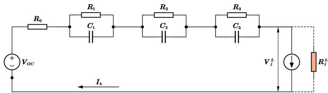  
Fig. 2. Third-order $R C$ equivalent circuit model for a lithium battery, taken and modified from [47]. $V _ { \mathrm { O C } }$ is open-circuit voltage; $R _ { 0 }$ is internal resistance; $R _ { 1 } , R _ { 2 } ,$ , and $R _ { 3 }$ are polarization resistances; $C _ { 1 } , C _ { 2 } ,$ , and $C _ { 3 }$ are polarization capacitors; $R _ { j } ^ { L }$ is a hypothetical load with dynamically varying resistance. In actual analysis, $R _ { j } ^ { L }$ is replaced by a current source.

vertical flying time of $U _ { j }$ from $P _ { U _ { j } } ( \tau )$ to GS are

$$
t _ { j 0 } ^ { h } = \frac { D ( P _ { U _ { j } } ( \tau ) , ( 0 , 0 , H ) ) } { v _ { j } ^ { h } }\tag{14a}
$$

$$
t _ { j 0 } ^ { d } = \frac { D ( P _ { \mathrm { G S } } , ( 0 , 0 , H ) ) } { v _ { d } } .\tag{14b}
$$

Consequently, the flying time of $U _ { j }$ from $P _ { U _ { j } } ( \tau )$ to GS is

$$
t _ { j 0 } = t _ { j 0 } ^ { h } + t _ { j 0 } ^ { d } .\tag{15}
$$

The variation of UAV battery level is closely related to voltage, so this article refers to the third-order RC equivalent circuit model to estimate the operating voltage of UAV, illustrated in Fig. 2. $V _ { \mathrm { O C } }$ is open-circuit voltage; $R _ { 0 }$ is internal resistance; $R _ { 1 } , R _ { 2 }$ and $R _ { 3 }$ are polarization resistances; $C _ { 1 } , C _ { 2 }$ and $C _ { 3 }$ are polarization capacitors; $R _ { j } ^ { L }$ is a hypothetical load resistance, dynamically varied by motor speed and pulsewidth modulation duty cycle, so it is replaced by a current source for analysis. $C _ { 1 } , C _ { 2 } ,$ , and $C _ { 3 }$ are used to simulate the polarization effect when discharge starts and stops, and they are regarded as disconnected when the battery of $U _ { j }$ is working steadily, so operating voltage of $U _ { j }$ satisfies

$$
V _ { j } ^ { L } = V _ { \mathrm { O C } } - I _ { b } \cdot R _ { \mathrm { t o t a l } }\tag{16}
$$

where $R _ { \mathrm { t o t o a l } } = R _ { 0 } + R _ { 1 } + R _ { 2 } + R _ { 3 }$ . According to the law of power conservation, battery output power equals total load power

$$
V _ { j } ^ { L } \cdot I _ { b } = P _ { \mathrm { l o a d } } .\tag{17}
$$

Combining (16) and (17), it can obtain

$$
( V _ { j } ^ { L } ) ^ { 2 } - V _ { \mathrm { O C } } \cdot V _ { j } ^ { L } + P _ { \mathrm { l o a d } } \cdot R _ { \mathrm { t o t a l } } = 0 .\tag{18}
$$

Further, it can deduce that

$$
V _ { j } ^ { L } = \frac { V _ { \mathrm { O C } } + \sqrt { ( V _ { \mathrm { O C } } ) ^ { 2 } - 4 P _ { \mathrm { l o a d } } \cdot R _ { \mathrm { t o t a l } } } } { 2 } .\tag{19}
$$

The other solution $\begin{array} { r } { V _ { j } ^ { L } = \frac { V _ { \mathrm { 0 C } } - \sqrt { ( V _ { \mathrm { 0 C } } ) ^ { 2 } - 4 P _ { \mathrm { l o a d } } \cdot R _ { \mathrm { t o t a l } } } } { 2 } } \end{array}$ is discarded, since $V _ { j } ^ { L }$ should be slightly less than $V _ { \mathrm { O C } }$ . The electrical energy output from battery is converted into propulsion power for UAV and partially dissipated as energy loss. Therefore, it can be formulated as [48]

$$
P _ { \mathrm { l o a d } } = \frac { P _ { \mathrm { p r o p } } } { \eta _ { p } \cdot \eta _ { m } \cdot \eta _ { \mathrm { E S C } } }\tag{20}
$$

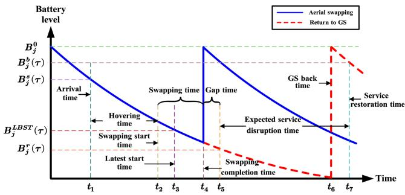  
Fig. 3. Two examples of $U _ { j } \mathrm { ' s }$ battery replaced in the air or at GS. The blue solid curve shows the battery level changing i $\mathrm { ~ f ~ } { U _ { j } } ^ { \prime } \mathrm { s }$ battery is swapped by a mule. The red dotted curve shows the battery level changing i $U _ { j }$ flies back to GS for battery replacement.

where $P _ { \mathrm { p r o p } }$ represents propulsion power, categorized into hovering and flying states, corresponding to (36), (38), and (41); $\eta _ { p } , \eta _ { m }$ , and ηESC are propeller efficiency, motor efficiency, and electronic speed controller (ESC) efficiency, respectively.

The state of charge (SOC) indicates the percentage of charge remaining in the battery. Based on [47], there is a definite nonlinear relationship between SOC and $V _ { \mathrm { O C } }$

$$
V _ { \mathrm { O C } } = f ( \mathrm { S O C } )\tag{21}
$$

where f(SOC) denotes a function with respect to SOC.1 Therefore, $V _ { j } ^ { L }$ under each SOC can be obtained. For battery discharge process, the depletion of battery level per second over a short period of time can be considered as a fixed value. Thus, $U _ { j } { ' } \mathrm { s }$ battery level when it must start to return to GS is

$$
B _ { j } ^ { r } ( \tau ) = \int _ { t _ { 5 } } ^ { t _ { 5 } + t _ { j 0 } ^ { h } } B _ { j } ^ { h } d t + \int _ { t _ { 5 } + t _ { j 0 } ^ { h } } ^ { t _ { 5 } + t _ { j 0 } ^ { h } + t _ { j 0 } ^ { d } } B _ { j } ^ { d } d t\tag{22}
$$

where $B _ { j } ^ { h }$ and $B _ { j } ^ { d }$ are the amount of electricity consumed by $U _ { j }$ per second when moving in horizontal and descending directions, respectively, in $\operatorname { A h } / \operatorname { s } . t _ { 5 }$ is the time when $U _ { j }$ starts to return to GS, as shown in Fig. 3. Battery level of $U _ { j }$ at the latest moment a mule begins to swap its battery is defined as

$$
B _ { j } ^ { \mathrm { L B S T } } ( \tau ) = B _ { j } ^ { r } ( \tau ) + \int _ { t _ { 3 } } ^ { t _ { 5 } } B _ { j } ^ { \mathrm { h o v e r } } d t\tag{23}
$$

where $B _ { i } ^ { \mathrm { h o v e r } }$ is the amount of electricity consumed by $U _ { j }$ per second when hovering, in $\operatorname { A h } / \operatorname { s }$ , and $t _ { 3 }$ is the latest battery swapping start time, as shown in Fig. 3. Similarly, horizontal and vertical flying time of $U _ { j }$ from GS to $P _ { U _ { j } } ( \tau )$ are

$$
t _ { 0 j } ^ { h } = \frac { D ( P _ { U _ { j } } ( \tau ) , ( 0 , 0 , H ) ) } { v _ { j } ^ { h } }\tag{24a}
$$

$$
t _ { 0 j } ^ { a } = \frac { D ( P _ { \mathrm { G S } } , ( 0 , 0 , H ) ) } { v _ { a } } .\tag{24b}
$$

The flying time of $U _ { j }$ from GS to $P _ { U _ { j } } ( \tau )$ is

$$
t _ { 0 j } = t _ { 0 j } ^ { h } + t _ { 0 j } ^ { a } .\tag{25}
$$

Therefore, $U _ { j } { ' } \mathrm { s }$ battery level when returning to $P _ { U _ { j } } ( \tau )$ is

$$
B _ { j } ^ { b } ( \tau ) = B _ { j } ^ { 0 } - \left( \int _ { t _ { 6 } } ^ { t _ { 6 } + t _ { 0 j } ^ { a } } B _ { j } ^ { a } d t + \int _ { t _ { 6 } + t _ { 0 j } ^ { a } } ^ { t _ { 6 } + t _ { 0 j } ^ { a } + t _ { 0 j } ^ { h } } B _ { j } ^ { h } d t \right)\tag{26}
$$

where $B _ { j } ^ { a }$ is the amount of electricity consumed by $U _ { j }$ per second when moving in ascending direction, and $t _ { 6 }$ is the time when $U _ { j }$ starts to return to $P _ { U _ { j } } ( \tau )$ from GS, as shown in Fig. 3. To be noted, the time that $U _ { j }$ spends replacing battery at GS is ignored. Therefore, the round-trip time of $U _ { j }$ is

$$
t _ { j } ^ { r } = t _ { j 0 } + t _ { 0 j } .\tag{27}
$$

Based on the definition o $\dot { \boldsymbol { t } } _ { i } ^ { r }$ and $\chi _ { i j } ( \tau )$ , we know the service disruption time (SDT) of $\overset { \prime } { U } _ { j }$ in timeslot τ is

$$
t _ { j } ^ { \mathrm { S D T } } ( \tau ) = \left( 1 - \sum _ { i = 1 } ^ { L } \chi _ { i j } ( \tau ) \right) \cdot t _ { j } ^ { r } , \chi _ { i j } ( \tau ) \in \{ 0 , 1 \} .\tag{28}
$$

Then, we can define a metric, named CSR, which implies the ratio of $U _ { j }$ ’s continuous service time in timeslot τ. It is denoted as

$$
C _ { j } ( \tau ) = 1 - \frac { t _ { j } ^ { \mathrm { S D T } } ( \tau ) } { \Delta ( \tau ) }\tag{29}
$$

where $\Delta ( \tau )$ is the length of timeslot τ. Thus, the total CSR of $\mathcal { U } _ { i }$ and in timeslot τ are

$$
C _ { \mathcal { U } _ { i } } ( \tau ) = \sum _ { j = 1 } ^ { N _ { i } } C _ { j } ( \tau )\tag{30a}
$$

$$
C _ { \mathcal { U } } ( \tau ) = \sum _ { i = 1 } ^ { L } C _ { \mathcal { U } _ { i } } ( \tau ) .\tag{30b}
$$

The average and variance of CSR for all subswarms are

$$
C _ { \mathrm { a v e } } ( \tau ) = \frac { C _ { \mathcal { U } } ( \tau ) } { L }\tag{31a}
$$

$$
C _ { \mathrm { v a r } } = \frac { 1 } { L } \sum _ { i = 1 } ^ { L } ( C _ { { \mathcal U } _ { i } } ( \tau ) - C _ { \mathrm { a v e } } ( \tau ) ) ^ { 2 } .\tag{31b}
$$

## E. Battery Swapping Model

To fully utilize the battery ofeach UAV, we set each mule not to start swapping battery immediately when it arrives at the deployment position of a UAV, but rather to hover for a period of time and swap the battery as soon as possible at UAV’s LBST.

We suppose $M _ { i }$ will swap the battery for $U _ { j }$ in timeslot τ, which means $\chi _ { i j } ( \tau ) = 1$ , so $M _ { i }$ should fly to $P _ { U _ { j } } ( \tau )$ before $B _ { j } ( \tau )$ drops to $B _ { j } ^ { \mathrm { L B S T } }$ . Assume that the capacity of $U _ { j } { ' } \mathrm { s }$ battery is $B _ { i } ^ { 0 }$ and its battery level at the beginning of timeslot τ is $B _ { j } ^ { s } ( \dot { \tau } )$ . The blue solid curve in Fig. 3 shows an example of $U _ { j }$ ’s battery level changing in timeslot τ . Battery level decreases due to hovering, flying, and task execution energy consumption of $U _ { j }$ . As discharge process proceeds, $V _ { \mathrm { O C } }$ decreases, resulting that $B _ { i } ^ { \mathrm { h o v e r } }$ gradually reduces. Mi flies to $P _ { U _ { i } } ( \tau )$ at $t _ { 1 }$ , beginning to hover, and starts to swap battery for $U _ { j }$ at $t _ { 2 } .$ The battery swapping process completes at $t _ { 4 } .$ , so battery swapping time $t _ { \mathrm { s w a p } } = t _ { 4 } - t _ { 2 }$ . The moment completing battery swapping, $U _ { j } { ' } { \bf { \bar { s } } }$ battery level returns to $B _ { i } ^ { 0 }$ . t3 is the LBST of $U _ { j }$ , and if $U _ { j } { ' } \mathrm { s }$ battery was swapped at $t _ { 3 } ,$ the battery swapping completion time would be $t _ { 5 }$ . There is

$$
t _ { 5 } - t _ { 3 } = t _ { 4 } - t _ { 2 } = t _ { \mathrm { s w a p } } .\tag{32}
$$

In order to increase the number of UAVs in $M _ { i } { ' } \mathrm { s }$ flying path, hovering time of $M _ { i }$ at $U _ { j }$ need to be compressed, so start of battery swapping for $U _ { j }$ is advanced from $t _ { 3 }$ to $t _ { 2 }$ . It results in a gap time $t _ { 5 } - t _ { 4 }$ , which means the battery of $U _ { j }$ is not fully utilized until it is swapped.

Fig. 3 also shows the other case that $U _ { j }$ needs to fly back to GS for battery replacement in timeslot $\tau ,$ , which means $\begin{array} { r } { \sum _ { i = 1 } ^ { L } \chi _ { i j } ( \tau ) = 0 . ~ U _ { j } } \end{array}$ leaves its deployment position at its -LBST $t _ { 5 }$ and flies back to GS at $t _ { 6 }$ . Then, its battery level returns to $B _ { i } ^ { 0 } . \ U _ { j }$ flies to $P _ { U _ { j } } ( \tau )$ from GS at $t _ { 7 } .$ , indicating the restoration of MEC service. Therefore, $t _ { 7 } - t _ { 5 }$ is the expected SDT.

Based on the definition of $\chi _ { i j } ( \tau )$ and gap time, the real gap time of $U _ { j }$ in timeslot τ can be derived, denoted as

$$
t _ { j } ^ { \mathrm { g a p } } ( \tau ) = \sum _ { i = 1 } ^ { N } \chi _ { i j } ( \tau ) \cdot ( t _ { 5 } - t _ { 4 } ) , \chi _ { i j } ( \tau ) \in \{ 0 , 1 \} .\tag{33}
$$

Then, we can define a metric, named gap time ratio (GTR). The GTR of $U _ { j }$ in timeslot τ is

$$
G _ { j } ( \tau ) = \frac { t _ { j } ^ { \mathrm { g a p } } ( \tau ) } { \Delta ( \tau ) } .\tag{34}
$$

It implies the wasted service time of $U _ { j }$ to allow the mule to execute battery swapping for more UAVs. Thus, the total GTR of in timeslot τ are

$$
G _ { \mathcal { U } } ( \tau ) = \sum _ { i = 1 } ^ { L } \sum _ { j = 1 } ^ { N _ { i } } G _ { j } ( \tau ) .\tag{35}
$$

Since each mule carries at most K batteries, ifthe battery swapping mission remains unfinished after the mule has swapped batteries for K UAVs, the mule will return to GS to reload K batteries and then continue the mission.

## F. Energy Consumption Model

All operations of UAVs and mules incur energy consumption, including the flight and hovering of UAVs and mules, and MEC tasks for UAVs. Communication energy consumption is relatively minor and negligible compared to the propulsion energy consumption [49]. However, in scenario where UAVs operate intensive computing, the energy consumption associated with MEC becomes significant and must be taken into account. We neglect the environmental interference and fluctuation of UAVs and mules, and suppose that the flight is steady, not considering acceleration. Besides, suppose that UAVs and mules move in the same way, so their energy consumption analysis for flight and hovering can be shared, with the exception of gravity.

For $U _ { j }$ , its gravity is $G _ { j } ^ { \mathrm { u a v } } = ( m _ { f } ^ { \mathrm { u a v } } + m _ { p } ^ { \mathrm { u a v } } ) \xi$ g in Newtons $( \mathrm { N } )$ , where $m _ { f } ^ { \mathrm { u a v } }$ is the weight of a $\mathrm { U A V } _ { \mathrm { } } { \mathrm { { s } } }$ frame along with a battery in $\mathrm { k g } , m _ { p } ^ { \mathrm { u a v } }$ is the payload of a UAV in kg, and g is the gravitational acceleration in m $1 / \mathrm { s } ^ { 2 }$ . For $M _ { i }$ , its payload is mainly decided by the number of carried batteries, so its gravity is $G _ { i } ^ { \mathrm { m u l e } } = \stackrel { \cdot } { ( } m _ { f } ^ { \mathrm { m u l e } } + m _ { p } ^ { \mathrm { m u l e } } ) \mathrm { ~ g ~ }$ , where $m _ { p } ^ { \mathrm { m u l e } } = K$ $m _ { b }$ , and $m _ { b }$ is a battery weight in $\mathrm { k g }$ . As for scenarios 2 and 4 stated in Section III-C, if $M _ { i }$ runs out of charged batteries after swapping battery for $U _ { \alpha _ { i } }$ , then it will return to GS with a horizontal velocity $v _ { i } ^ { h } = v _ { i } ^ { \tilde { \alpha _ { j - 1 } } }$ , where $\boldsymbol v _ { i } ^ { \alpha _ { j - 1 } }$ is the velocity of $M _ { i }$ flying between $U _ { \alpha _ { i - } }$ and $U _ { \alpha _ { i } }$

Hovering energy: The power (in watts) consumed by hovering of $U _ { j }$ is [50]

$$
P _ { j } ^ { \mathrm { { h o v e r } } } = \frac { N _ { r } ( G _ { j } ^ { \mathrm { { u a v } } } ) ^ { \frac { 3 } { 2 } } } { \sqrt { 2 \pi \rho \beta ^ { 2 } } }\tag{36}
$$

where $N _ { r }$ is the number of rotors on a UAV; $\rho$ is the fluid density of the air in $\mathrm { k g } / \mathrm { m } ^ { 3 } ; \beta$ is the rotor disk radius in meters. When the hovering time of $U _ { j }$ in timeslot τ is $t _ { j } ^ { \mathrm { h o v e r } }$ its hovering energy consumption is

$$
E _ { j } ^ { \mathrm { h o v e r } } ( \tau ) = P _ { j } ^ { \mathrm { h o v e r } } \cdot t _ { j } ^ { \mathrm { h o v e r } } .\tag{37}
$$

Flying energy: For horizontal flying power $P _ { j } ^ { h }$ , we have

$$
P _ { j } ^ { h } = P _ { j } ^ { p } + P _ { j } ^ { I }\tag{38}
$$

where $P _ { j } ^ { p }$ is the power for overcoming parasitic drag, and $P _ { j } ^ { p }$ is defined as [49]

$$
P _ { j } ^ { p } = \frac { 1 } { 2 } \rho C _ { D _ { 0 } } A \left( v _ { j } ^ { h } \right) ^ { 3 } + \frac { \pi } { 4 } N _ { r } \rho c _ { b } C _ { D _ { 0 } } w ^ { 3 } \beta ^ { 4 } \left( 1 + 3 \left( \frac { v _ { j } ^ { h } } { w \beta } \right) ^ { 2 } \right)\tag{39}
$$

where $C _ { D _ { 0 } }$ is the drag coefficient, A is the frontal area of a $\mathrm { U A V } , c _ { b }$ is the rotor chord, and w is the angular velocity. In addition, $P _ { j } ^ { l }$ is the induced power for overcoming the resistance of lifting in the vertical direction, denoted as [49]

$$
P _ { j } ^ { I } = G _ { j } ^ { \mathrm { u a v } } \sqrt { \frac { \lambda - ( v _ { j } ^ { h } ) ^ { 2 } } { 2 } }\tag{40}
$$

where $\begin{array} { r } { \lambda = \sqrt { ( v _ { j } ^ { h } ) ^ { 4 } + ( \frac { G _ { j } ^ { \mathrm { u a v } } } { \pi \rho \beta ^ { 2 } } ) ^ { 2 } } } \end{array}$ . Ascending and descending flying power (in watts) are defined as [49]

$$
P _ { j } ^ { a } = \frac { G _ { j } ^ { \mathrm { u a v } } } { 2 } v _ { a } + \frac { G _ { j } ^ { \mathrm { u a v } } } { 2 } \sqrt { ( v _ { a } ) ^ { 2 } + \frac { 2 G _ { j } ^ { \mathrm { u a v } } } { \pi \rho \beta ^ { 2 } } }\tag{41a}
$$

$$
P _ { j } ^ { d } = \frac { G _ { j } ^ { \mathrm { u a v } } } { 2 } v _ { d } + \frac { G _ { j } ^ { \mathrm { u a v } } } { 2 } \sqrt { ( v _ { d } ) ^ { 2 } - \frac { 2 G _ { j } ^ { \mathrm { u a v } } } { \pi \rho \beta ^ { 2 } } } .\tag{41b}
$$

In timeslot τ , the flying energy consumption of $U _ { j }$ is

$$
E _ { j } ^ { \mathrm { f l y } } ( \tau ) = P _ { j } ^ { h } \cdot \frac { D _ { j } ^ { h } ( \tau ) } { v _ { j } ^ { h } } + P _ { j } ^ { a } \cdot \frac { D _ { j } ^ { a } ( \tau ) } { v _ { a } } + P _ { j } ^ { d } \cdot \frac { D _ { j } ^ { d } ( \tau ) } { v _ { d } }\tag{42}
$$

where $D _ { j } ^ { h } ( \tau )$ is horizontal movement distance of $U _ { j }$ in timeslot τ, and $D _ { j } ^ { a } ( \tau )$ and $D _ { j } ^ { d } ( \tau )$ are its ascending and descending movement distances in timeslot τ, respectively.

Battery swapping energy: We consider an ideal situation, assuming that the energy consumption of one battery swapping process for any UAV is a constant $E _ { \mathrm { s w a p } }$

UAV MEC energy: When $U _ { j }$ operates an MEC task $m _ { j } .$ , energy consumption per second is [51]

$$
E _ { j } ^ { \mathrm { t a s k } } = \gamma _ { j } b _ { j } c _ { j } ( f _ { j } ) ^ { 2 } \cdot d _ { j } ^ { \mathrm { t a s k } } + \gamma _ { j } b _ { j } c _ { j } \left( f _ { j } ^ { \prime } \right) ^ { 2 } \cdot \left( 1 - d _ { j } ^ { \mathrm { t a s k } } \right)\tag{43}
$$

where $\gamma _ { j }$ is the effective switched capacitance of $U _ { j } { ' } \mathrm { s }$ processing unit in farads (F); $b _ { j }$ is the number of input bits per second; $c _ { j }$ is the number of $U _ { j } { ' } \mathrm { s }$ CPU cycles for processing one input bit; $f _ { j }$ and $f _ { j } ^ { \prime }$ are $U _ { j } { ' } \mathrm { s }$ processing frequency in Hertz (Hz) when its processing unit is busy or idle, respectively; $d _ { j } ^ { \mathrm { t a s k } }$ is the whole needed CPU cycles of $m _ { j }$ , denoted as $\begin{array} { r } { d _ { j } ^ { \mathrm { t a s k } } = \frac { c _ { j } b _ { j } } { f _ { j } } } \end{array}$

UAV battery level depletion: Based on $P _ { j } ^ { \mathrm { h o v e r } }$ and $E _ { j } ^ { \mathrm { t a s k } }$ we can know $B _ { j } ^ { \mathrm { h o v e r } }$ in (23) is

$$
B _ { j } ^ { \mathrm { { h o v e r } } } = { \frac { 1 \cdot P _ { j } ^ { \mathrm { { h o v e r } } } + E _ { j } ^ { \mathrm { { t a s k } } } } { V _ { j } ^ { L } \cdot 3 6 0 0 } }\tag{44}
$$

where $1 \cdot P _ { j } ^ { \mathrm { h o v e r } }$ refers to hovering energy consumption per second. Similarly, $B _ { j } ^ { h } , B _ { j } ^ { a }$ , and $B _ { j } ^ { d }$ in (22) and (26) are

$$
B _ { j } ^ { h } = \frac { 1 \cdot P _ { j } ^ { h } } { V _ { j } ^ { L } \cdot 3 6 0 0 }\tag{45a}
$$

$$
B _ { j } ^ { a } = { \frac { 1 \cdot P _ { j } ^ { a } } { V _ { j } ^ { L } \cdot 3 6 0 0 } }\tag{45b}
$$

$$
B _ { j } ^ { d } = \frac { 1 \cdot P _ { j } ^ { d } } { V _ { j } ^ { L } \cdot 3 6 0 0 } .\tag{45c}
$$

Total energy consumption of mules (ECM): The energy consumption of Mi in timeslot τ is

$$
E _ { M _ { i } } ( \tau ) = E _ { M _ { i } } ^ { \mathrm { h o v e r } } ( \tau ) + E _ { M _ { i } } ^ { \mathrm { f l y } } ( \tau ) .\tag{46}
$$

Therefore, the energy consumption of in timeslot τ is

$$
E _ { \mathcal { M } } ( \tau ) = \sum _ { i = 1 } ^ { L } E _ { M _ { i } } ( \tau ) .\tag{47}
$$

## IV. PROBLEM FORMULATION AND ANALYSIS

The optimization problem for can be decomposed into two parts: 1) recipient assignment; 2) single-mule scheduling. Recipient assignment involves dividing into several subswarms and designating each mule to be responsible for the battery swapping mission of a specific subswarm. Mules scheduling focuses on selecting UAVs whose batteries will be swapped in the air from each subswarm across different timeslots and planning the trajectory for each mule.

The optimization goal consists of two components. At the first, accumulative CSR of should be maximized to provide the longest service time for ground users. Second, accumulative variance of CSR of all subswarms is supposed to be minimized, aiming to reduce the possibility of frequent service disruption in some regions. The optimization objective can be formulated as

$$
\operatorname { P 0 } : \operatorname* { m a x } _ { \mathcal { P } _ { i } ( \tau ) , \mathcal { T } _ { i } ( \tau ) , \chi _ { i j } ( \tau ) } \sum _ { \tau = 1 } ^ { Q } ( w _ { 1 } C _ { \mathcal { U } } ( \tau ) - w _ { 2 } C _ { \mathrm { v a r } } ( \tau ) )\tag{48}
$$

$$
\mathrm { s . t . } \qquad \quad \chi _ { i j } ( \tau ) \in \{ 0 , 1 \}\tag{49}
$$

$$
( 5 ) , ( 8 ) , ( 9 ) , ( 1 0 ) , ( 1 1 ) , ( 1 2 )\tag{50}
$$

where $w _ { 1 }$ and $w _ { 2 }$ are weight coefficients to balance $C _ { U } ( \tau )$ and $C _ { \mathrm { v a r } } ( \tau )$ . The optimization objective has some constraints, including UAVs deployment positions restriction [see (5)], mules flying velocity range restriction [see (8)] and arrival time restriction [see (9), (10), (11), (12)]. Obviously, due to (49), it is a 0–1 mixed integer programming model.

From P0, it can be known that two optimization objectives $C _ { U } ( \tau )$ and $C _ { \mathrm { v a r } } ( \tau )$ ) are highly coupled. Ifoptimization is performed directly, then it will affect them both at the same time. Therefore, it is first necessary to decouple the two optimization objects. A two-stage algorithm is designed, where the first stage optimizes $C _ { \mathrm { v a r } } ( \tau )$ and the second stage optimizes $C _ { U } ( \tau )$ , eliminating the effects of them. Such an approach allows the solution to be independent of $w _ { 1 }$ and w2.

In the first stage, optimization of $C _ { \mathrm { v a r } } ( \tau )$ is formulated as

$$
\operatorname { P 1 } : \operatorname* { m i n } _ { \mathcal { P } _ { i } ( \tau ) } \sum _ { \tau = 1 } ^ { Q } C _ { \mathrm { v a r } } ( \tau )\tag{51}
$$

$$
\mathrm { s . t . } \qquad ( 5 ) .\tag{52}
$$

ENS-RA is utilized to divide into L subswarms, and associate each subswarm with a UAV. The purpose of assignment is to balance task load of mules. Since CSR is closely related to the number of UAVs in each subswarm, significant disparities in UAV counts across subswarms can lead to a large $C _ { \mathrm { v a r } } ( \tau )$

In the second stage, optimization of $C _ { U } ( \tau )$ is formulated as

$$
\mathrm { P 2 } : \operatorname* { m a x } _ { \mathcal { P } _ { i } ( \tau ) , \mathcal { T } _ { i } ( \tau ) , \chi _ { i j } ( \tau ) } \sum _ { \tau = 1 } ^ { Q } C _ { \mathcal { U } } ( \tau )\tag{53}
$$

$$
\mathrm { s . t . } \qquad \quad \chi _ { i j } ( \tau ) \in \{ 0 , 1 \}\tag{54}
$$

$$
( 5 ) , ( 8 ) , ( 9 ) , ( 1 0 ) , ( 1 1 ) , ( 1 2 ) .\tag{55}
$$

ITSP-MS is designed to judge which UAVs’ batteries to be swapped in the air and plan trajectories for each mule in the subswarm in which it executes task.

## V. RECIPIENT ASSIGNMENT

To minimize $C _ { \mathrm { v a r } } ( \tau )$ , ENS-RA aims to keep the number of UAVs in each subswarms as equal as possible. Besides, to avoid a case that some UAVs return to GS for battery replacement due to the long distances between mules and subswarms in timeslot 1, ENS-RA prioritizes assigning UAVs closest to each mule.

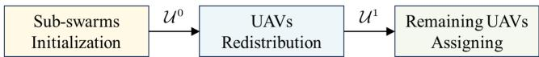  
Fig. 4. Overall process of ENS-RA.

## A. Overall Process

The overall process of ENS-RA algorithm is shown in Fig. 4. First of all, based on D(0) (stated in Section III-C), each mule selects a UAVs nearest to it into the subswarm that it is responsible for, where $a = \lfloor N / L \rfloor$ . Thus, the initial subswarm set can be defined as $\mathcal { U } ^ { 0 } = \{ \mathcal { U } _ { 1 } ^ { 0 } , \mathcal { U } _ { 2 } ^ { 0 } , \dots , \mathcal { U } _ { L } ^ { 0 } \}$ . As stated in (56), it is important to note that there may be a situation where a UAV is simultaneously one of the nearest a UAVs for multiple mules and these UAVs are denoted as ${ \mathcal { U } } _ { \mathrm { u n i } } = \{ U _ { \beta _ { 1 } } , U _ { \beta _ { 2 } } , \dots , U _ { \beta _ { u } } \}$

$$
\exists \mathcal { U } _ { i } ^ { 0 } \cap \mathcal { U } _ { j } ^ { 0 } \neq \emptyset , 1 \leq i , j \leq L , i \neq j .\tag{56}
$$

Therefore, the next step is to reassign the unallocated UAVs, as well as those that have not yet been assigned to any subswarms, deriving the updated $\mathcal { U } ^ { 0 }$ , denoted as $\mathcal { U } ^ { 1 } = \{ \mathcal { U } _ { 1 } ^ { 1 } , \mathcal { U } _ { 2 } ^ { 1 } , \ldots , \mathcal { U } _ { L } ^ { 1 } \}$ }. Finally, if $N > a \cdot L$ , some UAVs will not be in any subswarms, denoted as $\chi _ { \mathrm { r e m } } =$ $\{ U _ { \eta _ { 1 } } , U _ { \eta _ { 2 } } , \dotsc , U _ { \eta _ { r } } \}$ , where $r = N - a \cdot L$ . Besides, we have

$$
\mathcal { U } _ { \mathrm { r e m } } = \mathcal { U } - \mathcal { U } ^ { 1 } .\tag{57}
$$

Therefore, we assign each of these remaining UAVs into the subswarm that its nearest mule takes battery swapping mission for, trying to increase the CSR of $\mathcal { U } _ { \mathrm { r e m } }$

In the next part, we will detail the UAV redistribution process. The initialization of subswarms and assignment of remaining UAVs have been thoroughly described in this section and will not be reiterated.

## B. UAVs Redistribution

Pseudocode of UAVs redistribution is illustrated in Algorithm 1. Steps 1–6 get the intersection between all pairwise subswarms in $\mathcal { U } ^ { 0 } .$ , and take the union of all these intersections, denoted as $\mathcal { U } _ { \mathrm { u n i } }$ . Then, in Step 7, we count the number of elements in $\mathcal { U } _ { \mathrm { u n i } }$ , denoted as u. If $u = 0$ then UAVs’ redistribution process completes; if not, we need to reassign some controversial UAVs, which are the UAVs currently selected by multiple subswarms. Moreover, the controversial UAVs lead to a scenario where several other UAVs remain unassigned into any subswarms. Consequently, it is necessary to allocate these unassigned UAVs appropriately. Steps 10–14 assign each controversial UAV into the subswarm that its nearest mule is responsible for, remove them from other subswarms and make other subswarms no longer select them. Next, for the updated $\mathcal { U } ^ { 0 }$ if there exists a subswarm whose number of UAVs does not equal a, we will loop through these subswarms and select the nearest several UAVs from those that are available for assignment, which is shown in Steps 16–26. After this, UAVs’ redistribution process is completed.

Algorithm 1: UAVs Redistribution.   
Input : UAV swarm: ${ \mathcal { U } } = \{ U _ { 1 } , U _ { 2 } , \ldots , U _ { N } \}$   
initial sub-swarm:   
$\mathcal { U } ^ { 0 } = \{ \mathcal { U } _ { 1 } ^ { 0 } , \mathcal { U } _ { 2 } ^ { 0 } , \ldots , \mathcal { U } _ { L } ^ { 0 } \}$   
distance matrix: $D ( 0 )$   
Output: The updated $\mathcal { U } ^ { 0 }$   
1 for $i = 1$ to $L - 1$ do   
2 for $j = i + 1$ to L do   
3 Get the intersection between $\mathcal { U } _ { i } ^ { 0 }$ and $\mathcal { U } _ { j } ^ { 0 }$   
4 end for   
5 end for   
6 Take the union of these intersections, denoted as   
$\mathcal { U } _ { u n i } ;$   
7 Count the number of elements in $u _ { u n i } ,$ denoted   
as u;   
8 Define $\mathcal { U } _ { u n i } = \{ U _ { \beta _ { 1 } } , U _ { \beta _ { 2 } } , . . . , U _ { \beta _ { u } } \} ;$   
9 if $u \ne 0$ then   
10 for i = 1 to u do   
11 Assign $U _ { \beta _ { i } }$ to its nearest mule's   
sub-swarm;   
12 Delete $U _ { \beta _ { i } }$ from other sub-swarms;   
13 Mark $U _ { \beta _ { i } }$ as assigned, and other   
sub-swarms cannot select it;   
14 end for   
15 Update $\mathcal { U } ^ { 0 } ;$   
16 while $\exists ~ \left| \mathcal { U } _ { i } ^ { 0 } \right| \neq a , ~ 1 \leq i \leq L$ do   
17 Define these sub-swarms as $\mathcal { U } _ { s p a r e } ,$ and   
count the number of sub-swarms in it.   
denoted as s;   
18 Denote ${ \mathcal { U } } _ { s p a r e } = \{ { \mathcal { U } } _ { \zeta _ { 1 } } , { \mathcal { U } } _ { \zeta _ { 2 } } , \dots , { \mathcal { U } } _ { \zeta _ { s } } \}$   
19 Count the number of UAVs in each   
sub-swarm in $\mathcal { U } _ { s p a r e } ;$   
20 Calculate the number of UAVs that each   
sub-swarm in $\mathcal { U } _ { s p a r e }$ needs to add,   
denoted as $\{ N _ { \zeta _ { 1 } } , \stackrel { \cdot } { N } _ { \zeta _ { 2 } } , \ldots , N _ { \zeta _ { s } } \} ;$   
21 for $j = 1$ to s do   
22 $\mathcal { U } _ { \zeta _ { j } }$ selects $N _ { \zeta _ { j } }$ nearest UAVs from U   
that it can select;   
23 end for   
24 Update $\mathcal { U } ^ { 0 } ;$   
25 Repeat Steps 1 to 15   
26 end while   
27 Return $\mathcal { U } ^ { 0 } ;$   
28 else   
29 | Return $\mathcal { U } ^ { 0 } ;$   
30 end if

## C. Algorithm Complexity Analysis

In Algorithm 1, the time complexity from Steps 1–5 is $O ( L ^ { 2 } )$ and Steps 10–14 is O(u). Steps 16–26 distribute $N - a L \mathrm { U A V s } \tan L$ subswarms; hence, the time complexity is $O ( L \times ( N - a L ) )$ . Since N is usually much larger than L, combining the above analysis, the time complexity of Algorithm 1 is $O ( L ^ { 2 } + u + L \times ( N - a L ) ) \approx O ( L \times N )$ . In Step 25, the number of iterations is a finite constant that is only used to determine whether or not to exit loop and has no impact on complexity. Besides, the time complexity of subswarm initialization and remaining UAVs assigning is on the order of O(L). Therefore, the time complexity of ENS-RA is ${ \cal O } ( L \times N )$

## D. Algorithm Convergence Analysis

The convergence of Algorithm 1 is proved using mathematical induction. UAVs in $\mathcal { U } _ { \mathrm { u n i } }$ are defined as controversial UAVs. Define k as the number of unassigned or controversial UAVs during algorithm execution.

Proposition: For any $k \geq 0 ,$ , Algorithm 1 can terminate by decreasing k to 0 in a finite number of steps.

PROOF The three steps of proof are given below.

1) Base case: When $k = 0 ,$ , Algorithm 1 executes Step 29 after the judgment in Step 9, then Algorithm 1 terminates and the proposition holds.

2) Inductive hypothesis: Assume that Algorithm 1 can terminate in a finite number of steps when $k =$ m, $m \geq 0 .$

3) Inductive proof: It needs to be shown that Algorithm 1 can still terminate in a finite number of steps when $k = m + 1$

Algorithm 1 reduces the value of k in the following two methods.

First, from Steps 10 to 14, after one iteration, a controversial UAV is assigned causing k to be decreased to m. By inductive hypothesis, it follows that the algorithm converges.

Second, from Steps 21 to 23, after one iteration, an unassigned UAV is solved making k reduced to m. It can be concluded through inductive hypothesis that the algorithm converges.

In summary, it follows from the base case and induction steps that Algorithm 1 terminates for any $k \geq 0$ -

## VI. IMPROVED TSP-BASED MULE SCHEDULING

The mule scheduling consists of two key points basically: 1) selecting UAVs swapped in the air from each subswarm; 2) planning each mule’s trajectory in each timeslot. However, we combine the first and second points in the solution process since they are both determined by the LBST, which can be calculated based on (22), (32), and (44). Due to the influence of the LBST, we propose ITSP-MS algorithm. This algorithm can make mule scheduling decisions over multiple timeslots based on the battery levels of UAVs at the beginning of task. To facilitate solving the scheduling problem, we model UAV swarm as a graph, where all UAVs are represented as vertices, meaning that each UAV can only be visited once in a timeslot.

## A. Overall Process

Fig. 5 shows the overall process of ITSP-MS. In the subsequent analysis, to simplify the problem description and without loss of generality, we focus on the scenario within a single subswarm. For example, $M _ { 1 }$ swaps batteries for $\mathcal { U } _ { 1 }$ , in which the number of UAVs is $N _ { 1 }$ . Besides, we only analyze the flying trajectory deriving in timeslot τ. Horizontal velocities of mules and UAVs both belong to $\{ v _ { h } ^ { \operatorname* { m i n } } \leq v _ { h } \leq v _ { h } ^ { \operatorname* { m a x } } | v _ { h } \in \mathbb { Z } \}$ , which contains P selectable velocities. Based on the position of each UAV in $\mathcal { U } _ { 1 }$ and GS, we can calculate a distance $N _ { 1 } \times N _ { 1 }$ matrix $\mathbf { D } ^ { 1 }$ and two distance $1 \times N _ { 1 }$ matrixes $ { \mathbf { D } } ^ { 2 }$ and $\mathbf { D } ^ { 3 } .$ , in which $D _ { p q } ^ { 1 }$ refers to the distance between $U _ { p }$ and $U _ { q } , D _ { p } ^ { 2 }$ refers to horizontal distance between $U _ { p }$ and GS, and $D _ { p } ^ { 3 }$ refers to the vertical distance between $U _ { p }$ and GS, respectively. Then, we can get two flying time $\dot { N _ { 1 } } \times N _ { 1 } \times P$ matrix $\mathbf { T } ^ { \breve { \nu } }$ and $\mathbf { F } ^ { \nu }$ , in which $\begin{array} { r } { T _ { p q } ^ { v _ { i } ^ { h } } = \frac { D _ { p q } ^ { 1 } } { v _ { i } ^ { h } } } \end{array}$ and $\begin{array} { r } { F _ { p q } ^ { v _ { i } ^ { h } } = \frac { D _ { p } ^ { 2 } } { v _ { i } ^ { h } } + \frac { D _ { p } ^ { 3 } } { v _ { d } } + \frac { D _ { q } ^ { 2 } } { v _ { i } ^ { h } } + \frac { D _ { q } ^ { 3 } } { v _ { a } } } \end{array}$ , respectively.

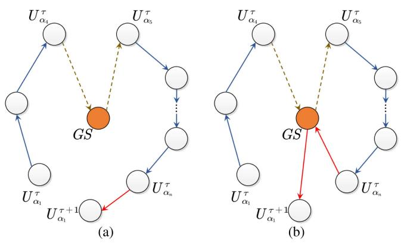

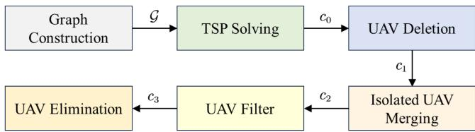  
Fig. 5. Overall process of ITSP-MS.  
Fig. 6. Two situations of $M _ { 1 }$ flies from $U _ { \alpha _ { n } } ^ { \tau }$ to $U _ { \alpha _ { 1 } } ^ { \tau + 1 }$ . (a) $N _ { B }$ after $U _ { \alpha _ { n } } ^ { \tau }$ is not 0. (b) $N _ { B }$ after $\bar { U } _ { \alpha _ { n } } ^ { \tau }$ is $0 .$

The graph $\mathcal { G }$ consists of UAVs vertices and direct links, and links can exist between any UAV and other UAVs, because we do not consider their LBST in this step. Then, TSP solving regards the problem as a TSP and tries to find a path with the shortest distance that traverses all UAV vertices, obtaining $c _ { 0 } ^ { \phantom { \dagger } }$ . UAV deletion deletes some UAVs on $c _ { 0 }$ based on each UAV’s LBST, obtaining $c _ { 1 }$ that only includes valid direct links. For two UAVs in $\mathcal { U } _ { 1 } .$ , such as $U _ { A }$ and $U _ { B } ,$ the existence of valid direct link from $U _ { A }$ to $U _ { B }$ is determined by whether $M _ { 1 }$ can fly from $U _ { A }$ to $U _ { B }$ before $U _ { B } { } ^ { , }$ s LBST after it swaps battery for $U _ { A }$ . The UAVs that are not in each mule’s flight path are denoted as isolated UAVs. Isolated UAV merging adjusts $M _ { 1 } { } ^ { \prime } \mathrm { s }$ velocity or reduces hovering time at deployment positions of some UAVs to make more isolated UAVs whose LBST becomes feasible after adjusting, obtaining $c _ { 1 }$ . After that, UAV filter optimizes the flight path and flight speed again based on the number of charged batteries in $M _ { 1 }$ during the flight, obtaining $c _ { 2 }$

Algorithm 2: TSP Solving Based on $\mathrm { S A } .$   
Input : Graph ${ \mathcal { G } } ,$ distance matrix $\mathbf { D } ^ { 1 }$   
Output: The shortest path $c _ { 0 }$   
1 Initialize original temperature $T _ { 0 } ,$ , final   
temperature $T _ { f }$ and cooling rate $R _ { c } ;$   
2 Randomly generate an initial path containing all   
UAV nodes, denoted as $c _ { i n i t } ;$   
3 Set $c _ { a } = c _ { i n i t } .$ $T = T _ { 0 }$ , and count = 1;   
4 while $T > T _ { f }$ do   
5 Stochastic exchange of the order of visits of   
two UAVs in $c _ { a } ,$ , deriving a new path $c _ { b } ;$   
6 Use Metropolis criterion shown in Step 17 to   
Step 25 to determine whether to receive $^ { c _ { b } ; }$   
7 Denote the deriving path after Step 6 as $c _ { d } ;$   
8 if count = 1 or length $\mathit { c } _ { d } ) \mathit { \Theta } <$ length(cbest)   
then   
9 Record $c _ { d }$ as the best path $\begin{array} { r } { c _ { b e s t } ; } \end{array}$   
10 else   
11 1 $c _ { b e s t }$ remains the same;   
12 end if   
13 count = count + 1;   
14 $T = T \cdot R _ { c } ;$   
15 end while   
16 Return $\mathit { c } _ { b e s t } ;$   
17 Set $l _ { a } =$ distance $\left( c _ { a } \right)$ and $l _ { b } = d i s t a n c e ( c _ { b } ) ;$   
18 $\Delta _ { l } = l _ { b } - l _ { a } ;$   
19 if $\Delta _ { l } < 0$ then   
20 $c _ { d } = c _ { b } ;$   
21 else if $e ^ { - ( \Delta _ { l } / T ) } \geq$ rand then   
22 $c _ { d } = c _ { b } ;$   
23 else   
24 $c _ { d } = c _ { a } ;$   
25 end if

These previous steps do not consider whether $M _ { 1 }$ can fly from the latest UAV on $c _ { 2 }$ to the first UAV in next timeslot, which is the work of UAV elimination.

It should be emphasized that based on the paths obtained from solving TSP, UAVs not meeting the time conditions are removed according to the LBST. Since the LBST is solvable, a unique path can be determined for each timeslot. This systematic process ensures that the algorithm converges to a stable solution.

## B. TSP Solving

In general TSP solving, the vehicle visits all nodes and returns to the starting point. In the mule scheduling problem, we do not consider the process of mule returning to the start point, which will be solved in UAV elimination. TSP solving is to find the shortest path, including all UAV vertices, where “shortest” indicates that the flying distance is shortest.

SA algorithm [34], [37] is leveraged in TSP solving, and its pseudocode is illustrated in Algorithm 2. Steps 1 and 2 initialize some parameters for SA and the flying path cinit, respectively. Denote $c _ { \mathrm { i n i t } }$ as $c _ { a }$ in Step 3 and perform a stochastic transformation of $c _ { a }$ in Step ${ 5 , }$ deriving $c _ { b } .$ . Steps 6 and 7 use Metropolis criterion between $c _ { a }$ and $c _ { b }$ to obtain $c _ { d }$ . The Metropolis criterion is shown in Steps 17–Step 25. Steps 8–12 update the best path. If the temperature T does not decrease to the threshold $T _ { f }$ , then we will cycle the best path searching from Steps 4–15.

Algorithm 3: UAV Deletion.   
Input : The LBST: $t _ { \beta _ { 1 } } ^ { l a t e s t } , t _ { \beta _ { 2 } } ^ { l a t e s t } , \ldots , t _ { \beta _ { n } } ^ { l a t e s t } ,$   
c0: $\{ U _ { \beta _ { 1 } } ^ { \tau } , U _ { \beta _ { 2 } } ^ { \tau } , \dotsc , U _ { \beta _ { n } } ^ { \tau } \}$   
$t _ { s w a p } ,$ , flying time matrix $\mathbf { T } ^ { \nu }$   
Output: Flying path $c _ { 1 }$ that satisfies the LBST   
requirement   
1 Initialize a temporary path $c _ { t e m p } = N U L L ;$   
2 Initialize a path set $\begin{array} { r } { \dot { \mathcal { C } } = N U L \dot { L } \dot { \mathbf { ; } } } \end{array}$   
3 for $i = 1$ to $n - 1$ do   
4 Add $U _ { \beta _ { i } }$ onto $c _ { t e m p } ;$   
5 for $j = i + 1$ to n do   
6 if $t _ { \beta _ { i } } ^ { l a t e s t } + t _ { s w a p } + T _ { \beta _ { i } \beta _ { j } } ^ { v _ { 1 } } \leq t _ { \beta _ { j } } ^ { l a t e s t }$ then   
7 Add $U _ { \beta _ { j } }$ onto Ctemp;   
8 end if   
9 end for   
10 Record $c _ { t e m p }$ into ${ \mathcal { C } } ;$   
11 end for   
12 Find the path $c _ { 1 }$ in $\mathcal { C }$ that contains the highest   
number of UAVs and travels the shortest   
distance;   
13 Return $c _ { 1 } ;$

## C. UAV Deletion

Due to the neglect of the LBST in TSP solving, $M _ { 1 }$ is unable to access each UAV in the order of the UAVs in $c _ { 0 } .$ Therefore, it is necessary to identify a feasible path that allows $M _ { 1 }$ to reach the deployment positions of certain UAVs before their LBST expires. We count the number of UAVs in $c _ { 0 }$ first, defined as $n = \mathrm { l e n g t h } ( c _ { 0 } )$ , so $c _ { 0 }$ can be denoted as $\{ U _ { \beta _ { 1 } } ^ { \tau } , U _ { \beta _ { 1 } } ^ { \tau } , . . . , U _ { \beta _ { n } } ^ { \tau } \}$

The pseudocode of UAV deletion of ITSP-MS is illustrated in Algorithm 3. Steps 3–11 select different UAVs sequentially forward as the initial node of a path starting from the beginning of $c _ { 0 } .$ , and judge whether to add subsequent UAVs in $c _ { 0 }$ to the path with the condition that $M _ { 1 }$ can fly to it directly before its LBST from the previous UAV. A total of $n - 1$ new paths are generated and stored into . Step 12 chooses the best path $c _ { 1 }$ from .

## D. Isolated UAV Merging

After UAV deletion, the direct links in $\mathcal { G }$ are changed and a feasible direct link exists only between two UAVs that satisfy (9). The effect of isolated UAV merging is adjusting each mule’s velocity and hovering time to create more direct links.

The pseudocode of isolated UAV merging is shown in Algorithm 4. The algorithm is illustrated using an isolated UAV $U _ { s _ { 1 } } ^ { \tau }$ as an example. Steps 5–11 attempt to add $U _ { s _ { 1 } } ^ { \tau }$ to the head of $c _ { 1 }$ . Steps 12–Step 28 attempt to add $U _ { s _ { 1 } } ^ { \tau }$ to a certain position at the middle of $c _ { 1 } .$ . This position is between $U _ { \nu _ { k - 1 } } ^ { \tau }$ and $U _ { \gamma _ { k } } ^ { \tau }$ , where $U _ { \gamma _ { k } } ^ { \tau }$ is the UAV with the smallest LBST that satisfies $t _ { s _ { 1 } } ^ { \mathrm { l a t e s t } } + t _ { \mathrm { s w a p } } + T _ { s _ { 1 } \gamma _ { k } } \leq t _ { \gamma _ { k } } ^ { \mathrm { l a t e s t } }$ . Steps 20–26 are to make $U _ { s _ { 1 } } ^ { \tau }$ and $U _ { \gamma _ { k } } ^ { \tau }$ fulfill (9) by adjusting $M _ { 1 } { ' } \mathrm { s }$ velocity and hovering time, and Step 23 works to reduce the hovering time at $U _ { \gamma _ { i } } ^ { \tau }$ to 0. Steps 29–36 attempt to add $U _ { s _ { 1 } } ^ { \tau }$ to the end of $c _ { 1 }$ .

Algorithm 4: Isolated UAV Merging.   
Input : $\overline { { c _ { 1 } = \{ U _ { \gamma _ { 1 } } ^ { \tau } , U _ { \gamma _ { 2 } } ^ { \tau } , \dots , U _ { \gamma _ { m } } ^ { \tau } \} } }$ , the LBST of   
all UAVs in $\mathcal { U } _ { 1 } ^ { ' \phantom { \nu } } , \mathbf { T } ^ { \nu } , \mathbf { F } ^ { \mathcal { V } ^ { ' \phantom { \nu } } } , t _ { s w a p }$   
Output: $c _ { 2 } = \{ U _ { \alpha _ { 1 } } ^ { \tau } , U _ { \alpha _ { 2 } } ^ { \tau } , \ldots , U _ { \alpha _ { n } } ^ { \tau } \}$   
1 Obtain isolated UAVs set: $\{ U _ { s _ { 1 } } ^ { \tau } , U _ { s _ { 2 } } ^ { \tau } , \ldots , U _ { s _ { n } } ^ { \tau } \}$   
2 $m = l e n g t h ( c _ { 1 } ) , n = N _ { 1 } - m ;$   
3 foreach isolated UAV in $\mathcal { U } _ { s }$ do   
4 For example, $U _ { s _ { 1 } } ^ { \tau } ; b _ { s u c c e s s } = 0 ;$   
5 if $t _ { s _ { 1 } } ^ { l a t e s t } \hat { < } t _ { \gamma _ { 1 } } ^ { l a t e s t }$ then   
6 while $b _ { s u c c e s s } = 0$ and $v _ { M _ { 1 } } ^ { s _ { 1 } \gamma _ { 1 } } \ne v _ { P }$ do   
7 if $t _ { s _ { 1 } } ^ { l a t e s t } + t _ { s w a p } + T _ { s _ { 1 } \gamma _ { 1 } } \leq t _ { \gamma _ { 1 } } ^ { l a t e s t }$ then   
8 $b _ { s u c c e s s } = 1 ;$   
9 Add $U _ { s _ { 1 } } ^ { \tau }$ to $c _ { 1 }$ at position before   
$U _ { \gamma _ { 1 } } ^ { \tau } ;$   
10 end if   
11 end while   
12 else if $t _ { \gamma _ { 1 } } ^ { l a t e s t } < t _ { s _ { 1 } } ^ { l a t e s t } < t _ { \gamma _ { m } } ^ { l a t e s t }$ then   
13 Adjust $v _ { M _ { 1 } } ^ { s _ { 1 } \gamma _ { k } }$ and find $\bar { U } _ { \gamma _ { k } } ^ { \tau }$ with the   
smallest LBST that satisfies:   
$t _ { s _ { 1 } } ^ { l a t e s t } + t _ { s w a p } + T _ { s _ { 1 } \gamma _ { k } } \leq t _ { \gamma _ { k } } ^ { l a t e s t } ;$   
14 while $b _ { s u c c e s s } = 0$ do   
15 if $t _ { \gamma _ { k - 1 } } ^ { l a t e s t } + t _ { s w a p } + T _ { \gamma _ { k - 1 } s _ { 1 } } \leq t _ { s _ { 1 } } ^ { l a t e s t }$   
then   
16 $b _ { s u c c e s s } = 1 ;$   
17 Add $U _ { s _ { 1 } } ^ { \tau }$ to $c _ { 1 }$ at position between   
$U _ { \gamma _ { k - 1 } } ^ { \tau }$ and $U _ { \gamma _ { k } } ^ { \tau } ;$   
18 break;   
19 end if   
20 Adjust $\boldsymbol { v } _ { M _ { 1 } } ^ { \gamma _ { k - 1 } s _ { 1 } }$ and repeat Steps 15 to   
19;   
21 for $i = k - 1$ to 1 do   
22 Adjust $v _ { M _ { 1 } } ^ { \gamma _ { i - 1 } \gamma _ { i } } ;$   
23 $t _ { \gamma _ { i } } ^ { s t a r t } = t _ { \gamma _ { i - 1 } } ^ { l i t e s t } + t _ { s w a p } + T _ { \gamma _ { i - 1 } \gamma _ { i } } ;$   
24 Update battery swapping time   
from $U _ { \gamma _ { i } } ^ { \tau }$ to $U _ { \gamma _ { k - 1 } } ^ { \tau } ;$   
25 Repeat Steps 15 to 19;   
26 end for   
27 break;   
28 end while   
29 else   
30 if $t _ { \gamma _ { m } } ^ { l a t e s t } + t _ { s w a p } + T _ { \gamma _ { m } s _ { 1 } } \leq t _ { s _ { 1 } } ^ { l a t e s t }$ then   
31 bsuccess = 1;   
32 Add $U _ { s _ { 1 } } ^ { \tau }$ to $c _ { 1 }$ at position after $U _ { \gamma _ { m } } ^ { \tau } ;$   
33 end if   
34 Repeat Steps 14 to 28 except replacing k   
to m;   
35 Repeat Steps 30 to 33;   
36 end if   
37 end foreach   
38 Return updated $c _ { 1 } ;$

Algorithm 5: UAV Filter.   
Input : The LBST: $t _ { \alpha _ { 1 } } ^ { l a t e s t } , t _ { \alpha _ { 2 } } ^ { l a t e s t } , \ldots , t _ { \alpha _ { n _ { \bullet } , } } ^ { l a t e s t } ,$   
C $\therefore \{ U _ { \alpha _ { 1 } } ^ { \tau } , U _ { \alpha _ { 2 } } ^ { \tau } , \dot { \textrm {  ~ \cdot ~ } } . . , U _ { \alpha _ { n } } ^ { \tau ^ { - } } \} , t _ { s w a p } , \ddot { \mathbf { F } } ^ { \mathcal { V } } ,$   
$N _ { B }$ at the end of timeslot $\tau - 1$   
Output: Flying path $c _ { 3 }$ that satisfies $N _ { B }$   
changing   
1 while $M _ { 1 }$ does not reach the end $o f c _ { 2 }$ do   
2 Assume $M _ { 1 }$ is located at the position of $U _ { \alpha _ { i } } ^ { \tau }$   
3 if $N _ { B } > 0$ then   
4 $M _ { 1 }$ flies to the position of $U _ { \alpha _ { i + 1 } } ^ { \tau } ;$   
5 $N _ { B } = N _ { B } - 1 ;$   
6 else   
7 $M _ { 1 }$ returns to GS to reload batteries;   
8 $M _ { 1 }$ adjust its flying velocity and flies to   
$U _ { \alpha _ { i } } ^ { \tau }$ that satisfies:   
$t _ { \alpha _ { j } } ^ { s t a r t } \ge t _ { \alpha _ { j } } ^ { s t a r t } + t _ { s w a p } + F _ { \alpha _ { i } \alpha _ { j } } ^ { v _ { i j } }$   
9 Delete the $\mathrm { U A V s }$ between $U _ { \alpha _ { i } } ^ { \tau }$ and $U _ { \alpha _ { j } } ^ { \tau } ;$   
10 $N _ { B } = K - 1 ;$   
11 end if   
12 end while   
13 Return updated $c _ { 2 } ;$

## E. UAV Filter

$M _ { 1 }$ follows $c _ { 2 }$ for battery swapping and regulates $c _ { 2 }$ to remaining charged battery number $N _ { B } ,$ deleting unsuitable UAVs from $c _ { 2 }$ . The pseudocode ofUAV filter is illustrated in Algorithm 5. Steps 3–5 show the case that $M _ { 1 }$ flies directly between two UAVs. Steps 6–11 show the other case that $M _ { 1 }$ flies to GS for battery reloading and then flies to the UAV, which $M _ { 1 }$ can reach in time, satisfying (10).

## F. UAV Elimination

As for scenarios 3 and 4 stated in (11) and (12), we need to consider how $M _ { 1 }$ takes actions at the end of timeslot τ. Assume that the length of $c _ { 3 }$ is $n ,$ so the latest UAV on $c _ { 3 }$ is denoted as $U _ { \alpha _ { n } } ^ { \tau }$ , and the first UAV on $M _ { 1 } { ' } \mathrm { s }$ flying path in timeslot $\tau + 1$ is $U _ { \alpha _ { 1 } } ^ { \tau + 1 }$ . If $N _ { B }$ at the end of timeslot τ is $^ { 0 , }$ then $M _ { 1 }$ will return to GS to reload batteries first and then fly to $U _ { \alpha _ { 1 } } ^ { \tau + 1 }$ to continue swapping batteries; otherwise, $M _ { 1 }$ will fly to $U _ { \alpha _ { 1 } } ^ { \tau + 1 }$ directly. These two situations are shown in Fig. $^ { 6 , }$ and it also presents that $M _ { 1 }$ returns to GS for reloading batteries after swapping battery for $U _ { \alpha _ { 4 } } ^ { \tau }$

However, the distance between $U _ { \alpha _ { n } } ^ { \tau }$ and $U _ { \alpha _ { 1 } } ^ { \tau + 1 }$ leads to a question that whether $M _ { 1 }$ will be able to fly to the deployment position of $U _ { \alpha _ { 1 } } ^ { \tau + 1 }$ before its LBST. If not, we will adjust $M _ { 1 } { ' } \mathrm { s }$ flying velocities between previous UAVs and hovering time at them. But if these operations do not work, then $U _ { \alpha _ { n } } ^ { \tau }$ will be deleted from $c _ { 3 }$ and those adjustments will then continue until $M _ { 1 }$ can fly to $U _ { 1 } ^ { \tau + 1 }$ in time.

The pseudocode of UAV elimination is illustrated in Algorithm 6. After UAV filter, their real battery swapping start time of $c _ { 3 }$ can be derived, defined as $\{ t _ { \alpha _ { 1 } } ^ { \mathrm { s t a r t } } , t _ { \alpha _ { 2 } } ^ { \mathrm { s t a r t } } , \ldots , t _ { \alpha _ { n } } ^ { \mathrm { s t a r t } } \}$ . Thus, based on $t _ { \alpha _ { 1 } } ^ { \mathrm { s t a r t } }$ and $B _ { j } ^ { d }$ in (44), we can calculate the LBST of $U _ { \alpha _ { 1 } } ^ { \tau + 1 }$ , denoted as $f _ { \alpha _ { 1 } } ^ { \mathrm { l a t e s t } }$ . At the first, we record the length of $c _ { 3 }$ and define a Boolean variable to indicate whether the fetching of path is completed. Steps 4–28 consider the case that $M _ { 1 }$ flies to $U _ { \alpha _ { 1 } } ^ { \tau + 1 }$ directly after swapping battery for $U _ { \alpha _ { n } } ^ { \tau }$ ; Steps 29–37 consider the other case that $M _ { 1 }$ flies to GS first and then flies to $U _ { \alpha _ { 1 } } ^ { \tau + 1 }$ . Steps $^ { 6 - 9 }$ judge whether $M _ { 1 }$ flies to $U _ { \alpha _ { 1 } } ^ { \tau + 1 }$ before its LBST when horizontal velocity of $M _ { 1 }$ is $v _ { i } , { \dot { 1 } } \leq i \leq P$ . If it does not satisfy when $T _ { \alpha _ { n } \alpha _ { 1 } }$ is minimized, Steps 14–18 will reduce the hovering time at $U _ { \alpha _ { n } } ^ { \tau }$ to 0. If it also does not work, then Steps 11–28 will cycle the velocity of $M _ { 1 }$ between two adjacent UAVs and its hovering time at each UAV, and determine whether the arrival condition is met. Steps 29–37 are essentially the same principle as Steps 4–28, except that $T _ { \alpha _ { n } \alpha _ { 1 } } ^ { v _ { i } }$ is replaced with $F _ { \alpha _ { n } \alpha _ { 1 } } ^ { v _ { i } }$ in Step 31. If after all adjustments, $M _ { 1 }$ still cannot fly to $U _ { \alpha _ { 1 } } ^ { \tau + 1 }$ in time, we have to eliminate the last UAV on $c _ { 2 } .$ , then reset the previous adjustments for swapping start time, and ${ \bf g 0 }$ through the adjustments in the same way as above until the arrival condition is met or there is only one UAV left on $c _ { 3 }$

## G. Algorithm Complexity Analysis

In Algorithm 2, the temperature decreases geometrically as $T _ { k } = T _ { 0 } ( R _ { c } ) ^ { k }$ . The algorithm terminates when $T _ { k } \le T _ { f }$ Thus, the number of iterations k required satisfies: $k =$ $\left\lceil \frac { l n ( T _ { f } / T _ { 0 } ) } { l n R _ { c } } \right\rceil$ .. Suppose that there are $N _ { 1 }$ UAVs in $\mathcal { U } _ { 1 }$ . The length of path needs to be calculated for each loop, so the complexity of Algorithm 2 is $O ( k \times N _ { 1 } )$ .

In Algorithm 3, due to Steps 3–11, its time complexity is $O ( N _ { 1 } ^ { 2 } )$ .

In Algorithm 4, assuming that there are n UAVs on $c _ { 1 } .$ , the quantities of isolated drones and speed optionals are $N _ { 1 } - n$ and P, respectively. The time complexity of Algorithm 4 is $O ( n \times ( N _ { 1 } - n ) \times P )$ because of the attempt to insert all isolated UAVs into $c _ { 1 }$

In Algorithm 5, suppose $n _ { 2 }$ UAVs are on $c _ { 2 } .$ , so its time complexity is $O ( n _ { 2 } \times P )$

In Algorithm $^ { 6 , }$ supposing that there are $n _ { 3 }$ UAVs on $c _ { 3 } ,$ , Steps 3–41 have at most $n _ { 3 }$ loops, and since the time complexity ofSteps 5–10, Steps 12–26, and Steps 30–36 are all $O ( P ) _ { \ l }$ , the time complexity of Algorithm 6 is ${ \cal O } ( n _ { 3 } \times P )$

Above all, the time complexity of ITSP-MS is O(n × $( N _ { 1 } - n ) \times P )$

## H. Algorithm Convergence Analysis

## 1) Convergence analysis of Algorithm 2:

PROOF Since the state transfer in solving TSP by SA is independent of historical state, the proof process will be analyzed in the context of Markov chain theory.

Definition $o f$ solution space: Given that the solution space of TSP is , $| \Omega | < + \infty$ . For $\forall s \in \Omega$ , define the objective function f(s) to denote path length. Denote the globally optimal value as $f ^ { * } = \operatorname* { m i n } \{ f ( s ) | s \in \Omega \}$ Algorithm 2 searches by a nonzippered Markov chain, and state transfer follows Metropolis criterion, as shown in Steps 17–25.

Algorithm 6: UAV Elimination. temperature at the kth iteration is $\begin{array} { r } { T _ { k } = \frac { T _ { 0 } } { \log ( 1 + k ) } } \end{array}$ , satisfying   
Input : $c _ { 3 } = \{ U _ { \alpha _ { 1 } } ^ { \tau } , U _ { \alpha _ { 2 } } ^ { \tau } , \ldots , U _ { \alpha _ { n } } ^ { \tau } \} , \mathbf { T } ^ { \nu } , \mathbf { F } ^ { \nu } ,$ tswap $T _ { k } \to 0$ and $\textstyle \sum _ { k = 1 } ^ { + \infty } T _ { k } = + \infty$ . Thus, for globally optimal   
Swapping start time: $t _ { \alpha _ { 1 } } ^ { s t a r t } , t _ { \alpha _ { 2 } } ^ { s t a r t } , \ldots , t _ { \alpha _ { n } } ^ { s t a \dot { r } t }$ solution $\begin{array} { r } { s ^ { * } , \pi _ { T _ { k } } ( s ^ { * } ) = \frac { e ^ { - f ( s ^ { * } ) / T _ { k } } } { Z _ { T } } } \end{array}$ ; for any other solution s,   
The LBST of $N _ { B }$ after swapping batteries for UAVs on $U _ { \alpha _ { 1 } } ^ { \tau + 1 } \colon f _ { \alpha _ { 1 } } ^ { \dot { l } \dot { a } }$ test $c _ { 3 }$ $\begin{array} { r } { \frac { \pi _ { T _ { k } } ( s ) } { \pi _ { T _ { k } } ( s ^ { * } ) } = e ^ { ( f ( s ) - f ^ { * } ) / T _ { k } }  0 . \forall s , s ^ { \prime } \in \Omega } \end{array}$ , detailed balance con-  
Output: Updated $c _ { 3 } ,$ , Boolean value $b _ { s u c c e s s }$ dition holds: $\pi _ { T } ( s ) \Phi ( s ^ { \prime } | s , T ) = \pi _ { T } ( s ^ { \prime } ) \Phi ( s | s ^ { \prime } , T )$ , which in  
dicates that solution space is connected. Therefore, after a   
1 $\begin{array} { r } { b _ { s u c c e s s } = \mathrm { F A L S E } ; } \end{array}$   
2 $n = l e n g t h ( c _ { 3 } ) , c = n ;$ sufficient number of iterations, it converges to $s ^ { * }$ with prob-  
3 while $b _ { s u c c e s s } = F A L S E$ and $n > 1$ do ability 1, satisfying $\begin{array} { r } { \operatorname* { l i m } _ { k \to + \infty } P ( s _ { k } = s ^ { * } | s _ { 0 } = c _ { \mathrm { i n i t } } ) = 1 } \end{array}$   
4 if $N _ { B } > 0$ after $U _ { \alpha _ { n } } ^ { \tau }$ then Experimental approximation: As shown in Step 14,   
5 for $i = 1$ to P do approximation is made using geometric cooling $T _ { k } =$   
6 if $t _ { \alpha _ { n } } ^ { s t a r t } + t _ { s w a p } + T _ { \alpha _ { n } \alpha _ { 1 } } ^ { v _ { i } } \le f _ { \alpha _ { 1 } } ^ { l a t e s t }$ then $T _ { 0 } ( R _ { c } ) ^ { k }$ to reduce the number of iterations, by setting   
7 $b _ { s u c c e s s } = \mathrm { T r u e } ;$ $R _ { c }$ close to 1 to approach global optimum. For ge-  
8 Return C3; ometric cooling, when $R _ { c }  1$ , ln $T _ { k } = \ln T _ { 0 } + k$ ln $R _ { c }$ ≈   
9 end if ln $T _ { 0 } + k ( R _ { c } - 1 ) = \ln T _ { 0 } - \epsilon k$ , where $\epsilon = 1 - R _ { c }$ . For log-  
10 end for arithmic cooling, when k is large enough, ln $T _ { k } =$   
11 while $c > 1$ do ln $\begin{array} { r } { \frac { T _ { 0 } } { \log ( 1 + k ) _ { \ast } } \approx \ln \frac { \breve { T } _ { 0 } } { \log ( k ) } = \ln T _ { 0 } - \ln ( \log \breve { k } ) } \end{array}$ . It follows that   
12 for $i = 1 \ t o \ P$ do both methods tend to decrease slowly and can be approxi-  
13 $t _ { \alpha _ { c } } ^ { o l d } = t _ { \alpha _ { c } } ^ { s t a r t } ;$ mated using geometric cooling. In addition, Step 4 defines   
14 if $N _ { B } > 0$ after $U _ { \alpha _ { c - 1 } } ^ { \tau }$ then the termination condition for the iteration, ensuring that the   
15 $t _ { \alpha _ { c } } ^ { s t a r t } = t _ { \alpha _ { c - 1 } } ^ { s t a r t } + \acute { t } _ { s w a p } + T _ { \alpha _ { c - 1 } \alpha _ { c } } ^ { v _ { i } } ;$ algorithm converges to a solution.   
16 else 2) Convergence analysis ofAlgorithms $3 { - } 6 \colon$   
17 $t _ { \alpha _ { c } } ^ { s t a r t } = t _ { \alpha _ { c - 1 } } ^ { s t a r t } + t _ { s w a p } + F _ { \alpha _ { c - 1 } \alpha _ { c } } ^ { v _ { i } } ;$   
18 end if PROOF By analyzing the maximum number of iterations   
19 if $c < n$ then for Algorithms $3 - 6 .$ , it is shown that they can be solved in   
20 treduce = $t _ { \alpha _ { c } } ^ { o l d } - t _ { \alpha _ { c } } ^ { s t a r t } ;$ polynomial time.   
21 for $j = c + \bar { 1 }$ to n do   
The calculation of the maximum number of iterations   
22 $\begin{array} { r l } { \rvert } & { { } t _ { \alpha _ { j } } ^ { s t a r t } = t _ { \alpha _ { j } } ^ { s t a r t } - t _ { r e d u c e } ; } \end{array}$   
can be referred to the analysis of time complexity in   
23 end for   
Section VI-G. The maximum number of iterations for   
24 end if Algorithm 3 is $\frac { N _ { 1 } ( N _ { 1 } - 1 ) } { 2 }$ . When $\begin{array} { r } { n = \frac { N _ { 1 } } { 2 } } \end{array}$ , Algorithm 4 has   
25 Repeat Steps 6 to 9;   
26 end for the largest number of iterations: $\frac { P ( N _ { 1 } ) ^ { 2 } } { 4 }$ . Both Algorithms 5   
27 $c = c - 1 ;$ and 6 have a maximum number of iterations $N _ { 1 } \times P .$ . Thus,   
28 end while Algorithms 3–6 can converge in polynomial time. -   
29 else   
30 for $i = 1$ to P do VII. SIMULATION AND RESULTS   
31 if $t _ { \alpha _ { n } } ^ { s t a r t } + t _ { s w a p } + F _ { \alpha _ { n } \alpha _ { 1 } } ^ { v _ { i } } \le f _ { \alpha _ { 1 } } ^ { l a t e s t }$ then This section evaluates the performance of proposed   
32 bsuccess = True; algorithm. To demonstrate performance improvements of   
33 Return c3; our proposal, it is compared with other algorithms under   
34 end if   
varying simulation parameters.   
35 Repeat Steps 11 to 28;   
36 end for A. Simulation Settings   
37 end if   
38 Reset the swapping start time to what they were is set up in a circle of radius R. Each UAV is randomly   
before Step 3; distributed within the circle, all at a height H. Unless   
39 Delete $U _ { \alpha _ { n } } ^ { \tau }$ from c3; otherwise specified, the deployment location ofUAV swarm   
40 $n = l e n g t \ddot { h } ( c _ { 3 } ) , c = n ;$ remains unchanged. Default values of main parameters are   
41 end while displayed in Table II.   
42 Return $c _ { 3 }$ The experiments utilize a hardware configuration fea- The experiments utilize a hardware configuration fea-

Convergence criterion of Markov chain: Define state transition matrix $\Phi ( s ^ { \prime } | s , T )$ , and stationary distribution of Algorithm 2 at temperature T is $\begin{array} { r } { \pi _ { T } ( s ) \dot { = } \frac { e ^ { - f ( s ) / T } } { Z _ { T } } } \end{array}$ , where $\begin{array} { r } { Z _ { T } = \sum _ { s ^ { \prime } \in \Omega } e ^ { - f ( s ^ { \prime } ) / T } } \end{array}$ is a normalization constant. Accord--ing to [52], when temperature takes a logarithmic decrease, turing an Intel i7-14700HX CPU and 16 GB of RAM.

## B. Comparison Benchmarks

To demonstrate the superior performance of ITSP-MS in the second stage, five algorithms are chosen as comparison benchmarks, i.e., NoMule Policy, random node selection (RNS), SA [34], [37], ACO [36], and VND [38]. These benchmarks are based on the initial trajectory obtained and determine whether mules can reach next UAV before its LBST to get the final trajectory. Besides, to validate the proposed algorithm’s applicability in swarm mobility scenario, supplementary experiments are conducted using the UAVMove Policy to evaluate different algorithms. Moreover, for ENS-RA designed in the first stage, we compare it with random assignment policy (RAP) and K-Means++ [43]. In the following simulation analysis, ITSP-MS will be shortened to ITSP and ENS-RA to ENS for simplicity.

TABLE II  
Default Parameters for Simulation
<table><tr><td rowspan=1 colspan=1>Parameter</td><td rowspan=1 colspan=1>Value</td></tr><tr><td rowspan=1 colspan=1> $\overline { { m _ { f } ^ { \mathrm { m u l e } } } }$ </td><td rowspan=1 colspan=1>5kg</td></tr><tr><td rowspan=1 colspan=1> $\frac { \mu \mathrm { a v } } { m _ { p } ^ { \mathrm { u a v } } }$ </td><td rowspan=1 colspan=1>0.5 kg</td></tr><tr><td rowspan=1 colspan=1> $m _ { b }$ </td><td rowspan=1 colspan=1>0.5 kg</td></tr><tr><td rowspan=1 colspan=1> $\rho$ </td><td rowspan=1 colspan=1> $\overline { { 2 . 2 \mathrm { ~ k g } / \mathrm { m } ^ { 3 } } }$ </td></tr><tr><td rowspan=1 colspan=1> $\beta$ </td><td rowspan=1 colspan=1>0.25 m</td></tr><tr><td rowspan=1 colspan=1> $w$ </td><td rowspan=1 colspan=1> $1 0 0 ~ \mathrm { r a d / s }$ </td></tr><tr><td rowspan=1 colspan=1> $C _ { D _ { 0 } }$ </td><td rowspan=1 colspan=1>0.025</td></tr><tr><td rowspan=1 colspan=1> $c _ { b }$ </td><td rowspan=1 colspan=1>0.022 m</td></tr><tr><td rowspan=1 colspan=1> $A$ </td><td rowspan=1 colspan=1> $\overline { { 0 . 1 9 2 ~ \mathrm { m } ^ { 2 } } }$ </td></tr><tr><td rowspan=1 colspan=1> $\overline { { N _ { r } } }$ </td><td rowspan=1 colspan=1>4</td></tr><tr><td rowspan=1 colspan=1> $g$ </td><td rowspan=1 colspan=1> $\overline { { 9 . 8 \mathrm { ~ m } / \mathrm { s } ^ { 2 } } }$ </td></tr><tr><td rowspan=1 colspan=1> $\underline { { t _ { \mathrm { s w a p } } } }$ </td><td rowspan=1 colspan=1> $\overline { { 1 5 \mathrm { ~ s ~ } } }$ </td></tr><tr><td rowspan=1 colspan=1> $\mathcal { I } j$ </td><td rowspan=1 colspan=1> $\overline { { 5 \times 1 0 ^ { - 2 7 } \mathrm { ~ F ~ } } }$ </td></tr><tr><td rowspan=1 colspan=1> $c _ { j }$ </td><td rowspan=1 colspan=1> $[ 5 0 0 , 1 0 0 0 ]$ </td></tr><tr><td rowspan=1 colspan=1> $f _ { j }$ </td><td rowspan=1 colspan=1>[0.5, 2] GHz</td></tr><tr><td rowspan=1 colspan=1> $\frac { \mathrm { \omega } } { b _ { j } ^ { \mathrm { S W a p } } }$ </td><td rowspan=1 colspan=1>[0.5, 1] MB</td></tr><tr><td rowspan=1 colspan=1> $\overline { { v _ { h } ^ { \mathrm { m i n } } } }$ </td><td rowspan=1 colspan=1> $1 0 ~ \mathrm { m / s }$ </td></tr><tr><td rowspan=1 colspan=1> ${ \underline { { v _ { d } } } }$ </td><td rowspan=1 colspan=1> $8 ~ \mathrm { m / s }$ </td></tr><tr><td rowspan=1 colspan=1> $\eta _ { \mathcal { P } } , \eta _ { m } , \eta _ { \mathrm { E S C } }$ </td><td rowspan=1 colspan=1>0.7, 0.95, 0.98 [48]</td></tr><tr><td rowspan=1 colspan=1> $R _ { 0 }$ </td><td rowspan=1 colspan=1> $\overline { { 5 . 8 5 \times 1 0 ^ { - 2 } ~ \Omega } }$ </td></tr><tr><td rowspan=1 colspan=1> $R _ { 1 }$ </td><td rowspan=1 colspan=1> $\overline { { \ 2 . 1 3 \times 1 0 ^ { - 2 } \ \Omega } }$ </td></tr><tr><td rowspan=1 colspan=1> $R _ { 2 }$ </td><td rowspan=1 colspan=1> $\overline { { 5 . 6 1 \times 1 0 ^ { - 3 } \Omega } }$ </td></tr><tr><td rowspan=1 colspan=1> $R _ { 3 }$ </td><td rowspan=1 colspan=1> $\overline { { 2 . 9 2 \times 1 0 ^ { - 3 } \Omega } }$ </td></tr></table>

NoMule policy: The most basic comparative baseline. No mule takes battery swapping tasks for , and each UAV returns to GS for battery replacement.

RNS: The visiting order of each UAV is random.

UAVMove policy: At the end of a timeslot, each UAV decides with 50% probability to move within the range [x ± 0.5 m, y ± 0.5 m] in the next timeslot, where x and y are the UAV’s 2-D coordinates in the current timeslot.

RAP: N UAVs are randomly divided into L subswarms.

1) Comparison Metrics: Average service disruption time (ASDT): Average SDT of all UAVs in .

Average longest service time (ALST): Average length of a timeslot for each subswarm in ITSP. However, in NoMule and RNS, the length of a timeslot is 0 or too short, so we replace it to average service time of each UAV in if not considering, they need to return to GS for battery swapping, which refers to the length of a timeslot.

CSR: It equals 1 minus the ratio between ASDT and ALST. It refers to the possibility that a service disruption does not occur.

Ratio of UAVs swapped by mules (RUSM): The ratio between the number of UAVs swapped by mules and N. Improving the service time of UAVs is the dominant mission, and RUSM is not affected by the length of timeslots, which can most directly reflect the performance of scheduling algorithm.

GTR: The ratio between average of all UAVs’ gap time and length of a timeslot.

ECM: Total ECM in a timeslot.

Sum of Variance (SV): SV of CSR for all subswarms in Q timeslots.

## C. Results and Analysis

In our experiments, mule positions, initial battery level, and position of UAVs are set the same in all algorithms. First, the performance of the six scheduling algorithms under ENS is compared. The parameters are set to: $Q =$ $1 0 0 , L = 5 , N = 1 0 0 , K = 1 0 , B _ { i } ^ { 0 } = 1 0 \mathrm { A h } , R = 1 0 0 0 0 \mathrm { n }$ , $H = 8 0$ m, $m _ { f } ^ { \mathrm { u a v } } = 1 . 5$ kg, $v _ { a } = 5 \mathrm { m } / \mathrm { s }$ , and the maximum of horizontal velocity $v _ { h } ^ { \operatorname* { m a x } } = 3 0 \mathrm { m } / \mathrm { s } .$ . In ITSP algorithm, each mule’s horizontal velocity can be adjusted within the range $\{ v _ { h } ^ { \operatorname* { m i n } } \leq v _ { h } \leq v _ { h } ^ { \operatorname* { m a x } } | v _ { h } \in \mathbb { Z } \}$ , while the other compared scheduling algorithms do not support velocity adjustment. To reflect variations in UAV missions and simplify simulation, each UAV’s horizontal velocity is set to a fixed value randomly selected from the same range, which is taken from [53].

The running time of the six scheduling algorithms, each combined with different assignment algorithms, is presented in Table III under the conditions described above. Results show that ACO has the longest runtime, and ITSP with ENS runs approximately 0.99 s longer than NoMule, which has the shortest running time. Decision time of ITSP for each timeslot is about 0.10 s, indicating that the proposal in this article can be used in practical applications.

As illustrated in Fig. 7(a), CSR of ITSP stabilizes at approximately 93%. According to Fig. 7(b), average CSR of ITSP exceeds that of ACO by 30.70%, indicating a significant performance advantage. To more intuitively demonstrate the superior performance of ITSP, Fig. 7(c) compares average RUSM across different algorithms, highlighting that ITSP’s average RUSM exceeds twice that of ACO, confirming its optimal performance. Fig. 7(d) reveals that GTR for SA, ACO and VND is significantly higher than that for ITSP, suggesting that they do not ensure efficient battery utilization. Moreover, Fig. 7(e) illustrates that ECM of RNS is the highest due to the presence of long flight distances caused by random selection of paths. Meanwhile, ITSP has the second highest ECM because it features higher RUSM, resulting in longer hovering time and flight time. In addition, Fig. 7(f) presents a comparison of SV across five algorithms, demonstrating that ITSP has the lowest SV and hence offers the best load balancing performance. Then, to demonstrate the performance advantage of ENS, Fig. 7(g) and (h) shows average RUSM of different scheduling algorithms with RAP and K-Means++, respectively. Results indicate that under identical parameter settings, RUSM of ITSP with RAP is 16.85% lower than that of ENS, and RUSM of ITSP with K-Means++ is 6.10% lower than that of ENS. Furthermore, as can be seen in Table III, the running time of RAP and K-Means++ are higher than ENS, further validating the efficiency of ENS. Finally, Fig. 7(i) presents average RUSM of six algorithms with ENS under

(c)  
Running Time of Different Scheduling Algorithms in Seconds
<table><tr><td rowspan=1 colspan=1>Stage 2Stage 1</td><td rowspan=1 colspan=1>NoMule</td><td rowspan=1 colspan=1>Random</td><td rowspan=1 colspan=1>SA</td><td rowspan=1 colspan=1>ACO</td><td rowspan=1 colspan=1>VND</td><td rowspan=1 colspan=1>ITSP</td></tr><tr><td rowspan=1 colspan=1>ENS</td><td rowspan=1 colspan=1>9.0298</td><td rowspan=1 colspan=1>9.7491</td><td rowspan=1 colspan=1>9.9563</td><td rowspan=1 colspan=1>13.5647</td><td rowspan=1 colspan=1>9.8343</td><td rowspan=1 colspan=1>10.0192</td></tr><tr><td rowspan=1 colspan=1>RAP</td><td rowspan=1 colspan=1>18.0048</td><td rowspan=1 colspan=1>24.0014</td><td rowspan=1 colspan=1>19.0247</td><td rowspan=1 colspan=1>22.8754</td><td rowspan=1 colspan=1>19.0623</td><td rowspan=1 colspan=1>20.0717</td></tr><tr><td rowspan=1 colspan=1>K-Means++</td><td rowspan=1 colspan=1>10.8467</td><td rowspan=1 colspan=1>11.7617</td><td rowspan=1 colspan=1>11.3533</td><td rowspan=1 colspan=1>15.4363</td><td rowspan=1 colspan=1>11.7741</td><td rowspan=1 colspan=1>11.7121</td></tr></table>

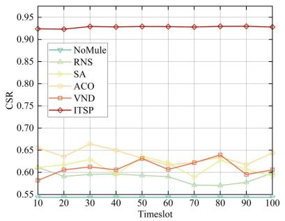  
(a)

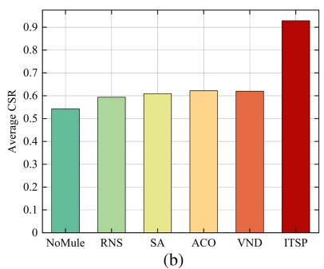

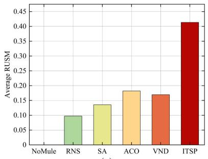

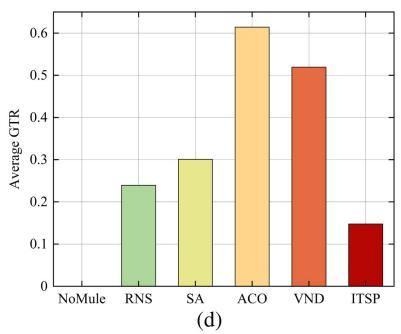

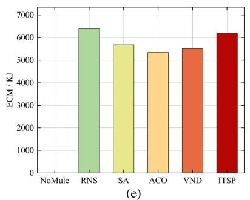

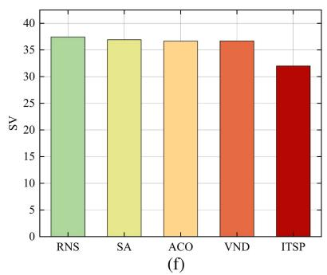

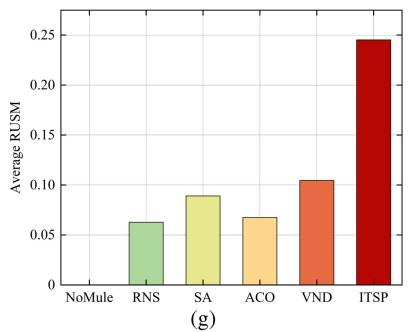

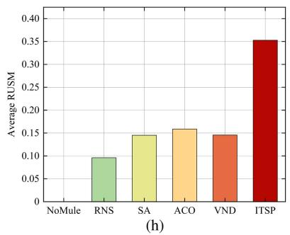

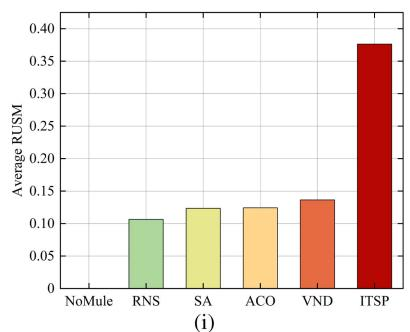  
Fig. 7. Simulation results when L = 5, N = 100, K = 10, B0 = 10 Ah, R = 10000 m, H = 80 m, $m _ { f } ^ { \mathrm { u a v } } = 1 . 5$ kg, $v _ { a } = 5 \mathrm { m } / \mathrm { s } ,$ , and $v _ { h } ^ { \operatorname* { m a x } } = 3 0 \mathrm { m } / \mathrm { s }$ (a)–(f) Different performance metrics of scheduling algorithms with ENS-RA. (g) and (h) Average RUSM of different scheduling algorithm with RAP and K-Means++, respectively. (a) CSR. (b) Average CSR. (c) Average RUSM for ENS. (d) Average GTR. (e) ECM. (f) SV for ENS. (g) Average RUSM for RAP. (h) Average RUSM for K-Means++. (i) Average RUSM for UAVMoving.

UAVMove policy. Different from the static deployment of UAVs, under UAVMove Policy, distance matrixes $\mathbf { D } ^ { 1 }$ and $ { \mathbf { D } } ^ { 2 }$ must be recalculated at the start of each timeslot, detailed in Section VI-A. It shows that RUSM of ITSP is at least 2.5 times that of other algorithms, which validates that our proposed framework remains applicable in UAV swarm mobility scenarios. By comparing Fig. 7(c) and Fig. 7(i), a slight decrease of RUSM can be observed in ITSP. This is attributed to the continuous accumulation of changes in UAV positions, causing increased magnitudes of certain elements in $\mathbf { D } ^ { 1 }$ and $ { \mathbf { D } } ^ { 2 }$ . Consequently, a higher number of UAV positions violates the constraints in (9)–(12).

To more clearly demonstrate the mules’ execution of battery swapping task, Fig. 8 illustrates the mules’ flight paths during the 100th timeslot under different recipient assignment and mule scheduling algorithms, in which Fig. 8(e) shows the trajectory results of our proposal. From Fig. 8(a) to (e), it can be observed that under ENS, ITSP achieves the highest number of UAVs with replaced batteries by mules. For RAP, the random division of subswarms results in a relatively large distance between two adjacent UAVs in each mule’s flight path, degrading system performance. For Kmeans++, subswarms are divided strictly based on geographical location. Specifically, to prevent mule idleness, the experiment is designed such that each mule will be assigned at least one UAV. It can be noticed that one subswarm contained only a single UAV, exhibiting a significant disparity in UAV numbers compared to other subswarms. This causes smaller RUSM values in subswarms with higher UAV counts, thereby reducing overall performance. In addition, as shown in the diagram, the flight paths of different mules intersect. However, this does not imply that mules will collide; the intersections may merely indicate that different mules pass through the same location at different moments in time. In fact, ENS accounts for the spatial relationship between mules and UAVs. The vast majority of UAVs within a subswarm clusters together, thereby reducing the probability of collisions. Furthermore, given the large area of the mission zone, the probability of two mules simultaneously arriving at an intersection is extremely low. In practical operations, collisions can be completely avoided by fine-tuning the altitude of each mule during horizontal flight.

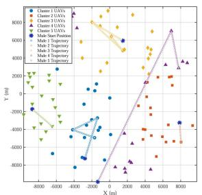  
(a)

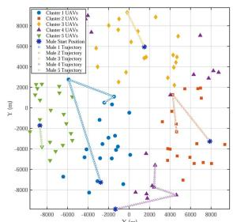  
(b)

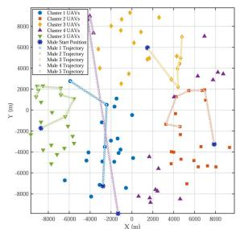  
(c)

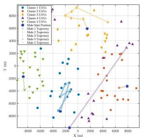  
(d)

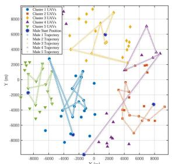  
(e)

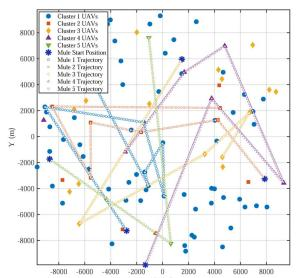

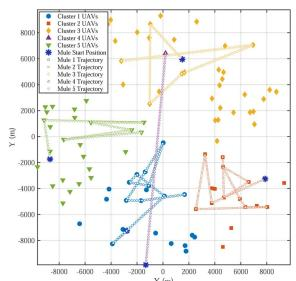  
(g)  
Fig. 8. Flight paths of mules in the 100th timeslot when $L = 5 , N = 1 0 0 , K = 1 0 , B _ { i } ^ { 0 } = 1 0 \mathrm { ~ A h } , R = 1 0 0 0 0 \mathrm { ~ m } , H = 8 0 \mathrm { ~ m } , m _ { f } ^ { \mathrm { u a v } } = 1 . 5 \mathrm { ~ k g }$ $v _ { a } = 5 \mathrm { m } / \mathrm { s } ,$ and $v _ { h } ^ { \mathrm { m a x } } = 3 0 \mathrm { m / s } .$ . (a) RNS with ENS. (b) SA with ENS. (c) ACO with ENS. (d) VND with ENS. (e) ITSP with ENS. (f) ITSP with RAP. (g) ITSP with Kmeans++.

Next, in order to evaluate the effect of different parameters on the experimental outcomes, multiple trials are conducted by systematically varying these parameters. Given that NoMule’s RUSM remains at 0, it has been excluded from the comparative analysis of experimental results. From Fig. 9(a)–(e), it is evident that ITSP consistently exhibits the best performance. As shown in Fig. 9(a), average RUSM of all scheduling algorithms tends to improve as L increases, attributed to the decrease in the number of UAVs within each subswarm, thereby allowing mules to swap batteries for more UAVs. In Fig. 9(b), it is observed that increasing N leads to a reduction in average RUSM, indicating an increased difficulty for mules in executing battery swapping tasks. Fig. 9(c)

illustrates that increasing K improves average RUSM for ITSP. However, for other algorithms, K has a negligible effect. This is because their RUSM remains at lower levels, reducing the need for mules to frequently return to GS for battery reloading. In addition, as K increases, the rate of increase in the ITSP’s RUSM decreases. This is because when K is sufficiently large, the frequency at which the mule returns to GS to reload batteries has already reached a low level, and K is no longer the performance bottleneck affecting RUSM. According to Fig. 9(d), average RUSM increases with $B _ { j } ^ { 0 } .$ due to the longer LBST available for UAVs, which allows more time for battery swapping by mules. In Fig. 9(e), average RUSM obtained by ITSP increases with $v _ { h } ^ { \operatorname* { m a x } }$ , because higher $v _ { h } ^ { \operatorname* { m a x } }$ reduces the minimum flight time between different UAVs for mules, enabling them to reach more UAV deployment positions before their LBST. For other algorithms, changes in $v _ { h } ^ { \operatorname* { m a x } }$ have minimal impact on their performance, since these algorithms lack the capability to adjust mule velocities. As presented in Fig. 9(f) and (g), variations in H and $v _ { a }$ exert little influence on average RUSM of all algorithms. These two parameters both affect round-trip duration of UAVs and mules traveling to and from GS. The changes in round-trip duration are negligible compared to the LBST and mules do not return to GS frequently, allowing ITSP to compensate by adjusting the hovering time or horizontal velocities of mules. In addition, only UAVs not on the mules’ flight paths will return to GS, so the time that UAVs spend traveling to and from GS has minimal impact on system performance. In Fig. 9(h), average RUSM decreases with R. A larger R increases UAV dispersion, extending mule flight time and reducing the number of UAVs reachable before their LBST. Fig. 9(i) shows that average RUSM declines as $m _ { f } ^ { \mathrm { u a v } }$ increases. Increased weight elevates energy consumption, shortening LBST, and diminishing the time available for mule battery swapping.

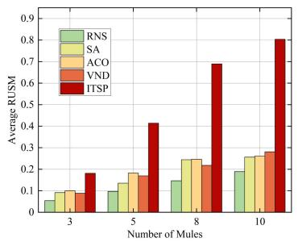  
(a)

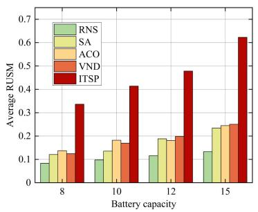  
(d)

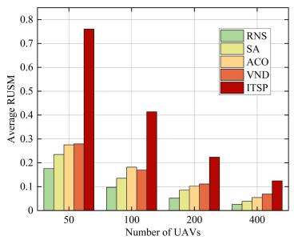  
(b)

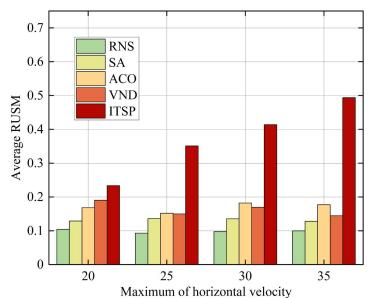

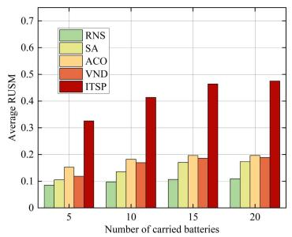  
(c)

(e)  
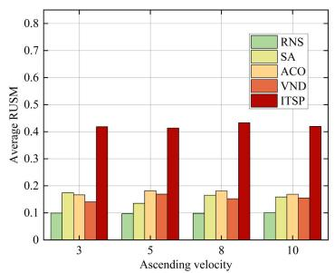  
(f)

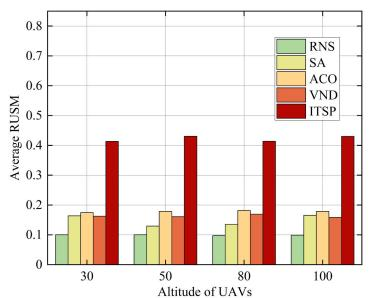  
(g)

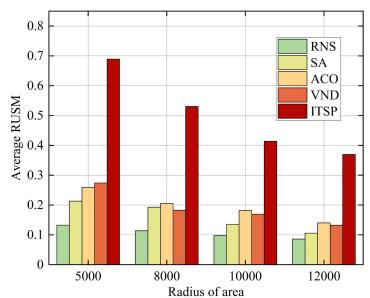  
(h)

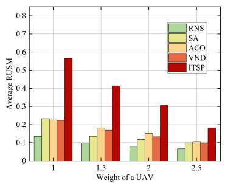  
(i)  
Fig. 9. Average RUSM of different L, N, K, B0j , vmaxh , va, H, R, and $m _ { f } ^ { \mathrm { u a v } }$ . The controlled variable method is used for each set of experiments. (a) Average RUSM with respect to L. (b) Average RUSM with respect to N. (c) Average RUSM with respect to K. (d) Average RUSM with respect to $B _ { j } ^ { 0 } .$ (e) Average RUSM with respect to $v _ { h } ^ { \operatorname* { m a x } }$ . (f) Average RUSM with respect to $v _ { a } . \left( \mathrm { g } \right)$ Average RUSM with respect to H. (h) Average RUSM with respect to R. (i) Average RUSM with respect to $m _ { f } ^ { \mathrm { u a v } }$

## D. Discussion and Expansion

Experimental results verify that the proposed assignment and scheduling algorithms significantly improve UAVs’ CSR based on UAV battery level prediction. In addition, the existing industrialized UAV products are well matured, and some of them have the function of displaying remaining battery capacity and voltage in real time. Therefore, in practical use, mule scheduling model and scheme can be modified in combination with UAVs’ actual battery voltage and SOC. This can be specified into the following two points. 1) The equation $V _ { \mathrm { O C } } = f ( \mathrm { S O C } )$ can be refined using real-time monitored battery voltage and SOC by adjusting the coefficients of existing terms or introducing additional polynomial components to improve modeling accuracy. 2) In cases where scheduled mule operations conflict with real-time battery status of UAVs, scheduling plan can be dynamically updated within online model. Taking $M _ { i }$ and $U _ { j }$ for example, adjustments may include increasing the flight velocity of $M _ { i }$ to ensure arrival prior to $U _ { j } { ' } \mathrm { s }$ LBST, or reducing $M _ { i } { ' } \mathrm { s }$ hovering time at $U _ { j }$ to avoid its battery level falling below $B _ { j } ^ { \mathrm { L B } \mathrm { \check { S } T } }$

In addition to the practical application extensions mentioned above, it is also important to objectively acknowledge the scope of the present study. The core of this work lies in decomposing the multimule scheduling problem into single-mule scheduling within subswarms, with a focus on designing the scheduling algorithm, namely, ITSP-MS. This algorithm achieves high battery swapping efficiency under time constraints by optimizing recipient selection and mule trajectory, which is validated by experimental results. However, there remains room for improvement in achieving full collaborative control among multiple mules. Specifically, the current multimule framework adopts initial static geometric partitioning via the ENS-RA algorithm to balance workloads across mules, but it lacks dynamic coordination mechanisms between subswarms, which can be further explored in future research.

## VIII. CONCLUSION

This study proposes a two-stage framework for multimule scheduling in a UAV swarm, combining ENS-RA for recipient assignment and ITSP-MS for single-mule scheduling. Simulations demonstrate that our proposal achieves at least 30.70% higher average CSR compared to benchmark methods, significantly extending aerial service time under battery constraints. Unlike prior approaches that either neglect fundamental battery limitations or oversimplify complex scenarios, this solution integrates time constraints into mule scheduling by incorporating a detailed battery level depletion model for UAVs and employs a greedy algorithm for load-balanced recipient assignment, offering a practical and efficient strategy that directly enhances UAV-based services through prolonged operations. Future work will attempt to transform the infinite search space faced in the battery swapping problem and employ DRL to solve multimule scheduling. Besides, to enhance system performance, dynamic partition adjustment and intersubswarm mule coordination mechanisms will be considered to realize multimule to multi-UAV collaborative scheduling.

## REFERENCES

[1] L. Zhang, F. Wen, Q. Zhang, G. Gui, H. Sari, and F. Adachi, “Constrained multi-objective decomposition evolutionary algorithm for UAVs-assisted mobile edge computing networks,” IEEE Internet Things J., vol. 11, no. 22, pp. 36673–36687, Nov. 2024.

[2] D. Li et al., “Mapping catchment-scale soil erosion and deposition using an improved DoD method based on multitemporal UAV-borne laser scanning,” IEEE Trans. Geosci. Remote Sens., vol. 63, 2025, Art. no. 5701113.

[3] J. Chen, P. Wan, and G. Xu, “Cooperative learning-based joint UAV and human courier scheduling for emergency medical delivery service,” IEEE Trans. Intell. Transp. Syst., vol. 26, no. 1, pp. 935–949, Jan. 2025.

[4] H. Cui, N. Zhang, and P. Liu, “Trajectory optimization for 6G-UAV based on deep reinforcement learning,” IEEE Trans. Veh. Technol., vol. 73, no. 11, pp. 17935–17939, Nov. 2024.

[5] J. Wu, Z. Yu, J. Guo, Z. Tang, T. Wang, and W. Jia, “Two-stage deep energy optimization in IRS-assisted UAV-based edge computing systems,” IEEE Trans. Mobile Comput., vol. 24, no. 1, pp. 449–465, Jan. 2025.

[6] Z. Wan et al., “Performance ofcellular-connected UAV in cell-free radio access network with network-assisted full-duplex,” IEEE Trans. Wireless Commun., vol. 23, no. 10, pp. 14848–14863, Oct. 2024.

[7] P. Zhang et al., “Assessment of a UAV radar system for reconstructing vertical structure of forests by single pass,” IEEE Trans. Geosci. Remote Sens., vol. 63, 2025, Art. no. 5100311.

[8] T. Deng, X. Xu, Z. Zou, W. Liu, D. Wang, and M. Hu, “Multidrone parcel delivery via public vehicles: A joint optimization approach,” IEEE Internet Things J., vol. 11, no. 6, pp. 9312–9323, Mar. 2024.

[9] C. Zhang et al., “A strong misalignment-tolerance wireless power transfer system based on dynamic diffusion magnetic field for unmanned aerial vehicle applications,” IEEE Trans. Power Electron., vol. 39, no. 11, pp. 14129–14134, Nov. 2024.

[10] S. Li, Y. Zhu, P. Yuan, and G. Guo, “Separation and rendezvous control of the UAV-USV subsystem based on distributed SMPC with unbounded disturbances,” IEEE Trans. Intell. Veh., vol. 10, no. 3, pp. 1749–1758, Mar. 2025.

[11] G. K. Pandey, D. S. Gurjar, S. Yadav, Y. Jiang, and C. Yuen, “UAVassisted communications with RF energy harvesting: A comprehensive survey,” IEEE Commun. Surv. Tut., vol. 27, no. 2, pp. 782–838, Apr. 2025.

[12] Y. Lyu, W. Wang, and P. Chen, “Fixed-wing UAV based air-to-ground channel measurement and modeling at 2.7 GHz in rural environment,” IEEE Trans.Antennas Propag., vol. 73, no. 4, pp. 2038–2052, Apr. 2025.

[13] B. Yin, X. Fang, and X. Wang, “Joint optimization of trajectory control, resource allocation and user association based on DRL for multi-fixed-wing UAV networks,” IEEE Trans. Wireless Commun., vol. 23, no. 10, pp. 13330–13343, Oct. 2024.

[14] Y. Yan, B. Wang, C. Wang, C. Xiao, and D. Zhao, “Novel synergistic framework design and optimization for hydrogen-electric hybrid power system in unmanned aerial vehicle applications,” IEEE Trans. Transport. Electrific., vol. 11, no. 1, pp. 337–347, Feb. 2025.

[15] C. Ren, Z. He, Y. Long, C. Zhao, L. Sun, and K. Xu, “Multi-modal virtual semantic communication for tiny machine learning-based UAV task execution,” IEEE Internet Things J., vol. 11, no. 19, pp. 30864–30874, Oct. 2024.

[16] R. Zhang, X. Pang, W. Lu, N. Zhao, Y. Chen, and D. Niyato, “Dual-UAV enabled secure data collection with propulsion limitation,” IEEE Trans. Wireless Commun., vol. 20, no. 11, pp. 7445–7459, Nov. 2021.

[17] X. Guo et al., “Noise-adaptive multimode online energy management for PEMFC/battery hybrid UAVs,” IEEE Trans. Transport. Electrific., vol. 11, no. 1, pp. 2609–2618, Feb. 2025.

[18] V. D. Hoang and E. S. M. Ebeid, “Manipulating magnetic field of the magnetic gripper with charging feature for drones on energized power lines,” IEEE Trans. Ind. Electron., vol. 71, no. 11, pp. 14691–14700, Nov. 2024.

[19] M. Kishk, A. Bader, and M.-S. Alouini, “Aerial base station deployment in 6G cellular networks using tethered drones: The mobility and endurance tradeoff,” IEEE Veh. Technol. Mag., vol. 15, no. 4, pp. 103–111, Dec. 2020.

[20] C. Cai et al., “Multi-state voltage balancing of UAV’s cell string: A reconfigurable WPT-based multiport hybrid charging approach,” IEEE Trans. Ind. Electron., vol. 72, no. 1, pp. 266–277, Jan. 2025.

[21] X. Ma, X. Liu, and N. Ansari, “Green laser-powered UAV far-field wireless charging and data backhauling for a large-scale sensor network,” IEEE Internet Things J., vol. 11, no. 19, pp. 31932–31946, Oct. 2024.

[22] N. Gupta, S. Agarwal, D. Mishra, and B. Kumbhani, “Trajectory and resource allocation for UAV replacement to provide uninterrupted service,” IEEE Trans. Commun., vol. 71, no. 12, pp. 7288–7302, Dec. 2023.

[23] A. S. Abdalla and V. Marojevic, “Multiagent learning for secure wireless access from UAVs with limited energy resources,” IEEE Internet Things J., vol. 10, no. 24, pp. 22356–22370, Dec. 2023.

[24] R. Jacobsen, N. Ruhe, and N. Dornback, “Autonomous UAV battery swapping,” Ph.D. dissertation, Honors Research Project, The Dr. Gary B. and Pamela S. Williams Honors College, The University of Akron, Akron, OH, USA, 2017.

[25] K. P. Jain and M. W. Mueller, “Flying batteries: In-flight battery switching to increase multirotor flight time,” in Proc. IEEE Int. Conf. Rob. Autom., 2020, pp. 3510–3516.

[26] Y. Guetta and A. Shapiro, “On-board physical battery replacement system and procedure for drones during flight,” IEEE Robot. Autom. Lett., vol. 7, no. 4, pp. 9755–9762, Oct. 2022.

[27] A. Seth, A. James, E. Kuantama, R. Han, and S. Mukhopadhyay, “AeroBridge: Autonomous drone handoff system for emergency battery service,” in Proc. ACM MobiCom-Proc. Int. Conf. Mobile Comput. Netw., 2024, pp. 573–587.

[28] J. Pasha et al., “The drone scheduling problem: A systematic stateof-the-art review,” IEEE Trans. Intell. Transp. Syst., vol. 23, no. 9, pp. 14224–14247, Sep. 2022.

[29] B. Shi, Z. Chen, and Z. Xu, “A deep reinforcement learning based approach for optimizing trajectory and frequency in energy constrained multi-UAV assisted MEC system,” IEEE Trans. Netw. Service Manag., vol. 23, pp. 317–328, 2026.

[30] G. Zhao, Y. Wang, T. Mu, Z. Meng, and Z. Wang, “Reinforcementlearning-assisted multi-UAV task allocation and path planning for IIoT,” IEEE Internet Things J., vol. 11, no. 16, pp. 26766–26777, Aug. 2024.

6403

[31] C. C. Murray and A. G. Chu, “The flying sidekick traveling salesman problem: Optimization of drone-assisted parcel delivery,” Transp. Res. Part C: Emerg. Technol., vol. 54, pp. 86–109, 2015.

[32] N. Agatz, P. Bouman, and M. Schmidt, “Optimization approaches for the traveling salesman problem with drone,” Transp. Sci., vol. 52, no. 4, pp. 965–981, 2018.

[33] N. M. Imran, S. Mishra, and M. Won, “A-VRPD: Automating dronebased last-mile delivery using self-driving cars,” IEEE Trans. Intell. Transp. Syst., vol. 24, no. 9, pp. 9599–9612, Sep. 2023.

[34] G. Wu, N. Mao, Q. Luo, B. Xu, J. Shi, and P. N. Suganthan, “Collaborative truck-drone routing for contactless parcel delivery during the epidemic,” IEEE Trans. Intell. Transp. Syst., vol. 23, no. 12, pp. 25077–25091, Dec. 2022.

[35] F. Kong, J. Li, B. Jiang, H. Wang, and H. Song, “Trajectory optimization for drone logistics delivery via attention-based pointer network,” IEEE Trans. Intell. Transp. Syst., vol. 24, no. 4, pp. 4519–4531, Apr. 2023.

[36] J. Fu, G. Sun, J. Liu, W. Yao, and L. Wu, “On hierarchical multi-UAV dubins traveling salesman problem paths in a complex obstacle environment,” IEEE Trans. Cybern., vol. 54, no. 1, pp. 123–135, Jan. 2024.

[37] R. Chai, Y. Gao, R. Sun, L. Zhao, and Q. Chen, “Time-oriented joint clustering and UAV trajectory planning in UAV-assisted WSNs: Leveraging parallel transmission and variable velocity scheme,” IEEE Trans. Intell. Transp. Syst., vol. 24, no. 11, pp. 12092–12106, Nov. 2023.

[38] P. Wan, S. Wang, G. Xu, Y. Long, and R. Hu, “Hybrid heuristicbased multi-UAV route planning for time-dependent data collection,” IEEE Internet Things J., vol. 11, no. 13, pp. 24134–24147, Jul. 2024.

[39] G. Park, W. Lee, and K. Lee, “3D multi-trajectory and pick-up optimization of UAV for minimizing delivery time with weight restriction,” IEEE Trans. Intell. Transp. Syst., vol. 25, no. 11, pp. 17562–17573, Nov. 2024.

[40] H. Liu et al., “An iterative two-phase optimization method based on divide and conquer framework for integrated scheduling of multiple UAVs,” IEEE Trans. Intell. Transp. Syst., vol. 22, no. 9, pp. 5926–5938, Sep. 2021.

[41] D. Liu, B. Fei, W. Bao, X. Zhu, and X. Li, “DAWN: Dynamic task planning of multi-UAV with two-layer optimization mechanism in uncertain environments,” IEEE Internet Things J., vol. 11, no. 23, pp. 37813–37830, Dec. 2024.

[42] F. Xia, J. Wang, and L. Dai, “Optimizing clustered cell-free networking for sum ergodic capacity maximization with joint processing constraint,” IEEE Trans. Wireless Commun., vol. 24, no. 1, pp. 571–584, Jan. 2025.

[43] Y. Luo, X. Deng, W. Zhang, Y. Ke, S. Wan, and Y. Qian, “Collaborative intelligent delivery with one truck and multiple heterogeneous drones in COVID-19 pandemic environment,” IEEE Trans. Intell. Transp. Syst., vol. 25, no. 7, pp. 7907–7920, Jul. 2024.

[44] S. Dong, H. Su, R. Hou, and A. Shankar, “Improved PBFT consensus mechanism based on voting sort clustering partition with group signature for IoT,” IEEE Trans. Intell. Transp. Syst., vol. 26, no. 2, pp. 2239–2251, Feb. 2025.

[45] X. Liu, H. Liu, K. Zheng, J. Liu, T. Taleb, and N. Shiratori, “AoI-minimal clustering, transmission and trajectory co-design for UAV-assisted WPCNs,” IEEE Trans. Veh. Technol., vol. 74, no. 1, pp. 1035–1051, Jan. 2025.

[46] D. Sacramento, D. Pisinger, and S. Ropke, “An adaptive large neighborhood search metaheuristic for the vehicle routing problem with drones,” Transp. Res. Part C: Emerg. Technol., vol. 102, pp. 289–315, 2019.

[47] B. Sarsembayev, S. S. Heidari Yazdi, A. Kapanov, and M. Bagheri, “LiPO battery modeling for dynamic wireless power transfer in UAV application,” in Proc. IEEE Int. Conf. Renew. Energy Res. Appl., 2022, pp. 346–351.

[48] R. Charayron, T. Lefebvre, N. Bartoli, and J. Morlier, “Multi-fidelity Bayesian optimization strategy applied to overall drone design,” in Proc. AIAA SCITECH 2023 Forum, 2023, Art. no. 2366.

[49] A. Gao, Q. Wang, W. Liang, and Z. Ding, “Game combined multiagent reinforcement learning approach for UAV assisted offloading,” IEEE Trans. Veh. Technol., vol. 70, no. 12, pp. 12888–12901, Dec. 2021.

[50] K. Dorling, J. Heinrichs, G. G. Messier, and S. Magierowski, “Vehicle routing problems for drone delivery,” IEEE Trans. Syst. Man Cybern.: Syst., vol. 47, no. 1, pp. 70–85, Jan. 2017.

[51] S. Jeong, O. Simeone, and J. Kang, “Mobile edge computing via a UAV-mounted cloudlet: Optimization of bit allocation and path planning,” IEEE Trans. Veh. Technol., vol. 67, no. 3, pp. 2049–2063, Mar. 2018.

[52] S. Geman and D. Geman, “Stochastic relaxation, Gibbs distributions, and the Bayesian restoration of images,” IEEE Trans. Pattern Anal. Mach. Intell., vol. PAMI-6, no. 6, pp. 721–741, Nov. 1984.

[53] R. Raj and C. Murray, “The multiple flying sidekicks traveling salesman problem with variable drone speeds,” Transp. Res. Part C Emerg. Technol., vol. 120, 2020, Art. no. 102813.

  
Mingyu Li received the B.E. degree in electronic information engineering from the Northwest A&F University, Yangling, China, in 2023. He is currently working toward the M.S. degree in electronic information with the National University of Defense Technology, Changsha, China.

His research interests include unmanned systems control and mobile communication networks.

Xianglin Wei received the Ph.D. degree in technology for computer applications from the PLA University of Science and Technology, Nanjing, China, in 2012.

He is currently a Researcher with the 63rd Research Institute, National University of Defense Technology, Nanjing. His research interests include mobile edge computing and wireless network optimization.

Dr. Wei was an Editorial Member or a Reviewer for many international journals and international conferences. He was the recipient of multiple best paper awards.

Xiaolong Xu received the B.E. degree in electronic science and technology from the Wuhan University of Technology, Wuhan, China, in 2024. He is currently working toward the M.S. degree in electronic information with the National University of Defense Technology, Changsha, China.

His current research interests include edge computing and autonomous intelligent games.

Yangang Wang received the Ph.D. degree in communication and information system from the College of Communications Engineering, Army Engineering University of PLA, Nanjing, China, in 2023.

He is currently a Researcher with the 63rd Research Institute, National University of Defense Technology, Changsha, China. His research interests include mobile edge computing, deep learning, and wireless network optimization.