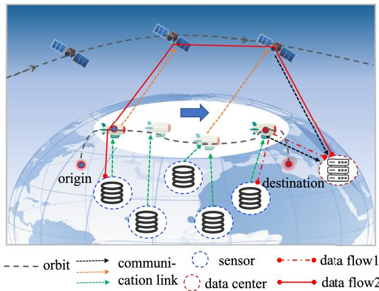
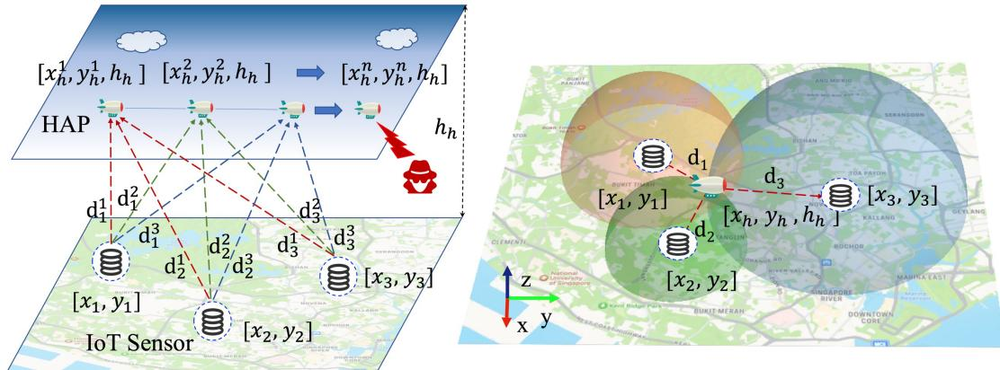
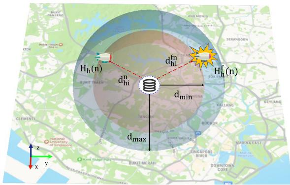
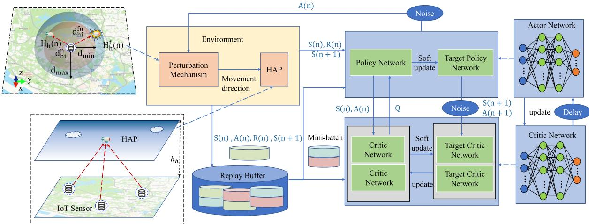
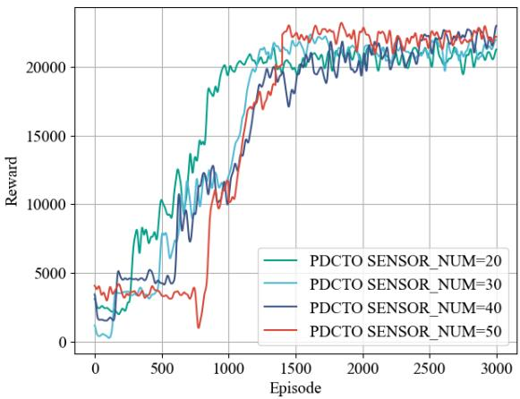
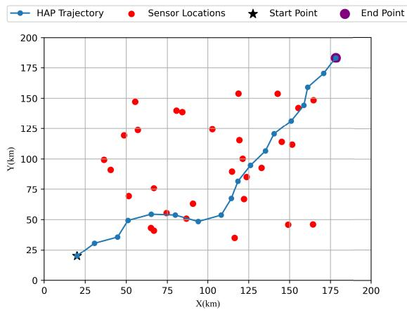
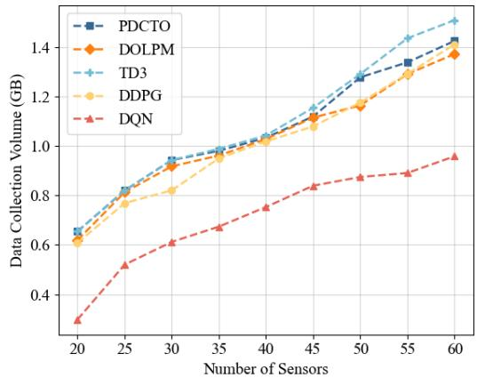
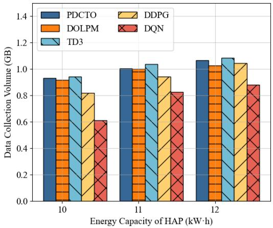
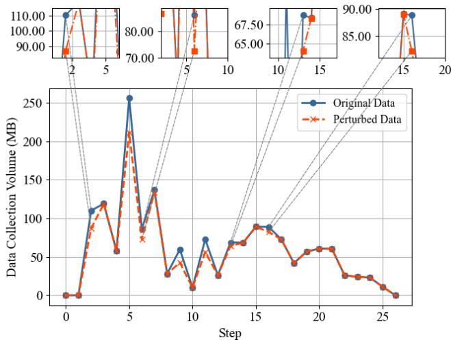
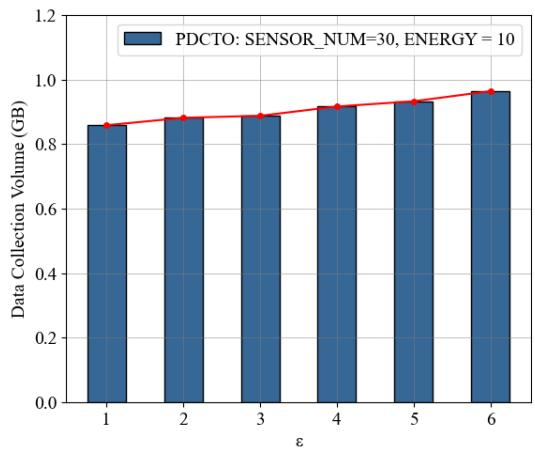

# Location Privacy-Aware High-Altitude Platforms Data Collection and Trajectory Optimization

Zhiqi Guo , Student Member, IEEE, Fengxiao Tang , Senior Member, IEEE,

Linfeng Luo , Graduate Student Member, IEEE, Ming Zhao , Member, IEEE, and Nei Kato , Fellow, IEEE

Abstract—With the rapid development of the internet of things (IoT), IoT devices are now capable of real-time monitoring and collecting environmental and production data through integrated sensors. However, these devices often face challenges related to limited storage capabilities and transmission range. Furthermore, the widespread deployment of IoT devices has raised significant concerns regarding privacy security. To enhance data collection efficiency and ensure the security of location privacy, this study proposes a high altitude platform (HAP) data collection and trajectory design scheme that is aware of location privacy. Firstly, our scheme utilizes HAPs to quickly cover the collection area and transmit data in real time via satellites. Secondly, a differential privacy-based perturbation mechanism is applied to reduce the risk of location information leakage. Finally, the trajectory optimization problem, incorporating privacy awareness, is modeled as a Markov decision process (MDP) and solved using deep reinforcement learning (DRL) techniques to determine the movement decisions of the HAPs. Experimental results demonstrate that this scheme effectively protects location privacy while enhancing the efficiency and security of data collection.

Index Terms—Internet of Things, data collection, trajectory design, location privacy, high altitude platforms, differential privacy, deep reinforcement learning.

## I. INTRODUCTION

W ITH the deepening application of internet of things (IoT) in smart cities [1], industrial automation [2], and agriculture [3], IoT devices are increasingly used to monitor and collect environmental and production data in real-time through integrated sensors. However, due to limited storage capacity, transmission range, and energy supply, most IoT devices are unable to directly transmit large volumes of data to a central data center for real-time processing and analysis. How to intelligently select, process, and transmit sensed data under stringent resource constraints has therefore become a complex and urgent problem [4].

Aerial platforms have been widely adopted for IoT data collection due to their flexible deployment and wide-area coverage capabilities [5], [6]. Nevertheless, conventional lowaltitude uncrewed aerial vehicles (UAVs) are often constrained by limited endurance, frequent return requirements, and unstable communication links when performing long-distance or large-scale data collection tasks, which makes it difficult to support sustained and efficient data acquisition [7]. In contrast, high-altitude platforms (HAPs), operating in the stratosphere, offer significant advantages such as wide coverage, long endurance, and more stable communication links, making them more suitable for large-scale IoT data collection scenarios [8].

Meanwhile, the integration of IoT devices and the surge in large-scale data transmission has also raised concerns regarding location information and privacy security. Recent studies [9], [10], [11] have revealed the potential risk of untrusted platforms inferring user locations by analyzing patterns in data transmission. Under wireless channel constraints, the quality of the wireless channel is inversely correlated with the distance between users and transmission targets [12]. Therefore, untrusted platforms may infer the user’s relative distance by monitoring the relationship between transmitted data volume and transmission time. If a user simultaneously transmits data with multiple sensors, untrusted sensors may even acquire accurate user location information through collaborative inference methods. Striking a balance between meeting data requirements and safeguarding user location privacy is crucial in the realm of privacy protection [13]. To counter the threats of location privacy leakage, researchers have actively explored innovative approaches in location privacy protection, with prominent utilization of methods including k-anonymity [14] and differential privacy algorithms [12]. Current efforts on trajectory privacy protection mainly focus on the release of privacy-preserving datasets [15], while protection of trajectory information during the data collection process remains insufficient. In this context, HAPs act as privacy-sensitive entities during data collection and require targeted mechanisms to safeguard their location and trajectory against potential inference attacks.

In addition, privacy protection and data collection efficiency are often inherently conflicting during data acquisition. On the one hand, introducing noise or restricting communication behavior can reduce privacy leakage risks but may degrade data accuracy and collection efficiency. On the other hand, increasing data transmission rates and communication frequency to improve collection performance inevitably leads to higher energy consumption and greater exposure of location information. How to jointly optimize data collection efficiency and location privacy under energy constraints remains a challenging problem.

To address the above challenges, this paper proposes a location privacy-aware data collection and trajectory design scheme based on HAPs. Although conventional HAPs are often regarded as quasi-stationary platforms, in practical applications many HAP systems still require well-designed trajectory planning to support large-scale task execution, coverage optimization, and energy management [16], [17], [18]. In large-scale IoT scenarios, sensor nodes are typically distributed over wide geographical areas, and as the distance between the HAP and sensors increases, communication performance at the coverage edges degrades significantly, thereby reducing data collection efficiency. As a result, the region that a HAP can serve in a stable and efficient manner at any given time is inherently limited [8]. For sensor networks spanning hundreds of kilometers, relying solely on static deployment is insufficient to effectively collect data from all sensors. This work therefore leverages trajectory planning to guide the HAP to dynamically approach different sensor regions, and integrates satellite links to enable efficient large-scale data collection and real-time data backhaul. Furthermore, to address the location privacy risks faced by HAPs during mission execution, a differential privacy-based location perturbation mechanism is incorporated into the trajectory design, providing strong location privacy protection for HAP-based data collection in sensitive environments. The main contributions of this paper are summarized as follows:

This paper introduces trajectory optimization into largescale IoT data collection scenarios and designs a real-time communication framework that integrates HAPs with low earth orbit (LEO) satellites. The proposed system enables rapid and flexible coverage of wide geographic areas and transmits the collected data to the data center in real time, thereby achieving efficient data collection in hard-to-reach regions.

• To address the often-overlooked risk of location privacy leakage faced by HAPs during data collection, this paper, for the first time, integrates a differential privacy mechanism into trajectory design. A location perturbation algorithm is proposed to protect the true position of the HAP while maintaining data collection efficiency. By carefully constraining the perturbation range and applying precise decision criteria, the algorithm minimizes the adverse impact of perturbed positions on communication performance, thereby enhancing both the security and privacy protection capabilities of the system.

• The privacy-aware data collection problem is formulated as a Markov decision process (MDP), and a privacy-aware data collection and trajectory optimization scheme is developed based on deep reinforcement learning (DRL). Experimental results demonstrate that the proposed algorithm significantly enhances both data collection efficiency and security, while maintaining high sensitivity and responsiveness to location privacy.

## II. RELATED WORKS

## A. HAPs Data Collection and Trajectory Optimization

HAP systems, such as long-endurance UAVs and uncrewed airships, are highly flexible and accessible, enabling efficient data collection in areas where ground transportation is difficult, such as mountainous regions and narrow urban spaces. These devices can be rapidly deployed and operate in a wide range of environments, offering a more efficient and cost-effective solution for data collection tasks compared to traditional, labor-intensive methods. Although HAPs offer advantages such as high payload capacity and long endurance, practical resource constraints and communication delays must still be considered when performing large-scale data collection tasks. For instance, long-duration or wide-area missions may place significant demands on energy and storage resources, requiring careful management during task planning. In addition, HAPs may operate far from data processing centers, resulting in data transmission delays that can affect applications with stringent real-time requirements. Therefore, trajectory optimization and task management need to be carefully designed to enhance overall performance. Current research mainly focuses on trajectory planning for UAVs. For instance, Wang et al. [19] consider optimizing the data collection completion time in an imperfect three-dimensional urban IoT environment, while accounting for throughput and flight constraints. Yuan et al. [20] aim to significantly reduce the data collection completion time in drone-assisted networks using a successive-hover-fly (SHF) structure. Additionally, some studies focus on minimizing energy consumption under time constraints. Chu et al. [21] utilize transfer learning techniques to optimize drone flight speed and energy replenishment, thereby enhancing energy efficiency. Moreover, through dynamic clustering of devices, [22] identifies optimal drone hovering points to minimize the total energy consumption required to complete the data collection task.

In contrast to these studies, our work focuses on largescale sensor data collection and long-distance transmission. We employ HAPs instead of conventional UAVs. Owing to their broader coverage, HAPs can simultaneously collect data from multiple IoT devices, thereby significantly reducing the overall data collection time. In addressing the challenges of long-range sensor data transmission, we further mitigate the problems of unstable links and slow responsiveness. To this end, we adopt satellites as relay stations to establish relatively stable data connections, ensuring that the collected data can be promptly transmitted to the data center.

## B. Privacy-Aware Protection in IoT

In the IoT field, privacy protection is a critical issue in data collection, processing, and transmission. Traditional methods for privacy protection include access control, permission management, and secure computing [23], [24], [25]. Recent studies have found that user privacy may be compromised during service requests, especially during data transmission, as attackers can use historical data to infer real-time locations [26], [27], [28], [29]. To protect user location privacy and usage pattern privacy, [9] proposed a privacy-aware task offloading scheduling algorithm based on constrained Markov decision processes. This algorithm achieves optimal latency and energy performance while satisfying privacy constraints. Wang et al. [12] developed an optimal offloading strategy by generating location perturbations based on customized privacy factors in both single-server and multi-server scenarios. To prevent malicious eavesdroppers from tracking service migration trajectories, [30] defined the total system cost as the sum of migration cost, user-perceived latency, and location privacy leakage risk, and solved for the minimum total system cost. To prevent the capture of user trajectory privacy, Wen et al. [31] addressed the balance between privacy protection and data utility by introducing personalized differential privacy methods. This approach filters template trajectories based on semantic similarity and assigns different privacy levels to ensure different locations on the user’s trajectory are protected with varying levels of privacy. Wu et al. [32] proposed a trajectory publishing mechanism that uses Kalman filters to dynamically predict user trajectories, protecting trajectory association privacy among different users. Sun et al. [33] introduced a differential privacy-based synthetic trajectory data generation model that integrates geographic information and user behavior patterns, preserving the authenticity and usability of trajectory data while protecting privacy.

Recent IoT privacy protection research has primarily focused on task offloading, as wireless channel conditions are crucial for offloading decisions. Attackers can infer user locations by analyzing the size and pattern of offloaded tasks. On the other hand, trajectory information protection research has mostly focused on the release of trajectory datasets. However, the protection of HAPs’ location information during the data collection process remains unaddressed. HAPs communicate with multiple IoT devices along their flight paths, facing significant risks of location exposure, especially during long-distance operations. The extensive coverage and broadcast communication of HAPs increase the likelihood of attackers intercepting signals. If attackers deduce the HAPs’ trajectory, they could interfere, intercept, or inject false data, negatively impacting the data collection task. To address these threats, this study proposes a privacy-aware trajectory design scheme to reduce location exposure risk and ensure the safe and reliable execution of data collection tasks.

## III. SYSTEM MODEL

In this section, we first introduce the system scenario of data collection, which consists of satellites in space, HAPs in the air, and sensors on the ground. We then present the mobility models of the satellites and HAPs, the channel models for data transmission, the data collection model, and the data transmission model. Table I summarizes the key parameters and notations used in this paper.

LIST OF IMPORTANT NOTATIONS AND SYMBOLS  
TABLE I
<table><tr><td rowspan=1 colspan=1>Notation</td><td rowspan=1 colspan=1>Definition</td></tr><tr><td rowspan=1 colspan=1>2</td><td rowspan=1 colspan=1>Sensor index</td></tr><tr><td rowspan=1 colspan=1> $I$ </td><td rowspan=1 colspan=1>Total number of sensors</td></tr><tr><td rowspan=1 colspan=1> $h$ </td><td rowspan=1 colspan=1>HAP index</td></tr><tr><td rowspan=1 colspan=1> $s$ </td><td rowspan=1 colspan=1>Satellite index</td></tr><tr><td rowspan=1 colspan=1> $S$ </td><td rowspan=1 colspan=1>Total number of satellites</td></tr><tr><td rowspan=1 colspan=1> $H _ { h } ( n )$ </td><td rowspan=1 colspan=1>Position of HAP at time n</td></tr><tr><td rowspan=1 colspan=1> $\pmb { H } _ { h } ^ { f } ( n )$ </td><td rowspan=1 colspan=1>Perturbed virtual position of HAP at time n</td></tr><tr><td rowspan=1 colspan=1> $\theta _ { n } , \Delta \theta _ { n }$ </td><td rowspan=1 colspan=1>Change in the horizontal direction and heading angle ofHAP relative to the x-axis at time n</td></tr><tr><td rowspan=1 colspan=1> $\theta _ { m a x }$ </td><td rowspan=1 colspan=1>Maximum allowable change rate of the heading angle</td></tr><tr><td rowspan=1 colspan=1> $P ^ { t r } , P ^ { r e }$ </td><td rowspan=1 colspan=1>Transmission power and reception power</td></tr><tr><td rowspan=1 colspan=1> $G ^ { t r } , G ^ { r e }$ </td><td rowspan=1 colspan=1>Transmission gain and reception gain</td></tr><tr><td rowspan=1 colspan=1> $\lambda$ </td><td rowspan=1 colspan=1>Link wavelength</td></tr><tr><td rowspan=1 colspan=1> $L$ </td><td rowspan=1 colspan=1>System loss factor</td></tr><tr><td rowspan=1 colspan=1> $W$ </td><td rowspan=1 colspan=1>Channel bandwidth</td></tr><tr><td rowspan=1 colspan=1> $n _ { 0 }$ </td><td rowspan=1 colspan=1>Noise power</td></tr><tr><td rowspan=1 colspan=1> $r$ </td><td rowspan=1 colspan=1>Data transmission rate</td></tr><tr><td rowspan=1 colspan=1> $d _ { h , i } ^ { n } , d _ { h , i } ^ { f n }$ </td><td rowspan=1 colspan=1>Real distance between HAP and sensor node and perturbeddistance between HAP and sensor node</td></tr><tr><td rowspan=1 colspan=1> $D _ { h , i }$ </td><td rowspan=1 colspan=1>Maximum data collection distance for HAP</td></tr><tr><td rowspan=1 colspan=1> $[ d _ { m i n } , d _ { m a x } ]$ </td><td rowspan=1 colspan=1>Range of perturbation distance</td></tr><tr><td rowspan=1 colspan=1> $X _ { i , j } ^ { n }$ </td><td rowspan=1 colspan=1>Indicator of whether an active link exists between nodes iand j at time slot n</td></tr><tr><td rowspan=1 colspan=1> $\underline { { C _ { h , i } ^ { n } } }$ </td><td rowspan=1 colspan=1>Total data collection volume by HAP in a time slot n</td></tr><tr><td rowspan=1 colspan=1> $E _ { c }$ </td><td rowspan=1 colspan=1>Energy consumption for data collection by HAP</td></tr><tr><td rowspan=1 colspan=1> $E _ { t }$ </td><td rowspan=1 colspan=1>Energy consumption for data transmission by HAP</td></tr><tr><td rowspan=1 colspan=1> $E _ { v }$ </td><td rowspan=1 colspan=1>Energy consumption for HAP flight</td></tr></table>

  
Fig. 1. Satellite assisted HAP data collection and transmission system.

## A. Network Scenario

We investigated a solution for data collection and transmission through satellite-assisted HAP. As illustrated in Fig. 1, a large number of IoT sensors are distributed across a vast area. Each sensor is denoted by $i ,$ where i belongs to the set $\mathcal { T } = \{ i = 1 , 2 , \ldots , I \}$ . These sensors are typically located in remote areas without base station coverage and rely on HAP for data collection. Represented by h, each HAP is equipped with an onboard processor and M antennas. HAP departs from the starting point, travels to the destination, collects data from sensors within the communication range during the flight, and transmits the acquired data to the ground data center (data flow 1). Due to communication distance limitations, HAP often cannot communicate directly with the ground data center. To enhance data processing and response speed, satellites can act as relay nodes, forwarding the data collected by HAP to the ground data center (data flow 2). Satellites, denoted by s belonging to the set $\mathcal { S } = \{ s = 1 , 2 , \ldots , S \}$ , move periodically along an orbit, with each satellite equipped with computing servers and M antennas.

In this system, we assume that the sensors exhibit the characteristic of being honest yet curious. They faithfully receive signals and transmit data to the HAP in accordance with a pre-established transmission protocol. Nevertheless, these sensors may collusively infer the real-time location of the HAP based on the conditions of data transmission.

## B. Mobility Model

For analytical convenience, we adopt a discrete-time model where $T = N \cdot \tau .$ , with the time range T divided into N time slots, each lasting for τ. At time n, the position of the $\mathrm { H A P }$ can be represented as $H _ { h } ( n ) = [ x ( n ) , y ( n ) , h _ { h } ]$ , where $n \in$ $\{ 0 , 1 , \ldots , N \}$ . We assume that the HAP moves at a constant speed $V _ { h }$ within a plane at an altitude $h _ { h } .$

The orientation of the HAP relative to the horizontal direction along the x-axis in the plane is denoted by $\theta _ { n } \in ( 0 , 2 \pi ]$ where $\Delta \theta _ { n }$ denotes the change in the steering angle. The movement pattern of the HAP can be expressed as

$$
x _ { h } ( n + 1 ) = x _ { h } ( n ) + V _ { h } \tau \cos { ( \theta _ { n } + \Delta \theta _ { n } ) } ,\tag{1}
$$

$$
y _ { h } ( n + 1 ) = y _ { h } ( n ) + V _ { h } \tau \sin { ( \theta _ { n } + \Delta \theta _ { n } ) } .\tag{2}
$$

## C. Channel Model

In each time slot, the connections between sensors, HAP, satellites, and the ground data center persist for a duration greater than τ , allowing us to consider the network connections as quasi-static. Within each time slot, the continuity of connections permits us to treat the channel state information as constant. When a time slot change occurs, the corresponding channel state information will be promptly updated based on parameter variations [34]. Considering that the focus of this study lies in network layer and system level optimization rather than physical layer modulation and demodulation performance, we assume that standard Doppler frequency offset estimation and compensation techniques are employed. As a result, the Doppler effect caused by mobile nodes (e.g., HAPs and LEO satellites) can be effectively mitigated within each time slot, and the channel can be approximated as a quasistatic model without residual Doppler shifts. Regarding the channel characteristics, since IoT sensors and the ground data center are located in remote areas with almost no obstacles between them and the HAP, the communication links are modeled as line-of-sight (LOS) channels, and the free-space path loss model is adopted [35]. The received power can be expressed as

$$
P ^ { r e } ( n ) = \frac { P ^ { t r } G ^ { t r } G ^ { r e } \lambda ^ { 2 } } { \left( 4 \pi \right) ^ { 2 } d ^ { 2 } L } 1 0 ^ { X _ { \sigma _ { l } } ( n ) / 1 0 } ,\tag{3}
$$

where $P ^ { t r }$ represents the transmission power, $G ^ { t r }$ and $G ^ { r e }$ represent the transmission and reception gains respectively, λ is the wavelength of the link, L is the system loss factor, and d is the distance. Moreover, $X _ { \sigma } ( t ) \sim \mathcal { N } ( 0 , \sigma _ { l } ^ { 2 } )$ models the log-normal shadowing effect, where $\sigma _ { l }$ denotes the standard deviation of shadowing.

The maximum achievable transmission rate of the channel can be approximated as

$$
r = W \log _ { 2 } { \left( 1 + \frac { P ^ { r e } ( n ) } { n _ { 0 } } \right) } ,\tag{4}
$$

where W denotes the channel bandwidth, and $n _ { 0 }$ represents the power of additive white gaussian noise (AWGN), which follows a zero-mean Gaussian distribution. The noise power spectral density is denoted as $N _ { 0 } ,$ , with its value specified in the experimental setup.

Based on the above model, the maximum achievable transmission rates of different communication links can be expressed as follows.

The uplink from an IoT sensor to the HAP can be expressed as

$$
r _ { h , i } = W _ { h , i } \log _ { 2 } \left( 1 + \frac { P _ { i } ^ { t r } G _ { i } ^ { t r } G _ { h } ^ { r e } { \lambda _ { h , g } } ^ { 2 } { 1 0 ^ { X _ { \sigma _ { l } } ( n ) / 1 0 } } } { \left( 4 \pi \right) ^ { 2 } { d _ { h , i } } ^ { 2 } L n _ { 0 } } \right) .\tag{5}
$$

$P _ { i } ^ { t r }$ denotes the transmit power of the i-th sensor, $G _ { i } ^ { t r }$ and $G _ { h } ^ { r e }$ represent the transmit and receive antenna gains, respectively, $\lambda _ { h , g }$ is the wavelength of the ground-to-air link, $d _ { h , i }$ is the distance between sensor i and the HAP, and $W _ { h , i }$ is the link bandwidth.

The downlink from the HAP to the ground data center can be expressed as

$$
r _ { h , c } = W _ { h c } \log _ { 2 } \left( 1 + \frac { P _ { h } ^ { t r } G _ { h } ^ { t r } G _ { c } ^ { r e } { \lambda _ { h , g } } ^ { 2 } { 1 0 ^ { X _ { \sigma _ { l } } ( n ) / 1 0 } } } { \left( 4 \pi \right) ^ { 2 } { d _ { h , c } } ^ { 2 } { L n _ { 0 } } } \right) .\tag{6}
$$

$P _ { h } ^ { t r }$ is the transmit power of the HAP, $G _ { h } ^ { t r }$ and $G _ { c } ^ { r e }$ denote the transmit and receive antenna gains of the HAP and the ground data center, respectively, $d _ { h , c }$ is the distance between them, and $W _ { h , c }$ represents the bandwidth of the downlink.

The uplink from the HAP to the satellite can be expressed as (noting that Ku- and Ka-bands are the most widely used frequency ranges for LEO communications, where the channel condition is affected by rain attenuation $F _ { r a i n }$ [36])

$$
r _ { h , s } = W _ { h , s } \log _ { 2 } { \left( 1 + \frac { P _ { h } ^ { t r } G _ { h } ^ { t r } G _ { s } ^ { r e } { { \lambda _ { h , s } } ^ { 2 } } 1 0 ^ { - \frac { F _ { r a i n } } { 1 0 } } } { \left( 4 \pi \right) ^ { 2 } { d _ { h , s } } ^ { 2 } L { n _ { 0 } } } \right) } .\tag{7}
$$

where $G _ { s } ^ { r e }$ denotes the satellite receiving antenna gain, $\lambda _ { h , s }$ is the wavelength of the HAP-to-satellite link, $d _ { h , s }$ is the link distance, and $W _ { h , s }$ is the channel bandwidth.

## D. Energy Cost Model

The total cost of the HAP data collection and transmission system consists of the HAP flight energy consumption, data collection energy consumption, and data transmission energy consumption.

During data collection, the HAP adopts a mode of collecting data while flying and can simultaneously transmit data with all sensor nodes within its communication range. Let $D _ { h , \cdot }$ denote the maximum collection distance of the HAP. During the $\mathrm { H A P } ^ { \prime } \mathrm { s }$ flight, data collection can only occur when there are sensors within its collection range, i.e., only when $d _ { h , i } ^ { n } \leq D _ { h , i } .$ The indicator $X _ { i , j } ^ { n }$ is used to represent whether there is an active link between nodes i and j in timeslot n. If a link exists, then $X _ { i , j } ^ { n } = 1 ;$ otherwise, it is 0. The data stored by each sensor node is denoted by ξn. At the start of the collection task, it is set to a random initial value. The growth of data volume is influenced by various factors such as environmental changes, signal interference, and system failures, and thus has a certain randomness.

The total data collection amount by HAP within a time slot is the sum of the rates achieved by all sensor nodes within its communication range during that time slot. It can be expressed by the following equation

$$
C _ { h , i } ^ { n } = \sum _ { i = 1 } ^ { I } X _ { h , i } ^ { n } r _ { h , i } \tau .\tag{8}
$$

The energy cost of data collection by HAP can be expressed as

$$
E _ { c } = \sum _ { n = 1 } ^ { N } \sum _ { i = 1 } ^ { I } X _ { h , i } ^ { n } \tau P _ { h } ^ { r e } .\tag{9}
$$

Next, the HAP needs to send the collected data to the ground data center for subsequent processing, analysis, and application. The energy consumption cost for the HAP to transmit the collected data to the data center (data flow 1) is given by

$$
E _ { t ( h , c ) } = \sum _ { n = 1 } ^ { N } \frac { C _ { h , i } ^ { n } X _ { h , c } ^ { n } p _ { h } ^ { t r } } { r _ { h , c } } .\tag{10}
$$

In most cases, due to communication distance limitations, the HAP cannot directly transmit data to the data center. Instead, it relays the collected data to a satellite via the HAPsatellite link and then transmits it to the data center via the satellite-ground link (data flow 2). Since the satellite has a large coverage area, the connection between the HAP and the satellite remains stable. When forwarding data, the HAP selects the nearest satellite.

The link capacity between HAP and satellite exceeds that between IoT sensors and HAP, enabling concurrent data collection and transmission by HAP [37]. The energy cost of transmitting the collected data by HAP can be expressed as

$$
E _ { t ( h , s ) } = \sum _ { n = 1 } ^ { N } \sum _ { s = 1 } ^ { S } \frac { C _ { h , i } ^ { n } X _ { h , s } ^ { n } p _ { h } ^ { t r } } { r _ { h , s } } .\tag{11}
$$

The total energy cost of data transmission is calculated as

$$
E _ { t } = E _ { t ( h , c ) } + E _ { t ( h , s ) } .\tag{12}
$$

Since the focus of this paper is primarily on the trajectory planning of HAP during its airborne phase, simplifications are made for the energy consumption associated with $\mathrm { H A P } ^ { \prime } \mathrm { s }$ climb flight and landing at the end of the mission or upon reaching the destination, which is represented by a fixed value $E _ { o }$ . The energy consumption of HAP during flight can be expressed as

$$
E _ { v } = T \cdot \left( k _ { 1 } { V _ { h } } ^ { 3 } + \frac { k _ { 2 } } { V _ { h } } \right) + E _ { o } ,\tag{13}
$$

where $k _ { 1 }$ and $k _ { 2 }$ are fixed parameters related to air density, HAP weight, etc.

In summary, the total cost of the HAP data collection and transmission system is

$$
E = E _ { c } + E _ { t } + E _ { v } .\tag{14}
$$

## E. Problem Formulation

When privacy concerns associated with the data collection process are not taken into account, the typical optimization objective is to design the movement trajectory of the HAP to optimize data collection efficiency, specifically by maximizing the data collection volume. The total data collection volume of the system is given by

$$
C = \sum _ { n = 1 } ^ { N } { C _ { h , i } ^ { n } } .\tag{15}
$$

This problem can be formalized as P1

$$
\begin{array} { r l } & { \mathrm { \bf ~ P 1 } { : } \operatorname* { m a x } _ { \alpha } C , } \\ & { \quad \quad \Delta \theta _ { n } } \\ & { \quad \quad \quad s . t . H _ { h } ( 0 ) = H _ { s t a r t } , } \\ & { \quad \quad H _ { h } ( N ) = H _ { t a r g e t } , } \\ & { \quad \quad E \leq E _ { m a x } , \quad ( c ) } \\ & { \quad \quad 0 < \theta _ { n } \leq 2 \pi , \quad ( d ) } \\ & { \quad \quad | \Delta \theta _ { n } | \leq \theta _ { m a x } . \quad ( e ) } \end{array}\tag{a}
$$

(b)

(16)

In this context, $H _ { s t a r t } = [ x _ { s t a r t } , y _ { s t a r t } , h _ { h } ]$ and $H _ { t a r g e t } =$ $[ x _ { t a r g e t } , y _ { t a r g e t } , h _ { h } ]$ denote the takeoff and destination position vectors of the HAP, respectively. Constraints (a) and (b) are related to the completion of the flight mission. $E _ { m a x }$ denotes the maximum energy capacity of the $\mathrm { H A P } ^ { \prime } \mathrm { s }$ power source. Constraint (c) addresses the energy consumption requirements for both the flight mission and the data collection task. Constraint (e) ensures the stability of the HAP during high-speed flight by limiting the steering angle, thereby preventing excessive sideslip or roll angles, which could lead to stall or imbalance. $\theta _ { m a x }$ represents the maximum allowable rate of change in the steering angle. The reason for selecting the turning angle as the trajectory optimization parameter lies in the fact that the flight altitude is typically constrained by environmental factors and the design of the aircraft. In practical applications, the flight altitude is often fixed or varies within a small range, making it unnecessary to adjust the altitude during the optimization process. In contrast, the turning angle directly influences the trajectory adjustment of the HAP, and its optimization can significantly enhance data collection efficiency, especially in large-scale coverage tasks. By optimizing the turning angle, we can simplify the optimization problem, reduce computational complexity, and achieve more efficient task execution.

Another key focus of this study is to safeguard the location privacy of HAPs throughout the entire data collection process, ensuring the secure execution of data collection tasks, thereby enhancing the overall performance and efficiency of the data collection system. A description of privacy concerns will be provided in Chapter IV.

## IV. LOCATION PRIVACY-AWARE TRAJECTORY OPTIMIZATION

## A. Preliminaries

Differential privacy, introduced by Dwork [38], [39], is considered the most secure method among current privacy protection approaches based on perturbation. The relevant definition of differential privacy is as follows.

Definition 1 (ε-Differential Privacy): Consider a random algorithm $\mathcal { M } : D  O$ , where O is the codomain of the dependent variable. For any pair of adjacent datasets D and $D ^ { \prime } { } .$ , and any subset $S \in R$ , the algorithm M satisfies the following condition

$$
P r \left[ \mathcal { M } ( D ) \in S \right] \leq e ^ { \varepsilon } \cdot P r \left[ \mathcal { M } ( D ^ { \prime } ) \in O \right] ,\tag{17}
$$

the algorithm M is thus considered to satisfy ε-Differential Privacy, where ε represents a small value used to measure the privacy budget.

Definition 2 (Sensitivity): For a query function $q : D  O$ let $\Delta q$ be the sensitivity of $q .$ For any pair of adjacent datasets $D$ and $D ^ { \prime }$ , the sensitivity of $q$ is defined as

$$
\Delta q = \operatorname* { m a x } _ { D , D ^ { \prime } } \| q ( D ) - q ( D ^ { \prime } ) \| _ { 1 } ,\tag{18}
$$

where sensitivity reflects the maximum range of change when querying a query function on a pair of adjacent datasets. Differential privacy can be achieved by introducing noise into the query results, and random noise extracted from the Laplace distribution is commonly used for implementing differential privacy [40].

Definition 3 (Laplace distribution): If the probability density function of a random variable follows the Laplace distribution given by

$$
P r [ x | \mu , b ] = \frac { 1 } { 2 b } e ^ { - \frac { | x - \mu | } { b } } , x \in ( - \infty , + \infty ) ,\tag{19}
$$

it is referred to as Laplace distribution. Here, µ is the location parameter, typically set to 0, and $\begin{array} { l l l } { b } & { = } & { { \frac { \dot { \Delta } q } { c } } } \end{array}$ is the scale parameter. The Laplace distribution with scale b and center 0 is denoted as $L a p ( b )$ , and the noise level is related to sensitivity.

## B. Privacy Metric

Equation (3) (4) illustrates the direct correlation between the quality of the wireless channel link and the distance between communication devices. When the distance between devices increases, resulting in lower achievable transmission rates, it leads to greater system energy consumption. If untrusted IoT devices detect pertinent information, such as the system bandwidth and background noise of the air-to-ground link, they can utilize the data transmission rate to compute their respective distances to the HAP

$$
d = \left[ \frac { \left( 4 \pi \right) ^ { 2 } L W _ { h , i } n _ { 0 } } { P _ { i } ^ { t r } G _ { i } ^ { t r } G _ { h } ^ { r e } \lambda ^ { 2 } 1 0 ^ { X _ { \sigma _ { l } } \left( t \right) / 1 0 } } \left( 2 ^ { \frac { r _ { h , i } } { W _ { h , i } } } - 1 \right) \right] ^ { 2 } .\tag{20}
$$

The transmission rate can be estimated from the amount of data transmitted and the transmission time. Therefore, as illustrated in Fig. 2, malicious IoT devices may exploit long-term observations and analyses of channel conditions to compute their distances to the HAP. When multiple IoT devices communicate with the HAP simultaneously, they can jointly estimate the HAP’s real-time coordinates $[ x _ { h } ^ { n } , y _ { h } ^ { n } , h _ { h } ]$ with a certain level of accuracy, based on their own geographic coordinates $[ x _ { i } , y _ { i } ]$ and the estimated distances $d _ { i }$ . Here, $d _ { i } ^ { n }$ denotes the communication distance between the HAP and sensor i in time slot n, while the bold arrows represent the $\mathrm { H A P } ^ { \prime } \mathrm { s }$ flight trajectory over time. Furthermore, if a group of IoT devices collude, they may infer the HAP’s flight speed and trajectory from its historical positions. Once such inference is achieved, adversaries could intercept or disrupt the HAP’s data collection tasks.

To protect the HAP’s location privacy during data collection, we introduce a perturbed location $\begin{array} { r l } { \pmb { H } _ { h } ^ { f } ( n ) } & { { } = } \end{array}$ $\left[ x _ { f } \left( n \right) , y _ { f } \left( n \right) , h _ { h } \right]$ . The superscript $f$ is used to index the perturbed position associated with the true HAP location at time slot $n .$ To deceive malicious IoT devices, the HAP communicates with sensor nodes based on the parameters of the perturbed position. The data transmission rate corresponding to the perturbed position is expressed as

$$
r _ { h , i } ^ { f n } = W _ { h , i } \log _ { 2 } \left( 1 + \frac { P _ { i } ^ { t r } G _ { i } ^ { t r } G _ { h } ^ { r e } { \lambda _ { h , g } } ^ { 2 } 1 0 ^ { X _ { \sigma _ { l } } ( n ) / 1 0 } } { \left( 4 \pi \right) ^ { 2 } { d _ { h , i } ^ { f n } } ^ { 2 } L n _ { 0 } } \right) .\tag{21}
$$

Here, $d _ { h , i } ^ { f n }$ denotes the distance between the IoT sensor and the perturbed position of the HAP. The corresponding data collection quantity will also change accordingly. In a privacy-aware data collection and transmission system, the data collection quantity for time slot n is $C _ { f i } ^ { n }$ , and the total data collection quantity is

$$
C ^ { f } = \sum _ { n = 1 } ^ { N } C _ { f i } ^ { n } = \sum _ { n = 1 } ^ { N } \sum _ { i = 1 } ^ { I } X _ { h , i } ^ { n } r _ { h , i } ^ { f n } \tau .\tag{22}
$$

Similarly, the data transmission energy consumption will be affected. The updated total system energy consumption is

$$
E ^ { f } = E _ { c } + \sum _ { n = 1 } ^ { N } \left( \frac { C _ { f i } ^ { n } X _ { h , c } ^ { n } p _ { h } ^ { t r } } { r _ { h , c } } + \sum _ { s = 1 } ^ { S } \frac { C _ { f i } ^ { n } X _ { h , s } ^ { n } p _ { h } ^ { t r } } { r _ { h , s } } \right) + E _ { v } .\tag{23}
$$

In the scenario considering privacy awareness, the problem P1 is redefined as P2

$$
\begin{array} { r l } & { \mathbf { P 2 } \colon \underset { \Delta \theta _ { n } , f } { \operatorname* { m a x } } C ^ { f } , } \\ & { \qquad \mathrm { s . t . } E ^ { f } \le E _ { m a x } , } \\ & { \qquad ( 1 6 ) - ( a ) , ( b ) , ( d ) , ( e ) . } \end{array}\tag{24}
$$

The objective of this paper is to design a location-privacyaware HAP trajectory optimization scheme that simultaneously protects the position privacy of the HAP and maximizes the efficiency of system data collection. The optimization problem P2 is formulated on the basis of the true system state information, so that in each time slot the planned trajectory corresponds to the path that maximizes potential data collection. Nevertheless, due to the incorporation of the privacy-preserving mechanism, the effective amount of data collected by the system is constrained by the perturbed transmission rates. Consequently, the optimal solution of problem P2 represents the upper bound of the achievable data collection performance under the constraints imposed by the location privacy protection mechanism. Due to the uncertainty in the growth of data from IoT devices, the trade-off between data collection efficiency and the risk of location privacy leakage makes the optimization problem more complex, necessitating the design of an effective algorithm for the solution. DRL has been proven to be an effective method for handling complex control problems in high-dimensional continuous spaces [41]. Therefore, we propose a solution based on DRL, which will be elaborated in the following subsection.

  
(a) Risk of privacy leakage in HAP data collection  
(b) Location privacy inference process

Fig. 2. Privacy leakage risk in HAP data collection.  
  
Fig. 3. HAP position disturbance mechanism.

## C. Location Perturbation Mechanism

To ensure the smooth execution of data collection tasks, the perturbed position of HAP should be constrained within a reasonable range. As shown in Fig. 3, in time slot $n ,$ the distance between the true position of HAP and the sensor node is denoted as $d _ { h , i } ^ { n } .$ , while the distance between the perturbed position and the sensor node is denoted as $d _ { h , i } ^ { f n } . \ d _ { m i n }$ and $d _ { m a x }$ represent the minimum and maximum values of the perturbed distance $d _ { h , i } ^ { f n }$ , respectively. Firstly, the perturbed distance $d _ { h , i } ^ { f n }$ of $\mathrm { H A P }$ from the sensor node cannot be closer than the true distance $d _ { h , i } ^ { n } ,$ as the data collection rate at the false perturbed position cannot exceed that at the true position, i.e., $d _ { m i n } = d _ { h , i } ^ { n }$ . Secondly, the perturbed position should not exceed the communication coverage range of the sensor node; otherwise, the data collection rate at the perturbed position cannot be calculated, i.e., $d _ { m a x } = D _ { h , i }$ To achieve a perturbation mechanism that satisfies differential privacy, we add Laplace-distributed noise to the true distance $d _ { h , i } ^ { n } ,$ yielding the perturbed distance $d _ { h , i } ^ { f n } = d _ { h , i } ^ { n } + \eta ,$ , where $\eta \sim \mathrm { L a p l a c e } ( 0 , \Delta q / \varepsilon )$ . Subsequently, the probability density function of the Laplace distribution is processed to ensure that the perturbed position always remains within a physically reasonable range. In this way, the system not only meets the ε-differential privacy constraint but also avoids generating perturbed positions that are physically infeasible.

According to the literature [12], the Laplace probability density function that perturbs $d _ { h , i } ^ { n }$ to $d _ { h , i } ^ { f n }$ while satisfying ε-differential privacy is given by

$$
P \left( d _ { h , i } ^ { f n } \Big | _ { { d _ { h , i } ^ { n } } } \right) = \frac { \varepsilon } { 2 ( d _ { m a x } - d _ { m i n } ) } e ^ { - \frac { \varepsilon \big | _ { { d _ { h , i } ^ { f n } } } ^ { f n } - d _ { { h , i } } ^ { n } \big | } { d _ { m a x } - d _ { m i n } } } \cdot \frac { 1 } { K } ,\tag{25}
$$

$$
\frac { 1 } { K } = 1 - \frac { 1 } { 2 } e ^ { - \frac { \varepsilon \left| { d _ { m i n } - d _ { h , i } ^ { n } } \right| } { { d _ { m a x } } - { d _ { m i n } } } } - \frac { 1 } { 2 } e ^ { - \frac { \varepsilon \left| { d _ { m a x } - d _ { h , i } ^ { f n } } \right| } { { d _ { m a x } } - { d _ { m i n } } } } .\tag{26}
$$

As the distance between the perturbed location and the true location increases, the risk of privacy leakage decreases. However, with the increase in perturbation distance, the perturbed location deviates further from the true location, which leads to a reduction in the data collection rate of the HAP during that time slot, thereby decreasing the overall data collection efficiency of the system. To better illustrate the impact of privacy protection and data collection efficiency, we can provide a specific use case:

Assume a HAP is collecting data from multiple IoT sensor nodes in a remote area. In this scenario, the privacy protection mechanism perturbs the HAP’s location to prevent potential eavesdroppers from inferring its true position. If the $\mathrm { H A P } ^ { \prime } \mathrm { s }$ location is perturbed at all times, the HAP will achieve higher privacy protection, significantly reducing the risk of privacy leakage. The perturbed trajectory will deviate from the true trajectory, and the more frequently the perturbation is applied and the larger the perturbation range, the lower the risk of privacy leakage. However, this privacy protection measure also results in a decrease in data collection rate. This is because the HAP’s transmission rate is calculated based on the perturbed location, which is typically farther from the sensor nodes than the true location, leading to a lower achievable transmission rate and, consequently, reduced data collection efficiency.

To ensure location privacy protection while minimizing the negative impact of location perturbation on data collection efficiency, we have designed a position perturbation algorithm based on differential privacy (PPAD).

Theorem 1: A necessary condition for malicious sensors to infer the location of a HAP is that the HAP must simultaneously communicate with three or more malicious IoT sensors.

Proof: Consider the worst-case scenario of Theorem 1, where all IoT sensors, except for the HAP, are hostile and colluding. We regard the joint group of all IoT sensors as the malicious party, with the HAP as the victim party.

1) HAP communicates with a single IOT sensor: When HAP communicates with a single IoT sensor, the IoT sensor can only infer the distance between HAP and itself. The possible positions of HAP lie on a circle around the sensor. In this case, the privacy of $\mathrm { H A P } ^ { \prime } \mathbf { s }$ position is not compromised.

2) HAP communicates with two IoT sensors: When HAP communicates with two IoT sensors simultaneously: Given the positions of the two sensors as $( x _ { 1 } , y _ { 1 } , 0 )$ and $( x _ { 2 } , y _ { 2 } , 0 )$ , and the distances of HAP to the two sensors as $d _ { 1 }$ and $d _ { 2 } .$ , the position of HAP $( x , y , z )$ can be determined by solving the following system of equations:

$$
\left\{ \begin{array} { l l } { ( x - x _ { 1 } ) ^ { 2 } + ( y - y _ { 1 } ) ^ { 2 } + z ^ { 2 } = d _ { 1 } ^ { 2 } ) } \\ { ( x - x _ { 2 } ) ^ { 2 } + ( y - y _ { 2 } ) ^ { 2 } + z ^ { 2 } = d _ { 2 } ^ { 2 } } \\ { z > 0 } \end{array} \right.\tag{27}
$$

This system of equations defines the feasible space of HAP’s position. Due to the existence of infinitely many solutions to this equation group, the privacy of the HAP location is not compromised.

Our proposed position perturbation algorithm, PPAD, achieves the objective of protecting location privacy by breaking the necessary conditions stated in Theorem 1. The algorithm first modifies the Laplace probability density function to constrain the range of perturbation, ensuring that the perturbed HAP position remains reasonable. It then assesses the risk of privacy leakage; if there is no risk in the current HAP’s communication state, no perturbation is applied to its position. By evaluating the conditions that trigger perturbation, the algorithm reduces the frequency of perturbations, thereby minimizing the negative impact of location perturbation on the system’s data collection efficiency. When there is a risk of privacy leakage, the algorithm generates a perturbation value based on the modified Laplace probability density function and calculates the perturbed distance. Finally, based on the perturbed distance output by the algorithm, the data collection volume and system energy consumption are computed, effectively concealing the true location of the HAP. It is worth emphasizing that the perturbation mechanism does not alter the actual flight trajectory of the HAP. Instead, it operates by computing the achievable rate based on the perturbed position and enforcing this rate for the actual data collection process. As a result, the HAP outwardly exhibits data collection capabilities consistent with the fictitious position, thereby misleading external observers into making incorrect inferences about its true location. This strategy—misdirecting location estimation through rate perturbation—effectively break the direct mapping between wireless channel quality and spatial position, thus achieving location privacy protection. Algorithm 1 illustrates the details of the position perturbation algorithm.

Algorithm 1 Position Perturbation Algorithm Based on Dif  
ferential Privacy (PPAD)   
Input: Position of HAP at time n: $H _ { h } ( n )$ , list of positions   
of all IoT sensors: $H _ { i } ,$ , communication range: $D _ { h , i } ,$   
perturbation parameters: $\varepsilon , d _ { m i n } , d _ { m a x }$   
Output: List of perturbed distances between HAP and each   
communicable sensor: $\{ d ^ { f n } \}$   
1: Initialize the list of communicable sensors ${ \mathrm { : } } { \mathcal { T } } ( n )$   
2: Initialize the list of perturbed distances: D   
3: Compute the number of sensors simultaneously commu  
nicating with HAP:   
4: count = 0   
5: for $\forall i \in \mathcal { T }$ do   
6: Compute the real distance $d _ { h i } ^ { n } = | \pmb { H } _ { h } ( n ) - \pmb { H } _ { i } |$   
7: if $d _ { h , i } ^ { n } \leq D _ { h , i }$ then   
8: count += 1   
9: Add the sensor to $\mathbb { Z } ( n )$   
10: end if   
11: end for   
12: if count ${ > } 2$ then   
13: for $\forall i \in \mathcal { I } ( n )$ do   
14: Set the minimum perturbation distance $d _ { m i n } = d _ { h , i } ^ { n }$   
15: Set the maximum perturbation distance $d _ { m a x } \ =$   
$D _ { h , i }$   
16: Generate the perturbation value noise according to   
(25) (26)   
17: Compute the perturbed distance $d _ { h , i } ^ { f n } = d _ { h , i } ^ { n } +$ noise   
18: Add the perturbed distance $d _ { h , i } ^ { f n }$ to D   
19: end for   
20: end if   
21: return $\{ d _ { h , i } ^ { f n } , i \in \mathcal { T } ( n ) \}$

## D. Data Collection and Trajectory Optimization Framework

As stated above, to simultaneously improve system data collection efficiency and reduce privacy leakage risks, we propose a privacy-aware data collection and trajectory optimization (PDCTO) scheme based on DRL to solve problem P2. We define P2 as an MDP to apply DRL, specifying states, actions, and rewards for the HAP data collection and trajectory optimization problem.

State $S ( n ) { \mathrm { : } }$ : For each time slot $n ~ \in ~ \{ 0 , 1 , \ldots , N \}$ , the state space $S ( n )$ consists of the following components. The sensor data volume $\xi _ { i } ^ { n }$ characterizes the heterogeneity of data distribution across nodes and guides the agent, via the reward function, to prioritize the collection of high-value data. The link connectivity status, denoted by $X = \bar { \{ } X _ { h , i } ^ { n } , X _ { h , c } ^ { n } , X _ { h , s } ^ { n } \}$ reflects the dynamic topology of the network. In addition, the mobility states of the LEO satellite and the HAP are represented as $\textbf { \textit { H } } = \ \{ H _ { h } ( n ) , H _ { s } ( n ) \}$ . To ensure scale consistency across different state dimensions and to improve training efficiency, min–max normalization is applied to key numerical features in the state construction, including the sensor data volume and the HAP position information.

Action $A ( n )$ : The action $A ( n )$ is defined as the heading angle change $\Delta \theta _ { n }$ for HAP. By controlling this angle, $\mathrm { H A P } ^ { \prime } \mathrm { s }$ position is determined for each time slot, ultimately forming the trajectory of HAP.

Reward $R ( n )$ : In this problem, the reward function is designed to find the optimal trajectory for HAP that maximizes data collection while completing flight missions. In the early stages of trajectory planning, due to abundant energy, data collection tasks are prioritized. When $\mathrm { H A P } ^ { \prime } \mathbf { s }$ energy is insufficient, the focus shifts towards completing the flight mission. Thus, the reward function is formulated as follows

$$
R ( n ) = \alpha R _ { c } + \beta R _ { e } + \gamma R _ { p u n i s h }\tag{28}
$$

where $R ( n )$ is the total reward for time step $n . \ R _ { c } \ =$ $\textstyle \sum _ { i = 1 } ^ { I } X _ { h , i } ^ { n } r _ { h , i } ^ { f n } \tau$ is the reward for data collected during time slot n. As shown in (29), $R _ { e }$ represents the reward for moving HAP towards the destination, incentivizing the agent to consider effective trajectories. $R _ { p u n i s h } = E ( n )$ represents the penalty associated with the energy consumption of each action taken by the HAP at step n. $\alpha , \beta ,$ and γ are coefficients balancing different factors, which, by adjustment, can better define and optimize $\mathrm { H A P } ^ { \prime } \mathrm { s }$ flight trajectory, ensuring that the flight mission is completed under limited energy conditions while maximizing data collection.

$$
R _ { e } = \left\{ \begin{array} { l l } { \displaystyle { \frac { d _ { t a r g e t } ^ { n - 1 } - d _ { t a r g e t } ^ { n } } { E _ { r e m a i n } ^ { n } } } , d _ { t a r g e t } ^ { n - 1 } \geq d _ { t a r g e t } ^ { n } , } \\ { \displaystyle { 0 , \mathrm { o t h e r w i s e } } , } \end{array} \right.\tag{29}
$$

$d _ { t a r g e t } ^ { n } ~ = ~ \sqrt { \left( x _ { h } ( n ) - x _ { t a r g e t } \right) ^ { 2 } + \left( y _ { h } ( n ) - y _ { t a r g e t } \right) ^ { 2 } + { h _ { h } } ^ { 2 } }$ represents the distance from HAP to the destination at time slot $n ,$ and $E _ { r e m a i n } ^ { n }$ indicates the remaining energy of HAP.

For the aforementioned problem with a continuous action space, we employed the Twin Delayed Deep Deterministic Policy Gradient (TD3) algorithm [41] as the foundation for our proposed PDCTO algorithm. TD3 is a significant improvement over the Deep Deterministic Policy Gradient (DDPG) algorithm, specifically as follows:

1) Twin Critic Networks: TD3 employs two independent value networks, Q1 and Q2, to estimate the value function. The minimum value of these two estimates is selected as the final estimate, effectively mitigating overestimation issues. The formula is expressed as follows

$$
y = r + \varpi \operatorname* { m i n } _ { i = 1 , 2 } Q _ { \theta _ { i } ^ { \prime } } ( s ^ { \prime } , \pi _ { \phi _ { 1 } } ( s ^ { \prime } ) ) ,\tag{30}
$$

where $r$ represents the reward, $\varpi$ is the discount factor, and $\pi _ { \phi _ { 1 } }$ is the output of the target policy network.

2) Delayed Policy Updates: In TD3, the actor network is updated less frequently compared to the critic networks. This design reduces the policy network’s rapid adaptation to unstable value estimates, thereby enhancing the overall stability of the learning process. All the target networks are updated using the following soft update method

$$
\theta ^ { \prime }  \varphi \theta + ( 1 - \varphi ) \theta ^ { \prime } ,\tag{31}
$$

where $\theta ^ { \prime }$ represents the parameters of the network, and $\varphi$ is the soft update factor, which is typically a small value.

3) Target Policy Smoothing: TD3 introduces slight Gaussian noise to the target policy during execution, making the target policy smoother. This strategy effectively reduces the value network’s sensitivity to environmental noise, ensuring more accurate valuations.

$$
y = r + \varpi Q _ { \theta ^ { \prime } } ( s ^ { \prime } , \pi _ { \phi ^ { \prime } } ( s ^ { \prime } ) + \epsilon ) ,\tag{32}
$$

$$
\epsilon \sim \mathrm { c l i p } ( \mathcal { N } ( 0 , \sigma _ { p } ) , - c , c ) ,\tag{33}
$$

here,  is the noise added to the target policy output, which follows a normal distribution with a mean of 0 and a standard deviation of $\sigma _ { p } ,$ clipped to the range $[ - c , c ]$

These mechanisms significantly enhance the TD3 algorithm’s effectiveness in learning policies within continuous action spaces, enabling it to better address complex environmental challenges. In Fig. 4, we illustrate the algorithmic structure of PDCTO in the satellite-assisted HAP data collection and transmission system. The overall framework of PDCTO consists of environment modeling, the perturbation mechanism, and a TD3-based learning structure. The replay buffer is employed to store interaction data, while noise denotes the Gaussian exploration noise. The actor and critic networks are responsible for generating and evaluating trajectory actions, respectively. The soft update and delay mechanisms are incorporated to enhance training stability.

## E. Theoretical Analysis

To demonstrate that the proposed perturbation scheme satisfies differential privacy, it is necessary to analyze the output probabilities of the perturbation process for adjacent datasets and verify that they meet the conditions of differential privacy.

Theorem 2: In the proposed HAP data collection system, the perturbation mechanism is proven to satisfy ε-differential privacy.

Proof: Suppose there are two adjacent datasets D and $D ^ { \prime } ,$ with the value range $[ \ell _ { 1 } , \ell _ { 2 } ]$ , which differ by only one data point. We define the adjacent distance elements $d _ { h i } ^ { n }$ and $\widetilde { d _ { h , i } ^ { n } }$ within the region $[ \ell _ { 1 } , \ell _ { 2 } ]$ , where the probability of perturbing $\underline { { d } } _ { h , i } ^ { n }$ to $d _ { h , i } ^ { f n }$ is $P ( d _ { h , i } ^ { f n } | d _ { h , i } ^ { n } )$ , and the probability of perturbing $\bar { d } _ { h , i } ^ { n }$ to $d _ { h , i } ^ { f n }$ is $P ( d _ { h , i } ^ { f n } | \widetilde { d _ { h , i } ^ { n } } )$ . To verify the differential privacy condition, we need to compute the perturbation probability ratio between the adjacent datasets, i.e.,

  
Fig. 4. PDCTO algorithm structure diagram.

$$
\begin{array} { r l } { \frac { P ( d _ { h , i } ^ { f _ { n } } ) | \bar { d } _ { h , i } ^ { n } ) } { P ( d _ { h , i } ^ { f _ { n } } ) | \bar { d } _ { h , i } ^ { n } ) } = } & { \frac { \frac { \varepsilon } { 2 ( \ell _ { 2 } - \bar { d } _ { 1 } ) } e ^ { - \frac { \varepsilon | \bar { d } _ { h , i } ^ { f _ { n } } - \bar { d } _ { h , i } ^ { n } | } { \varepsilon _ { 2 } - \bar { d } _ { 1 } } \cdot \frac { 1 } { K } } } { \frac { \varepsilon } { 2 ( \bar { d } _ { 2 } - \bar { d } _ { 1 } ) } e ^ { - \frac { \varepsilon | \bar { d } _ { h , i } ^ { f _ { n } } - \bar { d } _ { h , i } ^ { n } | } { \varepsilon _ { 2 } - \bar { d } _ { 1 } } \cdot 1 } } \cdot \frac { 1 } { K } } \\ & { = \frac { e ^ { - \frac { \varepsilon | \bar { d } _ { h , i } ^ { f _ { n } } - \bar { d } _ { h , i } ^ { n } | } { \varepsilon _ { 2 } - \bar { d } _ { 1 } } } } { e ^ { - \frac { \varepsilon | \bar { d } _ { h , i } ^ { f _ { n } } - \bar { d } _ { h , i } ^ { n } | } { \varepsilon _ { 1 } - \bar { d } _ { 1 } } } } } \\ & { = e ^ { \frac { \varepsilon | \bar { d } _ { h , i } ^ { f _ { n } } - \bar { d } _ { h , i } ^ { n } | - \varepsilon | \bar { d } _ { h , i } ^ { f _ { n } } - \bar { d } _ { h , i } ^ { n } | } { \varepsilon _ { 2 } - \bar { d } _ { 1 } } } } \\ &  = e ^  \frac  \varepsilon | \bar { d } _ { h , i } ^ { f _ { n } } - \bar { d } _ { h , i } ^ { n } | - \varepsilon | \bar { d } _ { h , i } ^  f _  n  \end{array}\tag{34}
$$

Generally, the distance difference between adjacent datasets D and $D ^ { \prime } { } .$ , denoted as $| \widetilde { d _ { h , i } ^ { n } } - d _ { h , i } ^ { n } |$ , is bounded. Since $d _ { 1 } \leq$ $d _ { h , i } ^ { n } \leq d _ { 2 }$ and $\ell _ { 1 } \leq \widetilde { d _ { h , i } ^ { n } } \leq \ell _ { 2 } ,$ , it follows that $| \widetilde { d _ { h , i } ^ { n } } - d _ { h , i } ^ { n } | \leq$ $\ell _ { 2 } - \ell _ { 1 }$ . Thus, we can conclude

$$
e ^ { \frac { \varepsilon \left| \widetilde { d _ { h , i } ^ { n } } - d _ { h , i } ^ { n } \right| } { \ell _ { 2 } - \ell _ { 1 } } } \leq e ^ { \varepsilon } .\tag{35}
$$

Based on the above derivation, we can conclude that the perturbation process satisfies differential privacy, as the perturbation probability ratio between adjacent datasets satisfies the following inequality

$$
\frac { P \left( d _ { h , i } ^ { f n } \Big | d _ { h , i } ^ { n } \right) } { P \left( d _ { h , i } ^ { f n } \Big | \widetilde { d _ { h , i } ^ { n } } \right) } \leq e ^ { \varepsilon } .\tag{36}
$$

By controlling the perturbation probability ratio between adjacent datasets to not exceed $e ^ { \varepsilon }$ , we can ensure that privacy leakage remains within a controllable range, thereby guaranteeing the effectiveness of differential privacy protection.

## V. EXPERIMENT AND DISCUSSION

## A. Experimental Settings

This study employs Python 3.6.10 as the primary programming language and utilizes the OpenAI Gym framework to create the experimental environment. Gym provides standardized interfaces and a diverse range of environments, making it suitable for defining and simulating the movement and data collection tasks of high-altitude platforms. The deep learning component relies on PyTorch as the main framework due to its dynamic computational graph and powerful automatic differentiation capabilities, which are well-suited for implementing complex deep reinforcement learning algorithms. The experiments are conducted on a computer equipped with an NVIDIA RTX 3080 GPU and an Intel Core i9 processor to accelerate the training and inference processes of deep learning models. We consider the following network scenario. In an area of 200 km ×200 km, multiple IoT sensor devices are randomly distributed. The HAP departs from the starting point and flies to the destination. During the trajectory phase, the HAP flies at an altitude of $h _ { h } = 1 8$ km and at a speed of $V _ { h } = 1 2 0 \ m / s .$ , maximum steering angle $\theta _ { m a x } = 4 5$ , and maximum collection distance $D _ { h , i } = 3 0$ km, meaning that the HAP can only establish a stable communication link with sensors within this range. In the HAP-ground link, the IoT sensors have a transmission power $P _ { i } ^ { t r } = 0 . 1 ~ W$ , antenna gain $G _ { i } ^ { t r } = 2 0 ~ d B ,$ , and data center antenna gain $G _ { c } ^ { r e } = 2 0 ~ d B$ The HAP’s transmission power is $P _ { h } ^ { t r } = 2 0 ~ W$ , with antenna gains $G _ { h } ^ { t r } G _ { h } ^ { r e } = 4 1 d B$ , wavelength $\lambda _ { h g } = 0 . 8 m$ , and channel bandwidth $W _ { h i } W _ { h c } \ =$ 1e7 $H z ,$ and the standard deviation of shadow fading is $\sigma _ { l } = 4 \ d B$ . In the HAP-satellite link, the channel bandwidth is $W _ { h s } = 2 e 8 ~ H z .$ , the wavelength is $\lambda _ { h s } = 0 . 0 6 ~ m$ , and the satellite antenna gain is $G _ { s } ^ { r e } = 5 2 \ : d B$ rain attenuation $F _ { r a i n } = 6 ~ d B$ . The noise power is computed as $n _ { 0 } = N _ { 0 }$ W, where $N _ { 0 }$ denotes the noise power spectral density, set to -174 dBm/Hz.

In the PDCTO algorithm, both the actor and critic networks are structured as three-layer fully connected feedforward neural networks, with the number of neurons in each layer being 512, 256, and 256, respectively. The activation function used in the actor network is tanh(·), while the ReLU activation function is applied in the critic network. Batch size is 256, learning rate is 0.01, discount factor is 0.99. Additional key simulation parameters are summarized in Table II. In the reward function, the coefficients $\alpha , \beta ,$ and γ are employed to balance the relative importance of the data collection reward, the trajectory efficiency reward, and the energy consumption penalty, respectively. To ensure consistency in magnitude across different reward components and to prevent any single term from dominating the overall optimization objective during training, we applied normalization to the individual reward terms and performed empirical tuning in line with the system objectives. This combination enables the agent to emphasize data collection efficiency while simultaneously guiding it to maintain rational path planning and energy consumption control. To ensure the reliability of the experimental results, each experiment was repeated 20 times and the average of the results was taken to enhance the statistical significance and credibility of the results.

TABLE II  
MAIN EXPERIMENTAL PARAMETERS
<table><tr><td>Parameter</td><td>Value</td></tr><tr><td>Replay Buffer Capacity</td><td>5000</td></tr><tr><td>Batch Size</td><td>256</td></tr><tr><td>Discount Factor</td><td>0.99</td></tr><tr><td>Learning Rate</td><td>0.01</td></tr><tr><td>Target Network Soft-update Rate</td><td>0.005</td></tr><tr><td>The Gaussian Distributed Exploration Noise</td><td>0.5</td></tr><tr><td> $\theta _ { \mathrm { m a x } }$ </td><td>45</td></tr><tr><td>α</td><td>1e-5</td></tr><tr><td>β</td><td>0.1</td></tr><tr><td>γ</td><td>-0.001</td></tr></table>

## B. Evaluation of Data Collection Efficiency and Location Privacy Protection Performance

To evaluate the performance of the proposed algorithm, we compare it against the following methods:

DOLPM: Based on the differential privacy–driven location perturbation mechanism proposed in [12], which was originally designed for task offloading scenarios. In this work, we adapt the mechanism to fit the trajectory-optimizationbased data collection framework, where it serves as a privacy-preserving baseline method.

TD3: In this method, all experimental parameters are kept consistent with those used in our proposed PDCTO algorithm. However, TD3 ignores location privacy and uses the actual location to compute the data collection cost and rewards.

DDPG: Similar to TD3, this method also disregards location privacy and serves as a baseline experiment for continuous action space algorithms. It employs a structure similar to TD3 but lacks the enhancements present in the TD3 algorithm.

DQN: This method uses a discrete action space, with 9 uniformly selected angles within the maximum steering range $\left( \pm \theta _ { m a x } \right)$ for testing. The DQN method is primarily used to compare its performance in a discrete action space.

Fig. 5 illustrates the reward convergence curves of the proposed algorithm under different numbers of sensors. It can be observed that after the initial exploration phase, the algorithm tends to converge in all cases. However, as the number of sensor nodes increases, the convergence speed becomes slower. This is because the higher environmental complexity leads to an increase in the dimensionality of the state vector, requiring more time for the algorithm to adapt and optimize its strategy. Although the convergence slows down with more sensors, the algorithm can still identify favorable strategies within a reasonable time and achieve a stable high performance. These results demonstrate that the algorithm effectively adapts to environments of different scales, exhibiting strong scalability and robustness.

  
Fig. 5. Reward convergence curves.

  
Fig. 6. HAP’s flight trajectories according to the proposed PDCTO algorithm

However, in future deployments targeting larger-scale sensor networks, the further expansion of the state space dimension may still raise significant scalability challenges. In particular, when both the data volume of each node and the link connectivity status must be perceived at every time slot, the complexity of the state space may increase linearly or even exponentially. To address this issue, future work could explore approaches such as state aggregation, feature selection, attention mechanisms, and autoencoder-based dimensionality reduction, in order to compress the state representation space while maintaining decision accuracy.

Fig. 6 shows the flight trajectory of the HAP from its initial position to the destination while performing data collection tasks. Given limited power, the HAP adopts a nearly straight flight path and stays as close as possible to the sensor nodes for data collection. This path planning strategy enables the HAP to balance data collection tasks with energy usage, ensuring it reaches the destination and maximizes data collection from sensors along the way.

  
Fig. 7. Total data collection under different numbers of sensors $( \mathrm { E N E R G Y = 1 0 \ k W h } , \varepsilon { = } 5 )$

Fig. 7 shows the trend in total data collection volume as the number of sensors increases for various algorithms. PDCTO, DOLPM, TD3, and DDPG, which use a continuous action space, outperform DQN’s discrete action space. When the number of sensors is less than 30, PDCTO and TD3 have the same optimal collection volume. This is because, with fewer sensor nodes, the location perturbation mechanism is not triggered, allowing the PDCTO algorithm to fully utilize the true locations for data collection. As the number of sensors increases, the data collection volume of PDCTO becomes slightly lower than that of TD3. This difference primarily arises because PDCTO incorporates a privacy-preserving mechanism, which perturbs the true location to protect privacy. In contrast, TD3 does not apply any perturbation and therefore achieves higher data collection efficiency, as it utilizes the true location and can approach the optimal data rate. Comparatively, the performance of DOLPM consistently lags behind PDCTO. The reason is that DOLPM applies differential privacy–based location perturbation in every time slot, and such continuous perturbation significantly impacts data collection efficiency, resulting in an overall lower collection volume than PDCTO. The results demonstrate that PDCTO successfully minimizes the adverse impact of perturbation on data collection efficiency while protecting location privacy, achieving data collection performance that is very close to TD3 across different sensor scales. This indicates that, although privacy protection introduces a certain degree of efficiency loss, PDCTO is still able to maintain a desirable balance between privacy preservation and data collection efficiency.

Fig. 8 illustrates the data collection performance of various algorithms under different HAP energy capacities. The overall trend indicates that as the energy capacity increases, the data collection volume of all algorithms improves, since higher energy availability enables the HAP to sustain longer flight times and accomplish more data collection tasks. Across all energy settings, the performance of PDCTO remains consistently close to that of TD3, demonstrating that although PDCTO incorporates a position perturbation mechanism for privacy protection, its impact on overall performance is effectively controlled. As a result, PDCTO can maintain nearly the same efficiency as non-privacy-preserving algorithms even under energy constraints. Moreover, compared with DOLPM, PDCTO significantly mitigates the negative impact of perturbations, making it more suitable for IoT data collection tasks where both privacy and efficiency must be ensured. While DDPG and DQN can also benefit from increased energy capacity, their efficiency in utilizing energy is inferior to that of PDCTO, DOLPM, and TD3.

  
Fig. 8. Total data collection under different energy levels (SEN-SOR $\mathbf { N U M } { = } 5 0 , \varepsilon { = } 5 )$

  
Fig. 9. Impact of perturbation mechanism on data collection across different time steps (SENSOR NUM=50,ε=5).

Fig. 9 shows the impact of the perturbation mechanism on data collection at different time steps within an episode. It can be seen that when the perturbation mechanism is triggered, the data collection is lower than that without perturbation. This is because the perturbed positions are calculated to be farther from the sensors compared to the real positions, leading to a decreased data collection rate. However, at most time steps, the perturbation mechanism has minimal impact on the data collection. This indicates that although position perturbation introduces a certain degree of error, a welldesigned perturbation mechanism can still achieve effective data collection while ensuring location privacy.

Fig. 10 shows the impact of different privacy budgets (ε) on data collection volume. As ε increases, the data collection volume rises. This is because a higher ε means weaker privacy protection, reducing the likelihood of perturbed positions significantly deviating from the true positions, allowing the HAP to more accurately align with sensor nodes and improve data collection efficiency. This trend highlights the trade-off between privacy and utility: relaxing privacy constraints makes the system less conservative in adjusting the HAP position, enabling the HAP to follow the optimal data collection path more closely instead of compensating for significant deviations caused by stronger privacy perturbations.

  
Fig. 10. Total data collection under different privacy budgets (ε).

## VI. CONCLUSION

In this paper, we propose a scheme that leverages HAPs and satellites to enable rapid data coverage and real-time transmission, addressing the challenges of efficient data collection and location privacy in IoT environments, and achieving a balance between the two. Experimental results demonstrate that the proposed PDCTO algorithm can effectively protect location privacy without significantly compromising data collection efficiency. Future research could focus on further enhancing the privacy-preserving mechanisms and integrating them into more sophisticated IoT data collection frameworks, while improving robustness under environmental uncertainties such as sensor localization errors and channel estimation biases. This includes incorporating observation noise and channel perturbations as practical factors, and employing approaches such as partially observable Markov decision processes or Bayesian reinforcement learning to optimize policy generation. Finally, given the computationally intensive nature of DRL methods, exploring techniques such as online learning and transfer learning for trajectory optimization could help mitigate computational burdens, thereby providing more efficient solutions for large-scale deployments.

## REFERENCES

[1] F. Tang, C. Wen, M. Zhao, and N. Kato, “Machine learning for space-airground integrated network assisted vehicular network: A novel network architecture for vehicles,” IEEE Veh. Technol. Mag., vol. 17, no. 3, pp. 34–44, Sep. 2022.

[2] L. Ji, S. He, W. Wu, C. Gu, J. Bi, and Z. Shi, “Dynamic network slicing orchestration for remote adaptation and configuration in industrial IoT,” IEEE Trans. Ind. Informat., vol. 18, no. 6, pp. 4297–4307, Jun. 2022.

[3] L. Zhou, W. Tu, C. Wang, and Q. Li, “A heterogeneous access metamodel for efficient IoT remote sensing observation management: Taking precision agriculture as an example,” IEEE Internet Things J., vol. 9, no. 11, pp. 8616–8632, Jun. 2022.

[4] Y. Li et al., “Data collection maximization in IoT-sensor networks via an energy-constrained UAV,” IEEE Trans. Mobile Comput., vol. 22, no. 1, pp. 159–174, Jan. 2023.

[5] J. Tan, X. Dai, F. Tang, M. Zhao, and N. Kato, “Intelligent configuration method based on UAV-driven frequency selective surface for communication band shielding,” IEEE Internet Things J., vol. 10, no. 13, pp. 11507–11517, Jul. 2023.

[6] Z. Li, H. Li, and T. Tang, “UAV-assisted 3D trajectory planning and data collection in wireless powered IoT,” in Proc. IEEE Appl. Sens. Conf. (APSCON), Jan. 2023, pp. 1–3.

[7] X. Dai, Z. Lu, X. Chen, X. Xu, and F. Tang, “Multiagent RL-based joint trajectory scheduling and resource allocation in NOMA-assisted UAV swarm network,” IEEE Internet Things J., vol. 11, no. 8, pp. 14153–14167, Apr. 2024.

[8] S. C. Arum, D. Grace, and P. D. Mitchell, “A review of wireless communication using high-altitude platforms for extended coverage and capacity,” Comput. Commun., vol. 157, pp. 232–256, May 2020.

[9] X. He, J. Liu, R. Jin, and H. Dai, “Privacy-aware offloading in mobileedge computing,” in Proc. IEEE Global Commun. Conf. (GLOBECOM), Dec. 2017, pp. 1–6.

[10] X. He, R. Jin, and H. Dai, “Deep PDS-learning for privacy-aware offloading in MEC-enabled IoT,” IEEE Internet Things J., vol. 6, no. 3, pp. 4547–4555, Jun. 2019.

[11] J. Dong, D. Geng, and X. He, “Privacy-aware task offloading via two-timescale reinforcement learning,” in Proc. IEEE/CIC Int. Conf. Commun. China (ICCC), China, Aug. 2020, pp. 220–225.

[12] Z. Wang et al., “Location privacy-aware task offloading in mobile edge computing,” IEEE Trans. Mobile Comput., vol. 23, no. 3, pp. 2269–2283, Mar. 2024.

[13] T. Asikis and E. Pournaras, “Optimization of privacy-utility trade-offs under informational self-determination,” Future Gener. Comput. Syst., vol. 109, pp. 488–499, Aug. 2020.

[14] B. Li, R. Liang, W. Zhou, H. Yin, H. Gao, and K. Cai, “LBS meets blockchain: An efficient method with security preserving trust in SAGIN,” IEEE Internet Things J., vol. 9, no. 8, pp. 5932–5942, Apr. 2022.

[15] S. Li, Z. Qi, and Q. Li, “Vehicle trajectory data publishing mechanism based on differential privacy,” in Proc. China Autom. Congr. (CAC), China, Oct. 2021, pp. 5373–5378.

[16] B. Huang, K. Park, X. Pang, and M.-S. Alouini, “Joint trajectory and resource optimization for HAPs-SAR systems with energy-aware constraints,” 2025, arXiv:2506.23248.

[17] T. Mori and T. Ohtsuki, “HAPS trajectory optimization based on throughput heat map,” in Proc. IEEE Global Commun. Conf. (GLOBE-COM), Dec. 2023, pp. 7291–7296.

[18] Z. Na, Y. Wang, and M. Xiong, “Joint trajectory and power optimization for NOMA-based high altitude platform relaying system,” Wireless Netw., vol. 30, no. 5, pp. 3885–3896, Jul. 2024.

[19] Y. Wang et al., “Trajectory design for UAV-based Internet of Things data collection: A deep reinforcement learning approach,” IEEE Internet Things J., vol. 9, no. 5, pp. 3899–3912, Mar. 2022.

[20] X. Yuan, Y. Hu, J. Zhang, and A. Schmeink, “Joint user scheduling and UAV trajectory design on completion time minimization for UAVaided data collection,” IEEE Trans. Wireless Commun., vol. 22, no. 6, pp. 3884–3898, Jun. 2023.

[21] N. H. Chu, D. T. Hoang, D. N. Nguyen, N. Van Huynh, and E. Dutkiewicz, “Joint speed control and energy replenishment optimization for UAV-assisted IoT data collection with deep reinforcement transfer learning,” IEEE Internet Things J., vol. 10, no. 7, pp. 5778–5793, Apr. 2023.

[22] L. Shen, N. Wang, D. Zhang, J. Chen, X. Mu, and K. M. Wong, “Energyaware dynamic trajectory planning for UAV-enabled data collection in mMTC networks,” IEEE Trans. Green Commun. Netw., vol. 6, no. 4, pp. 1957–1971, Dec. 2022.

[23] S. Yi, Z. Qin, and Q. Li, “Security and privacy issues of fog computing: A survey,” in Proc. 10th Int. Conf. Wireless Algorithms Syst. Appl.Qufu, China: Springer, 2015, pp. 685–695.

[24] R. Roman, J. Lopez, and M. Mambo, “Mobile edge computing, fog et al.: A survey and analysis of security threats and challenges,” Future Gener. Comput. Syst., vol. 78, pp. 680–698, Jan. 2018.

[25] H. Wang, G. Han, W. Lai, Y. Hou, and C. Lin, “A multi-round gamebased source location privacy protection scheme with AUV enabled in underwater acoustic sensor networks,” IEEE Trans. Veh. Technol., vol. 72, no. 6, pp. 7728–7742, Jun. 2023.

[26] K. Zheng et al., “Secrecy capacity scaling of large-scale networks with social relationships,” IEEE Trans. Veh. Technol., vol. 66, no. 3, pp. 2688–2702, Mar. 2017.

[27] X. Pang, Z. Wang, J. Li, R. Zhou, J. Ren, and Z. Li, “Towards online privacy-preserving computation offloading in mobile edge computing,” in Proc. IEEE Conf. Comput. Commun. (IEEE INFOCOM), May 2022, pp. 1179–1188.

[28] H. Gao, W. Huang, T. Liu, Y. Yin, and Y. Li, “PPO2: Location privacy-oriented task offloading to edge computing using reinforcement learning for intelligent autonomous transport systems,” IEEE Trans. Intell. Transp. Syst., vol. 24, no. 7, pp. 7599–7612, Jul. 2023.

[29] W. Lan, K. Chen, Y. Li, J. Cao, and Y. Sahni, “Deep reinforcement learning for privacy-preserving task offloading in integrated satelliteterrestrial networks,” IEEE Trans. Mobile Comput., vol. 23, no. 10, pp. 9678–9691, Oct. 2024.

[30] W. Wang, S. Ge, and X. Zhou, “Location-privacy-aware service migration in mobile edge computing,” in Proc. IEEE Wireless Commun. Netw. Conf. (WCNC), May 2020, pp. 1–6.

[31] R. Wen, W. Cheng, H. Huang, W. Miao, and C. Wang, “Privacy preserving trajectory data publishing with personalized differential privacy,” in Proc. IEEE Int. Conf. Parallel Distrib. Process. Appl. Big Data Cloud Comput. Sustain. Comput. Commun. Social Comput. Netw. (ISPA/BDCloud/SocialCom/SustainCom), Dec. 2020, pp. 313–320.

[32] L. Wu, C. Qin, Z. Xu, Y. Guan, and R. Lu, “TCPP: Achieving privacypreserving trajectory correlation with differential privacy,” IEEE Trans. Inf. Forensics Security, vol. 18, pp. 4006–4020, 2023.

[33] X. Sun et al., “Synthesizing realistic trajectory data with differential privacy,” IEEE Trans. Intell. Transp. Syst., vol. 24, no. 5, pp. 5502–5515, May 2023.

[34] Z. Jia, M. Sheng, J. Li, D. Zhou, and Z. Han, “Joint HAP access and LEO satellite backhaul in 6G: Matching game-based approaches,” IEEE J. Sel. Areas Commun., vol. 39, no. 4, pp. 1147–1159, Apr. 2021.

[35] A. Alsharoa and M.-S. Alouini, “Improvement of the global connectivity using integrated satellite-airborne-terrestrial networks with resource optimization,” IEEE Trans. Wireless Commun., vol. 19, no. 8, pp. 5088–5100, Aug. 2020.

[36] F. Vatalaro, G. E. Corazza, C. Caini, and C. Ferrarelli, “Analysis of LEO, MEO, and GEO global mobile satellite systems in the presence of interference and fading,” IEEE J. Sel. Areas Commun., vol. 13, no. 2, pp. 291–300, Feb. 1995.

[37] S. Zhang, H. Zhang, B. Di, and L. Song, “Joint trajectory and power optimization for UAV sensing over cellular networks,” IEEE Commun. Lett., vol. 22, no. 11, pp. 2382–2385, Nov. 2018.

[38] C. Dwork, “Differential privacy,” in Automata, Languages and Programming, vol. 4052. Berlin, Germany: Springer, 2006, pp. 1–12.

[39] C. Dwork and J. Lei, “Differential privacy and robust statistics,” in Proc. 41st Annu. ACM Symp. Theory Comput., May 2009, pp. 371–380.

[40] C. Dwork, F. McSherry, K. Nissim, and A. Smith, “Calibrating noise to sensitivity in private data analysis,” in Proc. 3rd Theory Cryptogr. Conf. Theory Cryptogr. (TCC), New York, NY, USA. Cham, Switzerland: Springer, 2006, pp. 265–284.

[41] S. Fujimoto, H. van Hoof, and D. Meger, “Addressing function approximation error in actor-critic methods,” in Proc. Int. Conf. Mach. Learn., 2018, pp. 1587–1596.

  
Zhiqi Guo (Student Member, IEEE) received the B.E. and M.Sc. degrees in software engineering from Xinjiang University, Ur¨ umqi, China, in 2018 and¨ 2021, respectively. She is currently pursuing the Ph.D. degree with the School of Computer Science and Engineering, Central South University, Changsha, China. Her main research focuses on SAGIN.

Fengxiao Tang (Senior Member, IEEE) was an Assistant Professor and an Associate Professor with the Graduate School of Information Sciences (GSIS), Tohoku University, from 2019 to 2020 and from 2020 to 2021, respectively. He is currently a Full Professor with the School of Computer Science and Engineering, Central South University, and a Distinguished Professor with GSIS, Tohoku University. His research interests include unmanned aerial vehicles system, the IoT security, game theory optimization, network traffic control, and machine learning algorithm. He was a recipient of the prestigious Dean’s and President’s Awards from Tohoku University in 2019, and several best paper awards at conferences, including IC-NIDC 2018/2023, GLOBECOM 2017/2018. He was also a recipient of the prestigious Funai Research Award in 2020, the IEEE ComSoc Asia–Pacific (AP) Outstanding Paper Award in 2020, and the IEEE ComSoc AP Outstanding Young Researcher Award in 2021.

Linfeng Luo (Graduate Student Member, IEEE) received the B.S. degree in computer science and technology from the Huazhong University of Science and Technology, Wuhan, China, in 2019, and the M.S. degree in software engineering from the School of Computer Science and Engineering, Central South University, Changsha, China, in 2024. He is currently pursuing the Ph.D. degree in computer science and technology with Central South University, with research interests including digital twin networks, network fault diagnosis, and graph neural networks.

Ming Zhao (Member, IEEE) received the M.Sc. and Ph.D. degrees in computer science from Central South University, Changsha, China, in 2003 and 2007, respectively. He is currently a Professor with the School of Computer Science and Engineering, Central South University. His main research focuses on wireless networks. He is a member of China Computer Federation.

Nei Kato (Fellow, IEEE) was the Dean of the Graduate School of Information Sciences from 2021 to 2025. He is currently a Distinguished Professor with the Graduate School of Information Sciences, Tohoku University. His research interests include computer networking, wireless mobile communications, satellite communications, ad hoc and sensor and mesh networks, UAV networks, AI, the IoT, and big data. He is a fellow of the Engineering Academy of Japan and IEICE. He is a Clarivate Analytics Highly Cited Researcher. He is the Editor-in-Chief of IEEE INTERNET OF THINGS JOURNAL, the vice president of publication, and the IEEE Communications Society.