# Methods to Assign UAVs for K-Coverage and Recharging in IoT Networks

Zilin Song , Kwan-Wu Chin , Changlin Yang , Member, IEEE, and Montserrat Ros , Senior Member, IEEE

Abstract—This article studies a coverage problem in Internet of things (IoT) networks using unmanned aerial vehicles (UAVs) supported by solar-powered charging platforms. The problem at hand is to determine an assignment of UAVs to either a charging station or a monitoring point over a planning horizon. A key constraint is K-coverage, where given a set of  points, K of these points must be monitored by a UAV in each time slot. In this respect, the paper aims to design UAVs assignment solutions that yield the longest K-coverage lifetime. We formulate a novel mixed integer linear program (MILP) to jointly optimize UAVs assignments over a given planning horizon. The problem is challenging as the energy level of charging platforms and UAVs are coupled across time slots. Moreover, the formulated MILP requires non-causal energy arrivals information at charging platforms. To this end, we outline a model predictive control (MPC) and a Monte Carlo tree search (MCTS) based solution that use non-causal energy arrivals information. The simulation results show that MPC and MCTS achieve approximately 81.04% and 67.07% of the optimal results computed by MILP.

Index Terms—Drones, matching, mathematical program, receding horizon control, surveillance.

## I. INTRODUCTION

P ROVIDING coverage is a fundamental requirement inmany Internet of Things (IoT) applications such as those many Internet of Things (IoT) applications such as those used for monitoring borders [1], mobile base stations [2] or transportation [3]. In these applications, static or mobile targets may need to be covered/monitored by sensing devices at any time. However, most of these applications use static sensor nodes. This motivates the use of mobile sensing devices such as unmanned aerial vehicles (UAVs) that are equipped with sensing units, e.g., a camera. Indeed, UAVs have a number of advantages compared to fixed sensor nodes, such as i) flexible deployment in rural or disaster areas [4], ii) they can be deployed at different or strategic vantage points to avoid obstacles and gain better coverage or line-of-sight [5], [6], and iii) compared to conventional static sensor nodes, UAVs can be recharged easily [7].

Future networks with UAVs are likely to deploy charging platforms. They ensure UAVs are able to operate or cover targets continuously. They help address the energy limitation of UAVs due to their limited battery size [7], e.g., the maximum hovering time of DJI Mavic 3 is 40 minutes [8]. To this end, a UAV can thus recharge itself using a charging platform such as a HEISHA C300 charging pad [9]. In addition, charging platforms may be deployed in some areas that do not have easy access to main electricity, e.g., rural or low-income areas [10] or after a disaster. In these cases, charging platforms can be powered by solar [11]. These solar charging platforms with spatio-temporal energy arrivals yield the following novel research question: how to jointly optimize the assignment of UAVs to monitoring points and charging platforms, and the energy usage of both UAVs and charging platforms?

In this article, we aim to achieve K-coverage, where given a set of monitoring points, we wish to deploy multiple UAVs to monitor K of these points. Here, these points can correspond to the same static/mobile target [12], e.g., a target that requires multiple perspectives of view from UAVs to generate its digital twin [13], or a set of diverse targets/areas, e.g., a road/path that is divided to multiple segments, and each segment requires the surveillance by UAVs [14]. Indeed, K-coverage is important in IoT applications because it i) ensures robustness, i.e., multiple UAVs protect against failures [15], and ii) improve data reliability [12].

To achieve K-coverage, the problem at hand is to decide the assignment of UAVs to K points and also to charging platforms in each time slot. There are a number of challenges. First, we must consider assignments across multiple time slots. This means UAVs assignments in past and current time slots will affect the residual energy of UAVs and charging platforms in future time slots. Second, the amount of energy harvested by each charging platform varies across time slots. Next, the energy arrival information of charging platforms is causal, i.e., charging platforms do not know the amount of energy arrival in future time slots. Lastly, charging platforms may experience energy overflow. This wastes the energy that could have been used to improve coverage.

Fig. 1 illustrates our UAVs assignment problem, where they are deployed to monitor the depicted path from some vantage points, see yellow stars. These UAVs can also be recharged at any solar-powered charging platforms. Note, each charging platform charges one UAV at a time. Fig. 2 shows two feasible assignments to ensure 2-coverage. Although Assignment-2 satisfies 2-coverage, it is less efficient as it uses two additional, but unnecessary, UAVs. By contrast, Assignment-1 achieves 2-coverage using two UAVs. Other UAVs replenish their battery, and they are used once the UAVs located at a monitoring point return to a charging platform. Assignment-1 thus results in a longer coverage lifetime as compared to Assignment-2.

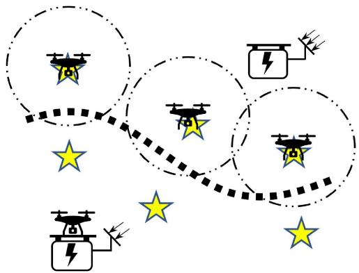  
Fig. 1. Example rechargeable UAVs network with six monitoring points, shown in yellow stars, that can be used to monitor vehicles on the depicted path (dashed arc). Dotted circles represent the coverage range of UAVs.

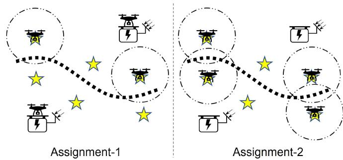  
Fig. 2. In Assignment-1, two UAVs are on monitoring points, while another two UAVs are at a charging platform. In Assignment-2, four UAVs are assigned to monitoring points, making it less efficient than Assignment-1.

Henceforth, this article contains the following contributions:   
- It addresses a novel problem and presents the first mixed integer linear program (MILP) for the problem at hand. Its objective is to maximize the K coverage lifetime of a given set of monitoring points. Further, it yields the optimal assignment of UAVs given non-causal energy arrivals information at charging platforms.

It presents the first solutions for the said problem. First, this article outlines a model predictive control (MPC) [16] framework to assign UAVs to monitoring points and charging stations. Specifically, a controller employs a Gaussian mixture model (GMM) [17] to estimate energy arrivals at each charging station over a finite time duration. This information is then used by the said MILP to optimize the assignment of UAVs to either a charging station or monitoring point. Second, we propose a heuristic solution based on Monte Carlo tree search (MCTS) [18] to assign UAVs. Different from MPC, the said heuristic decides the current UAVs assignment based on Monte Carlo simulations.

\- It contains the first study of the problem and said solutions. Specifically, we compare the coverage lifetime obtained by MPC and MCTS versus MILP by varying different parameters, such as the number of UAVs or charging platforms. The simulation results show that in the case of MILP with causal information, the coverage lifetime of MPC and MCTS is approximately 81.04% and 67.07% as compared to MILP, respectively.

The rest of this article is organized as follows. Section II reviews prior works. Then Sections III and IV formalize the system and problem, respectively. Section V outlines the said MPC solution. Simulation results are presented and discussed in Section VI. We conclude the paper in Section VII.

## II. RELATED WORKS

Many works have considered recharging UAVs using one or more charging platforms. They can be divided into the following three categories: i) single charging platform, ii) multiple charging platforms, and iii) multiple charging platforms with renewable energy. As it will become clear later, most of these works do not consider energy harvesting platforms, which experience spatio-temporal varying energy arrivals. Note that works that consider the deployment of charging platforms, e.g., [19], are complementary to our work. We omit coverage works that do not consider a charging platform, e.g., [20], [21]. This is because these works either assume UAVs have no energy limitation, or they do not consider rechargeable UAVs. Hence, these works do not consider the problem of assigning a UAV to a charging platform for energy replenishment.

In category (i), i.e., single charging platform works, their aim is to charge UAVs acting as mobile base stations, e.g., [22], or to provide surveillance of an area, e.g., [23], [24], [25]. For example, reference [22] uses a charging platform to recharge UAVs that cover mobile vehicles on highways. In [23], the authors consider the surveillance of barriers and schedule the recharging sequence of UAVs. Some works such as [27], [28], [29] plan the trajectory of UAVs so that they start and end at a charging platform. In a different work, Ghazzai et al. [26] deploy UAVs from a docking station to monitor multiple geographically distributed events.

As for category (ii), i.e., multiple charging platforms works, their aim to decide the assignment between UAVs and charging platforms. These charging platforms are powered by main electricity. Therefore, these works do not consider energy limitation. Example works include [30], [31], [32]. Briefly, reference [30] proposes a distributed solution that allows each UAV to compete for a charging platform with other UAVs. In [32], the authors consider a two-tier assignment problem. In their work, a set of UAVs functions as base stations, and each UAV has a fixed location. To recharge these UAVs, the authors use another set of UAVs as mobile charging UAVs. The problem is to determine how UAVs recharge themselves at charging platforms, and how they charge other UAVs. Trotta et al. [33] aim to maximize the coverage lifetime of a given area. Their problem in each time slot is to decide whether a UAV is monitoring an area or is located at a charging platform. Unlike the aforementioned works, our

TABLE I  
COMPARISONS BETWEEN OUR WORK AND PRIOR RESEARCH
<table><tr><td rowspan=1 colspan=2>Studies</td><td rowspan=1 colspan=2>Multiple chargingplatforms</td><td rowspan=1 colspan=2>Renewableenergy</td><td rowspan=1 colspan=2>Multiple timeslots</td><td rowspan=1 colspan=2>K-Coverage</td><td rowspan=1 colspan=2>UAVs to platformassignment</td><td rowspan=1 colspan=1>Energycausality</td><td rowspan=1 colspan=1>Lifetimemaximization</td></tr><tr><td rowspan=1 colspan=1>[</td><td rowspan=1 colspan=1>19]</td><td rowspan=1 colspan=2>√</td><td rowspan=1 colspan=2>X</td><td rowspan=1 colspan=2>X</td><td rowspan=1 colspan=2>X</td><td rowspan=1 colspan=2>X</td><td rowspan=1 colspan=1>X</td><td rowspan=1 colspan=1>X</td></tr><tr><td rowspan=1 colspan=1>[</td><td rowspan=1 colspan=1>22]</td><td rowspan=1 colspan=2>x</td><td rowspan=1 colspan=2>X</td><td rowspan=1 colspan=2>√</td><td rowspan=1 colspan=2>X</td><td rowspan=1 colspan=2>x</td><td rowspan=1 colspan=1>x</td><td rowspan=1 colspan=1>x</td></tr><tr><td rowspan=1 colspan=1></td><td rowspan=1 colspan=1>[23]</td><td rowspan=1 colspan=2>x</td><td rowspan=1 colspan=2>x</td><td rowspan=1 colspan=2>√</td><td rowspan=1 colspan=2>√</td><td rowspan=1 colspan=2>X</td><td rowspan=1 colspan=1>x</td><td rowspan=1 colspan=1>X</td></tr><tr><td rowspan=1 colspan=1>[</td><td rowspan=1 colspan=1>24]</td><td rowspan=1 colspan=2>x</td><td rowspan=1 colspan=2>X</td><td rowspan=1 colspan=1>√</td><td rowspan=1 colspan=1></td><td rowspan=1 colspan=2>X</td><td rowspan=1 colspan=2>√</td><td rowspan=1 colspan=1>X</td><td rowspan=1 colspan=1>√</td></tr><tr><td rowspan=1 colspan=2>[25], [26]</td><td rowspan=1 colspan=2>X</td><td rowspan=1 colspan=2>X</td><td rowspan=1 colspan=1>√</td><td rowspan=1 colspan=1></td><td rowspan=1 colspan=2>√</td><td rowspan=1 colspan=2>√</td><td rowspan=1 colspan=1>X</td><td rowspan=1 colspan=1>x</td></tr><tr><td rowspan=1 colspan=2>[27], [28], [29]</td><td rowspan=1 colspan=2>X</td><td rowspan=1 colspan=2>x</td><td rowspan=1 colspan=1>√</td><td rowspan=1 colspan=1></td><td rowspan=1 colspan=2>√</td><td rowspan=1 colspan=2>X</td><td rowspan=1 colspan=1>X</td><td rowspan=1 colspan=1>X</td></tr><tr><td rowspan=1 colspan=2>[30], [31], [32]</td><td rowspan=1 colspan=2>√</td><td rowspan=1 colspan=2>x</td><td rowspan=1 colspan=1>√</td><td rowspan=1 colspan=1></td><td rowspan=1 colspan=2>x</td><td rowspan=1 colspan=1>√</td><td rowspan=1 colspan=1></td><td rowspan=1 colspan=1>X</td><td rowspan=1 colspan=1>X</td></tr><tr><td rowspan=1 colspan=2>[33]</td><td rowspan=1 colspan=1>√</td><td rowspan=1 colspan=1></td><td rowspan=1 colspan=2>X</td><td rowspan=1 colspan=1>√</td><td rowspan=1 colspan=1></td><td rowspan=1 colspan=2>X</td><td rowspan=1 colspan=1>√</td><td rowspan=1 colspan=1></td><td rowspan=1 colspan=1>x</td><td rowspan=1 colspan=1>√</td></tr><tr><td rowspan=1 colspan=2>[34], [35]</td><td rowspan=1 colspan=1>√</td><td rowspan=1 colspan=1></td><td rowspan=1 colspan=2>√</td><td rowspan=1 colspan=1>√</td><td rowspan=1 colspan=1></td><td rowspan=1 colspan=2>X</td><td rowspan=1 colspan=1>√</td><td rowspan=1 colspan=1></td><td rowspan=1 colspan=1>√</td><td rowspan=1 colspan=1>x</td></tr><tr><td rowspan=1 colspan=2>[36]</td><td rowspan=1 colspan=1>√</td><td rowspan=1 colspan=1></td><td rowspan=1 colspan=1>√</td><td rowspan=1 colspan=1></td><td rowspan=1 colspan=1>√</td><td rowspan=1 colspan=1></td><td rowspan=1 colspan=2>X</td><td rowspan=1 colspan=1>√</td><td rowspan=1 colspan=1></td><td rowspan=1 colspan=1>x</td><td rowspan=1 colspan=1>x</td></tr><tr><td rowspan=1 colspan=2>[37], [38]</td><td rowspan=1 colspan=1>√</td><td rowspan=1 colspan=1></td><td rowspan=1 colspan=1>√</td><td rowspan=1 colspan=1></td><td rowspan=1 colspan=1>√</td><td rowspan=1 colspan=1></td><td rowspan=1 colspan=2>√</td><td rowspan=1 colspan=1>X</td><td rowspan=1 colspan=1></td><td rowspan=1 colspan=1>x</td><td rowspan=1 colspan=1>X</td></tr><tr><td rowspan=1 colspan=1></td><td rowspan=1 colspan=1>[39]</td><td rowspan=1 colspan=1>√</td><td rowspan=1 colspan=1></td><td rowspan=1 colspan=2>X</td><td rowspan=1 colspan=2>x</td><td rowspan=1 colspan=1>√</td><td rowspan=1 colspan=1></td><td rowspan=1 colspan=1>X</td><td rowspan=1 colspan=1></td><td rowspan=1 colspan=1>X</td><td rowspan=1 colspan=1>x</td></tr><tr><td rowspan=1 colspan=1></td><td rowspan=1 colspan=1>[40]</td><td rowspan=1 colspan=1> $\overline { { \checkmark</td><td rowspan=1 colspan=1>} }$ </td><td rowspan=1 colspan=2>X</td><td rowspan=1 colspan=1>x</td><td rowspan=1 colspan=1></td><td rowspan=1 colspan=1>X</td><td rowspan=1 colspan=1></td><td rowspan=1 colspan=1>7</td><td rowspan=1 colspan=1></td><td rowspan=1 colspan=1>x</td><td rowspan=1 colspan=1>X</td></tr><tr><td rowspan=1 colspan=2>Our work</td><td rowspan=1 colspan=1> $\overline { { \checkmark</td><td rowspan=1 colspan=1>} }$ </td><td rowspan=1 colspan=2> $\overline { { \checkmark } }$ </td><td rowspan=1 colspan=1>√</td><td rowspan=1 colspan=1></td><td rowspan=1 colspan=1>√</td><td rowspan=1 colspan=1></td><td rowspan=1 colspan=1> $\overline { { \check</td><td rowspan=1 colspan=1>mark } }$ </td><td rowspan=1 colspan=1>√</td><td rowspan=1 colspan=1>√</td></tr></table>

Lastly, works in category (iii) consider charging platforms powered by a renewable energy source such as solar. The work in [34], [36] assumes charging platforms have both solar and main electricity. In both works, their goal is to minimize the usage main electricity. In contrast, the work in [37], [38] considers charging platforms that only harvest solar energy. However, they assume the energy arrival at each charging platform is a constant value in each time slot. In another work [35], the authors deploy each UAV at a fixed location to cover ground users until it runs out of energy. Then their problem is to schedule the assignment between UAVs and charging platforms. Different from [37], [38], reference [35] considers varying solar arrivals for charging platforms, which is similar to our work. However, they have a different aim, which is to develop a reinforcement learning method to determine which UAV can be recharged at which charging platform in each time slot. By contrast, we aim to maximize K-coverage. Another difference is that they do not consider the assignment between UAVs and monitoring points.

Table I shows the novelties of our work with respect to prior works. First, we see that most works do not consider charging platforms with energy limitation. Further, some works such as [35], [37], [38] assume that charging platforms have a renewable energy source, but only the work in [35] considers varying energy arrivals. However, the work in [35] does not consider K-coverage. Second, most works require future energy arrivals when assigning UAVs to charging platforms. By contrast, we only consider past and current energy arrivals. Third, although the work in [40] considers the problem of assigning UAVs to facilities/targets, it only considers a single time slot. By contrast, we consider multiple time slots. This is critical because the UAVs assignment in past and current time slots will affect the energy availability of UAVs and charging stations in future time slots. Apart from that, different from works such as [27], [28], [29], we consider multiple charging platforms with different locations. This means we need to determine the assignment of a UAV to a charging platform that is located at different distance and has varying spatio-temporal energy levels. For works with multiple charging platforms, research such as [30], [34], [37], charging platforms are only powered by solar energy, and we need to consider the energy evolution of charging platforms in each time slot.

[38], [40] assumes a charging platform can recharge multiple UAVs simultaneously, which is not the case in our work. Last but not least, only the work in [24] and [33] aims to maximize coverage lifetime. However, they do not consider different energy traveling consumption to/from targets and charging platforms. Moreover, they assume that charging platforms are powered by main electricity.

## III. SYSTEM MODEL

Table II lists our notations. Let U denote a set of UAVs, and C is the set of charging platforms. Each UAV and platform are respectively represented as $u _ { i }$ and $c _ { j }$ , where $i = 1 , \ldots , | \mathcal { U } |$ and $j = 1 , \dots , | { \mathcal { C } } |$ , where |.| represents the cardinality of a set. There are a set of points M that can be used to monitor events/objects on a path or a target, denoted as Λ. Each monitoring point is denoted as $p _ { k }$ , where $k = 1 , \dots , | \mathcal { M } |$ . We assume all charging platforms and UAVs have a direct connection to a controller that runs our solutions.

Time is divided into discrete slots. Each time slot has the same duration τ. For convenience, we set τ to unit length. Time slots are indexed by t, where $t = 1 , \dots , T$ . That is, we consider a planning horizon with T time slots.

We assume UAVs have an auto-pilot [41], [42]. This means UAVs do not need real-time flight control from a controller. The controller only needs to broadcast a message containing their assigned charging platform/monitoring point. Each UAV then navigates itself to its assigned location autonomously.

## A. UAVs States

Each UAV has three possible states: i) charging, ii) hovering/monitoring, or iii) disconnected. Referring to Fig. 3, state i) denotes a UAV is on a charging platform. If a UAV is in state ii), then it is hovering on a monitoring point in M to cover path Λ. State iii) means that a UAV no longer has energy to operate. This state occurs when a UAV runs out of energy. A UAV is in one state only in each time slot, and it changes its state over time. However, if a UAV is disconnected, it no longer changes to other states.

Next, we define decision variables used to track the state of each UAV. Let $\alpha _ { i j } ^ { t }$ be a binary decision variable to denote whether UAV $u _ { i }$ is on recharging platform $c _ { j }$ in time slot t. This is the case if we have $\alpha _ { i j } ^ { t } = 1$ . In each time slot t, a charging platform can only recharge one UAV. Mathematically, we have

TABLE II TABLE OF NOTATIONS
<table><tr><td> $\overline { { \mathbf { 1 . } } }$ </td><td>Sets</td></tr><tr><td> $\overline { { \mathcal { U } } }$ </td><td>The set of UAVs.</td></tr><tr><td> $\mathcal { C }$ </td><td>The set of charing platforms.</td></tr><tr><td> $\mathcal { M }$ </td><td>The set of monitoring points.</td></tr><tr><td> ${ \overline { { \mathbf { 2 } } } } .$ </td><td>Constants</td></tr><tr><td> $\overline { { K } }$ </td><td>The number of UAVs required by the given path/target.</td></tr><tr><td> $\mathrm { T }$ </td><td>The total number of time slots.</td></tr><tr><td> $\tau \ ( \mathrm { s } )$ </td><td>The length of a time slot.</td></tr><tr><td> $P _ { a } \ ( \mathrm { W a t t } )$ </td><td>The energy recharging rate of charging platforms.</td></tr><tr><td> $\mu _ { m }$ </td><td>The mean of state m in Gaussian distribution.</td></tr><tr><td> $\sigma _ { m }$ </td><td>The variance of state m in Gaussian distribution.</td></tr><tr><td> $e _ { m a x } \ ( \mathrm { J o u l e } )$ </td><td>The battery capacity of charging platforms.</td></tr><tr><td> $\Omega \ ( c m ^ { 2 } )$ </td><td>Solar panel size of charging platforms.</td></tr><tr><td> $\theta$ </td><td>The solar energy conversion efficiency.</td></tr><tr><td> $\eta$ </td><td>The inductive charging efficiency.</td></tr><tr><td> $E _ { m a x } \mathrm { ' ( J o u l e ) }$ </td><td>The battery capacity of UAVs.</td></tr><tr><td> $q \ ( \mathrm { J o u l e / m e t e r } )$ </td><td>Energy consumption rate for level flight.</td></tr><tr><td> $P _ { h } \ ( \mathsf { W a t t } )$ </td><td>The power required by hovering UAVs.</td></tr><tr><td> $g \ ( m / s ^ { 2 } )$ </td><td>Gravity.</td></tr><tr><td> ${ M _ { d } } ~ ( k g )$ </td><td>The mass of UAVs.</td></tr><tr><td> $R$ </td><td>The number of rotors of UAVs.</td></tr><tr><td> $\rho ~ ( k g / m ^ { 3 } )$ </td><td>Air density.</td></tr><tr><td> $\zeta ~ ( m ^ { 2 } )$ </td><td>The area for the spinning blade disc of a rotor.</td></tr><tr><td> ${ \overline { { \mathbf { 3 } } } } .$ </td><td>Variables</td></tr><tr><td> $\alpha _ { i j } ^ { t }$ </td><td>Binary variable to decide whether  $u _ { i }$  at platform  $c _ { j }$  in time slot  $t .$ </td></tr><tr><td> $\beta _ { i k } ^ { t }$ </td><td>Binary variable to decide whether  $u _ { i }$  at monitoring point  $p _ { k }$  in time slot t.</td></tr><tr><td> $\gamma _ { i } ^ { t }$ </td><td>Binary variable to decide whether  $u _ { i }$  is landed in time</td></tr><tr><td></td><td>slot t.</td></tr><tr><td> $\boldsymbol { r } _ { j } ^ { t }$ </td><td>Binary variable to decide whether platform  $c _ { j }$ </td></tr><tr><td></td><td>has energy overflow.</td></tr><tr><td> $\delta _ { j } ^ { t }$ </td><td>The amount of energy that charging platform  $c _ { j }$  stores</td></tr><tr><td></td><td>in time slot t.</td></tr><tr><td> $\boldsymbol { v } _ { i } ^ { t }$ </td><td>Binary variable to decide whether UAV ui</td></tr><tr><td></td><td>has energy overflow.</td></tr><tr><td> $\varepsilon _ { j } ^ { t }$ </td><td>The amount of energy that UAV  $u _ { i }$  stores in time slot t.</td></tr><tr><td></td><td>Binary variable to decide whether flies from point</td></tr><tr><td> $\boldsymbol { w _ { i j k } ^ { t } }$ </td><td> $u _ { i }$ </td></tr><tr><td></td><td> $p _ { k }$  to platform  $c _ { j }$  in time slot t.</td></tr><tr><td></td><td>Binary variable to decide whether  $u _ { i }$  flies from platform</td></tr><tr><td> $\boldsymbol { x } _ { i j k } ^ { t }$ </td><td> $c _ { j }$  to point  $p _ { k }$  in time slot t.</td></tr><tr><td></td><td></td></tr><tr><td> $\boldsymbol { y } _ { i k k ^ { \prime } } ^ { t }$ </td><td>Binary variable to decide whether  $u _ { i }$  flies between two</td></tr><tr><td></td><td>points pk and  $p _ { k } ^ { \prime }$  in time slot t.</td></tr><tr><td></td><td>Binary variable to decide whether  $u _ { i }$  flies between two</td></tr><tr><td> $z _ { i j j ^ { \prime } } ^ { t }$ </td><td></td></tr><tr><td></td><td>platforms  $c _ { j }$  and  $c _ { j } ^ { \prime }$  in time slot t.</td></tr></table>

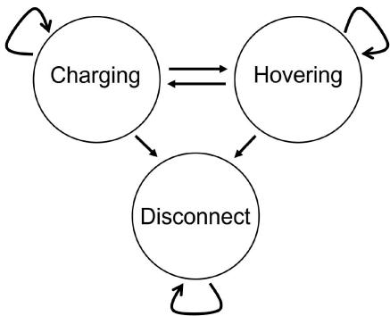  
Fig. 3. Relationship among all states of a UAV. Solid arrows indicate state changes.

$$
\sum _ { i = 1 } ^ { | \mathcal { U } | } \alpha _ { i j } ^ { t } \leq 1 , \forall j \in \mathcal { C } , \forall t \in T .\tag{1}
$$

Define $\beta _ { i k } ^ { t }$ as a binary variable that is equal to one if UAV $u _ { i }$ is at monitoring point $p _ { k }$ in time slot t. Each monitoring point can only have at most one hovering UAV in one time slot. We thus have

$$
\sum _ { i = 1 } ^ { | \mathcal { U } | } \beta _ { i k } ^ { t } \le 1 , \quad \forall k \in \mathcal { M } , \quad \forall t \in T .\tag{2}
$$

Recall that a key requirement is that Λ must satisfy K-coverage, i.e., at least K monitoring points within set M are monitored by UAVs in set U in each time slot t. We thus have

$$
\sum _ { i = 1 } ^ { | \mathcal { U } | } \sum _ { k = 1 } ^ { | \mathcal { M } | } \beta _ { i k } ^ { t } \geq K , \forall t \in T .\tag{3}
$$

We use $\gamma _ { i } ^ { t }$ as a binary variable that is equal to one if UAV $u _ { i }$ is active in time slot t. That is, if the value of $\gamma _ { i } ^ { t }$ is zero, then UAV $u _ { i }$ is in state iii), i.e., disconnected. In each time slot t, a UAV only has one location. To this end, we have

$$
\sum _ { j = 1 } ^ { | \mathcal { C } | } \alpha _ { i j } ^ { t } + \sum _ { k = 1 } ^ { | \mathcal { M } | } \beta _ { i k } ^ { t } + ( 1 - \gamma _ { i } ^ { t } ) = 1 , \forall i \in \mathcal { U } , \forall t \in T .\tag{4}
$$

(4) means that UAV $u _ { i }$ is hovering or recharging only if it is active, $\mathrm { i } . \mathrm { e } . , \gamma _ { i } ^ { t } = 1$ . Otherwise, when the value of $\gamma _ { i } ^ { t }$ is zero, the sum of $\alpha _ { i j } ^ { t }$ and $\beta _ { i k } ^ { t }$ is forced to be zero.

First, we will formulate the energy consumption model of charging platforms. Next, we outline a hidden Markov model to govern the solar energy arrivals of charging platforms. Finally, we present the energy evolution of charging platforms that also consider energy overflow.

## B. Charging Platforms

1) Energy Consumption: Let $h _ { j } ^ { t }$ (Joule) be the energy consumed by charging platform $c _ { j }$ to recharge UAVs in time slot t. We assume that charging platforms recharge UAVs via inductive charging with efficiency η [43]. The amount of energy consumed $h _ { i } ^ { t }$ by platform $c _ { j }$ is equal to the energy harvested by a UAV. Let $\check { P _ { a } }$ (Watt) be the energy recharging rate of charging platforms. Hence, the value of $h _ { j } ^ { t }$ is

$$
h _ { j } ^ { t } = \eta \tau { { P } _ { a } } \sum _ { i = 1 } ^ { | \mathcal { U } | } { \alpha _ { i j } ^ { t } } , \forall j \in \mathcal { C } , \forall t \in T .\tag{5}
$$

In $( 5 )$ , the value of $h _ { i } ^ { t }$ is greater than one if the sum of $\alpha _ { i j } ^ { t }$ is one, i.e., there is a UAV on platform $c _ { j }$

2) Energy Arrival: We define $g _ { j } ^ { t }$ (Joule) as the energy harvested by charging platform $c _ { j }$ in time slot t. The energy arrival $g _ { j } ^ { t }$ at each charging platform is governed by the Hidden Markov model in [44]; its parameter values are set as per measurement data. Briefly, the model contains $F$ states. Each state represents a different level of solar intensity. Moreover, each state $f$ corresponds to a Gaussian distribution with mean $\mu _ { f }$ and variance $\sigma _ { f } .$ , where $f \in \{ 1 , \ldots , F \}$ . We use ψtj $( \mu W / c m ^ { 2 } )$ to denote the solar irradiance intensity of charging platform $c _ { j }$ . Note that if charging platform $c _ { j }$ is in state $f ,$ , then the corresponding solar intensity $\psi _ { j } ^ { t }$ is determined via the Gaussian distribution with mean $\mu _ { f }$ and variance $\sigma _ { f } .$ . Each charging platform is connected to a solar panel with size $\Omega ( c m ^ { 2 } )$ , and the conversion efficiency of the solar panel is $\theta .$ . Then the amount of harvested energy $g _ { j } ^ { t }$ by charging platform $c _ { j }$ in time slot t is

$$
g _ { j } ^ { t } = \Omega \theta \psi _ { j } ^ { t } \tau , \forall j \in \mathcal { C } , \forall t \in T .\tag{6}
$$

3) Energy Evolution: Define $e _ { j } ^ { t }$ as the residual energy of charging platform $c _ { j }$ in time slot t. It must be within the battery capacity of charging platforms, which is defined as $e _ { m a x } .$ Further, the energy consumed by a charging platform cannot exceed its residual energy $e _ { j } ^ { t }$ . We thus have

$$
h _ { j } ^ { t } \leq e _ { j } ^ { t } \leq e _ { m a x } , \forall j \in \mathcal { C } , \forall t \in T .\tag{7}
$$

We consider energy overflow at charging platforms. Specifically, energy overflow may happen if a charging platform harvests energy in the case of high solar intensity for multiple time slots, and does not recharge any UAVs. Let $r _ { j } ^ { t }$ be a binary variable to represent whether energy overflow occurs in charging platform $c _ { j }$ in time slot t. We have $r _ { j } ^ { t } = 1$ if energy overflow occurs, i.e., $\mathrm { , } e _ { j } ^ { t } + g _ { j } ^ { t } > e _ { m a x }$ . Formally, the value of $\boldsymbol { r } _ { j } ^ { t }$ is determined by the following constraints

$$
e _ { j } ^ { t } + g _ { j } ^ { t } - e _ { m a x } \geq ( r _ { j } ^ { t } - 1 ) M _ { 1 } , ~ \forall j \in \mathcal { C } , ~ \forall t \in T .\tag{8}
$$

$$
e _ { j } ^ { t } + g _ { j } ^ { t } - e _ { m a x } \leq r _ { j } ^ { t } M _ { 1 } , \forall j \in \mathcal { C } , \forall t \in T .\tag{9}
$$

In constraint (8) and (9), the constant $M _ { 1 }$ is a constant large number for disabling these two constraints.1 We set $M _ { 1 }$ to be twice the value of $e _ { m a x }$ . When energy overflow occurs, i.e., $e _ { j } ^ { t } +$ $g _ { j } ^ { t } - e _ { m a x } \geq 0$ , we only have $r _ { j } ^ { t } = 1$ to ensure these constraints are feasible.

Let $\delta _ { j } ^ { t }$ (in Joule), where $0 \leq \delta _ { j } ^ { t } \leq g _ { j } ^ { t }$ , be the amount of energy that charging platform $c _ { j }$ stores in its battery in time slot t. If a charging platform $c _ { j }$ has sufficient battery capacity, then we have $\delta _ { j } ^ { t } = g _ { j } ^ { t }$ . On the other hand, if it has insufficient capacity, meaning it will experience energy overflow if it stores all of $g _ { j } ^ { t } .$ then the amount of energy stored is only the difference between $e _ { m a x }$ and $e _ { j } ^ { t }$ . That is, we have $\delta _ { j } ^ { t } = e _ { m a x } - e _ { j } ^ { t }$ . Mathematically, the value of $\delta _ { j } ^ { t }$ is constrained as follows:

$$
g _ { j } ^ { t } - r _ { j } ^ { t } M _ { 1 } \leq \delta _ { j } ^ { t } \leq g _ { j } ^ { t } + r _ { j } ^ { t } M _ { 1 } , \forall j \in \mathcal { C } , \forall t \in T .\tag{10}
$$

$$
\delta _ { j } ^ { t } \geq e _ { m a x } - e _ { j } ^ { t } - ( 1 - r _ { j } ^ { t } ) M _ { 1 } , ~ \forall j \in \mathcal { C } , ~ \forall t \in T .\tag{11}
$$

$$
\delta _ { j } ^ { t } \leq e _ { m a x } - e _ { j } ^ { t } + ( 1 - r _ { j } ^ { t } ) M _ { 1 } , ~ \forall j \in \mathcal { C } , ~ \forall t \in T .\tag{12}
$$

The energy evolution of a charging platform describes how its energy varies over time given energy arrivals and consumption. Mathematically, the residual energy $e _ { j } ^ { t + 1 }$ of charging platform $c _ { j }$ evolves as

$$
e _ { j } ^ { t + 1 } = e _ { j } ^ { t } + \delta _ { j } ^ { t } - h _ { j } ^ { t } , ~ \forall j \in \mathcal { C } , ~ \forall t \in T .\tag{13}
$$

## C. Energy Model ofUAVs

Here, we outline the energy consumption model of UAVs, their energy evolution and energy overflow. In terms of energy consumption, we consider the energy cost of UAV movements to/from charging stations and monitoring points as well as between monitoring points. Further, UAVs also consume energy when hovering over a monitoring point.

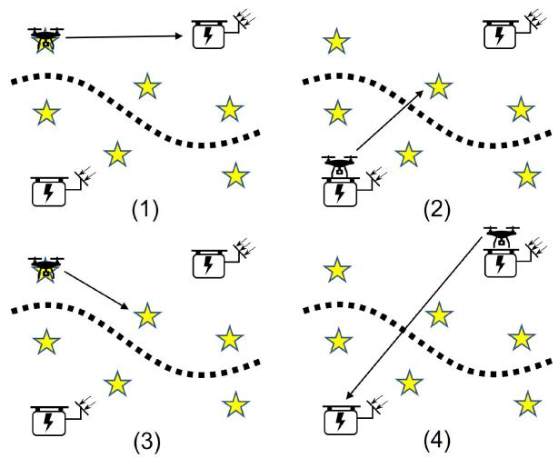  
Fig. 4. Four different flights of UAVs. Solid arrows represent the movement of a UAV in one time slot. We have the following cases: (1) from a monitoring point to a charging platform, (2) from a charging platform to a monitoring point, (3) from a monitoring point to another monitoring point, and (4) from a charging platform to another charging platform.

1) Energy Consumption Model: Define $H _ { i } ^ { t }$ (Joule) as the energy consumed by UAV $u _ { i }$ in time slot t. It is divided into two parts: a UAV consumes energy when i) it flies to/from monitoring points/charging platforms, or ii) it hovers at monitoring points. We assume that the flight of a UAV requires one time slot. Moreover, UAVs consume negligible energy at charging platforms and when it is disconnected, i.e., state iii). Further, UAVs consume negligible energy to communicate with the controller.

Fig. 4 shows all possible movements of a UAV, which contains the flight from a charging platform/monitoring point to another charging platform/monitoring point. Let $m \in \{ 1 , 2 , 3 , 4 \}$ be the index for the aforementioned cases shown in Fig. 4. Note that we assume the flight of a UAV occurs at the beginning of a time slot, and we ignore the time duration for UAVs flights. Next, we outline the model for each case.

Case $m = 1 \colon$ Let $w _ { i j k } ^ { t } \in \{ 0 , 1 \}$ be a binary variable that equals to one if UAV ui flies from monitoring point $p _ { k }$ to charging platform $c _ { j }$ in time slot t, and zero otherwise. Mathematically, the value of $w _ { i j k } ^ { t + 1 }$ in time slot t + 1 is

$$
w _ { i j k } ^ { t + 1 } \leq \alpha _ { i j } ^ { t + 1 } , \forall i \in \mathcal { U } , \forall t \in T ,\tag{14}
$$

$$
w _ { i j k } ^ { t + 1 } \leq \beta _ { i k } ^ { t } , \forall i \in \mathcal { U } , \forall t \in T ,\tag{15}
$$

$$
w _ { i j k } ^ { t + 1 } \geq \alpha _ { i j } ^ { t + 1 } + \beta _ { i k } ^ { t } - 1 , \forall i \in \mathcal { U } , \forall t \in T .\tag{16}
$$

In the above constraints, once we have $\beta _ { i k } ^ { t } = 0$ or $\alpha _ { i j } ^ { t + 1 } = 0$ the value of $w _ { i j k } ^ { t }$ is forced to zero. This means there is no flight between point $p _ { k }$ and platform $c _ { j }$ . On the other hand, when the value of $\beta _ { i k } ^ { t }$ and $\alpha _ { i j } ^ { t + \bar { 1 } }$ is one, the above constraints force the value of $w _ { i j k } ^ { t }$ to be one, which means that UAV $u _ { i }$ moves from point $p _ { k }$ to platform $c _ { j }$ in time slot $t + 1$

Case $m = 2 \cdot$ : Let $\bar { x } _ { i j k } ^ { t } \in \{ 0 , 1 \}$ be a binary variable which is equal to one if $\mathrm { U A V } ~ u _ { i }$ flies from charging platform $c _ { j }$ to monitoring point $p _ { k }$ in time slot t. Formally, the value of $x _ { i j k } ^ { t + 1 }$ is expressed as

$$
\begin{array} { r } { x _ { i j k } ^ { t + 1 } \leq \alpha _ { i j } ^ { t } , \forall i \in \mathcal { U } , \forall t \in T , } \end{array}\tag{17}
$$

$$
{ \boldsymbol { x } } _ { i j k } ^ { t + 1 } \le \beta _ { i k } ^ { t + 1 } , ~ \forall i \in \mathcal { U } , ~ \forall t \in T ,\tag{18}
$$

$$
x _ { i j k } ^ { t + 1 } \geq \alpha _ { i j } ^ { t } + \beta _ { i k } ^ { t + 1 } - 1 , \forall i \in \mathcal { U } , \forall t \in T .\tag{19}
$$

In constraint (17) to (19), variable $x _ { i j k } ^ { t + 1 }$ is forced to be zero if $\alpha _ { i j } ^ { t } = 0 \ \mathrm { o r } \ \beta _ { i j } ^ { t + 1 } = 0$ . This means UAV $u _ { i }$ does not have a flight between $c _ { j }$ and $p _ { k }$ . On the other hand, the value of $x _ { i j k } ^ { t + 1 }$ is forced to one by constraint (19) if there is a flight from $c _ { j }$ to $p _ { k }$ , as shown in Fig. 4.

Case $m = 3 \colon$ This case occurs when there is a flight for UAV $u _ { i }$ between two monitoring points $p _ { k }$ and $p _ { k ^ { \prime } }$ , where $\boldsymbol { k } ^ { \prime } \neq \boldsymbol { k }$ . Let $y _ { i k k ^ { \prime } } ^ { t } \in \{ 0 , 1 \}$ be a binary decision variable that equals to one if there is a flight between point $p _ { k }$ and $p _ { k ^ { \prime } }$ . This means when the value of $\beta _ { i k } ^ { t + 1 }$ and $\beta _ { i k ^ { \prime } } ^ { t }$ is one, then the value of $y _ { i k k ^ { \prime } } ^ { t + 1 }$ is set to one. To this end, we have

$$
y _ { i k k ^ { \prime } } ^ { t + 1 } \leq \beta _ { i k } ^ { t + 1 } , ~ \forall i \in \mathcal { U } , ~ \forall t \in T ,\tag{20}
$$

$$
y _ { i k k ^ { \prime } } ^ { t + 1 } \leq \beta _ { i k ^ { \prime } } ^ { t } , \forall i \in \mathcal { U } , \forall t \in T ,\tag{21}
$$

$$
y _ { i k k ^ { \prime } } ^ { t + 1 } \geq \beta _ { i k } ^ { t + 1 } + \beta _ { i k ^ { \prime } } ^ { t } - 1 , \forall i \in \mathcal { U } , \forall t \in T .\tag{22}
$$

Case $m = 4 \colon$ In this case, UAV $u _ { i }$ flies from a charging platform $c _ { j }$ to another platform $c _ { j ^ { \prime } }$ , where $j \neq j ^ { \prime }$ . Note that this case arises if charging platform $c _ { j }$ runs out of energy, which forces a UAV to another charging platform for energy replenishment. Define $z _ { i j j ^ { \prime } } ^ { t } \in \{ 0 , 1 \}$ as a binary variable to represent whether there is a flight between two charging platforms. When UAV $u _ { i }$ moves from platform $c _ { j }$ to another platform $c _ { j ^ { \prime } }$ , the value of $z _ { i j j ^ { \prime } } ^ { t }$ is set to one. Formally, the value of $z _ { i j j ^ { \prime } } ^ { t + 1 }$ is expressed as

$$
z _ { i j j ^ { \prime } } ^ { t + 1 } \leq \alpha _ { i j } ^ { t + 1 } , \forall i \in \mathcal { U } , \forall t \in T ,\tag{23}
$$

$$
z _ { i j j ^ { \prime } } ^ { t + 1 } \leq \alpha _ { i j ^ { \prime } } ^ { t } , \forall i \in \mathcal { U } , \forall t \in T ,\tag{24}
$$

$$
z _ { i j j ^ { \prime } } ^ { t + 1 } \geq \alpha _ { i j } ^ { t + 1 } + \alpha _ { i j ^ { \prime } } ^ { t } - 1 , \forall i \in \mathcal { U } , \forall t \in T .\tag{25}
$$

Constraint (23) and (24) force variable $z _ { i j j ^ { \prime } } ^ { t + 1 }$ to zero if we have $\alpha _ { i j } ^ { t + 1 } = 0$ or $\alpha _ { i j } ^ { t } = 0$ . On the other hand, when $\alpha _ { i j } ^ { t + 1 } = 1$ and $\alpha _ { i j } ^ { t } = 1$ exist, constraint (25) ensures we have $z _ { i j j ^ { \prime } } ^ { t + 1 } = 1$

Note that a UAV only has at most one flight in each time slot; see the solid arrows in Fig. 4 for each case. Mathematically, the said four cases are related as follows:

$$
\begin{array} { r l } & { \mathrel { \phantom { = } } \displaystyle \sum _ { j = 1 } ^ { | \mathcal { C } | } \sum _ { k = 1 } ^ { | \mathcal { M } | } w _ { i j k } ^ { t } + \sum _ { j = 1 } ^ { | \mathcal { C } | } \sum _ { k = 1 } ^ { | \mathcal { M } | } x _ { i j k } ^ { t } + \sum _ { k = 1 } ^ { | \mathcal { M } | } \sum _ { k ^ { \prime } = 1 , k ^ { \prime } \ne k } ^ { | \mathcal { M } | } y _ { i k k ^ { \prime } } ^ { t } } \\ & { \quad \quad + \sum _ { j = 1 } ^ { | \mathcal { C } | } \sum _ { j ^ { \prime } = 1 , j ^ { \prime } \ne j } ^ { | \mathcal { C } | } z _ { i j j ^ { \prime } } ^ { t } \le 1 , \forall i \in \mathcal { U } , \forall t \in T . } \end{array}\tag{26}
$$

Given the above cases, we now consider the energy consumed by a UAV during flight. Let $\epsilon _ { i m } ^ { t }$ (Joule) be the energy consumed by UAV $u _ { i }$ due to case m in time slot t. We use the model in [45] to calculate $\epsilon _ { i m } ^ { t }$ . Specifically, the amount ofenergy consumed by a UAV is proportional to its flying distance. Let q (Joule/meter)

be the energy consumption rate for level flight, i.e., we assume a UAV does not ascend or descend when flying between two geographical points. Mathematically, UAV $u _ { i }$ consumes the following amount of energy for each of the said cases

$$
\epsilon _ { i 1 } ^ { t } = q \sum _ { j = 1 } ^ { \mathcal { C } } \sum _ { k = 1 } ^ { \mathcal { M } } w _ { i j k } ^ { t } d _ { k j } , \forall i \in \mathcal { U } , \forall t \in T ,\tag{27}
$$

$$
\epsilon _ { i 2 } ^ { t } = q \sum _ { j = 1 } ^ { \mathcal { C } } \sum _ { k = 1 } ^ { \mathcal { M } } x _ { i j k } ^ { t } d _ { k j } , \forall i \in \mathcal { U } , \forall t \in T ,\tag{28}
$$

$$
\epsilon _ { i 3 } ^ { t } = q \sum _ { k = 1 } ^ { \mathcal { M } } \sum _ { k ^ { \prime } = 1 , k ^ { \prime } \neq k } ^ { \mathcal { M } } y _ { i k k ^ { \prime } } ^ { t } d _ { k k ^ { \prime } } , \forall i \in \mathcal { U } , \forall t \in T ,\tag{29}
$$

$$
\epsilon _ { i 4 } ^ { t } = q \sum _ { j = 1 } ^ { \mathcal { C } } \sum _ { \substack { j ^ { \prime } = 1 , j ^ { \prime } \neq j } } ^ { \mathcal { C } } z _ { i j j ^ { \prime } } ^ { t } d _ { j j ^ { \prime } } , \forall i \in \mathcal { U } , \forall t \in T ,\tag{30}
$$

where $d _ { k j }$ is the euclidean distance from charging platform $c _ { j }$ to monitoring point $p _ { k }$ . Similarly, we use $d _ { k k ^ { \prime } }$ to represent the distance between two monitoring points $p _ { k }$ and $p _ { k ^ { \prime } }$ , and $d _ { j j ^ { \prime } }$ for the distance between charging platform $c _ { j }$ and $c _ { j ^ { \prime } }$

Next, we consider the energy cost of a hovering UAV. Let $P _ { h }$ (Watt) be the power required for a UAV to hover [46]:

$$
P _ { h } = \frac { ( g M _ { d } ) ^ { 3 / 2 } } { \sqrt { 2 R \rho \zeta } } .\tag{31}
$$

In (31), notation $g , M _ { d }$ and R represent the gravity constant, the mass of a UAV, and the number of rotors for a UAV, respectively. Further, ρ represents air density, and ζ is the area for the spinning blade disc of a rotor [46]. We use $\epsilon _ { i h } ^ { t }$ (Joule) to represent the hovering energy consumption of UAV $u _ { i }$ in time slot t. Then $\epsilon _ { i h } ^ { t }$ is expressed as

$$
\epsilon _ { i h } ^ { t } = P _ { h } \tau \sum _ { k = 1 } ^ { | { \mathcal { M } } | } \beta _ { i k } ^ { t } , \forall i \in { \mathcal { U } } , \forall t \in T .\tag{32}
$$

To this end, the energy consumption $H _ { i } ^ { t }$ of UAV $u _ { i }$ in time slot t is represented as

$$
H _ { i } ^ { t } = \sum _ { m = 1 } ^ { 4 } \epsilon _ { i m } ^ { t } + \epsilon _ { i h } ^ { t } , ~ \forall i \in \mathcal { U } , ~ \forall t \in T .\tag{33}
$$

2) Energy Evolution: Let $E _ { i } ^ { t }$ (Joule) be the residual energy of UAV $u _ { i }$ in time slot t. A UAV cannot consume more than its residual energy. That is, UAV $u _ { i }$ is active if its residual energy is larger or equal to its energy consumption. To this end, we have

$$
\gamma _ { i } ^ { t } H _ { i } ^ { t } \leq E _ { i } ^ { t } \leq E _ { m a x } , \forall i \in \mathcal { U } , \forall t \in T ,\tag{34}
$$

where $E _ { m a x }$ is the battery capacity of UAVs. Moreover, the energy evolution of $u _ { i }$ is

$$
E _ { i } ^ { t + 1 } = E _ { i } ^ { t } + \varepsilon _ { i } ^ { t } - \gamma _ { i } ^ { t } H _ { i } ^ { t } , ~ \forall i \in \mathcal { U } , ~ \forall t \in T ,\tag{35}
$$

where $\varepsilon _ { i } ^ { t }$ (Joule) represents the energy stored by UAV $u _ { i }$ in time slot t.

Next, we need to determine the value of $\varepsilon _ { i } ^ { t }$ . Define $\boldsymbol { v } _ { i } ^ { t }$ as a binary decision variable that is equal to one if UAV $u _ { i }$ experiences energy overflow and zero otherwise. In the case of energy overflow, i.e., $v _ { i } ^ { t } = 1$ , UAV ui can only store $E _ { m a x } - E _ { i } ^ { t }$ amount of energy. On the other hand, if there is no energy overflow, the value of $\varepsilon _ { i } ^ { t }$ is equal to the energy that UAV $u _ { i }$ harvests in time slot $t ,$ which is defined as $G _ { i } ^ { t }$ (Joule). The value of $G _ { i } ^ { t }$ is defined as

$$
G _ { i } ^ { t } = P _ { a } \tau \sum _ { j = 1 } ^ { | { \mathcal { C } } | } \alpha _ { i j } ^ { t } , \forall i \in { \mathcal { U } } , \forall t \in T .\tag{36}
$$

Mathematically, the value of $\boldsymbol { v } _ { i } ^ { t }$ and $\varepsilon _ { i } ^ { t }$ are determined by the following constraints

$$
E _ { i } ^ { t } + G _ { i } ^ { t } - E _ { m a x } \geq ( v _ { i } ^ { t } - 1 ) M _ { 1 } , ~ \forall i \in \mathcal { U } , ~ \forall t \in T .\tag{37}
$$

$$
E _ { i } ^ { t } + G _ { i } ^ { t } - E _ { m a x } \leq v _ { i } ^ { t } M _ { 1 } , ~ \forall i \in \mathcal { U } , ~ \forall t \in T .\tag{38}
$$

$$
G _ { i } ^ { t } - v _ { i } ^ { t } M _ { 1 } \leq \varepsilon _ { i } ^ { t } \leq G _ { i } ^ { t } + v _ { i } ^ { t } M _ { 1 } , \forall i \in \mathcal { U } , \forall t \in T .\tag{39}
$$

$$
\varepsilon _ { i } ^ { t } \geq E _ { m a x } - E _ { i } ^ { t } - ( 1 - v _ { i } ^ { t } ) M _ { 1 } , ~ \forall i \in \mathcal { U } , ~ \forall t \in T .\tag{40}
$$

$$
\varepsilon _ { i } ^ { t } \le E _ { m a x } - E _ { i } ^ { t } + ( 1 - v _ { i } ^ { t } ) M _ { 1 } , ~ \forall i \in \mathcal { U } , ~ \forall t \in T .\tag{41}
$$

Constraints (37) and (38) force the value of $\boldsymbol { v } _ { i } ^ { t }$ to be one when energy overflow occurs, i.e., $E _ { i } ^ { t } + G _ { i } ^ { t } \ge E _ { m a x }$ . In this case, the value of $\varepsilon _ { i } ^ { t }$ is determined by constraint (40) and (41). On the other hand, when $v _ { i } ^ { t } = 0 , \mathrm { i . e . }$ , no energy overflow, constraint (39) forces the value of $\varepsilon _ { i } ^ { t }$ to be $G _ { i } ^ { t }$

## IV. PROBLEM FORMULATION

We are now ready to formulate the problem at hand as a mixed integer linear program (MILP). Its objective is to maximize coverage lifetime, i.e., cover the given path by K UAVs as long as possible. Here, coverage lifetime is defined as the number of consecutive time slots whereby each time slot has K-coverage.

Define $\xi _ { t }$ as a binary decision variable to decide whether time slot t has K-coverage. If the number of UAVs on monitoring points is equal or higher than K, i.e., $\begin{array} { r } { \sum _ { i = 1 } ^ { | \mathcal { U } | } \sum _ { k = 1 } ^ { | \mathcal { M } | } \beta _ { i k } ^ { t } \ge K } \end{array}$ then we have $\xi _ { t } = 1$  . To model the previous relationship, we rewrite constraint (3) to couple $\xi _ { t }$ and $\beta _ { i k } ^ { t }$ as follows:

$$
\sum _ { i = 1 } ^ { | \mathcal { U } | } \sum _ { k = 1 } ^ { | \mathcal { M } | } \beta _ { i k } ^ { t } - K \le ( M _ { 2 } - K ) \xi _ { t } , \forall t \in T ,\tag{42}
$$

$$
\sum _ { i = 1 } ^ { | \mathcal { U } | } \sum _ { k = 1 } ^ { | \mathcal { M } | } \beta _ { i k } ^ { t } \geq K \xi _ { t } , \forall t \in T ,\tag{43}
$$

where the constant $M _ { 2 }$ is a given large number for disabling constraint (42). We set $M _ { 2 }$ as $2 K | \mathcal { U } | | \mathcal { M } |$ to ensure its value is always larger than K or the sum of $\beta _ { i k } ^ { t }$ . When K-coverage is satisfied, i.e., $\begin{array} { r } { \sum _ { i = 1 } ^ { | \mathcal { U } | } \sum _ { k = 1 } ^ { | \mathcal { M } | } \beta _ { i k } ^ { t } \ge K } \end{array}$ , the value of $\xi _ { t }$ can only be  one to ensure constraint (42) is feasible. Similarly, ifK-coverage is not satisfied, constraint (43) forces the value of $x _ { i }$ to be one.

Another requirement is that path Λ must be covered consecutively by at least K UAVs in each time slot. That is, once UAVs fail to provide K-coverage in time slot $t ,$ the value of $\xi _ { t }$ turns to zero, and no longer turns to one in future time slots. Formally, in order to ensure consecutive K-coverage, we have

$$
\xi _ { t + 1 } \leq \xi _ { t } , \forall t \in T .\tag{44}
$$

Now we can formulate the problem at hand as a MILP. For ease of exposition, let $x =$ $\{ \alpha _ { i j } ^ { t } , \beta _ { i k } ^ { t } , \gamma _ { i } ^ { t } , r _ { j } ^ { t } , v _ { i } ^ { t } , \delta _ { j } ^ { t } , \varepsilon _ { i } ^ { t } , w _ { i j k } ^ { t } , x _ { i j k } ^ { t } , y _ { i k k ^ { \prime } } ^ { t } , z _ { i j j ^ { \prime } } ^ { t } , \xi _ { t } \}$ be a set of decision variables in MILP (45). Formally, given a planning horizon with $T$ time slots, we have

$$
\begin{array} { r l } { \underset { x } { \operatorname* { m a x } } } & { { } ~ \displaystyle \sum _ { t = 1 } ^ { T } \xi _ { t } } \\ { \mathrm { s . t . } } & { { } ~ ( 1 ) , ( 2 ) , ( 4 ) , ( 7 ) - ( 2 6 ) , } \\ { \quad } & { { } ~ ( 3 4 ) , ( 3 5 ) , ( 3 7 ) - ( 4 4 ) . } \end{array}\tag{45}
$$

We conclude this section with some discussion relating to computational complexity. First, the formulated MILP has the following number of constraints and decision variables. In these constraints of MILP (45), there are $| { \mathcal { C } } | \times T$ constraints in each of (1) and (7)–(13). Moreover, there are $| { \mathcal { M } } | \times T$ constraints in (2). On the other hand, in each of (4), (14)–(26), (34), (35), and (37)–(41), they have $| \mathcal { U } | \times T$ constraints. Lastly, (42)–(44) have T constraints. Therefore, the total number of constraints in (45) is $( 8 | \mathcal { C } | + | \mathcal { M } | + 2 1 | \mathcal { U } | + 3 ) \times T$ . In terms of decision variables, each charging platform has 2T decision variables to manage its energy overflow. On the other hand, for each UAV, it has $| { \mathcal { C } } | T$ variable $\alpha _ { i j } ^ { t } , | \mathcal { M } | T$ variable $\beta _ { i k } ^ { t }$ and $T$ variable $\gamma _ { i } ^ { t }$ Further, each UAV has 2T decision variables for managing its energy overflow, and $( | \mathcal { C } | + | \mathcal { M } | ) ^ { 2 } T$ decision variables to decide its energy consumption for flights. Hence, the total number of decision variables for our MILP is $( ( ( | \mathcal { C } | + | \mathcal { M } | ) ^ { 2 } + | \mathcal { C } | +$ $| \mathcal { M } | + 3 ) | \mathcal { U } | + 2 | \mathcal { C } | ) T$

Second, the number of assignments increases exponentially with the number of monitoring points, charging stations, number of UAVs and time slots. To see this, note that in each time slot, there are $( { | \mathcal { M } | } )$ possible assignment of UAVs to monitoring  points. Further, UAVs not assigned to a monitoring point has $\bar { \binom { | \mathcal { C } | } { | \mathcal { U } | - K } }$ possible charging station assignments. This yields a total of $( \binom { | \mathcal { M } | } { K } \times \binom { | \mathcal { C } | } { | \mathcal { U } | - K } ) ^ { T }$ number of assignments.

Lastly, we note that solving MILP (45) requires non-causal knowledge of energy arrivals at changing stations. However, this information is not available in practice. Hence, the MILP can only be used to benchmark any practical solutions. Next, we propose a solution that does not require future information.

## V. SOLUTIONS

We will present two solution methods. The first is based on MPC. The second uses Monte Carlo tree search (MCTS). Fig. 5 shows an overview of these two methods. As it will become clear later, both of these two methods are executed once for each time slot, and they compute a solution over a planning horizon. They then adopt the solution for the current time slot. Further, both of them employ GMM to estimate future energy arrivals at charging platforms. A key difference between them is that MPC computes solutions by solving MILP (45), while MCTS uses Monte Carlo simulations. Note that our methods are run infrequently, which is a function of the battery size of UAVs or time slot duration, which could be in minutes or hours.

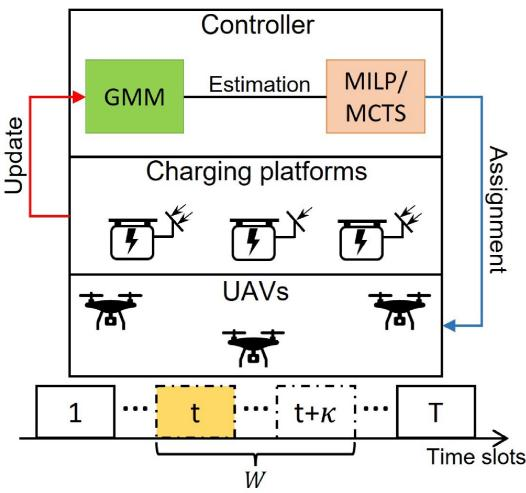  
Fig. 5. Overview of proposed solutions. The orange block represents MPC or MCTS, respectively. Dotted blocks represent time slots within planning horizon W, where the yellow block represents the current time slot t. The controller has a communication channel to charging platforms, which it uses to collect their actual solar irradiance, and also to each UAV.

## A. A MPC-Based Solution

We first introduce the MPC framework [16]. After that, we apply it to solve our UAVs assignment problem; this solution is labeled as MPC-MILP. We then provide a brief background on GMM [17], which is used to estimate future energy arrivals at charging platforms. Lastly, we show how the controller, which runs MILP (45) using the MPC framework, manages charging stations and UAVs.

The MPC framework [16] relies on a predictive model to estimate system quantities and then solves an optimization problem over a planning horizon. The controller adopts the solution for the current time slot as computed by the optimization problem. It then shifts the horizon by one time slot, and repeats the said process for subsequent time slots. Fig. 5 shows how the said MPC framework is used in our work. Let W be the planning horizon, and κ be its size. Hence, in time slot t, the planning horizon W ranges from t to $t + \kappa ;$ see dotted blocks in Fig. 5. In each time slot, the controller assigns UAVs for monitoring or recharging by carrying out the following steps:

Estimation: Our controller uses GMM to estimate the solar energy arrivals of each charging platform over the planning horizon W. Define gˆj as the estimated solar arrivals of charging platform $c _ { j } .$ . Further, let $\hat { \mathbf { G } } = \{ \hat { \mathbf { g } } _ { \mathbf { j } } | j = 1 , \dots , | { \mathcal { C } } | \}$ be a set that contains solar energy estimations of charging platforms over planning horizon W.

\- Optimization: Using the said energy arrivals estimations, the controller constructs an MILP over the planning horizon W. It then solves MILP (45) to assign UAVs to monitoring points/charging platforms in each time slot of planning horizon W.

\- Assignment: The controller adopts the solution for the current time slot t. Then the controller assigns UAVs to monitoring points/charging platforms based on the said solution; see the blue arrow in Fig. 5.

\- Update: The controller collects solar energy arrivals at each charging platform. It then updates its GMM using these new energy arrivals information in order to improve the accuracy of its future solar irradiance estimates.

In the Estimation step, we use GMM [17] to estimate the energy arrivals of charging platforms. Briefly, GMM is a probabilistic model that combines multiple Gaussian/Normal distributions. Let $p ( \mathbf { x _ { j } } )$ be the GMM model for charging platform $c _ { j }$ , where $\mathbf { x _ { j } }$ is the set of data for $c _ { j }$ . It contains L components/distributions, where each distribution is indexed by $l = 1 , \ldots , L$ . The parameter L of GMM decides the accuracy of its estimates. Formally, the GMM for charging platform $c _ { j }$ is

$$
p ( \mathbf { x _ { j } } ) = \sum _ { l = 1 } ^ { L } \omega _ { l } \mathcal { N } ( \mathbf { x _ { j } } | \mu _ { l } , \sigma _ { l } ) , \forall j \in \mathcal { C } ,\tag{46}
$$

where $\mu _ { l }$ and $\sigma _ { l }$ are the mean and variance of distribution $l ,$ respectively. We use the Expectation-Maximization algorithm [47] to determine the value of $\mu _ { l }$ and $\sigma _ { l }$ for each distribution. Further, the term $\omega _ { l } \geq 0$ is the weight of distribution l. It is constrained by

$$
\sum _ { l = 1 } ^ { L } \omega _ { l } = 1 .\tag{47}
$$

In (46), the term $\mathcal { N } ( \mathbf { x } | \mu _ { l } , \sigma _ { l } )$ is the probability density function of distribution l, and it is formulated as

$$
\mathcal { N } ( \mathbf { x } | \mu _ { l } , \sigma _ { l } ) = \frac { 1 } { \sigma _ { l } \sqrt { 2 \pi } } \mathrm { e x p } \left( - \frac { ( \mathbf { x } - \mu _ { l } ) ^ { 2 } } { 2 \sigma _ { l } ^ { 2 } } \right) .\tag{48}
$$

Algorithm 1 describes how the controller assigns UAVs in one time slot. In line 4-5, the controller generates Gˆ by calling GMM() to estimate solar energy arrivals of each charging platform $c _ { j }$ . Next, in line 8, the controller solves MILP (45) and obtains the location of each UAV, i.e., $\alpha _ { i j } ^ { t }$ and $\beta _ { i k } ^ { t }$ . In line 10- 15, the controller assigns UAVs to monitoring points/charging platforms as per the solution of time slot t. At the end of time slot t, the controller determines the actual solar energy arrivals at each charging platform; see line 18. It then updates the GMM model of each charging platform.

## B. Monte Carlo Tree Search

Here, we present a solution that uses MCTS [18]. We first provide a general introduction to MCTS. After that, we tailor MCTS to our problem.

MCTS is a method to solve combinatorial decision problems [18]. For example, in [48], Google Deepmind used an MCTS approach, called AlphaGo, to play the game of Go. Briefly, MCTS operates in an iterative manner until it reaches a pre-defined computational budget, such as time or memory [18]. MCTS evaluates different actions to gradually build a tree, where each node on the tree represents a system state. Further, from each node, an action is taken, which leads to a child node or new system state. Each action returns a reward. A key step in MCTS is that this reward is obtained via simulation, a.k.a. rollout. The goal is to find a path on the tree that contains nodes with the highest cumulative reward.

Algorithm 1: MPC-MILP.   
Input t, κ   
Output $\alpha _ { i j } ^ { t } , \beta _ { i k } ^ { t }$   
1: Initialize: $\hat { \mathbf { G } } { = } \emptyset$   
2: ∗ ∗ ∗ Estimate Solar Arrivals $* * *$   
3: for $c _ { j } \in { \mathcal { C } }$ do   
4: $\hat { \bf g } _ { \bf j } { = } G M M ( t , t { + } \kappa )$   
5: $\hat { \mathbf { G } } { = } \hat { \mathbf { G } } \cup \hat { \mathbf { g } } _ { \mathrm { j } }$   
6: end for   
7: $* * *$ Solve MILP ∗ ∗ ∗   
8: $\{ \alpha _ { i j } ^ { t } , \beta _ { i k } ^ { t } \} { = } M I L P ( \hat { \mathbf { G } } , t , t + \kappa )$   
9: ∗ ∗ ∗ UAVs Assignment $* * *$   
10: if $\alpha _ { i j } ^ { t } = 1$ then   
11: AssignToRecharge( $( \alpha _ { i j } ^ { t } )$   
12: end if   
13: if $\beta _ { i k } ^ { t } = 1$ then   
14: AssignToHover $\boldsymbol { \beta } _ { i k } ^ { t } )$   
15: end if   
16: ∗ ∗ ∗ Update GMM $* * *$   
17: for $c _ { j } \in { \mathcal { C } }$ do   
18: Collect solar energy $g _ { j } ^ { t }$   
19: Update GMM() of $c _ { j }$   
20: end for

We now introduce how MCTS is applied in our work. As shown in Fig. 5, the problem is to decide which UAVs on monitoring points are to be replaced by UAVs on charging platforms in each time slot. Define an action for MCTS as the number of UAVs to be replaced on monitoring points. Let $\mathcal { A } ^ { t }$ be the set of all possible actions in time slot t.

We now describe the tree structure used in our work. The controller in our system acts as the root node, where each tier of the tree represents nodes of a time slot within horizon W with size $\kappa .$ In each tier, each node corresponds to a system configuration that contains the following information: decision variables $\alpha _ { i j } ^ { t }$ and $\beta _ { i k } ^ { t }$ that represent the position of UAVs, energy arrival of charging platforms, and the residual energy of UAVs and charging platforms. We denote the nth node in time slot t as $s _ { n } ^ { t }$ , and the said system configuration of node $s _ { n } ^ { t }$ is represented as $S ( s _ { n } ^ { t } )$ . Moreover, let $P ( s _ { n } ^ { t } )$ be the parent node of $s _ { n } ^ { t }$ , and its children nodes are $C ( s _ { n } ^ { t } )$ . An edge on the constructed tree represents an action that leads to another node in the next time slot. Denote $a ( s _ { n } ^ { t } ) \in \mathcal { A } ^ { t }$ as the action that leads to node $s _ { n } ^ { t }$

The controller in our system uses MCTS to determine the best action for each time slot t. To do so, it applies MCTS starting from the root node of the aforementioned tree, and generates nodes that correspond to the system configuration in time slot t based on $\mathcal { A } ^ { t } ;$ see yellow nodes shown in Fig. 6. After that, MCTS estimates the coverage lifetime of each node in time slot t over horizon W. Let $Q ( s _ { n } ^ { t } )$ and $V ( s _ { n } ^ { t } )$ be the coverage lifetime and the visited frequency of node $s _ { n } ^ { t }$ , respectively. Then MCTS executes the following steps to determine $Q ( s _ { n } ^ { t } )$ for each node:

\- Selection: This step selects a node to explore. It initially sets the controller as a root node. Then this step selects the children of the current node with the highest Upper Confidence Bound (UCB1) value [49]. Specifically, the controller calculates

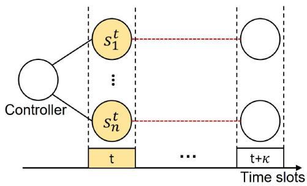  
Fig. 6. Overview of MCTS. The yellow block represents the current time slot t. Red dotted lines represent Monte Carlo simulation within horizon W spanning time slot $t \ { \mathrm { t o } } \ t + \kappa .$

$$
U C B 1 ( s _ { n } ^ { t } ) = \frac { Q ( s _ { n } ^ { t } ) } { V ( s _ { n } ^ { t } ) } + C \sqrt { \frac { l n ( V ( P ( s _ { n } ^ { t } ) ) } { V ( s _ { n } ^ { t } ) } } .\tag{49}
$$

On the right hand side of (49), the first term represents the exploitation potential of node $s _ { n } ^ { t } .$ , i.e., the average coverage lifetime achieved by system configuration $S ( s _ { n } ^ { t } )$ . Then the second term represents the exploration potential of node $s _ { n } ^ { t }$ . The term C is used to balance exploitation and exploration, and it is usually set to two [50]. Once the children node with the maximum UCB1 value is found, the selection step sets it as the current node, and repeats the above process until it reaches a leaf node or a node that needs to be expanded as per the next step.

\- Expansion: In this step, MCTS expands its tree structure from a selected node $s _ { n } ^ { t }$ if the node is a leaf node, and has been visited by at least one time. A set of children nodes $C ( s _ { n } ^ { t } )$ is created and added onto the tree based on the set of actions $\mathcal { A } ^ { t }$

Simulation (Rollout): In this step, MCTS estimates the coverage lifetime of node $s _ { n } ^ { t }$ within the horizon $\mathcal { W } ,$ as shown in red dotted lines in Fig. 6. Let $\mathcal { R } _ { n }$ be the reward after the execution of this step. Specifically, the tree structure starts at node $s _ { n } ^ { t }$ in the current time slot t. After that, MCTS chooses a random action from $\mathcal { A } ^ { t }$ , and the action leads to a new node in future time slot $t + 1$ . MCTS repeats the process of adding new nodes until it reaches a terminal node, i.e., the corresponding system configuration of a node cannot satisfy K-coverage, or the end of horizon W is reached. At the terminal node, MCTS calculates the reward $\mathcal { R } _ { n }$ of this simulation step. This is achieved by summing up the number of nodes on the path from node $s _ { n } ^ { t }$ to the terminal node.

In the simulation step, MCTS needs the solar energy arrivals for charging platforms. Similar to MPC, the controller uses GMM to estimate solar arrivals Gˆ for newly added nodes in future time slots; see Section V-A for details of GMM.

\- Backpropagation: The backpropagation step propagates the reward $\mathcal { R } _ { n }$ from leaf nodes along the path to the root node. Further, the coverage lifetime $Q ( s _ { n } ^ { t } )$ of node $s _ { n } ^ { t }$ is equal to $\mathcal { R } _ { n }$ being updated by this step. Lastly, MCTS updates the visiting frequency of nodes on the said path.

Algorithm 2: Monte Carlo Tree Search.   
Input $\hat { \mathbf { G } } , t , \kappa , E _ { i } ^ { t - 1 } , e _ { j } ^ { t - 1 } , \alpha _ { i j } ^ { t - 1 } , \beta _ { i k } ^ { t - 1 }$   
Output $\dot { s } _ { n } ^ { t }$   
1: Initialize: $Q _ { 0 } \mathrm { = } 0 , V _ { 0 } \mathrm { = } 0 , S _ { 0 } = \{ E _ { i } ^ { t - 1 } , e _ { j } ^ { t - 1 } , \alpha _ { i j } ^ { t - 1 } , \beta _ { i k } ^ { t - 1 } \}$   
2: ∗ ∗ ∗ Generate Root Node ∗ ∗ ∗   
$3 \colon s _ { 0 } { = } G e n e r a t e R o o t N o d e ( Q _ { 0 } , V _ { 0 } , S _ { 0 } )$   
4: ∗ ∗ ∗ Generate Action $\mathbf { S e t } * * *$   
5: At GenerateActionSet(t, sum $( \beta _ { i k } ^ { t - 1 } ) )$   
6: ∗ ∗ ∗ Expand Nodes in time slot $t * * *$   
$\scriptstyle 7 : C ( s _ { 0 } ) = E x p a n s i o n ( s _ { 0 } , { \mathcal { A } } ^ { t } , t )$   
8: ∗ ∗ ∗ Estimate Coverage Lifetime $* * *$   
9: for $s _ { n } ^ { t } \in C ( s _ { 0 } )$ do   
10: $\overset { \cdot } { \mathbf { Q } } ( s _ { n } ^ { t } ) , \overset { \cdot } { \mathbf { V } } ( s _ { n } ^ { t } ) , \overset { \cdot } { \mathbf { V } } ( s _ { 0 } ) { = } \emptyset , a { = } 0$   
11: while a $\neq a _ { m a x }$ do   
12: $s _ { L } , \mathcal { \hat { R } } _ { n } { = } S i m u l a t i o n ( t , t + \kappa , s _ { n } ^ { t } , \hat { \mathbf { G } } , \mathcal { A } ^ { t } )$   
13: $Q ( s _ { n } ^ { t } ) , V ( s _ { n } ^ { t } ) , V ( s _ { 0 } ) { = } B a c k u p ( s _ { L } , \mathcal { R } _ { n } )$   
14: $\mathbf { Q } ( s _ { n } ^ { t } ) { = } \mathbf { Q } ( s _ { n } ^ { t } ) \cup Q ( s _ { n } ^ { t } )$   
15: $\mathbf { V } ( s _ { n } ^ { t } ) { = } \mathbf { V } ( s _ { n } ^ { t } ) \cup V ( s _ { n } ^ { t } )$   
16: $\mathbf { V } ( s _ { 0 } ) { = } \mathbf { V } ( s _ { 0 } ) \cup V ( s _ { 0 } )$   
17: $a = a + 1$   
18: end while   
19: $\underline { { \overline { { Q } } } } ( s _ { n } ^ { t } ) , \overline { { V } } ( s _ { n } ^ { t } ) { = } A \nu e r a g e ( \mathbf { Q } ( s _ { n } ^ { t } ) , \mathbf { V } ( s _ { n } ^ { t } ) )$   
20: $\overline { { V } } ( s _ { 0 } ) { = } A \nu e r a g e ( \mathbf { V } ( s _ { 0 } ) )$   
21: end for   
22: ∗ ∗ ∗ Choose Optimal Node $* * *$   
23: $\begin{array} { r } { \scriptsize \dot { s } _ { n } ^ { t } \mathrm { = a r g m a x } _ { s _ { n } ^ { t } \in C ( s _ { 0 } ) } \frac { \overline { { Q } } ( s _ { n } ^ { t } ) } { \overline { { V } } ( s _ { n } ^ { t } ) } + C \sqrt { \frac { l n ( \overline { { V } } ( s _ { 0 } ) } { \overline { { V } } ( s _ { n } ^ { t } ) } } } \end{array}$   
24: Return $\dot { s } _ { n } ^ { t }$

Once the value $Q ( s _ { n } ^ { t } )$ of nodes $s _ { n } ^ { t }$ in time slot t is determined, the controller adopts the action $\boldsymbol { a } ( s _ { n } ^ { t } )$ that leads to the node with the highest UCB1 value. The horizon then shifts forward by one slot, and the controller repeats the above steps.

Algorithm 2 describes the steps of MCTS. Line 1-3 initialize the controller as a root node $s _ { 0 }$ . Specifically, the system configuration $S _ { 0 }$ of the controller comes from the information of the last time slot $t - 1$ , and the visiting time $V _ { 0 }$ or coverage lifetime $Q _ { 0 }$ of the root node is set to zero. Line 5 generates the action set for the current time slot t. Note that the number of actions $\lvert A ^ { t } \rvert$ in slot t depends on the number of UAVs on monitoring points in the last time slot $t - 1$ . After that, MCTS expands the root nodes to children nodes in time slot t based on $\mathcal { A } ^ { t }$ , where $C ( s _ { 0 } )$ represents the children nodes for the root node $s _ { 0 } .$ . Next, MCTS starts to estimate the coverage lifetime for each node $s _ { n } ^ { t }$ in $\mathcal { A } ^ { t } \mathrm { : }$ see Line 9-21. Specifically, MCTS runs the simulation step for multiple times in order to calculate an average estimated coverage lifetime of node $s _ { n } ^ { t } .$ . To this end, Line 10 initializes $\mathbf { Q } ( s _ { n } ^ { t } ) , \mathbf { V } ( s _ { n } ^ { t } )$ to record the estimated coverage lifetime and visited frequency of node $s _ { n } ^ { t }$ for each run, respectively. Similarly, the visited frequency of node $s _ { 0 }$ for each run is recorded in set $\mathbf { V } ( s _ { 0 } )$ . The term a represents the number of runs. In Line 12 and 13, MCTS executes the simulation and back propagation steps, and the result is the coverage lifetime and visited frequency of node $s _ { n } ^ { t }$ for one run. Note that $s _ { L }$ represents the terminal node. Further, these results for each run are recorded in set ${ \bf Q } ( s _ { n } ^ { t } ) , { \bf V } ( s _ { n } ^ { t } )$ and $\mathbf { V } ( s _ { 0 } )$ . After that, Line 19 and 20 calculate the average coverage lifetime of node $s _ { n } ^ { t } ,$ , and the visited frequency for node $s _ { n } ^ { t }$ and $s _ { 0 } .$ . In the last step, MCTS selects the optimal node $\dot { s } _ { n } ^ { t }$ with the highest UCB1 value; see Line 23.

TABLE III SIMULATION PARAMETERS
<table><tr><td>Parameters</td><td>Values</td></tr><tr><td>Region area</td><td>1000 × 1000  $\overline { { m ^ { 2 } } }$ </td></tr><tr><td>Number of time slots</td><td>30</td></tr><tr><td>Length of a time slot</td><td>0.5 hours</td></tr><tr><td> $\mathrm { U A } { \overset { \sim } { V } }$  weight [8]</td><td>0.9 kg</td></tr><tr><td>Battery capacity of UAVs [8]</td><td>77 Wh</td></tr><tr><td>Maximum flight time [8]</td><td>46 minutes</td></tr><tr><td>Maximum hovering time [8]</td><td>40 minutes</td></tr><tr><td>Battery capacity of charging platforms [37]</td><td>720Wh</td></tr><tr><td>Solar panel size [11]</td><td> $1 0 8 \times 7 1 ~ c m ^ { 2 }$ </td></tr><tr><td>Solar panel conversion efficiency [44]</td><td>20%</td></tr><tr><td>Flying energy consumption rate [45]</td><td>224 Joule/meter</td></tr><tr><td>Air density [46]</td><td> $1 . 2 0 4 ~ k g / m ^ { 3 }$ </td></tr><tr><td>Number of rotors [8]</td><td>4</td></tr><tr><td>Rotor disc area [46]</td><td> $0 . 2 ~ m ^ { 2 }$ </td></tr><tr><td>Planning horizon size</td><td>5</td></tr></table>

We conclude this section by considering the computational complexity of MCTS for one time slot. MCTS needs to calculate the coverage lifetime for $| C ( s _ { 0 } )$ | nodes, where the number of children nodes for root node $s _ { 0 }$ is determined by the action set $\mathcal { A } ^ { t }$ . In the worst case, the number of actions in $\mathcal { A } ^ { t }$ is equal to the number of monitoring points $| { \mathcal { M } } |$ . For each children node of $s _ { 0 } ,$ MCTS contains $a _ { m a x }$ iterations. Further, for each iteration, MCTS calls Simulation() and $B a c k U p ( )$ , where each of them has a run-time computational complexity of $\mathcal { O } ( \vert \mathcal { M } \vert \kappa )$ and ${ \mathcal { O } } ( \kappa )$ respectively. Therefore, the run-time complexity of MCTS is $\mathcal { O } ( a _ { m a x } | \mathcal { M } | \kappa ( | \mathcal { M } | + 1 ) )$ ).

## VI. EVALUATION

Our simulations are conducted in Python and Gurobi [51] on a laptop with Intel Core i5 CPU @2.4 GHz and 8 GB RAM. Table III lists parameter values. We assume UAVs operate in a square area with size $1 0 0 0 \times 1 0 0 0 m ^ { 2 }$ . The parameters of UAVs are as per the data-sheet of DJI Mavic 3 [8]. Specifically, the weight of UAVs is 0.9 kg, and each UAV is equipped with four rotors. Further, UAVs have the same battery capacity of 77 Wh (277200 Joules). This battery capacity allows a UAV to have a maximum flight time or maximum hovering time of 46 minutes and 40 minutes [8], respectively. A UAV’s energy consumption when flying is 224 Joule/meter [45]. Moreover, the air density when hovering is set to 1.204 $k g / m ^ { 3 }$ , and the rotor disc area of UAVs is 0.2 m2 [46].

The energy arrival ofcharging platforms has four states, where each state and its corresponding parameter values are listed in Table IV. Each charging platform has a battery capacity of 720 Wh (2592000 Joules) [52], which is powered by an external solar panel of size $1 0 8 \times 7 1 ~ c m ^ { 2 }$ [11]. Moreover, the solar energy conversion efficiency of charging platforms is set to 20% [44]. To train the GMM for each charging platform, we draw 10000 samples from the model in [44], which are based on actual measurements.

TABLE IV  
PARAMETER VALUES FOR THE FOUR-STATE HIDDEN MARKOV MODEL IN [44]
<table><tr><td>State</td><td>Poor</td><td>Fair</td><td>Good</td><td>Excellent</td></tr><tr><td>Mean</td><td>1.75</td><td>4.21</td><td>7.02</td><td>9.38</td></tr><tr><td>Variance</td><td>0.65</td><td>1.04</td><td>2.34</td><td>0.54</td></tr><tr><td>Steady state probability</td><td>0.16</td><td>0.36</td><td>0.21</td><td>0.27</td></tr></table>

We compare our approaches against two benchmarks:

\- Residual Energy Aware Algorithm (REAA). In each time slot, among all UAVs on monitoring points, this method selects the UAV with the minimum residual energy, and switches its state from monitoring to recharging. For UAVs at a recharging platform, REAA chooses the UAV with the maximum energy, and assigns it to the monitoring point with the minimum distance.

UAV Index Aware Algorithm (UIAA). It assigns UAVs based on their identifier or index. Define a hovering/recharging set that contains UAVs on monitoring points/charging platforms, respectively. In each time slot, UIAA updates the hovering set as follows: i) it selects the UAV with the minimum index in the hovering set, ii) calculates the distance from the selected UAV to all idle charging platforms, and iii) it assigns the selected UAV to its nearest charging platform. On the other hand, UIAA carries out the following steps to update the recharging set: i) selects the UAV with the minimum index in the recharging set, ii) it calculates the distance from the selected UAV to monitoring points without UAVs, and iii) it assigns the selected UAV to its nearest monitoring point. In each time slot, UIAA repeats the aforementioned steps until it fails to generate a hovering set with at least K UAVs.

We study the impact of the following factors on coverage lifetime: i) the number of UAVs, ii) the number of charging platforms, iii) operation region size, iv) UAV battery capacity $E _ { m a x } .$ , and v) charging platform battery capacity $e _ { m a x }$ . We also consider the computation time of MCTS and MPC by changing the number of UAVs or charging platforms. The total number of time slots is $T = 3 0$ , with each time slot duration of τ = 0.5 hours, which is smaller than the maximum flying or hovering time of UAVs. Hence, the maximum coverage lifetime is 15 hours. Each result is an average of 20 runs; each run has a different topology.

## A. UAV Density

This section studies up to ten UAVs, and there are five monitoring points and charging platforms. In terms of K-coverage, we consider K = 2 and K = 4. Figs. 7 and 8 show that the coverage lifetime grows if we deploy more UAVs. This is because more UAVs lead to more opportunities for each UAV to recharge itself. Therefore, each UAV does not deplete its energy. Specifically, in Fig. 7, the coverage lifetime of MILP is 14.15 hours when there are three UAVs, and grows to 15 hours when the number of UAVs is large or equal to four. This means for MILP, it uses four UAVs to achieve perpetual 2-coverage. By contrast, both MPC and MCTS require an additional UAV to achieve perpetual coverage. In the case of 4-coverage, the coverage lifetime of MILP shows a growing trend until it reaches 15 hours with nine UAVs. On the other hand, nine UAVs result in MILP achieving a coverage lifetime of 15 hours. On average, when the number of UAVs increases from four to eight, the coverage lifetime of MPC is 81.04% as compared to MILP. The coverage lifetime of MCTS is 13.63 hours when there are ten UAVs. On average, the coverage lifetime of MCTS is 67.07% as compared to MILP.

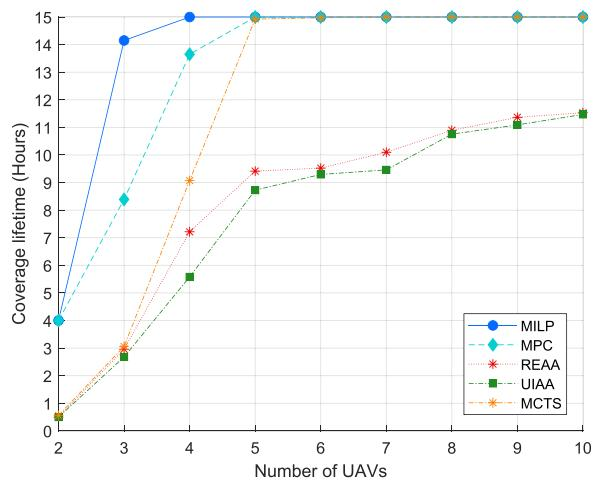  
Fig. 7. Number of UAVs versus coverage lifetime in the case of $K = 2 .$

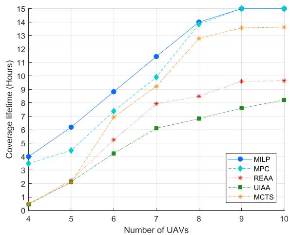  
Fig. 8. Number of UAVs versus coverage lifetime in the case of $K = 4 .$

The coverage lifetime of REAA and UIAA grows with more UAVs. Referring to Fig. 7, the coverage lifetime of REAA and UIAA is respectively 11.53 and 11.47 hours with ten UAVs, which are around 30.1% and 30.78% less than MILP, respectively. In Fig. 8, i.e., the case of 4-coverage, the coverage lifetime of REAA and UIAA is 9.64 and 8.205 hours when there are ten UAVs. This means in the case of ten UAVs, the coverage lifetime of REAA and UIAA is 64.27% and 54.7% that of MILP. The reason why REAA or UIAA has a lower coverage lifetime than MILP or MPC is because they restrict one UAV to change its state from hovering to recharging in each time slot.

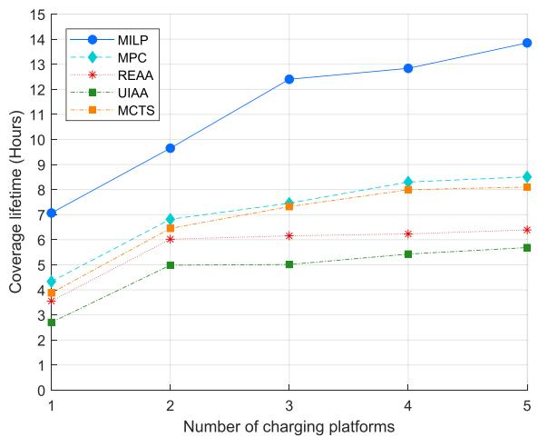  
Fig. 9. Number of charging platforms versus coverage lifetime in the case of $K = 3$

Therefore, when the number of UAVs is larger than the coverage requirement K, increasing the number of UAVs means more UAVs are wasting energy on monitoring points and do not have recharging opportunities. This decreases the coverage lifetime of REAA or UIAA.

## B. Charging Platform Density

Here, we vary the number of charging platforms from one to five in the case of 3-coverage. There are five UAVs and five monitoring points. As shown in Fig. 9, the coverage lifetime of MILP is 7.07 hours when there is one charging platform, and grows to 13.85 hours for five charging platforms. As a comparison, the coverage lifetime of MPC grows from 4.33 to 8.51 hours as the number of charging platforms increases. When there are five charging platforms, the coverage lifetime of MPC is 61.44% as compared to MILP. The coverage lifetime of MCTS increases from 3.88 to 8.1 hours with more charging platforms. On average, the coverage lifetime of MCTS is 94.78% as compared to MPC. By contrast, when there is one charging platform, the coverage lifetime of REAA and UIAA is 57.34% and 38.22% that of MILP, respectively. In the case of five charging platforms, the coverage lifetime of REAA and UIAA is 6.39 and 5.69 hours, respectively. Deploying more charging platforms increases coverage lifetime as this increases the total available energy to recharge UAVs. Further, ifa charging platform has an energy outage, UAVs can recharge themselves on other charging platforms; i.e., UAVs have more recharging opportunities in each time slot.

## C. Region Area Size

The region size affects coverage lifetime. As shown in Fig. 10, when the region is large, the average distance between monitoring points and charging platforms increases, and vice-versa. For example, when the region size is $5 0 0 \times 5 0 0 m ^ { 2 }$ , the average distance from a monitoring point to a charging platform is 260.94 m, and grows to 1564.09 m when region size is $3 0 0 0 \times 3 0 0 0 m ^ { 2 }$

As per Fig. 10, when the deployment region becomes larger, the coverage lifetime of each method decreases. This is reasonable because the distance for each UAV from a monitoring point/charging platform to a charging platform/monitoring point becomes longer. Therefore, the energy consumption incurred by UAVs to travel between locations rises. Specifically, when the region grows from $5 0 0 \times 5 0 0 \mathrm { t o } 3 0 0 0 \times 3 0 0 0 m ^ { 2 }$ , the coverage lifetime of MILP falls from 30 to 11 hours. By contrast, the coverage lifetime of MPC is 25.4 hours when region size is $5 0 0 \times 5 0 0 m ^ { 2 }$ , and it drops to 10.63 hours when we set the area size to $3 0 0 0 \times 3 0 0 0 m ^ { 2 }$ . When the area size is $5 0 0 \times 5 0 0 m ^ { 2 }$ the coverage lifetime of MPC is 84.67% as compared to MILP. When the region size is $5 0 0 \times 5 0 0 m ^ { 2 }$ , the coverage lifetime of MCTS is 22.87 hours, i.e., 76.23% that of MILP. It reduces to 2.934 hours if the region size changes to $3 0 0 0 \times 3 0 0 0 m ^ { 2 }$ . On the other hand, the coverage lifetime of REAA and UIAA reaches 19.03 and 20.8 hours in the case of $5 0 0 \times 5 0 0 m ^ { 2 } .$ , respectively. The coverage lifetime of REAA and UIAA is around 1.5 hours when the area size is $3 0 0 0 \times 3 0 0 0 m ^ { 2 }$

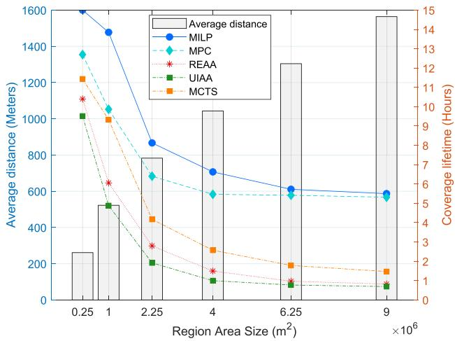  
Fig. 10. Coverage lifetime of each method, for $K = 3$ coverage. The average distance from a monitoring point/charging platform to a charging platform/monitoring point varies with different region area sizes.

## D. UAV Battery Capacity

The battery capacity of UAVs has an impact on coverage lifetime. To this end, this section studies battery capacity ranging from 138600 to 415800 Joules, i.e., from $0 . 5 E _ { m a x } \mathrm { t o } 1 . 5 E _ { m a x } .$ The number of UAVs, charging platforms and monitoring points remain at five each. Referring to Fig. 11, UAVs with a larger battery capacity has higher coverage lifetime. This is reasonable because when we increase the battery capacity of UAVs, they remain on a monitoring point for a longer. Moreover, a larger battery capacity reduces the frequency of recharging or flying back to charging platforms. Hence, the energy consumption of UAVs reduces. Specifically, the coverage lifetime of MILP grows from 4.17 to 14.94 hours when the battery capacity increases from 138600 to 415800 Joules. As a comparison, MPC reaches 3.2 hours when the UAV battery capacity is 138600 Joules. When we enlarge the UAV battery capacity to 415800 Joules, the coverage lifetime of MPC is 11.6 hours, and it is 28.79% less than that of MILP. The coverage lifetime of MCTS grows from two hours to 9.07 hours when the UAV battery capacity increases from 138600 to 415800 Joules. The average coverage lifetime of MCTS is 75.22% of MPC, or 54.77% of the lifetime achieved by

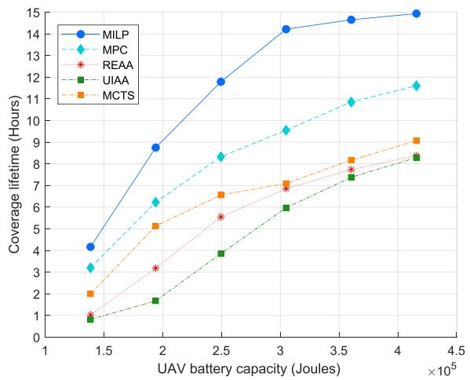  
Fig. 11. UAV battery capacity versus coverage lifetime in the case of $K = 3 .$

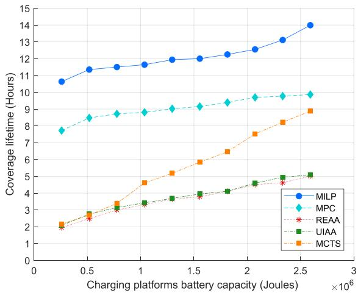  
Fig. 13. Coverage lifetime for different K values.  
Fig. 12. Charging platform battery capacity versus coverage lifetime in the case of $K = 3$

MILP. By contrast, the coverage lifetime of REAA starts from 1.03 hours, and grows to 8.38 hours when the battery capacity of UAVs increases from 138600 to 415800 Joules. Moreover, in the case of 138600 Joules, the coverage lifetime of UIAA reaches 0.82 hours, and it rises to 8.29 hours when the UAV battery capacity grows to 415800 Joules. In the case of 415800 Joules, the coverage lifetime of REAA and UIAA is around 72.4% that of MPC.

## E. Charging Platform Battery Capacity

We adjust the range of charging platform battery capacity from 259200 to 2592000 Joules [52], $\mathrm { i . e . , } 0 . 1 e _ { m a x } \mathrm { t o } e _ { m a x } . \mathrm { A c - }$ cording to Fig. 12, as the battery capacity of charging platforms grows from 259200 to 2592000 Joules, the coverage lifetime of MILP increases from 10.635 to 13.99 hours. This means that the coverage lifetime of MILP increases by 31.54%. By contrast, the coverage lifetime of MPC increases by 27.78%, i.e., from 15.44 to 19.73 hours. On the other hand, the coverage lifetime of MCTS is 2.16 hours when the charging platform battery capacity is 259200 Joules, and it finally reaches 8.88 hours. On average, the coverage lifetime of MPC and MCTS is 74.94% and 44.4% as compared to MILP, respectively. We note that coverage lifetime increases due to a larger charging platform battery capacity. This is because equipping charging platforms with a larger battery means it can store more energy as well as experience less energy overflow. Another observation is that the coverage lifetime of UIAA is higher than REAA. Specifically, the coverage lifetime of REAA increases from 2.06 to 6.29 hours. However, the coverage lifetime of UIAA ranges from 2.08 to 6.42 hours. The maximum gap between REAA and UIAA occurs when the platform battery capacity is $0 . 2 e _ { m a x }$ . In this case, the coverage lifetime of UIAA is 36.8% better than REAA.

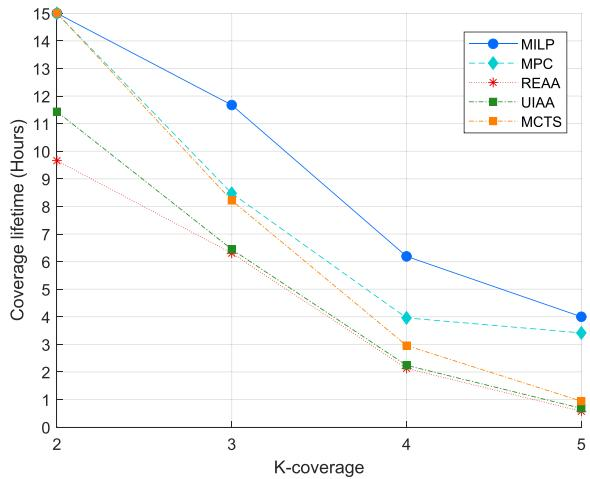

## F. Coverage Requirement

Fig. 13 shows a decreasing trend in coverage lifetime when we increase the coverage requirement K. Here, we vary the coverage requirement K from two to five, and fix the number of UAVs to five. In the case of 2-coverage, the coverage lifetime of MPC and MILP is 15 hours. When K grows to five, the coverage lifetime of MILP drops to 4 hours; for MPC, it reduces to 3.42 hours. The coverage lifetime of MCTS decreases from 15 hours to 0.5 hours from 2-coverage to 5-coverage. On average, the coverage lifetime of MILP is 27.8% and 42.33% longer than MPC and MCTS, respectively. By contrast, the coverage lifetime of REAA drops from 9.66 to 0.58 hours when the value of K grows from two to five. The coverage lifetime of UIAA is 11.44 hours in 2-coverage, and it drops to 0.68 hours in the case of 5-coverage. A larger value of K indicates that the given path requires the coverage from more UAVs. This means UAVs need to consume more energy to satisfy K-coverage. Another reason is that a larger value of K decreases the number of UAVs on recharging platforms in each time slot, i.e., reduces the energy harvested by UAVs.

## G. Hovering and Charging Duration

Fig. 14 illustrates the average time slots each UAV spends hovering or recharging in the case of K = 2-coverage. We consider two to ten UAVs. When there are two UAVs, each

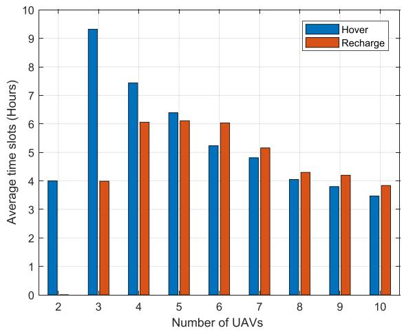  
Fig. 14. In 2-coverage, the number of UAVs versus the average number of time slots of a UAV used for hovering/recharging.

UAV spends four hours hovering, and they do not have chance to recharge themselves. With more UAVs, say from three to ten, the average hovering time of each UAV decreases. Specifically, when there are three UAVs, each UAV spends 9.32 hours on hovering. This becomes 3.47 hours in the case of ten UAVs. In other words, more UAVs lead to each UAV spending less time hovering. Another observation concerns the average recharging time of each UAV. As the number of UAVs grows, the average recharging time of each UAV shows an increase-decrease trend. When the number of UAVs grows from three to five, the average recharging time of each UAV varies from 3.99 to 6.11 hours. In this case, increasing the number of UAVs will give each UAV more chances to recharge. By contrast, the recharging time decreases from 6.11 to 3.84 hours when the number of UAVs grows from five to ten. Another observation is that each UAV has the longest recharging time in the case of five UAVs. The reason is as follows. In the case of 2-coverage, MILP achieves perpetual coverage when there are four UAVs, as shown in Fig. 7. Therefore, after five UAVs, increasing the UAVs number does not affect coverage lifetime. On the other hand, MILP has to ensure UAV receives a recharging opportunity. Therefore, the average recharging time of each UAV drops because there are more UAVs.

## H. Computation Time

Here, the average computation time is defined as the time duration required for a method to produce an assignment of UAVs for each time slot. To study the impact of network size, we set the number of monitoring points to 20, while the number of UAVs or charging platforms ranges from ten to 40. We set the coverage requirement to K = 10.

We study how the following factors affect computation time: i) the number of UAVs, and ii) the number of charging platforms. Note that these two factors affect the network scale. When the number of UAVs or charging platforms increases, there are more variables and constraints for MPC or MCTS to decide. For other parameters, such as UAVs battery capacity or region area size, they do not increase network size. Hence, they have negligible affects on the computation time of a method.

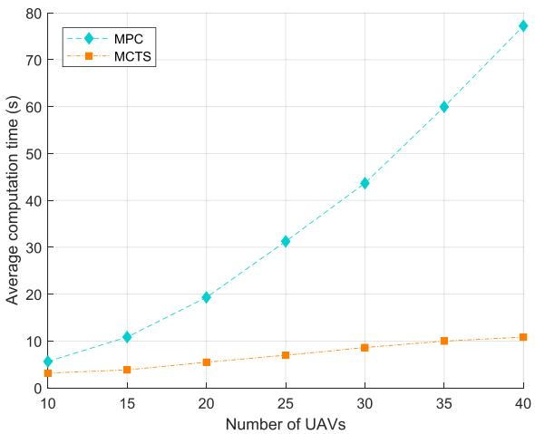  
Fig. 15. In 10-coverage, the average computation time of MPC and MCTS versus the number of UAVs.

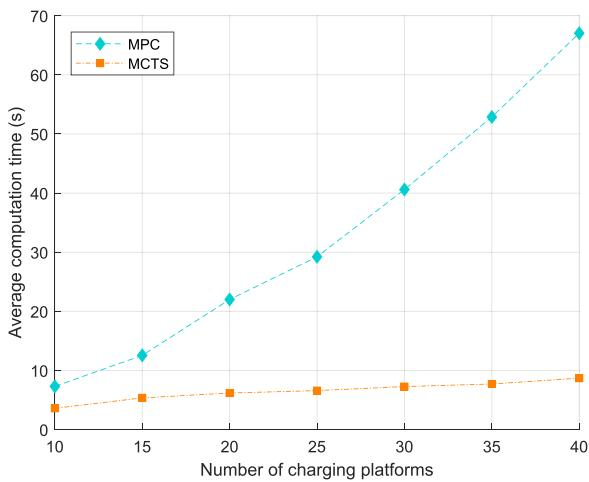  
Fig. 16. In 10-coverage, the average computation time of MPC and MCTS versus the number of charging platforms.

1) Number of UAVs: As shown in Fig. 15, the computation time ofMPC or MCTS increases due to more UAVs. Specifically, when there are ten UAVs, MPC requires 5.63 seconds to produce an assignment. However, when the number of UAVs grows to 40, the average computation time of MPC is 77.23 seconds. By contrast, the average computation time of MCTS is 3.15 seconds when there are ten UAVs, and it is 55.95% as compared to MPC. When we increase the number of UAVs to 40, MCTS requires 10.83 seconds to calculate an assignment. On average, the computation time of MCTS is 27.49% of MPC.

2) Number of Charging Platforms: We vary the number of charging platforms from ten to 40, and the interval is five. As shown in Fig. 16, the computation time of MPC grows from 7.31 to 67.04 seconds when the number of charging platforms increases from ten to 40. On average, adding a charging platform increases the computation time of MPC by 2 seconds. By contrast, when there are ten charging platforms, MCTS computes a solution in 3.59 seconds, and it requires 8.69 seconds when there are 40 charging platforms. On average, the computation time of MCTS is 26.86% of MPC.

## VII. CONCLUSION

This article considers the problem of assigning UAVs to achieve K-coverage over multiple time slots. To this end, this article formulates the problem as an MILP, and proposes two solutions, MPC and MCTS, to assign UAVs to monitor K points or assign them to charging platforms. The simulation results show that the coverage lifetime of MPC and MCTS is almost 81.04% and 67.07% of the optimal result, respectively. We obtain the following results:

MILP has better results than MPC because of the following reasons. First, MPC operates with less information than MILP. Specifically, it uses only predicted solar energy arrivals. By contrast, MILP has accurate energy arrivals for all time slots. Second, MPC suffers from solar energy arrival estimation errors. This means MPC may assign a UAV to a charging platform that has a lower energy arrival rate than its predicted energy arrival. Consequently, a UAV may waste its energy flying to a charging platform or MPC may not assign a UAV to charging platform that in actuality has a high energy arrival. Third, MPC makes myopic decisions. In particular, MPC overwrites its decision in previous time slots, and adjust its UAVs assignments for the current time slot. Therefore, the optimal decision computed by MPC in the last time slot is no longer optimal. This may lead to assignments that lead to UAVs wasting their energy.

\- Although MCTS has a similar framework to MPC, its coverage lifetime is worse than MPC. The reason is as follows. MPC solves MILP (45) to determine its result based on all possible assignments over planning horizon. By contrast, MCTS executes Monte Carlo simulations to determine its result. With a limited computational budget, it does not consider all possible UAVs assignments. However, considering all possible solutions also means that the computation time of MPC is worse than MCTS.

The simulation results show that the coverage lifetime of benchmark methods, namely REAA and UIAA, is worse than MPC or MCTS. This is because REAA and UIAA only select one hovering UAV to recharge in each time slot. This means other UAVs will lose their recharging opportunities. Second, compared to REAA and UIAA, MPC and MCTS have energy arrivals information of charging platforms, which allows them to assign UAVs to charging platforms that have sufficient energy. By contrast, REAA and UIAA do not know energy arrivals information, meaning they may assign a UAV to a charging platform that does not have sufficient energy for recharging. Lastly, MPC has a much slower computation time than MCTS. This is because it requires solving an MILP to optimality. Further, the computation time of MILP increases exponentially with increasing number of UAVs and charging platforms as both quantities increase the number of decision variables and constraints.

An immediate future work is to improve the computation time of our solutions by incorporating the voice of optimization framework [53], where pre-computed solutions stored in a neural network can be used to speed up computation. Another interesting future direction is to design decentralized solutions and apply machine learning techniques to set the operation mode of UAVs.

## REFERENCES

[1] A. Zrelli and T. Ezzedine, “Improvement of k-coverage and connectivity: Case of border monitoring application,” in Proc. Int. Conf. Comput. Syst. Appl., Antalya, Turkey, 2020, pp. 1–5.

[2] L. Yang, H. Yao, J. Wang, C. Jiang, A. Benslimane, and Y. Liu, “Multi-UAV-enabled load-balance mobile-edge computing for IoT networks,” IEEE Internet Things J., vol. 7, no. 8, pp. 6898–6908, Aug. 2020.

[3] H. P. Gupta, S. V. Rao, and V. Tamarapalli, “Analysis of stochastic kcoverage and connectivity in sensor networks with boundary deployment,” IEEE Trans. Intell. Transp. Syst., vol. 16, pp. 1861–1871, Aug. 2015.

[4] M. Erdelj, E. Natalizio, K. R. Chowdhury, and I. F. Akyildiz, “Help from the sky: Leveraging UAVs for disaster management,” IEEE Pervasive Comput., vol. 16, no. 1, pp. 24–32, First Quarter 2017.

[5] V. A. Dambal, S. Mohadikar, A. Kumbhar, and I. Guvenc, “Improving LoRa signal coverage in urban and sub-urban environments with UAVs,” in Proc. Int. Workshop Antenna Technol., Miami, FL, USA, 2019, pp. 210–213.

[6] X. Li, H. Yao, J. Wang, X. Xu, C. Jiang, and L. Hanzo, “A near-optimal UAV-aided radio coverage strategy for dense urban areas,” IEEE Trans. Veh. Technol., vol. 68, no. 9, pp. 9098–9109, Sep. 2019.

[7] M. Lu, M. Bagheri, A. P. James, and T. Phung, “Wireless charging techniques for UAVs: A review, reconceptualization, and extension,” IEEE Access, vol. 6, pp. 29865–29884, 2018.

[8] DJI Mavic 3, 2023. Accessed: Jan. 16, 2023. [Online]. Available: https: //www.dji.com/au/mavic-3/specs

[9] Heisha c300, 2023. Accessed: Jan. 17, 2023. [Online]. Available: https: //www.heishatech.com/charging-pad-3/

[10] L. Chiaraviglio et al., “Bringing 5G into rural and low-income areas: Is it feasible?,” IEEE Commun. Standards Mag., vol. 1, no. 3, pp. 50–57, Sep. 2017.

[11] E. Ali, M. Fanni, and A. M. Mohamed, “A new battery selection system and charging control of a movable solar-powered charging station for endless flying killing drones,” Sustainability, vol. 14, Feb. 2022, Art. no. 2071. [Online]. Available: https://www.mdpi.com/2071-1050/14/4/2071

[12] D. Pianini, F. Pettinari, R. Casadei, and L. Esterle, “A collective adaptive approach to decentralised k-coverage in multi-robot systems,” ACM Trans. Auton. Adapt. Syst., vol. 17, pp. 1–39, 2022.

[13] J. Leng, D. Wang, W. Shen, X. Li, Q. Liu, and X. Chen, “Digital twinsbased smart manufacturing system design in industry 4.0: A review,” J. Manuf. Syst., vol. 60, pp. 119–137, Jul. 2021.

[14] A. V. Savkin and H. Huang, “Navigation of a UAV network for optimal surveillance of a group of ground targets moving along a road,” IEEE Trans. Intell. Transp. Syst., vol. 23, no. 7, pp. 9281–9285, Jul. 2022.

[15] J. Yu, S. Wan, X. Cheng, and D. Yu, “Coverage contribution area based k -coverage for wireless sensor networks,” IEEE Trans. Veh. Technol., vol. 66, no. 9, pp. 8510–8523, Sep. 2017.

[16] M. M. Morato, J. E. Normey-Rico, and O. Sename, “Model predictive control design for linear parameter varying systems: A survey,” Annu. Rev. Control, vol. 49, pp. 64–80, Apr. 2020.

[17] G. Xuan, W. Zhang, and P. Chai, “EM algorithms of Gaussian mixture model and hidden Markov model,” in Proc. Int. Conf. Image Process., Thessaloniki, Greece, 2001, pp. 145–148.

[18] C. B. Browne et al., “A survey of Monte Carlo tree search methods,” IEEE Trans. Comput. Intell. AI Games, vol. 4, no. 1, pp. 1–43, Mar. 2012.

[19] H. Huang and A. V. Savkin, “A method of optimized deployment of charging stations for drone delivery,” IEEE Trans. Transp. Electrific., vol. 6, no. 2, pp. 510–518, Jun. 2020.

[20] N. Patrizi, G. Fragkos, K. Ortiz, M. Oishi, and E. E. Tsiropoulou, “A UAV-enabled dynamic multi-target tracking and sensing framework,” in Proc. IEEE Glob. Commun. Conf., Taipei, Taiwan, 2020, pp. 1–6.

[21] J. Chen, C. Du, Y. Zhang, P. Han, and W. Wei, “A clustering-based coverage path planning method for autonomous heterogeneous UAVs,” IEEE Trans. Intell. Transp. Syst., vol. 23, no. 12, pp. 25546–25556, Dec. 2022.

[22] M. Samir, D. Ebrahimi, C. Assi, S. Sharafeddine, and A. Ghrayeb, “Leveraging UAVs for coverage in cell-free vehicular networks: A deep reinforcement learning approach,” IEEE Trans. Mobile Comput., vol. 20, no. 9, pp. 2835–2847, Sep. 2021.

[23] Z. Han, X. Zhu, and L. Xu, “Scheduling rechargeable UAVs for long time barrier coverage,” in Proc. Int. Conf. Parallel Distrib. Syst., Hong Kong, China, 2020, pp. 282–289.

[24] A. Trotta, M. D. Felice, F. Montori, K. R. Chowdhury, and L. Bononi, “Joint coverage, connectivity, and charging strategies for distributed UAV networks,” IEEE Trans. Robot., vol. 34, no. 8, pp. 883–900, Aug. 2018.

[25] L. Xu, J. Liu, L. Xie, and X. He, “Multi-UAV navigation and recharging for fair and sustainable coverage in wireless networks,” in Proc. Int. Conf. Adv. Inf. Sci. Syst., Sanya, China, 2021, pp. 1–6.

[26] H. Ghazzai, A. Kadri, M. Ben Ghorbel, H. Menouar, and Y. Massoud, “A generic spatiotemporal UAV scheduling framework for multi-event applications,” IEEE Access, vol. 7, pp. 215–229, 2019.

[27] X. Li, H. Yao, J. Wang, C. Jiang, and F. R. Yu, “An energy-efficient UAV recharging and reshuffling strategy for seamless coverage,” in Proc. IEEE Glob. Commun. Conf., Waikoloa, HI, USA, 2019, pp. 1–6.

[28] H. Shakhatreh, A. Khreishah, J. Chakareski, H. B. Salameh, and I. Khalil, “On the continuous coverage problem for a swarm of UAVs,” in Proc. IEEE Sarnoff Symp., Newark, NJ, USA, 2016, pp. 130–135.

[29] X. Li, H. Yao, J. Wang, S. Wu, C. Jiang, and Y. Qian, “Rechargeable multi-UAV aided seamless coverage for QoS-guaranteed IoT networks,” IEEE Internet Things J., vol. 6, no. 6, pp. 10902–10914, Dec. 2019.

[30] C.-I. Li, L.-H. Yen, and M.-C. Cho, “Distributed mission and charging scheduling for UAV swarm to maximize service coverage,” in Proc. IEEE 94th Veh. Technol. Conf., Norman, OK, USA, 2021, pp. 1–6.

[31] S. Jung, J. Kim, and J.-H. Kim, “Joint message-passing and convex optimization framework for energy-efficient surveillance UAV scheduling,” Electronics, vol. 9, Sep. 2020, Art. no. 1475. [Online]. Available: https: //www.mdpi.com/2079-9292/9/9/1475

[32] S. Park, W.-Y. Shin, M. Choi, and J. Kim, “Joint mobile charging and coverage-time extension for unmanned aerial vehicles,” IEEE Access, vol. 9, pp. 94053–94063, 2021.

[33] A. Trotta, M. Di Felice, K. R. Chowdhury, and L. Bononi, “Fly and recharge: Achieving persistent coverage using small unmanned aerial vehicles (SUAVs),” in Proc. Int. Conf. Commun., Paris, France, 2017, pp. 1–7.

[34] L. Lv et al., “Contract and Lyapunov optimization-based load scheduling and energy management for UAV charging stations,” IEEE Trans. Green Commun. Netw., vol. 5, no. 3, pp. 1381–1394, Sep. 2021.

[35] M. Sherman, S. Shao, X. Sun, and J. Zheng, “UAV assisted cellular networks with renewable energy charging infrastructure: A reinforcement learning approach,” in Proc. IEEE Mil. Commun. Conf., 2021, pp. 495– 502.

[36] J. Liu, W. Li, N. B. Shroff, and P. Sinha, “Energy management for timely charging a system of drones,” in Proc. Conf. Decis. Control, Nice, France, 2019, pp. 5180–5186.

[37] L. Amorosi, L. Chiaraviglio, and J. Galán-Jiménez, “Optimal energy management of UAV-based cellular networks powered by solar panels and batteries: Formulation and solutions,” IEEE Access, vol. 7, pp. 53698–53717, 2019.

[38] J. Galán-Jiménez, E. Moguel, J. García-Alonso, and J. Berrocal, “Energyefficient and solar powered mission planning of UAV swarms to reduce the coverage gap in rural areas: The 3D case,” Ad Hoc Netw., vol. 118, Jul. 2021, Art. no. 102517.

[39] R. Santin, L. Assis, A. Vivas, and L. C. A. Pimenta, “Matheuristics for multi-UAV routing and recharge station location for complete area coverage,” Sensors, vol. 21, Mar. 2021, Art. no. 1705. [Online]. Available: https://www.mdpi.com/1424-8220/21/5/1705

[40] D. Chauhan, A. Unnikrishnan, and M. Figliozzi, “Maximum coverage capacitated facility location problem with range constrained drones,” Transp. Res. Part C: Emerg. Technol., vol. 99, pp. 1–18, Feb. 2019.

[41] J. R. Hervas, M. Reyhanoglu, and H. Tang, “Automatic landing control of unmanned aerial vehicles on moving platforms,” in Proc. Int. Symp. Ind. Electron., Istanbul, 2014, pp. 69–74.

[42] V. Kortunov, O. Mazurenko, A. Gorbenko, W. Mohammed, and A. Hussein, “Review and comparative analysis of mini- and micro-UAV autopilots,” in Proc. Int. Conf. Actual Problems UnmannedAerial Veh. Develop., Kyiv, UKraine, 2015, pp. 284–289.

[43] S. Obayashi, Y. Kanekiyo, and T. Shijo, “UAV/drone fast wireless charging FRP frustum port for 85-Khz 50-V 10-A inductive power transfer,” in Proc. IEEE Wireless Power Transfer Conf., Seoul, Korea South, 2020, pp. 219–222.

[44] M.-L. Ku, Y. Chen, and K. J. R. Liu, “Data-driven stochastic models and policies for energy harvesting sensor communications,” IEEE J. Sel. Areas Commun., vol. 33, no. 8, pp. 1505–1520, Aug. 2015.

[45] A. M. Moore, “Innovative scenarios for modeling intra-city freight delivery,” Transp. Res. Interdiscipl. Perspectives, vol. 3, Dec. 2019, Art. no. 100024.

[46] K. Dorling, J. Heinrichs, G. G. Messier, and S. Magierowski, “Vehicle routing problems for drone delivery,” IEEE Trans. Syst. Man Cybern. Syst., vol. 47, no. 1, pp. 70–85, Jan. 2017.

[47] A. P. Dempster, N. M. Laird, and D. B. Rubin, “Maximum likelihood from incomplete data via the EM algorithm,” J. Roy. Statist. Soc.: Ser. B. Methodological, vol. 39, no. 1, pp. 1–22, 1977.

[48] X. Chao, G. Kou, T. Li, and Y. Peng, “Jie ke versus alphago: A ranking approach using decision making method for large-scale data with incomplete information,” Eur. J. Oper. Res., vol. 265, pp. 239–247, Feb. 2018.

[49] P. Auer, N. Cesa-Bianchi, and P. Fischer, “Finite-time analysis of the multiarmed bandit problem,” Mach. Learn., vol. 47, pp. 235–256, May 2002.

[50] M. C. Fu, “A tutorial introduction to Monte Carlo tree search,” in Proc. Winter Simul. Conf., Orlando, FL, USA, 2020, pp. 1178–1193.

[51] Gurobi Optimization, LLC, “Gurobi optimizer reference manual,” 2022. Accessed: Oct. 22, 2022. [Online]. Available: http://www.gurobi.com

[52] Y. Zhang, M. Meo, R. Gerboni, and M. A. Marsan, “Minimum cost solar power systems for LTE macro base stations,” Comput. Netw., vol. 112, pp. 12–23, Oct. 2017.

[53] D. Bertsimas and B. Stellato, “Online mixed-integer optimization in milliseconds,” INFORMS J. Comput., vol. 34, pp. 2229–2248, Apr. 2022.

  
Zilin Song received the bachelor ofengineering (First Class Hons.) degree in telecommunication engineering from the University of Wollongong, Australia and Tiangong University, China in 2018. He is currently working toward the PhD degree with the University of Wollongong. His current research focuses on targets monitoring and UAVs assignment in energy harvesting Internet of Things networks.

Kwan-Wu Chin received the bachelor of science with First Class Honours and the PhD degree with commendation from Curtin University, Australia, in 1997 and 2000, respectively. He was a senior research engineer with Motorola from 2000 to 2003. In 2004, he joined the University of Wollongong as a senior lecturer. He was promoted to an associate professor, in 2011. His current research areas include medium access control protocols for wireless networks, and resource allocation algorithms/policies for communications networks. To date, he holds four United States

of America (USA) patents, and has published more than 190 conference and journal articles.

Changlin Yang (Member, IEEE) received the PhD degree from the University of Wollongong, in 2015. He was a senior wireless engineer with Huawei Australia from 2015 to 2017. He was a postdoctoral researcher with the Department of Electrical Engineering, Columbia University, USA from 2018 to 2020. He is now a research fellow with the School of Software Engineering, Sun Yat-Sen University. He served as a TPC member or session chair for multiple IEEE conferences. His research areas include optimization and machine learning for targets tracking

and coverage problems, and blockchain in Internet of Things.

Montserrat Ros (Senior Member, IEEE) received the BE(Comp. Sys)/BSc(Math) degrees with First Class Honours, in 2000 and the PhD in computer engineering, in 2007, both from the University of Queensland, Australia. She is an associate professor in the School of Electrical, Computer and Telecommunications Engineering and Associate Dean (Education) in the Faculty of Engineering and Information Sciences with the University of Wollongong, Australia. Her research interests include Embedded Systems, Internet of Things, Sensor Networks Data

Fusion, Code Compression and Engineering Education and has published over 80 peer-reviewed papers. Montse was awarded a 2019 Citation for Outstanding Contributions to Student Learning at the Australian Awards for University Teaching; and was named a UOW 2016 Woman of Impact for inspiring the young STEM generation.