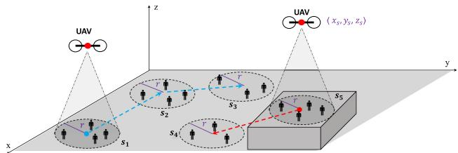
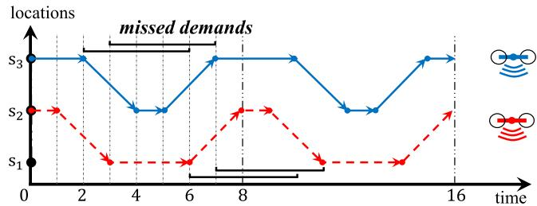
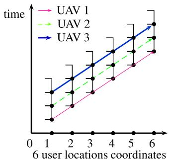
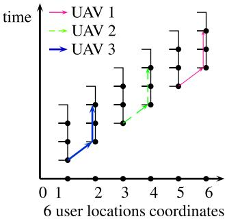
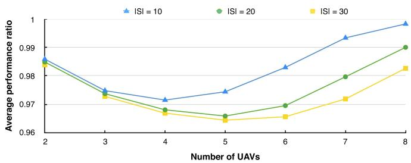
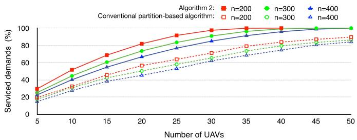
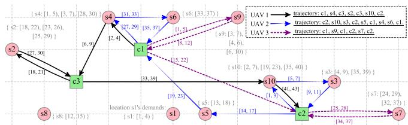
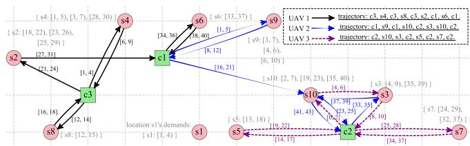
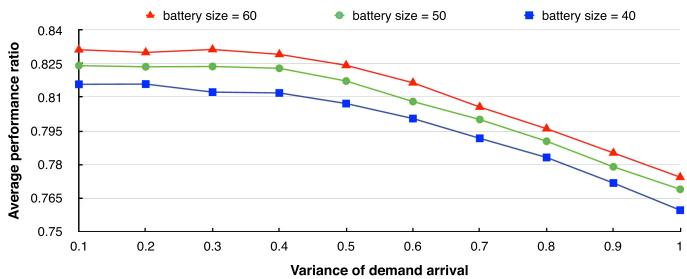

# Multi-UAV Cooperative Trajectory for Servicing Dynamic Demands and Charging Battery

Kai Wang , Xiao Zhang , Member, IEEE, Lingjie Duan , SeniorMember, IEEE, and Jun Tie

Abstract—Unmanned Aerial Vehicle (UAV) technology is a promising solution for providing high-quality mobile services (e.g., edge computing, fast Internet connection, and local caching) to ground users, where a UAV with limited service coverage travels among multiple geographical user locations (e.g., hotspots) for servicing their demands locally. How to dynamically determine a UAV swarm's cooperative path planning to best meet many users’ spatio-temporally distributed demands is an important question but is unaddressed in the literature. To our best knowledge, this paper is the first to design and analyze cooperative path planning algorithms of a large UAV swarm for optimally servicing many spatial locations, where ground users’ demands are released dynamically in the long time horizon. Regarding a single UAV's path planning design, we manage to substantially simplify the traditional dynamic program and propose an optimal algorithm of low computation complexity, which is only polynomial with respect to both the numbers of spatial locations and user demands. After coordinating a large number K of UAVs, this simplified dynamic optimization problem becomes intractable and we alternatively present a fast iterative cooperation algorithm with provable approximation ratio 1 ð1 <sup>1</sup> Þ<sup>K</sup> in the worst case, which is proved to obviously outperform the traditional approach of partitioning UAVs to serve different location clusters separately. To relax UAVs’ battery capacity limit for sustainable service provisioning, we further allow UAVs to travel to charging stations in the mean time and thus jointly design UAVs’ path planning over users’ locations and charging stations. Despite of the problem difficulty, for the optima solution, we successfully transform the problem to an integer linear program by creating novel directed acyclic graph of the UAV-state transition diagram, and propose an iterative algorithm with constant approximation ratio. Finally, we validate the theoretical results by extensive simulations

Index Terms—UAV swarm cooperation, optimal trajectory planning, dynamic demands, battery charging stations, approximation algorithms

## 1 INTRODUCTION

tion to provide high-quality mobile services (e.g., edge computing, high-speed Internet access, and local caching) to ground users (e.g., [1], [2], [3]). Unlike the conventional wireless communication systems, UAVs offer line-of-sight (LoS) wireless links with users [4], which greatly improves the quality of service. Besides, due to their agility and mobility, UAVs can be deployed fast to achieve seamless wireless coverage and provide on-demand mobile services to the users under emergency conditions [5], [6]. Despite of these advantages, a UAV has small service coverage due to limited antenna size and low transmit power, and needs to fly closely to service ground users [7], [8], [9]. To service many dynamic users across different spatial locations sustainably, it is necessary for UAVs to intelligently cooperate with each other by taking into account their locations, trajectories, battery charging and the users’ demands over time, and how to determine UAVs’ cooperative path planning is an important question in many applications.

## 1.1 Related Works

In the literature of wireless communications and networking, there are some studies of UAV deployment schemes to service ground users (e.g., [10], [11]), given their distribution in a geographical area. Zeng and Zhang [12] consider a UAV-enabled base station to service multiple users for achieving maximum throughput per user, by jointly optimizing the transmit power and the UAV trajectory. Without knowing users’ spatial distribution, Xu et al. [8] study the UAV-user interaction for learning users’ real locations before the single UAV’s deployment. To meet users’ instantaneous traffic requests over different locations, Wang et al. [7] study how a single UAV should dynamically adapt its location to user movements following predefined random processes. Wang and Duan [13], [14] further consider the energy allocation of a UAV for meeting dynamically arriving users’ demands. Yang et al. [15] studied energy efficient UAV path planning with energy harvesting.

Jiang and Swindlehurst [16] present a heading algorithm to position an UAV for improving uplink communications for ground users. Xu et al. [17] consider various uncertainties (e.g., user location, wind speed, and no-fly zones) and jointly optimize an UAV’s path planning and transmit beamforming vector for the overall energy consumption, which is a non-convex optimization problem. In [18], UAV’s trajectory is optimally designed in an UAV-enable wireless transfer system in order to maximize the total energy transfer. The cooperative trajectories of UAV-swarm are rarely exploited to improve the system performance, e.g., energy efficiency and service quality.

In term of drone/vehicle routing in the broader literature, there are some studies on multiple vehicular data mules’ joint path planning ([19], [20]). Zhang et al. [20] studied data sensing and transmission problem with energy consideration and proposed a two-stage data gathering approach for dynamic sensing and routing. As to path planning of UAVs, Sun et al. [21] studied 3D trajectory design for UAV communication systems and considered ground users’ static demands only. These works do not explicitly study the UAV-to-UAV cooperation to meet users’ dynamic demands spatially and temporally, and there is a lack of studies of such UAV-swarm cooperation for dynamic path planning.

We are aware that in the literature of artificial intelligence and robotics, there are some preliminary designs of cooperative vehicle trajectories to visit target locations once and for all ([22], [23], [24]). However, in practice the UAVswarm may need to repeatedly visit the same set of user locations (e.g., shopping malls and other hotspots) over time according to users’ activity patterns and waiting time deadline, and there is another temporal domain to optimize other than the spatial domain. As the sustainable UAV servicing over many users is also limited by the UAV’s energy capacity ([25], [26]), we should allow UAVs to return to a charging station to recharge or change their batteries. These problems are not addressed in previous studies by designing UAVs’ cooperative path planning over users’ locations and charging stations for achieving sustainable servicing.

## 1.2 Main Contributions

Given the aforementioned review, no prior optimization technique can be applied to this challenging problem, and we are interested in developing new algorithms for cooperative UAV-swarm path planning with provable performance bounds. When there are many spatial locations or user demands to service over time, our problem becomes complex and it is challenging to design tractable algorithms with low computational complexity.

Our key novelty and main contributions in this paper are summarized as follows.

Dynamic UAV-swarm cooperation to service users’ spatial-temporal demands (Section 2): To our best knowledge, this is the first paper to design and analyze cooperative mutli-UAV trajectory planning algorithms for dynamically servicing many spatial demand locations over time. Unlike existing routing problems (e.g.,[19], [22], [23]), we consider the practical and challenging problem that the UAV-swarm need to repeatedly visit users’ locations and charging stations over a long time, and design low-complexity algorithms for guiding UAV-swarm cooperation with provable performance guarantee.

 Optimal path planning for a single UAV (Section 3): Regarding a single UAV’s dynamic trajectory Authorized licensed use limited to: GUANGZHOU UNIVERSITY. Downloade planning problem, we manage to substantially simplify the dynamic programming problem and propose a fast algorithm for returning the UAV’s optimal path planning. The algorithm’s complexity is low and regardless of the scale of time domain, only polynomial with respect to both the numbers of user locations and user demands.

  
Fig. 1. An illustration of the system model, where two UAVs cooperatively route and service $| S | = 5$ locations or clusters with radii r in the (x; y; z) 3D space. Each location (e.g., location $s _ { 1 }$ here) releases a series of user demands over time and each user demand requests to be serviced by a UAV within user’s waiting time. The connected blue dashed and red dashed arrows show the first and second UAVs’ trajectories, respectively.

Cooperative path planning of a large UAV-swarm to service many user demands (Section 5): When a large number jKj of UAVs are cooperating to service many user locations, the simplified dynamic optimization problem becomes intractable and we alternatively present a fast iterative cooperation algorithm with provable approximation ratio $1 - ( 1 - \frac { 1 } { | K | } ) ^ { | K | }$ in the worst case, which arbitrarily approaches to constant guarantee $1 - 1 / e$ . Our approximation algorithm is proved to obviously outperform the traditional approach of partitioning UAVs to serve different user/location clusters separately.

Refined algorithm design for UAV-swarm by adding UAV charging stations (Section 6): For achieving sustainable service provisioning, we jointly design UAVs’ cooperative path planning over spatial-temporal users’ demands and various charging stations. The problem becomes more challenging and we successfully transform it to an integer linear programming by creating novel directed acyclic graph (DAG) of the UAV-state transition diagram. To further lower the complexity we accordingly propose an iterative algorithm with constant approximation ratio.

## 2 SYSTEM MODEL AND PROBLEM DESCRIPTION

As illustrated in Fig. 1, given a set K of UAVs to service a set J of dynamically arriving users over a set of potential locations (e.g., shopping malls and other hotspots) across the 3D space, we seek to design UAV-swarm’s cooperative path planning among these locations to meet delay-sensitive users’ demands as many as possible. To successfully service a user demand, a UAV must reach the corresponding location before the waiting deadline of the demand. The objective is to determine cooperative path planning for the UAVswarm so that the total number of successfully serviced demands is maximized. In the following, we detail the system model for the dynamic demands, UAV service, and summarize the key notations in Table 1.

TABLE 1 Notations and Physical Meanings
<table><tr><td>Math notation</td><td>Physical Meaning</td></tr><tr><td> $K$ </td><td>the set of UAVs</td></tr><tr><td> $S$ </td><td>the set of user locations</td></tr><tr><td> $J , n$ </td><td>the set (resp. the number) of all user demands</td></tr><tr><td> $J _ { s }$ </td><td>the set of user demands at location  $s \in S$ </td></tr><tr><td> $r _ { j } , d _ { j }$ </td><td>the release time and waiting deadline of user demand  $j \in J ,$  respectively</td></tr><tr><td> $q$ </td><td>servicing time for each demand</td></tr><tr><td> $a ( s , s ^ { \prime } )$ </td><td>the travelling distance from location s to location  $s ^ { \prime }$ </td></tr><tr><td> $U ( t )$ </td><td>the state of the UAV at time t</td></tr><tr><td> $M ( t )$ </td><td>the set of historical UAV states up to time t</td></tr><tr><td> $J ( M ( t ) )$ </td><td>the set of serviced demands up to time t</td></tr><tr><td> $\langle U ( t ) , J ( M ( t ) ) \rangle$ </td><td>the decision state at time t</td></tr></table>

As in [11], [12], we adopt the air-to-ground model where the UAVs are deployed to the positions above ground and the wireless communication channels between UAVs and users are dominated by $\mathrm { L o } \mathsf { S }$ links. LoS links are expected for air-to-ground channels in many scenarios. Therefore, the channel power gain from the UAV to each user k is modeled as the free-space path loss model, i.e., $g _ { k } = \xi \bar { d } _ { k } ^ { - 2 } .$ , where - denotes the channel power gain at a reference distance. $\bar { d } _ { k }$ is the link distance between the UAV i and ground user k. Given a standard transmission power $P ,$ the signal-to-noise ration (SNR) at ground user k is given by $\begin{array} { r } { \gamma _ { k } = \frac { \bar { P } g _ { k } } { \sigma ^ { 2 } } } \end{array}$ , where $\sigma ^ { 2 }$ denotes the noise power at each ground user. We say a ground user k at any location can be serviced by a UAV if the SNR at user k is no less than a threshold value $\gamma _ { t h } ,$ and the data rate is log $( 1 + \gamma _ { t h } )$ . Thus, we can obtain each UAV’s wireless coverage disk on the ground with range r and flying altitude H to serve users nearby to meet target SNR as follows.

$$
r = \sqrt { \frac { P \xi } { \gamma _ { t h } \sigma ^ { 2 } } - H ^ { 2 } } .\tag{1}
$$

Given the spatial distribution of the ground users and the coverage radii $^ { r , }$ the ground users can be clustered into the location set S by applying the classical clustering algorithm [27]. As illustrated in Fig. 1, each cluster of users is a circular region with ground radius $^ { r , }$ correspondingly, the associated UAV location in 3D is $s = \langle \bar { x _ { s } } , y _ { s } , z _ { s } \rangle \in S ,$ thus we denote $J _ { s }$ as the set of user demands in this cluster, which are dynamically released over time. Our following algorithms are thus designed based on such wireless model and set S.

We assume that the UAVs have sufficient bandwidth resources so that all UAVs can be assigned orthogonal channels and for achieving interference-free [28]. Note that in our designed algorithms, multiple UAVs servicing the same UAV location simultaneously is prohibited. In practice, the assigned channels for distant UAVs can be reused during servicing. Thus, the interference among UAVs can be ignored, and henceforth we focus our study on the UAVswarm path planning.

Each user demand $j \in J _ { s }$ associated by UAV location $s \in$ S is characterized by its release time $r _ { j }$ and waiting deadline $d _ { j } ,$ where the time difference $d _ { j } - r _ { j }$ tells the user’s maximum waiting time. For each demand, it takes a fixed amount of time $q$ to service this demand. We denote $J =$ $\cup _ { s \in S } J _ { s }$ as the set of demands at all the locations and denote $n = \left| J \right|$ as the total number of demands. To locally service user demand $j \in J _ { s }$ , the UAV must reach location s within time window $[ r _ { j } , d _ { j } )$ and service at location s for at least a consecutive time q. If a UAV just reaches the location at time point $t = d _ { j } ,$ , it cannot service demand $j$ but just misses the demand.

In our model, the UAV can simultaneously service multiple user demands at the same location, which holds for many applications such as edge computing and information broadcasting to users [29].

To ensure reliable service, the servicing demands can not be interrupted and should be finished before the UAV leaves the location. Note that in our problem of optimizing multi-UAV trajectory planning, the demand set $J _ { s }$ is already determined as users need to register their demands beforehand and otherwise the demand will not be serviced. The UAV path planning is computed based on the given $S , J _ { s } , K$ in the offline. Later in Section $^ { 7 , }$ we will show that our designed algorithms also provide good performances even if there is some unexpected error in estimating the demands.

We model the spatial connectivity of the UAV locations S by a distance matrix $a ( \cdot , \cdot )$ , where $\boldsymbol { a } ( s , s ^ { \prime } )$ indicates the pairwise travelling distance from location s to $s ^ { \prime }$ with $s , s ^ { \prime } \in S .$ In our model, we assume the UAV moves at constant speed $v ,$ and without loss of generality, we normalize it as $v = 1$ In addition, we practically consider that the UAV’s traveling distance matrix satisfies the triangle inequality, i.e., for any three different locations $s , s ^ { \prime } , s ^ { \prime \prime } \in \mathsf { \bar { S } } ,$ , it holds that

$$
a ( s , s ^ { \prime } ) + a ( s ^ { \prime } , s ^ { \prime \prime } ) \geq a ( s , s ^ { \prime \prime } ) .\tag{2}
$$

When a UAV is flying from location s to $s ^ { \prime } ,$ it cannot provide any service to users in the meantime, since UAVenabled service coverage is small as compared to the distance between location s and s<sup>0</sup> [30].

Our problem can be described as an optimization problem to maximize the number of successfully serviced demands as follows.

$$
\operatorname* { m a x } _ { \{ T _ { k , s } , \forall \mathrm { U A V } _ { k } \mathrm { a n d ~ l o c a t i o n } _ { s } \} } \ : \sum _ { s \in S } \sum _ { j \in J _ { s } } \mathrm { s e r v i c e d } ( j , T _ { s } )
$$

$$
s . t . \ ( T _ { k , 1 } , T _ { k , 2 } , \ldots , T _ { k , | S | } ) { \longrightarrow } \mathrm { f e a s i b l e ~ r o u t i n g , ~ } \forall k .\tag{3}
$$

$$
\left\{ T _ { s } = \bigcup \right\} _ { k = 1 } ^ { K } T _ { k , s } , s \in S \} { \longrightarrow } \mathrm { c o l l i s i o n \mathrm { - } f r e e ~ r o u t i n g }  .
$$

$$
\begin{array} { r } { \mathrm { s e r v i c e d } ( j , T _ { s } ) = \left\{ \begin{array} { c c } { 1 , } & { \mathrm { i f } \exists k , \exists [ t _ { 1 } , t _ { 2 } ) \in T _ { k , s } , } \\ { } & { t _ { 2 } - q \in [ r _ { j } , d _ { j } ) \cap [ t _ { 1 } , t _ { 2 } ) . } \\ { 0 , } & { \mathrm { o t h e r w i s e } } \end{array} \right. } \end{array}\tag{4}
$$

As a decision, the schedule set $T _ { k , s }$ in the whole discrete time horizon $[ 1 , T _ { m a x } ]$ contains all the time periods during on October 26,2026 at 07:50:12 UTC from IEEE Xplore. Restrictions apply.

  
Fig. 2. An illustrative example of two-UAV cooperative path planning (in red dashed line and blue solid line) to service three locations $( s _ { 1 } , s _ { 2 } , s _ { 3 } )$ placed on a line over 16 discrete time units. All demands last for 4 units of time and are released at each discrete time point, $\begin{array} { r l } { \mathsf { i . e . , } } & { { } J _ { s _ { 1 } } = } \end{array}$ $\{ [ 0 , 4 ) , [ 1 , 5 ) , [ 2 , 6 ) , . . . \} , J _ { s _ { 2 } } = \{ [ 0 , 4 ) , [ 0 , 4 ) , [ 1 , 5 ) , [ 1 , 5 ) , [ 2 , 6 ) , [ 2 , 6 ) , . . . \} ,$ $\bar { J _ { s _ { 3 } } } = \{ \bar { [ 0 , 4 ) } , \bar { [ 1 , 5 ) } , [ 2 , 6 ) , . . . \bar  \}$ . The arrows indicate the optimal path planning of the two UAVs, where the horizontal intervals at locations $s _ { 1 } , s _ { 3 }$ indicate 4 missed demands.

which UAV k is hovering at location $s \in S$ to service user demands there, and the time periods $( T _ { k , 1 } , T _ { k , 2 } , \ldots , T _ { k , | S | } )$ are the result of a feasible routing of a single UAV k. In particular, $T _ { s }$ summarizes the overall servicing time periods at location s by all UAVs. To address the UAV collision issues, the path planning defined by $T _ { k , s }$ is collision-free if any two UAVs neither meet at any location nor meet during flying to its target location. At time point $t \in T _ { k , s } , \mathrm { U A V }$ k can start to service a demand $j \in J _ { s }$ at location s only if this demand is released prior to time t and not missed yet, $\mathbf { i . e . , } t \in [ r _ { j } , d _ { j } )$ As such, demand j can be serviced if time period $[ t _ { 1 } , t _ { 2 } ) \in$ $T _ { k , s }$ of UAV k is long enough to finish the demand, i.e., condition $t _ { 2 } - q \in [ r _ { j } , d _ { j } ) \cap [ t _ { 1 } , t _ { 2 } )$ in Eq. (4) indicates a service success. Thus, the optimal UAV trajectory planning sends each UAV k to service at each location $s \in S$ appropriately at time periods $T _ { k , s }$ such that the total number of serviced demands is maximized. From above formulation of problem in Eq. (3), each UAV needs to decide at any time point to visit which location, translating to a huge computational complexity for solving Eq. (3), which is $\breve { O ( } ( T _ { m a x } ) ^ { \mathbf { \bar { 2 } } K H } )$ with H being the number of visits per UAV per location. Actually, we can rigorously prove that this problem is NP-hard and the existing solutions (e.g., [19], [22], [23]) in the literature cannot apply, requiring us to innovate and propose new algorithms with provable performance bounds.

Seeking UAV-swarm cooperation is important for the optimal path planning for meeting dynamic demand patterns over space and time, and we illustrate the cooperation advantage by a simple example in Fig. 2, which motivates our problem formulation in next sections. Here we have two UAVs to provide service at three locations along a road in set $S = \{ s _ { 1 } , s _ { 2 } , s _ { 3 } \}$ . The three locations along a road have 1D coordinates $\{ 0 , 2 , 4 \}$ , respectively, telling a UAV’s travelling delay $a ( s _ { 1 } , s _ { 2 } ) = a ( s _ { 2 } , \bar { s _ { 3 } } ) = 2$ if we normalize the UAV velocity as one unit per time. At each discrete time $t \in$ $\{ 0 , 1 , 2 , \ldots \}$ , there is one user demand released at location $s _ { 1 } ,$ one user demand released at $s _ { 3 }$ and two user demands released at middle location $s _ { 2 }$ . All demands have fixed service time $q = 1$ and last for 4 time units, i.e., $d _ { j } - r _ { j } = 4 , \forall j \in J $

Fig. 2 shows how the two UAVs cooperate with each other in a periodic cycle of 8 time units at optimum. Specifically, in every 8 time units, the two UAVs take turns to visit location $s _ { 2 }$ with a time gap of 3 time units (without missing any demand there), and each of them stays at one of the two ends (location $s _ { 1 } \ \mathrm { o r } \ s _ { 3 } )$ for 3 time units for each visit there. During the first time period cycle [0,8) for example, at location $s _ { 1 } ( \mathrm { r e s p . } s _ { 3 } )$ only two demands with release times 6 and 7 (resp. release times 2 and 3) are missed. That is to say, totally 87:5% of demands are serviced. Without cooperation, however, the two UAVs which stay at their own locations will miss much more demands. For example, if the first UAV stays at location $s _ { 1 }$ to meet all the demands there and the second UAV services the remaining two locations, the strategy of the second UAV that travels between $s _ { 2 }$ and $s _ { 3 }$ back-and-forth staying one unit time at each will miss $^ 6$ demands (4 demands from $s _ { 2 }$ and 2 demands from $s _ { 3 } )$ in the period time cycle $^ { [ 0 , 6 ) }$ , which does not service more demands than simply staying at location $s _ { 2 }$ to service all demands there. As a result, at most 75% of demands can be serviced. Later in Lemma 14, we theoretically prove that the performance of UAV-swarm’s partitioned path planning without overlapped locations can be arbitrarily poor.

The advantage of UAV-swarm cooperation is not only to hit the dynamic demands, but also to cover each other to charge battery and enable sustainable service provisioning. Later in Section 6 we will generalize our model to consider UAV battery charging at ground stations.

## 3 OPTIMAL PATH PLANNING ALGORITHM FOR ASINGLE UAV

In this section, we first design and analyze the optimal path planning algorithm of a single UAV for servicing the dynamically arriving user demands across different spatial locations, which will be shown extendable to the multi-UAV case by taking the cooperation advantage among multiple UAVs into account in later sections. Nevertheless, the dynamic optimization problem for the single UAV is still challenging due to the curse of dimensionality or huge solution space for spatial routing decision-making over time. To tackle this challenge, we first analyze the fundamental properties of the UAV routing under optimal path planning, and then identify the critical times at which a routing decision is really necessary. This will substantially reduce the solution space of routing decisions, since now it suffices to make routing actions at a reduced set of time points instead of the whole continuous-time domain. Then, only at each critical time stamp, we need to characterize the decision state that determines the optimal routing action. Finally, we propose a dimensionality-reduced dynamic programming approach to enumerate all such possible decision states and efficiently compute the optimal path planning.

In the following, we first characterize the UAV movement in an optimal path planning by the following two lemmas.

Lemma 1. At the optimum, once the UAV finishes servicing the on-going demands, it should either immediately travel to another location or continue hovering at the current location until servicing a new demand here.

Proof. We can prove this by contradiction. If the UAV continues staying at the current location s for a positive time without servicing any demand there, it must be waiting for some new demand to service. Suppose not, then the UAV can always travel to next target location earlier, hence servicing more demands and improving the objective of problem (3). tu

Lemma 2. If the UAV just arrives at a new location $s ^ { \prime }$ (from location s) to just find no demand there, it is optimal for the UAV to keep waiting at location $s ^ { \prime }$ until a new demand is released in the future.

Proof. Consider the other case that the UAV plans to leave location $s ^ { \prime }$ to some other location $s ^ { \prime \prime } ,$ without meeting or servicing any demand at location $s ^ { \prime } .$ Then, it is better for the UAV to travel directly from location $s$ to $s ^ { \prime \prime } ,$ , which saves travel time according to the triangle inequality in Eq. (2). tu

Using the above two lemmas, we conclude that at optimum the UAV decides to leave (or not leave) the current location only at the time point when it just finishes servicing a demand there. When the UAV decides to leave the current location at time point $t ,$ we do not need to make any routing decision during time window $( t - q , t ] ,$ as it takes time $q$ to finish servicing the current demand. Therefore, we can equivalently regard this routing decision of leaving or not to be made at time point $t - q .$

## 3.1 Dimensionality-Reduced Decision States in the Markov Decision Process

The optimal path planning contains a series of routing decisions (e.g., stay at the current location or fly to another location) at critical time stamps, and it can be modeled as a Markov decision process (MDP). Therefore, we need to characterize the decision state that determines the optimal routing action at each critical time point. A decision state consists of the state of the UAV and the state of the demands, both of which are necessary for the UAV to make the best routing decision. For example, before flying to a new location, the UAV should know which user demands can be met and serviced there. The focus of our dimensionality-reduced dynamic programming approach is to efficiently reduce the possible decision states such that we only consider the decision states that could occur under an optimal path planning. We successfully achieve this decision state reduction by comparing the path planning choices and disregarding the choices dominated by the others. Next, we first introduce the UAV state as well as the partial feasible path planning, and then the dominant property over different partial feasible path planning choices. Table 1 contains a summary of notations defined below for characterizing the decision state of the problem.

Definition 3 (UAV State for the MDP formulation). At time point $t ,$ the UAV state is represented by a tuple $U ( t ) =$ $\langle t , i , s \rangle$ , indicating that the UAV is at location $s \in S$ at time point t and it has already serviced a number of i demands up to time t (including the possible demands finished exactly by time t).

Definition 4 (Partial Feasible Path Planning). A partial feasible path planning up to time t is a set of UAV states $M ( t ) = \hat { \{ U ( t ^ { \prime } ) \ \rvert \ t ^ { \prime } \in [ 0 , t ] \} }$ , where $U ( t ^ { \prime } )$ represents the UAV state at time point $t ^ { \prime } .$

Before time point $t ,$ each historical UAV state $U ( t ^ { \prime } ) \in$ $M ( t )$ contains the location information of the UAV at earlier time $t ^ { \prime } ,$ hence a partial path planning for the UAV up to time t can be defined by set $M ( t )$ . As a result, the serviced demands up to time t can also be derived, which is denoted by the set $\bar { J ( M ( t ) ) }$ and is critical in our MDP problem objective. Without recording this set, the UAV cannot tell whether a demand $j$ at location s has been previously serviced or not, by using the basic information of demand release time $r _ { j }$ and deadline $d _ { j } .$ . This can indeed happen when demand $j$ has a long waiting time window $[ r _ { j } , d _ { j } )$ during which the UAV might have visited location s for several times. Each visit after the first one, the UAV should know that demand $j$ is already serviced at the very first visit. However, directly recording this set $J ( M ( t ) )$ leads to exponential solution space due to the combinatorial nature of the serviced demands by the UAV over time. The key observation in our approach is that the complexity of set $J ( M ( t ) )$ can be significantly reduced without the entire information of $M ( t )$ but instead with only the latest UAV departure times at the locations. Now, we formally introduce the definition of decision state at a time point t of interest.

Definition 5 (Decision State). In a partial feasible path planning defined by $M ( t )$ , the decision state at time point t is represented by $\langle U ( t ) , J ( M ( t ) ) \rangle$ where $U ( t )$ represents the $U A V$ state at time point t and $J ( M ( t ) )$ indicates the set of serviced demands up to time t.

We then define the dominance relation between two partial feasible path planning choices and show that dominated path planning choices will not be adopted by optimum.

Definition 6 (Choice Dominance). Let sets $M ( t )$ and $M ^ { \# } ( t ^ { \# } )$ define any two different partial feasible path planning choices respectively, and let $\mathbf { \bar { \chi } } U ( t ) = \langle t , i , s \rangle \mathbf { \bar { \epsilon } } \in \dot { M } ( t )$ and $U ^ { \# } ( t ^ { \# } ) = \langle t ^ { \# } , i ^ { \# } , s ^ { \# } \rangle \in M ^ { \# } ( t ^ { \# } )$ be the UAV states at time point t and time $t ^ { \# }$ in the two path plannings, respectively. Formally, the path planning defined by $M ^ { \# } ( t ^ { \# } )$ is dominated by $M ( t )$ if and only if $\begin{array} { r } { \mathrm {  ~ \psi ~ } ( i ) \ s = s ^ { \# } , i = i ^ { \# } ; \ ( i i ) \ J ( M ( t ) ) = } \end{array}$ $\bar { J } ( M ^ { \# } ( t ^ { \# } ) ) ; ( i i i ) t < \bar { t } ^ { \# }$

Lemma 7. Dominated partial path planning will never be adopted by optimum.

Proof. Comparing the two path plannings defined by $M ( t )$ and $M ^ { \# } ( i ^ { \# } )$ in Definition $^ { 6 , }$ all state parameters are the same except that $t < t ^ { \# }$ , indicating that when finishing the same objective number i of demands, the former path planning uses less time than the latter and hence has advantage over the latter since the UAV can at least dissipate this extra time via waiting at the current location from time t to time $t ^ { \# }$ to service more potential demands. □

In the next subsection, we are ready to introduce our dimensionality-reduced dynamic programming algorithm to compute all possible decision states.

## 3.2 Low-Complexity Dynamic Programming Algorithm

In this subsection, we propose a new algorithm to compute the optimal path planning of a single UAV. As mentioned in Section 3.1, the optimal routing decision at each time t can be completely determined by the decision state $\langle U ( t ) , J ( M ( t ) ) \rangle$ , which corresponds to a partial path planning choice $M ( t )$ . We first show a way to represent this decision state efficiently, without $M ( t )$

Lemma 8. At time point t, it is sufficient to compute the optimal routing action by recording the last departure time $t ^ { * }$ at each location $s ,$ instead of recording the set of all serviced demands $J ( M ( t ) )$ up to time t.

Proof. Consider the serviced demands at location s up to time $t , \mathrm { i . e . , } J ^ { \prime } = J _ { s } \cap J ( M ( t ) )$ . When the UAV just arrives at location s at time point $t ,$ we focus on an arbitrary demand $j \in J _ { s }$ that is released before time $t . \operatorname { I f } d _ { j } \leq t ,$ this demand is already due by time $t ,$ and it does not matter whether it has been serviced or not. Otherwise if $r _ { j } < t <$ $d _ { j } ,$ , this demand could possibly already be serviced at some earlier visit of location s. We claim that demand $j$ is already serviced if $r _ { j } \le t ^ { * } - q$ and not serviced otherwise. Note that by Lemmas 1 and 2, the UAV leaves the location at a historical time $t ^ { * }$ only if it exactly finished some demand at time point $t ^ { * }$ . Hence, demand j can at least be serviced by the UAV during historical time interval $[ t ^ { * } -$ $q , t ^ { * } )$ if $r _ { j } \leq t ^ { * } - q ;$ and otherwise if $r _ { j } > t ^ { * } - q ,$ that ${ \mathrm { i } } \mathbf { s } ,$ demand j cannot be finished by time $t ^ { * }$ , and thus it is not serviced yet. As a conclusion, with the last departure time $t ^ { * }$ at location $s ,$ the UAV is able to differentiate for each demand $j$ from $J _ { s }$ whether the demand is still waiting to be serviced or not. tu

Lemma 8 indicates that whether a demand from location s is waiting to be serviced or not can be easily identified by the last UAV departure time $t ^ { * }$ at location $s .$ This provides opportunities for efficiently encoding the decision state $\langle \hat { U } ( t ) , J ( M ( t ) ) \rangle$ , without the entire information from set $M ( t )$ . Based on Lemma $^ { 8 , }$ we now describe the dimensionality-reduced dynamic programming algorithm as follows.

At time point $t ,$ we label the latest UAV departure time stamps at all the locations. More specifically, we introduce set $Q ,$ , where each tuple $\langle s ^ { * } , t ^ { * } \rangle \in Q$ tells that time point $t ^ { * }$ is the latest time when the UAV leaves location $s ^ { * }$ . Therefore, the decision state at time point t can be efficiently represented by $\langle Q , i , s , t \rangle$ , which indicates that the UAV is at location $s$ and just services an accumulated number $i$ of demands by time t with the constraints of departure times in $Q .$ Although set $Q$ still incurs huge solution space, we only need it to extract useful information for optimal decisionmaking. Later in the analysis of computational complexity of our dimensionality-reduced dynamic programming algorithm, we show that the complexity of set $Q$ can be significantly reduced to achieve polynomial complexity.

Based on the UAV decision state $\langle Q , i , s , t \rangle$ , we further consider the dominance relation between different states. Implied by the dominant property of decision state in Definition 6 and Lemma $^ { 7 , }$ the earlier the UAV services the same demands, the better the path planning choice is. We thus aim to design the dimensionality-reduced dynamic programming algorithm to find the path planning choice that can service the same amount of demands as the optimum and minimize the time span to service these demands. Accordingly, given particular set $Q ,$ , integer $i \in \{ 1 , \ldots , n \}$ and location $s \in S ,$ , we denote variable $g ( Q , i , s )$ as the earliest time t such that some partial feasible path planning reaches decision state $\langle Q , i , s , t \rangle$ , i.e., time t is the earliest time for the UAV to finish i demands under the constraints of departure times $Q .$ By this definition, a user demand is indeed serviced exactly at time point t, which holds for the optimum. The maximum value i such that some state $\langle Q , i , s , t \rangle$ corresponds to a partial feasible path planning choice indicates an optimal solution to our problem. The dimensionalityreduced dynamic programming formulation above has the advantage that when multiple optimal solutions exist, it always returns the one with the shortest time to service the same objective number of demands. This is consistent with practice that the UAV can stay in the air for a limited amount of time.

Algorithm 1 shows how to compute all variables $\{ g ( Q , i , s ) \}$ for the dimensionality-reduced dynamic programming. Suppose $g ( Q , i , s ) = t$ is computed, by definition some user demand is serviced exactly at time point t. This is interpreted as a decision process that the UAV decides at time point $t - q$ to start servicing that demand, $\mathrm { i . e . , } t - q$ is regarded as a decision-making time stamp. We enumerate all possible subsequent decisions after time $t - q$ to obtain new partial path planning choices. Specifically, we aim to obtain a new partial path planning $\langle Q ^ { \prime } , i ^ { \prime } , \dot { s ^ { \prime } } , t ^ { \prime } \rangle$ from current $\langle Q , i , s , t \rangle$ , by determining the next location $s ^ { \prime }$ for the UAV to visit after time $t - q .$ We enumerate all such possible choices and divide them into following two cases.

After time $t - q ,$ the UAV plans to stay at the same location s to service more demands, i.e., $s ^ { \prime } = s$ (see Line 22 of Algorithm 1). By Lemma 1 it stays at least until time $\bar { t } ^ { \prime } = t ^ { * } + q$ with $t ^ { * } = \operatorname* { m i n } \{ r _ { j } \mid t - q <$ $r _ { j } , j \in J _ { s } \}$ being the earliest time that the next demand(s) is released at location s after time $t - q .$ Parameter $Q ^ { \prime }$ is updated to be the same as $Q$ about departure time stamps, since the UAV does not leave the current location. And the formula $\textstyle \sum _ { j \in J _ { s ^ { \prime } } : r _ { j } = t ^ { * } } 1$ Pcontains the additional demand to be serviced at time point $t ^ { * }$ at location $s ^ { \prime } .$

Otherwise after time $t - q ,$ the UAV decides to leave location s. Then it leaves at time point t when finishing servicing the demand. During time interval $( t -$ $q , t ] .$ , the UAV cannot start to service any new demand at location $s ,$ otherwise they will not be finished by time $t .$ After time $t ,$ the UAV will arrive the new location $s ^ { \prime }$ at time point $t ^ { \prime } = t + a ( s , s ^ { \prime } )$ (see Line 28 of Algorithm 1). To characterize the decision state at time point $t ^ { \prime } ,$ we further divide this case into two sub-cases, depending on whether location $s ^ { \prime }$ has been previously visited or not.

If s<sup>0</sup> is visited before by the UAV, there exists $\langle s ^ { \prime } , t ^ { * } \rangle \in Q$ indicating that the UAV has lastly visited location $s ^ { \prime }$ at a previous time $t ^ { * }$ . Note that it takes time $q$ to service a demand, and those demands arriving in time interview $( t ^ { * } - q , t ^ { * } ]$ cannot be serviced at location $s ^ { \prime } .$ Then the number of new demands that can be serviced by future time $t ^ { \prime }$ is $\sum _ { \substack { j \in J _ { s ^ { \prime } } : t ^ { * } - q < r _ { j } \leq t ^ { \prime } < d _ { j } } } ]$ (Line 31 of Algorithm $1 ) _ { , }$ P s, where only a demand $j$ with release time $r _ { j }$ later than $t ^ { * } - q$ and before $t ^ { \prime }$ will be considered by time $t ^ { \prime } ,$ , and demand $j$ should have deadline $d _ { j }$ longer than $t ^ { \prime } \left( \mathrm { i . e . } \right.$ , not missed). If not, $\textstyle \sum _ { j \in J _ { s ^ { \prime } } : r _ { j } \leq t ^ { \prime } < d _ { j } } 1$ (Line 33 of Algorithm 1) Ptells the number of demands that can be serviced by future time $t ^ { \prime } .$

For both sub-cases, the UAV stays at location $s ^ { \prime }$ at least until time $t ^ { \prime } + q$ to finish the demands started servicing at on October 26,2026 at 07:50:12 UTC from IEEE Xplore. Restrictions apply.

time point t<sup>0</sup> (Line 36). We also update set Q by including one more tuple $\langle s , t \rangle$ , telling that the UAV departs location s at time point t (Line 29). Moreover, if the UAV finds no new demand at future time t<sup>0</sup>, i.e., i<sup>0</sup> i (Line 35), by Lemma 2 the UAV should stay at location $s ^ { \prime }$ until a new demand is released. Then, we further expand the partial path planning to find the earliest demand to service at location s<sup>0</sup> after time t<sup>0</sup>.

```latex
Algorithm 1. Optimal Path Planning of a Single UAV
Input: set J of demands, set S of locations
Output: optimal path planning.
1: $\bar { g } ( \cdot ) \bar { - \infty } , \bar { G ( \cdot ) }  \bar { \varnothing }$
2: for $s \in S$ do ⊳ Initialization
3: $t \gets \operatorname* { m i n } \{ r _ { j } \mid j \in J _ { s } \}$
4: $\begin{array} { r } { i \gets \sum _ { j \in J _ { s } : r _ { i } = t } 1 } \end{array}$
5: $g ( \emptyset , i , s ) \gets t + q$
6: Insert $\langle \varnothing , s \rangle$ into $G ( i )$
7: end for
8: for $i = 1$ to n do ⊳ Round i
9: for $\langle Q , s \rangle \in G ( i )$ do
10: $t \gets g ( Q , i , s )$
11: for $s ^ { \prime } \in S$ do
12: $\langle Q ^ { \prime } , i ^ { \prime } , s ^ { \prime } , t ^ { \prime } \rangle \gets \mathrm { E x p a N D } ( \langle Q , i , s , t \rangle , s ^ { \prime } )$
13: $Q ^ { \prime } \gets \mathrm { T R I M } \big ( \langle Q ^ { \prime } , i ^ { \prime } , s ^ { \prime } , t ^ { \prime } \rangle \big )$
14: $g ( Q ^ { \prime } , i ^ { \prime } , s ^ { \prime } ) \gets \operatorname* { m i n } \{ g ( Q ^ { \prime } , i ^ { \prime } , s ^ { \prime } ) , t ^ { \prime } \}$
15: Insert $\langle Q ^ { \prime } , s ^ { \prime } \rangle$ into $G ( i ^ { \prime } )$
16: end for
17: end for
18: end for
19: $Q ^ { * } , i ^ { * } , s ^ { * } \gets \arg \operatorname* { m a x } _ { i } \{ g ( Q , i , s ) \neq \infty \}$
20: path planning backtrack from $g ( Q ^ { * } , i ^ { * } , s ^ { * } ) ;$
21: procedure Expand $\langle Q , i , s , t \rangle , s ^ { \prime }$ ⊳ Expand
22: if $s = s ^ { \prime }$ then
23: $t ^ { * } \gets \operatorname* { m i n } \{ r _ { j } \mid t - q < r _ { j } , j \in J _ { s ^ { \prime } } \}$
24: $Q ^ { \prime }  Q$
25: $\begin{array} { r } { i ^ { \prime } \gets i + \sum _ { j \in J _ { s ^ { \prime } } : r _ { j } = t ^ { * } } 1 } \end{array}$
26: Return $\langle Q ^ { \prime } , i ^ { \prime } , s ^ { \prime } , t ^ { * } + q \rangle$
27: else
28: $t ^ { \prime } \gets t + a ( s , s ^ { \prime } )$
29: $Q ^ { \prime } \gets Q \cup \{ \langle s , \dot { t } \rangle \}$
30: $\mathbf { i } \mathbf { f } \ni \left. s ^ { \prime } , t ^ { * } \right. \in Q$ then
31: $\begin{array} { r } { i ^ { \prime } \gets i + \sum _ { j \in J _ { s ^ { \prime } } : t ^ { * } - q < r _ { j } \leq t ^ { \prime } < d _ { j } } 1 } \end{array}$
32: else
33: $\begin{array} { r } { i ^ { \prime }  i + \sum _ { j \in J _ { s ^ { \prime } } : r _ { j } \leq t ^ { \prime } < d _ { j } } 1 } \end{array}$
34: end if
35: Return Expand $( \langle Q ^ { \prime } , i ^ { \prime } , s ^ { \prime } , t ^ { \prime } + q \rangle , s ^ { \prime } ) \mathbf { I f } \left( i ^ { \prime } = i \right)$
36: Return $\langle Q ^ { \prime } , i ^ { \prime } , s ^ { \prime } , t ^ { \prime } + q \rangle$
37: end if
38: end procedure
39: procedure Trim $\langle Q , i , s , t \rangle$ ⊳ Trim
40: $Q ^ { * }  \emptyset$
41: for $\left. s ^ { * } , t ^ { * } \right. \in Q$ do
42: if $s ^ { * } = s \mathrm { ~ } \mathbf { \ t r } \exists \langle s ^ { \prime \prime } , t ^ { \prime \prime } \rangle \in Q , s ^ { * } = s ^ { \prime \prime } , t ^ { * } < t ^ { \prime \prime } \mathrm { ~ } \mathbf { \ o r ~ } t ^ { * } - q +$
max $_ { j \in J _ { s ^ { * } } } ( d _ { j } - r _ { j } ) \leq t + a ( s , s ^ { * } )$ then
43: continue
44: end if
45: $t ^ { \prime } \gets$ max $\{ r _ { j } \ | \ r _ { j } \le t ^ { * } - q , j \in J _ { s ^ { * } } \}$
46: $Q ^ { * } \gets Q ^ { * } \cup \{ \langle s ^ { * } , t ^ { \prime } + q \rangle \}$
47: end for
48: Return $Q ^ { * }$
49: end procedure
```

Using the above procedure of extending partial path planning solutions to future critical time stamps, we are able to compute all variables $\{ g ( Q , i , s ) \}$ in the whole time horizon. Next, we first prove the optimality of Algorithm 1 and then analyze its computational complexity.

Proposition 9. Algorithm 1 computes an optimal path planning choice for the UAV in the whole time horizon.

Proof. See Appendix $\mathbf { A } ,$ which can be found on the Computer Society Digital Library at http://doi.ieeecomputersociety. org/10.1109/TMC.2021.3110299 tu

Finally, we analyze the computational complexity of Algorithm 1. Generally, the computational complexity relates to the number of variables $g ( Q , i , s )$ and the complexity for computing them. The complexity of our Algorithm 1 still depends on the mobility of the UAV during a demand window as defined below.

Definition 10. Let $\alpha \in \{ 1 , \ldots , | S | \}$ be the maximum number of different locations that a UAV can visit during the longest waiting time ma $\mathbf { x } _ { j \in J } d _ { j } - r _ { j }$ among all the demands in set J.

Given the fixed mobility parameter $\alpha ,$ the computational complexity of Algorithm 1 only depends on the number of demands and the number of locations, instead of the tedious input values of times $( \mathrm { e . g . }$ , release times) and distances in traditional dynamic programs. This is achieved by further trimming set $Q$ (see Line 13 of Algorithm 1) to reduce its complexity, which is given in the following Proposition 11.

Proposition 11. Algorithm 1 has low computational complexity $\hat { O ( } n ^ { \alpha } | S | ^ { \alpha + 1 } )$ , which is polynomial in both demand number n and location number jSj.

Proof. See Appendix B, available in the online supplemental material. tu

## 4 DIFFERENT USER SERVICE TIMES

In this section, we generalize our proposed Algorithm 1 to consider flexible user service time. Specifically, for each user demand $j \in J ,$ its service time is now $q _ { j } ,$ instead of fixed time $q .$ We show that Algorithm 1 can be generalized to compute the optimal path planning with the following assumption on UAV service.

Assumption 1 (Irrevocable UAV decision). When the UAV decides to leave location s at time point $t ^ { * } = t - q _ { j ^ { \prime } } f o r$ some demand $j ^ { \prime } \in J _ { s } \ \left( i . e . \right.$ , leaves at time point t), for any demand $j \in J _ { s }$ that is released before time $t ^ { * }$ but neither serviced nor missed yet, either i.) the UAV services this demand before leaving, or ii.) demand j is no longer serviced by the UAV at any future visit of location s, i.e., demand $j$ is missed.

The above assumption deals with the situation that the UAV rejects to service an already-released demand j. Previously, in the case of fixed service time $q _ { j } = q ,$ condition i.) will always hold because anyway demand $j$ can be finished by the time t when the UAV leaves. However, for the case of flexible service time, demand $j$ may have very long service time. In that situation, the UAV could possibly service it in future visit, while the above assumption prohibits this to happen. This assumption is consistent with many dynamic planning situations where decisions are irrevocable, i.e., when the UAV rejects to service a demand for the first time, it cannot service it in future [31].

With the above assumption, we present the generalization of Algorithm 1. First, the important resultant observation by the above assumption is that, any demand that is released before time point $t ^ { * }$ at location s is either serviced or missed by time point t when the UAV leaves, which is consistent with the previous case in Algorithm 1. Previously, Algorithm 1 records the latest departure time t at each location s, indicating that all demands that are released before time $t - q$ at location s is handled $( \mathrm { i . e . }$ , either serviced or missed), and hence the UAV only checks demands released after time $t - q$ for future visit at location s (see Line 31 of Algorithm 1). In the generalized algorithm, we alter Algorithm 1 to record $\langle t , q _ { j ^ { \prime } } \rangle$ instead of t in the problem state, i.e., the problem state is updated as $\langle Q , i , s , \langle t , q _ { j ^ { \prime } } \rangle \rangle$ instead of $\langle Q , i , s , t \rangle$

We update q properly in Algorithm 1, and show that the resulting algorithm still returns the optimal path planning. At the current decision time point $t - q _ { j ^ { \prime } }$ with problem state $\langle Q , i , s , \langle t , q _ { j ^ { \prime } } \rangle \rangle$ , the UAV is planned to service demand $j ^ { \prime }$ during time period $[ t - q _ { j ^ { \prime } } , t ]$ at location $s ,$ we compute for two possible future UAV decisions after time point $t ,$ either staying at location s or flying to other location $s ^ { \prime } .$ . In particular, all future released demands that can be finished by time point t, i.e., $\{ j \mid t - q _ { j ^ { \prime } } \leq r _ { j } \leq t - q _ { j } , j \in J _ { s } \}$ , will all be serviced by the UAV, and hence will be exempt from consideration.

If the UAV decides to stay at the current location, it waits until a future demand $j \in J _ { s }$ release such that $r _ { j } + q _ { j } \ > \ t .$ Note that demand $j$ is not necessary the earliest released demand after time point $t - q _ { j ^ { \prime } } ,$ since the UAV now may skip some demand of long service time to achieve optimality. Therefore, similarly as previous we enumerate such future demand $j$ in the new algorithm and update $t \gets$ $r _ { j } + q _ { j }$ and $q _ { j ^ { \prime } }  q _ { j }$ for new problem state. Otherwise, the UAV leaves at time point t and travels to some other location $s ^ { \prime } .$ Similarly, we add the departure information $\langle s , \langle t , q _ { j ^ { \prime } } \rangle \rangle$ at location $s$ to set $Q .$ . When the UAV arrives at location $s ^ { \prime }$ at time point $t _ { 1 } = t + a ( s , s ^ { \prime } )$ , we compute the next demand $j$ can be serviced at location $s ^ { \prime } .$ Especially, among the demands, say $J _ { 1 } ,$ that are available at time point $t _ { 1 , }$ , the algorithm enumerates demand $j$ from $J _ { 1 }$ and transits to next decision time point by $t  t _ { 1 } + q _ { j } , q _ { j ^ { \prime } }  q _ { j }$ . As such, the UAV will stay at location $s ^ { \prime }$ during time period $[ t _ { 1 } , t _ { 1 } +$ $q _ { j } ]$ to service demand ${ j , }$ as well as any demand from $J _ { 1 }$ that can be serviced by time $t _ { 1 } + q _ { j }$ . To compute $J _ { 1 }$ , if $\exists \langle s ^ { \prime } , \langle t ^ { \prime } , q _ { j ^ { \prime \prime } } \rangle \rangle \in Q .$ , i.e., the latest historical UAV departure information at location $s ^ { \prime }$ is recorded in set $\bar { Q } , \ J _ { 1 } =$ $\{ j \mid t ^ { \prime } - q _ { j ^ { \prime \prime } } \leq r _ { j } \leq t _ { 1 } < d _ { j } , j \in J _ { s ^ { \prime } } \}$ and the algorithm only deals with demands released after time point $t ^ { \prime } - q _ { j ^ { \prime \prime } }$ . Otherwise, $J _ { 1 } = \{ j \ | \ r _ { j } \le t _ { 1 } < d _ { j } , j \in J _ { s ^ { \prime } } \}$ . In case set $J _ { 1 }$ is empty, similarly, the UAV waits until a new demand released at location $s ^ { \prime } .$

The complexity of encoding the new set $Q$ is $O ( n ^ { 2 ( \alpha - 1 ) } | S | ^ { \alpha - 1 } )$ . For each departure $\langle s , \langle t , q _ { j ^ { \prime } } \rangle \rangle$ recorded in $Q ,$ it takes $O ( n ^ { 2 } | S | )$ complexity where time point t still has complexity $O ( n )$ due $\tan t - q _ { j ^ { \prime } } = r _ { j }$ for some demand release time r ( where it is $t - q = r _ { i }$ previously). Each computation of variable $g ( \cdot )$ increases by a factor of $O ( n )$ for computing the next demand $j$ to service since now the algorithm may skip some demand of long service time. As a result, the new algorithm has complexity $\mathsf { \tilde { O } } ( n ^ { 2 \alpha } | S | ^ { \alpha + 1 } )$



  
(a) Trajectories at optimum  
(b) Trajectories from partitionbased algorithm  
Fig. 3. The trajectories from the optimal algorithm and the best partitionbased algorithm are depicted in Figs. 3a and 3b respectively, where the three lines with red, green, blue colors indicate the trajectories of the three UAVs, respectively. At the optimum, the UAVs visit sequentially each location and all demands are serviced, while only 12 demands are serviced in partition-based algorithm.

Proposition 12. For different user service time case, Algorithm 1 can be generalized to compute the optimal path planning within computational complexity $O ( n ^ { 2 \alpha } | \dot { S } | ^ { \alpha + 1 } )$

## 5 COOPERATIVE PATH PLANNING ALGORITHMSFOR THE UAV-SWARM

In this section, we study the more complex problem of a number $| K |$ of UAVs’ cooperative path planning for jointly serving jSj-many locations with nontrivial $| K | \geq 1 , | \dot { S } | \geq \dot { 2 } \ .$ Without loss of generality, we assume the number the UAVs is less than the number of locations, i.e., $| K | < | S | ,$ otherwise the problem becomes trivial since the optimal solution simply assigns at least one UAV to each location and not miss any demand there. Due to the problem difficulty, we focus on approximation algorithm design. In the following, we first show that the dimensionality-reduced dynamic programming approach in Algorithm 1 is no longer tractable with a large number of UAVs here. Afterwards, we provide a common-sense benchmark approach by partitioning UAV-swarm to route and service without any overlapping in locations, as explained in Fig. 3 later. As the benchmark performance will be proved to be arbitrarily poor in the worst case, we finally propose a desirable algorithm with constant approximation ratio to solve the difficult problem efficiently.

## 5.1 Optimal UAV-Swarm Path Planning

We have solved the single UAV problem by determining the UAV’s path planning for servicing many locations in Algorithm 1. In this subsection, we extend the dimensionality-reduced dynamic programming approach in Algorithm 1 to optimally solve UAV-swarm cooperation problem. The major difference is that here we encounter the situation that multiple UAVs could visit the same location and the same demand could possibly be targeted by multiple UAVs simultaneously. To determine each $\mathrm { U A V ^ { \prime } s }$ path planning, we record the visiting information of locations and times on October 26,2026 at 07:50:12 UTC from IEEE Xplore. Restrictions apply.

from all the other jKj 1 UAVs. Moreover, to coordinate the UAV routing actions, we focus on a time interval starting from time t $( \mathrm { e . g . }$ , time interval $( t , t + t _ { k } ^ { * } )$ below) for each UAV during which the UAV sticks to the last routing action $( \mathrm { i . e . , }$ either staying at the current location or on the way traveling to some target location). Different from the approach in Section 3, we encode the decision state at time point t by a long tuple $\langle Q , i , t , \hat { s } _ { 1 } , \hat { s } _ { 2 } , \ldots , \hat { s } _ { | K | } , t _ { 1 } ^ { * } , t _ { 2 } ^ { * } , \ldots , t _ { | K | } ^ { * } \rangle$ , which tells that

a number of i demands are serviced up to time $t ,$

$\mathrm { U A V } k \in K$ will be at location $\hat { s } _ { k }$ at future time $t + t _ { k } ^ { * } ,$

 and each tuple $\left. s ^ { \prime } , t ^ { \prime } \right. \in Q$ indicates that a UAV leaves location $s ^ { \prime } \in S$ at historical time $t ^ { \prime } .$

In the decision state described above, we follow the principle that each UAV k is on the way to the target location $\hat { s } _ { k }$ during time interval $( t , t + t _ { k } ^ { * } )$ . This can be interpreted as two cases: either the UAV is flying to the target location or it is hovering at the current location for the next demand to be released at time point $t + t _ { k } ^ { * }$ . For both cases, new decisions have to be made at time point $t + t _ { k } ^ { * }$ . Both Lemmas 1 and 2 are still useful here to simplify the routing decisions. Similar to Algorithm 1, set $Q$ about the UAVs’ departure time stamps at all the locations can be encoded with complexity $O ( n ^ { ( \overset { \bullet } { \alpha } - 1 ) | K | } | S | ^ { ( \alpha - 1 ) | K | } )$ , which now further depends on UAV number $| K |$ and thus we extend Algorithm 1 by using the new decision state for the UAV-swarm.

Lemma 13. The optimal solution of the UAV-swarm’s cooperative path planning can be obtained with high computation complexity $\stackrel { \bullet } { O } ( n ^ { 1 + ( \alpha - 1 ) | K | } | S | ^ { 1 + \alpha | K | } a _ { m a x } ^ { | K | } )$ for a large number jKj of UAVs, where $a _ { m a x }$ is the longest traveling time between any two locations in set S.

Sketch of Proof. Similar to variable $g ( Q , i , s ) = t$ used in Algorithm 1 to represent decision state $\langle Q , i , s , t \rangle$ for a single UAV, here we use variable $g ( Q , i , \hat { s } _ { 1 } , \hat { s } _ { 2 } , \dots , \hat { s } _ { | K | } , t _ { 1 } ^ { * } , t _ { 2 } ^ { * }$ $, \dots , t _ { | K | } ^ { * } ) = t$ to represent decision state $\langle Q , i , t , \hat { s } _ { 1 } , \hat { s } _ { 2 } , \dots ,$ $\hat { s } _ { | K | } , t _ { 1 } ^ { * } , t _ { 2 } ^ { * } , \ldots , t _ { | K | } ^ { * } \rangle$ for $| K |$ UAVs. Algorithm 1 can thus be generalized to compute the new variables here. The optimal path planning for multiple UAVs can be computed as long as all possible states and all possible routing decisions are considered in the computation.

To extend the state $\langle Q , i , t , \hat { s } _ { 1 } , \hat { s } _ { 2 } , \ldots , \hat { s } _ { | K | } , t _ { 1 } ^ { * } , t _ { 2 } ^ { * } , \ldots , t _ { | K | } ^ { * } \rangle$ and generate new partial path planning, we aim to consider the routing decision at the earliest time that a UAV arrives its target location. Specifically, we find the earliest time $t ^ { \prime } =$ $t + t _ { \hat { k } } ^ { * }$ when some UAV <sup>^</sup>k arrives its target location $\hat { s } _ { k } .$ . During time interval $( t , t ^ { \prime } )$ , all the UAVs are on their ways to their target locations, and hence we only need to focus on the routing decision at time point $t ^ { \prime } .$ We enumerate all the possible locations for the UAV k<sup>^</sup> to visit after time $t ^ { \prime } , \mathrm { i . e . , }$ either continue staying at the current location $\hat { s } _ { k }$ or flying to some other location. For each of such options, we update the variables $g ( \cdot )$ for the new states, using the similar approach as in Algorithm 1. As a result, we prove that Algorithm 1 can be generalized to compute the optimal path planning.

Now we analyze the computational complexity. Generalizing to multiple $\mathrm { U A V s } ,$ set $\bar { Q }$ can be encoded with complexity ${ \cal O } ( n ^ { ( \alpha - 1 ) | K | } | S | ^ { ( \alpha - 1 ) | K | } )$ . The complexity for variables $g ( \cdot )$ now becomes $\dot { O ( Q ) } \cdot \dot { O ( n | S | ^ { | K | } a _ { m a x } ^ { | K | } ) }$ . Additionally, $O ( | S | )$ is needed to compute each variable $g ( \cdot ) . \mathrm { O v e r a l l }$ , the computational complexity is $O ( n ^ { 1 + ( \alpha - 1 ) | K | } | S | ^ { 1 + \alpha | K | } a _ { m a x } ^ { | K | } )$

We can see from Lemma 13 that the refined Algorithm 1 returns the optimal solution but with formidably high computational complexity. This motivates us to propose new low-complexity algorithms for a large number of UAVs to cooperate.

## 5.2 Benchmark: Partition-Based UAV-Swarm Routing Algorithm

It is straightforward to decompose the complex problem and partition the UAV-swarm into $| K |$ subproblems, by assigning the location clusters to UAVs. In this benchmark case, we divide all the locations into different subsets/clusters and assign one UAV to service each subset of locations. We call this benchmark approach as partition-based UAVswarm routing algorithm, where any two UAVs will not visit the same location.

We show that any partition-based UAV swarm-routing algorithm has approximation ratio no better than $\begin{array} { r } { \frac { 1 } { | K | } + \frac { | K | - 1 } { | S | } } \end{array}$ in the worst case, and Fig. 3 illustrates the big gap between the optimal solution and the partitioned-based algorithm.

Lemma 14. There exists an instance such that any partitionbased UAV-swarm routing algorithm has approximation ratio no more than $\textstyle { \frac { 1 } { | K | } } + { \frac { | K | - 1 } { | S | } }$ in the worst case. When the UAV number $| K |$ and the location number jSj go to infinity, this ratio $\begin{array} { r } { \frac { 1 } { | K | } + \frac { | K | - 1 } { | S | } } \end{array}$ approaches zero.

Proof. Consider the worst-case instance where all the locations are on a straight line and the traveling time between any two adjacent locations is one and demand service time is arbitrarily small $( q \to 0 )$ . Assume the jSj locations are ordered from leftmost to rightmost. For each location $s \in \{ 1 , 2 , \ldots , | S | \}$ , we create a number of $| K |$ demands of unit waiting time where the release times are $\{ s + 0 , s +$ $1 , \ldots , s + | \bar { K } | - 1 \}$ . The instance for $\lvert S \rvert = 6 , \lvert K \rvert = 3$ is depicted in Fig. 3.

In an optimal solution in Fig. 3a, each UAV will start from the leftmost location with starting times $\{ 0 , 1 , \ldots , | K | - 1 \}$ , and fly to the next location $( \mathrm { i . e . , }$ from location s to s þ 1) immediately after servicing one demand, thus the first UAV will finish the earliest released demand on each location, the second UAV will finish the second earliest released demand on each location, and so on. Therefore, all demands are serviced in the optimal solution.

For partition-based solutions, we claim that in any feasible partition-based solution (e.g., Fig. 3b), any UAV that visits a number of $k ^ { \prime }$ distinct locations will finish no more than $k ^ { \prime } + | K | - 1$ demands. The claim will result in the conclusion that at most $\begin{array} { r } { \sum _ { k \in K } \bigl ( i _ { k } + | K | - 1 \bigr ) } \end{array}$ demands are Pserviced in the best partition-based solution with $i _ { k }$ being the number of locations assigned to the kth UAV, which is bounded by $| S | + | K | ( | K | - 1 )$ due to the fact that each location is only allowed to be visited by at most one UAV.

Now we prove the claim. A location is visited by a UAV if the UAV finishes at least one demand at the location. Consider a UAV in a feasible partition-based solution, and suppose that the UAV has visited a number of October 26,2026 at 07:50:12 UTC from IEEE Xplore. Restrictions apply.

k<sup>0</sup> distinct locations where $s , s ^ { \prime } \in \{ 1 , 2 , \ldots , | S | \}$ with $s \leq s ^ { \prime }$ are the two special locations with the smallest and largest index, respectively. Consider the demands on these $k ^ { \prime }$ locations, the earliest demand is released at location s at time point $s + 0 ,$ and the latest demand is released at location $s ^ { \prime }$ at time point $s ^ { \prime } + | K | - 1$ . Hence, the UAV can finish demands during at most $t _ { 1 } = ( s ^ { \prime } + | K | ) - ( s + 0 )$ units of time because during each unit time there is at most one demand released at each location. Traveling from location s to $s ^ { \prime }$ will waste at least $t _ { 2 } = ( s ^ { \prime } - s ) -$ $( k ^ { \prime } - 1 )$ units of time where at each of such unit times the UAV does not service any demand, i.e., the UAV flies over some location without staying at that location. Therefore, the UAV finishes at most $t _ { 1 } - t _ { 2 } = k ^ { \prime } + | K | - 1$ demands and the claim holds. As a consequence, the approximation ratio of any partition-based solution is no better than $\begin{array} { r } { \frac { | S | + | K | ( | K | - 1 ) } { | S | | K | } = \frac { 1 } { | K | } ^ { \bullet } + \frac { | K | - 1 } { | S | } } \end{array}$ tu

## 5.3 Fast Iterative Algorithm for UAV-Swarm Path Planning

We have shown that the partition-based UAV-swarm routing algorithm without location overlap in Section 5.2 can have arbitrarily poor performance in the worst case, though it has low complexity. Alternatively, here we present a fast iterative algorithm by iteratively routing each UAV one by one with location overlap for the UAV-swarm cooperation. In each iteration, we compute the best path planning solution for routing an individual UAV based on Algorithm 1 with the input of the demands that have not been serviced by any UAV yet, and finally remove the already serviced demands by that UAV. We continue this process until all the demands are serviced or all the UAVs are used up. We call this algorithm as Fast Iterative UAV-swarm Routing Algorithm, which is presented in Algorithm 2 by calling Algorithm 1 in Line 3.

More specifically, in the process of running Algorithm $^ { 2 , }$ let $J _ { u }$ be the set of demands that have not been serviced by any UAV yet. For each $\mathrm { U A V ~ } k \in K$ , we obtain demand set $J ( \boldsymbol { k } ) \subseteq J _ { u }$ by running Algorithm 1 such that all the demands from JðkÞ can be serviced by this single UAV. Afterwards, we remove demands JðkÞ from set $J _ { u } , \mathrm { i . e . , } J _ { u } \gets J _ { u } \backslash J ( k )$ in Line 5 of Algorithm 2.

Algorithm 2. Fast Iterative UAV-Swarm Routing   
Algorithm   
1: $J _ { u } \gets J$   
2: for $k \in \{ 1 , 2 , \ldots , | K | \}$ do   
3: call Algorithm 1 for individual UAV k to service demand   
set $J _ { u }$   
4: $J ( k )$ serviced demands by UAV k   
5: $J _ { u } \gets J _ { u } \setminus J ( k )$   
6: end for   
7: Return demands $\cup _ { k \in K } J ( k )$

Proposition 15. Algorithm 2 nicely achieves constant approximation ratio $1 - \check { ( 1 - 1 / | K | ) } ^ { | K | }$ in the worst case, which is greater than $1 - 1 / e$

In this proof, we write $\begin{array} { r } { w ( J ^ { \# } ) = \sum _ { j \in J ^ { \# } } 1 } \end{array}$ as the total number of demands in $J ^ { \# } \subseteq J .$ PFor each UAV $k \in K ,$ , we denote $J ( k ) , { \tilde { J } } ( k )$ as the sets of demands which are serviced by UAV k in Algorithm 2 and the optimum, respectively. Especially, let $\mathsf { \tilde { J } } ^ { * } = \cup _ { k \in K } \tilde { J } ( k )$ be the set of serviced demands in the optimal solution.

Next, we prove for each $k \in \{ 1 , 2 , \ldots , | K | \}$ , it holds that

$$
w ( J ( k ) ) \geq { \frac { 1 } { | K | } } \cdot w ( J ^ { \prime } ) ,\tag{5}
$$

where $J ^ { \prime } = J ^ { * } \setminus ( \cup _ { k ^ { \prime } = 1 } ^ { k - 1 } J ( k ^ { \prime } ) )$ . When UAV k is considered in Algorithm 2, demand set $J ^ { \prime }$ indicates the set of demands which are not serviced yet but instead serviced by the optimum. By the pigeonhole principle, there exists $\begin{array} { r } { \dot { \mathrm { U A V } } \ \hat { k } \stackrel { * } { \in } K } \end{array}$ in the optimal solution such that $w ( J ^ { \prime } \cap$ $\tilde { J } ( \hat { k } ) ) \geq \frac { 1 } { | K | } \cdot w ( J ^ { \prime } )$ . In other words, at least a portion of $\textstyle { \frac { 1 } { | K | } }$ demands from $J ^ { \prime }$ are serviced by some UAV alone at optimum, which is true because all demands from $J ^ { \prime }$ are serviced in optimum. Therefore, in Algorithm 2 UAV k can at least follow the same solution of UAV <sup>^</sup>k in the optimal solution. Because Algorithm 1 is optimal for a single UAV, it implies that the total number of demands serviced by UAV k in Algorithm 2 is at least that of UAV $\hat { k }$ in the optimal solution, i.e., $w ( J ^ { \prime } \cap \tilde { J } ( \hat { k } ) )$ . That is, $\begin{array} { r } { w ( J ( k ) ) \ge \overset { \cdot } { w } ( J ^ { \prime } \cap \tilde { J } ( \hat { k } ) ) \ge \frac { 1 } { | K | } \cdot w ( J ^ { \prime } ) . } \end{array}$

Now, we are ready to prove the approximation ratio. We denote optimum as $\mathrm { \hat { O } } P T = w ( \hat { J ^ { * } } )$ , and let $W ( k ) =$ $w ( \cup _ { k ^ { \prime } = 1 } ^ { k } J ( k ^ { \prime } ) )$ be the total number of serviced demands by the UAVs up to UAV k iteration in Algorithm 2, especially let $W ( 0 ) = 0$ . Because one demand is serviced by at most one UAV in our algorithm, Eq. (5) can be equivalently expressed as

$$
W ( k ) - W ( k - 1 ) \geq { \frac { 1 } { | K | } } \cdot ( O P T - W ( k - 1 ) ) ,
$$

as $W ( k ) - W ( k - 1 ) = w ( J ( k ) )$ and $w ( J ^ { \prime } ) = w ( J ^ { * } )$ $w ( \cup _ { k ^ { \prime } = 1 } ^ { k - 1 } J ( k ^ { \prime } ) ) = O P T - W ( k - 1 )$ . Then reorganizing the equation, we have

$$
W ( k ) - O P T \geq ( 1 - \frac { 1 } { \vert K \vert } ) \cdot ( W ( k - 1 ) - O P T ) .
$$

Proceeding by induction from $k = | K | { \mathrm { t o } } k = 1$ , we have

$$
W ( | K | ) - O P T \ge ( 1 - \frac { 1 } { | K | } ) ^ { | K | } \cdot ( W ( 0 ) - O P T ) .
$$

That is,

$$
W ( | K | ) \ge ( 1 - ( 1 - \frac { 1 } { | K | } ) ^ { | K | } ) \cdot O P T .
$$

Note that $W ( | K | )$ indicates the total number of demands serviced in Algorithm 2, hence Algorithm 2 has constant approximation ratio $\begin{array} { r } { 1 - ( 1 - \frac { 1 } { | K | } ) ^ { | K | } } \end{array}$ tu

Note that the approximation ratio $\begin{array} { r } { 1 - ( 1 - \frac { 1 } { | K | } ) ^ { | K | } } \end{array}$ decreasingly approaches to $1 - 1 / e$ when jKj approaches to infinity, where $e \approx 2 . 7 1 8$ is the base of the natural logarithm. Algorithm 2 performs much better than the partition-based algorithm with zero ratio in the worst-case, on October 26,2026 at 07:50:12 UTC from IEEE Xplore. Restrictions apply.

especially for a large number of UAVs jKj and a large number of locations jSj as shown in Lemma 14. Later in the simulation experiment section, we will show that the average-case performance of Algorithm 2 is close to optimum. Moreover, Algorithm 2 has low computational complexity $O ( | K | n ^ { \alpha } | S | ^ { \alpha + 1 } )$ , which is linear to the number of UAVs jKj and the term $O ( n ^ { \alpha } | S | ^ { \alpha + 1 } )$ is the complexity for solving the optimal path planning of a single UAV as shown in Proposition 11.

Proposition 16. There exists a collision-free path planning that the total number of successfully serviced demands is the same as that of Algorithm 2.

Proof. We identify two cases when two UAVs collide, i) they service the same location at the same time, ii) they meet during traveling to its target location. When any of these two cases happens, we show that the routing path of the UAVs returned by Algorithm 2 can be transformed to avoid UAV collision, without changing the serviced demands. Specifically, whenever two UAVs meet, we swap their future paths and adjust the new paths to avoid collision.

For case i), we swap the departure times of the two UAVs at this location, and thus the time period servicing the location by one UAV will be contained by that of the other UAV, resulting in the fact that the demands serviced by one UAV can actually all be serviced by the other UAV. Therefore, we adjust its path to skip visiting this location and hence avoid the collision.

For case ii), we swap the target locations of the two UAVs when they meet, resulting in the paths that the two UAVs will return back to its departure location, which is a waste of time. Therefore, we adjust the paths to skip such meaningless turnarounds, and hence avoid UAV collision. tu

## 6 ALGORITHMS FOR UAV-SWARM POWERED WITH BATTERY CHARGING STATIONS

In previous sections, we have successfully designed and analyzed cooperative path planning algorithms, where each UAV has a finite time in the sky to route and service due to the limited battery capacity. In this section, to provide sustainable service provisioning, we further consider that each UAV can charge its battery by reaching an battery charging station. Accordingly, we jointly design UAVs’ cooperative path planning over not only users’ locations but also battery charging stations in the long run. The battery charging option introduces new decision choices into UAV path planning and makes it more challenging to design the cooperative path planning algorithm. In the following, we first extend the system model with battery charging and show that the dominance property of optimal path planning in Lemma 7 do not hold anymore. We then analyze new dominance property and refine our previous algorithms.

On top of the system model defined in Section 2, we additionally consider a set C of battery charging stations distributed spatially on the ground to power each UAV with fixed battery capacity B. We assume each UAV has power consumption rate $p _ { 0 }$ per unit time when hovering and $p _ { 1 }$ when flying. Without loss of generality, we assume $p _ { 0 } \leq p _ { 1 }$ . With remaining energy $B _ { t }$ in battery, it takes time $t _ { c } ( B _ { t } )$ for a UAV to fully charge the battery to capacity B. We require the path planning that each UAV starts at some charging station and finally lands at a charging station when finishing servicing the assigned demands. Yet we flexibly allow a UAV (after fully charged) to wait extra time on the ground charging station for new demands to be released.

Based on the system model in Section 2, we update the UAV routing constraint in Eq. (3) in the following equation. With charging, for each UAV k, the set $T _ { k , s }$ includes the time periods when the UAV stays at location s, where $s \in$ $\{ 1 , 2 , \bar { \ldots } , | S | \}$ indicates a service location, and $s \in$ $\{ | S | + 1 , | \dot { S } | + 2 , \ldots , | S | + | C | \}$ indicates a charging location. The routing defined by $T _ { k , s }$ is feasible if the battery level is non-negative at each time points of $T _ { k , s }$

$$
( T _ { k , 1 } , T _ { k , 2 } , \ldots , T _ { k , | S | + | C | } ) { \longrightarrow } \mathrm { f e a s i b l e ~ r o u t i n g ~ w i t h ~ c h a r g i n g } .\tag{6}
$$

With such model extension to include charging stations, we first refine our dominance property in Lemma 7 to fit the new charging model. Our previous algorithms in Sections 3 and 5 can be regarded as a special case here for only one battery cycle of UAV operation before using up energy storage B. With the consideration of battery charging, however, the problem becomes complex since each UAV needs to decide when and where (not necessarily the nearest charging station) to charge the battery. Considering its energy consumption, it is no longer optimal for each UAV to service the demands as early as possible, which violates the dominance property in Definition 6.

This can be seen from an example that after charging, the UAV can indeed return back to some user location as early as possible or exactly at the time when a new demand is released there. However, this may not be optimal since after servicing this demand, the UAV may have to consume more energy to hover in the air for a longer time for the next demand to be released. In this situation, a better strategy is just to wait on the ground for more time after charging such that this demand is serviced with the later released demands together. As a result, the UAV now needs to reach the user location within the overlapping waiting time window of the user demands as much as possible (i.e., neither earlier nor later). Except for this, both Lemmas 1 and 2 still work here for characterizing the UAV movement in the optimal solution, since any violation of these two lemmas will lead to unnecessary waste of time or energy. Based on these observations, we still manage to characterize the decision states of the MDP problem.

Inspired by the design idea of Algorithm 1 in Section 3.2, we first propose a dimensionality-reduced dynamic programming based algorithm to obtain the optimal path planning of a single UAV with battery charging. Similar to Algorithm 2 in Section 5.3, for the whole UAV-swarm problem with battery charging, we then present a fast iterative greedy algorithm with low complexity and prove its theoretical performance.

## 6.1 Optimal Path Planning of a Single UAV With Battery Charging

In this subsection, we characterize the decision states for computing the optimal path planning of a single UAV powered by battery charging stations. Recall that in Algorithm 1 we use set $Q$ to label the UAV departure times at all the locations, where each tuple $\left. s ^ { * } , t ^ { * } \right. \in Q$ tells the last UAV departure time $t ^ { * }$ at location $s ^ { * }$ . At time $t ,$ the decision state can be represented by a tuple $\langle Q , B _ { t } , i , s , t \rangle$ , indicating that the UAV at location s just services an accumulated number i of demands by time t with remaining battery energy $B _ { t }$ and latest departure times $Q .$ Compared with the decision state in Section $^ { 3 , }$ we only need to include the energy storage state $B _ { t }$ in the decision state here. However, we cannot directly adopt the variable $g ( Q , i , s )$ from Algorithm 1 to compute the optimal path planning because servicing demands at the earliest may not be the optimal strategy. Instead, as the UAV prefers to finish more demands with more energy left in battery, decision state $\langle Q , B _ { t } , i , s , t \rangle$ dominates $\langle Q , \bar { B } _ { t } ^ { \prime } , i , s , t \rangle$ if $\dot { B } _ { t } > B _ { t } ^ { \prime }$ Therefore, we redefine $g ( Q , i , s , t )$ as the maximum energy that the UAV at location s can keep in battery at time t for servicing an accumulated number of i demands under the constraints of departure times $Q .$ Since the dominance property on time domain does not hold, now the computational complexity of variables $g ( Q , i , s , t )$ relies on the value of time t.

In term of charging decisions, the UAV now can choose to charge the battery at some ground station $c \in C$ before flying from the current location $s \in S$ to some target location $s ^ { \prime } \in \breve { S }$ . We describe all possible subsequent decisions based on the current state. In new decision state $\langle Q ^ { \prime } , B _ { t ^ { \prime } } , i ^ { \prime } , s ^ { \prime } , t ^ { \prime } \rangle$ we disregard the choices such that the resulting battery energy $B _ { t ^ { \prime } }$ is not sufficient for the UAV to reach the nearest charging station after time $t ^ { \prime } ,$ i.e., $\begin{array} { r } { B _ { t ^ { \prime } } < p _ { 1 } \cdot \operatorname* { m i n } _ { c \in C } a ( s ^ { \prime } , c ) } \end{array}$ Similar to Algorithm 1 in Section $3 . 2 ,$ we consider time $t - q$ as a decision-making time stamp only if some demand will be serviced at time t as it takes time $q$ to service a demand. We separate the state transition analysis associated with the possible decisions at time $t - q$ into the following two cases.

If the UAV decides to stay at location s at time $t - q$ to service more demands, the earliest time for the next demand to be released at location $s$ is $t ^ { * } =$ min $\{ r _ { j } \mid t - q < r _ { j } , j \in J _ { s } \}$ . The UAV will finish servicing this demand at time $t ^ { * } + q .$ In this case, we have $\begin{array} { r } { Q ^ { \prime } = Q , s ^ { \prime } = s , t ^ { \prime } = t ^ { * } + q , i ^ { \prime } = i + \sum _ { j \in J _ { s ^ { \prime } } : r _ { i } = t ^ { * } } \mathbb { 1 } } \end{array}$ 1 and the energy level $B _ { t ^ { \prime } }$ at time $t ^ { \prime }$ Pis updated to

$$
B _ { t ^ { \prime } } = B _ { t } - p _ { 0 } ( t ^ { \prime } - t ) .\tag{7}
$$

Otherwise, if the UAV decides to leave at time $t - q ,$ it does not service any new demand during time interval $( t - q , t ]$ . After time $t ,$ the UAV can fly to the target location $s ^ { \prime } \in S$ with or without battery charging on the way, as discussed in the following two sub-cases.

The UAV directly flies to new location $s ^ { \prime } \in S$ without battery charging, $\mathrm { i . e . , }$ it will reach location $s ^ { \prime }$ at future time $t ^ { * } = t + a ( s , s ^ { \prime } )$ . By Lemma $^ { 2 , }$ the $\mathrm { U A V }$ should at least service one demand at location and let be the

$$
s ^ { \prime }
$$

$$
t ^ { \prime } - q \ ( \mathrm { w i t h } \ t ^ { \prime } - q \geq t ^ { * } )
$$

earliest time to service a new demand. Similar to Algorithm 1, time $t ^ { \prime }$ can be calculated based on the previous departure times in $Q$ and the demand information at location $s ^ { \prime } .$ For the remaining energy level at time $t ^ { \prime } ,$ it is updated to

$$
B _ { t ^ { \prime } } = B _ { t } - p _ { 1 } \cdot a ( s , s ^ { \prime } ) - p _ { 0 } ( t ^ { \prime } - t ^ { * } ) .\tag{8}
$$

The UAV decides to charge the battery before flying to location $s ^ { \prime } .$ In this process, the UAV flies to charging station $c \in C$ and possibly another charging station $c ^ { \prime } \in C$ later to charge the battery to full capacity. This is possible if it consumes a lot energy when flying to location $s ^ { \prime }$ directly, and it is better to refill from another charging station $c ^ { \prime }$ located around location $s ^ { \prime } .$ . It is also possible that the UAV stays at charging station $\boldsymbol { s } ^ { \prime }$ after fully charged and return to sky at time $t ^ { * }$ . In the new algorithm, we examine every feasible possibility of the charging process, i.e., values for $s ^ { \prime } , c , c ^ { \prime } , t * . \ \mathrm { A t }$ time $t ^ { * } + { \bar { a } } ( c ^ { \prime } , s ^ { \prime } )$ , the UAV will arrive at the new location $s ^ { \prime }$ to service a new demand. The $\mathrm { U A V } ^ { \prime } \mathbf { s }$ battery energy after servicing this demand at time $\dot { t ^ { \prime } } = t ^ { * } + \ddot { a } ( c ^ { \prime } , s ^ { \prime } ) + q$ is updated to

$$
B _ { t ^ { \prime } } = B - p _ { 1 } \cdot a ( c ^ { \prime } , s ^ { \prime } ) - p _ { 0 } \cdot q .\tag{9}
$$

For both cases above, the UAV can finish servicing a demand at future time $t ^ { \prime }$ at location $s ^ { \prime } .$ . We count the additional demands that can be started to service at time $t ^ { \prime } - q$ and update parameter $i ^ { \prime } .$ In the revised procedure above, we successfully refine Algorithm 1 for returning an optimal path planning solution for the single UAV powered by ground charging stations.

Proposition 17. Let $T = \mathrm { m a x } _ { j \in J } d _ { j } - \mathrm { m i n } _ { j \in J } r _ { j }$ be the total time slot number, the variables $g ( Q , i , s , t )$ in the revised MDP can be computed in complexity $\overrightarrow { O } ( T ^ { 2 } \cdot n ^ { \alpha } \cdot | C | ^ { 2 } \cdot | S | ^ { \alpha + 1 } )$

Sketch of proof. Similar to the computational complexity analysis of Algorithm 1 in the proof of Proposition 11, after servicing this demand at time $t ^ { \prime } = t ^ { * } + \mathsf { \bar { { a } } } ( c ^ { \prime } , s ^ { \prime } ) + q ,$ the computational complexity for encoding $g ( Q , i , s , t )$ here is $\hat { O ( Q ) } \cdot \hat { O ( n | S | T ) }$ with ${ \cal \dot { O } } ( Q ) = { \cal O } ( n ^ { \alpha - 1 } | S | ^ { \alpha - 1 } )$ being the computational complexity for set $Q$ . It takes $O ( T | S | \cdot | C | ^ { 2 } )$ operations to enumerate all possible decisions for joint routing and charging, especially for the last sub-case in Eq. (9) above. In that sub-case, enumerating all possible $s ^ { \prime } , c , \bar { c } ^ { \prime } , t ^ { * }$ takes $O ( | S | ) , O ( | C | ) , O ( | C | ) , O ( T )$ operations, respectively. Hence, the computational complexity for computing all the variables $g ( Q , i , s , t )$ is $O ( T ^ { 2 } \cdot n ^ { \dot { \alpha } } \cdot | C | ^ { 2 } \cdot | S | ^ { \alpha + 1 } )$ .

## 6.2 Cooperative Path Planning for the UAV-Swarm With Battery Charging

In this subsection, we focus on finding the path planning for the UAV-swarm. As an extension of the single-UAV case in Section 6.1, the difficulty of the problem here increases substantially as the number of the UAVs increases. Despite of the problem difficulty, we successfully transform the problem to an integer linear program by creating novel directed on October 26,2026 at 07:50:12 UTC from IEEE Xplore. Restrictions apply.

acyclic graph (DAG) of the UAV-state transition diagram. Then we determine the optimal solution with detailed steps, though the overall complexity is still high. The detailed description of our ILP approach to compute the optimal UAV-swarm with battery charging can be found in Appendix C, available in the online supplemental material.

To further reduce the complexity, we treat charging stations as special user locations (to go once out of energy) and focus on all the refined feasible path planning choices for each UAV. As the UAVs are identical, any feasible path planning for one UAV is also feasible for another UAV. Inspired by the iterative path planning idea for the UAVswarm in Section 5 (i.e., Algorithm 2), we successfully present a fast iterative algorithm with theoretical performance guarantee for the new UAV-swarm problem with battery charging in Algorithm 3.

Algorithm 3. UAV-Swarm Algorithm With Battery   
Charging   
1: $J _ { u } \gets J$   
2: for $k \in \{ 1 , 2 , \ldots , | K | \}$ do   
call refined dynamic programming algorithm in Sec  
tion 6.1 to route UAV k to demand set $J _ { u }$   
4: JðkÞ serviced demands by UAV k   
5: $J _ { u } \gets J _ { u } \setminus J ( k )$   
6: end for   
7: Return demands $\cup _ { k \in K } J ( k )$

Algorithm 3 iteratively finds the optimal path planning for each individual UAV by calling the refined single-UAV algorithm in Section 6.1. As it only incurs one UAV at a time and hence can be solved efficiently by our proposed dimensionality-reduced dynamic programming approach. In Algorithm 3, UAVs are dispatched to spatial locations and charging stations in a greedy manner, as a result, its computational complexity is just linear to the number of UAVs jKj, which is given by $\stackrel { \triangledown } { O ( | K | \cdot T ^ { 2 } \cdot n ^ { \alpha } \cdot | C | ^ { 2 } \cdot | S | ^ { \alpha + 1 } ) }$

Proposition 18. Algorithm 3 achieves constant approximation ratio $1 - ( 1 - 1 / | \check { K } | ) ^ { | K | }$ in the worst case, which is greater than constant 1 1=e.

Sketch of Proof. Algorithm 3 works based on the fact that the path planning of one UAV can also be feasibly applied to another UAV since UAVs are identical, i.e., they have the same flying speed and power consumption rate. Each feasible path planning choice for a UAV can be mapped to a subset of serviced demands by the UAV. As Algorithm 3 optimizes the path planning for each UAV k individually, it at least uses the same routing strategy as one of the jKj UAVs from the globally optimized solution. Due to this iterative nature of Algorithm 3, it can always guarantee that at least a portion of $\textstyle { \frac { 1 } { | K | } }$ demands from the current set $J _ { u }$ of demands are serviced. As a result, applying mathematical induction, the approximation ratio bound $1 - ( 1 - 1 / | K | ) ^ { | K | }$ can be calculated at the worst case.

This proposition tells that our proposed Algorithm 3 has desirable performance bound even in the worst case, while enjoying the low computational complexity. Later in Section 7 we will use extensive simulations in Fig. 4 to show that the performance of our algorithm is near-optimal.

  
Fig. 4. Average performance ratios achieved by our Fast Iterative UAVswarm Routing Algorithm versus the optimum under different values of the UAV number $| \bar { K } |$ and the location number jSj.

## 7 SIMULATION EXPERIMENTS

In this section, we implement our proposed algorithms and conduct extensive simulations to evaluate their performances. The data used in simulations are generated randomly to mimic the practical UAV service provisioning. Specifically, the demands are generated randomly over time span up to 40 minutes. We first pick random values for each demand’s duration in the discrete range of [1,20] minutes and set random values for demand release times and deadlines in the discrete range of [1,40] minutes. The UAV’s service time for each demand is 2 minutes. For user locations and charging stations, we generate integer value of 2D ground coordinates with uniform distribution in range [0,10] km for both x-axis and y-axis, and adopt Manhattan Distance to measure their pairwise distance for the UAVs to fly through. Each UAV’s battery capacity is set to be 30 units of energy, the energy consumption rates for hovering and flying are set to be 2 and 3 units per minute, respectively. We consider 3 charging stations and it takes 3 minutes to fast charge or swap the battery. The above setting applies to all the following experiments unless separately described.

## 7.1 Performance Evaluation of UAV-Swarm Algorithms Without Battery Charging

In this experiment, we present the results without battery charging. Recall that our Algorithm 1 already returns the optimal solution for a single-UAV case in Section 3, and Algorithm 2 extends Algorithm 1 for jKj-many cooperative UAVs in Section 5. We aim to verify the performance of Algorithm 2, and we implemented a conventional baseline approach where UAV locations are partitioned into clusters and one cluster is assigned to one UAV, as discussed in Section 5.2. Specifically, we marge a pair of clusters/locations with the minimum marginal distance into one cluster until a number of jKj clusters achieved [33]. For each single UAV, we still apply our optimal Algorithm 1 to obtain the path planning.

We first verify the performance of Algorithm 2 versus the optimum, here we use average performance ratio metric [34], where performance ratio is the ratio of the number of serviced demands by Algorithm 2 to that of optimum.

In Fig. 4, as the performance of the algorithm is measured in average sense (average over 100 random inputs), it is expected to be greater than the approximation ratio in the worst case analysis as in Proposition 15. We can see from Fig. 4 that the average performance ratio of Algorithm 2 is overall high (above 96%), and it is very close to 1 (i.e., optimum) when the number of UAVs is small or large enough.

  
Fig. 5. Percentage of serviced demands versus the number of UAVs for $| \boldsymbol { S } | = 1 0 0$ locations by Algorithm 2 (solid lines) and by the conventional partitioned-based algorithm in Section 5.2 (dashed lines), respectively.

When jKj is small, UAVs are sparsely distributed among many user locations and the ”separated” UAVs cover very different user locations at optimum. Thus, our iterative Algorithm 2 which routes UAVs one by one in a greedy manner performs very close to the optimum. When jKj is large, most user locations are covered by enough UAVs and our algorithm missing very few performs very close to the optimum as well. Furthermore, as the location number jSj increases, the performance gap between the optimum and our algorithm increases as there are more joint routing possibilities among UAVs to consider.

We then verify the performance of Algorithm 2 with the baseline approach mentioned above for large scale input of $\vert { \cal S } \vert = 1 0 0$ locations (which is hard to compute the optimum). The coordinates of user locations are randomly selected from [0,30] km to support up to $n = 4 0 0$ demands release. Fig. 5 shows how the percentage of serviced demands changes with the increase number of UAVs. When the UAV number becomes large and sufficient to service all the demands, the serviced demands rate tends to converge. Besides, Algorithm 2 significantly outperforms the conventional approach for various setting of UAV number jKj.

## 7.2 Performance Evaluation of UAV-Swarm Algorithms With Battery Charging

In this subsection, we examine our low-complexity Algorithm 3’s average performance and compare it to our optimal algorithm based on ILP as detailed in Appendix $C ,$ available in the online supplemental material. Here, we present one typical example of three UAVs’ cooperative trajectories with three charging stations, where the solutions returned by our Algorithm 3 and our optimal ILP algorithm are depicted in Figs. 6a and 6b, respectively. With 20 user demands released over 10 locations, the optimum services 17 demands and our Algorithm 3 services 16 demands with average performance ratio 94% as compared to the optimum. Though the trajectories in these two sub-figures look somewhat different, in both the optimum and Algorithm 3’s solution, we observe smart UAVs’ cooperation by overlapping their trajectories in certain user locations.

Next, we study how battery charging affects UAVswarm cooperation in the path planning. As shown in Fig. 6a, UAV 3 flies from charging station $c _ { 1 }$ to another charging station $c _ { 2 } ,$ before reaching location $s _ { 7 }$ to service the demands there. One may wonder why the UAV needs to charge again at charging station $c _ { 2 }$ during the flight. Intuitively, charging twice compensates the energy consumption during the flight from $c _ { 1 }$ to s , especially when the stopping point $c _ { 2 }$ is close to target user location $s _ { 7 } .$ . Moreover, even with the battery charging option, our optimal algorithm using ILP chooses not to service location $s _ { 1 }$ which is far from the other nodes, and similarly our sub-optimal Algorithm 3 chooses not to service location $s _ { 8 }$ at the corner.

  
(a) UAVs' Trajectories returned by Algorithm 3 with charging

  
(b) UAVs' Trajectories at optimum with charging  
Fig. 6. Three UAVs’ cooperative path planning over 2D ground plane across 10 locations $s _ { 1 } \cdot s _ { 1 0 }$ and battery charging stations $c _ { 1 } \cdot c _ { 3 } ,$ , where the circle nodes indicate user locations and square nodes indicate charging stations. Fig. 6a and b show each UAV’s trajectory (over different nodes) returned by Algorithm 3 and by the optimal algorithm, respectively. The three UAVs’ trajectories are marked in different colors (black, purple, blue). Near each location node $s ,$ the demand $j \in J _ { s }$ is depicted as time interval $[ r _ { j } , d _ { j } )$ with arrivel time $r _ { j }$ and deadline $d _ { j } ,$ and for example location $s _ { 3 }$ faces two demand windows ½4; 9Þ and ½35; 39Þ minutes. Each directed edge connecting two nodes corresponds a routing decision for the corresponding UAV, where the label $[ t _ { 1 } , t _ { 2 } ]$ for each edge indicates that the UAV departs from one node at time $t _ { 1 }$ and arrives at the other node at time $t _ { 2 } .$

## 7.3 Algorithm Robustness to Noisy Demand Information

One may wonder the performances of our proposed algorithms if the UAVs do not have precise information about the demands to service at each location. This is possible in practice if the demand forecasting has some error. We choose Algorithm 3 as it fits the most general scenario with battery charging stations and conduct experiments to examine its robustness to noisy demand information. We refine our Algorithm 3 to use the expected demand information such as mean arrival time as input to obtain the cooperative path planning solution, while the actual arrival of each demand may deviate from the mean with some noisy Gaussian distribution in the time domain. We show how this noisy demand distribution affects the performance of the algorithm, by counting the finally serviced demands.

Fig. 7 presents the average performance ratio of Algorithm $^ { 3 , }$ as compared to the offline optimum which knows precisely all the demand information. Naturally, more demands are missed given a larger variance of the demand information unknown to the UAV-swarm. We can see that as compared to the offline optimum, Algorithm 3 performs well given reasonable variance of noisy demand information, with average performance ratio above 75% for various settings of energy capacity. Though sometimes a UAV may leave a location early to miss a delayed demand, due to the trajectory overlaps among the cooperative UAVs, this on October 26,2026 at 07:50:12 UTC from IEEE Xplore. Restrictions apply.

  
Fig. 7. Average performance ratio between Algorithm 3 and the offline optimum (with precise information) versus the variance of the demand arrival information.

demand can still be serviced by another UAV flying to the same location later.

## 8 CONCLUSION AND FUTURE DIRECTIONS

In this paper, we study the UAV-swarm routing problem for servicing many spatial locations with dynamic user arrivals and waiting deadlines in the time horizon, aiming to maximize the total number of successfully serviced user demands. For a single UAV’s routing problem, we propose an optimal algorithm of fast computation time. When a large number of UAVs are coordinating, the problem becomes intractable and we prove that the performance of partitioning UAVs to service separate location clusters can be arbitrarily poor. Alternatively, we present an iterative cooperative routing algorithm with constant factor approximation ratio in the worst case. Moreover, to further relax UAVs’ energy capacity limit for sustainable service provisioning, we allow UAVs to travel to charging stations in the mean time and thus jointly design UAVs’ path planning over users’ locations and charging stations. Based on the DAG of the UAV-state transition diagram, we successfully transform the problem to an integer linear program to solve it optimally. To achieve low computational complexity, we further propose an iterative algorithm with constant approximation ratio with energy charging. Finally, we validate the theoretical results by extensive simulations.

In future work, we may consider the scenario with completely unknown users’ demands where the demands may be released in an online version, and we aim to design online algorithms with provable competitive ratio.

## ACKNOWLEDGMENTS

This work was supported in part by the National Natural Science Foundation of China (NSFC) under Grant 61902437, in part by the Hubei Provincial Natural Science Foundation of China under Grant 2020CFB629, in part by the Major projects of Technological Innovation in Hubei Province, China, under Grant 2019ABA101, and in part by the Research Start-up Funds of South-Central University for Nationalities under Grant YZZ18006. The work of Lingjie Duan was supported by the Ministry of Education, Singapore, under its Academic Research Fund Tier 2 Grant T2EP20121-0044. A preliminary version of this paper appeared in the Proceedings of IEEE Global Communications Conference 2020 [1].

## REFERENCES

[1] K. Wang, X. Zhang, and L. Duan, “Cooperative path planning of a UAV swarm to meet temporal-spatial user demands,” in Proc. IEEE Glob. Commun. Conf., 2020, pp. 1–6.

[2] A. Asheralieva and D. Niyato, “Hierarchical game-theoretic and reinforcement learning framework for computational offloading in UAV-enabled mobile edge computing networks with multiple service providers,” IEEE Internet Things J., vol. 6, no. 5, pp. 8753– 8769, Oct. 2019.

[3] T. Liu, M. Cui, G. Zhang, Q. Wu, X. Chu, and J. Zhang, “3D trajectory and transmit power optimization for UAV-enabled multilink relaying systems,” IEEE Trans. Green Commun. Netw., vol. 5, no. 1, pp. 392–405, Mar. 2021.

[4] W. Saad, M. Bennis, and M. Chen, “A vision of 6G wireless systems: Applications, trends, technologies, and open research problems,” IEEE Netw., vol. 34, no. 3, pp. 134–142, May/Jun. 2019.

[5] X. Zhang and L. Duan, “Fast deployment of UAV networks for optimal wireless coverage,” IEEE Trans. Mobile Comput., vol. 18, no. 3, pp. 588–601, Mar. 2019.

[6] Q. Guo et al., “Minimizing the longest tour time among a fleet of UAVs for disaster area surveillance,” IEEE Trans. Mobile Comput., to be published, doi: 10.1109/TMC.2020.3038156.

[7] Z. Wang, L. Duan, and R. Zhang, “Adaptive deployment for UAV-aided communication networks,” IEEE Trans. Wireless Commun., vol. 18, no. 9, pp. 4531–4543, Sep. 2019.

[8] X. Xu, L. Duan, and M. Li, “Strategic learning approach for deploying UAV-provided wireless services,” IEEE Trans. Mobile Comput., vol. 20, no. 3, pp. 1230–1241, Mar. 2021.

[9] J. Gu, G. Ding, Y. Xu, H. Wang, and W. Qihui, “Proactive optimization of transmission power and 3D trajectory in UAV-assisted relay systems with mobile ground users,” Chin. J. Aeronaut., vol. 34, no. 3, pp. 129–144, 2021.

[10] M. Pan, P. Li, and Y. Fang, “Cooperative communication aware link scheduling for cognitive vehicular networks,” IEEE J. Sel. Areas Commun., vol. 30, no. 4, pp. 760–768, May 2012.

[11] Y. Zeng, Q. Wu, and R. Zhang, “Accessing from the sky: A tutorial on UAV communications for 5G and beyond,” Proc. IEEE, vol. 107, no. 12, pp. 2327–2375, Dec. 2019.

[12] Y. Zeng and R. Zhang, “Energy-efficient UAV communication with trajectory optimization,” IEEE Trans. Wireless Commun., vol. 16, no. 6, pp. 3747–3760, Jun. 2017.

[13] X. Wang and L. Duan, “Dynamic pricing and capacity allocation of UAV-provided mobile services,” in Proc. IEEE Conf. Comput. Commun., 2019, pp. 1855–1863.

[14] Z. Wang and L. Duan, “Chase or wait: Dynamic UAV deployment to learn and catch time-varying user activities,” IEEE Trans. Mobile Comput., to be published, doi: 10.1109/TMC.2021.3107027.

[15] Z. Yang, W. Xu, and M. Shikh-Bahaei, “Energy efficient UAV communication with energy harvesting,” IEEE Trans. Veh. Technol., vol. 69, no. 2, pp. 1913–1927, Feb. 2019.

[16] F. Jiang and A. L. Swindlehurst, “Optimization of UAV heading for the ground-to-air uplink,” IEEE J. Sel. Areas Commun., vol. 30, no. 5, pp. 993–1005, Jun. 2012.

[17] D. Xu, Y. Sun, D. W. K. Ng, and R. Schober, “Multiuser MISO UAV communications in uncertain environments with no-fly zones: Robust trajectory and resource allocation design,” IEEE Trans. Commun., vol. 68, no. 5, pp. 3153–3172, May 2020.

[18] J. Xu, Y. Zeng, and R. Zhang, “UAV-enabled wireless power transfer: Trajectory design and energy optimization,” IEEE Trans. Wireless Commun., vol. 17, no. 8, pp. 5092–5106, Aug. 2018.

[19] R. Sugihara and R. K. Gupta, “Path planning of data mules in sensor networks,” ACM Trans. Sensor Netw., vol. 8, no. 1, pp. 1–27, 2011.

[20] Y. Zhang, S. He, and J. Chen, “Data gathering optimization by dynamic sensing and routing in rechargeable sensor networks,” IEEE/ACM Trans. Netw., vol. 24, no. 3, pp. 1632–1646, Jun. 2015.

[21] Y. Sun, D. Xu, D. W. K. Ng, L. Dai, and R. Schober, “Optimal 3Dtrajectory design and resource allocation for solar-powered UAV communication systems,” IEEE Trans. Commun., vol. 67, no. 6, pp. 4281–4298, Jun. 2019.

[22] V. Roberge, M. Tarbouchi, and G. Labonte, “Comparison of parallel genetic algorithm and particle swarm optimization for realtime UAV path planning,” IEEE Trans. Ind. Informat., vol. 9, no. 1, pp. 132–141, Feb. 2013.

[23] C. Xu, M. Xu, and C. Yin, “Optimized multi-UAV cooperative path planning under the complex confrontation environment,” Comput. Commun., vol. 162, pp. 196–203, 2020.

[24] X. Liu, H. Song, and A. Liu, “Intelligent UAVs trajectory optimization from space-time for data collection in social networks,” IEEE Trans. Netw. Sci. Eng., vol. 8, no. 2, pp. 853–864, Apr.–Jun. 2021.

[25] X. Zhang and L. Duan, “Energy-saving deployment algorithms of UAV swarm for sustainable wireless coverage,” IEEE Trans. Veh. Technol., vol. 69, no. 9, pp. 10320–10335, Sep. 2020.

[26] J. Yao and N. Ansari, “QoS-aware rechargeable UAV trajectory optimization for sensing service,” in Proc. IEEE Int. Conf. Commun., 2019, pp. 1–6.

[27] D. S. Hochbaum and D. B. Shmoys, “A best possible heuristic for the k-center problem,” Math. Operations Res., vol. 10, no. 2, pp. 180–184, 1985.

[28] M. Mozaffari, W. Saad, M. Bennis, Y. Nam, and M. Debbah, “A tutorial on UAVs for wireless networks: Applications, challenges, and open problems,” IEEE Commun. Surveys Tut., vol. 21, no. 3, pp. 2334–2360, Jul.–Sep. 2019.

[29] G. G. M. Nawaz Ali et al., “Admission control-based multichannel data broadcasting for real-time multi-item queries,” IEEE Trans. Broadcast., vol. 60, no. 4, pp. 589–605, Dec. 2014.

[30] J. Baek, S. I. Han, and Y. Han, “Energy-efficient UAV routing for wireless sensor networks,” IEEE Trans. Veh. Technol., vol. 69, no. 2, pp. 1741–1750, Feb. 2020.

[31] G. Lee, W. Saad, and M. Bennis, “Online optimization for UAVassisted distributed fog computing in smart factories of industry 4.0,” in Proc. IEEE Glob. Commun. Conf., 2018, pp. 1–6.

[32] D. S. Hochbaum and A. Pathria, “Analysis of the greedy approach in problems of maximum k-coverage,” Nav. Res. Logistics, vol. 45, no. 6, pp. 615–627, 1998.

[33] O. Grygorash, Y. Zhou, and Z. Jorgensen, “Minimum spanning tree based clustering algorithms,” in Proc. IEEE Int. Conf. Tools Artif. Intell., 2006, pp. 73–81.

[34] N. Stefas, P. A. Plonski, and V. Isler, “Approximation algorithms for tours of orientation-varying view cones,” Int. J. Robot. Res., vol. 39, no. 4, pp. 389–401, 2020.

  
Kai Wang received the PhD degree from the Department of Computer Science, City University of Hong Kong, Hong Kong, in 2018. He is currently a postdoctoral fellow with the Department of Information Engineering, The Chinese University of Hong Kong, Hong Kong. His research interests include combinatorial optimization, scheduling algorithms, and networking.


Xiao Zhang (Member, IEEE) received the PhD degree from the Department of Computer Science, City University of Hong Kong, Hong Kong, in 2016. From 2016 to 2019, he was a postdoctoral research fellow with the Singapore University of Technology and Design. He is currently an associate professor with the College of Computer Science, South-Central University for Nationalities, China. His research interests include algorithms design and analysis, combinatorial optimization, and wireless and UAV networking.


Lingjie Duan (Senior Member, IEEE) received the PhD degree from The Chinese University of Hong Kong in 2012. In 2011, he was a visiting scholar with the University of California, Berkeley, Berkeley, CA, USA. He is currently an associate professor of engineering systems and design with the Singapore University of Technology and Design (SUTD). His research interests include network economics and game theory, cognitive and green networks, and energy harvesting wireless communications. He is currently the editor of

IEEE Transactions on Wireless Communications. He was the editor of IEEE Communications Surveys and Tutorials. He was the guest editor of IEEE Journal on Selected Areas in Communications Special Issue on Human-in-the-Loop Mobile Networks, as well as IEEEWireless Communications Magazine. He was the recipient of SUTD Excellence in Research Award in 2016 and the 10th IEEE ComSoc Asia-Pacific Outstanding Young Researcher Award in 2015.


Jun Tie received the BS degree from the South-Central University for Nationalities (SCUN), Wuhan, China, in 1997, and the PhD degree from the Huazhong University of Science and Technology, Wuhan, China, in 2015. He is currently a full professor with the College of Computer Science, SCUN. His research interests include intelligent manufacturing and intelligent agriculture, knowledge discovery and data mining, and service computing and applications of intelligent algorithms.

" For more information on this or any other computing topic, please visit our Digital Library at www.computer.org/csdl.