# On-Demand Snapshot Migration: Accelerating Container Migration in Low-Bandwidth Networks

Zhiyuan Hu , Jiannong Cao , Fellow, IEEE, Zhaorui Zhang , Yinfeng Cao , and Lei Yang , Member, IEEE

Abstract—Container migration is fundamental for workload balancing, QoS management, and failure recovery in containerized platforms. However, existing approaches incur high network traffic and long migration time, especially in low-bandwidth edge and IoT environments. By profiling existing migration methods, we reveal that most snapshot files transferred during migration are never accessed after container resumption, indicating substantial redundancy in current designs. Motivated by this observation, we propose SEER, an on-demand container migration approach that transfers only the snapshot files required for container resumption. SEER is a novel system that leverages file-access prediction to guide snapshot migration. Predicting future file accesses is challenging because access patterns depend on both program behavior and unpredictable migration timing. To address this, SEER employs a learning-based prediction model trained on file-access traces, and further introduces an online prediction revision mechanism to correct mispredictions at runtime and prevent error propagation. To ensure generality, SEER also supports automatic profiling and adaptation for previously unseen containers. We implement SEER and integrate it with Docker and Kubernetes. Experiments on an edge testbed show that SEER significantly reduces both migration time and network traffic compared with state-of-the-art approaches.

Index Terms—Container migration, file-access prediction, edge computing, filesystem, low-bandwidth networks.

## I. INTRODUCTION

N RECENT years, containers have become one of the most popular tools for service deployment due to their lightweight   
isolation and portability [1], [2]. A container packages an appli  
cation together with all its dependencies into a self-sufficient,   
isolated execution environment. This encapsulation enables de  
velopers to build, ship, and run applications efficiently without   
worrying about compatibility issues or complex configurations   
in the underlying infrastructure [3], [4]. Supported by a com  
prehensive stack of software [5], [6], [7], [8], [9], [10], [11],

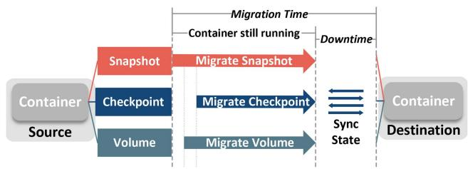  
Fig. 1. High-level overview of container migration. Container migration typically involves the sequential or parallel transfer of three key components: snapshots, checkpoints, and volumes. The container remains running throughout most of the process, except during the state synchronization stage.

containers are widely adopted in resource-constrained environments such as edge computing [3], [12], IoT [13], and mobile networks [14], where lightweight and efficient deployment and updates are essential [15].

Container migration—the process of transmitting a running container from one node to another—is a critical capability in containerized platforms to achieve load balancing [16], hardware failure recovery [17], and improved quality of service (QoS) [14]. For instance, containers can be migrated from overloaded nodes to idle ones, from failed nodes to operational ones, and from less powerful nodes to more powerful ones. A high-level overview of the migration process is shown in Fig. 1. Container migration typically involves migrating three core components: the snapshot, checkpoint, and volume, which are terms that correspond to the container’s filesystem, memory state, and persistent storage, respectively. Generally, three key performance metrics are concerned when evaluating container migration approaches: (1) service downtime, as Fig. 1 shows, it refers to the period during which the application is unavailable to users, (2) migration time, as Fig. 1 shows, it refers to the duration from the start of migration to the resumption of the container on the destination node, and (3) migration traffic, which refers to the network traffic generated by migrating the containers. These metrics capture different aspects of performance—while downtime directly affects service quality and user experience [14], migration time reflects the platform’s agility in managing workloads [12], and the migration traffic reflects the communication overhead brought by migration [18].

However, our experiments reveal that container migration generates huge network traffic, and it is challenging to guarantee its time efficiency under low-bandwidth conditions. For example, our experiments in Section II-A show that the average migration time for 13 popular containers increases from 28.64 seconds to 56 seconds as bandwidth drops from 500 Mbps to 100 Mbps. This degradation significantly limits the practicality of container migration in environments such as edge computing, IoT, and mobile computing, where network bandwidth is typically more constrained than in cloud or datacenter environments.

While there are existing works on container migration, most of them focus on optimizing the downtime, yet few of them focus on reducing migration time and migration traffic [25]. Voyager [18] proposes to reduce migration time by using a network file system (NFS) to allow destination nodes to use containers’ snapshots remotely from source nodes, and hence omit transferring the container’s snapshot. However, this NFS approach strongly relies on the source node to remain online even after migration. Such dependencies on source node may make Voyager [18] unsuitable for handling hardware failure, or prevent the source node to delete container’s data for reclaiming spaces. Ma et al. [23] propose to reduce migration time by migrating only the writable layer of a container image. However, this approach assumes that the remaining layers already exist on the destination node, which is a strong assumption in coldstart scenarios [12]. H-container [14] aims to enable migration between nodes with different ISAs, but lacks discussion on migration time. Works including [24], [26], [27] focus on the decision-making problem of selecting migration destination, rather than providing an optimized method for the container migration process.

To reduce the migration time and traffic, we first profiled the container migration process and identified two key observations: (1) the snapshot migration is the most costly part, accounting for 75.9% of total migration time and 97.7% of total migration traffic; and (2) on average, only 13.1% of snapshot files are accessed after the container resumes on the destination node. These observations indicate an opportunity to reduce migration time by avoiding the transfer of unnecessary snapshot files.

Based on these observations, we propose SEER, a container migration approach that sends only the subset of snapshot files needed to resume the container, instead of transferring the entire snapshot—namely, on-demand snapshot migration. The main benefit of SEER is that it can reduce both migration time and migration traffic. Additionally, this on-demand approach stores fewer snapshot files on the destination node, reducing the storage burden on nodes that usually have limited capacity [28]. Moreover, SEER can integrate with most live migration techniques because the snapshot migration process is typically independent of state synchronization.

There are two key challenges in designing SEER. First, identifying which files are needed to resume the container on the destination node is difficult. On the one hand, a container’s file access is often random and non-deterministic due to the unpredictable behavior of programs and varying runtime environments. On the other hand, migration can occur at any time [29], so the service breakpoint is not fixed, making future file access hard to predict. The second challenge is a side effect of on-demand snapshot migration: although an incomplete snapshot on the destination node will not block container execution, if the container tries to access a file that was not migrated, it must pause until the file is fetched. This may happen if the prediction is inaccurate. What is worse, a missing file may have downstream dependencies—e.g., packages it imports—so a single miss can lead to more, a phenomenon we refer to as a miss snowball.

We present two insights to address these challenges. First, future file accesses can be predicted from historical file-access records. As discussed in Section III-B, we found that these records are actually composed of multiple file call chains. However, these call chains can be extremely complex, long, and overlapping, which makes them difficult to identify and predict, thus requiring the design of an effective prediction method. Second, to handle missing files and mitigate the miss snowball effect, we introduce a runtime revision mechanism. When the first miss is detected, the prediction is updated based on the runtime file access record, and subsequent files can be proactively fetched—effectively stopping the snowball. Although this introduces some latency, the prediction update is performed while the container is suspended and fetching the missing file, so it does not add additional overhead.

Building on these insights, we develop two techniques in SEER. First, we design a prediction model that can predict file accesses for general containers at arbitrary execution points. The model is also capable of predicting access patterns for unseen containers not included in the training set. We provide interfaces for users to profile custom containers and fine-tune the model for specific workloads. Second, to address the missing file problem, we design a runtime revision interface: when a missing file is accessed, the container is suspended and the file is fetched. Simultaneously, the container reports the miss to the prediction model and a new prediction is generated. Since this occurs during suspension, it introduces no extra latency.

We implement SEER and a supporting container filesystem with approximately 5,000 lines of Golang code. We trained a prediction model on a dataset of file access traces we collected from 13 types of containers in an edge computing platform. To adapt to unseen containers, SEER provides APIs for autoprofiling unseen containers and fine-tuning the prediction model. SEER is compatible with both Docker [6] and Kubernetes [5]. We evaluate SEER on an edge computing platform under network bandwidth settings ranging from 100 to 1000 Mbps. Experimental results show that SEER achieves a 2.5 to 6.7 speedup in migration time and an 27.2% to 88.1% reduction in migration traffic.

Our contributions can be summarized as follows:

We present SEER, a container migration approach that significantly reduces container migration time and network traffic. SEER is integrated with Docker [6] and Kubernetes [5]. The code is available at https://github.com/ zhiyuanGH/seer-container-migration.

We introduce a prediction model capable of predicting future file accesses at arbitrary points during container execution. Beyond containers, this model can be applied to predict the file access of general processes with minimal engineering effort.

\- We present a dataset of file-access records from 13 popular containers across various execution stages. This dataset offers a resource for future research on file-access behavior in containers and general-purpose programs.

The dataset is available at https://github.com/zhiyuanGH/ FileAccessTrace.

## II. MOTIVATION

## A. Background and Motivation

Container: The idea ofa container is to package an application together with its dependencies into a self-sufficient execution environment, known as an image. The image can be pushed to a registry for publishing and pulled to worker nodes to spawn containers. This self-contained design ensures that the application runs consistently across different computing environments, making it highly portable and compatible. Containers leverage Linux mechanisms such as cgroups and namespaces to achieve isolation, making them a lightweight virtualization method. A robust tool stack supports container management and orchestration. These features have established containers as the dominant solution for software deployment. For example, Google uses containers to deploy major services such as Gmail, YouTube, and Search, launching billions of containers weekly on Google Cloud [1], [30].

To deploy a container on a worker node, the container runtime on the node downloads the image, extracts its contents, and creates a snapshot, which serves as the container’s isolated filesystem [31]. The container runtime then starts the container process. For a running container, the checkpoint represents its runtime state, including memory pages, file descriptors, and other execution contexts. Optionally, a local storage space— referred to as a volume—can be attached to the container to provide shared storage between the container and the host. The volume can be used to provide input data or persist outputs of containers.

Container migration: In containerized computing platforms, container migration is often employed for load balancing, improving Quality of Service (QoS), and handling hardware failures. As Fig. 1 shows, container migration typically involves transferring three components: the snapshot, checkpoint, and volume, which represent the container’s filesystem, memory state, and attached storage, respectively. Pulling an image from a registry can recreate the static image layers on a destination node, but it does not recover the current snapshot changes, memory state, or attached storage of a running container; therefore, registry image pulling is a deployment/re-provisioning operation rather than a replacement for migration. The primary metrics used to evaluate migration performance are service downtime, which refers to the period during which the service is interrupted, and migration time, which refers to the time from the start of migration to the container’s successful resumption on the destination node. Generally, downtime has a more direct impact on user experience, while migration time reflects the platform’s agility in resource management.

Low-bandwidth Network: A low-bandwidth network refers to a communication infrastructure with limited data transfer capacity, typically ranging from 100 to several hundred Mbps. Such networks are common in edge computing, IoT, and mobile environments [12], [32], where infrastructure limitations or physical distances constrain connectivity [33]. Low-bandwidth networks impose significant challenges for communicationintensive tasks such as container migration. Reduced bandwidth directly increases data transmission time, thereby degrading migration performance.

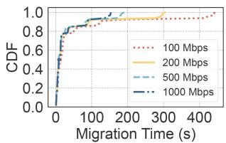  
(a) Migration Time

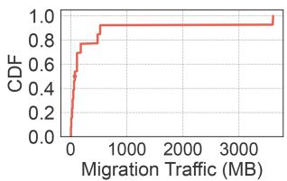  
(b) Migration Traffic

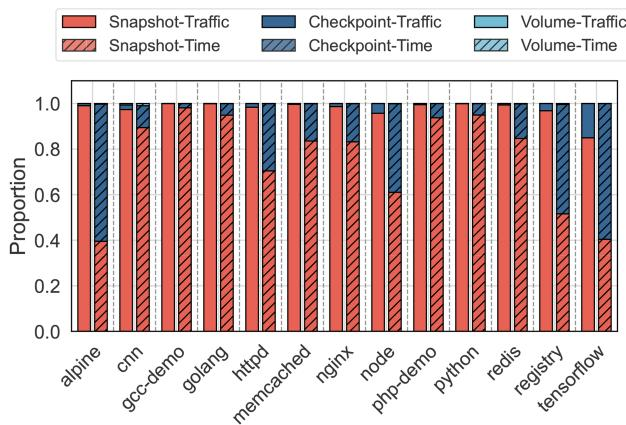  
(c) Breakdown of Migration Time and Traffic  
Fig. 2. Migration performance and cost breakdown for popular containers. The profile results derive from our Overlay implementation (Section VIII-A), and the experimental setup and evaluation methodology are also detailed there.

Existing Works: We review existing works on container migration as well as Virtual Machine (VM) migration, given that VM migration has a longer history and some container migration approaches borrow ideas from VM migration. A summary of existing works is presented in Table I.

## B. Observations and Opportunity

Observation-1. Low bandwidth leads to slow migration: We select 13 popular containers to profile migration performance under varying bandwidth settings. Since current container engines like Docker [6] and Kubernetes [5] do not provide built-in migration tools, we implement a container migration method using their default filesystem OverlayFS [31]. The list ofcontainers we profiled is shown in Table II. The details of the experimental hardware setup are provided in Section VIII-A.

We first profile the network traffic generated by container migration, and present the corresponding network traffic results in Fig. 2(b). On average, a single container migration generates 404 MB of traffic, with large containers producing up to 3600 MB. Given the fact that the available bandwidth in edge, IoT, and mobile settings is typically on the order of tens to a few hundred megabits per second, the container migration tasks are considered to be communication-intensive. We then profile the migration time, and the results of the migration time are shown in Fig. 2(a). The mean migration time increases from

TABLE I  
EXISTING WORKS ON CONTAINER AND VM MIGRATION
<table><tr><td rowspan="2">Type</td><td rowspan="2">System</td><td rowspan="2">Evaluated Bandwidth (Mbps)</td><td rowspan="2">Checkpoint Transfer</td><td rowspan="2">Filesystem</td><td colspan="3">Performance Goals</td><td rowspan="2">OCI Compatible</td><td rowspan="2">Container Evaluated</td><td rowspan="2">Open Source</td></tr><tr><td>Downtime Transfer</td><td>Migration Time</td><td>Traffic</td></tr><tr><td rowspan="2">VM [19]</td><td>Hines et al. [20]</td><td>1000</td><td>Post-copy</td><td>N/A</td><td>√</td><td>√</td><td>ン</td><td>N/A</td><td>N/A</td><td>√</td></tr><tr><td>Clark et al. [21]</td><td>~512</td><td>Pre-copy</td><td>N/A</td><td>√</td><td>V</td><td></td><td>N/A</td><td>N/A</td><td>√</td></tr><tr><td rowspan="4">Container [22]</td><td>Voyager [18]</td><td>2500</td><td>Pre-copy</td><td>Post-copy</td><td>√</td><td>V</td><td>√</td><td>√</td><td>1</td><td>√</td></tr><tr><td>Ma et al. [23]</td><td>5-500</td><td>Pre-copy</td><td>Layer-aware</td><td>√</td><td>√</td><td></td><td>x</td><td>2</td><td>x</td></tr><tr><td>DQLCM [24]</td><td>100-1000</td><td>Pre-copy</td><td>Full Copy</td><td></td><td></td><td></td><td>√</td><td>3</td><td>x</td></tr><tr><td>H-Container [14] Seer (Ours)</td><td>1000 100-1000</td><td>Pre-copy Pre-copy</td><td>N/A Hybrid</td><td>√ J</td><td></td><td></td><td>√</td><td>6 13</td><td>√ V</td></tr></table>

TABLE II

CONTAINERS INCLUDED IN THE DATASET
<table><tr><td>Container</td><td>Workload</td><td>Domain</td><td>DockerHub Stars</td></tr><tr><td>Alpine</td><td>Shell scripting</td><td>Base OS</td><td>10K+</td></tr><tr><td>GCC</td><td>C compilation</td><td>Development</td><td>868</td></tr><tr><td>Golang</td><td>Looping Go program</td><td>Runtime</td><td>5K</td></tr><tr><td>Python</td><td>Looping Python program</td><td>Runtime</td><td>10K+</td></tr><tr><td>Node</td><td>Web request handling</td><td>Web server</td><td>10K+</td></tr><tr><td>PHP</td><td>Web request handling</td><td>Web server</td><td>7.7K</td></tr><tr><td>Nginx</td><td>Reverse proxy server</td><td>Proxy</td><td>10K+</td></tr><tr><td>Httpd</td><td>Web content serving</td><td>Web server</td><td>4.8K</td></tr><tr><td>Memcached</td><td>In-memory caching</td><td>Caching</td><td>2.3K</td></tr><tr><td>Redis</td><td>In-memory data storage</td><td>Data store</td><td>10K+</td></tr><tr><td>TensorFlow</td><td>CNN model training</td><td>ML framework</td><td>2.7K</td></tr><tr><td>PyTorch</td><td>CNN model training</td><td>ML framework</td><td>1.3K</td></tr><tr><td>Registry</td><td>Health-check endpoint</td><td>Registry health</td><td>4.1K</td></tr></table>

28.84 seconds to 56.07 seconds as the bandwidth decreases from 500 Mbps to 100 Mbps. This degradation of migration time significantly reduces the effectiveness of using container migration for time-sensitive tasks such as load balancing, fault recovery, and online rescheduling.

Observation-2. Snapshot migration is the most costly: We profiled the proportion of time and traffic of migration to identify the bottlenecks. Fig. 2(c) shows the time and traffic proportions of migrating snapshot, checkpoint, and volume relative to the total migration cost. The migration of snapshot dominates both time and traffic costs. On average, snapshot migration accounts for 75.9% of the total migration time and 97.7% of the total migration traffic, while the checkpoint, and volume take the remaining parts. This result indicates that the snapshot migration is the most costly part, and this motivates us to further explore if any spaces of optimizing the migration of snapshot.

Observation-3. Not all files are needed: We found that not all snapshot files are needed after resuming containers on destination nodes. We trace the files accessed after resuming each container until termination. For non-terminating containers, e.g., nginx servers, we manually terminated them after one minute of inactivity. After the termination, we count the snapshot files accessed by the container on the destination node, and compare them with the entire snapshot. As Fig. 3 shows, on average, only 13.1% of the snapshot files are accessed post-resumption. For containers such as GCC, Python, and Golang, this percentage is extremely low. Opportunities: An opportunity arises from these three observations: if we can avoid transferring unnecessary snapshot files, the network traffic generated can be reduced, and subsequently alleviate the bottleneck brought by low bandwidth networks. Inspired by these observations, we proposed an on-demand snapshot migration method that transfers only the snapshot files a container will access after resumption, rather than the entire snapshot. This on-demand migration approach is expected to significantly reduce the amount of data transferred during migration, thereby reducing migration time and traffic. In addition, the on-demand fetching mechanism can also reduce the storage overhead at the destination edge node, which is often storage-constrained.

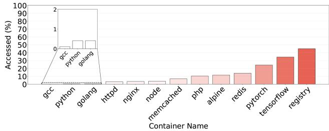  
Fig. 3. Percentage of files accessed after resumption. Each bar represents the percentage of snapshot files accessed by a container after resuming on the destination node, relative to the full snapshot size.

## III. CHALLENGES AND INSIGHTS

## A. Challenges

Challenge-1: Dynamic file access prediction The first and most critical step in on-demand migration is identifying which files a container will require upon resumption at the destination node. However, accurately predicting future file access is inherently difficult due to two key factors:

Non-deterministicfile access: File access behavior may vary across different runs of the same container image due to runtime configuration differences. For example, containers built from TensorFlow [34] images may enable or disable GPU support, or execute different startup commands. Since these configurations are not fixed at image build time, the resulting access patterns are uncertain and difficult to predict. Additionally, inherent randomness in application behavior may further complicate prediction [35]. For instance, a test automation framework container may execute test cases in randomized order to uncover inter-test dependencies and ensure test isolation. This randomness introduces variability in file access behavior across container executions, making future access prediction even more challenging.

Uncertain migration timing: Container migration is frequently used for workload management in dynamic environments. As such, migration events are often unplanned and may occur at any point in time [36], such as during hardware failure or when a node becomes overloaded. Consequently, a container may be migrated at an unpredictable execution point, making it difficult to anticipate which files will be needed after resumption. To examine the impact of migration timing, we launched a PyTorch [37] model training container and migrated it at different time offsets, e.g., migrated it 2 s, 4 s, and 30 s after startup. Fig. 4 presents a heatmap ofpost-migration file accesses, illustrating that file access behavior varies significantly. This indicates that the container’s post-migration file requirements are highly dependent on the execution state at the moment of migration.

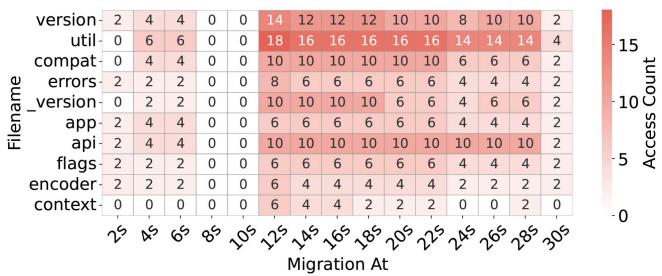  
Fig. 4. Post-migration file access heatmap. We launched the container 15 times, migrating it at different time points, and recorded how many times each file was accessed after resumption on the destination node. For example, the cell at $[ 1 2 \mathrm { ~ s } , \mathrm { u t i } 1 ] = 1 8$ indicates that when the container was migrated 12 s after startup, the file util was accessed 18 times post-resumption.

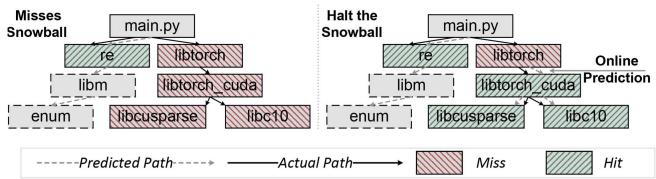  
Fig. 5. The snowball of missing files. To halt the snowball of misses, SEER performs an online prediction when it encounters a miss, followed by a quick prefetching to avoid accessing missing files.

One potential solution is to ask developers to explicitly specify expected file access patterns or to use prefetching flags [38]. However, maintaining transparency is critical— migration should remain fully transparent to applications [36]. Our objective is therefore to design a solution that requires no modifications to containers and can predict file access at arbitrary execution points. Challenge-2: Side effect ofon-demand migration During on-demand snapshot migration, files are transferred based on predictions of what the container will require after resumption. Once these predicted files arrive, the snapshot is assembled, and the container runtime is notified to restore the container with the incomplete snapshot. However, actual file usage does not always align with the predictions (as discussed in Section III-A). To handle missing files, the container must pause and request them from the source. Frequent misses can result in multiple fetch requests, each incurring additional latency and overhead. A recent work, Starlight [12], demonstrates that such frequent suspensions can significantly degrade container performance—for example, by prolonging the training time of a machine learning container or reducing the throughput of a database container.

Moreover, a missing file may trigger a cascade of further misses. As shown in Fig. 5, containers often follow multiple potential execution paths, and the occurrence of a single missing file may indicate that the predicted execution path deviates from the actual one. The missing file may, in turn, attempt to access another unmigrated file, leading to a snowball effect. Consequently, the divergence between the predicted and actual file access paths can become substantial, resulting in notable performance degradation.

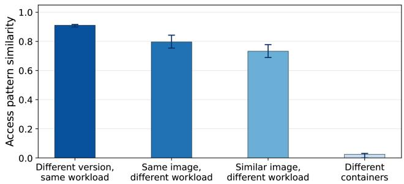  
Fig. 6. Similarity of recurrent file-access patterns. Bars show the median pairwise Jaccard similarity of recurrent file-access transition patterns, and error bars show the interquartile range. From left to right, the groups compare different container-image versions under the same workload, the same image under different workloads, similar images under different workloads, and containers from different runtime or service classes.

## B. Insights

Insight-1. Predict file access based on invocation relationships: The file access behavior of a container often follows chains of dependent accesses—where accessing one file leads to the access of its dependencies. These call chains present an opportunity to anticipate future file accesses by combining historical access records with knowledge of file dependencies or invocation relationships. However, real-world containers may access thousands offiles with deeply nested, complex, and sometimes cyclic dependencies. These access patterns often form non-linear sequences, making prediction challenging. Therefore, an effective prediction method must be capable of extracting such intricate call chains and leveraging them to perform accurate and robust file-access prediction.

To examine whether these recurrent access structures can be reused across related containers, we conducted a trace-analysis experiment using syscall-level file-access traces collected from Docker containers. For each container/workload case, we first discover recurrent file-access patterns within repeated runs: an adjacent transition between two normalized file categories is considered recurrent only if it appears in at least two runs of the same case. The file categories capture dependency types such as Python runtime files, system libraries, configuration files, service binaries, and workload data. We then compute the pairwise Jaccard similarity of these recurrent file-access transitions across cases. As shown in Fig. 6, different containerimage versions running the same workload have high similarity (median 0.91), cases from the same image but different workloads also have high similarity (median 0.80), and similar images running different workloads still share substantial structure (median 0.73). In contrast, containers from different runtime or service classes show little overlap (median 0.02). These results provide empirical support for using a unified base predictor when containers share runtime stacks or invocation behavior, while also identifying the case where adaptation should be used:

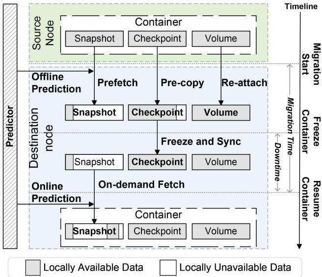  
Fig. 7. Design Overview.

when no similar training image or workload exists, SEER uses its profiling and fine-tuning workflow before future migrations of that container.

Insight-2. Proactive online prediction: As discussed in Section III-A and Insight-1, a missing file can trigger access to more missing files, causing a cascade of misses. To prevent this chain reaction, the prediction should be revised immediately upon encountering the first miss. Once a miss is detected, the prediction model updates its prediction based on the revised historical access record and issues prefetch requests for newly predicted downstream files.

This proactive revision does not require the container to wait for all newly predicted files. The container resumes as soon as the first missing file that caused the fault has been fetched. The remaining proactive prefetching continues asynchronously after resumption; if these files arrive before the container accesses them, later miss faults are avoided, and if they do not, the normal miss-handling path is used. Therefore, the online revision computation is overlapped with the unavoidable wait for the first missing file, while proactive fetching is used to reduce subsequent stalls rather than to delay resumption.

## IV. DESIGN OVERVIEW

We propose SEER, a container migration approach that transfers only the subset of snapshot files needed to resume the container, instead of migrating the entire snapshot—this is referred to as on-demand snapshot migration. Fig. 7 presents the design overview of SEER, illustrating both the on-demand snapshot migration mechanism and the complete container migration workflow. The migration process can be divided into three stages: (1) from migration start to freezing the container, (2) from freezing the container to resuming it on the destination, and (3) after the container is resumed.

From migration start tofreezing the container: SEER transfers the snapshot, checkpoint, and volume in parallel while allowing the container to continue running on the source node. For the snapshot, SEER uses the container’s historical file access records to predict the files likely to be accessed after resumption, and only those files are transferred. For the checkpoint, SEER creates a checkpoint of the container and begins transferring the checkpoint data to the destination. Since the container is still running, the checkpoint data may change and is therefore not synchronized in this stage. For the volume, SEER migrates it either by mounting it via NFS or by re-attaching a new volume on the destination node. This stage completes when the following conditions are met: (1) all predicted snapshot files have been transferred, (2) all volume data has been migrated, and (3) a threshold portion of checkpoint data (e.g., 90%) has been transferred.

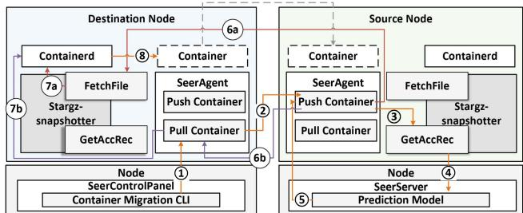  
Fig. 8. Implementation Overview of SEER.

Fromfreezing the container to resuming it on the destination: In this stage, the container on the source node is frozen, and the checkpoint data between the source and destination is synchronized. This ensures the container’s memory and runtime state are consistent before resumption. The stage finishes once the checkpoint synchronization is complete.

After the container is resumed: In this final stage, the container resumes execution on the destination node. It has access to the complete checkpoint, the complete volume, and an incomplete snapshot. If the container tries to access a snapshot file that is missing on the destination, a miss fault occurs. This triggers the runtime revision process described in Section V-C. When a miss occurs, the container is temporarily paused while the missing file is fetched from the source node. Simultaneously, the prediction model performs a runtime revision to update its predictions based on the latest access history, and proactively fetches additional files likely to be accessed in the near future. This mechanism helps prevent further miss faults and mitigates the snowball effect introduced in Section V-C.

Unified prediction model and adaptation: Motivated by the recurrent file-access pattern evidence in Section III-B, SEER uses a unified prediction model rather than maintaining one model for each container. The unified model is most effective when a workload shares part of its filesystem stack or invocation behavior with the training containers in Table II. At the same time, the initial dataset is not intended to exhaustively cover all possible workloads. Ifa target container has no similar image or workload in the training dataset, SEER treats it as an unseen container and applies the auto-profiling and fine-tuning mechanism described in Section V-E. This design avoids the scalability and routing overhead of maintaining many per-container models, while still allowing specialization for unseen or highly customized workloads. In SEER, the learned dependency structures are mapped to concrete file paths in the target container before invoking FetchFile().

TABLE III  
DESCRIPTION OF DATA FIELDS
<table><tr><td>Field</td><td>Description</td></tr><tr><td>Timestamp</td><td>The time when the file access occurred (with timezone).</td></tr><tr><td>OperationType</td><td>The type of file operation, such as Open, Read, or Write.</td></tr><tr><td>Filename</td><td>The absolute path of the accessed file.</td></tr><tr><td>FileSize</td><td>The size of the file at the time of access, in bytes.</td></tr><tr><td>FileMode</td><td>The permission mode of the file in Unix-style notation (e.g., -rw-r--r--).</td></tr></table>

## V. ON-DEMAND SNAPSHOT MIGRATION

## A. Problem Formulation

This section formulates the problem of predicting the files needed for migrating the containers. Consider a container $C$ running on a source node until time T, after which it is migrated to a destination node. We define the following sets:

$\mathcal { F }$ : the set of all files associated with container $C ,$

$S \subseteq { \mathcal { F } }$ : the set of files accessed by $C$ during (0, T),

$D \subseteq { \mathcal { F } }$ : the set of files accessed by C during [T, ).

The goal is to construct a prediction $\widehat { D }$ that estimates the set D using the known sets $\mathcal { F }$ and S. This predicted set $\widehat { D }$ determines which snapshot files should be transferred prior to container resumption, with the objective of reducing migration time and avoiding post-migration file-miss faults.

To quantify prediction accuracy while reflecting migration cost, we use a file-size-weighted Jaccard similarity between $\widehat { D }$ and $D$ , which penalizes both false positives and false negatives. Let $b ( f )$ denote the size of file $f .$ The prediction problem can be formulated as the following optimization:

$$
\widehat { D } ^ { * } = \arg \operatorname* { m a x } _ { \widehat { D } \subseteq \mathcal { F } } \frac { \sum _ { f \in D \cap \widehat { D } } b ( f ) } { \sum _ { f \in D \cup \widehat { D } } b ( f ) }
$$

When all files are assigned the same weight, this formulation reduces to the standard Jaccard similarity [39].

## B. Dataset and Collection Methodology

To build the prediction model, we first designed and collected a dataset of file access records from 13 widely used containers on DockerHub [40], as listed in Table II. These containers span a broad range of applications and programming languages, encompassing diverse runtime dependencies and libraries.

Data Format: Table III provides descriptions of each field in the collected file access traces. These traces are used to characterize the file usage behavior of containers during migration and serve as the training dataset of the prediction model.

Collection Methodology: For each container, we launched it 15 times and performed migrations at different time offsets—for example, at 2 s, 4 s, and 30 s after startup. During each migration, we recorded the files accessed on the source node prior to migration as the history access data, and the files accessed on the destination node after migration as the future access data.

## C. Missing File Handling and Online Prediction

As discussed in Section III-A, when the container attempts to access files that were not included in the prediction and therefore not migrated, it encounters a missfault. In many cases, the missing file may trigger access to additional downstream files, such as dependencies, resulting in a cascading sequence of faults—a phenomenon we refer to as a miss snowball (introduced in Section III-A).

As illustrated in Fig. 5, the predicted access path is not aligned with the actual access path. Since libtorch was not included in the predicted list, it was not migrated. After the container resumes on the destination node and attempts to access libtorch, it encounters a miss fault and is suspended while libtorch is fetched from the source node. Subsequently, accessing libtorch triggers a miss fault for libtorch\_cuda, further propagating the fault chain into a “miss snowball.”

To address missing files and prevent this miss-snowball effect, we introduce a runtime revision strategy, as illustrated in Fig. 5. When a missing file is detected, the container first fetches that file (e.g., libtorch) to resume execution. While the container is paused for this unavoidable fetch, SEER consults the latest file-access records to update its prediction and proactively issues fetch requests for additional files (e.g., libtorch\_cuda and its dependent files) that are likely to be accessed next. The container does not wait for all proactively predicted files before resuming. Instead, it resumes as soon as the faulting file becomes available, while the remaining proactive fetches continue asynchronously in the background. This proactive fetching reduces the likelihood of subsequent miss faults.

Although runtime revision introduces some computational overhead, the prediction update is overlapped with the period in which the container is already suspended for the faulting file. The subsequent proactive file transfers are asynchronous and therefore do not extend the current suspension, unless the container later accesses a file before its proactive fetch completes.

## D. Reliability Enhancement

The proposed on-demand snapshot migration introduces a potential reliability issue. When the container resumes on the destination node and encounters a missing file fault, it must fetch the missing file from the source node. However, if the source node becomes unavailable—due to crashes, disconnection, or deletion of snapshot files—the container at the destination is unable to retrieve the required file and remains blocked indefinitely.

To address this issue, we design a simple yet effective fallback mechanism. When the destination node fails to fetch the missing file from the source, SEER initiates a back-source download procedure. This process attempts to download the missing file directly from the container image registry. While not ideal for performance, this fallback is practical and reliable in most real-world scenarios, as developers typically upload container images to registries for distribution. Therefore, the registry can serve as a secondary source or backup for retrieving missing snapshot files.

## E. Adaptation to Unseen Containers

We have provided a prediction model which is trained on file access traces we collected from 13 containers (listed in Table II). However, in practice, the prediction model must ensure accurate prediction for general containers that are not included in the list, which we call ‘unseen containers‘. To adapt to unseen containers, SEER provides an API to automatically profile the specific unseen container and fine-tune the prediction model. The profile process is as the same as introduced in Section V-B. For each unseen container, SEER only needs to perform the adaptation once, and then can run it well in every future container migration. The migration performance of SEER before/after adaptation is presented in Section VIII-E.

## VI. MIGRATION OF VOLUME AND CHECKPOINT

Migration of Volume: SEER supports three strategies for migrating volumes during container migration. First, in the full-copy mode, SEER packages and compresses the volume data, transfers it to the destination node, decompresses it, and re-attaches it to the container. Second, in the NFS mode, if the volume is originally mounted via NFS, the same mount source is retained and re-mounted on the destination. Third, in the re-attach mode, users can configure whether to migrate the original volume or re-attach a new volume on the destination, depending on whether the container’s workload should resume from existing data or operate on a fresh dataset.

Migration of Checkpoint: One of the most practical approaches for transferring container memory state is Checkpoint and Restore (C/R). C/R captures the container’s memory state into a checkpoint file, which is transferred and restored at the destination. To reduce downtime, SEER adopts a pre-copy strategy. The checkpoint data is transferred while the container continues to run. Once the difference between the source and destination checkpoints falls below a threshold, the container is frozen, the checkpoint is synchronized, and the container is resumed on the destination.

## VII. IMPLEMENTATION

## A. Workflow and System Components

We implemented SEER using approximately 5,000 lines of Go code (LoC), along with an additional 300 LoC of Python for model training, fine-tuning and inference. The filesystem of SEER is built upon the Stargz-snapshotter [41], with two APIs added to support on-demand snapshot migration.

As shown in Fig. 8, SEER consists of three system components: seerAgent, seerServer, and seerControl-Panel. To enable container migration in containerized platforms, the seerAgent must be installed on each node that hosts containers eligible for migration. The seerServer is required to provide the prediction service. However, if the seerServer is unavailable, SEER can still perform on-demand snapshot migration using pre-defined file selection rules (as detailed in Section VIII-A). The seerControlPanel is a command-line tool for manually triggering container migration in trivial or specialized scenarios. In typical usage, migration is initiated through APIs, in which case the seerControl-Panel is not required.

Workflow ofUsing SEER to Migrate Containers.

The container migration workflow proceeds as follows:

1 seerControlPanel instructs the destination (Dst) node to pull the container from the source (Src) node. 2 The Dst node requests the Src node to push the container, including snapshot, checkpoint, and volume data. 3 Upon receiving this request, the Src node retrieves its current file-access records via the GetAccessRecord() API. 4 The Src node submits these records to seerServer, which analyzes them to predict future file accesses. 5 seerServer returns a manifest of predicted files to the Push Container Service. The snapshot is transferred according to the manifest. Simultaneously, the checkpoint and volume data are pushed to the destination. Once both transfers complete, the Dst node holds the full checkpoint, the full volume, and a partial snapshot. The Dst node assembles the snapshot and submits it to containerd. It then verifies and submits the checkpoint and volume. 8 Finally, containerd assembles all components and restores the container to its last execution state.

## B. Endpoint Redirection and Session Continuity

SEER treats endpoint redirection as a platform-level step that is executed after the destination has assembled the snapshot, checkpoint, and volume, and before source resources are released. This choice keeps SEER independent of a particular service discovery mechanism while still allowing migration to be used in Docker and Kubernetes deployments. In our implementation, each migration request records service metadata, including the container or pod identifier, exposed ports, and service name if the workload is managed by Kubernetes. After restoration succeeds, the seerAgent on the destination reports the restored endpoint to the seerControlPanel or the caller, and the caller updates the service binding from the source node to the destination node.

For Kubernetes deployments, SEER relies on the Kubernetes Service abstraction for the client-facing endpoint. Clients access a stable Service IP or DNS name rather than a node-specific container address. After checkpoint restoration, the migration controller replaces the old pod endpoint with the restored pod endpoint, so the Kubernetes network layer forwards subsequent requests to the destination node. Thus, endpoint redirection is handled by the orchestrator and no client-side address change is required. For standalone Docker deployments, where no native service abstraction exists, SEER exposes the restored container through the corresponding port mapping on the destination node and relies on the deployment environment to update the external load balancer, reverse proxy, DNS record, or application gateway.

SEER does not claim to provide transparent transport-layer connection migration by itself. Existing TCP sessions may be interrupted during checkpoint and restoration unless the deployment uses a connection-preserving layer such as a proxy, service mesh, or robust migration framework. This is consistent with the scope of SEER: it optimizes filesystem/snapshot transfer and can be combined with connection-continuity mechanisms.

## C. Filesystem

SEER implements its filesystem based on eStargz [41] which is an extended version of Stargz [41] that supports launching containers with incomplete snapshots. However, eStargz cannot support the proposed on-demand snapshot migration due to two limitations: (1) it cannot collect historical file access records, which are essential inputs for predicting future access patterns, and (2) it does not provide APIs for selectively fetching specific files, while SEER must fetch files on demand according to prediction results. To address these limitations, we extend eStargz with two new APIs, described below.

GetAccRec() We intercept Read() and Open() calls in eStargz and log events to a thread-safe in-memory structure. On request, FlushAllAccessRecords() outputs the set of file access records in batch, minimizing I/O overhead.

FetchFile() The built-in prefetch() in eStargz fetches files based on offset, not filenames. To support on-demand snapshot migration, we implement FetchFile(), which fetches files by filename from a given list.

Compatibility with Distributed Snapshot Backends: SEER is decoupled from the physical location of snapshot files. Its prediction model only determines which files should be migrated, while the underlying snapshot backend is responsible for locating and serving those files. Therefore, SEER can work with distributed filesystem or distributed snapshot services as long as they expose a unified file namespace or a file-level fetch interface. In such deployments, FetchFile() can retrieve predicted files from the distributed backend rather than directly from the source node.

## D. Prediction Model

To address the problem formulated in Section V-A, we trained a prediction model using a Long Short-Term Memory (LSTM) [42] on the dataset we collected. The LSTM architecture provides a clear advantage for our task: its gating mechanisms allow effective retention and forgetting of information across long sequences, it converges robustly even with limited data, and it incurs relatively low inference cost. This balance of long-range dependency modeling, training stability, and execution efficiency makes LSTM the most suitable choice for predicting future file accesses from extended sequential histories. The configuration of LSTM model used in SEER is listed in Table IV.

Alternative sequence-modeling approaches were also considered. Hidden Markov models (HMMs) [43] captures only shortrange dependencies and are unable to leverage long histories of access events. One-dimensional convolutional networks [44] can efficiently learn local temporal patterns but lack an explicit memory to retain long-term dependencies. Transformer-based encoders [45] offer powerful global context modeling via selfattention, yet they demand substantially more training data and computational resources and tend to overfit on our moderatesized access dataset.

TABLE IV  
LSTM MODEL CONFIGURATION
<table><tr><td>Parameter</td><td>Setting</td></tr><tr><td>Input sequence length</td><td>100</td></tr><tr><td>File embedding dimension</td><td>64</td></tr><tr><td>Container embedding dimension</td><td>32</td></tr><tr><td>Mask zero (mask_zero)</td><td>True</td></tr><tr><td>LSTM units</td><td>128</td></tr><tr><td>LSTM dropout</td><td>0.5</td></tr><tr><td>LSTM return_sequences</td><td>False</td></tr><tr><td>Combined vector size</td><td>160</td></tr><tr><td>Hidden dense units</td><td>128</td></tr><tr><td>Hidden layer activation</td><td>ReLU</td></tr><tr><td>Hidden layer dropout</td><td>0.5</td></tr><tr><td>Output dimension</td><td> $V + 1$ </td></tr><tr><td>Output activation</td><td>Sigmoid</td></tr></table>

Input Preprocessing: To map raw file-access records into the fixed-length LSTM input, SEER first sorts access events by timestamp and collapses consecutive accesses to the same file into one logical access event. When the resulting history contains more than 100 events, SEER keeps the most recent 100 events, since they are closest to the migration point and most relevant to future accesses. When the history is shorter than 100 events, it is padded with masked zeros, consistent with the mask\_zero setting in Table IV.

Prediction Model Integration: In addition to the LSTM model itself, SEER manually implements the surrounding logic required to integrate the predictor into the migration workflow. The prediction service receives file-access records from seerAgent, converts file paths and container identifiers into the integer IDs used by the trained model, invokes the model, and converts the output probabilities into a predicted file manifest. This manifest is then returned to the snapshot migration component, which invokes FetchFile() to transfer the selected files before container resumption.

## VIII. EVALUATION

## A. Methodology

Experimental Setup: We use a cluster of 8 Jetson Orin NX 16 GB devices [46] for our evaluation. Each Jetson is equipped with a CPU running at a maximum frequency of 2 GHz and 16 GB of memory. The devices run Ubuntu 22.04.5 LTS with the Linux 5.15.148-tegra kernel. All devices are set to MAXN power mode [47] and interconnected via a wireless router supporting up to 2 Gbps. One node hosts the SeerServer and its prediction model, another runs the SeerControlPanel, and the remaining six serve as worker nodes. We compare SEER against two baselines by migrating containers under bandwidth limits of 100, 200, 500, and 1000,Mb/s. For each setting, we perform five runs, issuing the migration at 6, 12, 18, 24, and 30,s after startup to cover different migration timings. To validate the effectiveness of the prediction model, an ablation study is presented in Section VIII-D. Detailed descriptions of baselines, metrics, and container selection are given below.

OverlayFS: The production baseline corresponding to the default snapshotter path in our container stack, i.e., OverlayFS in containerd v2.2.1 (December 2025) [11]. This choice reflects contemporary Docker [6] and Kubernetes [5] deployments that commonly rely on containerd’s OverlayFS-style snapshotting. We extend this OverlayFS path to support snapshot migration, transferring the entire snapshot before resumption.

\- Voyager: Reproduced from Voyager [18], which uses NFS to access checkpoint, volume, and snapshot data remotely, reducing data transfer at migration time but incurring fault handling overhead.

\- SEER: The full on-demand migration method proposed in this paper.

\- SEERNOPRE: SEER without the prediction module. It prefetches files based on a static profile (Section VII-C) and lacks both offline and online prediction.

Except for Voyager, which uses its own design of checkpoint and volume migration, the other three methods share the same design for those components introduced in Section VI.

Containers Used in Evaluation: We categorized containers into two groups. The first group includes containers from SEER’s training dataset, which is listed in Table II. The second group includes unseen containers not used during model training. We specifically select Ruby [48] and Ollama [49] as unseen containers, as they share minimal similarity with the training containers, enabling us to evaluate SEER’s generalization capability.

Migration Performance Metrics: We evaluate migration effectiveness using three primary metrics. First, migration time measures the time from when the migration command is issued until the container resumes on the destination. Second, downtime refers to the duration for which the container is paused during migration. Third, migration traffic quantifies the total volume of network data transferred during migration.

Side Effect Metrics: On-demand snapshot migration may result in occasional file misses, which can impact container performance. To evaluate this side effect, we compare application-level performance of containers migrated with different methods. For comparison, we use a TensorFlow-based model training container and measure its training time. It is worth noting that container migration does not affect model accuracy, as the training process is merely paused—not altered—during migration.

Prediction Evaluation Metrics: To assess the accuracy and efficiency of SEER’s prediction model, we report two metrics. The first is inference latency, representing the time taken to compute the prediction. The second is the Jaccard error (defined in Section V-A), which quantifies the dissimilarity between the predicted and actual file access sets. The evaluated prediction includes both the initial prediction and all runtime revisions performed during container execution.

TABLE V  
MIGRATION TIME AND DOWNTIME (VALUES ARE SHOWN AS MEAN / MEDIAN)
<table><tr><td>BW (Mb/s)</td><td>Method</td><td>Migration (s)</td><td>Downtime (ms)</td></tr><tr><td rowspan="2">100</td><td>OverlayFS</td><td>56.07/12.70</td><td>465.27/61.70</td></tr><tr><td>Voyager SeerNoPre</td><td>21.17/7.04</td><td>920.21/234.45</td></tr><tr><td rowspan="2"></td><td>Seer</td><td>10.72/2.49 8.36/1.60</td><td>475.58/75.50 463.55/58.40</td></tr><tr><td>OverlayFS</td><td>38.84/8.86</td><td>436.85/58.50</td></tr><tr><td rowspan="2">200</td><td>Voyager</td><td>18.67/7.26</td><td>783.93/235.95</td></tr><tr><td>SeerNoPre</td><td>9.37/1.91</td><td>422.49/66.75</td></tr><tr><td rowspan="2"></td><td>Seer</td><td>7.26/1.38</td><td>407.84/57.55</td></tr><tr><td>OverlayFS</td><td>28.84/9.08</td><td>399.69/56.20</td></tr><tr><td rowspan="2">500</td><td>Voyager</td><td>21.82/7.58</td><td>925.44/252.45</td></tr><tr><td>SeerNoPre Seer</td><td>8.60/1.76</td><td>390.77/61.50</td></tr><tr><td rowspan="2"></td><td>OverlayFS</td><td>6.53/1.42 26.45/9.09</td><td>367.03/55.10 377.88/53.70</td></tr><tr><td></td><td></td><td></td></tr><tr><td rowspan="2">1000</td><td>Voyager</td><td>20.57/7.67</td><td>834.81/255.55</td></tr><tr><td>SeerNoPre Seer</td><td>8.47/1.79 6.60/1.49</td><td>385.95/64.00 366.86/52.05</td></tr></table>

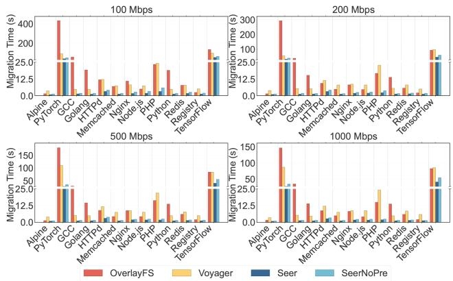  
Fig. 9. Migration time of individual containers.

## B. Migration Time and Downtime

Migration Time: As shown in Table V, across all bandwidth settings (100 Mbps–1 Gbps), SEER achieves substantially lower migration time than OverlayFS and Voyager. The improvement over OverlayFS arises because OverlayFS transfers the entire snapshot, incurring high data-transfer costs, whereas SEER sends only the subset of snapshot files required for resumption. Compared to Voyager, SEER benefits from two key advantages: (1) Voyager migrates no snapshot data at resume time, triggering numerous missing-file faults and the associated overhead offault handling and file fetching; and (2) Voyager uses NFS as the container filesystem, which adds extra latency compared with our snapshotter-based filesystem.

Although SEERNOPRE (i.e., SEER without the prediction module) is slower than full SEER, it still outperforms both OverlayFS and Voyager. Thus, in scenarios where a prediction module cannot be deployed—such as when computational resources are limited—SEERNOPRE remains a competitive alternative.

The migration times for individual containers are shown in Fig. 9. SEER consistently delivers the fastest migration across all containers, demonstrating its effectiveness across diverse workloads.

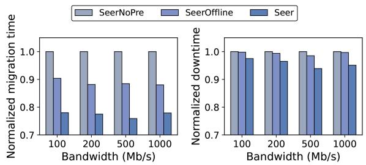

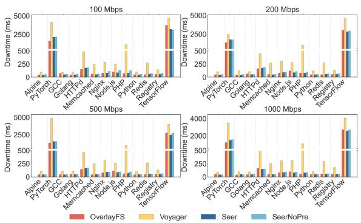  
Fig. 10. Downtime of individual containers.

TABLE VI  
NETWORK TRAFFIC GENERATED DURING CONTAINER MIGRATION
<table><tr><td>Method</td><td>Mean (MB)</td><td>Median (MB)</td><td>Min (MB)</td><td>Max (MB)</td></tr><tr><td>Overlay</td><td>404.78</td><td>73.02</td><td>3.52</td><td>3609.29</td></tr><tr><td>Voyager</td><td>299.59</td><td>9.45</td><td>1.43</td><td>2953.05</td></tr><tr><td>SeerNoPre</td><td>299.61</td><td>9.45</td><td>1.43</td><td>2953.18</td></tr><tr><td>Seer</td><td>294.11</td><td>8.73</td><td>1.43</td><td>2907.61</td></tr></table>

Downtime: Table V summarizes the overall downtime performance. SEER, SEERNOPRE, and OverlayFS achieve similar downtime across all settings, since they all employ a pre-copy checkpointing strategy—the primary determinant of downtime. Full SEER and SEERNOPRE exhibit no significant difference in downtime, as the prediction module affects only snapshot migration, which has minimal impact on downtime. In contrast, Voyager exhibits substantially higher downtime due to the absence of an optimized checkpoint synchronization strategy between source and destination nodes.

The per-container downtime results are shown in Fig. 10. Consistent with the overall trends, SEER’s downtime is close to that of OverlayFS and SEERNOPRE. For most containers, SEER maintains downtime below 100 ms. Notably, the PyTorch and TensorFlow containers experience extreme downtime, as their ML training workloads generate large in-memory state that requires longer synchronization periods.

## C. Network Traffic

The network traffic results, averaged across all bandwidth settings, are presented in Table VI, since migration traffic is largely independent of bandwidth. SEER achieves the lowest network traffic, reducing the median volume by 88.1% compared to Overlay. The gain over Voyager is marginal, as Voyager uses NFS as the snapshot backend—effectively filtering unnecessary transfers—albeit at the cost of numerous missing-file faults, as discussed previously.

## D. Prediction Model and Ablation Study

Inference Latency and Prediction Accuracy: Fig. 11 compares different prediction models in terms of inference latency and Jaccard error, where lower values are better for both metrics. The LSTM-based predictor used in SEER achieves the best results in both metrics: it has a marginally lower inference latency than HMM and TCN, while also delivering a substantially lower Jaccard error. This result indicates that SEER’s predictor improves access prediction quality without introducing additional runtime overhead. Since inference is invoked only during snapshot migration, its latency contributes to migration time rather than downtime; given that migration typically takes tens of seconds, this overhead remains negligible. The low Jaccard error further indicates that the predicted and actual file accesses largely overlap in the area of file access prediction [50], [51].

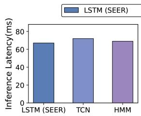

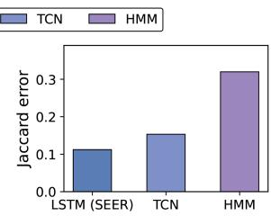  
Fig. 11. Comparison of prediction models in terms of inference latency and Jaccard error. Lower values are better for both metrics. The LSTM model used in SEER achieves marginally lower latency and substantially lower Jaccard error than HMM and TCN.  
Fig. 12. Normalized ablation results for migration time and downtime across different bandwidth settings. All values are normalized to SEERNOPRE. SEEROF-FLINE enables only offline prediction, while SEER enables both offline prediction and online revision. Lower values are better.

Ablation Study: Fig. 12 presents three variants: SEERNOPRE, which removes the prediction module; SEEROFFLINE, which uses only the offline predictor at migration time; and full SEER, which enables both offline prediction and online revision. All results are normalized to SEERNOPRE. Across different bandwidth settings, SEEROFFLINE reduces migration time by 9.6– 12.0%, while full SEER reduces migration time by 22.0–24.1%. For downtime, SEEROFFLINE reduces downtime by 0.2–1.5%, while full SEER reduces downtime by 2.5–6.1%. These results show that the offline predictor provides an initial improvement, while online revision further improves both migration time and downtime by correcting runtime mispredictions.

## E. Migration Performance on Unseen Containers.

We select two containers not included in the training dataset: Ollama (used for deploying large language models) and Ruby (a general-purpose scripting language). These containers differ significantly from those used to train SEER’s prediction model. We first evaluate the migration performance of SEER, SEERNOPRE, Voyager, and Overlay on these containers. We then apply the adaptation method described in Section V-E to generate a fine-tuned version of SEER, referred to as SEERADPT.

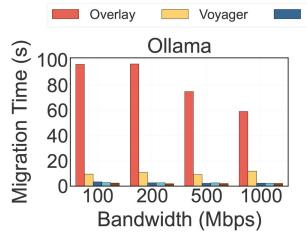

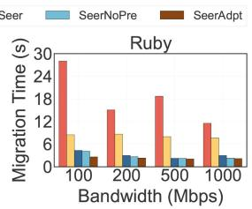  
Fig. 13. Migration time of unseen containers. Downtime and traffic metrics are omitted, as they are largely unaffected by the prediction model.

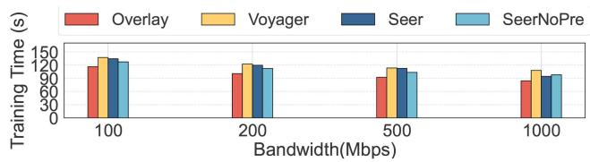  
Fig. 14. Model training completion time. To evaluate the side effects of an incomplete snapshot, we measure the model training completion time of a TensorFlow container migrated using different methods. The accuracy or quality of the trained model is not reported, as it is not affected by the migration process.

The migration times are shown in Fig. 13. SEERADPT consistently outperforms all baselines across all bandwidth settings, demonstrating the effectiveness of on-the-fly adaptation for unseen workloads. In addition, even without adaptation, SEER and SEERNOPRE outperform both Overlay and Voyager, reaffirming the robustness of SEER in diverse scenarios.

## F. Side Effect ofIncomplete Snapshot

As previously discussed in Section III-A, on-demand snapshot migration may leave some files unmigrated at the time of container resumption, potentially causing the container to pause while fetching missing files. Although our design mitigates such misses through prediction and runtime revision, they cannot be entirely eliminated. To evaluate the overall impact of these misses on container performance, we use a TensorFlow container as a case study and measure the completion time of a model training task.

In our experiment, we launch identical TensorFlow containers and migrate them using different migration methods while the model is being trained. As a result, training is completed by the source and destination nodes. We measure the total time from container launch to training completion. The results are shown in Fig. 14.

## IX. RELATED WORKS

VM Live Migration: The live migration of virtual machines (VMs) has been extensively studied in recent years, with a particular focus on minimizing downtime—the period during which a VM is paused and unavailable during migration. Downtime is primarily caused by the need to synchronize memory pages between the source and destination nodes. To mitigate this, the pre-copy strategy [21], [52] transfers memory pages to the destination while the VM continues running on the source. Once the remaining difference between the two memory states falls below a threshold, the VM is briefly suspended, and the remaining pages are synchronized. Post-copy [20], [53], on the other hand, takes a more aggressive approach. It first suspends the VM and transfers only the minimal state required to resume execution on the destination. The remaining memory pages are fetched on demand after resumption.

Container Migration: Most existing works on container migration [14], [18], [23] focus on optimizing the downtime adopting similar ideas of pre-copy of VM migration. However, few works focus on reducing the overall migration time and traffic. H-Container [14] proposed a technique to migrate containers between source and destination nodes with different instruction set architectures (ISAs), but it lacks discussion on minimizing migration time. Voyager [18] proposed using a network file system (NFS) to mount the container filesystem on the destination node, thereby avoiding snapshot transfer. However, this NFSbased method does not actually migrate the snapshot—it relies on the storage on the source node, which requires the source node to be available until the container terminates. Ma et al. [23] aimed to reduce migration time by transferring only the writable layer of the container image, assuming that the read-only layers already exist on the destination. This assumption is not valid in cold-start scenarios, where no image layers are pre-cached on the destination node.

Demand-driven image and block transfer: A related line of work reduces container startup time by fetching image data lazily or on demand. Slacker [54], Stargz/eStargz [41], Starlight [12], and on-demand loading in serverless platforms [55] avoid downloading complete images before launch by fetching image files or chunks as execution needs them. DADI and its journal extension, Block-level Image Service for the Cloud [56], [57], further organize, load, and distribute container images at block granularity, replacing full image download and unpacking with fine-grained on-demand transfer of remote image data. DADI also uses trace-based and pull-push collaborative block prefetching to reduce cold-start latency. These systems are related to SEER because they avoid unnecessary filesystem transfer. However, their primary target is image distribution or cold start, where the transferred object is usually a read-only image. SEER instead targets migration of a running container, where the destination must resume from a particular execution point and may need checkpoint state, volume state, writable snapshot changes, and runtime-specific files in addition to base image contents. In addition, DADI-style block-granularity transfer operates below filesystem semantics: the image is modeled as a virtual block device, and its trace prefetching records layer index, offset, and length rather than file identity or namespace. This provides portability and fast startup, but it provides less semantic information for learning which runtime files, libraries, configuration files, or workload data are likely to be needed after resumption. As a result, block-level traces provide less direct signal for SEER’s dependency prediction and online revision than file-level traces, where learned access patterns can be mapped directly to concrete files before invoking FetchFile(). Therefore, SEER is complementary to these systems: a block-level or lazy image service can serve as an efficient backend for retrieving data, while SEER decides which runtime-specific snapshot files should be transferred before or shortly after resumption.

Recent robust migration frameworks address complementary parts of the migration stack. Calagna et al. proposed a robust stateful edge microservice migration design with COAT and PAM, where COAT preserves established transport connections during migration and PAM models migration duration and downtime under CRIU/Podman-based pre-copy migration [58]. MOSE further extends this line into an orchestration framework that configures the migration process according to network and application KPI targets, reducing service disruption for latencysensitive microservices [59]. KubeSPT targets Kubernetes pod rescheduling and improves stateful pod live migration by synchronizing pod/container network states, redirecting service traffic, and optimizing memory restoration through hot-data lazy restore [60]. These systems mainly optimize connection continuity, orchestration decisions, checkpoint/memory restoration, and Kubernetes control-plane compatibility. SEER is orthogonal to them: it focuses on the filesystem/snapshot component of migration, which our profiling shows dominates migration traffic and time in low-bandwidth networks. Rather than assuming a full snapshot transfer or a pre-pulled image at the destination, SEER predicts and transfers only the files needed after resumption and fetches missing files on demand. Therefore, SEER can serve as a snapshot-transfer backend that complements such robust migration frameworks.

## X. CONCLUSION

In this paper, we profile container migration and identify that the performance bottleneck is snapshot migration. We introduced SEER, a container migration approach that reduces both migration traffic and time by transferring snapshot data on demand. SEER employs a prediction model to identify which files are necessary for container resumption. To ensure the generalization capacity ofthe prediction model, we provide APIs for auto-profiling and fine-tuning SEER on unseen containers. SEER is compatible with containerized platforms such as Docker and Kubernetes. The code and dataset of SEER are publicly available.

## REFERENCES

[1] A. Verma, L. Pedrosa, M. Korupolu, D. Oppenheimer, E. Tune, and J. Wilkes, “Large-scale cluster management at Google with Borg,” in Proc. 10th Eur. Conf. Comput. Syst., 2015, Art. no. 18.

[2] Z. Li et al., “Help rather than recycle: Alleviating cold startup in serverless computing through {Inter-Function} container sharing,” in Proc. USENIX Annu. Tech. Conf., 2022, pp. 69–84.

[3] S. Hu, W. Shi, and G. Li, “CEC: A containerized edge computing framework for dynamic resource provisioning,” IEEE Trans. Mobile Comput., vol. 22, no. 7, pp. 3840–3854, Jul. 2023.

[4] L. Pan, L. Wang, S. Chen, and F. Liu, “Retention-aware container caching for serverless edge computing,” in Proc. IEEE Conf. Comput. Commun., 2022, pp. 1069–1078.

[5] “Kubernetes,” 2025, Accessed: Apr. 10, 2025. [Online]. Available: https: //kubernetes.io/

[6] “Docker: Accelerated container application development,” 2025. Accessed: Apr. 10, 2025. [Online]. Available: https://www.docker.com/

[7] “Harbor,” 2025. Accessed: Apr. 10, 2025. [Online]. Available: https:// goharbor.io/

[8] “Helm,” 2025. Accessed: Apr. 10, 2025. [Online]. Available: https://helm. sh/

[9] “CNI,” 2025. Accessed: Apr. 10, 2025. [Online]. Available: https://www. cni.dev/

[10] “Prometheus - monitoring system & time series database,” 2025. Accessed: Apr. 10, 2025. [Online]. Available: https://prometheus.io/

[11] “Containerd–an industry-standard container runtime with an emphasis on simplicity, robustness and portability,” 2025. Accessed: Apr. 10, 2025. [Online]. Available: https://containerd.io/

[12] J. L. Chen, D. Liaqat, M. Gabel, and E. de Lara, “Starlight: Fast container provisioning on the edge and over the {WAN},” in Proc. 19th USENIX Symp. Netw. Syst. Des. Implementation, 2022, pp. 35–50.

[13] D. Jiang, B. Zhu, X. Liu, and S. Mumtaz, “ALCod: An adaptive loadaware approach to load balancing for containers in IoT edge computing,” IEEE Internet Things J., vol. 11, no. 23, pp. 37480–37492, Dec. 2024.

[14] T. Xing, A. Barbalace, P. Olivier, M. L. Karaoui, W. Wang, and B. Ravindran, “H-container: Enabling heterogeneous-ISA container migration in edge computing,” ACM Trans. Comput. Syst., vol. 39, no. 1/4, pp. 1–36, 2022.

[15] Z. Li et al., “Online container scheduling with fast function startup and low memory cost in edge computing,” IEEE Trans. Comput., vol. 73, no. 12, pp. 2747–2760, Dec. 2024.

[16] F. Xu et al., “Tetris: Proactive container scheduling for long-term load balancing in shared clusters,” IEEE Trans. Services Comput., vol. 17, no. 5, pp. 2918–2930, Sep./Oct. 2024.

[17] M. Terneborg, J. K. Rönnberg, and O. Schelén, “Application agnostic container migration and failover,” in Proc. IEEE 46th Conf. Local Comput. Netw., 2021, pp. 565–572.

[18] S. Nadgowda, S. Suneja, N. Bila, and C. Isci, “Voyager: Complete container state migration,” in Proc. IEEE 37th Int. Conf. Distrib. Comput. Syst., 2017, pp. 2137–2142.

[19] G. J. Popek and R. P. Goldberg, “Formal requirements for virtualizable third generation architectures,” Commun.ACM, vol. 17, no. 7, pp. 412–421, 1974.

[20] M. R. Hines, U. Deshpande, and K. Gopalan, “Post-copy live migration of virtual machines,” ACM SIGOPS Operating Syst. Rev., vol. 43, no. 3, pp. 14–26, 2009.

[21] C. Clark et al., “Live migration of virtual machines,” in Proc. 2nd Conf. Symp. Netw. Syst. Des. Implementation, 2005, pp. 273–286.

[22] D. Merkel et al., “Docker: Lightweight linux containers for consistent development and deployment,” Linux J., vol. 239, no. 2, 2014, Art. no. 2.

[23] L. Ma, S. Yi, and Q. Li, “Efficient service handoff across edge servers via docker container migration,” in Proc. 2nd ACM/IEEE Symp. Edge Comput., 2017, pp. 1–13.

[24] Z. Tang, X. Zhou, F. Zhang, W. Jia, and W. Zhao, “Migration modeling and learning algorithms for containers in fog computing,” IEEE Trans. Services Comput., vol. 12, no. 5, pp. 712–725, Sep./Oct. 2019.

[25] W. Soussi, G. Gür, and B. Stiller, “Democratizing container live migration for enhanced future networks-a survey,” ACM Comput. Surv., vol. 57, no. 4, pp. 1–37, 2024.

[26] X. Xie, X. Wu, Q. Hu, and S. Yuan, “Multi-container migration strategy optimization for industrial robotics workflow based on hybrid tabuevolutionary algorithm,” IEEE Trans. Services Comput., vol. 17, no. 5, pp. 2640–2653, Sep./Oct. 2024.

[27] W. Zhang, L. Chen, J. Luo, and J. Liu, “A two-stage container management in the cloud for optimizing the load balancing and migration cost,” Future Gener. Comput. Syst., vol. 135, pp. 303–314, 2022.

[28] X. Gao, W. Bao, X. Zhu, G. Wu, and L. Liu, “An edge storage acceleration service for collaborative mobile devices,” IEEE Trans. Services Comput., vol. 15, no. 4, pp. 1993–2006, Jul./Aug. 2022.

[29] S. Aleyadeh, A. Moubayed, P. Heidari, and A. Shami, “Optimal container migration/re-instantiation in hybrid computing environments,” IEEE Open J. Commun. Soc., vol. 3, pp. 15–30, 2022.

[30] “Containers at google| google cloud,” 2025. Accessed: Apr. 10, 2025. [Online]. Available: https://cloud.google.com/containers

[31] “Overlayfs storage driver| docker docs,” 2025. Accessed: Apr. 10, 2025. [Online]. Available: https://docs.docker.com/engine/storage/drivers/over layfs-driver/

[32] V. Persico, A. Botta, P. Marchetta, A. Montieri, and A. Pescapé, “On the performance of the wide-area networks interconnecting public-cloud datacenters around the globe,” Comput. Netw., vol. 112, pp. 67–83, 2017.

[33] A. Rouf, E. Arslan, and B. Charyyev, “Latency and bandwidth benefits of edge computing for scientific applications,” in Proc. IEEE Conf. Comput. Commun. Workshops, 2024, pp. 1–6.

[34] “Tensorflow/tensorflow - docker image| docker hub,” 2025. Accessed: Apr. 10, 2025. [Online]. Available: https://hub.docker.com/r/tensorflow/ tensorflow

[35] S. Kim, A. Sim, K. Wu, S. Byna, Y. Son, and H. Eom, “Towards HPC I/O performance prediction through large-scale log analysis,” in Proc. 29th Int. Symp. High- Perform. Parallel Distrib. Comput., 2020, pp. 77–88.

[36] M. Sindi and J. R. Williams, “Using container migration for HPC workloads resilience,” in Proc. IEEE High Perform. Extreme Comput. Conf., 2019, pp. 1–10.

[37] “PyTorch/PyTorch - docker image| docker hub,” 2025. Accessed: Apr. 10, 2025. [Online]. Available: https://hub.docker.com/r/pytorch/pytorch

[38] X. Cao, S. Patel, S. Y. Lim, X. Han, and T. Pasquier, “{FetchBPF}: Customizable prefetching policies in linux with {eBPF},” in Proc. USENIX Annu. Tech. Conf., 2024, pp. 369–378.

[39] P. Jaccard, “Étude comparative de la distribution florale dans une portion des alpes et des jura,” Bull. de la Societe Vaudoise des Sci. Naturelles, vol. 37, pp. 547–579, 1901.

[40] “Docker hub container image library| app containerization,” Apr. 10, 2025. [Online]. Available: https://hub.docker.com/

[41] “Containerd/ stargz-snapshotter: Fast container image distribution plugin with lazy pulling,” 2025. Accessed: Apr. 10, 2025. [Online]. Available: https://github.com/containerd/stargz-snapshotter

[42] S. Hochreiter and J. Schmidhuber, “Long short-term memory,” Neural Comput., vol. 9, no. 8, pp. 1735–1780, 1997.

[43] L. R. Rabiner, “A tutorial on hidden markov models and selected applications in speech recognition,” Proc. IEEE, vol. 77, no. 2, pp. 257–286, Feb. 1989.

[44] S. Bai, J. Z. Kolter, and V. Koltun, “An empirical evaluation of generic convolutional and recurrent networks for sequence modeling,” 2018, arXiv:1803.01271.

[45] A. Vaswani et al., “Attention is all you need,” in Proc. Adv. Neural Inf. Process. Syst., 2017, pp. 6000–6010.

[46] “Embedded systems developer kits & modules from NVIDIA jetson,” 2025. Accessed: Apr. 10, 2025. [Online]. Available: https://www.nvidia. com/en-us/autonomous-machines/embedded-systems/

[47] “Jetson faq| NVIDIA developer,” Apr. 10, 2025. [Online]. Available: https: //developer.nvidia.com/embedded/faq#enabling-super-mode-jetson-orin

[48] “ruby - official image| docker hub,” 2025. Accessed: Apr. 10, 2025. [Online]. Available: https://hub.docker.com/\_/ruby

[49] “ollama/ollama - docker image| docker hub,” 2025. Accessed: Apr. 10, 2025. [Online]. Available: https://hub.docker.com/r/ollama/ollama

[50] N. Theera-Ampornpunt et al., “Appstreamer: Reducing storage requirements of mobile games through predictive streaming,” 2019, arXiv:2001.08169.

[51] A. A. Bapat, S. Thirumuruganathan, and N. Koudas, “Pythia: A neural model for data prefetching,” in Proc. Int. Conf. Extending Database Technol., 2025, pp. 384–396.

[52] J. Chen, Y. Teng, S. Ma, T. Zhong, and M. Yi, “Enhancing pre-copy strategy for efficient containerized stateful service migration in MEC,” in Proc. IEEE 35th Int. Symp. Pers., Indoor Mobile Radio Commun., 2024, pp. 1–6.

[53] T. Hirofuchi, I. Yamahata, and S. Itoh, “Postcopy live migration with guest-cooperative page faults,” IEICE Trans. Inf. Syst., vol. 98, no. 12, pp. 2159–2167, 2015.

[54] T. Harter, B. Salmon, R. Liu, A. C. Arpaci-Dusseau, and R. H. Arpaci-Dusseau, “Slacker: Fast distribution with lazy docker containers,” in Proc. 14th USENIX Conf. File Storage Technol., 2016, pp. 181–195.

[55] M. Brooker, M. Danilov, C. Greenwood, and P. Piwonka, “On-demand container loading in {AWS} lambda,” in Proc. USENIXAnnu. Tech. Conf., 2023, pp. 315–328.

[56] H. Li, Y. Yuan, R. Du, K. Ma, L. Liu, and W. Hsu, “DADI: Block-level image service for agile and elastic application deployment,” in Proc. USENIX Annu. Tech. Conf., 2020, pp. 727–740.

[57] H. Li et al., “Block-level image service for the cloud,”ACM Trans. Storage, vol. 20, no. 1, Jan. 2024, Art. no. 1, doi: 10.1145/3620672.

[58] A. Calagna, Y. Yu, P. Giaccone, and C. F. Chiasserini, “Design, modeling, and implementation of robust migration of stateful edge microservices,” IEEE Trans. Netw. Service Manag., vol. 21, no. 2, pp. 1877–1893, Apr. 2024.

[59] A. Calagna, Y. Yu, P. Giaccone, and C. F. Chiasserini, “MOSE: A novel orchestration framework for stateful microservice migration at the edge,” IEEE Trans. Netw. Service Manag., vol. 22, no. 5, pp. 4827–4841, Oct. 2025.

[60] H. Zhang et al., “KubeSPT: Stateful pod teleportation for service resilience with live migration,” IEEE Trans. Services Comput., vol. 18, no. 3, pp. 1500–1514, May/Jun. 2025.

Zhiyuan Hu received the BEng degree from the South China University of Technology, in 2021. He is currently working toward the PhD degree with the Department of Computing, Hong Kong Polytechnic University, Hong Kong, China, under the supervision of Prof. Jiannong Cao. His research interests include edge computing, virtualization, and LLMbased agents. He is currently a visiting PhD student with the University of Bologna, Italy, under the host supervision of Prof. Paolo Bellavista.

Jiannong Cao (Fellow, IEEE) is currently the Otto Poon Charitable Foundation professor in data science and the chair professor of distributed and mobile computing with the Department of Computing, Hong Kong Polytechnic University (PolyU), Hong Kong. He also serves as the vice president (Education) with PolyU. He served as the head with the Department of Computing from 2011 to 2017. He is a member of Academia Europaea, a fellow of the China Computer Federation (CCF), and an ACM distinguished member. His research interests include distributed systems and blockchain, wireless sensing and networking, Big Data and machine learning, and mobile cloud and edge computing. He has co-authored five books in mobile computing and wireless sensor networks, co-edited nine books, and published more than 600 papers in major international journals and conference proceedings.

Zhaorui Zhang received the BSc degree in computer science from Xi’an Jiaotong University, and the PhD degree from the Department of Computer Science, University of Hong Kong, Hong Kong, SAR. She is currently a research assistant professor with the Department of Computing, Hong Kong Polytechnic University. Her research interests include distributed machine learning training and inference systems, distributed systems, high-performance computing, cloud computing, and data reduction.

Yinfeng Cao (Student Member, IEEE) received the BEng degree in information security (Cyber security experimental class) from Xidian University, China, in 2020, and the PhD degree from Hong Kong Polytechnic University (PolyU), Hong Kong, China, in 2025. He has been a Visiting PhD student with the Kanazawa University, Japan, in 2024. His current research interests include Web 3.0, blockchain, digital twin, metaverse, and decentralized finance. He is the recipient of Best Paper Award from BlockSys 2021 and Best Paper Award Nomination from IEEE iMeta

2023 and 2024. He is a student member of the ACM.

Lei Yang (Member, IEEE) received the BSc degree from Wuhan University, in 2007, the MSc degree from the Institute of Computing Technology, Chinese Academy of Sciences, in 2010, and the PhD degree from the Department of Computing, Hong Kong Polytechnic University, in 2014. He was a postdoctoral fellow with Hong Kong Polytechnic University for more than one year. He is currently a professor with the School of Software Engineering, South China University of Technology, China. He has authored or coauthored more than 50 papers in major

international journals such as IEEE Transactions on Mobile Computing, IEEE Transactions on Computers, IEEE Transactions on Parallel and Distributed Systems, IEEE Transactions on Services Computing, IEEE Transactions on Cloud Computing, and ACM Transactions on Knowledge Discovery from Data (TKDD), as well as in top conferences including IEEE INFOCOM and IEEE PERCOM. His research interests include distributed networks and systems, edge and cloud computing, and distributed machine learning.