# On Energy Consumption of Airship-Based Flying Base Stations Serving Mobile Users

Zdenek Becvar , Senior Member, IEEE, Mohammadsaleh Nikooroo , Graduate Student Member, IEEE, and Pavel Mach , Member, IEEE

Abstract— Flying base stations (FlyBSs) can serve space-time varying heterogeneous traffic in the areas, where a deployment of conventional static base stations is uneconomical or unfeasible. We focus on energy consumption of the FlyBSs serving moving users. For such scenario, rotary-wing FlyBSs are not efficient due to a high energy consumption while hovering at a fixed location. Hence, we consider airship-based FlyBSs. For these, we derive an analytical relation between the sum capacity of the users and the energy spent for flying. We show theoretical bounds of potential energy saving with respect to a relative sum capacity guarantee to the users for single FlyBS. Then, we generalize the problem towards multiple FlyBSs and we propose an algorithm minimizing the energy consumption of the FlyBSs serving moving users under a constraint on the minimum relative sum capacity guarantee. The proposed algorithm reduces the energy consumed by the airship-based FlyBSs for flying by dozens of percent at a cost of only a marginal and controlled degradation in the sum capacity. For example, if the degradation in the sum capacity up to 1% is allowed, 55.4%, 67.5%, and 90.7% of the energy is saved if five, three, and one FlyBSs are deployed, respectively.

Index Terms— Energy consumption, sum capacity, trade-off, mobile users, flying base station, unmanned aerial vehicles, 6G.

## I. INTRODUCTION

U NMANNED Aerial Vehicles (UAVs) are applied to many use-cases encompassing space-air-ground-sea applications [1], such as an area monitoring, where ad-hoc communication among the UAVs should be ensured [2], [3]. Besides, the UAVs acting as flying base stations (FlyBSs) are expected to help serving diverse and space-time varying requirements of users during peak traffic periods or emergency situations [4]–[8], or to offload computation from the users [9]. However, as indicated in [5] or [10], the concept of FlyBSs imposes challenges, such as a determination of the FlyBSs’ positions, optimization of the FlyBSs’ trajectories, or mobility and radio resource management. Another critical challenge is related to energy consumption of the FlyBSs, which are supposed to be powered by energy sources of limited capacity, such as batteries. Moreover, the energy is spent not only for communication with the users, but also for flying. Consequently, an operational time of the FlyBSs is shortened if the energy is not used efficiently.

The energy (or power) consumption of the FlyBSs is considered, e.g., in [11]–[28]. In [11], the FlyBS’s transmission power allocation to user equipments (UEs) is investigated to maximize energy efficiency. Then, the transmission power is optimized jointly with association of the UEs to the FlyBSs and ground base stations in [12]. However, as the UEs are static, also the FlyBS’s position does not change in both [11], [12]. In [13], the authors optimize 3D trajectory of the FlyBSs together with resource and power allocation in an urban environment to maximize the minimum throughput of the UEs. Then, in [14], the throughput of the UEs is maximized via successive convex optimization of the FlyBSs’ 3D positions and the transmission power. The UEs’ throughput is maximized also in [15] via interference mitigation in three-tier space-air-ground heterogeneous networks with optimized altitude of the FlyBSs’ hovering and uplink transmission power control.

In [16]–[18], the authors minimize the transmission power while guaranteeing data rate and/or communication quality for all UEs. In [19], energy consumption for communication is constrained by keeping at least the same size of a coverage area and a lower energy consumption is achieved via a movement of the FlyBSs providing connectivity to the UEs at certain positions (stopping points). An energy efficient collection of data from static sensors by the FlyBSs is addressed in [20], [21]. In [20], scheduling of the FlyBSs collecting and forwarding data to the conventional static base stations (SBSs) is proposed. In [21], minimization of the transmission power for communication of sensors in a hierarchical way via cluster heads (CHs) is achieved by a smart scheduling of the communication of individual CHs and the FlyBSs.

A relaying via the FlyBSs acting in an energy-efficient transparent mode is investigated in [22], where the static UEs are associated to the FlyBSs and the FlyBSs are positioned by deep neural networks in order to maximize throughput. Nevertheless, the energy consumption for communication and flying is not considered. In [23], [24], the objective is to minimize the energy consumed for both communication and movement of the FlyBSs in the scenario, where the FlyBSs fly over a set of static UEs and exchange data with the UEs sequentially. To this end, the authors design an algorithm that plans trajectories among the UEs and allocate time for communication and hovering in order to minimize the overall energy consumed by the FlyBSs. A communication of the static UEs via multiple FlyBSs is addressed also in [25], where the authors minimize the traveling time of these FlyBSs while collecting data from the UEs.

Scheduling of the UEs’ communication and transmission power and bandwidth allocation together with a design of the FlyBS’s trajectory in order to serve sequentially the static UEs is consider in [26]. Then, a design of a circular trajectory for the FlyBS serving multiple static UEs is proposed in [27]. The authors derive an energy efficient trajectory so that the UEs in a defined area are served with a certain quality of the communication channel. In [28], the authors consider the energy consumption in joint FlyBSs’ trajectory determination, transmission power setting, and scheduling of the UEs to maximize the sum throughput.

All papers [11]–[28] targeting the power/energy aspects of the FlyBSs, however, take only static UEs with apriori known coordinates into account. Such scenario corresponds, for example, to a collection of data from static IoT/machinetype devices (e.g., smart-meters) in a way that the FlyBS serves a group of the UEs/devices and, then, continues to serve another group (a “sequential communication” of the FlyBS with the UEs). Such solution is, however, applicable only when the UEs do not require any real-time services and do not care if the communication resources are available at the very moment or in few seconds or even minutes. In contrast, we focus on the problem, when the UEs require continuous services with a low latency and cannot wait seconds or minutes till the connectivity is provided. Moreover, the problem addressed in related papers [11]–[21], [23]–[28] relies on the apriori knowledge of the future UEs’ positions to plan the trajectory of FlyBS among the static UEs in a sequential way. Hence, the targeted problem in these papers is an analogy to the traveling salesman problem. Unfortunately, the solutions developed in these papers cannot be easily extended to an environment with moving UEs with positions not known in advance and changing over time.

The mobile UEs are considered, e.g., in [29]–[32]. In [29], the authors analyze performance of the mobile network with single FlyBS serving the mobile UEs. Multiple FlyBSs are assumed in [30], where the authors solve the positioning of the FlyBSs jointly with an association of the UEs via k-means algorithm. In [31], the authors optimize the network capacity and the energy consumption of the UEs. In [32], the coverage maximization and interference mitigation are addressed. Nevertheless, none of [29]–[32] consider the energy consumed by the FlyBSs.

The mobile UEs and the energy consumption of the FlyBSs are considered in [33], where the authors optimize the FlyBSs trajectories and the UEs’ association for a multi-antenna transmission. However, the proposed gradient-ascent-based solution requires to select future positions of the FlyBSs upon a knowledge of an impact of the selected actions on the performance. In practice, testing various trajectories over moving UEs is not possible, since the UEs’ positions change for each iteration. Furthermore, a physical wired connection among the FlyBSs, assumed in [33] to allow a coordination and the energy sharing among FlyBSs, limits practical applications.

The energy consumption of the single FlyBS in the scenario with mobile UEs is tackled in [34], [35], where the transmission power of single FlyBS and its energy spent for flying are jointly optimized. A closed-form solution for the transmission power setting and determination of the FlyBS’s coordinates is derived. Even though such solution is easy to implement, it is designed only for single FlyBS and cannot be easily extended to multiple FlyBSs. Also, the closed-form solution tracks the UEs strictly and, thus, leads to an unnecessary energy consumption.

The works considering mobile UEs [29]–[35] assume rotary-wing FlyBSs. However, the power consumption is relatively high for static or slowly moving rotary-wing FlyBSs, as shown e.g. in [23]. This is a result of helicopter dynamics, see e.g., [36]. Thus, in the scenarios with pedestrians (e.g., visitors of an outdoor event, sports, or city festival) considered in our paper, the rotary-wing FlyBSs would operate in a high energy consumption regime. Hence, we focus on the airshipbased FlyBSs represented by, e.g., small balloons or airships, for which a slow movement or even temporary hovering at the same position is not a drawback from the energy consumption point of view [4], [37], [28].

Our objective is to reduce the energy spent for the airship-based FlyBSs’ movement while guaranteeing a close-to-optimum sum capacity of the UEs. Unlike [11]–[21], [23]–[28], where the static UEs with apriori known positions are served sequentially, we focus on the scenario with the airship-based FlyBSs providing continuous communication services to the slowly moving UEs (e.g., pedestrians) in rural or sub-urban areas, where a temporary event, such as sport match, music/city festival, or concert, takes place. In such scenario, constructing common infrastructure of mobile networks with dense SBSs might not be economical, since the area is usually lightly crowded and high communication requirements arise only from time to time (e.g., once per week) due to the above-mentioned temporary event. We also focus on the energy consumption, which is neglected in most of the works targeting mobile UEs, see, e.g., [29]–[32]. Besides, the works, where either mobile UEs or energy is taken into account, e.g., [29]–[35], assume the rotary-wing FlyBSs, but these are not efficient for slow moving UEs due to a high energy consumption and the solution tailored for the rotary-wing FlyBSs cannot be applied due to completely different principle of flying and, consequently, different energy consumption models. We propose a new concept of the FlyBSs’ 3D movement optimization to eliminate redundant movements of the FlyBSs so that a notable energy saving is reached at a cost of only a marginal degradation in the sum capacity of UEs. Despite assuming mobile (moving) UEs, our solution does not require any knowledge of the future UEs’ positions as in the related works targeting the static UEs [11]–[28]. The contribution and novelty presented in this paper are summarized as follows:

• We derive a closed-form relation between the energy consumed by the airship-based FlyBSs for flying and the sum capacity achievable by the served mobile UEs.

We derive theoretical bounds and trade-offs between the energy consumed by single FlyBS for flying and the sum capacity of the mobile UEs. Further, we show a relation of both the energy consumption and the sum capacity to the positioning of single FlyBS to demonstrate that a slightly sub-optimal movement of the FlyBS in terms of the sum capacity results in a substantial reduction in the energy consumption for flying.

We extend the scenario to multiple FlyBSs and we formulate the problem of the flying energy minimization under the sum capacity constraint considering also practical constraints on flying. To solve this problem, we derive a relation between the energy consumption and the sum capacity for multiple FlyBSs serving mobile UEs and we propose an algorithm determining 3D positions of the FlyBSs so that the sum capacity of the moving UEs remains close to a theoretical maximum while the energy spent for flying is significantly reduced.

• We show that the proposed approach reduces the energy spent by the FlyBSs for flying by dozens of percent while the impact on the sum capacity is negligible for a wide range of numbers of the UEs and the FlyBSs. This interesting finding proves the fact that a “perfect positioning” of the airship-based FlyBSs is not necessary in practice, as it is energy demanding while the gain in sum capacity with respect to sub-optimal approaches is insignificant. This allows to relax requirements on the FlyBSs’ positioning and provides new degree of freedom for future optimizations in the networks with FlyBSs.

Note that the paper is an extension of our prior work presented in [38], where we show that the energy consumption of the FlyBSs can be reduced by restricting the FlyBSs’ 2D movement while a cost represented by a degradation in the sum capacity is marginal.

The rest of the paper is organized as follows. The next section outlines the system model considered in this paper and formulates the problem of energy consumption minimization. Then, in Section III, we provide an overview of general framework for the energy consumption minimization and we analyze trade-offs between the energy consumption and sum capacity for single FlyBS to illustrate theoretical bounds of the energy saving with respect to the sum capacity. Then, in Section IV, we extend the analysis to multiple FlyBSs and we propose a novel algorithm for the positioning of FlyBSs minimizing the energy consumed for flying. In Section V, simulation scenario and models are outlined and performance of the proposed algorithm is analyzed. Last, Section VI concludes the paper and outlines potential future works.

## II. SYSTEM MODEL AND PROBLEM FORMULATION

In this section, we first define the system model and, then, we formulate the targeted problem. Note that we summarize key parameters and notations used in the paper in Table I.

## A. System Model

Let’s assume N moving UEs distributed within an area covered by M FlyBSs. Current positions of the UEs at the time t are defined as $\begin{array} { r l r } { { \pmb U } ( t ) } & { { } = } & { \{ { \pmb u } _ { 1 } ( t ) , { \pmb u } _ { 2 } ( t ) , \ldots , { \pmb u } _ { N } ( t ) \} } \end{array}$ where $\begin{array} { r c l } { { \pmb u _ { n } } } & { { = } } & { { \left[ x _ { u , n } ( t ) , y _ { u , n } ( t ) , z _ { u , n } ( t ) \right] \ \in \ \mathbb { R } ^ { 3 } } } \end{array}$ for $\forall n \in$ $\langle 1 , N \rangle$ . Similarly, the FlyBSs are located at 3D positions $\begin{array} { r l r } { { \pmb V } ( t ) } & { { } = } & { \{ { \pmb v _ { 1 } } ( t ) , { \pmb v _ { 2 } } ( t ) , \ldots , { \pmb v _ { M } } ( t ) \} } \end{array}$ , where $\begin{array} { r l } { v _ { m } } & { { } = } \end{array}$ $[ x _ { f , m } ( t ) , y _ { f , m } ( t ) , z _ { f , m } ( t ) ] \in \mathbb { R } ^ { 3 }$ for ∀m $\in \langle 1 , M \rangle$ . Both the UEs and the FlyBSs move over time and the coordinates of each FlyBS are updated depending on the movement of the UEs. Note that the analysis and solution provided in this paper are independent of the UEs’ movement, as we derive the new positions of the FlyBSs in a closed form based only on the actual UEs’ positions (i.e., reactive approach). Hence, no mobility model is defined for the purposes of the analysis and we specify mobility models for simulations later in Section V-A.

TABLE I  
KEY PARAMETERS AND NOTATIONS USED IN THE PAPER

<table><tr><td>Param.</td><td>Meaning</td></tr><tr><td>M,N</td><td>Number of FlyBSs and UEs, resp.</td></tr><tr><td> $\boldsymbol{u_n}(t)$ </td><td>3D coordinates of UE n at time t</td></tr><tr><td> $\boldsymbol{v_m}(t)$ </td><td>3D coordinates of FlyBS m at time t</td></tr><tr><td> $C_{n,m}$ </td><td>Capacity of UE n to FlyBS m</td></tr><tr><td> $C_{opt}$ </td><td>Maximum sum capacity of all UEs</td></tr><tr><td> $B_{n,m}$ </td><td>Bandwidth of UE n served by FlyBS m</td></tr><tr><td> $a_{n,m}$ </td><td>Association of UE n to FlyBS m</td></tr><tr><td> $\gamma_{n,m}$ </td><td>SINR between UE n and FlyBS m</td></tr><tr><td> $p_{n,m}^R$ </td><td>Received power at UE n from FlyBS m</td></tr><tr><td> $\sigma^2$ </td><td>Noise plus background interference</td></tr><tr><td> $G_m^{T/R}$ </td><td>Gain of Tx and Rx antennas</td></tr><tr><td> $d_{n,m}$ </td><td>Distance between UE n and FlyBS m</td></tr><tr><td> $\alpha_{n,m}$ </td><td>Path-loss exp. between UE n and FlyBS m</td></tr><tr><td> $P_m^T$ </td><td>Transmission power of FlyBS m</td></tr><tr><td> $\varsigma_{n,m}$ </td><td>Channel fading between UE n and FlyBS m</td></tr><tr><td> $E_{F,m}$ </td><td>Energy spent by FlyBS m to fly from  $v_m(t)$  to  $v_m(t+1)$ </td></tr><tr><td> $e_m$ </td><td>Energy for the movement of FlyBS m per unit distance</td></tr><tr><td> $E_s$ </td><td>Energy saving wrt path maximizing sum capacity</td></tr><tr><td> $D_o$ </td><td>Distance of FlyBS to optimum position (reaching  $C_{opt}$ )</td></tr><tr><td> $d_m$ </td><td>Distance FlyBS m moves between time t and t + 1</td></tr><tr><td> $\epsilon$ </td><td>Maximum allowed degradation in sum capacity</td></tr><tr><td> $\nu,\omega_n$ </td><td>Substitutions defined in Proposition 2</td></tr><tr><td>A, $r_m$ </td><td>Substitutions defined in Theorem 3</td></tr><tr><td> $\theta$ </td><td>Angle between two segments of FlyBS path</td></tr><tr><td> $d_{m,req}$ </td><td>Movement distance of FlyBS m to meet required capacity</td></tr><tr><td> $d_{max}$ </td><td>Max. distance FlyBS can move between time t and t + 1</td></tr><tr><td> $\Delta C$ </td><td>Increase in sum capacity due to FlyBS movement</td></tr><tr><td> $\Delta C_{step}$ </td><td>Capacity change within a sub-step of FlyBS movement</td></tr><tr><td> $\Delta C_{target}$ </td><td>Increase in sum capacity to fulfill capacity constraint</td></tr><tr><td> $h_{min/max}$ </td><td>Minimum and maximum allowed altitude of FlyBS</td></tr></table>

Initial positions of all FlyBSs and association of the UEs to the FlyBSs are solved via commonly used k-means clustering algorithm, such as in [30]. As the UEs move, the k-means algorithm is continuously repeated to associate the UEs to the FlyBSs. Note that the principle of our algorithm introduced later in this paper is independent of the UEs’ association and arbitrary approach for the UEs’ association, such as the one based on machine learning proposed in [22], can be adopted without changing our analysis or the proposed algorithm. We adopt k-means as an example, because k-means converges fast (in order of microseconds) due to its polynomial complexity while it provides a good performance for the UEs association [30].

The downlink communication capacity of the n-th UE from the m-th FlyBS is defined as:

$$
C _ {n, m} = B _ {n, m} \log_ {2} \left(1 + \gamma_ {n, m}\right)\tag{1}
$$

where $B _ { n , m }$ stands for the channel bandwidth between the n-th UE and the m-th FlyBS (as our proposed solution does not depend on the selected bandwidth allocation, we assume the equal bandwidth allocation among the UEs connected to the same FlyBSs), and $\gamma _ { n , m }$ represents the SINR between the n-th UE and the m-th FlyBS considering also interference from other FlyBSs, as we assume the scenario with all FlyBSs occupying the same band. Thus, $\gamma _ { n , m }$ is defined as

$$
\gamma_ {n, m} = \frac {p _ {n , m} ^ {R}}{\sigma^ {2} + \sum_ {i = 1 , i \neq m} ^ {M} p _ {n , i} ^ {R}}\tag{2}
$$

where $p _ { n , m } ^ { R }$ and $p _ { n , i } ^ { R }$ are the received powers at the n-th UE from the serving m-th FlyBS and the i-th interfering FlyBS, respectively, and $\sigma ^ { 2 }$ represents the sum of the noise and the background interference (e.g., from neighboring cells).

The received power $p _ { n , m } ^ { R }$ is proportional to the distance $d _ { n , m }$ between the n-th UE and the m-th FlyBS and is generally defined as:

$$
p _ {n, m} ^ {R} = \frac {P _ {m} ^ {T} G _ {m} ^ {T} G _ {n} ^ {R} c ^ {\alpha_ {n , m}} \varsigma_ {n , m}}{(4 \pi f) ^ {\alpha_ {n , m}} d _ {n , m} ^ {\alpha_ {n , m}}} = \frac {Q _ {n , m}}{d _ {n , m} ^ {\alpha_ {n , m}}}\tag{3}
$$

where $P _ { m } ^ { T }$ is the transmission power of the m-th FlyBS, $G _ { m } ^ { T }$ and $G _ { n } ^ { R }$ are the gains of the FlyBS’s and UE’s antennas, respectively, $f$ is the communication frequency, $c = 3 \times 1 0 ^ { 8 }$ $m / s$ is the speed of light, $\alpha _ { n , m }$ represents the path loss exponent (of any positive value suitable for both line-of-sight, LoS, and non-line-of-sight, NLoS, communications) for the channel between the n-th UE and the m-the FlyBS, and $\varsigma _ { n , m }$ represents the channel fading between the m-th FlyBS and the n-th user. We substitute $\frac { \breve { P } _ { m } ^ { T } G _ { m } ^ { T } G _ { n } ^ { R } c ^ { \alpha n , m } } { ( 4 \pi f ) ^ { \alpha _ { n , m } } }$ with $Q _ { n , m }$ for an ease of representation in the rest of the paper. Note that aspects related to channel estimation are left out, since this problem is addressed in many other works (e.g., [39], [40]) and key concept remains similar as for the SBSs, since we focus on slow moving pedestrians with a low speed. Consequently, also the FlyBSs move with low speed far below speeds supported by 5G. Thus, we can neglect an impact of outdated CSI.

Note that the communication between the FlyBSs and the network (i.e., with the SBSs) and its specific implementation or potential limitation does not change principle of our proposed solution. Thus, like in many related works, we assume a high capacity backhaul connection of the FlyBSs to the network via, for example, optical wireless links [41], [42].

For the scenario with pedestrians, considered in this paper, the rotary-wing FlyBSs are not convenient due to their relatively high power consumption in a static or slowly moving mode. This high consumption is a result of the helicopter dynamics’ effect (see, e.g., [23], [36]). Thus, we focus on the airship-based FlyBSs. The power consumption of the airships is proportional to the distance traveled between two points and the power consumption of the airships is negligible if the airship are not moving, since the gravity is compensated by a static buoyancy [43]. We assume the FlyBS follows the shortest path between the current location $v _ { m } ( t ) ~ = ~ [ x ( t ) , y ( t ) , z ( t ) ]$ and a new determined location $\begin{array} { r c l } { { v _ { m } ( t \ + \ 1 ) } } & { { = } } & { { [ x ( t \ + \ 1 ) , y ( t \ + \ 1 ) , z ( t \ + \ 1 ) ] } } \end{array}$ $\mathrm { i . e . , }$ the m-th FlyBS moves for the distance $\begin{array} { r l } { d _ { m } } & { { } = } \end{array}$ $\sqrt { \left( x ( t ) - x ( t + 1 ) \right) ^ { 2 } + ( y ( t ) - y ( t + 1 ) ) ^ { 2 } + ( z ( t ) - z ( t + 1 ) ) ^ { 2 } } )$  Having in mind the power consumption of the airship is negligible when the airship hovers at the same position the energy spent by the m-the FlyBS to fly from $v _ { m } ( t )$ to $v _ { m } ( t + 1 )$ is defined as $E _ { F , m } = d _ { m } e _ { m }$ , where $e _ { m }$ represents the instantaneous unit energy spent for the movement of the m-th FlyBS per unit of distance (e.g., per meter). The overall energy consumption of the FlyBSs includes also transmission power spent for communication (data as well as signaling, channel estimation, flight control, etc.), and consumption of the circuitry. However, the overall transmission power is typically between 10 and 30 dBm (0.01–1 W) [18], [44], [45] and is significantly (few orders of magnitude) lower than the power required for flying [23], [35], [46], [47], [43]. Hence, we neglect the energy spent for communication. Besides, also the circuitry power is typically constant and cannot be influenced in frame of our targeted problem. Thus, we leave out the circuitry consumption to avoid veiling the gains directly related to our proposal.

## B. Problem Formulation

We focus on saving of the energy spent by the FlyBSs for flying while keeping the sum capacity of the moving UEs still close to the maximum achievable sum capacity. Thus, we minimize the energy consumption and the problem addressed in this paper is defined as:

$$
\begin{array}{l} \hat {\boldsymbol {V}} (\boldsymbol {t}) = \underset {\boldsymbol {V} \in \boldsymbol {R} ^ {3 M}} {\operatorname{argmin}} \sum_ {m = 1} ^ {M} E _ {F, m} \\ \text {   s.t.   (a)   } \sum_ {n = 1} ^ {N} \sum_ {m = 1} ^ {M} a _ {n, m} C _ {n, m} \geq C _ {o p t} \times (1 - \epsilon), \\ \text {(b)   } d _ {m} \leq d _ {m a x}, \\ \text {(c)   } h _ {m i n} \leq z _ {f, m} \leq h _ {m a x}, \end{array}\tag{4}
$$

where $a _ { n , m } = 1$ if the n-th UE is associated to the m-th FlyBS, otherwise $a _ { n , m } = 0 , C _ { o p t }$ is the sum capacity achieved by the UEs if the FlyBSs are deployed at the positions that lead to the maximum sum capacity, and $\epsilon \in \langle 0 , 1 \rangle$  is the constant indicating the maximum allowed degradation in the sum capacity (no degradation is allowed for $\epsilon = 0 ;$ and note that  is typically set to a fixed value according to users’ required communication quality), $d _ { m a x }$ is the maximum distance the FlyBS can move per time step (reflecting movement speed limit), and $h _ { m i n }$ and $h _ { m a x }$ are the minimum and maximum allowed altitudes of the FlyBS, respectively.

For clarity of explanations and derivations, but without loss of generality, we leave out $a _ { n , m }$ in the rest of the paper and we set $C _ { n , m } = 0$ if the n-th UE is not connected to the m-th FlyBS.

## III. ANALYSIS AND BOUNDS FOR ENERGY SAVINGAND SUM CAPACITY OF SINGLE FLYBS

In this section, we first outline a general framework and a core idea behind the energy consumption minimization (i.e., saving the energy) for the airship-based FlyBSs. Then, we analytically derive a relation and trade-offs between a potential saving in the energy consumed for flying and a decrease in the sum capacity. The analysis is done for single FlyBS, as it allows to illustrate theoretical bounds for the energy saving and the sum capacity in an easy-to-follow way without interaction among FlyBSs (interference and mutual impact on positions). Note that an extension towards multiple FlyBSs follows in Section IV.

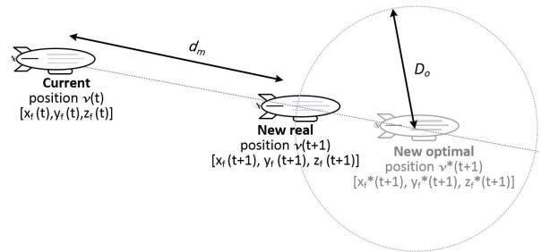  
Fig. 1. Illustration of a core idea of the proposed solution for elimination of redundant movement. Note that if the FlyBS is within the distance $D _ { o }$ from the new optimal position, no movement is necessary.

## A. Framework for FlyBS Positioning to Save Energy for Flying

Existing algorithms focusing on the scenario with the mobile UEs typically navigate the FlyBS(s) to follow the position maximizing the capacity. Hence, in the related existing works, the FlyBS moves frequently to increase the capacity offered to the UEs. In our scenario with the slow-moving pedestrian UEs served by the airship-based FlyBS, which is efficient for such scenario, the frequent changes of the FlyBS position notably drain their battery while achieving only a marginal improvement in the sum capacity. Consequently, the sum capacity maximization leads inevitably to “redundant” movements of the FlyBS. However, due to logarithmic dependence of the capacity on the distance (which is related to the channel quality), some of the FlyBS’s movements introduce only a marginal improvement in the sum capacity while a notable additional energy is consumed by the FlyBS for flying. The work presented in this paper is based on a presumption that not every movement of the UEs should necessarily lead to a repositioning of the FlyBSs to the position yielding the maximum sum capacity (denoted as the new optimal position). To this end, we suggest to avoid the “redundant” movements so that the FlyBS does not follow exactly the optimum position (i.e., position yielding the maximum capacity) ${ \pmb v } ^ { * } ( t + 1 ) =$ $[ x _ { f } ^ { * } ( t + 1 ) , y _ { f } ^ { * } ( t + 1 ) , z _ { f } ^ { * } ( t + 1 ) ]$ . Thus, instead of traveling to the optimum position, the FlyBS moves only to a new position $\pmb { v } ( t + 1 ) = [ x _ { f } ( t + 1 ) , y _ { f } ( t + 1 ) , z _ { f } ( t + 1 ) ]$ ], which is between the optimum and current positions to avoid the redundant movement, as illustrated in Fig. 1.

The new real position of the FlyBS is determined knowing the current FlyBS position ${ \pmb v } ( t ) = [ x _ { f } ( t ) , y _ { f } ( t ) , z _ { f } ( t ) ]$ , the new optimal position of the FlyBS ${ \pmb v } ^ { * } ( t + 1 ) = [ x _ { f } ^ { * } ( t + 1 )$ $y _ { f } ^ { * } ( t + 1 ) , z _ { f } ^ { * } ( t + 1 ) ]$ ], and the distance $D _ { o }$ to this new optimal position. Finding of the optimum positions of the FlyBS is a linear programming problem, hence, we derive the optimum position numerically by the Nelder-Mead simplex search (see details in [48]). Such approach is, however of a high complexity making it impractical for real networks. Therefore, we also investigate the performance for the positions of the FlyBS derived by a commonly adopted low-complexity (polynomial) and fast converging, but sub-optimal (in terms of the sum capacity) approach via k-means (see, e.g., [30]) and via state-of-the-art successive convex optimization outlined in [14]. Note that our proposed solution is independent of the approach for the optimum positions’ determination. Hence, we consider these three approaches for our investigation to show performance for i) complex, but well-performing, ii) low-complexity, but slightly worse performing, as well as iii) state-of-the-art approaches.

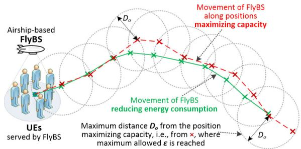  
Fig. 2. Example of FlyBS movement considering proposed concept (green solid line) with respect to positions yielding maximum sum capacity (red dashed line). Each cross $^ { \ast } \times \ '$ identifies a point where new position of FlyBS is determined and circles represent distance $D _ { o }$ from the optimum FlyBS’s position maximizing capacity within which the allowed sum capacity degradation - is not exceeded.

The new real position of the FlyBS is represented by an intersection of the straight line between the current and new optimal positions and the sphere defined by the radius $D _ { o } ( t +$ 1) whose center corresponds to the optimal position of the FlyBS. The new 3D coordinates of the FlyBS are defined in following lemma.

Lemma 1: The new position of the FlyBS is determined in a closed-form as:

$$
\begin{array}{c} \boldsymbol {v} (t + 1) = \boldsymbol {v} (t) + \frac {(\boldsymbol {v} ^ {*} (t + 1) - \boldsymbol {v} (t))}{| | \boldsymbol {v} ^ {*} (t + 1) - \boldsymbol {v} (t) | |} \\ \times \max \{0, (| | \boldsymbol {v} ^ {*} (t + 1) - \boldsymbol {v} (t) | | - D _ {o} (t + 1)) \} \end{array}\tag{5}
$$

Proof: In case that $| | \pmb { v } ^ { * } ( t + 1 ) - \pmb { v } ( t ) | | \ \leq \ D _ { o } ( t + 1 )$ the FlyBS would not move, as the constraint (4a) is already fulfilled. Furthermore, in case that $| | { \pmb v } ^ { * } ( t + 1 ) - { \pmb v } ( t ) | | \ >$ $D _ { o } ( t + 1 )$ , the movement of the FlyBS starts from v(t) and continues towards ${ \pmb v } ^ { * } ( t + 1 )$ . The movement distance is $d _ { m } =$ $| | \pmb { v } ^ { * } ( t + 1 ) - \pmb { v } ( t ) | | - D _ { o } ( t + 1 )$ according to Fig. 1. Hence, the displacement vector of the FlyBS is $\frac { ( \pmb { v } ^ { \ast } ( t + 1 ) - \pmb { v } ( t ) ) } { | | \pmb { v } ^ { \ast } ( t + 1 ) - \pmb { v } ( t ) | | } d _ { m }$ , where $\frac { ( \pmb { v } ^ { * } ( t + 1 ) - \pmb { v } ( t ) ) } { | | \pmb { v } ^ { * } ( t + 1 ) - \pmb { v } ( t ) | | }$ is the unit vector for the movement towards ${ \pmb v } ^ { * } ( t + 1 )$ . This concludes the proof.

The above described approach leads to a natural “smoothening” of the FlyBS’s movement. In other words, the FlyBS do not copy the movement of UEs accurately, but naturally avoids a redundant and non-beneficial movement as illustrated in Fig. 2.

B. Analysis of Energy Consumption and Sum Capacity Trade-Offs for Single FlyBS

In the case of single FlyBS, no interference among the FlyBSs applies, thus, the downlink communication capacity of the n-th UE is defined as:

$$
C _ {n} = B _ {n} \times \log_ {2} \left(1 + \frac {p _ {n} ^ {R}}{\sigma^ {2}}\right)\tag{6}
$$

Note that we omit index of the FlyBS in this subsection for clarity of presentation, as only one FlyBS is considered. For clarity of derivations, we remove also the constraints on the FlyBS flight (4b) and (4c) in this subsection. Then, the problem formulated in (4) is simplified to:

$$
\begin{array}{l} \boldsymbol {V} ^ {*} (\boldsymbol {t}) = \underset {\boldsymbol {V} \in \boldsymbol {R} ^ {3 M}} {\operatorname{argmin}} E _ {F} \\ \text { s.t. } \sum_ {n = 1} ^ {N} C _ {n} \geq C _ {o p t} \times (1 - \epsilon) \end{array}\tag{7}
$$

To solve this problem analytically, we first modify the constraint in (7) and we define relation between the allowed degradation in the sum capacity  and the distance $D _ { o }$ , which the FlyBS keeps from the optimum position as indicated in Proposition 1.

Proposition 1: The constraint $\begin{array} { r } { \sum _ { n = 1 } ^ { N } C _ { n } \ge C _ { o p t } \times ( 1 - \epsilon ) } \end{array}$ -in (7) can be replaced with the following constraint

$$
d \left[ \pmb {v} (t), \pmb {v} ^ {*} (t) \right] <   D _ {o} (t)\tag{8}
$$

where d $[ { \pmb v } ( t ) , { \pmb v } ^ { * } ( t ) ]$ represents the distance between the points v(t) and ${ \pmb v } ^ { * } ( t )$ representing the current and the optimal positions of the FlyBS at the time t.

The constraint (8) indicates that the new 3D position of the FlyBS lies in the sphere with the center at ${ \pmb v } ^ { * } ( t )$ and with the radius:

$$
D _ {o} (t) = \left(\frac {\nu - C _ {o p t} \times (1 - \epsilon)}{\sum_ {n = 1} ^ {N} \omega_ {n}}\right) ^ {\frac {1}{2}}\tag{9}
$$

where ν and $\omega _ { n }$ are substitutions of the system parameters (including, among others, 3D coordinates of the FlyBS) defined in Appendix A to simplify the formulation.

Proof: Please see Appendix A.

To quantify efficiency of the positioning in terms of the energy consumption, we define the energy saving metric $E _ { s }$ representing the amount of energy saved by the optimized positioning with respect to the positioning maximizing the sum capacity. To evaluate the energy saving $E _ { s }$ , let’s first expand the general high-level illustration of the principle presented in Fig. 1 into multiple consecutive steps of the FlyBS’s movement as shown in Fig. 3. The FlyBS’s movement can be decomposed into movements corresponding to short time steps (from t to t+ 1, from t+ 1 to t+ 2, etc.). Each segment of the movement is described by its length and by its angle θ with respect to the previous segment. Note that this angle is used for the purpose of analysis and can be of any value $( \mathrm { i . e . , ~ } \theta \in [ 0 , 2 \pi ] )$ . The figure depicts two possible paths of the FlyBS, each with two segments. The first path (red dashed line) corresponds to the FlyBS movement achieving the maximum sum capacity while the second path (green solid line) represents a shorter path resulting in the saving in energy consumed for flying.

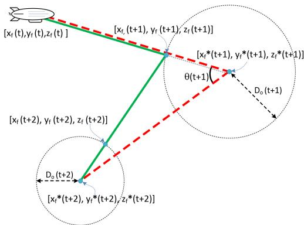  
Fig. 3. Illustrative example of single FlyBS movement over several (two) positions; the dashed red line is the “state-of-the-art” movement maximizing the sum capacity while the solid green line is the movement reducing the energy consumed for flying.

Considering the airship-based FlyBS, as explained in Section II, a potential energy saving is proportional to the ratio of the energy consumption over the energy efficient (green solid) path and the energy consumption over the path maximizing the sum capacity (red dashed). Hence, the relative saved energy $E _ { s }$ for the movement of single FlyBS is expressed by (10), as shown at the bottom of the page.

The $E _ { s }$ expresses the achievable energy saving in relation to the loss in sum capacity (with respect to the theoretical maximum achievable capacity) for single FlyBS. The energy saving $E _ { s }$ is proportional to $D _ { o }$ that is, in turn, proportional to  (i.e., allowed degradation in the sum capacity with respect to $C _ { o p t }$ , see (9)). Thus, with increasing $\epsilon , \ D _ { o }$ increases as well and, consequently, more energy is saved (see (10)). Note that $E _ { s } ~ = ~ 1$ corresponds to 100% of saved energy while $E _ { s } ~ = ~ 0$ represents no saving at all. A visualization and a quantification of the trade-off between the energy savings and the sum capacity according to (10) are provided in Section V focused on performance evaluation.

## IV. ENERGY EFFICIENT POSITIONING OF MULTIPLE FLYBSS

In this section, we extend the single FlyBS scenario to multiple FlyBSs. First, we derive energy consumption of the

$$
\begin{array}{l} E _ {s} = 1 - \frac {d [ \boldsymbol {v} (t) , \boldsymbol {v} (t + 1) ] + d [ \boldsymbol {v} (t + 1) , \boldsymbol {v} (t + 2) ]}{d [ \boldsymbol {v} (t) , \boldsymbol {v} ^ {*} (t + 1) ] + d [ \boldsymbol {v} ^ {*} (t + 1) , \boldsymbol {v} ^ {*} (t + 2) ]} \\ = 1 - \frac {d [ \boldsymbol {v} (t) , \boldsymbol {v} ^ {*} (t + 1) ] + d [ \boldsymbol {v} (t + 1) , \boldsymbol {v} ^ {*} (t + 2) ] - D _ {o} (t + 1) - D _ {o} (t + 2)}{d [ \boldsymbol {v} (t) , \boldsymbol {v} ^ {*} (t + 1) ] + d [ \boldsymbol {v} ^ {*} (t + 1) , \boldsymbol {v} ^ {*} (t + 2) ]} \\ = 1 - \frac {d [ \boldsymbol {v} (t) , \boldsymbol {v} ^ {*} (t + 1) ] - (D _ {o} (t + 1) + D _ {o} (t + 2)) + \sqrt {D _ {o} ^ {2} (t + 1) + d ^ {2} [ \boldsymbol {v} ^ {*} (t + 1) , \boldsymbol {v} ^ {*} (t + 2) ] - 2 D _ {o} (t + 1) d [ \boldsymbol {v} ^ {*} (t + 1) , \boldsymbol {v} ^ {*} (t + 2) ] c o s (\theta (t + 1))}}{d [ \boldsymbol {v} (t) , \boldsymbol {v} ^ {*} (t + 1) ] + d [ \boldsymbol {v} ^ {*} (t + 1) , \boldsymbol {v} ^ {*} (t + 2) ]} \end{array}
$$

(10)

FlyBS with respect to required changes in the sum capacity considering mutual impact (interference and positioning) of the FlyBSs. Then, we propose algorithm minimizing the energy consumed by the FlyBSs for flying under the constraints on sum capacity and flying in (4). Last, we discuss complexity and potential limitations of the algorithm.

## A. Energy Consumption and Sum Capacity for Multiple FlyBSs

An extension towards multiple FlyBSs assumes to consider a mutual interference among the FlyBSs. Thus, the channel capacity of the n-th UE associated to the m-th FlyBS $( C _ { m , n } )$ is defined in line with (1) and (2). For analysis of the energy consumption and sum capacity trade-offs in this section, we first approximate the sum capacity of multiple FlyBSs in the following theorem.

Theorem 1: The sum capacity of N UEs served by M FlyBSs is approximated as:

$$
\sum_ {m = 1} ^ {M} \sum_ {n = 1} ^ {N} C _ {n, m} \approx A - \sum_ {m = 1} ^ {M} r _ {m} d ^ {2} \left[ \boldsymbol {v} _ {\boldsymbol {m}} (t), \boldsymbol {v} _ {\boldsymbol {m}} ^ {*} (t) \right]\tag{11}
$$

and the constraint (4a) can be reformulated to:

$$
\sum_ {m = 1} ^ {M} r _ {m} d ^ {2} \left[ \boldsymbol {v} _ {\boldsymbol {m}} (t), \boldsymbol {v} _ {\boldsymbol {m}} ^ {*} (t) \right] \leq A - C _ {o p t} \times (1 - \epsilon)\tag{12}
$$

where A and $r _ { m }$ are substitutions defined in Appendix B to simplify the formulation.

Proof: Please see Appendix B.

To derive also the energy consumed for flying of individual FlyBSs, we first determine the required movement $( d _ { m , r e q } )$ of the m-th FlyBS $( 1 \leq m \leq M )$ leading to the increase in the sum capacity $\Delta C ,$ , which is required to fulfill the constraint (4a). Thus, ΔC is the difference between the sum capacity offered by all FlyBSs at the time t − 1 and at the time t, i.e.,:

$$
\Delta C = \sum_ {m = 1} ^ {M} \sum_ {n = 1} ^ {N} C _ {n, m} (t) - \sum_ {m = 1} ^ {M} \sum_ {n = 1} ^ {N} C _ {n, m} (t - 1)\tag{13}
$$

Now, exploiting the reformulated constraint from Theorem 1, we define $\Delta C$ as a function of the m-th FlyBS’s movement for the distance $d _ { m , r e q }$ required to fulfill the constraint, i.e.,:

$$
\begin{array}{l} \Delta C = \sum_ {m = 1} ^ {M} \sum_ {n = 1} ^ {N} C _ {n, m} (t + 1) - \sum_ {m = 1} ^ {M} \sum_ {n = 1} ^ {N} C _ {n, m} (t) \\ \qquad = (A - \sum_ {m = 1} ^ {M} r _ {m} (d [ \boldsymbol {v _ {m}} (t), \boldsymbol {v _ {m} ^ {*}} (t) ] + d _ {m, r e q}) ^ {2}) \\ \qquad - (A - \sum_ {m = 1} ^ {M} r _ {m} d ^ {2} [ \boldsymbol {v _ {m}} (t), \boldsymbol {v _ {m} ^ {*}} (t) ]) \\ \qquad = - r _ {m} \big (d _ {m, r e q} ^ {2} (t + 1) + 2 d [ \boldsymbol {v _ {m}} (t), \boldsymbol {v _ {m} ^ {*}} (t) ]   d _ {m, r e q} (t + 1) \big) \end{array}\tag{14}
$$

We can rewrite (14) to:

$$
\left(d _ {m, r e q} (t + 1) + d \left[ \boldsymbol {v} _ {\boldsymbol {m}} (t), \boldsymbol {v} _ {\boldsymbol {m}} ^ {*} (t) \right]\right) ^ {2} = d ^ {2} \left[ \boldsymbol {v} _ {\boldsymbol {m}} (t), \boldsymbol {v} _ {\boldsymbol {m}} ^ {*} (t) \right] - \frac {\Delta C}{r _ {m}}\tag{15}
$$

From (15), the value of $d _ { m , r e q } ( t + 1 )$ is simply expressed as:

$$
d _ {m, r e q} (t + 1) = - d [ \pmb {v} _ {\pmb {m}} (t), \pmb {v} _ {\pmb {m}} ^ {*} (t) ] \pm \sqrt {d ^ {2} [ \pmb {v} _ {\pmb {m}} (t) , \pmb {v} _ {\pmb {m}} ^ {*} (t) ] - \frac {\Delta C}{r _ {m}}}\tag{16}
$$

Between two values resulting from (16), we choose the one with a smaller absolute value, as the smaller movement incurs lower energy consumption:

$$
\begin{array}{l} \left| d _ {m, r e q} (t + 1) \right| \\ = m i n \left\{\left| - d \left[ \boldsymbol {v} _ {\boldsymbol {m}} (t), \boldsymbol {v} _ {\boldsymbol {m}} ^ {*} (t) \right] - \sqrt {d ^ {2} \left[ \boldsymbol {v} _ {\boldsymbol {m}} (t) , \boldsymbol {v} _ {\boldsymbol {m}} ^ {*} (t) \right] - \frac {\Delta C}{r _ {m}}} \right|, \right. \\ \left| - d \left[ \boldsymbol {v} _ {\boldsymbol {m}} (t), \boldsymbol {v} _ {\boldsymbol {m}} ^ {*} (t) \right] + \sqrt {d ^ {2} \left[ \boldsymbol {v} _ {\boldsymbol {m}} (t) , \boldsymbol {v} _ {\boldsymbol {m}} ^ {*} (t) \right] - \frac {\Delta C}{r _ {m}}} \right| \Bigg \} \end{array}\tag{17}
$$

Then, the energy consumption for flying of the m-th FlyBS leading to $\Delta C$ is:

$$
E _ {F, m} (t + 1) = e _ {m} d _ {m, r e q} (t + 1)\tag{18}
$$

B. Energy Efficient Positioning of Multiple Airship-Based FlyBSs

Exploiting the relation between the sum capacity and the energy consumption derived in the previous subsection, we propose an algorithm that determines the positions of arbitrary number of FlyBSs so that the energy spent for flying is minimized while the sum capacity still satisfies the constraint (4a). We distinguish two cases according to the constraint:

1) If the capacity constraint (4a) is satisfied, the FlyBSs should not move to avoid redundant consumption of the energy for flying.

2) If the capacity constraint (4a) is not satisfied, a movement of at least one of the FlyBSs is required to satisfy the users requirements on communication capacity.

As the first case does not require any movement, we now focus on the second case. The FlyBSs move with small steps as summarized in Algorithm 1. At the beginning (line 2 in Algorithm 1), the required increase in the sum capacity to fulfill the constraint $\Delta C _ { t a r g e t }$ reflecting the users’ requirements is determined. The $\Delta C _ { t a r g e t }$ is split into small substeps $\Delta C _ { s t e p } \in ( 0 ; \Delta C _ { t a r g e t } )$ . In each sub-step, the energy consumption for the required increase in sum capacity is calculated from (18) for each FlyBS (line 4). The FlyBS, whose movement yields the highest gain in the sum capacity at the cost of the smallest energy consumption is selected, $\mathrm { i . e . , }$ in each sub-step, we select the FlyBS $m _ { 0 }$ maximizing $\frac { \Delta C _ { s t e p } } { E _ { F , m } }$ (see line 5). As $C _ { s t e p } > 0 , \Delta C _ { t a r g e t }$ decrements over sub-steps and the algorithm converges. Note that selection of a larger $\Delta C _ { s t e p }$ leads to a lower number of sub-steps with a longer FlyBS’s movement in each sub-step (thus, keeps low computation complexity), but the longer movement of the FlyBS in each sub-step results to a sub-optimal new position of the FlyBS. The sub-optimality results from the fact that the selected FlyBS m0 keeps moving even if its $\frac { \Delta C _ { s t e p } } { E _ { F , m 0 } }$ is no longer maximal among all FlyBSs. Our experiments show that setting of $\Delta C _ { s t e p }$ to few kbps guarantees close-to-optimum performance and still keeps a low number of sub-steps. Hence, we set $\Delta C _ { s t e p }$ to 10 kbps in this paper.

Algorithm 1 Determination of New Positions for FlyBSs Minimizing Energy Consumption
1: $\mathcal{M} \leftarrow \{1, \ldots, M\}, [x_{f,m}(t+1), y_{f,m}(t+1), z_{f,m}(t+1)] \leftarrow [x_{f,m}(t), y_{f,m}(t), z_{f,m}(t)], d_{m,tot} = 0 \forall m \in \mathcal{M}$
2: $\Delta C_{target} \leftarrow C_{opt} \times (1 - \epsilon) - \sum_{n=1}^{N} \sum_{m=1}^{M} C_{n,m}$
3: while $\Delta C_{target} &gt; 0$ do
4: Calculate $[E_{F,1}, \ldots, E_{FM}]$ from (18)
5: $m_0 \leftarrow \text{argmax}_{m \in \mathcal{M}}(\frac{\Delta C_{step}}{E_{F,m}})$
6: Calculate $d_{m_0,req}(t+1)$ from (17) with $\Delta C = \Delta C_{step}$
7: if $d_{m_0,req}(t+1) &gt; d_{max}$ then $d_{m_0,req}(t+1) \leftarrow d_{max}$ and calculate $\Delta C$ from (14) end if
8: Calculate new $[x_{f,m_0}(t+1), y_{f,m_0}(t+1), z_{f,m_0}(t+1)]$ of $m_0$-th FlyBS via (5)
9: if $z_{f,m_0}(t+1) &gt; h_{max}$ or $z_{f,m_0}(t+1) &lt; h_{min}$ then
10: $d_{m_0,req}(t+1) \leftarrow ||\frac{h_{max(min)} - z_{f,m_0}(t)}{z_{f,m_0}(t+1) - z_{f,m_0}(t)} \times \frac{(\boldsymbol{v}_{\boldsymbol{m}_0}^*(t+1) - \boldsymbol{v}_{\boldsymbol{m}_0}(t))}{||\boldsymbol{v}_{\boldsymbol{m}_0}^*(t+1) - \boldsymbol{v}_{\boldsymbol{m}_0}(t)||}||$ and calculate $\Delta C$ (14) and $\boldsymbol{v}_{\boldsymbol{m}_0}$ (5)
11: end if
12: if $d_{m_0,tot}(t+1) + d_{m_0,req}(t+1) &gt; d_{max}$ then
13: $d_{m_0,req}(t+1) \leftarrow d_{max} - d_{m_0,tot}(t+1)$, calculate $\Delta C$ from (14) and $\boldsymbol{v}_{\boldsymbol{m}_0}$ from (5), and $\mathcal{M} \leftarrow \mathcal{M} - \{m_0\}$
14: else $d_{m_0,tot}(t+1) \leftarrow d_{m_0,tot}(t+1) + d_{m_0,req}(t+1)$ end if
15: $\Delta C_{target} = \Delta C_{target} - \Delta C$
16: end while

Now, using (17), we determine the distance $d _ { m _ { 0 } , r e q } ( t + 1 )$ for which the selected FlyBS $m _ { 0 }$ should move to reach $\Delta C _ { s t e p }$ (line 6). If the resulting $d _ { m _ { 0 } , r e q } ( t + 1 )$ exceeds $d _ { m a x }$ and violates constraint (4b), the FlyBS moves only for $d _ { m a x }$ and $\Delta C$ is updated via (14) (line 7). Then, new position of the selected FlyBS $m _ { 0 }$ is determined via (5) (line 8). If the new position would lead to a movement below minimum or above maximum allowed altitudes (constraint (4c)), the coordinates $v _ { m _ { 0 } }$ of the FlyBS are adjusted and $\Delta C$ is also updated (lines 9–11). After this, we also verify if the total movement of single FlyBS over all sub-steps towards $\Delta C _ { t a r g e t }$ still fulfills the constraint (4b) (lines 12–14) and ΔC is updated together with the FlyBS’s coordinates $v _ { m _ { 0 } }$ if the constraint is violated (line 13). Since the violation of (4b) indicates that the FlyBS $m _ { 0 }$ cannot further move in the next sub-steps, $m _ { 0 }$ is excluded from the set of all FlyBS considered for movement in next iterations (line 13). Finally, $\Delta C _ { t a r g e t }$ is decreased by $\Delta C _ { s t e p }$ (line 15). The process of the FlyBS selection and movement (lines 4–15) is repeated until the constraint (4a) is not fulfilled, i.e., as long as $\Delta C _ { t a r g e t } > 0$ . Algorithm 1 is repeated again if the capacity constraint in (4a) becomes not fulfilled in the future, e.g., due to the UEs’ movement.

## C. Complexity and Potential limitations

To determine the computation complexity of Algorithm 1, first, let us remind the proposed solution consists of two steps: i) an approximation of the sum capacity, and ii) a positioning of the FlyBSs based on the approximated sum capacity (Algorithm 1). The complexity of the approximation in the step i) is $\mathcal { O } ( M )$ for each UE, where M is the number of FlyBSs. Thus, the complexity of the step i) is O(MN), where N is the number of UEs and this complexity is linear with respect to both the number of UEs and the number of FlyBSs. Then, the complexity of the step ii) is $\mathcal { O } ( 1 / \Delta C _ { s t e p } )$ . Hence, the total complexity of the proposed solution is $\mathcal { O } ( M N / \Delta C _ { s t e p } )$ which makes the algorithm fast and easy to implement in practical systems.

Our algorithm is designed for the airship-based FlyBSs and would not work well for the rotary-wing FlyBSs, since the rotary-wing FlyBSs exhibit completely different energy consumption behavior. However, this limitation is implied by our targeted scenario, where the rotary-wing FlyBSs are not efficient, see Section I. Furthermore, the FlyBSs should cooperate together. Still, solutions considered commonly in the related works assuming a control of the FlyBSs centrally from the network via SBSs can be adopted in a way that the algorithm is processed by the network and decisions are, then, delivered to individual FlyBSs. Hence, no extra signaling or information exchange is required with respect to the related works.

## V. PERFORMANCE EVALUATION

In this section, first, simulation scenario, models, and metrics are outlined. Then, we illustrate bounds of theoretical energy saving related to the sum capacity of the UEs for single FlyBS. Last, we investigate the energy saving in the scenario with multiple FlyBSs and we demonstrate an efficiency of the proposed algorithm comparing to the optimum as well as state-of-the-art solutions for the FlyBS positioning.

## A. Simulation Scenario, Models, and Metrics

We assume the area of 1000 × 1000 m as in [12]. Within this area, 40 or 1000 UEs [12], [33], [35] are dropped as the FlyBSs are supposed to serve heavily loaded scenarios with a high UEs’ density. To mimic a realistic scenario, we model the UEs’ mobility as a mixture of random way-point and clusterbased mobility models. To this end, a half of the UEs (i.e., 500 UEs) are dropped randomly within the simulation area and move according to the commonly used random walk mobility model with a speed of 1 m/s. The second half of the UEs (another 500 UEs) are randomly distributed into $N _ { c r } ~ = ~ 6$ “crowds” and these UEs follow the crowd mobility model inspired by [49]. The movement of each crowd is defined by coordinates of the crowd’s center $W = \{ w _ { 1 } , w _ { 2 } , \dots , w _ { N _ { c r } } \}$ where $w _ { N c r } \in R ^ { 2 }$ for $\forall n _ { c r } \in \left. 1 , N _ { c r } \right.$ . Each cluster is of 20 m radius. Then, the 500 UEs belonging to the second half are randomly assigned to one of these clusters and dropped within the corresponding radius. Each UE in the cluster follows the global movement vector of the cluster, which moves with a speed of 1 m/s. On the top of the cluster movement, each UE within the cluster can also change its movement by $\pm 1 5 ^ { \circ }$ and speed by ±0.4 m/s with respect to the cluster center (i.e., the clustered UEs move with the uniformly distributed speed of 0.6 − 1.4 m/s). Note that the UEs cannot leave the cluster radius.

TABLE II  
SIMULATION PARAMETERS

<table><tr><td>Parameter</td><td>Value</td></tr><tr><td>Carrier frequency</td><td>2.6 GHz [35]</td></tr><tr><td>Bandwidth</td><td>20 MHz [50]</td></tr><tr><td>Number of UEs</td><td>40 and 1000 [12], [33], [35]</td></tr><tr><td>Number of FlyBSs</td><td>1, 3, 5 [12], [33], [35]</td></tr><tr><td>Tx power of FlyBSs</td><td>15 dBm [33], [44]</td></tr><tr><td>Height of UEs</td><td>1.5 m [50]</td></tr><tr><td>FlyBS altitude limits  $h_{min}$  and  $h_{max}$ </td><td>30 m and 350 m</td></tr><tr><td>FlyBS flight constraint  $d_{max}$ </td><td>25 m</td></tr><tr><td>Noise power spectral density</td><td>-174 dBm/Hz [12], [35]</td></tr><tr><td>Background interference</td><td>-130 dBm/Hz</td></tr></table>

We deploy up to five FlyBSs to serve the UEs [12], [33], [35]. The FlyBSs’ traveled distance per second is limited to $d _ { m a x } \ = \ 2 5 \ \mathrm { ~ m ~ }$ and the altitude to $h _ { m i n } \ = \ 3 0$ m and $h _ { m a x } \ = \ 3 5 0 \ \mathrm { ~ m ~ }$ . The channel between UE and FlyBS is determined via mixed LoS/NLoS path loss model with 10% probability of NLoS and 90% of LoS, as we focus on an outdoor scenario with the UEs in an open area. LoS and NLoS channels are modeled via the free space path loss with $\alpha _ { n , m } ~ = ~ 2$ and $\alpha _ { n , m } ~ = ~ 3$ in (3), respectively. We assume carrier frequency of 2.6 GHz [35], bandwidth of 20 MHz [50], and transmission power of the FlyBSs of 15 dBm [33], [44]. Noise and background interference from the neighboring SBSs with a density of −174 dBm/Hz [12], [35] and −130 dBm/Hz, respectively, are also considered to reflect our scenario, where a common infrastructure of mobile networks is not exactly in the served area like in the case of, for example, music festival in rural area. Note that the interference among the FlyBSs is derived as a sum of all interfering signals and it is added up to the noise and background interference from the neighboring SBSs.

The simulations are of 1800 seconds duration and the simulations are repeated 500 times with different UEs’ deployments and movements in each simulation run to suppress an impact of randomness. Key simulation parameters and settings are summarized in Table II.

The proposed solution is compared with following approaches:

Numerical positioning, which determines the positions of the FlyBSs to maximize the sum capacity numerically via Nelder-Mead simplex.

Positioning based on k-means, introduced in [30], represents the common approach adopted for positioning in recent works, as it is of polynomial complexity only (thus converges fast).

Positioning via successive convex optimization, representing state-of-the-art work determining the FlyBSs’ positions to maximize the minimum capacity, as proposed in [14].

Note that up to our best knowledge, there is no paper targeting the minimization of the energy consumption for flying of the airship-based FlyBSs serving mobile UEs and comparison with the works for static UEs is not possible due to the nature of such works.

To evaluate a performance of the proposed algorithm, we define two performance metrics:

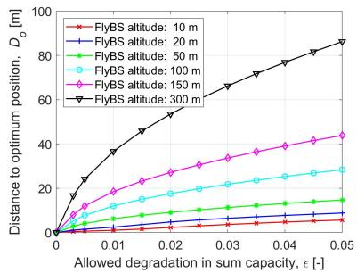  
Fig. 4. Relation between distance to optimum $D _ { o }$ with respect to allowed degradation in sum capacity of UEs -.

• Energy saving $E _ { s }$ – determined as relative average amount of the energy consumed by the proposal with respect to the average energy consumed by the algorithms determining the FlyBSs (sub-)optimal positions numerically, by k-means, and via successive convex optimization, during the whole simulation.

• Sum capacity degradation – relative difference between the sum capacity achieved by the proposed algorithm and by the FlyBSs in the (sub-)optimum positions. Note that the sum capacity approximation in Theorem 1 does not apply in the simulations.

Note that we present both performance metrics as relative values (from 0 to 1) with respect to performance in the (sub-)optimum positions of the FlyBSs, since the relative metrics eliminate an impact of a specific setting of the energy consumption model.

## B. Theoretical Bounds of Energy Saving for Single FlyBS

For easy interpretation of the trade-offs in energy saving and sum capacity, let us first illustrate a relation between the distance of the FlyBS from the optimum position $D _ { o }$ and the allowed degradation in sum capacity  for typical FlyBS’s altitudes [4], [51] in Fig. 4.

Fig. 4 indicates that $D _ { o }$ first rises quickly with increasing  and, then, starts slowly saturating. This is implied by the logarithmic relation between the capacity and path loss with respect to the distance. We illustrate the results for various altitudes of the FlyBS to indicate that there is almost linear dependence between the FlyBS’s altitude and $D _ { o } .$ . Thus, the higher the FlyBS is, the higher the distance from the optimum position is acceptable in order to fulfill the maximum allowed degradation in the sum capacity. In general, relatively large values of $D _ { o }$ (in order of ones to few dozens of meters) still lead to only a negligible decrease in the sum capacity. For example, to guarantee the sum capacity degradation below 1% $( \mathrm { i . e . , } \epsilon = 0 . 0 1 )$ ), the FlyBS can stay about up to 1.1 m, 2.3 m, 5.5 m, 12 m, 18.5 m, and 37 m from the optimum position for the FlyBS at altitudes of 10 m, 20 m, 50 m, 100 m, 150 m, and 300 m, respectively. This finding itself can be interpreted so that the sub-optimal FlyBS’s positions in order of few meters lead to only a negligible degradation in the sum capacity. Such outcome significantly relaxes requirements on finding the optimum positions of the FlyBSs.

Now, let’s investigate the trade-off between energy saving and sum capacity degradation according to (10). In Fig. 5, we illustrate three examples of common practical cases representing the UEs moving along: i) straight street $( \theta = \pi )$ with length of L meters, ii) right-angled streets (i.e., under the angle $\theta \ = \ \pi / 2 )$ , each street with length of $L / 2 ,$ , and iii) streets with length of $L / 2$ under the angle of $\theta = \pi / 4$

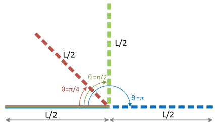  
Fig. 5. Examples of UEs’ movement along: i) straight street $( \theta ~ = ~ \pi )$ ii) right-angled streets $( \theta = \pi / 2 )$ , and iii) streets under angle of $\theta = \pi / 4$

We analyze the energy saving of single FlyBS depending on the street length $L ,$ its direction (defined by the angle θ), and $D _ { o }$ in Fig. 6. We show the energy saving for the allowed sum capacity degradation of 0.5% $( \epsilon = 0 . 0 0 5 )$ and 4% $( \epsilon = 0 . 0 4 )$ corresponding to $D _ { o }$ of 12 m and 39 m, respectively, for the FlyBS’s altitude of 150 m. Note that $D _ { o }$ is derived from  via (9), as visualized in Fig 4. The results in Fig. 6 indicate that the longer the street is (i.e., the higher value of $L ) .$ , the less energy can be saved. This is justified by the fact that the longer the movement in the same direction is, the proportionally lower part of the movement can provide some energy saving. Let us illustrate this on an example of rather extreme case with a long direct street $( \theta = \pi )$ and all UEs moving along the street in the same direction. For such street, the optimum position yielding the maximum sum capacity “moves” along with the UEs in the same direction. Thus, any energy saving is possible only at the beginning of the street until the optimum position is not farther than $D _ { o }$ from the initial position of the FlyBS. Once the optimum position becomes farther than $D _ { o } ,$ the constraint (4a) would not hold unless the FlyBS moves as well. However, as the UEs keep moving in the same direction, the FlyBS should also keep moving in the same direction. Thus, when the optimum becomes at the distance $D _ { o }$ from the FlyBS position for the first time, the FlyBS is forced to move all the time and no saving is possible to fulfill the constraint (4a). Thus, with prolongation of the street (higher L), the $D _ { o } ( t )$ becomes relatively smaller with respect to L and the energy saving is also reduced.

Furthermore, Fig. 6 demonstrates that more notable energy saving is observed if the angle between two streets θ is more acute. The reason is that the more acute angle enables to eliminate more significant part of the movement. In other words, the FlyBS moves less, as the UEs remain within $D _ { o }$ for a longer time. We also observe that a significant (dozens of percent) saving in the energy consumed for flying is possible despite a very low (few percent or less) degradation in the sum capacity is allowed. This very positive trade-off theoretically allows to save a significant amount of the energy for flying at a cost of only a marginal degradation in the sum capacity.

The analysis and results in Fig. 6 indicate that the energy saving is more likely for “more random” movement of the UEs rather than for a uniform direct movement of all UEs in the same direction. Such finding is, however, positive as the UEs are supposed to move at least a bit randomly in most of real-world situations.

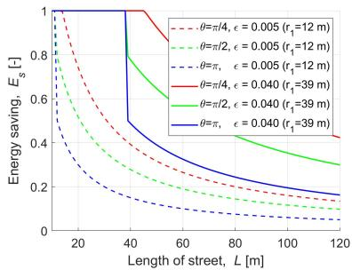  
Fig. 6. Relative amount of saved energy of FlyBS for flying; $E _ { s } ~ = ~ 0$ represents no saving, $E _ { s } = 1$ corresponds to 100% of energy being saved.

## C. Energy Saving for Multiple FlyBSs

Now, let’s focus on the energy saving and the sum capacity in the scenario with multiple FlyBSs. For this investigation, we assume a general area without streets (e.g., a square in a city, a concert, a sport event, or an emergency situation in an open area), where some of the UEs move randomly and some follow a crowd movement model as explained in Section V-A.

Fig. 7 and Fig. 8 show the energy saving and corresponding sum capacity degradation  (reflecting the users’ requirements, see (4)), respectively, of the proposed algorithm with respect to the FlyBSs’ positioning derived by three approaches outlined in Section V-A, i.e., numerically via simplex (left subplots), by k-means (middle subplots), and by state-of-the-art 3D positioning maximizing the minimum capacity via successive convex optimization (right subplots). The figures show results for lightly loaded network represented by 40 UEs (blue lines) and heavily loaded network with 1000 UEs (black lines) to demonstrate a scalability of our proposal. For the lower number of UEs, the gain with respect to the state-of-the-art works is a bit smaller (up to several to dozens percent decrease if the number of UEs drops 25-times, i.e., from 1000 to 40). This behavior is expectable, as the lower number of UEs imposes less pressure on communication and, hence, even less efficient solutions do not suffer much from sub-optimal decisions. A notable energy saving is observed with respect to all three competitive algorithms disregarding the number of FlyBSs, however, more significant energy saving is reached for a lower number of FlyBSs. The higher saving for less FlyBSs is due to a lower level of mutual interference among the FlyBSs and, at the same time, due to the fact that the more FlyBSs are deployed, the smaller area is served by each FlyBS and its movement is limited to this smaller area. Note that the decrease in energy savings with the number of FlyBSs is very small (just few percent when the number of FlyBSs is increased from three to five) and the savings are still significant (far above 60%) even for five FlyBSs. Hence, the solution is applicable even for large-scale scenarios.

In all three subplots in Fig. 7, the amount of saved energy increases with relaxation of the constraint on the sum capacity (i.e., with increasing ). The energy saving first raises promptly when $\epsilon > 0$ , since even a small allowed degradation in the capacity enables notable energy savings. With further increase in , the savings get saturated, since the saving reaches its maximum given by the users movement pattern. The energy for flying is saved significantly even if the allowed decrease in the sum capacity is very low (i.e., for very low ). For example, for the allowed degradation in the sum capacity of 1% $( \epsilon = 0 . 0 1 )$ ), 55.4%, 67.5%, and 90.7% of the energy is saved compared to the numerical derivation of the optimum position (left subplot)

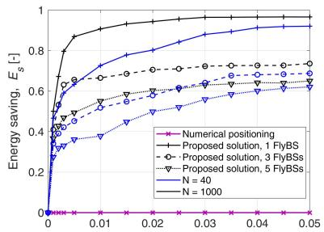  
Allowed sum capacity degradation, € [-]

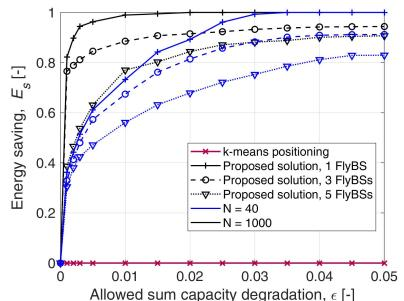  
Allowed sum capacity degradation, € [-]

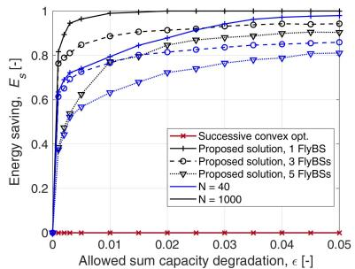  
Fig. 7. Relative energy saving of proposed FlyBSs’ positioning with respect to energy consumed by positioning: maximizing sum capacity derived numerically (left), based on k-means (middle), and based on successive convex optimization (right).

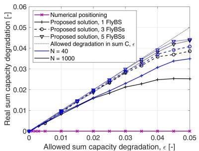  
Allowed sum capacity degradation, ε [-]

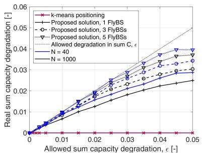  
Allowed sum capacity degradation, e [-]

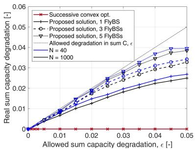  
Fig. 8. Sum capacity degradation due to proposed energy-efficient positioning with respect to maximum sum capacity determined: numerically (left), by k-means (middle), and based on successive convex optimization (right).

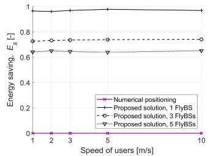

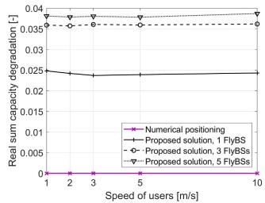

Fig. 9. Impact of speed of UEs on energy saving (left subplot) and sum capacity (right subplot) with respect to the numerical positioning for allowed degradation in sum capacity - = 0.04.  
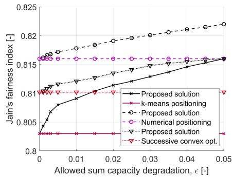  
Fig. 10. Fairness in capacity experienced by users with respect to allowed sum capacity degradation - for five FlyBSs.

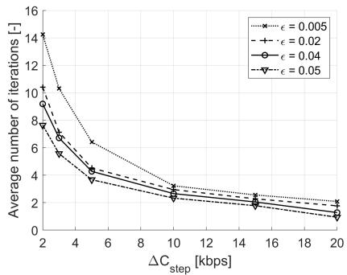  
Fig. 11. Number of iterations performed in the proposed positioning for different $\Delta C _ { s t e p }$ and various values of allowed degradation in sum capacity - for five FlyBSs.

numerical derivation of the optimum position is not practical due to a high complexity. Thus, we show also the performance of the proposed scheme with respect to a more practical stateof-the-art solution determining the position of the FlyBSs based on low-complexity k-means (middle subplot in Fig. 7) and based on successive convex optimization (right subplot in Fig. 7). With respect to the k-means-based determination of the positions, the proposal achieves even more significant energy saving and 77.2%, 88.2%, and 98.8% of the energy is saved for five, three, and one FlyBSs, respectively, if only 1% degradation in the sum capacity is allowed (i.e., $\epsilon = 0 . 0 1 )$ ). Similar energy saving of 77.1%, 88.6%, and 98.9% for five, three, and one FlyBSs, respectively, if $\epsilon = 0 . 0 1$ is reached by the proposal also with respect to the positioning based on successive convex optimization. The reason for higher savings reached by the proposal compared to the k-means and the successive convex optimization than the savings compared to the numerical solution is the fact that both the k-means and the successive convex optimization provide a sub-optimal sum capacity (lower than for the numerical solution) and, thus, enable our proposed algorithm to avoid the redundant movement even more notably.

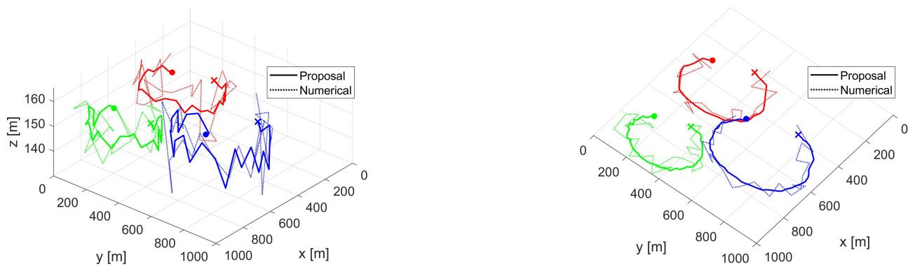  
Fig. 12. Example of movement of three FlyBSs for the proposed algorithm (solid lines) and positioning derived numerically (dotted lines), $" \bullet \mathrm { \ ? }$ and $^ { 6 6 } \times \vec { } ^ { , 3 }$ markers indicate starting and finishing positions of the FlyBSs in 3D (left) and 2D projection (right).

Note that  defines the maximum “allowed” degradation in the sum capacity, however, even a lower degradation can be actually experienced by the UEs. Thus, in Fig. 8, we illustrate the real sum capacity degradation observed in the simulations with respect to the given allowed degradation . The figure confirms that the real degradation in the sum capacity is safely below the allowed one (dotted straight line in figures) and the capacity constraint (4a) is satisfied.

Comparing the proposal with the positioning maximizing the sum capacity numerically in Fig. 8, left subplot, for 1% real degradation in the sum capacity,  corresponds to 0.0105, 0.0110, and 0.0125 and, consequently, the real energy saving (determined for these values of  in Fig. 7, left subplot) is 55.7%, 67.9%, and 91.9% for five, three, and one FlyBSs, respectively. The real degradation in the sum capacity comparing the proposal and the k-means is presented in Fig. 8 (middle subplot). For the same allowed sum capacity degradation of 1%, the real degradation is only about 0.90%, 0.80%, and 0.59% for five, three, and one FlyBSs, respectively. Thus, considering the real sum capacity degradation of 1% (corresponding to  of 0.011, 0.0125, and 0.0175), the energy saving of 77.9%, 89.4%, and 99.5% is observed for five, three, and one FlyBSs, respectively. Last, Fig. 8 (right subplot) depicts the real degradation in the sum capacity with respect to the successive convex optimization-based positioning. For the allowed sum capacity degradation of 1%, the real degradation corresponds to  of 0.011, 0.0120, and 0.015. Consequently, the real energy saving reaches 77.7%, 89.6%, and 99.4% for five, three, and one FlyBSs, respectively, compared to the successive convex optimization.

These results confirm the efficiency of the proposed algorithm and demonstrate that a significant saving in the energy for flying of the airship-based FlyBSs is achieved at a negligible cost represented by only marginal decrease in the sum capacity of the UEs. The results can be also interpreted in the way that an imprecise positioning of the FlyBSs (in order of dozens of decimeters to few meters) does not lead to any notable reduction in the sum capacity. Such finding gives a new degree of freedom for future optimization of the networks with the FlyBSs.

We investigate also an impact of the $\mathrm { U E s } ^ { \prime }$ speed on both the energy saving and the sum capacity compared to the positioning of the FlyBSs maximizing the sum capacity numerically via simplex in Fig. 9 for the allowed degradation in sum capacity of 4% $( \mathrm { i . e . , } \epsilon = 0 . 0 4 )$ . The figure demonstrates there is no notable impact (variation is about 2%) on both the energy saving (left subplot) and the sum capacity degradation (right subplot). This is due to the fact that there is no strong direct dependency of the proposed algorithm on the speed of UEs and the algorithm still forces the FlyBS to reach the same distance to optimum $D _ { o }$ (see (9)). Besides, the right subplot confirms that the real sum capacity degradation is safely below the allowed 4%.

Furthermore, in Fig. 10, we demonstrate that the fairness in capacity of individual UEs (defined as Jain’s fairness index) is similar for our proposal and for state-of-the-art works. Our algorithm even slightly improves the fairness (by few percent) if  increases compared to the state-of-the-art works, since the larger  provides additional flexibility in balancing the capacity among UEs.

To illustrate fast convergence of the proposed algorithm, we plot the average number of iterations over the capacity step $\Delta C _ { s t e p }$ (see Algorithm 1) in Fig. 11. This figure confirms that the larger the step of the FlyBS movement is (i.e., larger $\Delta C _ { s t e p } )$ , the faster the FlyBSs converge to their final positions. However, already $\Delta C _ { s t e p }$ of roughly 10 kbps requires only about two iterations. This means that only two FlyBSs move in each step. Such fast convergence does not limit practical applications. Note that all previous figures are plotted for $\Delta C _ { s t e p }$ of 10 kbps.

In Fig. 12, an example of the FlyBS trajectory in 3D space (left subplot) and projection to 2D (right subplot) is shown for three FlyBSs. We observe that each FlyBS changes 3D position in a certain area depending on the UEs’ movement and the FlyBSs’ positions are also influenced by interference from neighboring FlyBSs to the UEs. Hence, if one FlyBS initiates some movement towards other FlyBSs motivated by new UE’s positions, the other FlyBSs adapt to that movement with a similar movement pattern to keep their served UEs also satisfied. Fig. 12 also indicates optimum position of the FlyBSs derived numerically to illustrate that a notable reduction in the redundant movements of the FlyBSs is achieved by the proposed approach.

## VI. CONCLUSION

In this paper, we have derived and analyzed a relation between the sum capacity and the energy consumed for flying by the airship-based FlyBSs serving the mobile (moving) UEs. We have analytically shown theoretical bounds for the energy saving of the FlyBSs with respect to the sum capacity degradation. Then, we have proposed novel algorithm reducing the energy consumed for flying while still guaranteeing close to optimum sum capacity. If the sum capacity degradation is limited to 1%, the proposed algorithm enables energy saving of 55.4%, 67.5%, and 90.7% if five, three, and one FlyBSs are deployed, respectively, compared to the numerically determined position maximizing the sum capacity. The results indicate that a “perfect positioning” of the airship-based FlyBSs is not necessary and an error in the positioning in order of few meters have only marginal impact on the sum capacity. This finding provides a new degree of freedom for future research and development of algorithms for networks with FlyBSs.

In the future, the presented analysis and the proposed algorithm can be enhanced towards a joint optimization of the energies spent for flying and for communication. Besides, considering battery lifetime and charging aspects in the problem of FlyBSs positioning, e.g., as done for vehicles in [53], is a challenging topic.

## APPENDIX A

This appendix provides the proof to Proposition 1. Let us start with the sum capacity definition from system model (Section II), i.e.,:

$$
\begin{array}{c} \sum_ {n = 1} ^ {N} C _ {n} = \sum_ {n = 1} ^ {N} B _ {n} \log_ {2} \left(1 + \frac {p _ {n} ^ {R}}{\sigma^ {2}}\right) \\ = \sum_ {n = 1} ^ {N} B _ {n} \log_ {2} \left(1 + \frac {Q _ {n}}{\sigma^ {2} d _ {n} ^ {\alpha_ {n}}}\right). \end{array}\tag{19}
$$

Now, we approximate log function with respect to parameter X using linear approximation:

$$
\log_ {2} (a + X) \approx \frac {1}{\ln (2)} \big (\ln (a + a s \tau) - \frac {s \tau}{1 + s \tau} + \frac {X}{a (1 + s \tau)} \big),\tag{20}
$$

where $\begin{array} { r } { s = \lfloor \frac { X } { a \tau } \rfloor } \end{array}$ . We also use the polynomial approximation with respect to an arbitrary X:

$$
(a + X) ^ {k} \approx (a + q a \delta) ^ {k} + k (a + q a \delta) ^ {k - 1} (X - q a \delta),\tag{21}
$$

where $\begin{array} { l l l } { \displaystyle q \ = } \ \left\lfloor \frac { X } { a \delta } \right\rfloor  \end{array}$ . Note that the values of τ and δ in (20) and (21), respectively, are approximation parameters, and choosing a smaller τ and $\delta$ results in a smaller error in the linear approximations (up to a certain low value of both, as the UEs’ distribution is discrete), but the smaller error is at the cost of a higher computation complexity.

By applying (20) and (21) (with $\frac { Q _ { n } } { \sigma ^ { 2 } d _ { n } ^ { \alpha _ { n } } }$ as X), the sum capacity from (19) is rewritten for the optimal FlyBS position $[ x _ { f } ^ { \ast } , y _ { f } ^ { \ast } , z _ { f } ^ { \ast } ]$ as:

$$
\begin{array}{l} \sum_ {n = 1} ^ {N} C _ {n} \approx \sum_ {n = 1} ^ {N} \frac {B _ {n}}{\ln (2)} \left(\ln \left(1 + s _ {n} \tau\right) - \frac {s _ {n} \tau}{1 + s _ {n} \tau} \right. \\ \quad + \frac {Q _ {n}}{(1 + s _ {n} \tau) d _ {n} ^ {\alpha_ {n}} \sigma^ {2}}) \\ = \sum_ {n = 1} ^ {N} \frac {B _ {n}}{\ln (2)} \left(\ln \left(1 + s _ {n} \tau\right) - \frac {s _ {n} \tau}{1 + s _ {n} \tau}\right) \\ \quad + \sum_ {n = 1} ^ {N} \frac {B _ {n} Q _ {n}}{(1 + s _ {n} \tau) \sigma^ {2} \ln (2)} \left((x _ {f} ^ {*} - x _ {u, n}) ^ {2} + (y _ {f} ^ {*} - y _ {u, n}) ^ {2} \right. \\ \quad + ((z _ {f} ^ {*} - z _ {u, n}) ^ {2} - \Upsilon^ {2}) + \Upsilon^ {2}) ^ {- \frac {\alpha_ {n}}{2}}, \end{array} \tag {22}
$$

where $\Upsilon \neq 0$ is arbitrary value for the approximation. The expression (22) is then:

$$
\begin{array}{l}\sum_ {n = 1} ^ {N} C _ {n} \approx \sum_ {n = 1} ^ {N} \frac {B _ {n}}{\ln (2)} (\ln (1 + s _ {n} \tau) - \frac {s _ {n} \tau}{1 + s _ {n} \tau})\\\quad + \sum_ {n = 1} ^ {N} \frac {B _ {n} Q _ {n}}{(1 + s _ {n} \tau) \sigma^ {2} \ln (2)}\\\quad \times \left(\mu_ {n} ^ {- \frac {\alpha_ {n}}{2}} + \left(\frac {- \alpha_ {n} \mu_ {n} ^ {- \frac {\alpha_ {n}}{2}} - 1}{2}\right) \left((x _ {f} ^ {*} - x _ {u, n}) ^ {2} + (y _ {f} ^ {*} - y _ {u, n}) ^ {2} \right. \right.\\\quad \left. + \left((z _ {f} ^ {*} - z _ {u, n}) ^ {2} - \Upsilon^ {2}\right) - k _ {n} \delta \Upsilon^ {2}\right)\\= \sum_ {n = 1} ^ {N} \frac {B _ {n}}{\ln (2)} (\ln (1 + s _ {n} \tau) - \frac {s _ {n} \tau}{1 + s _ {n} \tau})\\\quad + \sum_ {n = 1} ^ {N} \frac {B _ {n} Q _ {n}}{(1 + s _ {n} t) \sigma^ {2} \ln (2)} \left(\mu_ {n} ^ {- \frac {\alpha_ {n}}{2}} + \frac {k _ {n} \delta \alpha_ {n}}{2} \mu_ {n} ^ {- \frac {\alpha_ {n}}{2} - 1} \Upsilon^ {2} \right.\\\quad - \frac {\alpha_ {n} \mu_ {n} ^ {- \frac {\alpha_ {n}}{2} - 1}}{2} (x _ {f} ^ {* 2} + x _ {u, n} ^ {2} - 2 x _ {f} ^ {*} x _ {u, n} + y _ {f} ^ {* 2} + y _ {u, n} ^ {2}\\\quad - 2 y _ {f} ^ {*} y _ {u, n} + z _ {f} ^ {* 2} + z _ {u, n} ^ {2} - 2 z _ {f} ^ {*} z _ {u, n} - \Upsilon^ {2})\left. \right)\\= \nu - (\sum_ {n = 1} ^ {N} \omega_ {n}) (d ^ {2} [ v ^ {*}, v _ {\mathbf {o}} ]),\end{array}\tag {23}
$$

where $\boldsymbol { v _ { o } } = [ x _ { f , o } , y _ { f , o } , z _ { f , o } ] ,$ , and (24), as shown at the bottom of the page.

$$
\begin{array}{l} k _ {n} = \left\lfloor \frac {\left(\left(x _ {f} ^ {*} - x _ {u , n}\right) ^ {2} + \left(y _ {f} ^ {*} - y _ {u , n}\right) ^ {2} + \left(z _ {f} ^ {*} - z _ {u , n}\right) ^ {2} - \Upsilon^ {2}\right)}{\Upsilon^ {2} \delta} \right\rfloor , \\ \mu_ {n} = \Upsilon^ {2} (1 + k _ {n} \delta), s _ {n} = \left\lfloor \frac {Q _ {n}}{\sigma^ {2} d _ {i} ^ {\alpha_ {n}} \tau} \right\rfloor , \omega_ {n} = \frac {B _ {i} Q _ {i} \alpha_ {n} \mu^ {- \frac {\alpha_ {n}}{2} - 1}}{2 \sigma^ {2} (1 + s _ {n} \tau) \ln (2)}, [ x _ {f, o}, y _ {f, o}, z _ {f, o} ] = \left[ \frac {\sum_ {n = 1} ^ {N} \omega_ {n} x _ {u , n}}{\sum_ {n = 1} ^ {N} \omega_ {n}}, \frac {\sum_ {n = 1} ^ {N} \omega_ {n} y _ {u , n}}{\sum_ {n = 1} ^ {N} \omega_ {n}}, \frac {\sum_ {n = 1} ^ {N} \omega_ {n} z _ {u , n}}{\sum_ {n = 1} ^ {N} \omega_ {n}} \right], \\ \nu = \frac {\left(\sum_ {n = 1} ^ {N} \omega_ {n} x _ {u , n}\right) ^ {2}}{\sum_ {n = 1} ^ {N} \omega_ {n}} + \frac {\left(\sum_ {n = 1} ^ {N} \omega_ {n} y _ {u , n}\right) ^ {2}}{\sum_ {n = 1} ^ {N} \omega_ {n}} + \frac {\left(\sum_ {n = 1} ^ {N} \omega_ {n} z _ {u , n}\right) ^ {2}}{\sum_ {n = 1} ^ {N} \omega_ {n}} - \sum_ {n = 1} ^ {N} \omega_ {n} x _ {u, n} ^ {2} - \sum_ {n = 1} ^ {N} \omega_ {n} y _ {u, n} ^ {2} - \sum_ {i = n} ^ {N} \omega_ {n} z _ {u, n} ^ {2} + \sum_ {n = 1} ^ {N} \frac {B _ {n}}{\ln (2)} \\ \times \left(\ln (1 + s _ {n} \tau) - \frac {s _ {n} \tau}{1 + s _ {n} \tau}\right) + \sum_ {n = 1} ^ {N} \frac {B _ {n} Q _ {n}}{\sigma^ {2} (1 + s _ {n} \tau) \ln (2)} \left(\mu_ {n} ^ {- \frac {\alpha_ {n}}{2}} + (\frac {k _ {n} \mu^ {- \frac {\alpha_ {n}}{2} - 1} \delta \alpha_ {n} + \alpha_ {n} \mu^ {- \frac {\alpha_ {n}}{2} - 1}}{2}) \Upsilon^ {2}\right) \end{array}
$$

Authorized licensed use limited to: China University of Geosciences Wuhan Campus. Downloaded on September 14,2026 at 13:36:50 UTC from IEEE Xplore. Restrictions apply.

The expression in (23) allows to directly evaluate $\textstyle \sum _ { n = 1 } ^ { N } C _ { n }$ at $[ x _ { f } , y _ { f } , z _ { f } ]$ -. To this end, using the approximation in (23), the constraint $\begin{array} { r } { \sum _ { n = 1 } ^ { N } C _ { n } \ge C _ { o p t } \times \left( 1 - \epsilon \right) } \end{array}$ from (7) is rewritten as:

$$
\begin{array}{l} \nu - \left(\sum_ {i = 1} ^ {N} \omega_ {n}\right) \left((x _ {f} ^ {*} - x _ {f, o}) ^ {2} + (y _ {f} ^ {*} - y _ {f, o}) ^ {2} + (z _ {f} ^ {*} - z _ {f, o}) ^ {2}\right) \\ \geq C _ {o p t} \times (1 - \epsilon), \end{array} \tag {2}\tag{25}
$$

or equivalently as:

$$
(x _ {f} ^ {*} - x _ {f, o}) ^ {2} + (y _ {f} ^ {*} - y _ {f, o}) ^ {2} + (z _ {f} ^ {*} - z _ {f, o}) ^ {2} \leq D _ {o} ^ {2} (t),\tag{26}
$$

where $\begin{array} { r } { D _ { o } ( t ) ~ = ~ \left( \frac { \nu - C _ { o p t } \times ( 1 - \epsilon ) } { \sum _ { n = 1 } ^ { N } \omega _ { i } } \right) ^ { \frac { 1 } { 2 } } } \end{array}$ as observed from (25), and $x _ { f , o } , \ y _ { f , o } , \ z _ { f , o }$ are, in line with (24), the coordinates of the FlyBS at which $\textstyle \sum _ { n = 1 } ^ { N } C _ { n }$ reaches its maximum for $[ x _ { f } , y _ { f } , z _ { f } ]$ -. Consequently, [ $\bar { \boldsymbol { \mathfrak { c } } } _ { f , o } , \boldsymbol { y } _ { f , o } , \boldsymbol { z } _ { f , o } ] = [ x _ { f } ^ { * } , y _ { f } ^ { * } , z _ { f } ^ { * } ]$ and (26) represents the distance $d \left[ { \pmb v } ( t ) , { \pmb v } ^ { * } ( t ) \right]$ ]. Thus, (26) can be rewritten as $d \left[ { \pmb v } ( t ) , { \pmb v } ^ { * } ( t ) \right] < \mathbf { \hat { \mathstrut } } D _ { o } ( t )$ . This concludes the proof.

## APPENDIX B

To provide proof to Theorem 1, let us first analyze the constraint (a) in the problem defined in (4) for multiple FlyBSs. From (1), (2), and (3), we get:

$$
\begin{array}{l} \sum_ {m = 1} ^ {M} \sum_ {n = 1} ^ {N} a _ {n, m} C _ {n, m} \\ = \sum_ {m = 1} ^ {M} \sum_ {n = 1} ^ {N} a _ {n, m} B _ {n, m} \times \log_ {2} (1 + \frac {p _ {n , m} ^ {R}}{\sigma^ {2} + \sum_ {j = 1 , m \neq j} ^ {M} p _ {n , j} ^ {R}}) \\ = \sum_ {m = 1} ^ {M} \sum_ {n = 1} ^ {N} a _ {n, m} B _ {n, m} \left(\log_ {2} (\sigma^ {2} + \frac {Q _ {n , m}}{d _ {n , m} ^ {\alpha_ {n , m}}} \right. \\ \left. + \sum_ {j = 1, m \neq j} ^ {M} \frac {Q _ {n , j}}{d _ {n , j} ^ {\alpha_ {n , m}}}) - \log_ {2} (\sigma^ {2} + \sum_ {j = 1, m \neq j} ^ {M} \frac {Q _ {n , j}}{d _ {n , j} ^ {\alpha_ {i , j}}})\right) \end{array} \tag {27}\tag{27}
$$

Next, using the linear approximation as defined in (21), we approximate $\frac { Q _ { n , m } } { d _ { n , m } ^ { \alpha { n , m } } }$ in (27) as (28), as shown at the bottom of the page.

A similar approximation is done also for $\frac { Q _ { n , m } } { d _ { n , m } ^ { \alpha _ { n , m } } }$ . Then, the sum capacity in (27) is approximated as:

$$
\begin{array}{l} \sum_ {m = 1} ^ {M} \sum_ {n = 1} ^ {N} a _ {n, m} C _ {n, m} \approx \sum_ {m = 1} ^ {M} \sum_ {n = 1} ^ {N} a _ {n, m} B _ {n, m} \\ \times \left(\log_ {2} \left(\sigma^ {2} + Q _ {n, m} \left(\Gamma_ {n, m} \left((x _ {f, m} ^ {*} - x _ {u, n}) ^ {2} \right. \right. \right. \right. \end{array}
$$

$$
\begin{array}{l} \left. + (y _ {f, m} ^ {*} - y _ {u, n}) ^ {2} + (z _ {f, m} ^ {*} - z _ {u, n}) ^ {2} - \Upsilon^ {2} - k _ {n, m} \delta \Upsilon^ {2}\right) \\ + \sum_ {j = 1, m \neq j} ^ {M} Q _ {n, j} \Big (\Gamma_ {n, j} ((x _ {f, j} ^ {*} - x _ {u, n}) ^ {2} \\ \left. + (y _ {f, j} ^ {*} - y _ {u, n}) ^ {2} + (z _ {f, j} ^ {*} - z _ {u, n}) ^ {2} - \Upsilon^ {2} - k _ {n, j} \delta \Upsilon^ {2})\right) \\ - \log_ {2} \left(\sigma^ {2} + \sum_ {j = 1, m \neq j} ^ {M} Q _ {n, j} \times \Big (\Gamma_ {n, j} ((x _ {f, j} ^ {*} - x _ {u, n}) ^ {2} \right. \\ \left. + (y _ {f, j} ^ {*} - y _ {u, n}) ^ {2} + (z _ {f, j} ^ {*} - z _ {u, n}) ^ {2} - \Upsilon^ {2} - k _ {n, j} \delta \Upsilon^ {2})\right) \Big) \\ = \sum_ {m = 1} ^ {M} \sum_ {n = 1} ^ {N} a _ {n, m} B _ {n, m} \times \left(\log_ {2} \left(\psi_ {n, m} + \sum_ {j = 1} ^ {M} \left(Q _ {n, j} \Gamma_ {n, j} \right. \right. \right. \\ \left. \left. \times ((x _ {f, j} ^ {*} - x _ {u, n}) ^ {2} + (y _ {f, j} ^ {*} - y _ {u, n}) ^ {2} + (z _ {f, j} ^ {*} - z _ {u, n}) ^ {2} - \Upsilon^ {2})\right)\right) \\ - \log_ {2} \left(\phi_ {n, m} + \sum_ {j = 1, m \neq j} ^ {M} \left(Q _ {n, j} \Gamma_ {n, j} \times ((x _ {f, j} ^ {*} - x _ {u, n}) ^ {2} \right. \right. \\ \left. + (y _ {f, j} ^ {*} - y _ {u, n}) ^ {2} + (z _ {f, j} ^ {*} - z _ {u, n}) ^ {2} - \Upsilon^ {2})\right) \Big) \Bigg) \end{array} \tag {29}
$$

$$
\begin{array}{l l l l} \text {where} & \Gamma_ {n, m} & = & \left(\Upsilon^ {2} (1 + k _ {n, m} \delta)\right) ^ {- \frac {\alpha_ {n , m}}{2}} \\ & \frac {\alpha_ {n , m}}{2} \big (\Upsilon^ {2} (1 + k _ {n, m} \delta) \big) ^ {- \frac {\alpha_ {n , m}}{2} - 1}; & \phi_ {n, m} & = \sigma^ {2} \\ & \sum_ {j = 1, m \neq j} ^ {M} Q _ {n, j} \Gamma_ {n, j} k _ {n, j} \delta \Upsilon^ {2}; & \psi_ {n, m} & = \sigma^ {2} \\ & Q _ {n, m} \Gamma_ {n, m} k _ {n, m} \delta \Upsilon^ {2} - \sum_ {j = 1, m \neq j} ^ {M} Q _ {n, j} \Gamma_ {n, j} k _ {n, j} \delta \Upsilon^ {2}. \end{array}
$$

-Using the approximation in (29), we get:

$$
\begin{array}{l} \sum_ {m = 1} ^ {M} \sum_ {n = 1} ^ {N} a _ {n, m} C _ {n, m} \approx \sum_ {m = 1} ^ {M} \sum_ {n = 1} ^ {N} a _ {n, m} B _ {n, m} \\ \times \left(\frac {\sum_ {j = 1} ^ {M} Q _ {n , j} \Gamma_ {n , j}}{\ln (2) \psi_ {n , m} (1 + \lambda_ {n , m} \tau)} \times \left((x _ {f, m} ^ {*} - x _ {u, n}) ^ {2} \right. \right. \\ + (y _ {f, m} - y _ {u, n}) ^ {2} + (z _ {f, m} ^ {*} - z _ {u, n}) ^ {2} - \Upsilon^ {2}) \\ + \ln (\psi_ {n, m} (1 + \lambda_ {n, m} \tau)) - \frac {\lambda_ {n , m} \tau}{1 + \lambda_ {n , m} \tau} \\ - \frac {\sum_ {j = 1 , m \neq j} ^ {M} Q _ {n , j} \Gamma_ {n , j}}{\phi_ {n , j} (1 + \beta_ {n , m} \tau)} \\ \times ((x _ {f, m} ^ {*} - x _ {u, n}) ^ {2} + (y _ {f, m} ^ {*} - y _ {u, n}) ^ {2} + (z _ {f, m} ^ {*} - z _ {u, n}) ^ {2} - \Upsilon^ {2}) \\ + \ln (\phi_ {n, m} (1 + \beta_ {n, m} \tau)) - \frac {\beta_ {n , m} \tau}{1 + \beta_ {n , m} \tau}) \\ (3 0) \end{array}
$$

$$
\begin{array}{l} \frac {Q _ {n , m}}{d _ {n , m} ^ {\alpha_ {n , m}}} = Q _ {n, m} \left((x _ {f, m} ^ {*} - x _ {u, n}) ^ {2} + (y _ {f, m} ^ {*} - y _ {u, n}) ^ {2} + \left((z _ {f, m} ^ {*} - z _ {u, n}) ^ {2} - \Upsilon^ {2}\right) + \Upsilon^ {2}\right) ^ {- \frac {\alpha_ {n , m}}{2}} \\ \approx Q _ {n, m} \left(\eta_ {n, m} ^ {- \frac {\alpha_ {n , m}}{2}} - \frac {\alpha_ {n , m}}{2} \eta_ {n, m} ^ {- \frac {\alpha_ {n , m}}{2} - 1} \left((x _ {f, m} ^ {*} - x _ {u, n}) ^ {2} + (y _ {f, m} ^ {*} - y _ {u, n}) ^ {2} + ((z _ {f, m} ^ {*} - z _ {u, n}) ^ {2} - \Upsilon^ {2}) - k _ {n, m} \tau \Upsilon^ {2}\right)\right), \eta_ {n, m} \\ = \Upsilon^ {2} (1 + k _ {n, m}) \delta , k _ {n, m} = \lfloor \frac {\left((x _ {f , m} ^ {*} - x _ {u , n}) ^ {2} + (y _ {f , m} ^ {*} - y _ {u , n}) ^ {2} + (z _ {f , m} ^ {*} - z _ {u , n}) ^ {2} - \Upsilon^ {2}\right)}{\Upsilon^ {2} \delta} \rfloor , \end{array} \tag {28}
$$

$$
\begin{array} { r l } A = B _ { n , m } \Upsilon ^ { 2 } ( & { } \frac { - \sum _ { m = 1 } ^ { M } Q _ { n , m } \Gamma _ { n , m } } { \ln ( 2 ) \psi _ { n , m } ( 1 + \lambda _ { n , m } \tau ) } + \frac { \sum _ { m = 1 , m \neq j } ^ { M } Q _ { n , j } \Gamma _ { n , j } } { \phi _ { n , m } ( 1 + \beta _ { n , m } \tau ) } ) + \sum _ { m = 1 } ^ { M } \sum _ { n = 1 } ^ { N } \left( \frac { B _ { n , m } } { \ln ( 2 ) } \sum _ { m = 1 } ^ { M } \left( \ln ( \psi _ { i , m } ( 1 + \lambda _ { i , m } \tau ) ) - \frac { \lambda _ { i , m } \tau } { 1 + \lambda _ { i , m } \tau } \right) \right) \\ & - \sum _ { m = 1 } ^ { M } \sum _ { n = 1 } ^ { N } \left( \frac { B _ { n , m } } { \ln ( 2 ) } \sum _ { j = 1 , m \neq j } ^ { M } \left( \ln \left( \phi _ { n , j } ( 1 + \beta _ { n , j } \tau ) \right) - \frac { \beta _ { n , j } \tau } { 1 + \beta _ { n , j } \tau } \right) \right) - \sum _ { n = 1 } ^ { N } \zeta _ { n , m } x _ { u , n } ^ { 2 } - \sum _ { n = 1 } ^ { N } \zeta _ { n , m } y _ { u , n } ^ { 2 } - \sum _ { n = 1 } ^ { N } \zeta _ { n , m } z _ { u , n } ^ { 2 } \\ & + \frac { ( \sum _ { n = 1 } ^ { N } \zeta _ { n , m } x _ { u , n } ) ^ { 2 } } { \sum _ { n = 1 } ^ { N } \zeta _ { n , m } } + \frac { ( \sum _ { n = 1 } ^ { N } \zeta _ { n , m } y _ { u , n } ) ^ { 2 } } { \sum _ { n = 1 } ^ { N } \zeta _ { n , m } } + \frac { ( \sum _ { n = 1 } ^ { N } \zeta _ { n , m } z _ { u , n } ) ^ { 2 } } { \sum _ { n = 1 } ^ { N } \zeta _ { n , m } } ) , \\ & \zeta _ { n , m } = \frac { B _ { n , m } } { \ln ( 2 ) } \sum _ { m = 1 } ^ { M } \left( M l _ { m } - ( M - 1 ) s _ { m } \right) ,   l _ { m } = \sum _ { n = 1 } ^ { N } \sum _ { m = 1 } ^ { M } \frac { Q _ { n , m } \Gamma _ { n , m } } { \psi _ { n , m } ( 1 + \lambda _ { n , m } \tau ) } ,   r _ { m } = \sum _ { n = 1 } ^ { N } \zeta _ { n , m} , \\ & s _ { m } = \sum _ { n = 1 } ^ { N } \sum _ { m = 1 } ^ { M } \frac { Q _ { n , m } \Gamma _ { n , m } } { \phi _ { n , m } ( 1 + \beta _ { n , m } \tau ) } ,   x _ { f , o , m } = \frac { \sum _ { n = 1 } ^ { N } \zeta _ { n , m } x _ { u , n } } { \sum _ { i = n } ^ { N } \zeta _ { n , m } } ,   y _ { f , o , m } = \frac { \sum _ { n = 1 } ^ { N } \zeta _ { n , m } y _ { u , n } } { \sum _ { n = 1 } ^ { N } \zeta _ { n , m} } ,   z _ { f , o , m } = \frac { \sum _ { n = 1 } ^ { N } \zeta _ { n , m } z _ { u , n} } { \sum _ { n = 1 } ^ { N } \zeta _ { n , m} } ( 3 3 ) . \\ & x _ {\mathrm{in}} = a (\alpha_ {\mathrm{in}}) (a - b (\alpha_ {\mathrm{in}})) (b - c (\alpha_ {\mathrm{in}})) (c - d (\alpha_ {\mathrm{in}})) (d - e (\alpha_ {\mathrm{in}})) (e - f (\alpha_ {\mathrm{in}})) (f - g (\alpha_ {\mathrm{in}})) (g - h (\alpha_ {\mathrm{in}})) (h - i (\alpha_ {\mathrm{in}})) (i (\alpha_ {\mathrm{in}})) (j (\alpha_ {\mathrm{in}})) (k (\alpha_ {\mathrm{in}})) (l (\alpha_ {\mathrm{in}})) (m (\alpha_ {\mathrm{in}})) (n (\alpha_ {\mathrm{in}})) (o (\alpha_ {\mathrm{in}})) (p (\alpha_ {\mathrm{in}})) (q (\alpha_ {\mathrm{in}})) (r (\alpha_ {\mathrm{in}})) (s (\alpha_ {\mathrm{in}})) (t (\alpha_ {\mathrm{in}})) (u (\alpha_ {\mathrm{in}})) (v (\alpha_ {\mathrm{in}})) (w (\alpha_ {\mathrm{in}})) (x (\alpha_ {\mathrm{in}})) (y (\alpha_ {\mathrm{in}})) (z (\alpha_ {\mathrm{in}})) (w (\alpha_ {\mathrm{in}})) (x (\alpha_ {\mathrm{in}})) (y (\alpha_ {\mathrm{in}})) (z (\alpha_ {\mathrm{in}})) (w (\alpha_ {\mathrm{in}})) (x (\alpha_ {\mathrm{in}})) (y (\alpha_ {\mathrm{in}})) (z (\alpha_ {\mathrm{in}})) (w (x (\alpha_ {\mathrm{in}}))) . \\ & x (\alpha_ {\mathrm{in}}) = a (\alpha_ {\mathrm{in}}) (a - b (\alpha_ {\mathrm{in}}) | x (\alpha_ {\mathrm{in}}) |) . \\ & x (\alpha_ {\mathrm{in}}) = a (\alpha_ {\mathrm{in}}) (a - b (\alpha_ {\mathrm{in}}) | x (\alpha_ {\mathrm{in}}) |) . \\ & x (\alpha_ {\mathrm{in}}) = a (\alpha_ {\mathrm{in}}) (a - b (\alpha_ {\mathrm{in}}) | x (\alpha_ {\mathrm{in}}) |). \\ & x (\alpha_ {\mathrm{in}}) = a (\alpha_ {\mathrm{in}}) (a - b (\alpha_ {\mathrm{in}}) | x (\alpha_ {\mathrm{in}}) |) . \\ & x (\alpha_ {\mathrm{in}}) = a (\alpha_ {\mathrm{in}}) (a - b (\alpha_ {\mathrm{in}}) | x (\alpha_ {\mathrm{in}}) |) ; \\ & x (\alpha_ {\mathrm{in}}) = a (\alpha_ {\mathrm{in}}) (a - b (\alpha_ {\mathrm{in}}) | x (\alpha_ {\mathrm{in}}) |) . \\ & x (\alpha_ {\mathrm{in}}) = a (\alpha_ {\mathrm{in}}) (a - b (\alpha_ {\mathrm{in}}) | x (\alpha_ {\mathrm{in}}) |) \\ & x (\alpha_ {\mathrm{in}}) = a (\alpha_ {\mathrm{in}}) (a - b (\alpha_ {\mathrm{in}}) | x (\alpha_ {\mathrm{in}}) |) . \\ & x (\alpha_ {\mathrm{in}}) = a (\alpha_ {\mathrm{in}}) (a - b (\alpha_ {\mathrm{in}}) | x (\alpha_ {\mathrm{in}}) |) ? \\ & x (\alpha_ {\mathrm{in}}) = a (\alpha_ {\mathrm{in}}) (a - b (\alpha_ {\mathrm{in}}) | x (\alpha_ {\mathrm{in}}) |) . \\ & x (\alpha_ {\mathrm{in}}) = a (\alpha_ {\mathrm{in}}) (a - b (\alpha_ {\mathrm{in}}) | x (\alpha_ {\mathrm{in}}) |) ! \\ & x (\alpha_ {\mathrm{in}}) = a (\alpha_ {\mathrm{in}}) (a - b (\alpha_ {\mathrm{in}}) | x (\alpha_ {\mathrm{in}}) |) ! . \\ & x (\alpha_ {\mathrm{in}}) = a (\alpha_ {\mathrm{in}}) (a - b (\alpha_ {\mathrm{in}}) | x (\alpha_ {\mathrm{in}}) |) ! . \\ & x (\alpha_ {\mathrm{in}}) = a (\alpha_ {\mathrm{in}}) (a - b (\alpha_ {\mathrm{in}}) | x (\alpha_ {\mathrm{in}}) | ) ! . \\ & x (\alpha_ {\mathrm{in}}) = a (\alpha_ {\mathrm{in}}) (a - b (\alpha_ {\mathrm{in}}) | x (\alpha_ {\mathrm{in}}) | ) ! . \\ & x (\alpha_ {\mathrm{in}}) = a (\alpha_ {\mathrm{in}}) (a - b (\alpha_ {\mathrm{in}}) | x (\alpha_ {\mathrm{in}} ) | ) ! . \\ & x (\alpha_ {\mathrm{in}}) = a (\alpha_ {\mathrm{in}}) (a - b (\alpha_ {\mathrm{in}}) | x (\alpha_ {\mathrm{in}} ) | ) ! . \\ & x (\alpha_ {\mathrm{in}}) = a (\alpha_ {\mathrm{in}}) (a - b (\alpha_ {\mathrm{in}} ) | x (\alpha_ {\mathrm{in}} ) | ) ! . \\ & x (\alpha_ {\mathrm{in}}) = a (\alpha_ {\mathrm{in}}) (a - b (\alpha_ {\mathrm{in}} ) | x (\alpha_ {\mathrm{in}} ) | ) ! . \\ & x (\alpha_ {\mathrm{in}}) = a (\alpha_ {\mathrm{in}}) (a - b (\alpha_ {\mathrm{ in }} ) | x (\alpha_ {\mathrm{in}} ) | ) ! . \\ & x (\beta^ {-}) = a (\beta^ {-}) (a - b ^ {-}) (a - b ^ {-}) (a - b ^ {-}) (a - b ^ {-}) (a - b ^ {-}) (a - b ^ {-}) (a - b ^ {-}) (a - b ^ {-}) (a - b ^ {-}) (a - b ^ {-}) (a - b ^ {-}) (a - b ^ {-}) (a - b ^ {-}) (a - b ^ {-}) (a - b ^ {-}). \\ & x ^ {(n)} = a ^ {(n)} + a ^ {(n)} + a ^ {(n)} + a ^ {(n)} + a ^ {(n)} + a ^ {(n)} + a ^ {(n)} + a ^ {(n)} + a ^ {(n)} + a ^ {(n)} + a ^ {(n)} + a ^ {(n)} + a ^ {(n)} + a ^ {(n)} + a ^ {(n)} + a ^ {(n)} + a ^ {(n)} + a ^ {(0)} + a ^ {(0)} + a ^ {(0)} + a ^ {(0)} + a ^ {(0)} + a ^ {(0)} + a ^ {(0)} + a ^ {(0)} + a ^ {(0)} + a ^ {(0)} + a ^ {(0)} + a ^ {(0)} + a ^ {(0)} + a ^ {(0)} + a ^ {(0)} + a ^ {(0)} + a ^ {(0)} + a^ {(0)} + a ^ {(0)} + a ^ {(0)} + a ^ {(0)} + a ^ {(0)} + a ^ {(0)} + a ^ {(0)} + a ^ {(0)} + a ^ {(0)} + a ^ {(0)} + a ^ {(0)} + a ^ {(0)} + a ^ {(0)} + a ^ {(0)} + a ^ {(0)} + a ^ {(0)} + a ^ {(0)}+ a ^ {(0)} + a ^ {(0)} + a ^ {(0)} + a ^ {(0)} + a ^ {(0)} + a ^ {(0)} + a ^ {(0)} + a ^ {(0)} + a ^ {(0)} + a ^ {(0)} + a ^ {(0)} + a ^ {(0)} + a ^ {(0)} + a ^ {(0)} + a ^ {(0)} + a ^ {(0)} + a ^ {(5)} + a ^ {(5)} + a ^ {(5)} + a ^ {(5)} + a ^ {(5)} + a ^ {(5)} + a ^ {(5)} + a ^ {(5)} + a ^ {(5)} + a ^ {(5)} + a ^ {(5)} + a ^ {(5)} + a ^ {(5)} + a ^ {(5)} + a ^ {(5)} + a ^ {(5)} + a ^ {(5)} + a^ {(5)}, \\ & x, y, z, w, x, y, z, w, z, w, z, w, z, w, z, w, z, w, z, w, z, w, z, w, z, w, z, w, z, w, z, w, z, w, z, w, z, w, z, w, z, w, z, w, z, w, z, w, z, w, z, w, z, w, z, w, z, z, w, z, w, z, w, z, w, z, w, z, w, z, w, z, w, z, w, z, w, z, w, z, w, z, w, z, w, z, w, z, w, z, w, z, w, z, w, z, w, z, w, z, w, z, w, z, w, z, v. \\ & y <   v <   v <   v <   v <   v <   v <   v <   v <   v <   v <   v <   v <   v <   v <   v <   v <   v <   v <   v <   v <   v <   v <   v <   v <   v <   v <   v <   v <   v <   v <   v <   v <   v <   v< |content_end|>
$$

where

$$
\begin{array}{r l} & {\beta_ {n, m} = \lfloor \frac {1}{\tau \phi_ {n , j}} \times \sum_ {j = 1, m \neq j} ^ {M} \Big (Q _ {n, j} \Gamma_ {n, j} \big ((x _ {f, j} ^ {*} - x _ {u, n}) ^ {2}} \\ & {\quad + (y _ {f, j} ^ {*} - y _ {u, n}) ^ {2} + (z _ {f, j} ^ {*} - z _ {u, n}) ^ {2} - \Upsilon^ {2} \big) \Big) \rfloor , \xi_ {n, m}} \\ & {\quad = \Gamma_ {n, m} \times \Big ((x _ {f, m} ^ {*} - x _ {u, n}) ^ {2} + (y _ {f, m} ^ {*} - y _ {u, n}) ^ {2}} \\ & {\quad + (z _ {f, m} ^ {*} - z _ {u, m}) ^ {2} - \Upsilon^ {2} \Big) + \sum_ {j = 1, m \neq j} ^ {M} Q _ {n, j} \Gamma_ {n, j} \Big ((x _ {f, j} ^ {*} - x _ {u, n}) ^ {2}} \\ & {\quad + (y _ {f, j} ^ {*} - y _ {u, n}) ^ {2} + (z _ {f, j} ^ {*} - z _ {u, n}) ^ {2} - \Upsilon^ {2} \Big), \lambda_ {n, m} = \lfloor \frac {\xi_ {n , m}}{\tau \psi_ {n , m}} \rfloor .} \end{array}\tag{31}
$$

The sum capacity defined in (30) is further simplified to:

$$
\begin{array}{r l} & {\sum_ {m = 1} ^ {M} \sum_ {n = 1} ^ {N} C _ {n, m} \approx A - \sum_ {m = 1} ^ {M} r _ {m} \Big ((x _ {f, m} ^ {*} - x _ {f, o, m}) ^ {2}} \\ & {\qquad + (y _ {f, m} ^ {*} - y _ {f, o, m}) ^ {2} + (z _ {f, m} ^ {*} - z _ {f, o, m}) ^ {2} \Big),} \end{array}\tag{32}
$$

where the following substitutions are adopted (33), as shown at the top of the page.

Since the sum capacity reaches its maximum for $[ x _ { f , m } , y _ { f , m } , z _ { f , m } ] ~ = ~ [ x _ { f , o , m } , y _ { f , o , m } , z _ { f , o , m } ]$ it is concluded that $[ x _ { f , m } ^ { * } , y _ { f , m } ^ { * } , z _ { f , m } ^ { * } ] ~ = ~ [ x _ { f , o , m } , y _ { f , o , m } , z _ { f , o , m } ]$ according to (32). Then, we use the approximation in (32) to evaluate the sum capacity at $[ x _ { f , m } , y _ { f , m } , z _ { f , m } ]$ as follow:

$$
\sum_ {m = 1} ^ {M} \sum_ {n = 1} ^ {N} C _ {n, m} \approx A - \sum_ {m = 1} ^ {M} r _ {m} d ^ {2} \left[ \boldsymbol {v} _ {\boldsymbol {m}} (t), \boldsymbol {v} _ {\boldsymbol {m}} ^ {*} (t) \right]\tag{34}
$$

Given the approximation derived in (34), the constraint (4a) is rewritten as:

$$
\begin{array}{l} \sum_ {m = 1} ^ {M} \sum_ {n = 1} ^ {N} C _ {n, m} \approx A - \sum_ {m = 1} ^ {M} r _ {m} d ^ {2} \left[ \boldsymbol {v} _ {\boldsymbol {m}} (t), \boldsymbol {v} _ {\boldsymbol {m}} ^ {*} (t) \right] \\ \qquad \qquad \qquad \geq C _ {o p t} \times (1 - \epsilon) \end{array}\tag{35}
$$

To conclude the proof, (35) is directly rewritten to the form in Theorem 1:

$$
\sum_ {m = 1} ^ {M} r _ {m} d ^ {2} \left[ \boldsymbol {v} _ {\boldsymbol {m}} (t), \boldsymbol {v} _ {\boldsymbol {m}} ^ {*} (t) \right] \leq A - C _ {o p t} \times (1 - \epsilon)\tag{36}
$$

## REFERENCES

[1] H. Guo, J. Li, J. Liu, N. Tian, and N. Kato, “A survey on space-airground-sea integrated network security in 6G,” IEEE Commun. Surveys Tuts., vol. 24, no. 1, pp. 53–87, 1st Quart., 2022.

[2] J. Wang, C. Jiang, Z. Han, Y. Ren, R. G. Maunder, and L. Hanzo, “Taking drones to the next level: Cooperative distributed unmannedaerial-vehicular networks for small and mini drones,” IEEE Veh. Technol. Mag., vol. 12, no. 3, pp. 73–82, Sep. 2017.

[3] J. Zhang et al., “Aeronautical ad hoc networking for the internet-abovethe-clouds,” Proc. IEEE, vol. 107, no. 5, pp. 868–911, May 2019.

[4] S. Chandrasekharan et al., “Designing and implementing future aerial communication networks,” IEEE Commun. Mag., vol. 54, no. 5, pp. 26–34, May 2016.

[5] L. Gupta, R. Jain, and G. Vaszkun, “Survey of important issues in UAV communication networks,” IEEE Commun. Surveys Tuts., vol. 18, no. 2, pp. 1123–1152, 2nd Quart., 2016.

[6] A. Fotouhi et al., “Survey on UAV cellular communications: Practical aspects, standardization advancements, regulation, and security challenges,” IEEE Commun. Surveys Tuts., vol. 21, no. 4, pp. 3417–3442, 4th Quart., 2019.

[7] H. Guo, X. Zhou, J. Liu, and Y. Zhang, “Vehicular intelligence in 6G: Networking, communications, and computing,” Veh. Commun., vol. 33, Jan. 2022, Art. no. 100399.

[8] R. I. Bor-Yaliniz, A. El-Keyi, and H. Yanikomeroglu, “Efficient 3-D placement of an aerial base station in next generation cellular networks,” in Proc. IEEE ICC, May 2016, pp. 1–5.

[9] Q. Hu, Y. Cai, G. Yu, Z. Qin, M. Zhao, and G. Y. Li, “Joint offloading and trajectory design for UAV-enabled mobile edge computing systems,” IEEE Internet Things J., vol. 6, no. 2, pp. 1879–1892, Apr. 2019.

[10] M. Mozaffari, W. Saad, M. Bennis, Y.-H. Nam, and M. Debbah, “A tutorial on UAVs for wireless networks: Applications, challenges, and open problems,” IEEE Commun. Surveys Tuts., vol. 21, no. 3, pp. 2334–2360, 3rd Quart., 2019.

[11] S. T. Muntaha, S. A. Hassan, H. Jung, and M. S. Hossain, “Energy efficiency and hover time optimization in UAV-based HetNets,” IEEE Trans. Intell. Transp. Syst., vol. 22, no. 8, pp. 5103–5111, Aug. 2021.

[12] M. Sami and J. N. Daigle, “User association and power control for UAVenabled cellular networks,” IEEE Wireless Commun. Lett., vol. 9, no. 3, pp. 267–270, Mar. 2020.

[13] Q. Hu, Y. Cai, A. Liu, G. Yu, and G. Y. Li, “Low-complexity joint resource allocation and trajectory design for UAV-aided relay networks with the segmented ray-tracing channel model,” IEEE Trans. Wireless Commun., vol. 19, no. 9, pp. 6179–6195, Sep. 2020.

[14] I. Valiulahi and C. Masouros, “Multi-UAV deployment for throughput maximization in the presence of co-channel interference,” IEEE Internet Things J., vol. 8, no. 5, pp. 3605–3618, Mar. 2021.

[15] J. Wang, C. Jiang, Z. Wei, C. Pan, H. Zhang, and Y. Ren, “Joint UAV hovering altitude and power control for space-air-ground IoT networks,” IEEE Internet Things J., vol. 6, no. 2, pp. 1741–1753, Apr. 2019.

[16] M. Mozaffari, W. Saad, M. Bennis, and M. Debbah, “Optimal transport theory for power-efficient deployment of unmanned aerial vehicles,” in Proc. IEEE ICC, May 2016, pp. 1–6.

[17] Y. Zeng and R. Zhang, “Energy-efficient UAV communication with trajectory optimization,” IEEE Trans. Wireless Commun., vol. 16, no. 6, pp. 3747–3760, Jun. 2017.

[18] L. Wang, B. Hu, and S. Chen, “Energy efficient placement of a drone base station for minimum required transmit power,” IEEE Wireless Commun. Lett., vol. 9, no. 12, pp. 2010–2014, Dec. 2020.

[19] M. Mozaffari, W. Saad, M. Bennis, and M. Debbah, “Unmanned aerial vehicle with underlaid device-to-device communications: Performance and tradeoffs,” IEEE Trans. Wireless Commun., vol. 15, no. 6, pp. 3949–3963, Jun. 2016.

[20] K. Li, W. Ni, X. Wang, R. P. Liu, S. S. Kanhere, and S. Jha, “Energyefficient cooperative relaying for unmanned aerial vehicles,” IEEE Trans. Mobile Comput., vol. 15, no. 6, pp. 1377–1386, Jun. 2016.

[21] A. E. A. A. Abdulla, Z. M. Fadlullah, H. Nishiyama, N. Kato, F. Ono, and R. Miura, “Toward fair maximization of energy efficiency in multiple UAS-aided networks: A game-theoretic methodology,” IEEE Trans. Wireless Commun., vol. 14, no. 1, pp. 305–316, Jan. 2015.

[22] M. Najla, Z. Becvar, P. Mach, and D. Gesbert, “Positioning and association rules for transparent flying relay stations,” IEEE Wireless Commun. Lett., vol. 10, no. 6, pp. 1276–1280, Jun. 2021.

[23] Y. Zeng, J. Xu, and R. Zhang, “Energy minimization for wireless communication with rotary-wing UAV,” IEEE Trans. Wireless Commun., vol. 18, no. 4, pp. 2329–2345, Apr. 2019.

[24] Q. Wu, Y. Zeng, and R. Zhang, “Joint trajectory and communication design for multi-UAV enabled wireless networks,” IEEE Trans. Wireless Commun., vol. 17, no. 3, pp. 2109–2121, Mar. 2018.

[25] J. Lee and V. Friderikos, “Path optimization for flying base stations in multi-cell networks,” in Proc. IEEE Wireless Commun. Netw. Conf. (WCNC), May 2020, pp. 1–6.

[26] F. Zeng et al., “Resource allocation and trajectory optimization for QoE provisioning in energy-efficient UAV-enabled wireless networks,” IEEE Trans. Veh. Technol., vol. 69, no. 7, pp. 7634–7647, Jul. 2020.

[27] C. Qiu, Z. Wei, Z. Feng, and P. Zhang, “Backhaul-aware trajectory optimization of fixed-wing UAV-mounted base station for continuous available wireless service,” IEEE Access, vol. 8, pp. 60940–60950, 2020.

[28] S. Ahmed, M. Z. Chowdhury, and Y. M. Jang, “Energy-efficient UAVto-user scheduling to maximize throughput in wireless networks,” IEEE Access, vol. 8, pp. 21215–21225, 2020.

[29] Z. Becvar, M. Vondra, P. Mach, J. Plachy, and D. Gesbert, “Performance of mobile networks with UAVs: Can flying base stations substitute ultradense small cells?” in Proc. Eur. Wireless, 2017, pp. 1–7.

[30] B. Galkin, J. Kibilda, and L. A. DaSilva, “Deployment of UAV-mounted access points according to spatial user locations in two-tier cellular networks,” in Proc. Wireless Days, 2016, pp. 1–6.

[31] Z. Becvar, P. Mach, J. Plachy, and M. F. P. de Tudela, “Positioning of flying base stations to optimize throughput and energy consumption of mobile devices,” in Proc. IEEE VTC-Spring, Apr. 2019, pp. 1–7.

[32] H. Huang and A. V. Savkin, “A method for optimized deployment of unmanned aerial vehicles for maximum coverage and minimum interference in cellular networks,” IEEE Trans. Ind. Informat., vol. 15, no. 5, pp. 2638–2647, May 2019.

[33] Y.-S. Wang, Y.-W.-P. Hong, and W.-T. Chen, “Trajectory learning, clustering, and user association for dynamically connectable UAV base stations,” IEEE Trans. Green Commun. Netw., vol. 4, no. 4, pp. 1091–1105, Dec. 2020.

[34] M. Nikooroo and Z. Becvar, “Optimization of transmission power for NOMA in networks with flying base stations,” in Proc. IEEE 92nd Veh. Technol. Conf. (VTC-Fall), Nov. 2020, pp. 1–7.

[35] M. Nikooroo and Z. Becvar, “Optimal positioning of flying base stations and transmission power allocation in NOMA networks,” IEEE Trans. Wireless Commun., vol. 21, no. 2, pp. 1319–1334, Feb. 2022.

[36] J. G. Leishman, Principles of Helicopter Aerodynamics. Cambridge, U.K.: Cambridge Univ. Press, 2006.

[37] K. Gomez et al., “Aerial base stations with opportunistic links for next generation emergency communications,” IEEE Commun. Mag., vol. 54, no. 4, pp. 31–39, Apr. 2016.

[38] Z. Becvar, P. Mach, and M. Nikooroo, “Reducing energy consumed by repositioning of flying base stations serving mobile users,” in Proc. IEEE Wireless Commun. Netw. Conf. (WCNC), May 2020, pp. 1–7.

[39] D. Fan et al., “Channel estimation and self-positioning for UAV swarm,” IEEE Trans. Commun., vol. 67, no. 11, pp. 7994–8007, Nov. 2019.

[40] Z. Mai, Y. Chen, H. Zhao, L. Du, and C. Hao, “A UAV air-to-ground channel estimation algorithm based on deep learning,” Wireless Pers. Commun., vol. 124, no. 3, pp. 2247–2260, Jun. 2022.

[41] A. Harris, J. J. Sluss, H. H. Refai, and P. G. LoPresti, “Alignment and tracking of a free-space optical communications link to a UAV,” in Proc. 24th Digit. Avionics Syst. Conf., 2005, p. 1.

[42] S. Roth, A. Kariminezhad, and A. Sezgin, “Base-stations up in the air: Multi-UAV trajectory control for min-rate maximization in uplink C-RAN,” in Proc. IEEE ICC, May 2019, pp. 1–6.

[43] W. Zhu, Y. Xu, J. Li, and L. Zhang, “Performance analysis of rotatable energy system of high-altitude airships in real wind field,” Aerosp. Sci. Technol., vol. 98, Mar. 2020, Art. no. 105689.

[44] Y. Gao, H. Tang, B. Li, and X. Yuan, “Robust trajectory and power control for cognitive UAV secrecy communication,” IEEE Access, vol. 8, pp. 49338–49352, 2020.

[45] D. Yang, Q. Wu, Y. Zeng, and R. Zhang, “Energy tradeoff in ground-to-UAV communication via trajectory design,” IEEE Trans. Veh. Technol., vol. 67, no. 7, pp. 6721–6726, Jul. 2018.

[46] P. Merlet, “Flight mechanics of an airship,” M.S. thesis, School Eng. Sci., Eng. Mech., Vehicle Eng. Solid Mech., Flight Dyn., KTH, Stockholm, Sweden, 2020.

[47] Y. Xia, “Design and realization of indoor airships with two actuation units and energy performance analysis,” M.S. thesis, Dept. Math. Comput. Sci., Eindhoven Univ. Technol., Eindhoven, The Netherlands, 2018.

[48] J. C. Lagarias, J. A. Reeds, M. H. Wright, and P. E. Wright, “Convergence properties of the Nelder–Mead simplex method in low dimensions,” SIAM J. Optim., vol. 9, no. 1, pp. 112–147, Jan. 1998.

[49] S. Patil, E. Altman, M. K. Hanawal, and J. Rojas-Mora, “Modeling and simulation of mobility of crowds,” in Proc. Int. Conf. Anal. Stochastic Modeling Techn. Appl., 2013, pp. 352–363.

[50] Study on Channel Model for Frequencies From 0.5 to 100 GHz, document TR 38.901, Version 16.1.0, 3GPP, 2020.

[51] B. Van Der Bergh, A. Chiumento, and S. Pollin, “LTE in the sky: Trading off propagation benefits with interference costs for aerial nodes,” IEEE Commun. Mag., vol. 54, no. 5, pp. 44–50, May 2016.

[52] A. El Abbous and N. Samanta, “A modeling of GPS error distributions,” in Proc. Eur. Navigat. Conf. (ENC), May 2017, pp. 119–127.

[53] J. Liu, H. Guo, J. Xiong, N. Kato, J. Zhang, and Y. Zhang, “Smart and resilient EV charging in SDN-enhanced vehicular edge computing networks,” IEEE J. Sel. Areas Commun., vol. 38, no. 1, pp. 217–228, Jan. 2020.

Zdenek Becvar (Senior Member, IEEE) received the M.Sc. and Ph.D. degrees in telecommunication engineering from Czech Technical University in Prague, Czech Republic, in 2005 and 2010, respectively. From 2006 to 2007, he joined the Sitronics Research and Development Center, Prague, focusing on speech quality in VoIP. Furthermore, he was involved in research activities of the Vodafone Research and Development Center, Czech Technical University in Prague, in 2009. He was on internships at Budapest Polytechnic Hungary, Hungary, in 2007;

CEA-Leti, France, in 2013; and EURECOM, France, from 2016 to 2019. From 2013 to 2017, he was a Representative of Czech Technical University in Prague in ETSI and 3GPP standardization organizations. Currently, he is an Associate Professor with the Department of Telecommunication Engineering, Czech Technical University in Prague, where he leads 6Gmobile Research Laboratory. He has published four book chapters and more than 100 conference or journal articles. His research is focused on development of solutions for future mobile networks with special focus on optimization of mobility and radio resource management, energy efficiency, device-to-device communication, edge computing, C-RAN, self-optimization, and UAVs/vehicular/the IoT communications.

Mohammadsaleh Nikooroo (Graduate Student Member, IEEE) received the B.Sc. degree in electrical engineering from the Sharif University of Technology, Iran, in 2014, and the M.Phil. degree in information engineering from The Chinese University of Hong Kong, Hong Kong, in 2017. He is currently pursuing the Ph.D. degree with the Department of Telecommunication Engineering, Czech Technical University in Prague, Czech Republic. His research project concerns communications in self-optimizing mobile networks with drones with

a focus on energy consumption, communication scheduling, and user’s QoS aspects. His research interests include mobile communications, signal processing, channel coding, and machine learning.

Pavel Mach (Member, IEEE) received the M.Sc. and Ph.D. degrees in telecommunication engineering from Czech Technical University in Prague (CTU in Prague), Czech Republic, in 2006 and 2010, respectively. During 2006 and 2007, he joined the Sitronics Research and Development Center in Prague focusing on emerging mobile technologies and he was involved in research activities of the Vodafone Research and Development Center, CTU in Prague, between 2005 and 2008. Currently, he is a Senior Researcher with the 6G Mobile Laboratory evolved from the 5G Laboratory founded in 2015 at the CTU in Prague. He was involved in several European projects such as FP6 FIREWORKS, FP7 ROCKET, FP7 FREEDOM, and FP7 TROPIC. He was/is a principal investigator in national research projects focused on allocation of radio resources to cognitive small cells and combination of device-to-device communication with visible light communication. He has published several book chapters, more than 70 conference or journal articles, and is a co-inventor of four U.S. patents. He was on internship in EURECOM, France, in 2019. His current research areas include radio resource management for device-to-device communication specifically focused on relaying techniques and incentive mechanisms given to the relaying users, new techniques for dynamic functional split for C-RANbased networks architectures, positioning of flying mobile base stations, and mobile edge computing.