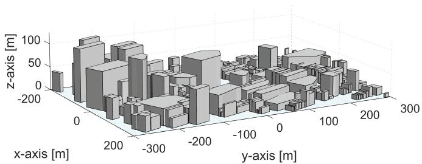
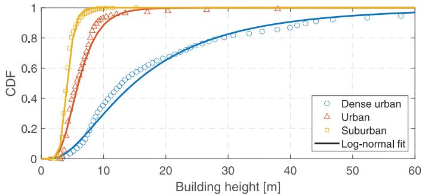
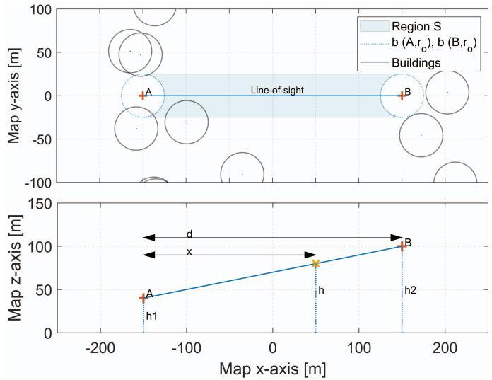
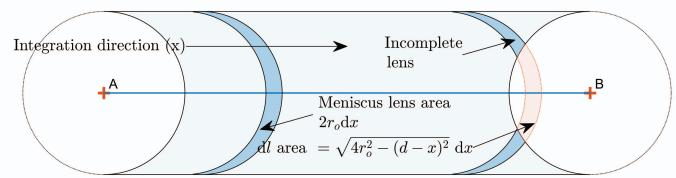
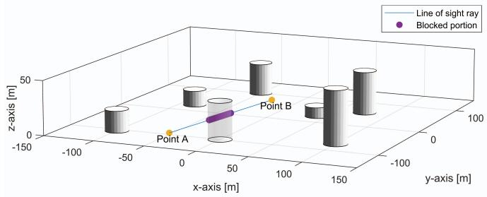
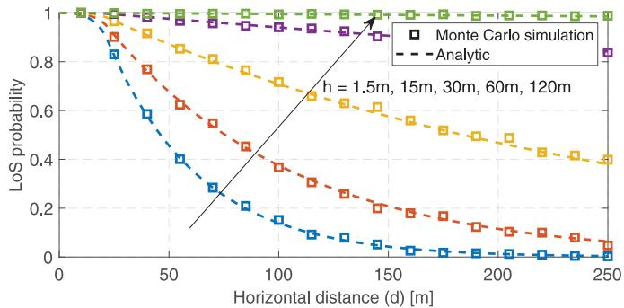
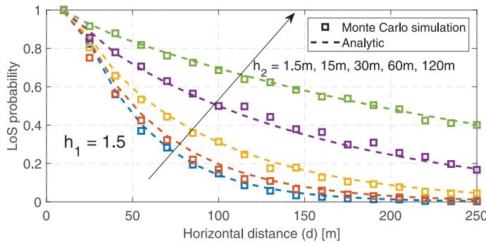
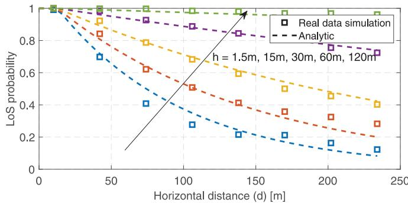
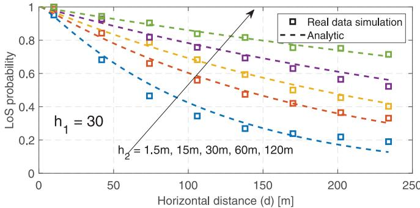

TABLE I NOTATIONS AND SYMBOLS

# On the Probability of Line-of-Sight in Urban Environments

Akram Al-Hourani , Senior Member, IEEE

Abstract—Line-of-Sight communication will play a major role in the next generation of wireless technologies; from UAV-to-UAV networks, to land mobile satellite services, and mmWave cellular coverage. In this letter we present a model for predicting the geometric line-of-sight probability in different urban environments formulated based on stochastic geometry. The model combines simplicity of formulation with high degree of accuracy when compared to real-life geographic data. For two points in the 3D space, it takes the height of each point and the distance between them as input, also it takes 4 other simple parameters that describe the geometric properties of the underlying environment. Based on these inputs, the proposed model produces consistent analytic results aligned with ray-tracing of the geographic data.

Index Terms—Line-of-sight probability, mmWave communication, UAV-to-UAV channel modeling, land mobile satellite.

## I. INTRODUCTION

effect on the performance of wireless channels, this influence becomes even more important for applications like mmWave, land mobile satellite, and UAV communications that are envisioned to take a prominent role in the next wave of hybrid communication systems. In these applications, the wireless signal is either too week to be delivered using nonline-of-sight modes (the case of UAV and satellites) or it does suffer from an extreme penetration loss due to absorbent obstacles (the case of mmWave).

Throughout the years, there have been many good models to capture the LoS probability developed by researchers and engineers, where the majority are specific to certain applications (or scenarios). The most known of which are the models recommended by the International Telecommunication Union (ITU-R M.2135-1) [1] focusing on common cellular scenarios such as Macro and Micro cellular sites with restriction on the acceptable range of nodes heights. With the advent of mmWave in 5G, extensive empirical studies have been conducted by researchers and industry to determine the radio LoS probability as part of the overall efforts in studying the propagation properties of mmWave, example papers cited here [2]–[4] among many other good works. 3GPP is also actively working on expanding its traditional 2D-based channel models [5] into 3D incorporating the LoS probability, this mainly stems from the intrinsic limitation of planner models in capturing mmWave and high-rise indoor scenarios. Most of the mentioned studies are based on empirical measurements without the need to rely on developing complicated geometrical models. On the other hand, the study in [6] attempts to develop a theoretical basis for the LoS probability parameterized with three main geometric descriptors of an urban environment, although the framework is interesting, the study does not try to apply the model into realistic/empirical footprint data from cities.

  
Fig. 1. The geometric representation for some buildings in the Central Business District in Melbourne as part of the data used for the ray-tracing simulations. Geodata source from the City of Melbourne Open Data [7].

<table><tr><td>Symbol</td><td>Units</td><td>Explanation</td></tr><tr><td> $\alpha_o$ </td><td>-</td><td>Ratio of the built-up area to the total area</td></tr><tr><td> $\lambda_o$ </td><td>buildings/m2</td><td>Density of buildings (structures)</td></tr><tr><td>G(h)</td><td>-</td><td>CCDF of buildings heights</td></tr><tr><td> $m_o, v_o$ </td><td>[m]</td><td>Mean and std. dev. of building heights</td></tr><tr><td> $\mu_o, \sigma_o$ </td><td>-</td><td>Log-normal distribution parameters</td></tr><tr><td> $r_o$ </td><td>[m]</td><td>Mean building radius</td></tr><tr><td> $h_o$ </td><td>[m]</td><td>Common height of the two points</td></tr><tr><td> $h_1, h_2$ </td><td>[m]</td><td>Height of the first and the second point</td></tr><tr><td>d</td><td>[m]</td><td>Distance between the two points</td></tr></table>

In this letter we present a framework for modeling the LoS probability in different urban environments, the framework is derived using tools from stochastic geometry representing buildings with scattered cylinders having random heights. The model in this letter builds upon the simplicity of the Poisson point process in representing randomly scattered points, where, at the same time, it yields very reliable results when compared with ray-tracing obtained from urban footprint data (an example of such data is shown in Fig. 1). The model accepts four geometric parameters, one of which is based on the ITU recommendation [8] and the remaining are extension to this recommendation. Based on these parameters the model then predicts the LoS probability between two points in space for any arbitrary distance and heights. For convenience we list the mathematical notations in Table I.

  
Fig. 2. The height distribution of the buildings in three different urban environments, comparing the log-normal model and the empirical data. The fitting parameters $\left[ \mu _ { O } , \sigma _ { O } \right]$ for this example are [2.70, 0.75], [1.78, 0.43], [1.42, 0.23] for the dense-urban, urban, suburban respectively.

## II. GEOMETRIC MODEL

In order to allow a tractable formulation of the LoS probability, we model the buildings (or obstacles) as random points following the Poisson point process (PPP) with density $\lambda _ { o } \ [ \mathrm { b u i l d i n g } / \mathrm { m } ^ { 2 } ]$ . Buildings are represented as cylinders of a fixed radius $r _ { o }$ and a random height H following an arbitrary distribution of $f ( H )$ , where the choice of the distribution does not impact the derivation leading to the main results of this letter. However, in this letter we adopt the log-normal distribution as an example based on the empirical analysis for a large set of buildings footprint data (around $4 5 { , } 0 0 0$ buildings) in three different urban environments in Victoria, Australia; (i) suburban, (ii) urban, and (iii) high-rise urban. Fig. 2 shows the empirical cumulative distribution function (CDF) of these areas with the suggested log-normal model given by

$$
F (H) = \frac {1}{2} + \frac {1}{2} \mathrm{erf} \left[ \frac {\ln H - \mu_ {o}}{\sqrt {2} \sigma_ {o}} \right],\tag{1}
$$

where $\mu _ { o }$ and $\sigma _ { o }$ are the mean and standard deviation of the height’s logarithm calculated as

$$
\mu_ {o} = \ln \left(\frac {m _ {o}}{\sqrt {1 + \frac {v _ {o}}{m _ {o} ^ {2}}}}\right), \quad \sigma_ {o} ^ {2} = \ln \left(1 + \frac {v _ {o}}{m _ {o} ^ {2}}\right),\tag{2}
$$

where parameter $m _ { o }$ and $v _ { o }$ represent the mean and variance of the heights. Thus a certain region with homogeneous buildings is represented by the vector $M = [ \lambda _ { o } , r _ { o } , \mu _ { o } , \sigma _ { o } ]$ . We later show in Section V how these parameters can be estimated from a given geographic representation of the buildings in the study region. Such representation is usually stored as a list of polygons tagged with a particular height, where an example is shown in Fig. 1.

## III. MODELING LINE-OF-SIGHT PROBABILITY

## A. The Special-Case (Scenario 1)

We start with the simplified scenario when the two points A and B are at the same height $h _ { o }$ from the ground. In this case the geometrical line-of-sight condition will be achieved when no building is obstructing the straight line connecting the two points A and B. This condition is equivalent to having the connecting rectangle with the two inward semicircle ends void of any building centers (seeds). The exact shape of this region (also dubbed as the critical region), is illustrated in Fig. 3 and denoted as such that

  
Fig. 3. The upper figure shows the critical region  that has to be void of any building seeds (point). The lower figure is the elevation view (profile) of the line-of-sight in the generalized case.

$$
\mathcal {S} (A, B, r _ {o}) \stackrel {\Delta} {=} \operatorname{Rect} (A, B, 2 r _ {o}) \setminus b (A, r _ {o}) \setminus b (B, r _ {o}),\tag{3}
$$

where $b ( A , r _ { o } )$ is the circle centered at point A with radius $r _ { o }$ and $\mathrm { R e c t } ( A , B , 2 r _ { 0 } )$ is the rectangle with width $2 r _ { 0 }$ having points A and B on its length axis. The reason for removing the two semi circles from the critical region is that we are conditioning the existence of transmitters in outdoor, i.e., both points A and B are conditioned to be free from obstructing structures within radius $r _ { o } .$ . We can see here the reason for choosing the circle for modeling the shape of the buildings is that the orientation of the circle does not impact the formulation of the critical region, any other shape will require the orientation to be defined and would be orientation-specific. Using geometric reasoning, the area of such shape can be shown to be

$$
| \mathcal {S} (A, B, r _ {o}) | = 2 d r _ {o} - \pi r _ {o} ^ {2} + l (d, r _ {o}),\tag{4}
$$

where $l ( d , r _ { o } )$ is the area of the symmetric lens formed by the intersection of two circles when A and B are too close to each others, $\mathrm { i . e . , ~ 0 < } d \leq 2 r _ { o }$ , and it is given by

$$
l (d, r _ {o}) = \left\{ \begin{array}{l l} 2 r _ {o} ^ {2} \cos^ {- 1} \left(\frac {d}{2 r _ {o}}\right) - \frac {1}{2} d \sqrt {4 r _ {o} ^ {2} - d ^ {2}} & : 0 <   d \leq 2 r _ {o} \\ 0 & : d > 2 r _ {o}. \end{array} \right.\tag{5}
$$

In the PPP process, the probability of a region to be void of points is $\exp ( - \lambda | \mathcal { R } | )$ where λ is the density of the points and . is the area measure. Given the assumption of this scenario where both points are located at height $h _ { o } ,$ the ratio of the buildings that are above this height is the complimentary cumulative distribution function of the heights, i.e., $G ( h _ { o } ) \ = \ 1 - \ F ( h _ { o } )$ . Thus the density of buildings that are above $h _ { o }$ is $\lambda _ { o } G ( h _ { o } )$ . Accordingly, the probability of LoS in this special-case scenario is given by $\begin{array} { r } { P _ { \mathrm { L o S } _ { 1 } } ( \dot { d } , \dot { h } _ { o } ) = \mathbb { P } [ \Phi _ { \mathfrak { b } } \cap \mathcal { S } = \varnothing ] = \exp ( - \lambda _ { o } G ( h _ { o } ) | \mathcal { S } \bar { | } ) } \end{array}$ , thus

$$
P _ {\mathrm{LoS} _ {1}} (d, h _ {o}) = \exp \left(- \lambda_ {o} G (h _ {o}) \left[ 2 r _ {o} d - \pi r _ {o} ^ {2} + l (d, r _ {o}) \right]\right)\tag{6}
$$

where $\Phi _ { \mathrm { b } }$ is the buildings’ point process.

  
Fig. 4. The integration region in the generalized case (scenario 2).

## B. The Generalized Case (Scenario 2)

In the generalized scenario we relax the common height condition such that points A and B could now have arbitrary heights $h _ { 1 } , \ h _ { 2 }$ respectively. In order to solve this case we divide the critical region $s$ into infinitesimal partitions with a shape of meniscus lenses as shown in Fig. 4 where these partitions $S _ { 1 } , S _ { 2 } , \ldots S _ { n } , \ldots S _ { N }$ are formed by walking along the LoS axis with increments of $\Delta x$ . In order to satisfy the LoS condition, all these partitions should be void of building seeds, this condition is expressed as follows

$$
\begin{array}{l}P _ {\mathrm{LoS} _ {2}} (d, h _ {1}, h _ {2}) = \mathbb {P} [ \Phi_ {b} \cap \mathcal {S} = \emptyset ] = \mathbb {P} \left[ \Phi_ {b} \bigcap_ {n = 1} ^ {N} \mathcal {S} _ {n} = \emptyset \right],\\\stackrel {{(\mathrm{a})}} {{=}} \lim _ {N \rightarrow \infty} \prod_ {n = 1} ^ {N} \exp (- \lambda_ {o} G (h) [ 2 r _ {o} \Delta x - \Delta l ]),\\= \lim _ {N \rightarrow \infty} \exp \left(- \sum_ {n = 1} ^ {N} \lambda_ {o} G (h) [ 2 r _ {o} \Delta x - \Delta l ]\right),\end{array}\tag{7}
$$

step (a) follows from the void probability of the PPP where the term $2 r _ { o } \Delta x$ represents the area of the meniscus lens $s _ { n } .$ and the term $\Delta l$ is the area of the lightly shaded red region in Fig. 4, this term is required to account for the incomplete partitions when reaching the circle $b ( B , r _ { o } )$ . The infinitesimal area of this region is calculated as

$$
\begin{array}{l} \Delta l = l (d - x - \Delta x, r _ {o}) - l (d - x, r _ {o}), \\ \Delta l | _ {\Delta x \to 0} = - \frac {\mathrm{d}}{\mathrm{d} x} l (d - x, r _ {o})   \mathrm{d} x = \sqrt {4 r _ {o} ^ {2} - (d - x) ^ {2}}   \mathrm{d} x. \end{array}\tag{8}
$$

By substituting in (7) and using the theorem of Riemann integration, it can be shown that the summation converges to a Riemann integral as the number of partitions $N  \infty$ , thus

$$
\begin{array}{l} P _ {\mathrm{LoS} _ {2}} (d, h _ {1}, h _ {2}) \\ = \exp \left(- \int_ {0} ^ {d} \lambda_ {o} G (h) \left[ 2 r _ {o} - \sqrt {\max \left(4 r _ {o} ^ {2} - (d - x) ^ {2} , 0\right)} \right] \mathrm{d} x\right), \end{array}\tag{9}
$$

where the operation max() is added such that the effect of the incomplete partition will only be accounted when $x > d - 2 r _ { o }$ The height at the integration partition, as indicated in Fig. 4 can be obtained using geometrical reasoning as follows

$$
h = \frac {x}{d} (h _ {2} - h _ {1}) + h _ {1},\tag{10}
$$

which is the height of the line-of-sight at distance x from the first point, thus we applied the thinning G(h) to reflect the reduced density of buildings at this height. The integral in (9)

  
Fig. 5. Illustration of Monte-Carlo ray-tracing simulation setup indicating an example of the tracing process.

can be further simplified by adjusting the integration limit as follows

$$
P _ {\mathrm{LoS} _ {2}} (d, h _ {1}, h _ {2}) = \exp \left(- 2 r _ {o} \lambda_ {o} \int_ {0} ^ {d - \frac {\pi}{2} r _ {o}} G (h) \mathrm{d} x\right)\tag{11}
$$

where it can be proven, using geometric reasoning, that the integration regions in (9) and (11) are equal for $\begin{array} { r } { d > \frac { \pi } { 2 } r _ { o } . } \end{array}$

As discussed earlier this is the generalized scenario when $h _ { 1 }$ and $h _ { 2 }$ are two arbitrary values, where it can be shown that the relation in (9) reduces to (6) when $h _ { 1 } = h _ { 2 } = h _ { o } ,$ i.e., $P _ { \mathrm { L o S _ { 2 } } } ( d , h _ { o } , h _ { o } ) = P _ { \mathrm { L o S _ { 1 } } } ( d , h _ { o } )$

## IV. MODEL VERIFICATION

In order to check the theoretical validity of the proposed analytic formulas in (6) and (11) we run extensive Monte-Carlo simulations for different heights and distances. To achieve this, large PPP realizations are generated based on a given building density $\lambda _ { o }$ where each point constitutes the center of a cylinder (or a circle in case of scenario 1) with radius $r _ { o }$ . Then pairs of test points are placed randomly, with uniform distribution, across the simulation region. For each of these pairs, the connecting line is traced to find if any intersection with the cylindrical buildings exists. If an intersection is found, then the pair are registered as NLoS, see Fig. 5 for an example of the line-tracing (ray-tracing) method. After running all the generated point pairs, the estimate of the LoS probability is found by counting the LoS pairs divided by the total number of simulated pairs (within the same height and distance group).

For the special-case, i.e., scenario 1, we depict the results of both the analytic and Monte-Carlo simulations in Fig. 6, where both degrees of freedom (distance d and common height $h _ { o } )$ are varied. For the generalized case, i.e., scenario 2, we have three degrees of freedom (distance $d ,$ height of the first point $h _ { 1 }$ , and height of the second point $h _ { 2 } )$ , accordingly we choose to fix one variable $h _ { 1 } = 1 . 5$ m, without the loss of generality, and vary the remaining two variables. Both scenarios show a high degree of matching between Monte-Carlo simulation and the analytic results.

Fig. 6. Scenario 1: comparing the analytic results, as per (6), with Monte-Carlo simulations.  
  
Fig. 7. Scenario 2: comparing the analytic results, as per (11), with Monte-Carlo simulations.

  
Fig. 8. Scenario 1: comparing the analytic results, as per (6), with the ray-tracing based on the geographic data of Melbourne.

## V. TUNING THE GEOMETRIC PARAMETERS

Recall from Section II that the statistics of the geometry of a certain region is captured in the proposed vector $M = [ \lambda _ { o } , r _ { o } , \mu _ { o } , \sigma _ { o } ]$ , these parameters can be estimated from the geodata as follows;

$\lambda _ { o }$ is calculated by dividing the number of polygons to the total area,

$r _ { o }$ is obtained as $r _ { o } = E [ { \sqrt { \frac { \left| { \mathrm { P o l y } } \right| } { \pi } } } ]$ , where |Poly| is the polygon area of the buildings,

$\mu _ { o }$ and $\sigma _ { o }$ are straight forward to get by fitting the buildings height to the log-normal distribution.

Although the above method is a reasonable starting point, we found that the accuracy of the model can be further enhanced by optimizing against the empirical ray-tracing simulation (or actual measurements if available). The optimization problem can be formulated by defining the loss function as the

  
Fig. 9. Scenario 2: comparing the analytic results, as per (11), with the ray-tracing based on the geographic data of Melbourne.

Euclidean distance between the analytic solution $P _ { \mathrm { L o S } } | _ { M }$ and the ray-tracing. Thus optimizing these parameters against the ray tracing is formulated as follows

$$
M ^ {*} = \underset {M} {\arg \min} \| P _ {\mathrm{LoS}} | _ {M} - P _ {\mathrm{LoS} _ {\mathrm{RayTracing}}} \| _ {2},\tag{12}
$$

The comparison between the analytic results and the geodata ray-tracing simulations are depicted in Fig. 8 and Fig. 9 for scenario 1 and scenario 2 respectively, where in these examples we have utilized the well-established optimization function fmincon() in MATLAB with the interior-point method. The optimized parameter vectors are $\begin{array} { r } { M _ { 1 } = [ \frac { \bar { 1 } } { 1 4 3 0 } , 8 . 0 7 , 3 . 0 4 , 0 . 9 ] } \end{array}$ and $M _ { 2 } = [ \textstyle \frac { 1 } { 5 0 } , 1 . 0 4 , 1 . 1 2 , 1 . 7 ]$ for scenario 1 and 2 respectively in dense-urban environment. The average root mean square error in this example is less than 2.85%.

## VI. CONCLUSION

The author presented a modeling approach for the geometric line-of-sight probability based on stochastic geometry. The model is captured in simple-to-compute analytic formulas that adapt based on the underlying geometric parameters of the urban environment, and it shows high-degree of consistency with real-life geographic data. The model has wide range of applications in radio channel predictions in next generation communication technologies.

## REFERENCES

[1] “Guidelines for evaluation of radio interface technologies for IMT-2020,” ITU, Geneva, Switzerland, ITU-R M.2412-0, 2017.

[2] K. Haneda et al., “5G 3GPP-like channel models for outdoor urban microcellular and macrocellular environments,” in Proc. IEEE 83rd Veh. Technol. Conf. (VTC Spring), May 2016, pp. 1–7.

[3] S. Sun et al., “Path loss, shadow fading, and line-of-sight probability models for 5G urban macro-cellular scenarios,” in Proc. IEEE Globecom Workshops (GC Wkshps), Dec. 2015, pp. 1–7.

[4] J. Järveläinen, S. L. H. Nguyen, K. Haneda, R. Naderpour, and U. T. Virk, “Evaluation of millimeter-wave line-of-sight probability with point cloud data,” IEEE Wireless Commun. Lett., vol. 5, no. 3, pp. 228–231, Jun. 2016.

[5] B. Mondal et al., “3D channel model in 3GPP,” IEEE Commun. Mag., vol. 53, no. 3, pp. 16–23, Mar. 2015.

[6] Z. Cui, K. Guan, C. Briso-Rodríguez, B. Ai, and Z. Zhong, “Frequencydependent line-of-sight probability modeling in built-up environments,” IEEE Internet Things J., vol. 7, no. 1, pp. 699–709, Jan. 2020.

[7] City ofMelbourne—Open Data Portal. Accessed: Apr. 11, 2020. [Online]. Available: https://data.melbourne.vic.gov.au/

[8] A. Al-Hourani, S. Kandeepan, and A. Jamalipour, “Modeling air-toground path loss for low altitude platforms in urban environments,” in Proc. IEEE Global Commun. Conf., Dec. 2014, pp. 2898–2904.