# Optimization of Total Power Consumed by Flying Base Station Serving Mobile Users

Mohammadsaleh Nikooroo , Member, IEEE and Zdenek Becvar , Senior Member, IEEE

Abstract—The unmanned aerial vehicles (UAVs) acting as flying base stations (FlyBSs) are considered as an efficient way to enhance the capacity of mobile networks. The enhancement provided by such network requires a dynamic positioning of the FlyBSs with respect to the users demands on communication. However, the power consumption of the FlyBS is a challenge due to a limited capacity of the FlyBS’s power supply. In this paper, we reduce a total power consumption of the FlyBS while a required communication capacity is guaranteed to the mobile users in every time instant of their movement. To this end, we derive a closed-form solution for an optimization of the FlyBS’s total power consumption in every single time step. Then, we provide a numerical solution for the total power optimization problem over a long period of the users’ movement. Via the simulations, we show that the proposed scheme reduces the overall power consumed by the FlyBS significantly (by up to 91%) comparing to existing solutions.

Index Terms—Flying base station, transmission power, propulsion power, mobile users, mobile networks, 6G.

## I. INTRODUCTION

DEPLOYMENT of unmanned aerial vehicles (UAVs) act- ing as flying base stations (FlyBSs) is a promising way to address multiple concerns in wireless networks. Compared to the conventional static base stations, the FlyBSs present exclusive advantages due to their high mobility that enables to adapt the network topology to an environment as well as to actual user requirements on communication. Such features make the FlyBSs an efficient solution for various applications including surveillance [1], offloading traffic from static base stations (BSs) [2], emergency operations [3], extension of the network coverage [4]–[8], collection of data from IoT devices [9], [10], or improvement in quality of service [11]–[13].

Key challenges regarding the FlyBS’s integration and deployment in mobile networks include [14]: positioning of the FlyBSs to maximize coverage, controlling the FlyBSs’ power consumption to enhance their operational time [5], or maximizing the quality of service. The problem of the coverage maximization for the networks with a single FlyBS is studied e.g., in [4] and [7]. Then, in [8], the authors investigate an opti mization of the number of required FlyBSs to guarantee the quality of service to the users. In [15], an evolutionary-based algorithm is adopted to maximize the satisfaction of the user with the experienced data rates. In [11], the authors study the uplink throughput maximization in a scenario with multiple antenna FlyBS. A throughput enhancement and a communica tion delay reduction by a dynamic control of the FlyBSs’ trajec tories is addressed in [16]. Furthermore, in [17], the author minimize a delay for communication between the FlyBSs via planning the FlyBSs’ trajectories. Then, the authors in [18] address the problem of FlyBS’s positioning and user association for the FlyBSs acting as transparent relays to maximize sum capacity of users. However, in all these papers, the power consumption is not taken into account at all.

In [19], the problem of transmission power allocation is tackled to maximize an energy efficiency. However, the FlyBSs positioning is not considered and the FlyBSs only hover at fixed points all the time. An efficient positioning of the FlyBSs considering the transmission power consumption is a scope of several works with a variety of goals including maximization of the net work throughput [20]–[24], maximization of the difference between the profit in terms of the user capacity and the transmission cost [25], maximization of the number of covered users [26], minimization of the outage probability [27], or maximization of the users’ quality-of-experience (QoE) [28]. However, the pro pulsion power consumption due to the movement of the FlyBS is not considered in any of [19]–[28].

Many works also address the problem of the FlyBS’s trajec tory planning in a scenario with static users. In [29], the authors minimize the total power consumption in the networks with a fixed-wing FlyBS collecting/delivering data from/to one static user. This work is then extended towards multiple static users in [30]–[32]. Furthermore, the authors in [33] and [34] maxi mize the minimum data rate of the users served by FlyBSs, However, in [29]–[34], the problem is defined as a planning of the trajectories among the static users and an allocation of the time for a sequential communication with each user and hover ing in order to minimize the overall energy consumed by the FlyBS. The problem addressed in these papers is an analogy of the traveling salesman problem with a planning of the FlyBS trajectory among fixed and a priory known positions of the static users. The authors assume the users communicate sequentially in a non-real time manner. Hence, these works are suitable for delay-tolerant services and scenarios with static users (e.g., collection of data from sensors or power meters), however, an extension towards mobile users requiring real time services is not straightforward, if not impossible.

In addition to [29]–[34], several other related works, e.g., [35]- [41], are also focused on the power consumption of the FlyBSs in different scenarios, where the users are static with coordinates known in advance. Unfortunately, the solutions proposed for the static users rely on a priori known and not changing positions of the users. Thus, these solutions cannot be applied to a dynamic scenario with moving users.

The problem of the propulsion and transmission power consumption in mobile networks is considered in [42], where the FlyBS tracks a single moving target. However, the quality of communication channel is not taken into account. Up to our best knowledge, the problem of the power optimization for the FlyBSs serving mobile users with a constraint on the qualit of service guarantee to the users has not been investigated in the literature.

In this paper, we focus on the minimization of the total power consumed by the rotary-wing FlyBS for the movement and for the communication while the minimum required communication capacity is continuously guaranteed to each mobile user in a real-time over the whole period of the FlyBS’s operation. We propose a power saving scheme adjusting the FlyBS’s position and the transmission power over a sequence of time steps to serve the mobile users. Even if we are aware of the fact that the transmission power consumption is usually lower than the propulsion power consumption for the FlyBSs, we still investigate both the transmission and propulsion powers jointly, as neglecting the transmission power would lead to a sub-optimal solution in some cases. We provide a generic solution applicable to any case disregarding whether the transmission power is negligible or not.

The major contributions of this paper are summarized as follows:

 The total power consumption is analytically expressed for rotary-wing FlyBS as a function of the system parameters including locations of the users and the FlyBS and the minimum capacity required by the users.

Then, we propose a single-point optimization scheme (denoted as SPS) to minimize the total power consumed by the FlyBS between two consecutive time steps. At each time step, the bandwidth allocation and the position of the FlyBS for the next time step is determined. For this case, we derive a closed-form solution expressing the next position of the FlyBS for arbitrary allocation of the bandwidth.

 We extend the SPS towards a multi-point optimization scheme (referred to as MPS), as the SPS does not guarantee the optimum over a long time period. For the MPS, we provide a numerical solution based on Nelder Mead Simplex algorithm considering a constraint on the FlyBS’s speed.

 Furthermore, we extend the idea of the MPS towards an enhanced MPS (EMPS) to further reduce the propulsion power consumption. The extension combines the aspects of both SPS and MPS via a sliding window to continuously adjust the future positions of the FlyBS.

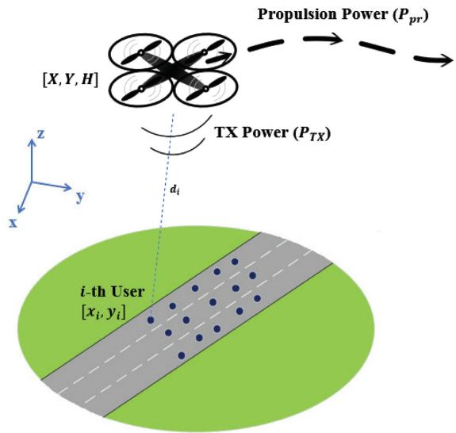  
Fig. 1. System model with multiple mobile users deployed within coverag area of the FlyBS.

 As the above-mentioned solutions might lead to an excessive transmission power of the FlyBS to fulfill the constraints on the users’ required capacity, we further enhance the proposed solution towards a more practical case with the transmission power of the FlyBS consid ered. Then, we reformulate such a constrained problem to be solvable numerically

 By simulations, we show that our proposed solution leads to a significant (up to 91%) improvement in the total power consumption comparing to the state-of-theart methods.

Note that this paper is an extension of our prior works [43], [44], where we have provided an initial analysis of the tota power optimization.

The rest of the paper is organized as follow. In Section II, we present the system model. In Section III, the problem of the power optimization via a determination of the FlyBS’s position and the transmission power for the moving users is formulated for a scenario with an unconstrained transmission power to show a theoretical maximum performance. Besides, we propose novel solutions for this problem in Section IV. In Section V, we formulate the problem and we provide solution for a practical power optimization in the scenario with a con strained transmission power. Then, in Section VI, we explain the simulation scenario and models, in section VII we present results and compare these with the performance of existing solutions. Last section concludes the paper and outlines poten tial directions to the future research.

## II. SYSTEM MODEL

We consider a rural scenario with n mobile users (e.g., vehicles) moving on a road or a highway as illustrated in Fig. 1. In such scenario, the FlyBSs are a suitable solution to provide temporary connectivity in case of a traffic jam or an accident [45], [46], when the users search for information about the traffic situation and, hence, move rather slower than in a common traffic situation. All n users in the area communicate directly with the FlyBS, as the communication capacity of the conventional static base stations in the rural areas is usually not sufficient to serve many users in the traffic jam.

Let $\boldsymbol { r } ( t ) = [ X ( t ) , Y ( t ) , H ( t ) ]$ denotes the location of the FlyBS at the time t and $[ x _ { i } ( t ) , y _ { i } ( t ) ]$ denotes the coordinates of the i-th user at the time t. Then, $d _ { i } ( t )$ denotes Euclidean distance of the i-th user to the FlyBS at the time t.

The channel capacity of the i-th user is calculated from the Shannon–Hartley theorem as:

$$
C _ {i} (t) = B _ {i} (t) \mathrm{log} _ {2} \bigg (1 + \frac {p _ {i} ^ {R} (t)}{N _ {i}} \bigg),\tag{1}
$$

where $B _ { i } ( t )$ denotes the bandwidth of the i-th user’s channel, $N _ { i }$ denotes the noise power at the channel of the i-th user, and $p _ { i } ^ { R } ( t )$ is the power received by the i-th user at the time t. In case of additional interference at the receiver, the superimposed interference can be assumed to be of Gaussian distribution and, thus, its power can be incorporated into (and treated as) the noise power [29], [48].

The transmission power of the FlyBS to the i-th user $( p _ { i } ^ { T } )$ ) is calculated according to the Friis’ transmission equation as:

$$
p _ {i} ^ {T} = Q _ {i} d _ {i} ^ {\gamma_ {i}} = \frac {p _ {i} ^ {R} (4 \pi f _ {c}) ^ {\gamma_ {i}} d _ {i} ^ {\gamma_ {i}}}{G _ {i} ^ {T} G _ {i} ^ {R} c ^ {\gamma_ {i}} \left(\frac {M}{M + 1} \overline {{h}} _ {i} + \frac {1}{M + 1} \tilde {h} _ {i}\right)},\tag{2}
$$

where $\gamma _ { i }$ is the path-loss exponent between the FlyBS and the i-th user, $G _ { i } ^ { T }$ and $G _ { i } ^ { R }$ are the gains of the FlyBS’s and user’s antennas, respectively, $f _ { c }$ is the communication frequency, $c = 3 \times 1 0 ^ { 8 }$ m/s is the speed of light, M is the Rician fading factor, $\overline { { h } } _ { i }$ is the line-of-sight (LoS) component satisfying $| \overline { { h } } _ { i } | = 1$ , and $\tilde { h _ { i } }$ denotes the non-line-of-sight (NLoS) component satisfying $\tilde { h _ { i } } \sim C N ( 0 , 1 )$ Þ. Note that the coefficient $\frac { p _ { i } ^ { R } ( 4 \pi f _ { c } ) ^ { \gamma _ { i } } } { G _ { i } ^ { T } G _ { i } ^ { R } c ^ { \gamma _ { i } } ( \frac { M } { M + 1 } \overline { { { h } } } _ { i } + \frac { 1 } { M + 1 } \tilde { h } _ { i } ) }$ is substituted with $Q _ { i }$ for the ease of presentation in later discussions. Furthermore, despite high velocities of the users, an impact of Doppler shift is still marginal and can be ignored, as the ratio of the relative speed between the FlyBS and the users to the speed of light is very small.

From (2), we observe that the transmission power $P _ { T X }$ consumed by the FlyBS is expressed as a function of the coordinates of the users and the FlyBS, i.e.,:

$$
\begin{array}{l} P _ {T X} (X, Y, H, t _ {k}) = \sum_ {i = 1} ^ {n} Q _ {i} d _ {i} ^ {\gamma_ {i}} \\ = \sum_ {i = 1} ^ {n} Q _ {i} ((X (t _ {k}) - x _ {i} (t _ {k})) ^ {2} + (Y (t _ {k}) - y _ {i} (t _ {k})) ^ {2} + H ^ {2} (t _ {k})) ^ {\frac {\gamma_ {i}}{2}}. \end{array}\tag{3}
$$

Following (3), the average transmission power, denoted as $P _ { T X } ^ { a v g }$ , over the time span of $\{ t _ { 1 } , \ldots , t _ { T } \}$ is written as:

$$
\begin{array}{r l} & P _ {T X} ^ {a v g} (t _ {1}, \ldots , t _ {T}) = \frac {1}{T} \sum_ {k = 1} ^ {T} \sum_ {i = 1} ^ {n} Q _ {i} d _ {i} ^ {\gamma_ {i}} = \frac {1}{T} \sum_ {k = 1} ^ {T} \sum_ {i = 1} ^ {n} Q _ {i} \\ & ((X (t _ {k}) - x _ {i} (t _ {k})) ^ {2} + (Y (t _ {k}) - y _ {i} (t _ {k})) ^ {2} + H ^ {2} (t _ {k})) ^ {\frac {\gamma_ {i}}{2}}. \end{array}\tag{4}
$$

As in many related works, we assume that the current posi tions of the users are known to the FlyBS (see, e.g., [4], [29], [31], [49], [50]). However, in any realistic case, the position ing information is inaccurate and contains a positioning error. Thus, the user’s position known to the FlyBS is given as:

$$
\begin{array}{r} x _ {i} (t) = x _ {i} ^ {e x a c t} (t) + e _ {i} ^ {M, x} (t), \\ y _ {i} (t) = y _ {i} ^ {e x a c t} (t) + e _ {i} ^ {M, y} (t), \end{array}\tag{5}
$$

where $x _ { i } ^ { e x a c t } ( t )$ and $y _ { i } ^ { e x a c t } ( t )$ are the exact x and y coordinates of the i-th user at the time $t ,$ respectively, and $e _ { i } ^ { M , x } ( t )$ and $e _ { i } ^ { M , y } ( t )$ are the positioning errors in x and y coordinates at the time $t ,$ respectively. We further assume that the FlyBS can determine its own position, as the knowledge of the FlyBS’s position is needed for a common flying and navigation of the FlyBSs [51].

In order to formulate the power spent for the FlyBS’s move ment (propulsion power), we refer to the model provided in [31] for rotary-wing FlyBSs. In particular, the propulsion power is a function of the FlyBS’s average velocity V in the following way:

$$
\begin{array}{r} P _ {p r} (V) = L _ {0} \left(1 + \frac {3 V ^ {2}}{U _ {\mathrm{tip}} ^ {2}}\right) + L _ {i} \left(\sqrt {1 + \frac {V ^ {4}}{4 v _ {0 , h} ^ {4}}} - \frac {V ^ {2}}{2 v _ {0 , h} ^ {2}}\right) ^ {\frac {1}{2}} \\ + \frac {1}{2} d _ {0} \rho s _ {r} A V ^ {3}, \end{array}\tag{6}
$$

where $L _ { 0 }$ and $L _ { i }$ are the blade profile and induced powers in hovering status, respectively, $U _ { \mathrm { t i p } }$ denotes the tip speed of the rotor blade, $v _ { 0 , h }$ represents the mean rotor induced velocity during hovering, $d _ { 0 }$ is the fuselage drag ratio, $s _ { r }$ is the rotor solidity, $\rho$ is the air density, and A denotes the rotor disc area. Interested readers can find more details about the model in [31]. Note that we consider the setting of parameters of the propulsion power model in line with the FlyBS with physical specifications provided in [52] for “DJI Spreading Wings S900” (see Table I in [31] and Table I in [52]).

Note that the FlyBS’s average velocity is calculated by dividing the distance moved between two points with the duration of the movement. In particular, if the FlyBS moves from the position $r ( t _ { k } )$ to the new position $r ( t _ { k + 1 } )$ , the average speed is determined as:

$$
V (t _ {k}, t _ {k + 1}) = \frac {1}{\Delta t _ {k}} | | \boldsymbol {r} (t _ {k + 1}) - \boldsymbol {r} (t _ {k}) | |,\tag{7}
$$

where $\Delta t _ { k } = t _ { k + 1 } - t _ { k }$

Let us define the initial position of the FlyBS as $[ X ( t _ { 0 } )$ $Y ( t _ { 0 } ) , H ( t _ { 0 } ) ]$ . Thus, the average propulsion power over the time period of $\{ t _ { 0 } , \ldots , t _ { T } \}$ is written as:

$$
P _ {p r} ^ {a v g} = \frac {1}{T} \sum_ {k = 0} ^ {T - 1} P _ {p r} (V (t _ {k}, t _ {k + 1})).\tag{8}
$$

We jointly optimize both the transmission power and the propulsion power as these are main parts of the total power consumption of the FlyBS. Nevertheless, we also consider a power consumption of on-board circuits of the FlyBS (denoted by $P _ { c i r c u i t } )$ ). Hence, the average overall power consumption $P _ { t o t } ^ { a v g }$ is written as:

TABLE I TABLEI  
SUMMARY OF PARAMETERS

<table><tr><td>Parameter</td><td>Description</td></tr><tr><td> $[X(t),Y(t),H(t)]$ </td><td>Coordinates of FlyBS</td></tr><tr><td> $H_{min},H_{max}$ </td><td>FlyBS&#x27;s minimum and maximum allowed flying altitudes</td></tr><tr><td> $[x_i(t),y_i(t)]$ </td><td>Coordinates of user i</td></tr><tr><td> $d_i(t)$ </td><td>Distance between FlyBS and user i</td></tr><tr><td> $C_i(t),C_i^{min}(t)$ </td><td>Instantaneous capacity and minimum required capacity of user i</td></tr><tr><td> $p_i^R(t)$ </td><td>Received power by user i</td></tr><tr><td> $p_i^T(t)$ </td><td>FlyBS&#x27;s transmission power to user i</td></tr><tr><td> $B_i(t)$ </td><td>Bandwidth of user i</td></tr><tr><td> $N_i$ </td><td>Noise power at the channel of user i</td></tr><tr><td> $G_i^R,G_i^T$ </td><td>Antenna gain of user i and FlyBS</td></tr><tr><td> $f_c$ </td><td>Communication frequency</td></tr><tr><td>c</td><td>Speed of light</td></tr><tr><td> $P_{TX}(t)$ </td><td>FlyBS&#x27;s instantaneous transmission power</td></tr><tr><td> $P_{TX}^{avg}$ </td><td>FlyBS&#x27;s average transmission power</td></tr><tr><td> $P_{TX}^{max}$ </td><td>maximum transmission power of FlyBS</td></tr><tr><td> $P_{pr}(t)$ </td><td>FlyBS&#x27;s instantaneous propulsion power</td></tr><tr><td> $P_{pr}^{avg}$ </td><td>FlyBS&#x27;s average propulsion power</td></tr><tr><td> $V(t)$ </td><td>FlyBS&#x27;s speed</td></tr><tr><td> $V_{max}$ </td><td>Maximum FlyBS&#x27;s speed</td></tr><tr><td> $P^{circuit}$ </td><td>FlyBS circuits&#x27; power consumption</td></tr><tr><td> $L_0,L_i$ </td><td>FlyBS hovering blade profile and induced power</td></tr><tr><td> $U_{tip},A$ </td><td>Blade speed and disk area of FlyBS rotor</td></tr><tr><td> $v_{0,h}$ </td><td>Rotor induced speed for hovering FlyBS</td></tr><tr><td> $d_0$ </td><td>FlyBS&#x27;s fuselage drag ratio</td></tr><tr><td> $s_r$ </td><td>FlyBS&#x27;s rotor solidity</td></tr><tr><td>ρ</td><td>Air density</td></tr><tr><td>T</td><td>Number of time steps in multi-point optimization</td></tr><tr><td> $T_\Delta$ </td><td>Number of time steps in EMPS&#x27;s output</td></tr><tr><td> $W_H$ </td><td>Highway&#x27;s width</td></tr><tr><td>η</td><td>Error factor in prediction</td></tr><tr><td> $\{e_i^{M,x},e_i^{M,y}\}$ </td><td>Real-time measurement error in {x,y}-coordinates of user i</td></tr><tr><td> $\{e_i^{Pr,x},e_i^{Pr,y}\}$ </td><td>Prediction error in {x,y}-coordinates of user i</td></tr><tr><td> $\{v_i^x(t),v_i^y(t)\}$ </td><td>Velocity of user i in directions of {x,y}-axes</td></tr><tr><td>α,β,ν,δ</td><td>Reflection, expansion contraction, and shrinkage factors in Simplex</td></tr></table>

$$
P _ {t o t} ^ {a v g} (\boldsymbol {r}, t _ {0}, t _ {1}, \dots , t _ {T}) = P _ {c i r c u i t} ^ {a v g} + P _ {T X} ^ {a v g} + P _ {p r} ^ {a v g}.\tag{9}
$$

Note that $P _ { c i r c u i t }$ in (9) depends on the FlyBS’s computational (processing) and communication chipsets, and can be regarded as a constant [31].

Inserting (4) and (8) into (9), we rewrite $P _ { t o t } ^ { a v g }$ as:

$$
\begin{array}{l} P _ {t o t} ^ {a v g} = P _ {c i r c u i t} ^ {a v g} + \frac {1}{T} \sum_ {k = 0} ^ {T - 1} P _ {p r} (V (t _ {k}, t _ {k + 1})) + \frac {1}{T} \sum_ {k = 1} ^ {T} \sum_ {i = 1} ^ {n} Q _ {i} \\ \times \Big ((X (t _ {k}) - x _ {i} (t _ {k})) ^ {2} + (Y (t _ {k}) - y _ {i} (t _ {k})) ^ {2} + H ^ {2} (t _ {k}) \Big) ^ {\frac {\gamma_ {i}}{2}}. \end{array}\tag{10}
$$

(10) can be further expanded by simply plugging (7) into (6), however, we do not show the expanded form to avoid cluttering.

## III. PROBLEM FORMULATION FOR UNCONSTRAINED TRANSMISSION POWER

We formulate the problem of the total power consumption minimization over the period of T time steps as:

$$
\begin{array}{c} \min _ {\boldsymbol {r} (t _ {k}), \boldsymbol {B} (t _ {k})} P _ {t o t} ^ {a v g}, (1 \leq k \leq T) \\ s. t. \quad C _ {i} (t _ {k}) \geq C _ {i} ^ {m i n}, \forall i \in \{1, \ldots , n \}, \forall k, \quad (a) \\ H _ {m i n} (X (t _ {k}), Y (t _ {k})) \leq H (t _ {k}) \leq H _ {m a x} (X (t _ {k}), Y (t _ {k})), \\ | | \boldsymbol {r} (t _ {k + 1}) - \boldsymbol {r} (t _ {k}) | | \leq V _ {m a x} (t _ {k + 1} - t _ {k}). \quad (c), \\ \sum_ {i = 1} ^ {n} B _ {i} \leq B _ {t o t} \quad (d), \end{array}\tag{b}
$$

(11)

where $V _ { m a x }$ is the FlyBS’s maximum speed and $B _ { t o t }$ is the total available bandwidth that can be allocated by the FlyBS. The constraint (a) in (11) guarantees that every user within the coverage area receives the minimum required capacity $C _ { i } ^ { m i n } , \forall i \in \{ 1 , . . . , n \} )$ Þ at all time as the users move. Further more, the constraint (b) in (11) bounds the FlyBS’s movement to the allowed altitude range of $[ H _ { m i n } ( X , Y ) , H _ { m a x } ( X , Y ) ]$ at every time step. The values of $H _ { m i n } ( X , Y )$ and $H _ { m a x } ( X , Y )$ are determined based on the environment’s topology (e.g., obstacles, buildings, etc.) and/or flight regulations given by local authorities in every country at each ½X; Y position of the FlyBS. Furthermore, the constraint (c) guarantees that the $\mathrm { F l y } \mathbf { B } \mathbf { S } ^ { \prime } \mathbf { i }$ s movement does not incur a speed larger than the max imum limit of $V _ { m a x }$ , and the constraint (d) ensures that the total allocated bandwidth does not exceed the maximum avail able bandwidth $B _ { t o t }$

For further elaboration and solution of the problem defined in (15), we simplify the constraint on the minimum capacity via the following proposition.

Proposition 1: The minimum transmission power in (11) is achieved for ${ { C } _ { i } } ( t ) = { { C } _ { i } } ^ { m i n } , \forall i \in \{ 1 , . . . , n \}$ ; 8t.

Proof: From (1), the received power $p _ { i } ^ { R }$ is rewritten as:

$$
p _ {i} ^ {R} (t) = N _ {i} (2 ^ {\frac {C _ {i} (t)}{B _ {i}}} - 1),\tag{12}
$$

and, hence, the transmission power is formulated as:

$$
p _ {i} ^ {T} = Q _ {i} d _ {i} ^ {\gamma_ {i}} = \frac {N _ {i} (2 ^ {\frac {C _ {i} (t)}{B _ {i}}} - 1) (4 \pi f _ {c}) ^ {\gamma_ {i}}}{G _ {i} ^ {T} G _ {i} ^ {R} c ^ {\gamma_ {i}} (\frac {M}{M + 1} \overline {{h}} _ {i} + \frac {1}{M + 1} \tilde {h} _ {i})} d _ {i} ^ {\gamma_ {i}}.\tag{13}
$$

From (13), we see that $p _ { i } ^ { T }$ is increasing with $C _ { i }$ for $i =$ $1 , . . . , n$ . Thus, the minimum transmission power is obtained when $C _ { i } ( t ) = C _ { i } ^ { m i n } \ ( \forall i \in \{ 1 , . . . , n \} , \forall t )$ &

Proposition 1 implies that, in order to achieve the minimum transmission power, the constraint (a) in (11) should be rewrit ten as $C _ { i } ( t ) = C _ { i } ^ { m i n } \ ( \forall i \in \{ 1 , \ldots , n \} , \forall t )$

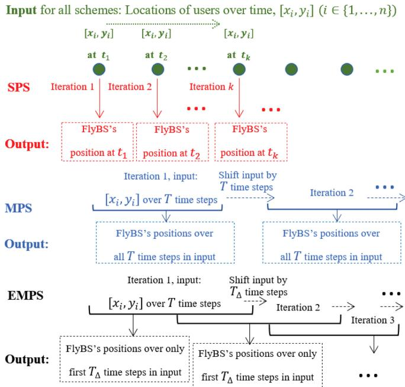  
Fig. 2. Illustration of a high-level principle of all three proposed schemes for single-point, multi-point, and enhanced multi-point optimizations of the total power consumed by FlyBS.

## IV. OPTIMIZATION OF POWER AND FLYBS POSITIONING ANDBANDWIDTH ALLOCATION

In this section, we introduce the proposed approach to solve (11) via a successive optimization of the bandwidth allocation and the FlyBS’s positioning. Then, we explain solution to the subproblem of the bandwidth allocation at the given position of the FlyBS. Afterwards, for the problem of the FlyBS’s positioning, we provide a high-level overview of the proposed solutions for the FlyBS positioning. Next, we derive a closed form solution of the problem for the first proposed solution represented by the single-point optimization scheme SPS, (i.e., for $T = 1 )$ ). Next, we provide a numerical solution for the multi-point optimization scheme MPS $( T > 1 )$ , as deriving a closed-form solution for this case is extremely difficult if not impossible. Furthermore, we enhance the MPS towards EMPS via a multi-point optimization with a sliding window to eliminate a problem with the power consumption discovered at the end of the optimization period of T time steps.

## A. Successive Optimization of the Bandwidth and the FlyBS’s Positioning

A joint optimization of the FlyBS’s position and bandwidth to solve (11) is difficult, as the total power consumption is a non-convex problem with respect to the FlyBS’s position. To tackle this issue, we propose a solution based on a successive optimization of the bandwidth B and the FlyBS’s position. In other words, we optimize the bandwidth allocation for a given position of the FlyBS. Afterwards, a new position of the FlyBS is found and we solve again the problem of bandwidth optimization at the updated position of the FlyBS. This process is repeated until the changes in the derived $r ( t _ { k } )$ and $B ( t _ { k } )$ falls below a given threshold, or until the maximum number of iterations is reached in the proposed sequential optimizatio of $r ( t _ { k } )$ and $B ( t _ { k } )$

## B. Optimization ofthe Bandwidth Allocation

To optimize bandwidth, let us note that the problem in (11) i convex with respect to B at any fixed position of the FlyBS. Hence, at the given position of the FlyBS $( \mathrm { i } . \mathrm { e } . , r ( t _ { k } ) )$ ), the convex subproblem of the bandwidth optimization is formulated as:

$$
\begin{array}{c} \min _ {B (t _ {k})} P _ {t o t} ^ {a v g}, (1 \leq k \leq T) \\ s. t. \quad C _ {i} (t _ {k}) = C _ {i} ^ {m i n}, \forall i \in \{1, \ldots , n \}, \forall k, \\ \sum_ {i = 1} ^ {n} B _ {i} \leq B _ {t o t}, \quad (b) \end{array}\tag{a}
$$

(14)

Using Shannon’s formula, the constraint (a) in (14) is rewritten as $\begin{array} { r } { B _ { i } ( t _ { k } ) \geq \frac { C _ { i } ^ { m i n } } { \log _ { 2 } ( 1 + \frac { p _ { i } ^ { R } } { N _ { i } } ) } } \end{array}$ . Thus, the problem in (14) is convex with respect to B and we solve it using CVX which is an efficient optimization tool for convex problems [53].

## C. Optimization of the FlyBS’s Positioning

Next, for the optimal bandwidth allocation derived by CVX we reformulate the subproblem of the FlyBS’s positioning to:

$$
\begin{array}{c} \min _ {\boldsymbol {r} (t _ {k})} P _ {t o t} ^ {a v g}, (1 \leq k \leq T) \\ s. t. \quad C _ {i} (t _ {k}) = C _ {i} ^ {m i n}, \forall i \in \{1, \ldots , n \}, \forall k, \quad (a) \\ H _ {m i n} (X (t _ {k}), Y (t _ {k})) \leq H (t _ {k}) \leq H _ {m a x} (X (t _ {k}), Y (t _ {k})), \\ | | \boldsymbol {r} (t _ {k + 1}) - \boldsymbol {r} (t _ {k}) | | \leq V _ {m a x} (t _ {k + 1} - t _ {k}). \quad (c) \end{array}\tag{b}
$$

(15)

The solution to (15), i.e. finding the FlyBS position, is outlined in next subsections.

## D. Overview of the Proposed Solutions to the FlyBS’s Positioning

Before going into details of individual proposed solutions, we first provide a high-level illustration of all three proposed schemes to outline key differences among them. Note that the bandwidth allocation problem is solved in a similar way for all the proposed solution as explained in the subsection IV-A.

According to Fig. 2, at each iteration of the optimization, the proposed SPS calculates the FlyBS’s position only for a given single time step, while the MPS and the EMPS determine multiple future positions of the FlyBS in several time steps. In the MPS as well as in the EMPS, for each input including a set of the expected locations of the users over next $T$ time steps, the future T positions of the FlyBS are determined. While the MPS navigates the FlyBS over all these determined positions during the whole period of $T$ and new positions are determined again after T, the EMPS continu ously updates all future positions exploiting new updated inputs.

Details of individual proposed solutions are presented in the following subsections.

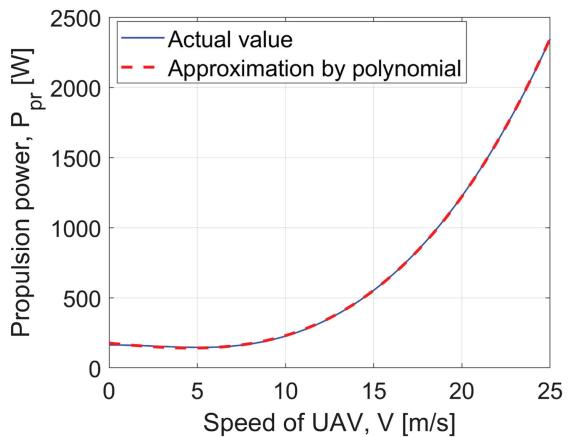  
Fig. 3. Actual propulsion power and polynomial approximation vs. velocity of rotary-wing FlyBS.

## E. Single-Point Optimization of the Total Power Consumption $( T = 1 )$

In this subsection, we derive closed-form solution to the problem defined in (15) for $T = 1$ . Note that the solution is derived for the FlyBS’s movement with no constraint on the speed and at a fixed altitude. The motivation to consider a fixed altitude is that, the available propulsion power consumption model for rotary-wing FlyBSs (provided by [31]) considers only a horizontal flight at a fixed altitude. However, we further enhance the solution to variable altitude in subsection IV-F for multi-point optimization. We also adopt $\gamma _ { i } = 2$ (see (13)) in this subsection for simplicity of formulations and expressions, nevertheless, the solution can be easily extended to any value of $\gamma _ { i }$ and we generalize $\gamma _ { i }$ also in subsection IV-F.

To solve (15), first, we find the critical points at which the partial derivatives of $P _ { t o t } ^ { a v g }$ are equal to zero. A calculation of the exact closed-form solution for $P _ { p r } ( V )$ defined in (6) is extremely complicated, as solving $\begin{array} { r } { \frac { \partial P _ { t o t } ^ { a v g } } { \partial X } = 0 } \end{array}$ and $\begin{array} { r } { \frac { \partial P _ { t o t } ^ { a v g } } { \partial Y } = 0 } \end{array}$ together leads to calculating the roots of polynomials of degree fourteen. Thus, we first find an approximation of $P _ { p r } ( V )$ using polynomial fitting and then solve $\frac { \partial P _ { t o t } ^ { a v g } } { \partial X } = 0$ and $\begin{array} { r } { \frac { \partial P _ { t o t } ^ { a v g } } { \partial Y } = 0 } \end{array}$ by referring to the approximated expression. To this end, we approximate the propulsion power in (6) by a polynomial of degree five with respect to $V$ as:

$$
\begin{array}{l} P _ {p r} ^ {a p x} (V) = \sum_ {j = 0} ^ {5} c _ {j} V ^ {j}, \\ c _ {0} = 2 1 5. 6 7 5 5, c _ {1} = 3. 0 6 9 5, c _ {2} = - 2. 5 8 3 1, c _ {3} = 0. 3 4 9 7, \\ c _ {4} = - 0. 0 0 6 4, c _ {5} = 7. 5 3 3 6 \times 1 0 ^ {- 5}. \end{array}\tag{16}
$$

The propulsion power approximation coefficients $c _ { j }$ in (16) are calculated via the minimum mean-square-error (MSE). The actual and approximated curves are shown in Fig. 3 to demonstrate sufficient fitting of the approximated propulsion power consumption model.

Using the approximation in (16), we calculate the critical points of $P _ { t o t } ^ { a v g }$ . The following Theorem 1 determines the optimum position of the FlyBS in closed-form via a derivation of the critical points for $P _ { t o t } ^ { a v g }$ and an evaluation of $P _ { t o t } ^ { a v g }$ in these critical points.

Theorem $ { \boldsymbol { l } } :$ The FlyBS’s optimum position at the time $t _ { 1 }$ is derived as:

$$
[ X (t _ {1}), Y (t _ {1}) ] = \underset {[ X, Y ], X \in X ^ {c}} {\operatorname{argmin}} P _ {t o t} ^ {a v g}\tag{17}
$$

where $X ^ { c } = \{ X _ { 1 } ^ { c } , . . . , X _ { 5 } ^ { c } \}$ is the set of the x-coordinates of the critical points for $P _ { t o t } ^ { a v g }$ given by:

$$
\begin{array}{c} X _ {1} ^ {c} = X (t _ {0}), \\ \{X _ {2} ^ {c}, X _ {3} ^ {c} \} = \frac {- A _ {3}}{4 A _ {4}} - S \pm \frac {1}{2} \sqrt {- 4 S ^ {2} - 2 p + \frac {q}{S}}, \\ \{X _ {4} ^ {c}, X _ {5} ^ {c} \} = \frac {- A _ {3}}{4 A _ {4}} + S \pm \frac {1}{2} \sqrt {- 4 S ^ {2} - 2 p - \frac {q}{S}}, \end{array}\tag{18}
$$

and $Y ( t _ { 1 } )$ is determined as:

$$
\begin{array}{l} (Y (t _ {1}) - Y (t _ {0})) \\ = \frac {(\sum_ {i = 1} ^ {n} 2 Q _ {i}) Y (t _ {0}) - (\sum_ {i = 1} ^ {n} 2 Q _ {i} y _ {i} (t _ {1}))}{(\sum_ {i = 1} ^ {n} 2 Q _ {i}) X (t _ {0}) - (\sum_ {i = 1} ^ {n} 2 Q _ {i} x _ {i} (t _ {1}))} (X (t _ {1}) - X (t _ {0})), \end{array}\tag{19}
$$

with the following substitutions adopted:

$$
\begin{array}{l} p = \frac {8 A _ {4} A _ {2} - 3 A _ {3} ^ {2}}{8 A _ {4} ^ {2}}, q = \frac {A _ {3} ^ {3} - 4 A _ {4} A _ {3} A _ {2} + 8 A _ {4} ^ {2} A _ {1}}{8 A _ {4} ^ {3}}, \\ S = \frac {1}{2} \sqrt {\frac {- 2}{3} p + \frac {1}{3 A _ {4}} \left(G + \frac {\Delta_ {0}}{G}\right)}, G = \sqrt [ 3 ]{\frac {\Delta_ {1} + \sqrt {\Delta_ {1} ^ {2} - 4 \Delta_ {0} ^ {3}}}{2}}, \end{array}
$$

$$
\begin{array}{l} \Delta_ {0} = A _ {2} ^ {2} - 3 A _ {3} A _ {1} + 1 2 A _ {4} A _ {0}, \\ \Delta_ {1} = 2 A _ {2} ^ {3} - 9 A _ {3} A _ {2} A _ {1} + 2 7 A _ {3} ^ {2} A _ {0} + 2 7 A _ {1} ^ {2} A _ {4} - 7 2 A _ {4} A _ {2} A _ {0}, \\ A _ {4} = 5 c _ {5} M ^ {3}, \quad A _ {3} = - 2 0 c _ {5} M ^ {3} X (t _ {0}) + (- 1) ^ {I _ {g}} (4 c _ {4} M ^ {2}), \\ A _ {2} = 3 0 c _ {5} M ^ {3} X ^ {2} (t _ {0}) - 1 2 c _ {4} M ^ {2} X (t _ {0}) + 3 c _ {3} M, \\ A _ {1} = - 2 0 c _ {5} M ^ {3} X ^ {3} (t _ {0}) + (- 1) ^ {I _ {g}} (1 2 c _ {4} M ^ {2} X ^ {2} (t _ {0})) \\ \qquad - 6 c _ {3} M X (t _ {0}) + (- 1) ^ {I _ {g}} \left(\sum_ {i = 1} ^ {n} 2 Q _ {i} + 2 c _ {2}\right), \\ A _ {0} = 5 c _ {5} M ^ {3} X ^ {4} (t _ {0}) - (- 1) ^ {I _ {g}} (4 c _ {4} M ^ {2} X ^ {3} (t _ {0})) + 3 c _ {3} M X ^ {2} (t _ {0}) \\ \qquad - (- 1) ^ {I _ {g}} (2 c _ {2} X (t _ {0})) + \frac {c _ {1}}{M} - (- 1) ^ {I _ {g}} \left(\sum_ {i = 1} ^ {n} 2 Q _ {i} x _ {i} (t _ {1})\right), \\ M = \frac {1}{\Delta t _ {k}} \left(1 + \frac {\left(\sum_ {i = 1} ^ {n} 2 Q _ {i}\right) Y (t _ {0}) - \left(\sum_ {i = 1} ^ {n} 2 Q _ {i} y _ {i} (t _ {1})\right)}{\left(\sum_ {i = 1} ^ {n} 2 Q _ {i}\right) X (t _ {0}) - \left(\sum_ {i = 1} ^ {n} 2 Q _ {i} x _ {i} (t _ {1})\right)}\right) ^ {\frac {1}{2}}, \\ I _ {g} = \mathbb {1} _ {\{X (t _ {1}) <   X (t _ {0}) \}}. \end{array} \tag {20}
$$

Proof. See Appendix A.

After the FlyBS moves to the new position derived via Theorem 1, the optimization is performed ove $\{ t _ { 1 } , t _ { 2 } \}$ to find $[ X ( t _ { 2 } ) , Y ( t _ { 2 } ) , H ]$ , and so on and so forth.

F. Multi-Point Optimization of the Total Power Consumption $( T > 1 )$

The single-point optimization in the previous subsection minimizes the total power consumption over a duration of one time step. Hence, the positioning of the FlyBS might be suboptimal in terms of the power consumption from the perspective of a longer operation of the FlyBSs. To tackle this problem we provide an extended solution by optimizing the total power consumption over multiple time steps $( T > 1 )$ .

Solving the FlyBS positioning, i.e., the problem defined in (15), for multi-point optimization requires a determination of 3 T unknown variables in (10), namely $X ( t _ { k } ) , ~ Y ( t _ { k } )$ , and $H ( t _ { k } )$ for $1 \leq k \leq T$ , and so it is extremely difficult, if not impossible, to derive a closed-form expression in general. Hence, we optimize $P _ { t o t } ^ { a v g }$ in (15) by providing a numerical solution.

There are several known methods that are commonly used to perform function optimization, such as descent algorithms (Newton’s method, Broyden’s method, etc.), evolutionary algorithms (genetic algorithms, simulated annealing, etc.), or pattern search methods (Simplex, multidirectional search, etc). The descent algorithms are typically fast in convergence, however, compared to other numerical methods, they are more likely to get stuck in local optima or even in minimax points. In contrast, the pattern search methods are more reliable and find the global optima of the objective function. Hence, in this paper, we adopt the pattern search methods to solve our defined problem. More specifically, we exploit Downhill Simplex Algorithm (also known as Nelder-Mead Simplex Algorithm) [54] to find the minimum value of $P _ { t o t } ^ { a v g }$ according to the objective formulated in (15). This algorithm is based on a direct search in a multidimensional space with m dimensions and a function comparison using simplex, which is a polytope of $m + 1$ vertices among m dimensions. The simplex is updated based on the values obtained from reflection, expansion, contraction, and shrinkage operations on the vertex at which the function reaches the largest value, and the centroid of the remaining vertices.

The Nelder-Mead Simplex algorithm requires all the unknown variables in the objective function to be unconstrained. However, the constraints (b) and (c) in (15) explicitly bound the coordinates of the FlyBS. To resolve this issue, we provide a change of variables to guarantee that the constraints (b) and (c) in (15) are automatically fulfilled and, hence, the constraints can be removed from the problem in (15). To always guarantee the constraints (b) and (c), we define the new variables $\varrho _ { k } , \varsigma _ { k }$ , and $\tau _ { k }$ so that:

$$
\begin{array}{c} X (t _ {k + 1}) = X (t _ {k}) + V _ {m a x} (t _ {k + 1} - t _ {k}) c o s (\varrho_ {k + 1}) c o s (\varsigma_ {k + 1}), \\ Y (t _ {k + 1}) = Y (t _ {k}) + V _ {m a x} (t _ {k + 1} - t _ {k}) c o s (\varrho_ {k + 1}) s i n (\varsigma_ {k + 1}), \\ H (t _ {k + 1}) = m i n \{H _ {m i n} (X (t _ {k + 1}), Y (t _ {k + 1})) + \\ (H _ {m a x} (X (t _ {k + 1}), Y (t _ {k + 1})) - H _ {m i n} (X (t _ {k + 1}), Y (t _ {k + 1}))) \\ \times s i n ^ {2} (\tau_ {k + 1}), m a x \{H (t _ {k}) + V _ {m a x} (t _ {k + 1} - t _ {k}) s i n (\varrho_ {k + 1}), \\ H _ {m i n} (X (t _ {k + 1}), Y (t _ {k + 1})) \} \}, \end{array}\tag{21}
$$

With the new defined variables $\varrho _ { k } , \varsigma _ { k }$ , and $\tau _ { k }$ and knowing that $0 \leq s i n ^ { 2 } ( \tau _ { k } ) \leq 1$ all the time, it is concluded that:

$$
\begin{array}{l} H _ {m i n} (X (t _ {k + 1}), Y (t _ {k + 1})) \leq H (t _ {k + 1}) \\ \leq H _ {m i n} (X (t _ {k + 1}), Y (t _ {k + 1})) + (H _ {m a x} (X (t _ {k + 1}), Y (t _ {k + 1})) \\ \quad - H _ {m i n} (X (t _ {k + 1}), Y (t _ {k + 1}))) s i n ^ {2} (\tau_ {k + 1}) \\ \leq H _ {m i n} (X (t _ {k + 1}), Y (t _ {k + 1})) + (H _ {m a x} (X (t _ {k + 1}), Y (t _ {k + 1})) \\ \quad - H _ {m i n} (X (t _ {k + 1}), Y (t _ {k + 1})) = H _ {m a x} (X (t _ {k + 1}), Y (t _ {k + 1})). \end{array}\tag{22}
$$

Thus, with the parameterization proposed in (21), the con straint (b) on the FlyBS’s altitude is fulfilled. Furthermore from (21), we also have

$$
\begin{array}{l} \left| \left| \boldsymbol {r} \left(t _ {k + 1}\right) - \boldsymbol {r} \left(t _ {k}\right) \right| \right| \leq \left| \left| V _ {\max} \left(t _ {k + 1} - t _ {k}\right) \right. \right. \\ \times \left[ \cos \left(\varrho_ {k + 1}\right) \cos \left(\varsigma_ {k + 1}\right), \cos \left(\varrho_ {k + 1}\right) \sin \left(\varsigma_ {k + 1}\right), \sin \left(\varrho_ {k + 1}\right) \right] | | \\ = V _ {\max} \left(t _ {k + 1} - t _ {k}\right). \end{array} \tag {2}\tag{23}
$$

Hence, the constraint (c) in (15) is also fulfilled, and the opti mization problem in (15) can be reformulated as

$$
\begin{array}{l} \min _ {\varrho_ {k}, \varsigma_ {k}, \tau_ {k}} P _ {t o t} ^ {a v g}, (1 \leq k \leq T) \\ s. t. \quad C _ {i} (t) = C _ {i} ^ {m i n}, \forall i \in \{1, \ldots , n \}, \forall t. \end{array}\tag{24}
$$

where the constraint in (24) is presented considering Proposi tion 1. Now we explain details of the proposed algorithm, which is also summarized in Algorithm 1. In our setup, each vertex of the simplex (denoted by $S _ { i } , 1 \le i \le m )$ is an m-dimensional point with $m = 3 ~ T$ corresponding to the sequence of $\varrho _ { k } , \quad \varsigma _ { k } ,$ and $\tau _ { k } \quad \mathrm { f o r } \quad 1 \leq k \leq T .$ i.e., $\left\{ \varrho _ { 1 } , \varsigma _ { 1 } , \tau _ { 1 } , . . . , \varrho _ { T } , \varsigma _ { T } , \tau _ { T } \right\}$ . The $3 T + 1$ vertices of the simplex are selected by guessing an initial point as one of the vertices (denoted as $S _ { m + 1 } )$ and, then, generating each of the other 3 T vertices by changing the value at one dimension of the initial point. More specifically, for $1 \leq i \leq m$

$$
S _ {i} = \left\{ \begin{array}{l l} S _ {m + 1} + \kappa_ {i} S _ {m + 1, i} \mathbf {e _ {i}} & S _ {m + 1, i} \neq 0, \\ S _ {m + 1} + \epsilon_ {i} \mathbf {e _ {i}} & \text {otherwise}, \end{array} \right.\tag{25}
$$

where $S _ { m + 1 , i }$ denotes the i-th element of $S _ { m + 1 }$ , and $\mathbf { e _ { i } }$ is the m-dimensional unit vector with zero elements at all dimensions except the i-th dimension, and $\epsilon _ { i }$ and $\kappa _ { i }$ are real coefficients that adjusts the convergence of the algorithm. The values for $\epsilon _ { i }$ and $\kappa _ { i }$ create the initial simplex, and choosing a larger $\epsilon _ { i }$ and $\kappa _ { i }$ leads to a larger search space for the optimization and, hence, to a prolongation of the optimization process. Thus, we start with the setting $\epsilon _ { i } = 0$ and $\kappa _ { i } = 0$ and, then, we gradually increase these values and run the algorithm repeatedly until the found the solu tion does not change anymore. This indicates that the optimum point is already enclosed by the initial simplex and, thus, a further increase in $\epsilon _ { i }$ and $\kappa _ { i }$ is not necessary [55].

From the definition of the simplex’s vertices, it is inferred that the values of the vertices should be selected carefully to achieve an efficient numerical optimization in terms of an accuracy as well as a convergence time. The algorithm is ter minated when the standard deviation of the corresponding values of $P _ { t o t } ^ { a v g }$ at the updated simplex’s vertices fall below a given threshold. In other words, when the vertices are close enough to each other, the algorithm stops to save time. In our setup, the value of threshold is set by trial and error considering the convergence time.

Algorithm 1: 3-dimensional optimal positioning of the FlyBS.
Input:  $[x_{i}(t_{k}), y_{i}(t_{k})]$ ,  $(1 \leq i \leq n, 1 \leq k \leq T)$ ,
Output: FlyBS's position at  $t_{k} = \arg\min_{\varrho_{k}, \varsigma_{k}, \tau_{k}} P_{tot}^{avg}$ ,  $(1 \leq k \leq T)$ $\sigma(A)$ : standard deviation of elements in set A
 $\sigma_{0}$ : standard deviation threshold for termination
 $S_{m+1}$ : random initial guess for  $\varrho_{k}, \varsigma_{k}, \tau_{k}$ $S_{i} (1 \leq j \leq m)$ : other simplex's vertices calculated from (25)
 $f(S_{i})$ :  $P_{tot}^{avg}$  at the FlyBS's positions given by  $S_{i}$ .
1: Sort and rearrange simplex's vertices as  $f(S_{1}) \leq f(S_{2}) \leq \ldots \leq f(S_{m+1})$ .
2: while  $\sigma(f(S_{1}), f(S_{2}), \ldots, f(S_{m+1})) &gt; \sigma_{0}$  do
3:  $S_{0} = centroid\{S_{1}, \ldots, S_{m}\}$ 
4: if  $f(S_{1}) \leq f(S_{r}) \leq f(S_{m})$  then  $S_{m+1} \leftarrow S_{r}$ 
5: else  $S_{e} = S_{0} + \beta(S_{r} - S_{0})$ 
6: end if
7: if  $f(S_{e}) \leq f(S_{r})$  then  $S_{m+1} \leftarrow S_{e}$  and go to step 23
8: else  $S_{m+1} \leftarrow S_{r}$  and go to step 23
9: end if
10:  $S_{c} = S_{0} + v(S_{m+1} - S_{0})$ .
11: if  $f(S_{c}) \leq f(S_{m+1})$  then  $S_{m+1} \leftarrow S_{c}$  and go to step 23
12: else  $S_{i} = S_{1} + \delta(S_{i} - S_{1})$  for  $1 \leq i \leq m + 1$  and go to step 23
13: end if
14: Sort points so that  $f(S_{1}) \leq f(S_{2}) \leq \ldots \leq f(S_{m+1})$ .
15: end while
16: Calculate  $H(t_{k})$  from the updated  $\tau_{k}$  in  $S_{m+1}$  and (21)

Also, the internal parameters specified in the algorithm, such as reflection, expansion, contraction, and shrinkage coefficients are tuned through trial and error and by consid ering both precision and convergence time, as there is no deterministic approach to select the optimal values for these coefficients. An option to determine the parameter’s values is to exploit evolutionary algorithms, such as genetic algorithms. However, these algorithms require a relatively long time to find suitable values of parameters, and there is still no guarantee that the derived values would be optimal [56].

Another common approach, adopted also in our paper, is to find the parameters’ values empirically and by testing the performance of the algorithm for different values, as suggested in [57], where the authors provide an experimental testbench for the choice of the parameters, and analyze the performance of the Simplex. In line with [57], we find the values of the parameters in the Simplex algorithm via an evaluation of the algorithm’s performance for a variety of the parameters’ values exploiting a knowledge of the Simplex’s principle. Thus, we start from the default values proposed in the original Nelder-Mead algorithm, i.e., 1.00, 2.00, 0.50, and 0.5 for the reflection, expansion, contraction, and shrinkage parameters, respectively. Then, at each time, we change one of those parameters by a specified increment/decrement value, and check the corresponding performance of the Simplex. According to the results presented in [57] and [58], the performance of the Simplex starts degrading if the values of those parameters become too large or too small. Hence, we do not need to check every possible combination of different values of these parameters and we choose an increment/decrement value of 0.05 for all Simplex’s parameters. We find the minimum total power consumption of the FlyBS for the values of 0.87, 1.75, 0.46, and 0.45 of the reflection, expansion, contraction, and shrinkage parameters, respectively.

We note that, after the Simplex algorithm is applied to find %k, $\varsigma _ { k } ,$ , and $\tau _ { k }$ for $1 \leq k \leq T _ { \ast }$ , we repeat the algorithm to find %k, $\varsigma _ { k } .$ , and $\tau _ { k }$ for $T + 1 \leq k \leq 2 \ T$ , and so on for the entire operational time.

## G. Enhanced Multi-Point Optimization of Transmission Power and Position

From (11), it is inferred that the obtained positions of the FlyBS at time steps $t _ { 1 } , \dots , t _ { T }$ guarantee the minimal power consumption over the period of T time steps only, and if the operational time of the FlyBS is longer than $T$ time steps, such solution might not be suitable due to the problem of having a transition edge between two optimization periods. More specifically, the location of the FlyBS at $t _ { T }$ is consid ered as the end position of one optimization period $\{ t _ { 1 } , \dots , t _ { T } \}$ and also as the initial position of the FlyBS for the next period $\{ t _ { T + 1 } , \ldots , t _ { 2 \ T } \}$ . Since (11) is solved for each time period disregarding the next period, the transition among the optimization periods at tT can potentially increase the propulsion power consumption over $\{ t _ { T + 1 } , \ldots , t _ { 2 \scriptscriptstyle T } \}$ . This can be solved by setting a long-enough $T .$ . However, performing the optimization over a larger $T$ may not be useful in realistic scenarios with erroneous prediction of the users movement, as increasing $T$ introduces a higher prediction error in general.

In order to tackle this issue, we enhance the previous multipoint optimization scheme by a sliding window optimization over multiple time points. To this end, we solve (11) over $\{ t _ { 1 } , \ldots , t _ { T } \}$ , however, only the derived locations of the FlyBS for the first $T _ { \Delta }$ time steps (i.e., $t _ { 1 } , \dots , t _ { T _ { \Delta } }$ , where $T _ { \Delta } < T )$ are actually used and the rest is adjusted in the next steps. Next, we solve (11) over $\{ t _ { T _ { \Delta } + 1 } , \dots , t _ { T _ { \Delta } + T } \}$ with the initial position of the FlyBS as at $t _ { T _ { \Delta } } .$ . Then, this optimization is repeated when the FlyBS reaches $t _ { T _ { \Delta } + 1 }$ , thus, only the derived locations of the FlyBS at time steps $\{ t _ { T _ { \Delta } + 1 } , \dots , t _ { 2 T _ { \Delta } } \}$ are used. This process is repeated for the rest of the entire operational time.

## H. Summary ofAll Three Proposed Solutions

The basic principle of all three proposed schemes (SPS, MPS, EMPS) is summarized in Fig. 4. For all proposed schemes, the user’s coordinates represent the inputs to the algorithm. The outputs are in a form of the FlyBS’s coordinates and the transmission power setting.

The SPS determines the FlyBS’s positioning and the transmission power allocation to each user at every time step $t _ { k }$ in a single-time-step-input to single-time-step-output manner, while the MPS and the EMPS provide positions and transmission power allocations for a whole period of $T > 1$ time steps on a basis of multiple-time-step-input to multiple-time-stepoutput optimization. Furthermore, the MPS does not update the calculated positions of the FlyBS in the previous optimization iteration, while the EMPS constantly adjusts later FlyBS’s positions and transmission powers calculated in the previous iterations.

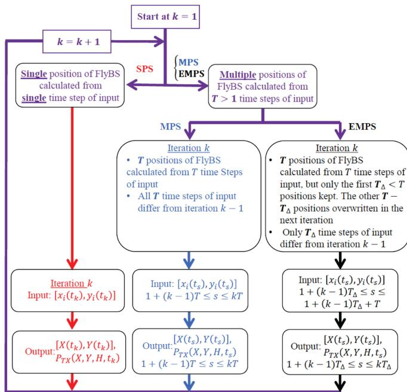  
Fig. 4. Detailed principle of all three proposed schemes based on singlepoint optimization, multi-point optimization, and enhanced multi-point optimization.

## V. POWER OPTIMIZATION WITH TRANSMISSION POWER CONSTRAINTS

The presented solutions in the previous section show a theoretical achievable performance in the communication system with unbounded transmission power. In real networks, however, the transmission power is limited by regulations or simply by capabilities of the physical equipment. Thus, in this section, we focus on a realistic case with the limited transmission power of the FlyBS.

In case the transmission power is limited, the power optimization problem is enhanced with a new constraint as:

$$
\begin{array}{c} \min _ {\boldsymbol {r} (t _ {k})} P _ {t o t} ^ {a v g}, (1 \leq k \leq T) \\ s. t. \quad C _ {i} (t _ {k}) = C _ {i} ^ {m i n}, \forall i \in \{1, \ldots , n \}, \forall k, \quad (c) \\ H _ {m i n} (X (t _ {k}), Y (t _ {k})) \leq H (t _ {k}) \leq H _ {m a x} (X (t _ {k}), Y (t _ {k})), \\ | | \boldsymbol {r} (t _ {k + 1}) - \boldsymbol {r} (t _ {k}) | | \leq V _ {m a x} (t _ {k + 1} - t _ {k}). \quad (c) \\ P _ {T X} (X, Y, H, t _ {k}) \leq P _ {T X} ^ {m a x}, \forall k \in \{1, \ldots , T \} \quad (c) \end{array}\tag{a}
$$

ðbÞ

ðdÞ

(26)

where the equality in the constraint (a) corresponds to the Proposition 1. To fulfill the constraint (d) in (26), global parameters of the mobile network should be set properly in the same way as expected in any existing research work dealing with a resource allocation and management in the mobile networks (not limited to FlyBSs). If the system is not globally set up properly (e.g., when a too narrow band is available, user’s are guaranteed with too high capacity, etc.), the constraint (d) in (26) might not hold even for the optimum $X _ { o p t }$ and $Y _ { o p t }$ at some time step(s). Thus, to solve the practical problem with the transmission power constraint, we assume that the system level parameters includ ing available bandwidth $( B _ { i } )$ and antennas’ gains $( G _ { i } ^ { T } , G _ { i } ^ { R } )$ are pre-set with respect to the environment so that the fol lowing condition is fulfilled:

$$
\min _ {\boldsymbol {r} (t _ {k})} \sum_ {i = 1} ^ {n} \frac {N _ {i} (2 ^ {\frac {C _ {i} ^ {m i n}}{B _ {i}} - 1}) (4 \pi f _ {c}) ^ {\gamma_ {i}}}{G _ {i} ^ {T} G _ {i} ^ {R} c ^ {\gamma_ {i}} (\frac {M}{M + 1} \overline {{h}} _ {i} + \frac {1}{M + 1} \tilde {h} _ {i})} d _ {i} ^ {\gamma_ {i}} \leq P _ {T X} ^ {m a x}\tag{27}
$$

The solution adopted for MPS and EMPS (section IV-F and IV-G) is based on Simplex algorithm. However, the Simplex algorithm is not able to solve optimization problems with con straints on the optimization variables in the objective function. In other words, we cannot apply the same solution directly to (26), as if we expand the constraint (d) in (26) using (3), the constraint contains unknown positions of the FlyBS in the fol lowing way:

$$
\begin{array}{l} \sum_ {i = 1} ^ {n} Q _ {i} ((X (t _ {k}) - x _ {i} (t _ {k})) ^ {2} + (Y (t _ {k}) - y _ {i} (t _ {k})) ^ {2} + H ^ {2} (t _ {k})) ^ {\frac {\gamma_ {i}}{2}} \\ \leq P _ {T X} ^ {m a x}, \forall k \in \{1, \dots , T \}. \end{array}\tag{28}
$$

Furthermore, the constraint (b) in (26) also limits the FlyBS’s altitude. Thus the Simplex algorithm cannot be immediately applied to the current optimization setting in (26). In order to address this issue, we propose a solution based on the change of variables $X ( t _ { k } ) , Y ( t _ { k } )$ , and $H ( t _ { k } ) ( 1 \leq$ $k \leq T )$ to eliminate the constraints (b), (c), and (d) in (26) as follow. We first consider the constraint (b) in (26). Suppose that $H _ { m a x } ( X ( t _ { k } ) , Y ( t _ { k } ) ) \leq H _ { M }$ . Then, by rewriting the transmission power in terms of the system parameters, the constraint (b) is fulfilled if:

$$
\sum_ {i = 1} ^ {n} Q _ {i} ((X (t _ {k}) - x _ {i} (t _ {k})) ^ {2} + (Y (t _ {k}) - y _ {i} (t _ {k})) ^ {2} + H _ {M} ^ {2} (t _ {k})) ^ {\frac {\gamma_ {i}}{2}} \leq P _ {T X} ^ {m a x}\tag{29}
$$

Using the first-order Taylor approximation for $( ( X ( t _ { k } ) - x _ { i }$ $( t _ { k } ) ) ^ { 2 } + ( Y ( t _ { k } ) - y _ { i } ( t _ { k } ) ) ^ { 2 } )$ , the left-hand side in (29) is rewritten as:

$$
\begin{array}{c} \sum_ {i = 1} ^ {n} Q _ {i} \Big ((X (t _ {k}) - x _ {i} (t _ {k})) ^ {2} + (Y (t _ {k}) - y _ {i} (t _ {k})) ^ {2} + H _ {M} ^ {2} (t _ {k}) \Big) ^ {\frac {\gamma_ {i}}{2}} \\ \cong A _ {0} + \bigg (\sum_ {i = 1} ^ {n} Q _ {i} \bigg) \Big ((X (t _ {k}) - X _ {*}) ^ {2} + (Y (t _ {k}) - Y _ {*}) ^ {2} \Big) \end{array}\tag{30}
$$

where

$$
\begin{array}{l} A _ {0} = \sum_ {i = 1} ^ {n} Q _ {i} ((H _ {M} ^ {2} + \Lambda_ {i} H _ {M} ^ {2} \Omega) ^ {\frac {\gamma_ {i}}{2}} - \frac {\gamma_ {i}}{2} \Lambda_ {i} H _ {M} ^ {2} \Omega \times \\ (H _ {M} ^ {2} + \Lambda_ {i} H _ {M} ^ {2} \Omega) ^ {\frac {\gamma_ {i}}{2} - 1}) + \frac {\gamma_ {i}}{2} (H _ {M} ^ {2} + \Lambda_ {i} H _ {M} ^ {2} \Omega) ^ {\frac {\gamma_ {i}}{2} - 1} (x _ {i} ^ {2} + y _ {i} ^ {2}) \\ - \left(\frac {\sum_ {i = 1} ^ {n} \Upsilon_ {i} x _ {i}}{\sum_ {i = 1} ^ {n} \Upsilon_ {i}}\right) ^ {2} - \left(\frac {\sum_ {i = 1} ^ {n} \Upsilon_ {i} y _ {i}}{\sum_ {i = 1} ^ {n} \Upsilon_ {i}}\right) ^ {2}, \\ X _ {*} = \frac {\sum_ {i = 1} ^ {n} \Upsilon_ {i} x _ {i}}{\sum_ {i = 1} ^ {n} \Upsilon_ {i}}, Y _ {*} = \frac {\sum_ {i = 1} ^ {n} \Upsilon_ {i} y _ {i}}{\sum_ {i = 1} ^ {n} \Upsilon_ {i}}, \\ \Upsilon_ {i} = Q _ {i} (H _ {M} ^ {2} + \Lambda_ {i} H _ {M} ^ {2} \Omega) ^ {\frac {\gamma_ {i}}{2} - 1}, \\ \Lambda_ {i} = \left\lfloor \frac {(X (t _ {k}) - x _ {i} (t _ {k})) ^ {2} + (Y (t _ {k}) - y _ {i} (t _ {k})) ^ {2}}{H _ {M} ^ {2} \Omega} \right\rfloor . \end{array}\tag{31}
$$

Note that the value V is an approximation parameter and choosing a smaller V results in a smaller error in the approximation in (30). Using the approximation in (31), the inequality in (29) is rewritten as:

$$
\left(X (t _ {k}) - X _ {*}\right) ^ {2} + \left(Y (t _ {k}) - Y _ {*}\right) ^ {2} \leq \zeta^ {2},\tag{32}
$$

where $\begin{array} { r } { \zeta = { ( \frac { P _ { T X } ^ { m a x } - A _ { 0 } } { \sum _ { i = 1 } ^ { n } Q _ { i } } ) } ^ { \frac { 1 } { 2 } } } \end{array}$ . Next, with a consideration of (32) and Pto also fulfill the constraints (c) and (d) in (26), we take a similar approach as in the solution to (15) and we define $\phi _ { k } , \psi _ { k } .$ $\chi _ { k } , \omega _ { k } ,$ , and $\xi _ { k }$ so that the following equations hold:

$$
\begin{array}{l} X (t _ {k + 1}) = \min \left\{X (t _ {k}) + V _ {\max} (t _ {k + 1} - t _ {k}) \cos (\omega_ {k}) \cos (\xi_ {k}), \right. \\ \left. X _ {*} (t _ {k + 1}) + \zeta \sin (\phi_ {k + 1}) \cos (\psi_ {k + 1}) \right\} \\ Y (t _ {k + 1}) = \min \left\{Y (t _ {k}) + V _ {\max} (t _ {k + 1} - t _ {k}) \cos (\omega_ {k}) \sin (\xi_ {k}), \right. \\ \left. Y _ {*} (t _ {k + 1}) + \zeta \sin (\phi_ {k + 1}) \sin (\psi_ {k + 1}) \right\} \\ H (t _ {k + 1}) = \min \left\{H _ {\min} (X (t _ {k + 1}), Y (t _ {k + 1})) \right. \\ + \left(H _ {\max} (X (t _ {k + 1}), Y (t _ {k + 1})) - H _ {\min} (X (t _ {k + 1}), Y (t _ {k + 1}))\right) \\ \times \sin^ {2} (\chi_ {k + 1}), \max \left\{H (t _ {k}) + V _ {\max} (t _ {k + 1} - t _ {k}) \times \sin (\omega_ {k + 1}), \right. \\ H _ {\min} (X (t _ {k + 1}), Y (t _ {k + 1})) \} \}. \end{array} \tag {3}\tag{33}
$$

With the defined $\phi _ { k } , \psi _ { k } , \chi _ { k } , \omega _ { k } .$ , and $\xi _ { k }$ the constraints (b)- (d) in (26) fulfill automatically and, thus, the problem of the total power minimization is rewritten as:

$$
\begin{array}{l} \min _ {\phi_ {k}, \psi_ {k}, \chi_ {k}, \omega_ {k}, \xi_ {k}} P _ {t o t} ^ {a v g}, (1 \leq k \leq T) \\ s. t. C _ {i} (t) = C _ {i} ^ {m i n}, \forall i \in \{1, \ldots , n \}, \forall t. \end{array}\tag{34}
$$

Similar to (15), the solution to optimization problem in (34) is based on the Simplex method as elaborated in Section IV-F.

In general, an analysis of the computational complexity is not possible for the Nelder-Mead Simplex, as it highly depends on the objective function [65]. Nevertheless, we can still derive the order of the computational complexity by counting the total number of clock cycles taken for fixed-point operations performed during the optimization. To this end, we assume each multiplication of two numbers takes 3 clock cycles and each addition takes 1 clock cycle [66]. Then, by simulating the scenario for different number of time steps $T$ in the optimization and counting the total number of clock cycles, it is observed that the computational complexity of the proposed solution scales as $O ( T ^ { 3 . 2 } )$ Þ. Furthermore, an evalua tion of the total power consumption in (10) is of a linear complexity with respect to the number of users (n). Hence, the overall complexity of the proposed solution i $O ( n T ^ { 3 . 2 } )$ Þ.

## VI. SIMULATION SCENARIO AND MODELS

In this section, we provide details of simulations and models adopted to evaluate the performance of the proposed solution minimizing the total power consumed by the FlyBS serving mobile users. We also define competitive algorithms consid ered in simulations.

We consider a scenario with the FlyBS serving users represented by vehicles, for example, during a busy traffic or a traf fic jam at a road or a highway. In such situation, the conventional network is usually overloaded as plenty of active users are located in a small rural area with a limited network coverage. In such scenario, the FlyBS is a suitable solution to improve the performance, see [45], [46]. The users are assumed to move on a 3-lane highway in the positive direction of y-axis. A wide range of velocities of the vehicles is consid ered (f2; 5; 10; 12; 15; 20; 25g m/s) to cover different traffic situations corresponding to a traffic jam and/or a busy traffic. Note that for higher speeds than 25 m/s, the typical FlyBS is not efficient and cannot follow the vehicles’ movement, as common rotary-wing UAVs can fly typically with a maximum speed of about 25 m/s [52]. We assume that a length of the crowd of vehicles served by the FlyBS in the traffic jam is 600 meters (i.e., the length of the line of the vehicles is 600 m).

As mentioned in Section II, the current positions of the users are assumed to be known to the FlyBS. However, the known positions contain a randomly distributed error of $e _ { i } ^ { M , x } \in [ \bar { - 1 0 } , 1 0 ]$ m and $e _ { i } ^ { M , y } \in [ - 1 0 , \dot { 1 } 0 ]$ m, see (5). Further more, the location of the users in future time slots are fully unknown in general. There are many solutions for a prediction of the user’s movement, see, e.g., [59]–[61]. As individual prediction schemes reach different performances depending on a scenario and an availability of additional information, the evaluation of our proposal for any specific prediction would lead to a validity of the results only for such specific scenario and conditions of the predictor. Thus, we generalize the evalu ation across different predictive models in the following way: The next position of the users is extrapolated from the last two previous positions of the user and this predicted position is further influenced by an additional random error so that:

$$
\begin{array}{l} x _ {i} (t) = x _ {i} (0) + v _ {i} ^ {x} (t) t + e _ {i} ^ {P r, x} (t), \\ y _ {i} (t) = y _ {i} (0) + e _ {i} ^ {P r, y} (t), \end{array}
$$

where $e _ { i } ^ { P r , x } ( t )$ and $e _ { i } ^ { P r , y } ( t )$ denote the added error to the x and y coordinates of the user i at the time $t ,$ respectively, and $v _ { i } ^ { x } ( t )$ denotes the velocity of the user i in the direction of x-axis at the time t. In our scenario, we consider the following model for $e _ { i } ^ { P r , x } ( t )$ and $e _ { i } ^ { P r , y } ( t )$

TABLE II  
PARAMETER FOR SIMULATIONS

<table><tr><td>System Parameter</td><td>Numerical value</td></tr><tr><td>Number of users, n</td><td>90</td></tr><tr><td>FlyBS&#x27;s antenna gain,  $G_i^T$ </td><td>7 dBi [62]</td></tr><tr><td>Ground users&#x27; antenna gain, $G_i^R$ </td><td>0 dBi [67]</td></tr><tr><td>Noise power spectral density, Ni</td><td>-174 dBm/Hz</td></tr><tr><td>Minimum capacity for the i-th user, $C_i^{min}$ </td><td>{5,10} Mbps</td></tr><tr><td>Communication frequency,  $f_c$ </td><td>2.6 GHz</td></tr><tr><td>System bandwidth</td><td>100 MHz</td></tr><tr><td>Simulation step,  $\Delta t_j$ </td><td>1 second</td></tr><tr><td>Range of FlyBS altitude, [Hmin, Hmax]</td><td>[100,300] meters</td></tr><tr><td>Velocity of users,  $v_i$ </td><td>{2,5,10,12,15,20,25} m/s</td></tr><tr><td>FlyBS&#x27;s circuit power,  $P_{circuit}$ </td><td>0.15 Watts</td></tr><tr><td>Maximum transmission power,  $p_{max}^T$ </td><td>2 Watts</td></tr><tr><td>Simulation Duration</td><td>15 minutes</td></tr><tr><td>Number of simulation drops</td><td>100</td></tr></table>

$$
\begin{array}{r} | e _ {i} ^ {P r, x} (t) | \leq \eta v _ {i} ^ {x} (t) t, \\ | e _ {i} ^ {P r, y} (t) | \leq W _ {H}, \end{array}
$$

where $W _ { H }$ denotes the highway’s width, and h is the error factor that indicates the extent of error incurred by the prediction. Note that, although our proposed solution for the positioning of the FlyBS is designed for 3D movement of the FlyBS, the only suitable propulsion power consumption model of the rotary-wing FlyBSs, see [31], only applies to a fixed altitude. Thus, for the simulations, the FlyBS’s altitude is set to H 100 m, and the optimization problems in (11) and (26) are solved only for x and y coordinates of the FlyBS.

Table II shows the values of the system parameters adopted in the simulations. For the wireless channel, we assume free space path loss (FSPL) model, as the communication link between the FlyBS and the users (vehicles) on a road is typically without any obstacles and the FSPL is a commonly adopted model in such cases [23], [29], [38]. Omni-directional antennas with gains of 7 dBi and 0 dBi for the FlyBS and the users are considered, respectively, [62], [67]. We set spectral density of noise to -174 dBm/Hz. The radio frequency $f _ { c } =$ 2:6 GHz and a bandwidth of 100 MHz are selected. We consider the same minimum required capacity for all users, i.e., ${ C _ { i } } ^ { m i n } = C ^ { m i n } , \forall i \in \{ 1 , . . . , n \}$ and the simulations are performed for $C ^ { m i n } = 5 { \mathrm { M b p s } }$ and $C ^ { m i n } = 1 0 \mathrm { M b p s }$

To suppress randomness in the models, each simulation is of 15 minutes duration with a step of 1 s and the results are averaged out over 100 simulation drops.

To solve the problems by Simplex algorithm, we set $\kappa _ { i } =$ 0:05 and $\epsilon _ { i } = 0 . 0 0 0 2 5$ to create the initial simplex from (25). These values are selected with respect to the accuracy and the termination time of the algorithm, as explained in Section IV-F.

For the initial simplex, we choose the points derived from the closed-form solution for the single-point optimization as elaborated in Section IV-F. The input used for this singlepoint optimization is the predicted location of the users calculated from (35).

We investigate five different schemes:

i) Proposed multi-point optimization scheme (MPS) with the location of FlyBS determined by the numerical optimiza tion of $P _ { t o t } ^ { a v g }$ as elaborated in subsection IV-F;

ii) Enhanced MPS (EMPS) as elaborated in subsection IV G, with $T = 2$ and $T _ { \Delta } = 1 , \mathrm { i . e }$ ., the optimization is done over 2 time steps, and it is iterated after each time step. Note that the values for T and $T _ { \Delta }$ are selected experimentally;

iii) Single-point optimization scheme (SPS), where the locations of the FlyBS is determined by minimizing $P _ { t o t } ^ { a v g }$ for $T = 1$ , as explained in subsection IV-E;

iv) Minimal TX power scheme (MTX), as outlined in [45] and further exploited and elaborated in [34], [68], targeting the transmission power minimization while the propulsion power is ignored;

In addition to the above mentioned schemes, we also evaluate the performance for the scenario with conventional static base station (i.e., with no propulsion power consumption) to investi gate benefits of the FlyBSs. However, based on the simulation results, the conventional static base station leads to the average transmission powers of 900 and 16 000 Watts for $v _ { i } = 1 0$ m/s and 25 m/s, respectively even for $C _ { j } ^ { m i n } = 5 { \mathrm { M b p s } }$ . These values are multiple times larger than the average total power consumption of all other schemes. Thus, for the clarity of presentation of the results, we do not show this scheme in the figures.

Note that up to our best knowledge, there is no other exist ing solution that targets the minimization of transmission and or propulsion power while the minimum capacity is guaran teed to the moving users.

## VII. PERFORMANCE EVALUATION

In this section, we discuss simulation results. First, we illus trate an evolution of the transmission, propulsion, and total power consumption over time for the proposed algorithms. Then, we compare the performance of the proposed scheme with existing state-of-the-art solutions in terms of the average power consumption and we analyze an impact of an error in prediction of the vehicles’ movement.

## A. Evolution of Power Consumption Over Time

Figs. 5, 6, and 7 represent a sample of the transmission, pro pulsion, and total power consumption, respectively, over a sample interval with a duration of 180 s. These figures show a mutual cooperation of the transmission power control and the selection of the position of the FlyBS. The figures show the results for $v _ { i } = 1 0$ m/s (subplot (a)) and $v _ { i } = 2 5$ m/s (subplot (b)). For the proposed MPS, the number of time steps in the optimization is set to $T = 3 0 ,$ , and ${ C _ { j } } ^ { m i n } = 1 0$ Mbps is assumed for all schemes. Note that we break (collapse) the y-axis in Figs. 6 and 7 to increase a separation of the plots for all three proposed solutions (SPS, MPS, and EMPS) and to demonstrate clearly the performance of individual solutions.

According to Fig. 5, the transmission power increases over time for all the proposed solutions. This behavior is justified by evaluating the changes in transmission and propulsion powers with respect to the change in the FlyBS’s speed. More specifically, assume that increasing the FlyBS’s speed by some $\delta V > 0$ causes an increase and a decrease in the propul sion and transmission powers by $\delta P _ { p r }$ and $\delta P _ { T X }$ , respectively. According to (4), $\delta P _ { T X }$ is directly proportional to $C ^ { m i n }$ as well as to the relative distances between the FlyBS and the users (d ), whereas $\delta P _ { p r }$ is independent of the $C ^ { m i n }$ and $d _ { i } .$ Now, let us have $\delta P _ { p r } > \delta P _ { T X }$ for the considered dV. Then, as a result, the FlyBS endeavors not to increase its speed by more than or equal to dV in the proposed solutions. Consequently, the distance between the FlyBS’s position and the center of gravity of the users might increase over time and, this imposes an increase in the transmission power. If the distance between the FlyBS and the users becomes large enough so that $\delta P _ { p r } < \delta P _ { T X }$ , then the FlyBS would start increasing its speed by more than $\delta V$ to reduce the transmission power.

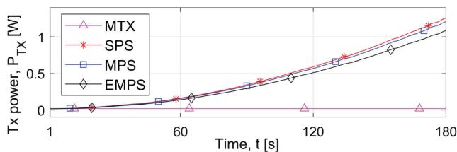

(a)  
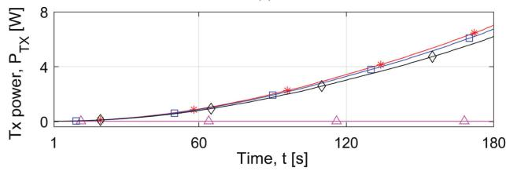  
(b)

Fig. 5. Evolution of transmission power $P _ { T X }$ over a sample of time for a) $v _ { i } = 1 0 \mathrm { m / s }$ and b) $v _ { i } = 2 5$ m/s. $\eta = 0 . 5$ is assumed for MPS and EMPS.  
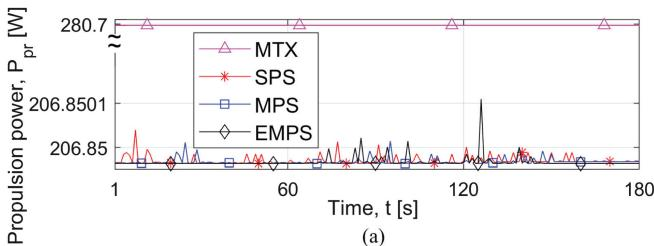  
(a)

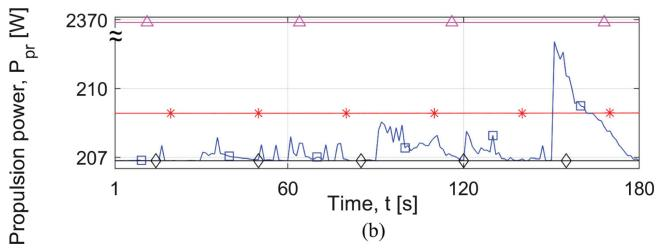  
Fig. 6. Evolution of propulsion power $P _ { p r }$ over a sample of time for a) $v _ { i } =$ 10 m/s and b) $v _ { i } = 2 5$ m/s. $\eta = 0 . 5$ is assumed for MPS and EMPS.

Furthermore, the increase in the transmission power over time is higher when the difference between the FlyBS’s and the users’ velocities is larger, as illustrated in Fig. 5 (bottom sub plot in Fig. 5 shows about 6-times higher increase in $P _ { T X }$ comparing to the top subplot). In contrast, the MTX scheme keeps the FlyBS’s position at the center of gravity of the users disregarding the incurred propulsion power. Hence, the MTX results in a significant increase in the propulsion power consumption (see Fig. 6) and, consequently, also in the total con sumed power (Fig. 7). As shown in Fig. 6 (subplot (a)), all three propose schemes (SPS, MPS, EMPS) reach similar propulsion power for a low speed of vehicles. However, for higher speeds of vehicles (subplot (b)), the differences among SPS, MPS, and EMPS become more significant, as the propulsion power for MPS undergoes rapid peaks at some time steps. The reason for such peaks is that the MPS optimizes the total power consump tion over T time steps by deriving the $T$ locations of the FlyBS. These locations are, however, not necessarily the optimal over a longer period of operation. Therefore, after the $T$ time steps, the FlyBS can be in a suboptimal position and should fly a rela tively long distance to reach the long-term optimum in order to reduce the power for the next T time steps. In contrast, the EMPS does not suffer from such sudden jumps in the propul sion power, as it iterates the optimization and adjusts the FlyBS’s position and transmission power after each time step while still considering long-term optimization perspective. Fig. 7 confirms that the EMPS always outperforms both SPS and MPS in terms of the total power consumption.

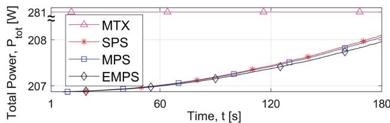  
(a)

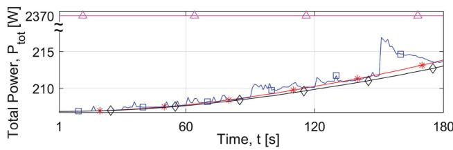  
(b)  
Fig. 7. Evolution of total power $P _ { t o t }$ over a sample of time for a) $v _ { i } = 1 0$ m/s and b) 25 m/s. $\eta = 0 . 5$ is assumed for MPS and EMPS.

## B. Impact of User’s Velocity

In this subsection, we investigate the impact of the users velocity on the average power consumption of the FlyBS over a longer period of the operational time of the FlyBS. Figs. 8, 9, and 10 show the average transmission, propulsion, and total power consumption, respectively. The results are shown for the case with no limitation of the transmission power (left subplots) as well as for the case with the transmission power lim ited to 2 W (right subplots). The figures show the results for $C ^ { m i n } = 5$ Mbps as well as $C ^ { m i n } = 1 0$ Mbps. The proposed MPS is investigated for the number of time steps in the optimi zation T set to 10, 20, and 30.

First, we explain the results for the case with no transmission power limit. According to Fig. 8, the average transmission power increases with the users’ velocity. As discussed in the description of Fig. 5, this is caused by the fact that for higher velocities of users, the distance between the FlyBS and the center of gravity of the users’ locations is higher on average, as the FlyBS tends to fly approximately with the speed corresponding to the minimum propulsion power for all the proposed solutions. The FlyBS increases its speed time-to-time in order to reduce the transmission power if the transmission power would be too high with respect to the propulsion power. Clearly, for higher velocities of the users, the FlyBS increases its speed more often and, hence, the average propulsion power increases with the velocity of the users, as illustrated in Fig. 9. In addition, Fig. 9 shows the advantage of the EMPS over the SPS and the MPS in controlling the propulsion power via a continuous adjustment of the FlyBS’s positions over time. Contrary to the proposed solutions, the MTX leads to the situation when the FlyBS flies with the speed equal to the users’ velocity to keep the transmission power at the lowest level. This causes a relatively high propulsion power, especially for a high velocity of the users. More specifically, at the velocity of 25 m/s, the proposed EMPS, MPS, and SPS reduce the propul sion power by up to about 91%, 90%, and 90%, respectively, comparing to the MTX. Note that roughly the same gains are observed for both $C ^ { m i n } = 5$ Mbps and $C ^ { m i n } = 1 0 $ Mbps.

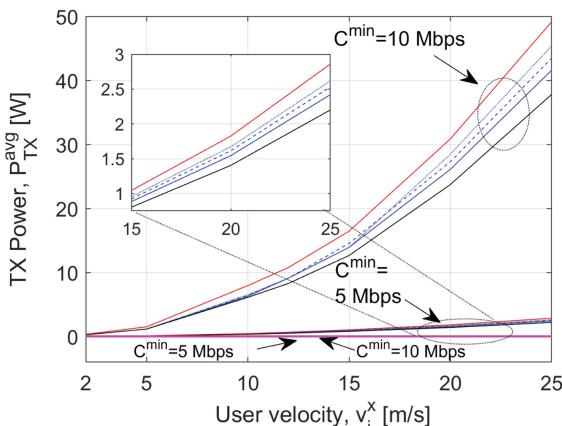

(a)  
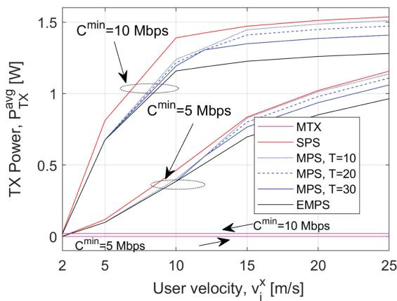  
(b)  
Fig. 8. $P _ { T X } ^ { a v g }$ vs. user’s velocity for a) unconstrained transmission power and b) constrained transmission power with $P _ { T X } ^ { m a x } = 2 \mathrm { W } . \ \eta = 0 . 5$ is assumed for MPS and EMPS.

Similar behavior and trends in the transmission and propulsion powers are observed also for the case with the transmission power constraint in Figs. 8 and 9 (right subplots). More specifically, before the transmission power reaches the maximum allowed value, the FlyBS keeps the propulsion power low while the transmission power is increasing. However, when the transmission power reaches the maximum, the FlyBS is forced to increase the speed in order to avoid getting too far from the center of gravity of the users. Consequently, the propulsion power is increased to find a position in which the capacity $C ^ { m i n }$ is guaranteed to all users. The left subplot in Fig. 9 shows this increase in the average pro pulsion power compared with the right subplot, especially for high speeds of the users and a high guaranteed Cmin. For higher users’ required capacity, the transmission power becomes compa rable to the propulsion power, and hence, the FlyBS increases its velocity to avoid a large increase in the transmission power.

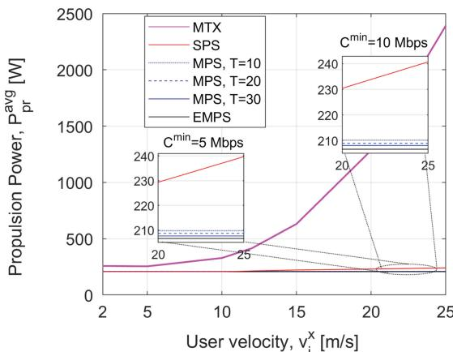  
(a)

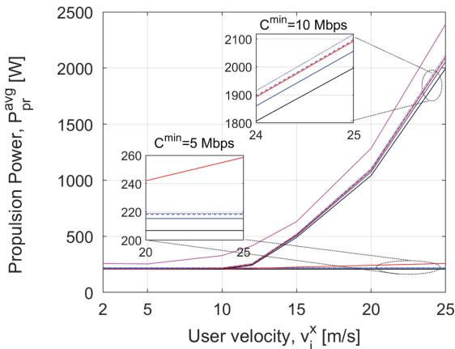  
(b)  
Fig. 9. $P _ { p r } ^ { a v g }$ vs. user’s velocity for a) unconstrained transmission power and b) constrained transmission power with $P _ { T X } ^ { m a x } = 2 \mathrm { W } . \ \eta = 0 . 5$ is assumed for MPS and EMPS.

Note that the transmission power limit does not change the results for MTX with respect to the case without the transmission power limit, as the MTX always achieves the minimum transmission power, which should be lower than $P _ { T X } ^ { m a x }$ , otherwise the problem in (26) would have no solution. According to Fig. 9, the proposed EMPS, MPS, and SPS reduce the propulsion power comparing to the MTX by 91%, 91%, and 89%, respectively, at the velocity of 25 m/s and for $C ^ { m i n } = 5$ Mbps. If $C ^ { m i n } = 1 0$ Mbps, the respective gains of EMPS, MPS, and SPS comparing to the MTX are about 36%, 34%, and 33%.

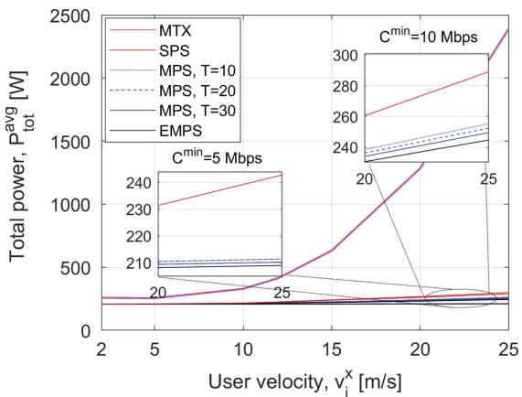  
(a)

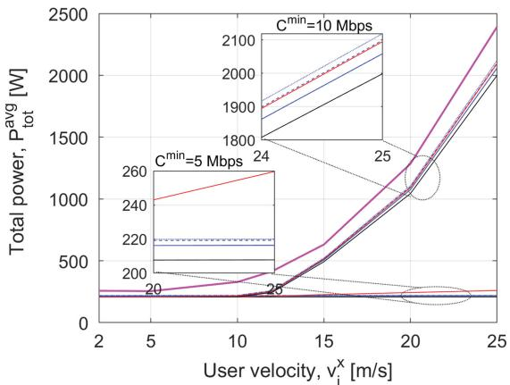  
(b)  
Fig. 10. $P _ { p r } ^ { a v g }$ vs. user’s velocity for a) unconstrained transmission power and b) constrained transmission power with $P _ { T X } ^ { m a x } = 2 \mathrm { W } . \eta = 0 . 5$ is assumed fo MPS and EMPS.

The average total power consumption is investigated in Fig. 10. The average total power consumed by the proposed MPS for $T = 3 0$ is lower than for $T = 1 0$ and $T = 2 0$ . Note that we have tested also the performance for larger values of $T ,$ but it has lead to no significant improvement in the performance of MPS. Hence, the results for $T > 3 0$ are not included to keep the figures clear. The reason that increasing $T$ does not always improve the performance is because a larger $T$ also entails the prediction over a longer period, thus, a higher prediction error is incurred. Furthermore, increasing $T$ can potentially increase the magnitude of sudden peaks in the propulsion power. Fig. 10 shows that the lowest power consumption is achieved by the EMPS. Comparing to the MPS, the EMPS allows a more frequent adjustment of the future positions of the FlyBS so that the sudden peaks in the propulsion power are suppressed. In the case of limited transmission power, the difference among the proposed solutions becomes more obvious for a higher required users’ capacity Cmin because of a higher gap between the users and FlyBS’s speeds, which allows the FlyBS to leverage an increase in the transmission power for the benefit of a saving in the propulsion power.

Fig. 10 further demonstrates that all proposed solutions outperform the MTX for all velocities. For the case of unconstrained transmission power at the velocity of 25 m/s, the proposed EMPS, MPS, and SPS reduce the total power comparing to the MTX by 91%, 90%, and 89%, respectively, if $C ^ { m i n }$ is set to 5 Mbps, and by 90%, 89%, and 87%, respec tively, if $C ^ { m i n }$ is set to 10 Mbps. For the case of constrained transmission power at the velocity of 25 m/s, the proposed EMPS, MPS, and SPS lead to a reduction in the total power consumption of about 90%, 89%, and 88%, respectively, with respect to the MTX if $C ^ { m i n }$ is set to 5 Mbps, and about 16%, 13%, and 12%, respectively, if $C ^ { m i n }$ is set to 10 Mbps.

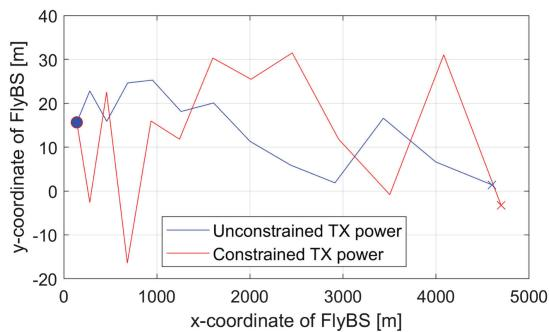

Fig. 11. FlyBS’s trajectory. The start and end points of the movement are marked by $\therefore$ and $^ { * * } \times \stackrel { \sim } { }$  
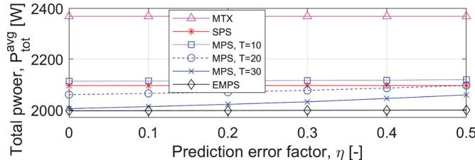

(a)  
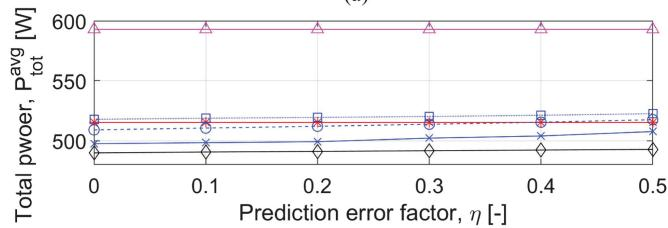  
(b)  
Fig. 12. $P _ { t o t } ^ { a v g }$ vs. the prediction error’s factor (h) for different schemes and for a) $v _ { i } ^ { x } = 2 5$ m/s and b) vx 15 m/s. $C ^ { m i n } = 1 0$ Mbps is assumed.

Next, Fig. 11 depicts the trajectory of the FlyBS for the case with and without constraint on the FlyBS’s transmission power. For the constrained transmission power, the FlyBS’s displace ments are relatively larger compared to the unconstrained trans mission power, as the FlyBS has to keep the transmission power below the maximum limit by moving to a favorable point even if such a movement would incur a larger propulsion power.

## C. Impact ofPrediction Error

Last, we investigate the impact of the error due to a predic tion of the vehicles’ movement (according to (35)) on the tota power consumption of the FlyBS in Fig. 12. The average total power consumption increases for both MPS and EMPS with the prediction error, because having more inaccurate parame ters in a function leads to a calculation of more inaccurate optimal values in general. We further see that, for any value of the error factor h (see (36)), the average total power consumption for MPS increases with $T$ as the prediction error increases with $T$ as well. Furthermore, the EMPS shows a stable behavior and robustness against the prediction error comparing to the MPS, as the optimization is adjusted over time to suppress the negative impact of the prediction error.

## VIII. CONCLUSION

In this paper, we have studied the problem of power optimization in future wireless networks with the FlyBSs. Contrary to existing papers, we optimize the total power consumed by the FlyBS while guaranteeing the minimum communication capacity to all users during their movement. We first provide the closedform solution determining the position and the transmission power of the FlyBS for a realistic non-linear power consumption model in the case of single-point optimization. Then, we develop a numerical solution for the optimal positioning of the FlyBS and setting of the FlyBS’s transmission power to minimize the total power consumed by the FlyBS over a period with an arbitrary duration (multi-point optimization). We show that the proposed joint transmission power control and FlyBS’s movement allows a significant reduction (up to 91%) in the total power consumed by the FlyBS while the required capacity of the moving users is always satisfied.

In the future, the scenario with multiple FlyBSs should be studied. Regarding this, two key aspects that should be addressed jointly are: i) association of the users to the FlyBSs and ii) management of interference among the FlyBSs.

## APPENDIX A PROOF TO THEOREM 1

Proof.

To find the FlyBS’s position that minimizes $P _ { t o t } ^ { a v g }$ , we start by finding the critical points for $P _ { t o t } ^ { a v g }$ . First, it is noted that $[ \dot { X } ( t _ { 1 } ) , \dot { Y ( t _ { 1 } ) } ] = [ X ( t _ { 0 } ) , Y ( t _ { 0 } ) ]$ is one the critical points for $\dot { P } _ { t o t } ^ { a v g }$ . Now we find the critical points where $[ X ( t _ { 1 } ) , Y ( t _ { 1 } ) ] \neq$ $[ X ( t _ { 0 } ) , Y ( t _ { 0 } ) ]$ . by using $P _ { p r } ^ { a p x }$ in (16) and rewriting $\frac { \partial P _ { t o t } ^ { a v g } } { \partial X } = 0$ and $\frac { \partial P _ { t o t } ^ { a v g } } { \partial Y } = 0$ for the period of $\{ t _ { 0 } , t _ { 1 } \}$ we get:

$$
\begin{array}{c} \sum_ {i = 1} ^ {n} 2 Q _ {i} (X (t _ {1}) - x _ {i} (t _ {1})) \\ = - (\frac {X (t _ {1}) - X (t _ {0})}{\sqrt {(X (t _ {1}) - X (t _ {0})) ^ {2} + (Y (t _ {1}) - Y (t _ {0})) ^ {2}}}) \cdot \frac {d P _ {p r} ^ {a p x}}{d V} | _ {V = V (t _ {0}, t _ {1})}, \end{array}
$$

$$
\begin{array}{c} \sum_ {i = 1} ^ {n} 2 Q _ {i} (Y (t _ {1}) - y _ {i} (t _ {1})) \\ = - (\frac {Y (t _ {1}) - Y (t _ {0})}{\sqrt {(X (t _ {1}) - X (t _ {0})) ^ {2} + (Y (t _ {1}) - Y (t _ {0})) ^ {2}}}) \cdot \frac {d P _ {p r} ^ {a p x}}{d V} | _ {V = V (t _ {0}, t _ {1})}. \end{array}\tag{37}
$$

We derive an auxiliary equation from (37) that does not include the complicated term of $\frac { d P _ { p r } ^ { a p x } } { d V }$ and helps to derive an explicit relation between $X ( t _ { 1 } )$ Þ and $\dot { Y } ( t _ { 1 } )$ Þ as:

$$
\frac {\sum_ {i = 1} ^ {n} 2 Q _ {i} (X (t _ {1}) - x _ {i} (t _ {1}))}{\sum_ {i = 1} ^ {n} 2 Q _ {i} (Y (t _ {1}) - y _ {i} (t _ {1}))} = \frac {X (t _ {1}) - X (t _ {0})}{Y (t _ {1}) - Y (t _ {0})}.\tag{38}
$$

Equation (38) is further rewritten as:

$$
\frac {(\sum_ {i = 1} ^ {n} 2 Q _ {i}) X (t _ {1}) - (\sum_ {i = 1} ^ {n} 2 Q _ {i} x _ {i} (t _ {1}))}{(\sum_ {i = 1} ^ {n} 2 Q _ {i}) Y (t _ {1}) - (\sum_ {i = 1} ^ {n} 2 Q _ {i} y _ {i} (t _ {1}))} = \frac {X (t _ {1}) - X (t _ {0})}{Y (t _ {1}) - Y (t _ {0})}.
$$

Then, from (39), it is concluded that:

(39)

$$
\begin{array}{c} (Y (t _ {1}) - Y (t _ {0})) = \\ \frac {(\sum_ {i = 1} ^ {n} 2 Q _ {i}) Y (t _ {0}) - (\sum_ {i = 1} ^ {n} 2 Q _ {i} y _ {i} (t _ {1}))}{(\sum_ {i = 1} ^ {n} 2 Q _ {i}) X (t _ {0}) - (\sum_ {i = 1} ^ {n} 2 Q _ {i} x _ {i} (t _ {1}))} (X (t _ {1}) - X (t _ {0})). \end{array}\tag{40}
$$

With (40), we can simplify the expression for V in (7) to:

$$
\begin{array}{l} V = M | X (t _ {1}) - X (t _ {0}) |, M \\ \qquad = \frac {1}{\Delta t _ {k}} (1 + \frac {(\sum_ {i = 1} ^ {n} 2 Q _ {i}) Y (t _ {0}) - (\sum_ {i = 1} ^ {n} 2 Q _ {i} y _ {i} (t _ {1}))}{(\sum_ {i = 1} ^ {n} 2 Q _ {i}) X (t _ {0}) - (\sum_ {i = 1} ^ {n} 2 Q _ {i} x _ {i} (t _ {1}))}) ^ {\frac {1}{2}}. \end{array}\tag{41}
$$

Now, by expanding the first equation in (37) using (16) and (41), we get:

$$
\begin{array}{l} \left(\sum_ {i = 1} ^ {n} 2 Q _ {i}) X (t _ {1}) - \left(\sum_ {i = 1} ^ {n} 2 Q _ {i} x _ {i} (t _ {1})\right) \right. \\ = - (\frac {X (t _ {1}) - X (t _ {0})}{M | X (t _ {1}) - X (t _ {0}) |}) (5 c _ {5} V ^ {4} + 4 c _ {4} V ^ {3} + 3 c _ {3} V ^ {2} + 2 c _ {2} V + c _ {1}) \\ = - (\frac {X (t _ {1}) - X (t _ {0})}{M | X (t _ {1}) - X (t _ {0}) |}) (5 c _ {5} M ^ {4} | X (t _ {1}) - X (t _ {0}) | ^ {4} \\ \quad + 4 c _ {4} M ^ {3} | X (t _ {1}) - X (t _ {0}) | ^ {3} + 3 c _ {3} M ^ {2} | X (t _ {1}) - X (t _ {0}) | ^ {2} \\ \quad + 2 c _ {2} M | X (t _ {1}) - X (t _ {0}) | + c _ {1}). \end{array}\tag{42}
$$

Equation (42) can be solved by considering two different possibilities:

a) $X ( t _ { 1 } ) > X ( t _ { 0 } )$ (equivalently, $| X ( t _ { 1 } ) - X ( t _ { 0 } ) | =$ $( X ( t _ { 1 } ) - X ( t _ { 0 } ) )$ : with this presumption (42) is rewritten as a quartic equation with respect to $X ( t _ { 1 } )$ as follow

$$
a _ {4} X ^ {4} (t _ {1}) + a _ {3} X ^ {3} (t _ {1}) + a _ {2} X ^ {2} (t _ {1}) + a _ {1} X (t _ {1}) + a _ {0} = 0,\tag{43}
$$

where

$$
\begin{array}{l} a _ {4} = 5 c _ {5} M ^ {3}, \quad a _ {3} = - 2 0 c _ {5} M ^ {3} X (t _ {0}) + 4 c _ {4} M ^ {2}, \\ a _ {2} = 3 0 c _ {5} M ^ {3} X ^ {2} (t _ {0}) - 1 2 c _ {4} M ^ {2} X (t _ {0}) + 3 c _ {3} M, \\ a _ {1} = \sum_ {i = 1} ^ {n} 2 Q _ {i} - 2 0 c _ {5} M ^ {3} X ^ {3} (t _ {0}) + 1 2 c _ {4} M ^ {2} X ^ {2} (t _ {0}) \\ \qquad - 6 c _ {3} M X (t _ {0}) + 2 c _ {2}, \\ a _ {0} = 5 c _ {5} M ^ {3} X ^ {4} (t _ {0}) - 4 c _ {4} M ^ {2} X ^ {3} (t _ {0}) + 3 c _ {3} M X ^ {2} (t _ {0}) \\ \qquad - 2 c _ {2} X (t _ {0}) + \frac {c _ {1}}{M} - (\sum_ {i = 1} ^ {n} 2 Q _ {i} x _ {i} (t _ {1})). \end{array}\tag{44}
$$

There are four solutions to (43) that are given by:

$$
\begin{array}{r} \frac {- a _ {3}}{4 a _ {4}} - S \pm \frac {1}{2} \sqrt {- 4 S ^ {2} - 2 p + \frac {q}{S}}, \\ \frac {- a _ {3}}{4 a _ {4}} + S \pm \frac {1}{2} \sqrt {- 4 S ^ {2} - 2 p - \frac {q}{S}}, \end{array}\tag{45}
$$

where

$$
\begin{array}{l} p = \frac {8 a _ {4} a _ {2} - 3 a _ {3} ^ {2}}{8 a _ {4} ^ {2}}, q = \frac {a _ {3} ^ {3} - 4 a _ {4} a _ {3} a _ {2} + 8 a _ {4} ^ {2} a _ {1}}{8 a _ {4} ^ {3}}, \\ S = \frac {1}{2} \sqrt {\frac {- 2}{3} p + \frac {1}{3 a _ {4}} (G + \frac {\Delta_ {0}}{G})}, G = \sqrt {[ 3 ]} \frac {\Delta_ {1} + \sqrt {\Delta_ {1} ^ {2} - 4 \Delta_ {0} ^ {3}}}{2}, \\ \Delta_ {0} = a _ {2} ^ {2} - 3 a _ {3} a _ {1} + 1 2 a _ {4} a _ {0}, \\ \Delta_ {1} = 2 a _ {2} ^ {3} - 9 a _ {3} a _ {2} a _ {1} + 2 7 a _ {3} ^ {2} a _ {0} + 2 7 a _ {1} ^ {2} a _ {4} - 7 2 a _ {4} a _ {2} a _ {0}. \end{array}\tag{46}
$$

b) $X ( t _ { 1 } ) < X ( t _ { 0 } )$ : with this presumption, (42) is rewritten as:

$$
b _ {4} X ^ {4} (t _ {1}) + b _ {3} X ^ {3} (t _ {1}) + b _ {2} X ^ {2} (t _ {1}) + b _ {1} X (t _ {1}) + b _ {0} = 0,\tag{47}
$$

where

$$
\begin{array}{l} b _ {4} = 5 c _ {5} M ^ {3}, b _ {3} = - 2 0 c _ {5} M ^ {3} X (t _ {0}) - 4 c _ {4} M ^ {2}, \\ b _ {2} = 3 0 c _ {5} M ^ {3} X ^ {2} (t _ {0}) - 1 2 c _ {4} M ^ {2} X (t _ {0}) + 3 c _ {3} M, \\ b _ {1} = - \sum_ {i = 1} ^ {n} 2 Q _ {i} - 2 0 c _ {5} M ^ {3} X ^ {3} (t _ {0}) - 1 2 c _ {4} M ^ {2} X ^ {2} (t _ {0}) \\ \qquad - 6 c _ {3} M X (0) - 2 c _ {2}, b _ {0} = 5 c _ {5} M ^ {3} X ^ {4} (t _ {0}) + 4 c _ {4} M ^ {2} X ^ {3} (t _ {0}) \\ \qquad + 3 c _ {3} M X ^ {2} (t _ {0}) + 2 c _ {2} X (t _ {0}) + \frac {c _ {1}}{M} + (\sum_ {i = 1} ^ {n} 2 Q _ {i} x _ {i} (t _ {1})). \end{array}\tag{48}
$$

Similar to (43), there are four solutions to (47) that can be derived by using the coefficients $b _ { 0 } , . . . , b _ { 4 }$ instead of $a _ { 0 } , . . . , a _ { 4 }$ respectively.

Note that only the real roots of the quartic functions in (43) and (47) are considered. Furthermore, the solutions to (43) and (47) should meet their presumptive conditions $X ( t _ { 1 } ) >$ $X ( t _ { 0 } )$ and $X ( t _ { 1 } ) < X ( t _ { 0 } )$ , respectively. For each of the candidates for $X ( t _ { 1 } )$ , the corresponding value of $Y ( t _ { 1 } )$ is calculated from (40). &

## REFERENCES

[1] A. Puri, “A survey of unmanned aerial vehicles (UAV) for traffic surveillance,” Department Computer Science Engineering, Univ. South Florida, 2005.

[2] J. Lyu, Y. Zeng, and R. Zhang, “UAV-aided offloading for cellular hotspot,” IEEE Trans. Wireless Commun., vol. 17, no. 6, pp. 3988–4001, Jun. 2018.

[3] K. P. Valavanis and G. J. Vachtsevanos, Handbook of Unmanned Aerial Vehicles. Berlin, Germany: Springer, 2014.

[4] A. Al-Hourani, S. Kandeepan, and S. Lardner, “Optimal LAP altitude for maximum coverage,” IEEE Commun. Lett., vol. 3, no. 6, pp. 569–572, Dec. 2014.

[5] Q. Wu, L. Liu, and R. Zhang, “Fundamental trade-offs in communication and trajectory design for UAV-enabled wireless network,” IEEE Wireless Commun., vol. 26, no. 1, pp. 36–44, Feb. 2019.

[6] M. Mozaffari, W. Saad, M. Bennis, and M. Debbah, “Efficient deployment of multiple unmanned aerial vehicles for optimal wireless coverage,” IEEE Commun. Lett., vol. 20, no. 8, pp. 1647–1650, Aug. 2016.

[7] I. Bor-Yaliniz and H. Yanikomeroglu, “The new frontier in RAN heterogeneity: Multi-tier drone-cells,” IEEE Commun. Mag., vol. 54, no. 11, pp. 48–55, Nov. 2016.

[8] E. Kalantari, H. Yanikomeroglu, and A. Yongacoglu, “On the number and 3D placement of drone base stations in wireless cellular networks,” in Proc. IEEE Conf. Veh. Technol., 2016, pp. 1–6.

[9] J. Chakareski, “Aerial UAV-IoT sensing for ubiquitous immersive com munication and virtual human teleportation,” in Proc. IEEE Conf. Com put. Commun. Workshops, 2017, pp. 718–723.

[10] H. Kim and J. Ben-Othman, “A collision-free surveillance system using smart UAVs in multi-domain IoT,” IEEE Commun. Lett., vol. 22, no. 12, pp. 2587–2590, Dec. 2018.

[11] F. Jiang and A. L. Swindlehurst, “Optimization of UAV heading for th ground-to-air uplink,” IEEE J. Sel. Areas Commun., vol. 30, no. 5, pp. 993–1005, Jun. 2012.

[12] V. Sharma and M. Bennis, “UAV-assisted heterogeneous networks for capacity enhancement,” IEEE Commun. Lett., vol. 20, no. 6, pp. 1207–1210, Jun. 2016.

[13] L. Wang, “Multiple access mmWave design for UAV-aided 5G communications,” IEEE Wireless Commun., vol. 26, no. 1, pp. 64–71, Feb. 2019.

[14] M. Mozaffari, W. Saad, M. Bennis, Y. Nam, and M. Debbah, “A tutorial on UAVs for wireless networks: Applications, challenges, and open problems,” IEEE Commun. Surveys Tuts., vol. 21, no. 3, pp. 2334–2360, Jul.–Sep. 2019.

[15] J. Plachy, Z. Becvar, P. Mach, R. Marik, and M. Vondra, “Joint positioning of flying base stations and association of users: Evolutionary-based approach,” IEEE Access, vol. 7, pp. 11454–11463, 2019.

[16] Z. M. Fadlullah, D. Takaishi, H. Nishiyama, N. Kato, and R. Miura, “A dynamic trajectory control algorithm for improving the communication throughput and delay in UAV-aided networks,” IEEE Netw., vol. 30, no. 1, pp. 100–105, Jan./Feb. 2016.

[17] H. Wang, J. Wang, G. Ding, J. Chen, F. Gao, and Z. Han, “Completion time minimization with path planning for fixed-wing UAV communications,” IEEE Trans. Wireless Commun., vol. 18, no. 7, pp. 3485–3499, Jul. 2019.

[18] M. Najla, Z. Becvar, P. Mach, and D. Gesbert, “Positioning and association rules for transparent flying relay stations,” IEEE Wireless Commun. Lett., vol. 10, no. 6, pp. 1276–1280, Jun. 2021.

[19] Y. Shi, E. Alsusa, and M. W. Baidas, “Energy-efficient decoupled access scheme for cellular-enabled UAV communication systems,” IEEE Syst. J., vol. 16, no. 1, pp. 701–712, Mar. 2022.

[20] Z. Becvar, P. Mach, J. Plachy, and M. F. P. de Tuleda, “Positioning of flying base stations to optimize throughput and energy consump tion of mobile devices,” in Proc. IEEE Conf. Veh. Technol., 2019, pp. 1–7.

[21] W. Guo, W. Zhang, Y. Wang, N. Zhao, and F. R. Yu, “Joint attitude and power optimization for UAV-aided downlink communications,” IEEE Trans. Veh. Technol., vol. 68, no. 12, pp. 12437–12442, Dec. 2019.

[22] A. H. Gazestani, S. A. Ghorashi, Z. Yang, and M. Shikh-Bahaei, “Joint optimization of power and location in full-duplex UAV enabled systems,” IEEE Syst. J., vol. 16, no. 1, pp. 914–921, Mar. 2022.

[23] X. Liu, B. Lai, L. Gou, C. Lin, and M. Zhou, “Joint resource optimization for UAV-enabled multichannel Internet of Things based on intelli gent fog computing,” IEEE Trans. Netw. Sci. Eng., vol. 8, no. 4, pp. 2814–2824, Oct.–Dec. 2021.

[24] M. Hua, L. Yang, Q. Wu, and A. L. Swindlehurst, “3D UAV trajectory and communication design for simultaneous uplink and downlink transmission,” IEEE Trans. Commun., vol. 68, no. 9, pp. 5908–5923, Sep. 2020.

[25] N. Zhao, Z. Liu, and Y. Cheng, “Multi-agent deep reinforcement learning for trajectory design and power allocation in Multi-UAV networks,” IEEE Access, vol. 8, pp. 139670–139679, 2020.

[26] H. Shakhatreh, A. Khreishah, A. Alsarhan, I. Khalil, A. Sawalmeh, and N. S. Othman, “Efficient 3D placement of a UAV using particle swarm optimization,” in Proc. IEEE 8th Int. Conf. Inf. Commun. Syst., 2017, pp. 258–263.

[27] S. Zhang, H. Zhang, Q. He, K. Bian, and L. Song, “Joint trajectory and power optimization for UAV relay networks,” IEEE Commun. Lett., vol. 22, no. 1, pp. 161–164, Jan. 2018.

[28] M. Chen, M. Mozaffari, W. Saad, C. Yin, M. Debbah, and C. S. Hong, “Caching in the sky: Proactive deployment of cache-enabled unmanned aerial vehicles for optimized quality-of-experience,” IEEE J. Sel. Areas Commun., vol. 35, no. 5, pp. 1046–1061, May 2017.

[29] Y. Zeng and R. Zhang, “Energy-Efficient UAV communication with trajectory optimization,” IEEE Trans. Wireless Commun., vol. 16, no. 6, pp. 3747–3760, Jun. 2017.

[30] S. Ahmed, M. Z. Chowdhury, and Y. M. Jang, “Energy-efficient UAVto-user scheduling to maximize throughput in wireless networks,” IEEE Access, vol. 8, pp. 21215–21225, 2020.

[31] Y. Zeng, J. Xu, and R. Zhang, “Energy minimization for wireless communication with rotary-wing UAV,” IEEE Trans. Wireless Commun., vol. 18, no. 4, pp. 2329–2345, Apr. 2019.

[32] F. Zeng et al., “Resource allocation and trajectory optimization for QoE provisioning in energy-efficient UAV-enabled wireless networks,” IEEE Trans. Veh. Technol., vol. 69, no. 7, pp. 7634–7647, Jul. 2020.

[33] Q. Wu, Y. Zeng, and R. Zhang, “Joint trajectory and communication design for Multi-UAV enabled wireless networks,” IEEE Trans. Wireless Commun., vol. 17, no. 3, pp. 2109–2121, Mar. 2018.

[34] B. Khamidehi and E. S. Sousa, “Trajectory design for the aerial base stations to improve cellular network performance,” IEEE Trans. Veh. Technol., vol. 70, no. 1, pp. 945–956, Jan. 2021.

[35] X. Zhang and L. Duan, “Energy-saving deployment algorithms of UAV swarm for sustainable wireless coverage,” IEEE Trans. Veh. Technol., vol. 69, no. 9, pp. 10320–10335, Sep. 2020.

[36] X. Liu, H. Song, and A. Liu, “Intelligent UAVs trajectory optimization from space-time for data collection in social networks,” IEEE Trans. Netw. Sci. Eng., vol. 8, no. 2, pp. 853–864, Apr./Jun. 2021.

[37] J. Gu et al., “Energy-constrained completion time minimization in UAV-enabled Internet of Things,” IEEE Internet Things J., vol. 7, no. 6, pp. 5491–5503, Jun. 2020.

[38] L. Li, X. Wen, Z. Lu, W. Jing, and H. Zhang, “Energy-efficient multi-UAVs deployment and movement for emergency response,” IEEE Commun. Lett., vol. 25, no. 5, pp. 1625–1629, May 2021.

[39] Y. Liu, K. Liu, J. Han, L. Zhu, Z. Xiao, and X.-G. Xia, “Resource allocation and 3-D placement for UAV-enabled energy-efficient IoT communications,” IEEE Internet Things J., vol. 8, no. 3, pp. 1322–1333, Feb. 2021.

[40] C. Qiu, Z. Wei, Z. Feng, and P. Zhang, “Backhaul-aware trajectory optimization of fixed-wing UAV-mounted base station for continuous available wireless service,” IEEE Access, vol. 8, pp. 60940–60950, 2020.

[41] C. Liu, Z. Chen, J. Tang, J. Xu, and C. Piao, “Energy-efficient UAV control for effective and fair communication coverage: A deep reinforcement learning approach,” IEEE J. Sel. Areas Commun., vol. 36, no. 9, pp. 2059–2070, Sep. 2018.

[42] M. Elloumi, B. Escrig, R. Dhaou, H. Idoudi, and L. A. Saidane, “Designing an energy efficient UAV tracking algorithm,” in Proc. IEEE 13th Int. Conf. Wireless Commun. Mobile Comput., 2017, pp. 127–132.

[43] M. Nikooroo and Z. Becvar, “Joint positioning of UAV and power control for flying base stations in mobile networks,” in Proc. IEEE Int. Conf. Wireless Mobile Comput., Netw. Commun., 2019, pp. 1–6.

[44] M. Nikooroo and Z. Becvar, “Optimizing transmission and propulsion powers for flying base stations,” in Proc. IEEE Conf. Wireless Commun. Netw., 2020, pp. 1–8.

[45] Z. Becvar, M. Vondra, P. Mach, J. Plachy, and D. Gesbert, “Performance of mobile networks with UAVs: Can flying base stations substitute ultra-dense small cells?,” in Proc. 23th Eur. Wireless Conf., 2017, pp. 1–7.

[46] P. Yang, X. Cao, C. Yin, Z. Xiao, X. Xi, and D. Wu, “Proactive dronecell deployment: Overload relief for a cellular network under flash crowd traffic,” IEEE Trans. Intell. Transp. Syst., vol. 18, no. 10, pp. 2877–2892, Oct. 2017.

[47] J. Lyu, Y. Zeng, R. Zhang, and T. J. Lim, “Placement optimization of UAV-mounted mobile base stations,” IEEE Commun. Lett., vol. 21, no. 3, pp. 604–607, Mar. 2017.

[48] C. Chapman et al., “A decentralized receiver in Gaussian interference,” Entropy, vol. 20, no. 4, Apr. 2018, Art. no. 269.

[49] E. Koyuncu, R. Khodabakhsh, N. Surya, and H. Seferoglu, “Deployment and trajectory optimization for UAVs: A quantization theory approach,” IEEE Trans. Wireless Commun., vol. 17, no. 12, pp. 8531–8546, Dec 2018.

[50] I. Bor-Yaliniz, A. El-Keyi, and H. Yanikomeroglu, “Efficient 3-D placement of an aerial base station in next generation cellular networks,” in Proc. IEEE Int. Conf. Commun., 2016, pp. 1–5.

[51] B. Lee, J. Morrison, and R. Sharma, “Multi-UAV control testbed for persistent UAV presence: ROS GPS waypoint tracking package and centralized task allocation capability,” in Proc. Int. Conf. Unmanned Aircr. Syst., 2017, pp. 1742–1750.

[52] A. Fotouhi et al., “Survey on UAV cellular communications: Practical aspects, standardization advancements, regulation, and security challenges,” IEEE Commun. Surveys Tuts., vol. 21, no. 4, pp. 3417–3442, Oct./ Dec. 2019.

[53] M. Grant, S. Boyd, and Y. Ye, “CVX users’ guide,” Jun. 4, 2009. [Online]. Available: http://www.stanford.edu/boyd/software.html

[54] J. A. Nelder and R. Mead, “A simplex method for function mini mization,” Comput. J., vol. 7, no. 4, pp. 308–313, 1965.

[55] J. Tomick, “On convergence of the nelder-mead simplex algorithm for unconstrained stochastic optimization,” Ph.D. Dissertation, Th Pennsylvania State Univ., State College, PA, USA, S. F. Arnold and R. R. Barton, Advisors, Order Number: AAI9532037, 1995.

[56] Y. Leung, Y. Gao, and Z. Xu, “Degree of population diversity - A perspective on premature convergence in genetic algorithms and its Markov chain analysis,” IEEE Trans. Neural Netw., vol. 8, no. 5, pp. 1165– 1176, Sep. 1997.

[57] S.-K. S. Fan and E. Zahara, “A hybrid simplex search and particle swarm optimization for unconstrained optimization,” Eur. J. Oper. Res., vol. 181, no. 2, pp 527–548, 2007.

[58] P. C. Wang and T. E. Shoup, “Parameter sensitivity study of the Nelder– Mead Simplex Method,” Adv. Eng. Softw., vol. 42, no. 7, pp 529–533, 2011.

[59] B. Prabhala and T. La Porta, “Next place predictions based on user mobility traces,” in Proc. IEEE Conf. Comput. Commun. Workshops, 2015, pp. 93–94.

[60] Z. Zhao, M. Karimzadeh, T. Braun, A. Pras, and H. van den Berg, “A demonstration of mobility prediction as a service in cloudified LTE networks,” in Proc. IEEE Int. Conf. Cloud Netw., 2015, pp. 78–80.

[61] N. Kuruvatti, W. Zhou, and H. Schotten, “Mobility prediction of diurnal users for enabling context aware resource allocation,” in Proc. IEEE Veh. Technol. Conf., 2016, pp. 1–5.

[62] M. Bekhti, M. Abdennebi, N. Achir, and K. Boussetta, “Path planning of unmanned aerial vehicles with terrestrial wireless network tracking,” in Proc. IEEE Wireless Days, 2016, pp. 1–6.

[63] S. Mao, S. He, and J. Wu, “Joint UAV position optimization and resource scheduling in space-air-ground integrated networks with mixed cloud-edge computing,” IEEE Syst. J., vol. 15, no. 3, pp. 3992–4002 Sep. 2021.

[64] A. J. Muhammed, Z. Ma, Z. Zhang, P. Fan, and E. G. Larsson, “Energyefficient resource allocation for NOMA based small cell networks with wireless backhauls,” IEEE Trans. Commun., vol. 68, no. 6, pp. 3766–3781, Jun. 2020.

[65] S. Singer and S. Singer, “Complexity analysis of nelder-mead search iterations,” in Proc. Conf. Appl. Math. Comput., 1999, pp. 185–196.

[66] E. Matthews and L. Shannon, “TAIGA: A new RISC-V soft-processor framework enabling high performance CPU architectural features,” in Proc. Int. Conf. Field Programmable Log. Appl., 2017, pp. 1–4.

[67] M. Xiong, D. Zeng, H. Yao, and Y. Li, “A crowd simulation based UAV control architecture for industrial disaster evacuation,” in Proc. IEEE Conf. Veh. Technol., 2016, pp. 1–5.

[68] A. Bera, S. Misra, and C. Chatterjee, “QoE analysis in cache-enabled Multi-UAV networks,” IEEE Trans. Veh. Technol., vol. 69, no. 6, pp. 6680–6687, Jun. 2020.

Mohammadsaleh Nikooroo (Member, IEEE) received the B.Sc. degree in electrical engineering from the Sharif University of Technology, Tehran, Iran, in 2014, and the M.Phil. degree in information engineering from the Chinese University of Hong Kong, Hong Kong, in 2017. He is currently working toward the Ph.D. degree with the Department of Telecommunication Engineering, Czech Technical University in Prague, Prague, Czech Republic. His research project include communications in self-optimizing mobile networks with drones with a focus on energy-

consumption, communication scheduling, and user’s QoS aspects. His research interests include mobile communications, signal processing, channel coding, and machine learning.

Zdenek Becvar (Senior Member, IEEE) received the M.Sc. and Ph.D. degrees in telecommunication engineering from Czech Technical University (CTU) in Prague, Prague, Czech Republic, in 2005 and 2010, respectively. He is currently an Associate Professor with the Department of Telecommunication Engi neering, CTU in Prague. From 2006 to 2007, he was with Sitronics R&D Center in Prague, focusing on speech quality in VoIP. In 2009, he was involved in research activities of Vodafone R&D Center, CTU in Prague. He was on internships with Budapest Poli technic, Budapest, Hungary, in 2007, CEA-Leti, France, in 2013, and EURE COM, France, in 2016 and 2019. From 2013 to 2017, he was a representative of CTU in Prague in ETSI and 3GPP standardization organizations. He lead the laboratory of mobile networks - 6Gmobile Research Lab at CTU in Prague, focusing on future mobile networks. He has authored or coauthored four book chapters and more than 100 conference or journal papers. He works on the development of solutions for future mobile networks with special focu on optimization of mobility and radio resource management, energy efficiency, device-to-device communication, edge computing, C-RAN, self-opti mization, and architecture of radio access network