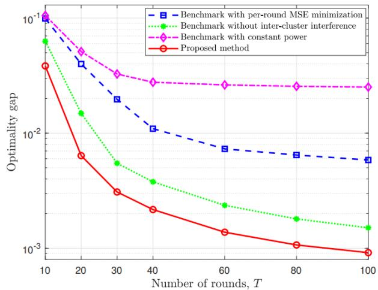
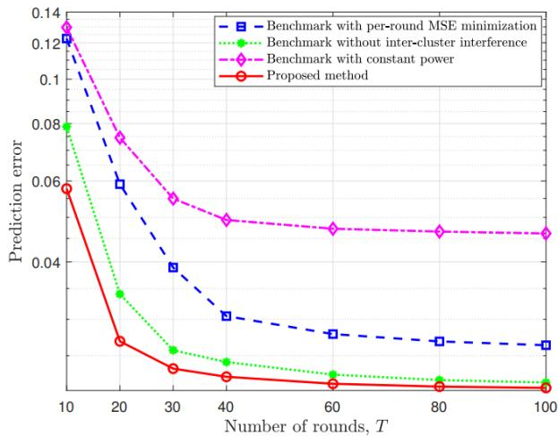

# Optimizing Power for Interference-Resilient Hierarchical Over-the-Air Federated Learning

Jianping Yao

School of Information

Engineering

Guangdong University of

Technology

Guangzhou 510006, China

yaojp@gdut.edu.cn

Dashun He

School of Information

Engineering

Guangdong University of

Technology

Guangzhou 510006, China

2112203101@mail2.gdut.edu.cn

Jinming Wen\*

School of Mathematics

Jilin University

Changchun 130012, China

jinming.wen@mail.mcgill.ca

Yi Fang

School of Information

Engineering

Guangdong University of

Technology

Guangzhou 510006, China

fangyi@gdut.edu.cn

Jie Xu\*

School of Science and

Engineering

The Chinese University of Hong

Kong (Shenzhen)

Shenzhen 518172, China

xujie@cuhk.edu.cn

Guojun Han

School of Information

Engineering

Guangdong University of

Technology

Guangzhou 510006, China

gjhan@gdut.edu.cn

Abstract—In this paper, we investigate a large-scale Hierarchical over-the-air federated learning (Hierarchical-Air-FL) network comprising a fusion center (FC) and multiple clusters, where each cluster includes a base station (BS) and several edge devices. During the model training process, we leverage over-theair computation (AirComp) for gradient aggregation to facilitate simultaneous transmission from devices to their respective BSs and from the BSs to the FC. To enhance communication efficiency and reduce transmission overhead, we employ a two-stage amplify-and-forward (AF) relaying mechanism. A significant challenge in such systems is inter-cluster interference due to shared wireless resources among clusters. To address this, we first conduct a comprehensive convergence analysis focusing on the optimality gap. Building upon this analysis, we propose an optimized power allocation strategy to minimize the optimality gap. Simulation results demonstrate that the proposed method exhibits significant advantages over baseline schemes.

Keywords—Hierarchical-Air-FL, power allocation, interference management, AF relaying.

## I. INTRODUCTION

The evolution of beyond fifth-generation (B5G) and sixthgeneration (6G) communication networks is steering a paradigm towards decentralized edge intelligence for enhanced real-time responsiveness, latency, and privacy. Federated Learning (FL) has emerged as a cornerstone technology in this context to enable collaborative model training across decentralized edge devices while preserving data locality. However, conventional FL implementations often rely on orthogonal multiple access (OMA) schemes for communication, which leads to a linear increase in resource demand with the number of participating devices [1].

To address this, over-the-air computation (AirComp) has been integrated into FL, known as over-the-air FL (Air-FL) [2]. AirComp leverages the superposition property of wireless channels to enable simultaneous transmission and aggregation of model updates directly over the air, which significantly enhances spectrum efficiency and reduces communication latency. Despite these advantages, Air-FL faces challenges such as signal distortion due to channel fading and stringent power constraints at edge devices. In single-cell scenarios, various strategies have been proposed to mitigate these issues to improve aggregation accuracy and system reliability, such as gradient compression [3], adaptive power control [4], device scheduling [5], and beamforming [6].

Expanding beyond single-cell configurations, multi-cell architectures have been introduced to enhance scalability by partitioning devices into multiple geographically distributed clusters [7-9]. This structure reduces device contention and channel resource competition, thereby improving aggregation accuracy and system throughput. However, existing multi-cell Air-FL systems primarily adopt single-tier architectures, where model aggregation occurs solely between devices and their respective local base stations (BSs). As network coverage areas and device densities increase, these single-tier systems encounter significant path loss in long-distance communications and face limitations in coordination capabilities and aggregation efficiency.

To further enhance the scalability and performance of Air-FL systems, hierarchical architectures have been proposed to introduce additional aggregation layers between edge devices and central servers [10-12], in which each intermediate server first aggregates the local model updates of a cluster of edge devices, and then sends the aggregated version to the central server for global aggregation. For example, the authors in [10] proposed a hierarchical Air-FL (Hierarchical-Air-FL) framework, which supports multiple local training rounds and combines intra-cluster gradient aggregation with inter-cluster parameter aggregation to better handle non-independent and identically distributed (non-IID) data. Additionally, the authors in [11] designed an intermediate server-based aggregation mechanism to mitigate path loss for distant users. Finally, the authors in [12] investigated a personalized Hierarchical-Air-FL framework to jointly optimize local and global models across multiple tiers. In these prior works [10-12], the decode-andforward (DF) mechanism was considered, in which the intermediate servers need to decode the locally aggregated models and then forward them to the central server.

In contrast to the DF mechanisms [10-12], the amplify-andforward (AF) approach is an alternative solution that offers further enhanced communication efficiency and reduced transmission overhead by eliminating the need for signal decoding at intermediate or relay servers. However, in AF-based systems, inter-cluster interference introduced at relay servers can be further amplified during subsequent transmission stages, which leads to significant distortion of aggregated gradient signals, thereby degrading the model convergence performance. Therefore, how to jointly optimize the power allocation strategies of devices and BSs to effectively suppress the impact of inter-cluster interference on global model updates remains a critical yet understudied challenge for AF-based Air-FL systems.

In the literature, only one recent study in [13] has directly tackled this issue. Specifically, the work [13] introduced an asynchronous two-tier framework that integrates dynamic clustering and power control strategies to alleviate inter-cluster interference, but it inevitably incurs additional waiting delays. Moreover, it primarily focuses on per-round optimization without fully accounting for the accumulation of aggregation errors over multiple rounds, which may affect long-term training performance. This limitation underscores the need for a more comprehensive solution that jointly optimizes power allocation strategies of devices and BSs to effectively suppress inter-cluster interference, while balancing communication efficiency and aggregation accuracy. Addressing this gap constitutes the core motivation of our work.

In this paper, we introduce a Hierarchical-Air-FL framework that employs a two-stage AF aggregation mechanism, which leverages AirComp for efficient hierarchical gradient aggregation. Under the considered Hierarchical-Air-FL network, we first theoretically derive the asymptotic upper bound of the optimality gap, which quantifies the impact of aggregation errors, including signal misalignment errors, inter-cluster interference, and receiver noise, on the convergence performance of Air-FL. By examining the relationship between the optimality gap and system parameters such as device transmission power, BS transmission power, and denoising factor, we formulate an optimization problem aimed at minimizing the optimality gap. This analysis provides a theoretical foundation for the subsequent design of power allocation strategies.

Next, to tackle the non-convex power allocation problem inherent in Hierarchical-Air-FL network, we propose a threephase alternating optimization algorithm that jointly optimizes device transmission power, BS transmission power, and denoising factor. Through structural analysis, we decompose the original non-convex problem into three convex subproblems and derive closed-form optimal solutions for each subproblem using the Lagrangian duality theory. Theoretical analysis reveals that the obtained transmission power solutions for both devices and BSs exhibit a weighted and regularized channel inversion structure. The algorithm ensures monotonic convergence of the objective function by alternately updating variables in each phase, thereby guaranteeing the convergence of the optimization process.

Finally, we conduct comprehensive performance evaluations of our proposed power allocation scheme by applying it to a representative machine learning task. The task involves ridge regression using a synthetically generated dataset. The results show the impact of different power allocation strategies on model convergence speed and generalization performance. It is shown that our proposed method consistently outperforms baseline schemes by effectively mitigating the adverse effects of inter-cluster interference. This leads to improved convergence speed and enhanced generalization ability, which validates the practical applicability and effectiveness of our optimality gap analysis and joint optimization algorithm in Hierarchical-Air-FL scenarios.

Notations: . ????[⋅] represents the expectation operation. ∇ denotes the gradient operator. The superscripts † and ???? correspond to the transpose and conjugate transpose, respectively. Bold uppercase letters signify column vectors. | ⋅ | denotes the cardinality of a set, the absolute value of a real scalar, or the modulus of a complex number. ∥ ???? ∥ represents the Euclidean norm of a vector ????. ℜ(⋅) extracts the real part of a complex number. $C N ( \mu , \sigma ^ { 2 } )$ describes a circularly symmetric complex Gaussian (CSCG) random variable with mean $\mu$ and variance $\sigma ^ { 2 }$ .

## II. SYSTEM MODEL

We consider a large-scale Hierarchical-Air-FL system consisting of an FC and ???? clusters, where each cluster is served by a dedicated BS $c \in \mathcal { C } \triangleq \left\{ 1 , \dots , C \right\}$ . Within each cluster, there are ???? edge devices indexed by $k \in \mathcal { K } _ { c } \triangleq \left\{ 1 , \dots , K \right\}$ , and we define the overall set of devices as $\mathcal { K } \triangleq \{ \mathcal { K } _ { 1 } , \ldots , \mathcal { K } _ { C } \}$ . All nodes are configured with a single antenna.

## A. Learning Model

We consider a learning model with parameter vector $\nu =$ $[ \nu _ { 1 } , \dots , \nu _ { N } ] ^ { \dag } \in \mathbb { R } ^ { N }$ , where is the model dimension. Each device $k \in \mathcal K _ { c }$ holds a local dataset $\mathcal { D } _ { k }$ . To assess prediction accuracy, we define a sample-wise loss function $l _ { k } ( \pmb { \nu } ; \pmb { x } , \xi )$ , and the local loss function at device ???? is given by

$$
L _ {k} (\boldsymbol {\nu}) = \frac {1}{| \mathcal {D} _ {k} |} \sum_ {(x, \xi) \in \mathcal {D} _ {k}} l _ {k} (\boldsymbol {\nu}; x, \xi). \tag {1}
$$

For simplicity, we assume that all devices have datasets of equal size, i.e., $| \mathcal { D } _ { j } | = | \mathcal { D } _ { k } | , \forall j , k \in \mathcal { K } _ { c } , c \in \mathcal { C }$ . The collective dataset for cluster ???? is the union of all its local datasets, expressed as $\mathcal { D } _ { c } = \cup _ { k \in \mathcal { K } _ { c } } \mathcal { D } _ { k }$ . The corresponding cluster-level loss function with respect to ???? at BS ???? is formulated as

$$
L _ {c} (\boldsymbol {\nu}) = \frac {| \mathcal {D} _ {k} |}{| \mathcal {D} _ {c} |} \sum_ {k \in \mathcal {K} _ {c}} L _ {k} (\boldsymbol {\nu}) = \frac {1}{K} \sum_ {k \in \mathcal {K} _ {c}} L _ {k} (\boldsymbol {\nu}). \tag {2}
$$

Extending to the entire network, the global dataset ???? is the aggregation of all cluster datasets, represented by $\mathcal { D } = \cup _ { c \in \mathcal { C } } \mathcal { D } _ { c } .$ Thus, the global loss function with respect to ???? at the FC is defined as

$$
L (\boldsymbol {\nu}) = \frac {| \mathcal {D} _ {c} |}{| \mathcal {D} |} \sum_ {c \in \mathcal {C}} L _ {c} (\boldsymbol {\nu}) = \frac {1}{K C} \sum_ {c \in \mathcal {C}} \sum_ {k \in \mathcal {K} _ {c}} L _ {k} (\boldsymbol {\nu}). \tag {3}
$$

The goal of the training process is to find the optimal model parameter $\nu ^ { \star }$ that minimizes the global loss function ????(????), i.e.,

$$
\boldsymbol {\nu} ^ {\star} = \underset {\boldsymbol {\nu} \in \mathbb {R} ^ {N}} {\arg \min} L (\boldsymbol {\nu}). \tag {4}
$$

## B. Hierarchical-Air-FL Framework

In the proposed Hierarchical-Air-FL framework, model training follows a two-stage AF relaying strategy, consisting of intra- and inter-cluster aggregation. Let ???? denote the total number of global communication rounds, indexed by $t \in \mathcal { T } =$ $\{ 1 , \ldots , T \}$ . At initialization, the FC sets the global model as $\nu ^ { ( 1 ) }$ and broadcasts it to all BSs. Each BS ???? then forwards the model to its devices, initializing local models as $\pmb { \nu } _ { k } ^ { ( 1 ) } = \pmb { \nu } ^ { ( 1 ) } , \forall k \in \mathcal { K } _ { c }$ .

1) Intra-Cluster Aggregation: Upon receiving the global model from FC, each device performs FedSGD using its individual dataset. Specifically, in the global communication round ????, each device $k \in \mathcal K _ { c }$ within cluster ???? computes its local $\overset { \cdot } { \mathbf { g } } _ { k } ^ { ( t ) }$

$$
\boldsymbol {g} _ {k} ^ {(t)} = \frac {1}{| \widetilde {\mathcal {D}} _ {k} ^ {(t)} |} \sum_ {(\boldsymbol {x}, \xi) \in \widetilde {\mathcal {D}} _ {k} ^ {(t)}} \nabla l _ {k} (\boldsymbol {\nu} _ {k} ^ {(t)}; \boldsymbol {x}, \xi). \tag {5}
$$

The local gradient ????(????) $\pmb { g } _ { k } ^ { ( t ) }$ is normalized prior to transmission. Each device first calculates the mean $\bar { g } _ { k } ^ { ( t ) } \in \mathbb { R }$ and standard deviation ????(????) $\varrho _ { k } ^ { ( t ) } \in \mathbb { R } ^ { + }$ ∈ ℝ+ of the -dimensional gradient ????(????) ${ \pmb g } _ { k } ^ { ( t ) }$ as

$$
\bar {g} _ {k} ^ {(t)} = \frac {1}{N} \sum_ {n = 1} ^ {N} g _ {k, n} ^ {(t)}, \tag {6}
$$

$$
\left(\varrho_ {k} ^ {(t)}\right) ^ {2} = \frac {1}{N} \sum_ {n = 1} ^ {N} \left(g _ {k, n} ^ {(t)} - \bar {g} _ {k} ^ {(t)}\right) ^ {2}. \tag {7}
$$

Then, the normalized transmit signal for the $n \in \mathcal N \triangleq$ $\{ 1 , \ldots , N \}$ }-th model parameter is obtained as

$$
s _ {k, n} ^ {(t)} = \frac {g _ {k , n} ^ {(t)} - \bar {g} _ {k} ^ {(t)}}{\varrho_ {k} ^ {(t)}}. \tag {8}
$$

$\ddot { \mathbb { E } [ s _ { k , n } ^ { ( t ) } ] } = 0 , \mathbb { E } [ ( s _ { k , n } ^ { ( t ) } ) ^ { 2 } ] = 1$ . Furthermore, we assume that $\mathbb { E } [ s _ { k } ^ { ( t ) } s _ { j } ^ { ( t ) } ] = \mathbf { 0 }$ $\pmb { s } _ { k } ^ { ( t ) } = [ s _ { k , 1 } ^ { ( t ) } , \ldots , s _ { k , N } ^ { ( t ) } ]$ (

Following the local update, devices within each cluster simultaneously upload their updated model parameters to their associated BS using AirComp. In the global communication round ????, let ℎ????,????(????) $h _ { c , k } ^ { ( t ) } \in \mathbb { C }$ represent the complex channel coefficients $k \in \mathcal K _ { c }$ $^ { c , }$ $h _ { c , i } ^ { ( t ) } \in \mathbb { C }$ denote the complex channel coefficients between a device $i \in$ $\mathcal { K } _ { j } .$ , in a neighboring cluster $j \in \mathcal { C } \backslash \{ c \}$ and BS ????. Each device applies the phase compensation strategy and transmits its signal with the coefficient:

$$
b _ {k} ^ {(t)} = \frac {\sqrt {p _ {k} ^ {(t)}} (h _ {c , k} ^ {(t)}) ^ {H}}{| h _ {c , k} ^ {(t)} |}, \tag {9}
$$

where ????(????) $p _ { k } ^ { ( t ) } \in \mathbb { R } ^ { + }$ represents the transmission power of device $k .$ Accordingly, the transmitted signal from device $k \in \mathcal { K } _ { c } , c \in \mathcal { C }$ for the ???? ∈ ????-th model parameter is given by

$$
x _ {k, n} = b _ {k} ^ {(t)} s _ {k, n} ^ {(t)}. \tag {10}
$$

Each device $k \in \mathcal K _ { c }$ is subject to both a maximum and an average transmission power constraint, given as

$$
\mathbb {E} \left[ \left| b _ {k} ^ {(t)} s _ {k, n} ^ {(t)} \right| ^ {2} \right] = p _ {k} ^ {(t)} \leq P _ {k} ^ {\max}, \tag {11}
$$

$$
\frac {1}{T} \sum_ {t \in \mathcal {T}} \mathbb {E} \left[ \left| b _ {k} ^ {(t)} s _ {k, n} ^ {(t)} \right| ^ {2} \right] = \frac {1}{T} \sum_ {t \in \mathcal {T}} p _ {k} ^ {(t)} \leq P _ {k} ^ {\text { avg }}, \tag {12}
$$

where $P _ { k } ^ { \mathrm { m a x } }$ x and ????avg $P _ { k } ^ { \mathrm { a v g } }$ denote the instantaneous and average power budgets of device $k ,$ , respectively. Assuming a quasistatic flat fading channel, the received signal at BS ???? for the ???? ∈ ????-th model parameter is given as

$$
r _ {c, n} ^ {(t)} = \sum_ {k \in \mathcal {K} _ {c}} \sqrt {p _ {k} ^ {(t)}} \big | h _ {c, k} ^ {(t)} \big | s _ {k, n} ^ {(t)} + Z _ {c, n} ^ {(t)} +
$$

$$
\sum_ {j \in \mathcal {C} \backslash \{c \}} \sum_ {i \in \mathcal {K} _ {j}} \frac {\sqrt {p _ {i} ^ {(t)}} h _ {c , i} ^ {(t)} (h _ {j , i} ^ {(t)}) ^ {H}}{| h _ {j , i} ^ {(t)} |} s _ {i, n} ^ {(t)}, \tag {13}
$$

where $Z _ { c , n } ^ { ( t ) } \sim \mathcal { C } \mathcal { N } ( 0 , \sigma _ { c } ^ { 2 } )$ stands for the additive Gaussian white noise (AWGN) with power $\sigma _ { c } ^ { 2 }$ at BS ????.

2) Inter-Cluster Aggregation: To achieve the global model update across all clusters, the system performs a second-stage aggregation using AirComp. In this stage, the BSs forward their aggregated signals to the FC via the $\mathrm { A F }$ relaying protocol to realize a two-hop hierarchical aggregation process.

For BS $^ { c , }$ the transmission coefficient is defined as

$$
b _ {c} ^ {(t)} = \frac {\sqrt {\alpha_ {c} ^ {(t)}} (\beta_ {c} ^ {(t)}) ^ {H}}{| \beta_ {c} ^ {(t)} |}, \tag {14}
$$

where ???? $\alpha _ { c } ^ { ( t ) } \in \mathbb { R } ^ { + }$ denotes the transmission power for BS $c ;$ $\beta _ { c } ^ { ( t ) } \in \mathbb { C }$ represents the complex-valued channel coefficients between BS ???? and the FC. Accordingly, the transmitted signal from BS ???? for the $n \in \mathcal { N } \mathrm { - t h }$ model parameter is given by

$$
x _ {c, n} = b _ {c} ^ {(t)} r _ {c, n} ^ {(t)}. \tag {15}
$$

Similarly, each BS ???? is also constrained by both a maximum and an average transmission power constraint, defined as

$$
\mathbb {E} \left[ \left| b _ {c} ^ {(t)} r _ {c, n} ^ {(t)} \right| ^ {2} \right] = \alpha_ {c} ^ {(t)} (\sum_ {k \in \mathcal {K} _ {c}} p _ {k} ^ {(t)} | h _ {c, k} ^ {(t)} | ^ {2} + \sigma_ {c} ^ {2}
$$

$$
+ \sum_ {j \in \mathcal {C} \backslash \{c \}} \sum_ {i \in \mathcal {K} _ {j}} \frac {p _ {i} ^ {(t)} | h _ {c , i} ^ {(t)} (h _ {j , i} ^ {(t)}) ^ {H} | ^ {2}}{| h _ {j , i} ^ {(t)} | ^ {2}}) \leq P _ {c} ^ {\max}, \tag {16}
$$

$$
\frac {1}{T} \sum_ {t \in \mathcal {T}} \mathbb {E} \left[ \left| b _ {c} ^ {(t)} r _ {c, n} ^ {(t)} \right| ^ {2} \right] = \frac {1}{T} \sum_ {t \in \mathcal {T}} \alpha_ {c} ^ {(t)} (\sum_ {k \in \mathcal {K} _ {c}} p _ {k} ^ {(t)} | h _ {c, k} ^ {(t)} | ^ {2}
$$

$$
+ \sigma_ {c} ^ {2} + \sum_ {j \in \mathcal {C} \backslash \{c \}} \sum_ {i \in \mathcal {K} _ {j}} \frac {p _ {i} ^ {(t)} | h _ {c , i} ^ {(t)} (h _ {j , i} ^ {(t)}) ^ {H} | ^ {2}}{| h _ {j , i} ^ {(t)} | ^ {2}}) \leq P _ {c} ^ {\text {avg}}, \tag {17}
$$

where $P _ { c } ^ { \mathrm { m a x } }$ and $P _ { c } ^ { \mathrm { a v g } }$ denote the instantaneous and average power budgets of BS ????, respectively. Therefore, the aggregated signal received at the FC is given by

$$
r _ {f, n} ^ {(t)} = \sum_ {c \in \mathcal {C}} \sqrt {\alpha_ {c} ^ {(t)}} | \beta_ {c} ^ {(t)} | r _ {c, n} ^ {(t)} + Z _ {f, n} ^ {(t)}, \tag {18}
$$

where $Z _ { f , n } ^ { ( t ) } \sim \mathcal { C } \mathcal { N } ( 0 , \sigma _ { f } ^ { 2 } )$ denotes the AWGN at the FC with power $\sigma _ { f } ^ { 2 }$ .

The FC performs linear post-processing to estimate the $y _ { f , n } ^ { ( t ) } [ 1 4 ]$

$$
y _ {f, n} ^ {(t)} = \frac {1}{K C} \left(\frac {r _ {f , n} ^ {(t)}}{\sqrt {\theta^ {(t)}}} + \sum_ {c \in \mathcal {C}} \sum_ {k \in \mathcal {K} _ {c}} \bar {g} _ {k} ^ {(t)}\right)
$$

$$
= \underbrace {\frac {1}{K C} \left(\sum_ {c \in \mathcal {C}} \sum_ {k \in \mathcal {K} _ {c}} g _ {k , n} ^ {(t)}\right)} _ {g _ {f, n} ^ {(t)}} + \varepsilon_ {n} ^ {(t)}, \tag {19}
$$

with

$$
\begin{array}{l} \varepsilon_ {n} ^ {(t)} = \sum_ {c \in \mathcal {C}} \left(\sum_ {k \in \mathcal {K} _ {c}} \left(\frac {\sqrt {\alpha_ {c} ^ {(t)}} \sqrt {p _ {k} ^ {(t)}} | \beta_ {c} ^ {(t)} h _ {c , k} ^ {(t)} |}{\sqrt {\theta^ {(t)}}} - \varrho_ {k} ^ {(t)}\right) s _ {k, n} ^ {(t)} \right. \\ + \sum_ {j \in \mathcal {C} \backslash \{c \}} \sum_ {i \in \mathcal {K} _ {j}} \frac {\sqrt {\alpha_ {c} ^ {(t)}} \sqrt {p _ {i} ^ {(t)}} | \beta_ {c} ^ {(t)} | h _ {c , i} ^ {(t)} (h _ {j , i} ^ {(t)}) ^ {H}}{\sqrt {\theta^ {(t)}} | h _ {j , i} ^ {(t)} |} s _ {i, n} ^ {(t)} \\ \left. + \frac {\sqrt {\alpha_ {c} ^ {(t)}} \left| \beta_ {c} ^ {(t)} \right|}{\sqrt {\theta^ {(t)}}} Z _ {c, n} ^ {(t)} + \frac {Z _ {f , n} ^ {(t)}}{\sqrt {\theta^ {(t)}}}\right) \times \frac {1}{K C} \tag {20} \\ \end{array}
$$

where $\theta ^ { ( t ) }$ is the denoising factor, and $\varepsilon _ { n } ^ { ( t ) }$ represents the total aggregation error. Therefore, the estimated global average gradient at the FC is reconstructed as

$$
\widehat {\boldsymbol {g}} _ {f} ^ {(t)} = \Re (\boldsymbol {y} _ {f} ^ {(t)}) = \boldsymbol {g} _ {f} ^ {(t)} + \Re (\boldsymbol {\varepsilon} ^ {(t)}), \tag {21}
$$

$\widehat { \pmb g } _ { f } ^ { ( t ) }$ as

$$
\boldsymbol {\nu} ^ {(t + 1)} = \boldsymbol {\nu} ^ {(t)} - \eta^ {(t)} \widehat {\boldsymbol {g}} _ {f} ^ {(t)}, \tag {22}
$$

where $\eta ^ { ( t ) }$ is the learning rate in round ????.

This hierarchical two-stage aggregation process is executed iteratively until the algorithm either converges or reaches the predefined maximum number of communication rounds.

## III. CONVERGENCE ANALYSIS

This section introduces a convergence analysis that incorporates the impact of aggregation errors, which utilizes the optimality gap to measure performance.

## A. Assumptions

We first introduce a set of widely adopted assumptions on loss functions and estimated gradients [15-17].

Assumption 1 (Smoothness) We assume that the gradients of the loss function $L ( \nu )$ is Lipschitz continuous with a constant $\gamma > 0$ . In other words, for any model parameters $\pmb { \nu } , \bar { \pmb { \nu } } \in \mathbb { R } ^ { N }$ , the change in gradients is bounded proportionally by the distance between them[15], given as

$$
\| \nabla L (\boldsymbol {v}) - \nabla L (\bar {\boldsymbol {v}}) \| \leq \gamma \| \boldsymbol {v} - \bar {\boldsymbol {v}} \|. \tag {23}
$$

Consequently, it holds that

$$
L (\boldsymbol {v}) \leq L (\bar {\boldsymbol {v}}) + \nabla L (\bar {\boldsymbol {v}}) ^ {\dagger} (\boldsymbol {v} - \bar {\boldsymbol {v}}) + \frac {\gamma}{2} \| \boldsymbol {v} - \bar {\boldsymbol {v}} \| ^ {2}. \tag {24}
$$

Assumption 2 (Polyak-inequality) Given that the optimal value of the global loss function for problem (4) is ????⋆, we further assume that the gradient ∇????(????) satisfies the Polyak-Łojasiewicz condition with a constant $\mu \geq 0 [ 1 6 ]$ , expressed as

$$
\| \nabla L (\boldsymbol {v}) \| ^ {2} \geq 2 \mu (L (\boldsymbol {v}) - L ^ {\star}). \tag {25}
$$

Assumption 3 (Variance bound) We assumt that the local estimated gradient $\pmb { g } _ { k } ^ { ( t ) }$ ???? given in (5) independently and unbiasedly approximates the batch gradient $\nabla L _ { k } ( \pmb { \nu } _ { k } ^ { ( t ) } )$ , and is upper bounded as [17]

$$
\mathbb {E} \big [ \boldsymbol {g} _ {k} ^ {(t)} \big ] = \nabla L _ {k} (\boldsymbol {\nu} _ {k} ^ {(t)}), \forall k \in \mathcal {K}, t \in \mathcal {T}, \tag {26}
$$

$$
\mathbb {E} \left[ \left\| \boldsymbol {g} _ {k} ^ {(t)} - \nabla L _ {k} (\boldsymbol {\nu} _ {k} ^ {(t)}) \right\| ^ {2} \right] \leq \frac {\phi_ {k} ^ {2}}{n _ {b}}, \forall k \in \mathcal {K}, t \in \mathcal {T}, (2 7)
$$

where $\phi _ { k }$ is a non-negative constant that quantifies the variance of stochastic gradients on device $k ,$ and $n _ { b }$ denotes the minibatch size.

## B. Optimality Gap Analysis

Building upon the aforementioned assumptions, we examine the convergence behavior of the proposed Hierarchical-Air-FL framework by evaluating the optimality gap. To quantify the impact of aggregation errors on convergence, we denote $\mathbb { E } \big [ \overline { { \mathfrak { R } ^ { 2 } } } ( \pmb { \varepsilon } _ { n } ^ { ( t ) } ) \big ]$ as the mean squared error (MSE) of the estimated global gradient in round ???? . By applying an appropriately decreasing learning rate, we derive the following theorem.

Theorem 1 (Convergence Upper Bound of Optimality Gap) In the proposed Hierarchical-Air-FL framework, a decreasing learning rate is implemented, defined by $\eta ^ { ( t ) } =$ $\frac { a } { t + b } \leq \frac { 1 } { \gamma } , \forall t \in \mathcal { T }$ , where $b > 0$ and $\textstyle a > { \frac { 1 } { \mu } }$ are constants that control the decay behavior. This schedule ensures that $\eta ^ { ( t ) }$ remains within the limits $0 \leq \eta ^ { ( t ) } \leq \frac { 1 } { \mu } .$ . Under this setting, we can derive a convergence upper bound of the expected optimality gap, given as

$$
\begin{array}{l} \mathbb {E} \left[ L \left(\boldsymbol {\nu} ^ {(T + 1)}\right) \right] - L ^ {\star} \leq \prod_ {t \in \mathcal {T}} D ^ {(t)} \left(\mathbb {E} \left[ L \left(\boldsymbol {\nu} ^ {(1)}\right) \right] - L ^ {\star}\right) \\ + \sum_ {t \in \mathcal {T}} J ^ {(t)} (\eta^ {(t)} B + \gamma (\eta^ {(t)}) ^ {2} \sum_ {n = 1} ^ {N} \mathbb {E} \big [ \Re^ {2} (\pmb {\varepsilon} _ {n} ^ {(t)}) \big ]), (2 8) \\ \end{array}
$$

where $\begin{array} { r } { 0 < D ^ { ( t ) } \triangleq 1 - \mu \eta ^ { ( t ) } < 1 , \forall t \in \mathcal { T } , J ^ { ( t ) } \triangleq \frac { \prod _ { i = t } ^ { T } D ^ { ( i ) } } { 2 D ^ { ( t ) } } } \end{array}$ ????=???? (????) , and

$$
B \triangleq \frac {1}{K C} \sum_ {c \in \mathcal {C}} \sum_ {k \in \mathcal {K} _ {c}} \frac {\phi_ {k} ^ {2}}{n _ {b}}.
$$

## C. Optimality Gap Versus Power and Denoising Factor

This subsection investigates how transmission power and denoising factor influence the optimality gap. When system parameters are given, the initial optimality gap $\Im \bigl [ L ( \pmb { \nu } ^ { ( 1 ) } ) \bigr ] - L ^ { \star }$ and the gradient variance component $J ^ { ( t ) } \eta ^ { ( t ) } B$ remain invariant throughout the optimization process. Consequently, the aggregation error dominates the dynamic portion of the optimality gap, referred to as the effective optimality gap:

$$
\sum_ {t \in \mathcal {T}} \sum_ {n = 1} ^ {N} J ^ {(t)} \gamma (\eta^ {(t)}) ^ {2} \mathbb {E} \left[ \Re^ {2} \left(\boldsymbol {\varepsilon} _ {n} ^ {(t)}\right) \right]. \tag {29}
$$

According to (20), (29) is rewritten as

$$
\Phi \big (p _ {k} ^ {(t)}, \alpha_ {c} ^ {(t)}, \theta^ {(t)} \big)
$$

$$
\triangleq \sum_ {t \in \mathcal {T}} \sum_ {c \in \mathcal {C}} E ^ {(t)} \left(\sum_ {k \in \mathcal {K} _ {c}} \left(\frac {\sqrt {\alpha_ {c} ^ {(t)}} \sqrt {p _ {k} ^ {(t)}} | \beta_ {c} ^ {(t)} h _ {c , k} ^ {(t)} |}{\sqrt {\theta^ {(t)}}} - \varrho_ {k} ^ {(t)}\right) ^ {2} \right.
$$

$$
+ \sum_ {j \in \mathcal {C} \{c \}} \sum_ {i \in \mathcal {K} _ {j}} \frac {\alpha_ {c} ^ {(t)} p _ {i} ^ {(t)} | \beta_ {c} ^ {(t)} | ^ {2} \Re^ {2} (h _ {c , i} ^ {(t)} (h _ {j , i} ^ {(t)}) ^ {H})}{\theta^ {(t)} | h _ {j , i} ^ {(t)} | ^ {2}}
$$

$$
\left. + \frac {\alpha_ {c} ^ {(t)} \left| \beta_ {c} ^ {(t)} \right| ^ {2} \sigma_ {c} ^ {2}}{2 \theta^ {(t)}} + \frac {\sigma_ {f} ^ {2}}{2 \theta^ {(t)}}\right), \tag {30}
$$

where (????) ????(????)????(????(????))2???? $\begin{array} { r } { E ^ { ( t ) } = \frac { J ^ { ( t ) } \gamma ( \eta ^ { ( t ) } ) ^ { 2 } N } { K ^ { 2 } C ^ { 2 } } } \end{array}$ ????2????2 . Accordingly, the associated optimization problem is mathematically formulated as

$$
(\mathbf {P 1}): \min _ {\{\alpha_ {c} ^ {(t)} \}, \{p _ {k} ^ {(t)} \}, \{\theta^ {(t)} \}} \Phi (\{p _ {k} ^ {(t)} \}, \{\alpha_ {c} ^ {(t)} \}, \{\theta^ {(t)} \}) \tag {31a}
$$

$$
\mathrm{s.t.} 0 \leq p _ {k} ^ {(t)} \leq P _ {k} ^ {\max}, \forall k \in \mathcal {K} _ {c}, c \in \mathcal {C}, t \in \mathcal {T}, \tag {31b}
$$

$$
\frac {1}{T} \sum_ {t \in \mathcal {T}} p _ {k} ^ {(t)} \leq P _ {k} ^ {\mathrm{avg}}, \forall k \in \mathcal {K} _ {c}, c \in \mathcal {C}, \tag {31c}
$$

$$
\alpha_ {c} ^ {(t)} I _ {c} ^ {(t)} \leq P _ {c} ^ {\max}, \forall c \in \mathcal {C}, t \in \mathcal {T}, \tag {31d}
$$

$$
\frac {1}{T} \sum_ {t \in \mathcal {T}} \alpha_ {c} ^ {(t)} I _ {c} ^ {(t)} \leq P _ {c} ^ {\mathrm{avg}}, \forall c \in \mathcal {C}, \tag {31e}
$$

$$
0 \leq \alpha_ {c} ^ {(t)}, 0 \leq \theta^ {(t)}, \forall c \in \mathcal {C}, t \in \mathcal {T}, \tag {31f}
$$

where (????) $\begin{array} { r } { I _ { c } ^ { ( t ) } = \sum _ { k \in \mathcal { K } _ { c } } p _ { k } ^ { ( t ) } | h _ { c , k } ^ { ( t ) } | ^ { 2 } + S _ { c , j } ^ { ( t ) } } \end{array}$ = ∑????∈???? ???? ， and $S _ { c , j } ^ { ( t ) } =$ $\begin{array} { r } { \sum _ { j \in \mathcal { C } \backslash \{ c \} } \sum _ { i \in \mathcal { K } _ { j } } \frac { p _ { i } ^ { ( t ) } | h _ { c , i } ^ { ( t ) } ( h _ { j , i } ^ { ( t ) } ) ^ { H } | ^ { 2 } } { | h _ { j , i } ^ { ( t ) } | ^ { 2 } } + \sigma _ { c } ^ { 2 } } \end{array}$ . The optimization problem exhibits significant non-convexity, which makes closed-form solutions intractable.

## IV. PROPOSED SOLUTION TO PROBLEM (P1)

Building upon the convergence analysis of the proposed Hierarchical-Air-FL framework, we introduce an alternating optimization algorithm to solve problem (????????), where the device $\{ p _ { k } ^ { ( t ) } \}$ $\{ \alpha _ { c } ^ { ( t ) } \}$ and denoising factor $\{ \theta ^ { ( t ) } \}$ are updated iteratively, while keeping the other variables fixed.

## A. Device Transmission Power Allocation

First, under the given transmission power $\{ \alpha _ { c } ^ { ( t ) } \}$ for BS ???? and the denoising factor $\{ \theta ^ { ( t ) } \}$ at the FC, we optimize the transmission power $\{ p _ { k } ^ { ( t ) } \}$ for each device. To simplify the optimization process, we introduce an auxiliary variable $q _ { k } ^ { ( t ) } =$ $\sqrt { p _ { k } ^ { ( t ) } }$

$$
(\mathbf {P 1 . 1}) \colon \min _ {\{q _ {k} ^ {(t)} \geq 0 \}} \sum_ {t \in \mathcal {T}} \sum_ {c \in \mathcal {C}} (\sum_ {k \in \mathcal {K} _ {c}} (\frac {\sqrt {\alpha_ {c} ^ {(t)}} q _ {k} ^ {(t)} | \beta_ {c} ^ {(t)} h _ {c , k} ^ {(t)} |}{\sqrt {\theta^ {(t)}}} - \varrho_ {k} ^ {(t)}) ^ {2}
$$

$$
+ \sum_ {j \in \mathcal {C} \backslash \{c \}} \sum_ {k \in \mathcal {K} _ {c}} \frac {\alpha_ {j} ^ {(t)} (q _ {k} ^ {(t)}) ^ {2} | \beta_ {j} ^ {(t)} | ^ {2} \Re^ {2} (h _ {j , k} ^ {(t)} (h _ {c , k} ^ {(t)}) ^ {H})}{\theta^ {(t)} | h _ {c , k} ^ {(t)} | ^ {2}}) E ^ {(t)} (3 2 a)
$$

$$
\text { s.t. } (q _ {k} ^ {(t)}) ^ {2} \leq P _ {k} ^ {\max}, \forall k \in \mathcal {K} _ {c}, c \in \mathcal {C}, t \in \mathcal {T}, \tag {32b}
$$

$$
\frac {1}{T} \sum_ {t \in \mathcal {T}} (q _ {k} ^ {(t)}) ^ {2} \leq P _ {k} ^ {\text {avg}}, \forall k \in \mathcal {K} _ {c}, c \in \mathcal {C}, \tag {32c}
$$

$$
\sum_ {k \in \mathcal {K} _ {c}} | q _ {k} ^ {(t)} h _ {c, k} ^ {(t)} | ^ {2} \leq G _ {c} ^ {(t)}, \forall c \in \mathcal {C}, t \in \mathcal {T}, \tag {32d}
$$

$$
\frac {1}{T} \sum_ {t \in \mathcal {T}} \alpha_ {c} ^ {(t)} I _ {c} ^ {(t)} \leq P _ {c} ^ {\text {avg}}, \forall c \in \mathcal {C}, \tag {32e}
$$

where $\begin{array} { r } { G _ { c } ^ { ( t ) } = \frac { P _ { c } ^ { \mathrm { m a x } } } { \alpha _ { c } ^ { ( t ) } } - S _ { c , j } ^ { ( t ) } } \end{array}$ ????( . Additionally, since problem (????????. ) ????( satisfies the Slater condition, we adopt the Lagrange duality $\{ q _ { k } ^ { ( t ) * } \}$ problem (????????. ) , and $\{ \psi _ { c , k } ^ { * } , \varsigma _ { c } ^ { ( t ) * } , \iota _ { c } ^ { * } \}$ represent the corresponding optimal dual variables associated with constraints $( 3 2 \mathrm { c } ) \dot { - } ( 3 2 \mathrm { e } )$ . Based on this, the optimal device transmission power $\{ p _ { k } ^ { ( t ) * } \}$ } with ????(????) $p _ { k } ^ { ( t ) * } { = } ( q _ { k } ^ { ( t ) * } ) ^ { 2 } , \dot { \forall k } \in K _ { c } , c \in \mathcal { C } , t \in \mathcal { T }$ =( ????????(????)∗ )2, ∀???? ∈ ????????, ???? ∈ ????, ???? ∈ ???? can be expressed as

$$
p _ {k} ^ {(t) *} = \min \left[ \binom {\varrho_ {k} ^ {(t)} \sqrt {\alpha_ {c} ^ {(t)}} | \beta_ {c} ^ {(t)} h _ {c, k} ^ {(t)} |} {\frac {\alpha_ {c} ^ {(t)} | \beta_ {c} ^ {(t)} h _ {c , k} ^ {(t)} | ^ {2}}{\sqrt {\theta^ {(t)}} + \lambda_ {k} ^ {(t)} + H _ {k} ^ {(t)}}}, P _ {k} ^ {\max} \right], \tag {33}
$$

$\begin{array} { r } { \lambda _ { k } ^ { ( t ) } = \sum _ { j \in \mathcal { C } \backslash \{ c \} } \frac { \alpha _ { j } ^ { ( t ) } | \beta _ { j } ^ { ( t ) } | ^ { 2 } \Re ^ { 2 } ( h _ { j , k } ^ { ( t ) } ( h _ { c , k } ^ { ( t ) } ) ^ { H } ) } { \sqrt { \theta ^ { ( t ) } } | h _ { c , k } ^ { ( t ) } | ^ { 2 } } \quad ; \qquad H _ { k } ^ { ( t ) } = } \end{array}$ (????) ???? where

$\begin{array} { r l r } {  { \frac { \sqrt { \theta ^ { ( t ) } } ( \psi _ { c , k } ^ { * } + \iota _ { c } ^ { * } \alpha _ { c } ^ { ( t ) } | h _ { c , k } ^ { ( t ) } | ^ { 2 } ) } { E ^ { ( t ) } T } + \frac { \sqrt { \theta ^ { ( t ) } } \varsigma _ { c } ^ { ( t ) * } | h _ { c , k } ^ { ( t ) } | ^ { 2 } } { E ^ { ( t ) } } } } \end{array}$ ∗ |ℎ????,????(????) | with the optimal dual variables $\{ \dot { \psi } _ { c , k } ^ { * } , \varsigma _ { c } ^ { ( t ) * } , \iota _ { c } ^ { * } \}$ . The optimal dual variables can be obtained by checking the corresponding Karush-Kuhn-Tucker (KKT) conditions.

## B. BS Transmission Power Allocation

Under given the device transmission power $\{ p _ { k } ^ { ( t ) } \}$ and denoising factor $\{ \theta ^ { ( t ) } \}$ , we focus on optimizing the BS transmission power $\{ \alpha _ { c } ^ { ( t ) } \}$ . By defining $\hat { \alpha } _ { c } ^ { ( t ) } = \sqrt { \alpha _ { c } ^ { ( t ) } }$ , problem (????????) can be reduced to

$$
\text {(P1.2)} \colon \min _ {\{\widehat {\alpha} _ {c} ^ {(t)} \geq 0 \}} \sum_ {t \in \mathcal {T}} \sum_ {c \in \mathcal {C}} E ^ {(t)} \left(\frac {(\widehat {\alpha} _ {c} ^ {(t)}) ^ {2} | \beta_ {c} ^ {(t)} | ^ {2} \sigma_ {c} ^ {2}}{2 \theta^ {(t)}} \right.
$$

$$
+ \sum_ {k \in \mathcal {K} _ {c}} \left(\frac {\widehat {\alpha} _ {c} ^ {(t)} \sqrt {p _ {k} ^ {(t)}} | \beta_ {c} ^ {(t)} h _ {c , k} ^ {(t)} |}{\sqrt {\theta^ {(t)}}} - \varrho_ {k} ^ {(t)}\right) ^ {2}
$$

$$
\left. + \sum_ {j \in \mathcal {C} \backslash \{c \}} \sum_ {i \in \mathcal {K} _ {j}} \frac {\left(\widehat {\alpha} _ {c} ^ {(t)}\right) ^ {2} p _ {i} ^ {(t)} \left| \beta_ {c} ^ {(t)} \right| ^ {2} \Re^ {2} \left(h _ {c , i} ^ {(t)} \left(h _ {j , i} ^ {(t)}\right) ^ {H}\right)}{\theta^ {(t)} \left| h _ {j , i} ^ {(t)} \right| ^ {2}}\right) \tag {34a}
$$

$$
s. t. \left(\hat {\alpha} _ {c} ^ {(t)}\right) ^ {2} \leq \hat {P} _ {c} ^ {\max}, \forall c \in \mathcal {C}, t \in \mathcal {T}, \tag {34b}
$$

$$
\frac {1}{T} \sum_ {t \in \mathcal {T}} (\hat {\alpha} _ {c} ^ {(t)}) ^ {2} I _ {c} ^ {(t)} \leq P _ {c} ^ {\text { avg }}, \forall c \in \mathcal {C}, \tag {34c}
$$

where ????� max $\begin{array} { r } { \hat { P } _ { c } ^ { \operatorname* { m a x } } = \frac { P _ { c } ^ { \operatorname* { m a x } } } { \sum _ { k \in \mathcal { K } _ { c } } p _ { k } ^ { ( t ) } | h _ { c , k } ^ { ( t ) } | ^ { 2 } + S _ { c , j } ^ { ( t ) } } . } \end{array}$ (????). Similar to problem (????????. ), we utilize the Lagrangian dual method to derive its optimal solution. Let {????�(????) $\{ \hat { \alpha } _ { c } ^ { ( t ) } \bar { { ^ { * } } } \}$ represent the optimal solution to problem (????????. ????) , and $\{ \zeta _ { c } ^ { * } \}$ denote the corresponding optimal dual variables associated with constraint (34b) and (34c). Based on this, the optimal BS transmission power $\{ \alpha _ { c } ^ { ( t ) * } \}$ $\alpha _ { c } ^ { ( t ) * } =$ $( \hat { \alpha } _ { c } ^ { ( t ) * } ) ^ { 2 } , \forall c \in \mathcal { C } , t \in \mathcal { T }$ can be written as

$$
\alpha_ {c} ^ {(t) *} = \min \left[ \binom{\sum_ {k \in \mathcal {K} _ {c}} \varrho_ {k} ^ {(t)} \sqrt {p _ {k} ^ {(t)}} | \beta_ {c} ^ {(t)} h _ {c, k} ^ {(t)} |}\frac {\sum_ {k \in \mathcal {K} _ {c}} \frac {p _ {k} ^ {(t)} | \beta_ {c} ^ {(t)} h _ {c , k} ^ {(t)} | ^ {2}}{\sqrt {\theta^ {(t)}} + \Delta_ {c} ^ {(t)} + \chi_ {c} ^ {(t)}}}, \hat {P} _ {c} ^ {\max} \right], \tag {35}
$$

where Δ????(????) = ∑????∈????\{????} ∑????∈???? $\begin{array} { r } { \Delta _ { c } ^ { ( t ) } = \sum _ { j \in \mathcal { C } \backslash \{ c \} } \sum _ { i \in \mathcal { K } _ { j } } \frac { p _ { i } ^ { ( t ) } | \beta _ { c } ^ { ( t ) } | ^ { 2 } \Re ^ { 2 } ( h _ { c , i } ^ { ( t ) } ( h _ { j , i } ^ { ( t ) } ) ^ { H } ) } { \sqrt { \theta ^ { ( t ) } } | h _ { j , i } ^ { ( t ) } | ^ { 2 } } + \frac { | \beta _ { c } ^ { ( t ) } | ^ { 2 } \sigma _ { c } ^ { 2 } } { 2 \sqrt { \theta ^ { ( t ) } } } \ ; } \end{array}$ 2�????(????)

$\begin{array} { r } { \chi _ { c } ^ { ( t ) } = \frac { \sqrt { \theta ^ { ( t ) } } \zeta _ { c } ^ { * } I _ { c } ^ { ( t ) } } { E ^ { ( t ) } T } } \end{array}$ ????(????)???? with the optimal dual variable {????∗} . The optimal dual variable can be obtained by checking the corresponding KKT conditions.

## C. Denoising Factor Optimization

Under given the device transmission power $\{ p _ { k } ^ { ( t ) } \}$ and BS transmfactor power. By d $\{ \alpha _ { c } ^ { ( t ) } \}$ , g optimizing the denoising , problem can be $\{ \theta ^ { ( t ) } \}$ $\begin{array} { r } { \widehat { \theta } ^ { ( t ) } = \frac { 1 } { \sqrt { \theta ^ { ( t ) } } } } \end{array}$ equivalently reformulated as

$$
\begin{array}{l} (\mathbf {P 1 . 3}) \colon \min _ {\{\widehat {\theta} ^ {(t)} \geq 0 \}} \sum_ {t \in \mathcal {T}} \sum_ {c \in \mathcal {C}} E ^ {(t)} \left(\frac {1}{2} \alpha_ {c} ^ {(t)} | \beta_ {c} ^ {(t)} | ^ {2} \sigma_ {c} ^ {2} (\widehat {\theta} ^ {(t)}) ^ {2} \right. \\ + \sum_ {k \in \mathcal {K} _ {c}} \left(\sqrt {\alpha_ {c} ^ {(t)}} \sqrt {p _ {k} ^ {(t)}} | \beta_ {c} ^ {(t)} h _ {c, k} ^ {(t)} | \hat {\theta} ^ {(t)} - \varrho_ {k} ^ {(t)}\right) ^ {2} + \frac {1}{2} \sigma_ {f} ^ {2} (\hat {\theta} ^ {(t)}) ^ {2} \\ + \sum_ {j \in \mathcal {C} \backslash \{c \}} \sum_ {i \in \mathcal {K} _ {j}} \frac {\alpha_ {c} ^ {(t)} p _ {i} ^ {(t)} | \beta_ {c} ^ {(t)} | ^ {2} \Re^ {2} (h _ {c , i} ^ {(t)} (h _ {j , i} ^ {(t)}) ^ {H}) (\widehat {\theta} ^ {(t)}) ^ {2}}{| h _ {j , i} ^ {(t)} | ^ {2}}). \tag {36} \\ \end{array}
$$

Problem (????????. ????) can be decomposed into $T$ convex subproblems with univariate quadratic objectives to allow direct analytical solutions via the first derivative w.r.t. $\{ \widehat \theta ^ { ( t ) } \}$ . This yields a closed-form expression for the optimal denoising factor $\{ \widehat \theta ^ { ( t ) * } \}$ , whose properties are characterized in the following proposition.

Proposition 1 The optimal denoising factor $\{ \theta ^ { ( t ) * } \}$ with (????)∗= $\theta ^ { ( t ) * } = \frac { 1 } { ( \widehat { \theta } ^ { ( t ) * } ) ^ { 2 } } , \forall t \in \mathcal { T }$ is written as

$$
\theta^ {(t) *} = \left(\frac {F _ {1} + F _ {2} + \sum_ {c \in \mathcal {C}} \frac {1}{2} \alpha_ {c} ^ {(t)} | \beta_ {c} ^ {(t)} | ^ {2} \sigma_ {c} ^ {2} + \frac {1}{2} \sigma_ {f} ^ {2}}{\sum_ {c \in \mathcal {C}} \sum_ {k \in \mathcal {K} _ {c}} \varrho_ {k} ^ {(t)} \sqrt {\alpha_ {c} ^ {(t)}} \sqrt {p _ {k} ^ {(t)}} | \beta_ {c} ^ {(t)} h _ {c , k} ^ {(t)} |}\right) ^ {2}, \tag {37}
$$

where

$$
F _ {1} = \sum_ {c \in \mathcal {C}} \sum_ {k \in \mathcal {K} _ {c}} \alpha_ {c} ^ {(t)} p _ {k} ^ {(t)} | \beta_ {c} ^ {(t)} h _ {c, k} ^ {(t)} | ^ {2}, \tag {38}
$$

$$
F _ {2} = \sum_ {c \in \mathcal {C}} \sum_ {j \in \mathcal {C} \backslash \{c \}} \sum_ {i \in \mathcal {K} _ {j}} \frac {\alpha_ {c} ^ {(t)} p _ {i} ^ {(t)} | \beta_ {c} ^ {(t)} | ^ {2} \Re^ {2} (h _ {c , i} ^ {(t)} (h _ {j , i} ^ {(t)}) ^ {H})}{| h _ {j , i} ^ {(t)} | ^ {2}}. \tag {39}
$$

In each iteration, the algorithm sequentially updates device power $\{ \pmb { p } _ { k } \}$ , BS power $\{ \pmb { \alpha } _ { c } \}$ , and denoising factor ???? by optimally solving subproblems (????????. )– (????????. ????) . Since each subproblem is solved optimally, the objective $\Phi ( \{ p _ { k } \} , \{ \pmb { \alpha } _ { c } \} , \{ \pmb { \theta } \} )$ is non-increasing across iterations, thus ensuring convergence.

## V. NUMERICAL RESULTS

In this section, we conduct comprehensive numerical simulations to assess the performance of the proposed power control strategies. In this simulation, we assume the following simulation parameters. The communication channels are modeled as Rayleigh fading. The network comprises $C = 5$ BSs and a total of $\dot { K } _ { \mathrm t o t } \dot { = } 3 0$ devices with $K = 6$ devices per cluster. Each device is associated with its nearest BS to ensure optimal connectivity based on proximity. Besides, we set $\sigma _ { c } ^ { 2 } = \sigma _ { f } ^ { 2 } =$ $1 0 ^ { - 9 } \mathrm { \Delta W } , P _ { k } ^ { \operatorname* { m a x } } = 0 . 1 \mathrm { \Delta W }$ , $P _ { c } ^ { \operatorname* { m a x } } = 1 \mathrm { ~ W } , \ P _ { k } ^ { a v g } = 0 . 5 P _ { k } ^ { \operatorname* { m a x } }$ , $P _ { c } ^ { \mathrm { } ^ { a v g } } = 0 . 5 P _ { c } ^ { \mathrm { m } a x } , D _ { k } = 5 0 0 , n _ { b } = T$ $\eta ^ { ( t ) } = 2 / ( t + 8 )$

We evaluate a ridge regression task, where the sample-wise loss function is defined as $l ( \pmb { \nu } ; \pmb { x } , \xi ) = 0 . 5 \parallel x ^ { \dagger } \pmb { \nu } - \xi \parallel ^ { 2 } + \rho$ ∥ $\nu \parallel ^ { 2 }$ , with the regularization coefficient set to $\rho = 5 \times 1 0 ^ { - 5 }$ . Each feature vector $\boldsymbol { x } \in \mathbb { R } ^ { N }$ with dimension $N = 2 0$ is independently drawn from a standard Gaussian distribution, $\mathrm { i . e . , }$ $\pmb { x } \sim \mathcal { N } ( \mathbf { 0 } , \mathbf { I } )$ . The corresponding label is generated as $\xi =$ $x ( 2 ) + 3 x ( 5 ) + 0 . 2 z$ , where $x ( t )$ denotes the ????-th element of $x ,$ and ???? represents observation noise sampled from $\sim \mathcal { N } ( 0 , 1 )$ . The smoothness constant ???? and the Polyak-Łojasiewicz constant ???? are computed as the largest and smallest eigenvalues of the data Gramian matrix $\overline { { x ^ { \dag } x / D _ { \mathrm { t o t } } } } + 1 0 ^ { - 4 } I$ , where $x =$ $[ \pmb { x } _ { 1 } , \cdots , \pmb { x } _ { D _ { \mathrm { t o t } } } ] ^ { \dagger }$ is the aggregated data matrix [18]. The optimal loss function value $L ^ { \star }$ is determined using the closed-form solution $\pmb { \nu } ^ { \star } = ( \pmb { x } ^ { \dagger } \pmb { x } + \rho I ) ^ { - 1 } \pmb { x } ^ { \dagger } \pmb { \xi }$ , where $\bar { \boldsymbol { \xi } } = [ \xi _ { 1 } , \cdots , \xi _ { D _ { \mathrm { t o t } } } ] ^ { \dagger }$ represents the vector of target labels. The model is initialized with a zero vector for the parameter ????. For comparison purposes, we benchmark the proposed method against three representative baseline schemes.

•Benchmark without inter-cluster interference: The FC performs the power control optimization without accounting for the inter-cluster interference.

•Benchmark with per-round MSE minimization: Devices and BSs independently optimize transmission powers per round to minimize aggregation MSE, without considering cumulative effects across rounds. The per-round MSE minimization follows the method in [19].

•Benchmark with constant power: Both the devices and BSs transmit using fixed average power levels throughout all communication rounds.

line chart

| Number of rounds, T | Benchmark with per-round MSE minimization | Benchmark without inter-cluster interference | Benchmark with constant power | Proposed method |
| ------------------- | ------------------------------------------ | --------------------------------------------- | ------------------------------ | --------------- |
| 10                  | 0.1                                        | 0.05                                          | 0.1                            | 0.03            |
| 20                  | 0.03                                       | 0.01                                          | 0.04                           | 0.005           |
| 30                  | 0.01                                       | 0.005                                         | 0.02                           | 0.002           |
| 40                  | 0.005                                      | 0.003                                         | 0.015                          | 0.001           |
| 60                  | 0.003                                      | 0.002                                         | 0.01                           | 0.0005          |
| 80                  | 0.002                                      | 0.001                                         | 0.01                           | 0.0002          |
| 100                 | 0.001                                      | 0.001                                         | 0.01                           | 0.0001          |

Fig. 1. Optimality gap versus round count ????.

line chart

| Number of rounds, T | Benchmark with per-round MSE minimization | Benchmark without inter-cluster interference | Benchmark with constant power | Proposed method |
| ------------------- | ------------------------------------------ | -------------------------------------------- | ----------------------------- | --------------- |
| 10                  | 0.125                                      | 0.08                                         | 0.135                         | 0.06            |
| 20                  | 0.06                                       | 0.03                                         | 0.075                         | 0.02            |
| 30                  | 0.04                                       | 0.015                                        | 0.055                         | 0.01            |
| 40                  | 0.025                                      | 0.01                                         | 0.05                          | 0.005           |
| 60                  | 0.02                                       | 0.005                                        | 0.045                         | 0.002           |
| 80                  | 0.015                                      | 0.002                                        | 0.045                         | 0.001           |
| 100                 | 0.01                                       | 0.001                                        | 0.045                         | 0.001           |

Fig. 2. Prediction error versus round count ????.

Figures 1 and 2 illustrate the convergence and generalization performance of different power control strategies as the number of communication rounds increases. The evaluation metrics include the optimality gap (Figure 1) and prediction error (Figure $^ { 2 ) , }$ , which reflect convergence speed and generalization capability, respectively. All schemes exhibit a decreasing optimality gap and prediction error with more communication rounds, which indicate improved convergence. Furthermore, the proposed method consistently outperforms the baseline schemes, which achieves faster convergence and lower prediction error. This superiority is attributed to its comprehensive optimization approach, which jointly considers power allocation and interference management across clusters, rather than optimizing each round in isolation. By effectively mitigating inter-cluster interference and aligning power control with convergence objectives, the proposed method enhances overall learning efficiency. In contrast, benchmark with constant power exhibits slower convergence and higher prediction error, which highlights the limitations of static power allocation in dynamic learning environments. Finally, benchmark without inter-cluster interference and benchmark with per-round MSE minimization offer limited improvements but fall short of the comprehensive benefits provided by the proposed method. These findings underscore the critical role of adaptive and interference-resilient power control in Air-FL networks, particularly in scenarios with hierarchical structures and shared wireless resources.

## VI. CONCLUSION

In this paper, we explored power allocation strategies in a large-scale Hierarchical-Air-FL network, characterized by an FC and multiple clusters, each comprising a BS and several devices. The training process utilized AirComp for gradient aggregation with a two-stage AF relaying mechanism. We conducted a comprehensive convergence analysis in terms of the optimality gap. Then, we proposed an optimized power allocation strategy to minimize the optimality gap. Finally, we provided simulation results to demonstrate the superiority of the proposed method.

## REFERENCES

[1] G. Zhu, Z. Lyu, X. Jiao, P. Liu, M. Chen, J. Xu, S. Cui, and P. Zhang, “Pushing AI to wireless network edge: An overview on integrated sensing, communication, and computation towards 6G,” SCIENCE CHINA Information Sciences, vol. 66, pp. 130301:1-130301:19, Mar. 2023.  
[2] X. Cao, Z. Lyu, G. Zhu, J. Xu, L. Xu, and S. Cui, “An overview on overthe-air federated edge learning,” IEEE Wireless Commun., vol. 31, no. 3, pp. 202-210, Jun. 2024.  
[3] G. Zhu, Y. Du, D. Gündüz, and K. Huang, “One-bit over-the-air aggregation for communication-efficient federated edge learning: Design and convergence analysis,” IEEE Trans. Wireless Commun., vol. 20, no. 3, pp. 2120-2135, Mar. 2021.  
[4] X. Cao, G. Zhu, J. Xu, and S. Cui, “Transmission power control for overthe-air federated averaging at network edge,” IEEE J. Sel. Areas Commun., vol. 40, no. 5, pp. 1571-1586, May. 2022.  
[5] Y. Sun, S. Zhou, Z. Niu, and D. Gündüz, “Dynamic scheduling for overthe-air federated edge learning with energy constraints,” IEEE J. Sel. Areas Commun., vol. 40, no. 1, pp. 227-242, Jan. 2022.  
[6] K. Yang, T. Jiang, Y. Shi, and Z. Ding, “Federated learning via over-theair computation,” IEEE Trans. Wireless Commun., vol. 19, no. 3, pp. 2022-2035, Mar. 2020.  
[7] T. Wu, Y. Qu, C. Liu, H. Dai, C. Dong, and J. Cao, “Cost-efficient federated learning for edge intelligence in multi-cell networks,” IEEE/ACM Trans. Netw., vol. 32, no. 5, pp. 4472-4487, Oct. 2024.  
[8] H. U. Sami and B. Güler, “Over-the-air clustered federated learning,” IEEE Trans. Wireless Commun., vol. 23, no. 7, pp. 7877-7893, Jul. 2023.  
[9] F. Li, Q. Ye, E. T. Fapi, W. Sun, and Y. Jiang, “Multi-cell over-the-air computation systems with spectrum sharing: A perspective from α- fairness,” IEEE Trans. Veh. Technol., vol. 72, no. 12, pp. 16249-16265, Dec. 2023.  
[10] S. M. Azimi-Abarghouyi and V. Fodor, “Scalable hierarchical over-theair federated learning,” IEEE Trans. Wireless Commun., vol. 23, no. 8, pp. 8480-8496, Aug. 2024.  
[11] O. Aygün, M. Kazemi, D. Gündüz, and T. M. Duman, “Over-the-air federated edge learning with hierarchical clustering,” IEEE Trans. Wireless Commun., vol. 23, no. 12, pp. 17856-17871, Dec. 2024.  
[12] F. Zhou, Z. Wang, H. Shan, L. Wu, X. Tian, Y. Shi, and Y. Zhou, “Overthe-air hierarchical personalized federated learning,” IEEE Trans. Veh. Technol., vol. 74, no. 3, pp. 5006-5021, Mar. 2025.  
[13] W. Guo, C. Huang, X. Qin, L. Yang, and W. Zhang, “Dynamic clustering and power control for two-tier wireless federated learning,” IEEE Trans. Wireless Commun., vol. 23, no. 2, pp. 1356-1371, Feb. 2024.  
[14] H. Liu, X. Yuan, and Y.-J. A. Zhang, “Reconfigurable intelligent surface enabled federated learning: A unified communication-learning design approach,” IEEE Trans. Wireless Commun., vol. 20, no. 11, pp. 7595- 7609, Nov. 2021.  
[15] Z. Wang, Y. Zhou, Y. Shi, and W. Zhuang, “Interference management for over-the-air federated learning in multi-cell wireless networks,” IEEE J. Sel. Areas Commun., vol. 40, no. 8, pp. 2361-2377, Aug. 2022.  
[16] X. Cao, G. Zhu, J. Xu, Z. Wang, and S. Cui, “Optimized power control design for over-the-air federated edge learning,” IEEE J. Sel. Areas Commun., vol. 40, no. 1, pp. 342-358, Jan. 2022.  
[17] C. Feng, H. H. Yang, D. Hu, Z. Zhao, T. Q. Quek, and G. Min, “Mobilityaware cluster federated learning in hierarchical wireless networks,” IEEE Trans. Wireless Commun., vol. 21, no. 10, pp. 8441-8458, Jun. 2022.  
[18] F. Wang, J. Xu, V. K. N. Lau, and S. Cui, “Amplify-and-forward relaying for hierarchical over-the-air computation,” IEEE Trans. Wireless Commun., vol. 21, no. 12, pp. 10 529-10 543, Dec. 2022.  
[19] D. Liu and O. Simeone, “Privacy for free: Wireless federated learning via uncoded transmission with adaptive power control,” IEEE J. Sel. Areas Commun., vol. 39, no. 1, pp. 170-185, Jan. 2021.