Received 11 July 2025, accepted 11 August 2025, date of publication 13 August 2025, date of current version 21 August 2025   
Digital Object Identifier 10.1109/ACCESS.2025.3598733

RESEARCH ARTICLE

# Optimum Distance for In-Flight UAV-to-UAV Wireless Charging

HUA YAN 1,2, (Member, IEEE), AND YUNFEI CHEN 1, (Senior Member, IEEE)

1Department of Engineering, Durham University, DH1 3LE Durham, U.K.

2School of Computer Science, Leeds Trinity University, LS1 6AE Leeds, U.K.

Corresponding author: Yunfei Chen (yunfei.chen@durham.ac.uk)

This work was supported in part by the Horizon Europe Marie Skłodowska-Curie Actions (MSCA)-2022-SE 101129618 Unmanned Aerial Vehicles for Non-Terrestrial Communications and Sensing (UNITE) under Grant Engineering and Physical Sciences Research Council (EPSRC) EP/Y036581/1, and in part by EPSRC TITAN under Grant EP/Y037243/1 and Grant EP/X04047X/1.

ABSTRACT Wireless charging is a promising technology for communications using battery-powered unmanned aerial vehicles (UAVs). In this paper, the optimal distance for UAV-to-UAV in-flight wireless charging and communications is studied. Considering the practical applications, two schemes are proposed. In the first scheme, the discharging UAV (D-UAV) and the charged UAV (C-UAV) are aligned during charging, which requires the D-UAV and the C-UAV to remain relatively stationary. In the second scheme, the D-UAV and the C-UAV move during charging. For both schemes, we aim to maximize the received energy at the C-UAV under the condition that the minimum achievable rate for communications is met. Numerical results show that the optimal distance exists in the Fresnel zone. They also show that the optimal distance increases with the charging frequency. This work provides useful guidance for UAV in-flight wireless charging and communications system designs.

INDEX TERMS Energy efficiency, far-field, near-field, wireless communications, wireless power transfer (WPT), UAV communications.

## I. INTRODUCTION

In the context of global trend towards low-carbon economy, electric-powered unmanned aerial vehicles (UAVs) have gained great research interest. As UAVs are usually powered by batteries with limited on-board energy, recharging or replacing the battery periodically could be an issue, especially in situations where ground infrastructure is unavailable. To make UAV charging more convenient and flexible, wireless charging technologies using wireless power transfer (WPT) have attracted considerable interest, as they eliminate the need for charging cables and allow charging during motion or action [1]. Therefore, it is interesting and important to study the UAV wireless charging schemes. On the other hand, UAV communication is crucial for recent advancements in autonomous collaboration and formation within UAV swarms. The use of wireless power makes it possible for us to employ the wireless signal for joint charging and communications, especially in a harsh environment.

Limited by the lack of accessible and reliable fixed charging infrastructure, as well as the high costs associated with batteries [2], wireless charging for UAVs is a good alternative. In [3], a WPT via microwave for battery-powered vehicles was studied, where both short distance and mid-distance charging systems were proposed. In these systems, considering the beam efficiency and safety power level, genetic algorithm was adopted to optimize the beam form and keep safe power level outside the charging systems. In [4], the authors studied the feasibility of long-distance wireless charging using microwave, where two ISM frequencies of 433.92 MHz and 2.45 GHz were investigated. To guarantee the safety for humans, different combinations of transmitting and receiving antennas were considered, but the transmission efficiency was generally low. They also suggested that WPT at 2.45 GHz can be used for charging battery-limited UAVs. In [5], different WPT technologies were reviewed first and then, efficiency, alignment tolerance and coil design were summarized as three challenges in magnetic resonance WPT. Compared with far-field power transfer, the authors concluded that near-field WPT is preferred for wireless charging, as it is better in terms of operating range and efficiency. In [6], the influence of power level, clearance and offset between coils on radiated magnetic field in wireless charging system was studied, and it provided valuable insights into the operating conditions for future standardization of wireless charging. These technologies are valuable references for in-flight wireless charging of UAVs.

The aforementioned works focus on static point-to-point vehicular charging. Recently, mobile wireless charging has also emerged for energy replenishment where one end of the charging system might be moving [7], [8], [9]. For example, wireless charging for UAVs has been widely studied in [10], [11], [12], and [13]. Besides, it is also possible to charge a UAV in the air via a discharging UAV (D-UAV) [14], which can be considered as a typical mobile wireless charging case. In [15], wireless mobile charger was envisioned as a promising solution to realizing on-demand and fully automatic UAV battery recharging. The authors in [16] investigated UAV wireless charging without requiring prior knowledge of the power states of the target nodes. They proposed an algorithm called charging with power transfer efficiency compensation (CPTEC) to effectively compensate for efficiency losses during charging. This approach is particularly beneficial for scenarios where a single UAV charges multiple UAVs. In [17], a magnetic coupler was proposed and designed for UAV WPT to counteract misalignments, thereby ensuring consistent and reliable wireless charging performance. In [18], in-flight wireless charging was considered to be the ideal solution to extend the operating range and remove the energy limitation. To address the challenge of power fluctuation caused by mutual inductance during UAV in-flight WPT, the authors in [19] proposed a control method based on bifurcation phenomena which tracks the bifurcation frequency to maintain a stable power supply. Similarly, the authors in [20] introduced an autonomous on-off keying modulation (AOKM) scheme that adjusts the duty cycle to flexibly regulate constant power output. Both approaches enable constant-power delivery in UAV in-flight WPT. In [21], a drone-to-drone energy-sharing framework was proposed to enhance the operational efficiency and extend the flight endurance of a UAV swarm. In [22], a WPT system charging multiple devices in the Fresnel region was studied, where the energy transmitter is equipped with an emerging dynamic meta-surface antenna (DMA), to study how the antenna configuration can exploit the spherical wavefront to generate focused energy beams. By using DMAs for energy focusing, the energy transfer efficiency was greatly improved and the energy pollution was greatly reduced. Further studies on near-field WPT for UAVs using inductive power transfer (IPT) and capacitive power transfer (CPT) can be found in [23] and [24].

All these works have provided very useful insights on wireless charging for UAV energy replenishment. However, none of them has considered the optimal wireless charging distance to maximize the charging efficiency. WPT using radio frequency (RF) signals has been considered promising [25] to charge devices at a long distance but the charging efficiency changes with the distance due to the properties of the radio waves [26]. There is a ‘‘near-far’’ fairness issue [27] in the far-field case. However, in the near-field case, the ‘‘near-far’’ fairness will no longer be an issue. This is because the received power does not always increase as the distance decreases (e.g., transitioning from the radiating near-field to the reactive near-field region) [28]. Moreover, RF signals can also be used to carry information. Thus, it is of great interest to study the optimal distance for UAV-to-UAV wireless charging jointly with wireless communications. To the best of the authors’ knowledge, this is the first study to investigate the optimal wireless charging distance for UAVs using RF signals.

Motivated by the above observations, in this paper, we study the optimal distance for UAV-to-UAV in-flight wireless charging and communications, i.e., simultaneous wireless information and power transfer (SWIPT) in the Fresnel zone (FZ). Considering the practical scenarios, two typical wireless charging schemes are proposed. In the first scheme, the D-UAV and the charged UAV (C-UAV) remain static. This is the case when the C-UAV can hover somewhere or fly at relatively low speeds to allow charging under suitable conditions. However, when the C-UAV operates at high speed or variable speeds during a mission, maintaining a static connection between the D-UAV and the C-UAV becomes significantly challenging. Thus, in the second scheme, the D-UAV and the C-UAV have relative mobility. This case occurs when the C-UAV is carrying out a specific task, and it is impossible for the C-UAV to hover or keep its speed. In this case, the D-UAV is dispatched to charge the C-UAV in a ‘‘fly by’’ manner. As the D-UAV is also energy-limited, a fixed amount of energy at the D-UAV is assumed. The communications requirements between the D-UAV and the C-UAV are also considered with a constraint on the minimum achievable rate. Alignment tolerance caused by environment factors, such as turbulence [18], is also studied. For both schemes, the optimal distances are derived by maximizing the energy received at the C-UAV while satisfying the minimum achievable rate. Numerical results are presented to show that the optimal distance exists in the FZ and that it increases with the operating frequency. The main contributions of this work can be summarized as follows:

• Two typical UAV-to-UAV in-flight wireless charging schemes are proposed and studied by considering the energy constraint at the D-UAV and the constraint on the minimum achievable rate for communications.

• The optimal distances for UAV-to-UAV in-flight wireless charging and communications in both schemes are derived.

• The effects of different system parameters on the maximized received energy are examined to give useful guidance for the system designs.

The rest of this paper is organized as follows. In Section II, the system model is introduced. Section III derives the optimal distances in both schemes. Section IV presents numerical results. Finally, the work is concluded in Section V.

## II. SYSTEM MODEL

Consider two UAV in-flight wireless charging scenarios, where one UAV charges the other UAV through RF-based WPT, as depicted in Fig. 1. In Fig. 1 (a), the D-UAV and the C-UAV are aligned during charging. This is the case when both are moving at the same velocity or both are hovering. In Fig. 1 (b), the D-UAV charges the C-UAV while it is moving at a certain speed, while the C-UAV either remains hovering or moves at a lower speed. Note that this is equivalent to the case when D-UAV is stationary and C-UAV is moving.

Assume that the D-UAV uses a directional antenna1 to transmit the energy, while the C-UAV uses an omnidirectional antenna to receive energy. This is to reduce the energy loss of the D-UAV in other directions and to increase the receiving efficiency of the C-UAV. For both scenarios, the goal is to maximize the energy received at the C-UAV, when part of the total received energy will be used for communications to meet the minimum rate requirement. To achieve this goal, it is important to derive the optimal distance between the D-UAV and the C-UAV. Considering the D-UAV is also energy-limited, it is assumed that only a fixed amount of energy is available at the D-UAV for charging. The energy loss during charging is caused by the path loss, antenna properties, beam collection efficiency and radio frequency to direct current (RF-to-DC) energy conversion efficiency, which will be discussed in the following before the optimal charging distance is obtained.

## A. ANTENNA GAIN AND BEAM COLLECTION LOSS

From [29], the aperture antenna gain can be expressed as

$$
G = { \frac { 4 \pi A } { \lambda ^ { 2 } } } ,\tag{1}
$$

where $A = \pi ( { \frac { D } { 2 } } ) ^ { 2 }$ is the effective area of the antenna, D is the aperture diameter, and λ is the wavelength. Using (1), the effective gains for both transmitting and receiving antennas are respectively

$$
G _ { t } = \left( \frac { \pi D _ { t } } { \lambda } \right) ^ { 2 } ,\tag{2}
$$

$$
G _ { r } = \left( \frac { \pi D _ { r } } { \lambda } \right) ^ { 2 } ,\tag{3}
$$

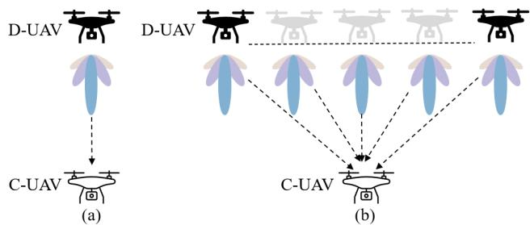  
FIGURE 1. UAV in-flight wireless charging schemes. (a) Stationary charging. (b) Mobile charging.

where $D _ { t }$ and $D _ { r }$ are the aperture diameters of the transmitting and the receiving antennas, respectively, with $A _ { t } \ =$ $\pi ( \frac { D _ { t } } { 2 } ) ^ { \sum }$ and $\begin{array} { r } { A _ { r } ~ = ~ \pi ( \frac { \mathbf { \widecheck D _ { r } } } { 2 } ) ^ { 2 } } \end{array}$ . As shown in Fig. 1, even if the D-UAV can transmit the radio wave via the main lobe of a directional antenna, there are still side-lobes of the beam in other directions as energy loss. The beam collection efficiency is defined as the ratio between the effective received beam of the receiving antenna aperture and the total radiation beam of the transmitting antenna [30]. Using the Gaussian beam approximation, the beam collection efficiency is [30] and [31]

$$
\eta _ { b } = 1 - e ^ { - \frac { A _ { t } A _ { r } } { \lambda ^ { 2 } d ^ { 2 } } } ,\tag{4}
$$

where $d$ is the distance between the transmit and receive antennas. From (4), one sees that, when the transmitting and receiving antenna aperture areas are fixed, the main factors affecting $\eta _ { b }$ are λ and d. A larger λ leads to a smaller η . Also, a larger d leads to a smaller $\eta _ { b }$ . Thus, λ and d need to be chosen carefully in the charging and communications.

## B. PATH LOSS AND RF-TO-DC CONVERSION LOSS

Using the free-space path loss (FSPL) model, the FSPL factor is given by $\frac { \lambda ^ { 2 } } { ( 4 \pi d ) ^ { 2 } }$ . When the distance is large, the charging works in the far-field. When the distance is small, it may work in the near-field. From [4], [28], [29], and [32], the Rayleigh distance, given by $\frac { 2 { D _ { t } } ^ { 2 } } { \lambda }$ , is a common boundary to distinguish between near-field and far-field regions. Thus, the far-field operation region can be determined by using

$$
d \geq \frac { 2 { D _ { t } } ^ { 2 } } { \lambda } .\tag{5}
$$

The near-field region can be further divided into the reactive and radiating near-field regions (also known as FZ) [28], and the boundary to distinguish these two regions is given by $0 . 6 2 \sqrt { \frac { { D _ { t } } ^ { 3 } } { \lambda } }$ [4]. As a result, the FZ region [4], [32] can be determined by using

$$
d \in F Z = \left[ 0 . 6 2 \sqrt { \frac { { D _ { t } } ^ { 3 } } { \lambda } } , \frac { 2 { D _ { t } } ^ { 2 } } { \lambda } \right] ,\tag{6}
$$

and the reactive near-field region [4], [28] is

$$
d \leq 0 . 6 2 { \sqrt { \frac { { D _ { t } } ^ { 3 } } { \lambda } } } .\tag{7}
$$

Note that the reactive near-field stores energy rather than radiating the energy from the antenna. Thus, if the C-UAV operates in this region, the received power at the C-UAV is 0. Next, we mainly focus on the far-field region and the FZ region.

In the far-field, using the Friis transmission equation [33], the received power at the C-UAV can be expressed as

$$
P _ { r - f a r } = \eta _ { b } \frac { P _ { t } G _ { t } G _ { r } \lambda ^ { 2 } } { ( 4 \pi d ) ^ { 2 } } , d > \operatorname * { m a x } \left( 1 , \frac { 2 D { t } ^ { 2 } } { \lambda } \right)\tag{8}
$$

where $P _ { t }$ is the transmit power at the D-UAV, max(·) is a function that returns the maximum value.

In the FZ region, the received power at the C-UAV can be calculated as [4] and [34]

$$
P _ { r - F Z } = \eta _ { b } \frac { P _ { t } G _ { t } G _ { r } \lambda ^ { 2 } } { ( 4 \pi d ) ^ { 2 } } \gamma _ { A } ,\tag{9}
$$

where $\gamma _ { A }$ represents the reduction factor that accounts for the impact of the FZ operation on the far-field Friis transmission equation in (8). From [34], the value of $\gamma _ { A }$ is given by

$$
\gamma _ { A } = \left\{ \begin{array} { l l } { 1 - \alpha _ { E } \left( \displaystyle \frac { d } { 2 \lambda G / \pi ^ { 2 } } \right) ^ { - 2 } , } & { G \ge 1 0 d B , } \\ { 1 - \alpha _ { E } \left( \displaystyle \frac { d } { 2 \lambda ( 2 G ) / \pi ^ { 2 } } \right) ^ { - 2 } , } & { G < 1 0 d B , } \end{array} \right.\tag{10}
$$

where G is the antenna gain as defined in (1), and $\begin{array} { r l } { \alpha _ { E } } & { { } = } \end{array}$ 0.06 is an empirical gain reduction coefficient for any type of antenna [4], [34]. As $P _ { r - F Z }$ is non-negative, the value of $\gamma _ { A }$ should be greater than or equal to 0. Consequently, from (10), one has $\gamma _ { A } \geq 0$ and the minimum value of d must satisfy

$$
\left\{ \begin{array} { l l } { d \geq d _ { m i n } = \frac { \sqrt { \alpha _ { E } } 2 \lambda G } { \pi ^ { 2 } } , } & { \ G \geq 1 0 \ d B , } \\ { d \geq d _ { m i n } = \frac { \sqrt { \alpha _ { E } } 4 \lambda G } { \pi ^ { 2 } } , } & { \ G < 1 0 \ d B . } \end{array} \right.\tag{11}
$$

Putting (8) and (9) together, the received power at the C-UAV is

$$
P _ { r } = \left\{ \begin{array} { l l } { P _ { r - F Z } , \operatorname* { m a x } ( d _ { m i n } , 0 . 6 2 \sqrt { \frac { { D _ { t } } ^ { 3 } } { \lambda } } ) < d < \frac { 2 { D _ { t } } ^ { 2 } } { \lambda } , } \\ { P _ { r - f a r } , d > \operatorname* { m a x } ( 1 , \frac { 2 D _ { t } { } ^ { 2 } } { \lambda } ) , } \end{array} \right.\tag{12}
$$

Note that $P _ { r }$ cannot be directly used by the receiver as they are AC power and thus, they need to be converted to DC. Several works have studied the modeling of the RF-to-DC conversion efficiency. For example, in [35] and [36], both linear and non-linear models were obtained. For the linear model, one has the relationship between the input power $P _ { r }$ and the output power of the C-UAV as

$$
\begin{array} { r } { P _ { D C } = f ( P _ { r } ) = \eta P _ { r } , } \end{array}\tag{13}
$$

where $\eta$ is the RF-to-DC conversion efficiency, and $P _ { D C }$ is the converted DC power at the C-UAV.

One sees from the above that the charging distance, d, plays a very important role. When d increases, $\eta _ { b }$ decreases and $\gamma _ { A }$ increases, and the C-UAV may move from the FZ to the far-field with different received power. The distance not only determines the beam collection efficiency, but also the FZ reduction factor and the path loss.

## III. PROBLEM FORMULATION AND OPTIMIZATION

In this section, we will study the optimum distance for UAV in-flight wireless charging and communications. Two schemes as shown in Fig. 1 will be considered. In Scheme 1, the D-UAV and the C-UAV maintain relative positions and are aligned with each other. Due to the trade-off between beam collection efficiency and path loss, there may exist an optimal distance in this scheme. In Scheme 2, the D-UAV and the C-UAV move away from each other, while the D-UAV charges the C-UAV dynamically. Due to the mobility, the charging distance will switch between the far-field and FZ regions. There may exist an optimal distance and an optimal relative movement speed.

## A. SCHEME 1

It is assumed that the total available energy for charging is $E _ { 0 }$ at the D-UAV, and that its own power consumption is P(v), as defined in [11, eq. (5)], [12, eq. (15)] and [39, eq. (7)], as a function of its speed. Particularly, when charging is in a static state, the power consumed by the D-UAV becomes P(0) when $\nu = 0 ( \mathrm { i } . \mathrm { e }$ ., hovering). Then, given $E _ { 0 } ,$ , the time for discharging can be calculated as

$$
T \leq \frac { E _ { 0 } } { P ( \nu ) + P _ { t } } .\tag{14}
$$

From (14), one can see that there is an inverse relationship between the charging time T and the transmit power $P _ { t }$ . At the C-UAV, power splitting (PS) is used to split the received energy for both charging and communications [37]. Denote $\rho ~ ( 0 ~ \leq ~ \rho ~ \leq ~ 1 )$ as the PS factor, one has $\rho P _ { r }$ for wireless charging and $( 1 - \rho ) P _ { r }$ for communications. Particularly, $\rho =$ 0 and $\rho = 1$ represent two special cases of communications only and wireless charging only. Using (4) and (8) – (14), the received energy at the C-UAV can be expressed as

$$
E _ { r - 1 } = \eta \rho P _ { r } | h _ { 1 } | ^ { 2 } T .\tag{15}
$$

where $h _ { 1 } \sim \mathcal { C N } ( \mu _ { 1 } , { \sigma _ { 1 } } ^ { 2 } )$ is the complex channel coefficient from the D-UAV to the C-UAV, $\mu _ { 1 }$ is the mean value and $\sigma _ { 1 } { } ^ { 2 }$ is the average fading power, $P _ { r } | h _ { 1 } | ^ { 2 }$ is the amount of received power at the C-UAV, and the achievable rate in bits/Hz during T can be expressed as

$$
C _ { 1 } = T \log _ { 2 } \left( 1 + \frac { ( 1 - \rho ) P _ { r } | h _ { 1 } | ^ { 2 } } { { \delta _ { 1 } } ^ { 2 } } \right) ,\tag{16}
$$

where ${ \delta _ { 1 } } ^ { 2 }$ is the noise power. To derive the optimal distance, we aim to maximize the received energy at the C-UAV, while meets the communications requirements under the constraint

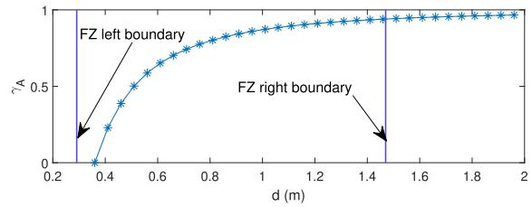

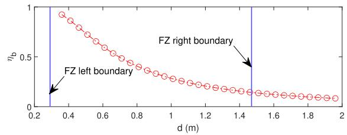

$$
\gamma _ { A }
$$

$$
\eta _ { B }
$$

Algorithm 1 Optimization of (P1) in (17)   
1: Input: $\overline { { D _ { t } , D _ { r } , f , C _ { \epsilon 1 } , E _ { 0 } , \delta _ { 1 } } }$ and $P ( \nu )$   
2: Calculate $\lambda = C / f , G _ { t } , G _ { r }$ and T using (2), (3) and (14)   
// Calculate Fresnel Zone using $D _ { t }$ and λ   
3: $\begin{array} { r } { I _ { f z } = \left\lceil 0 . 6 2 \sqrt { \frac { ( D _ { t } ) ^ { 3 } } { \lambda } } , \frac { 2 ( D _ { t } ) ^ { 2 } } { \lambda } \right\rceil } \end{array}$   
// Set search range (SR)   
4: $\begin{array} { r } { S R = \left[ m i n \left( d \stackrel { \smile } { i n } ( 1 1 ) , 0 . 6 2 \sqrt { \frac { ( D _ { t } ) ^ { 3 } } { \lambda } } \right) , \frac { 2 ( D _ { t } ) ^ { 2 } } { \lambda } \right] } \end{array}$   
// Set precision ϵ   
5: $\epsilon = 0 . 0 1 , S R _ { L } = S R ( 1 ) , S R _ { R } = S R ( 2 )$   
6: while $S R _ { R } - S R _ { L } > \epsilon$ do   
7: // Calculate the midpoint of the interval SR   
8: $S R _ { C } = ( S R _ { R } + S R _ { L } ) / 2$   
9: if $E _ { r - 1 } ( S R _ { C } - \epsilon ) < E _ { r - 1 } ( S R _ { C } + \epsilon )$ then   
10: $S R _ { L } = S R _ { C }$   
11: else   
12: $S R _ { R } = S R _ { C }$   
13: end if   
14: end while   
15: Calculate the maximum $E _ { r - 1 } ( ( S R _ { R } + S R _ { L } ) / 2 )$   
16: Calculate $d ^ { * } = ( S R _ { R } + S R _ { L } ) / 2$   
17: Calculate $\rho ^ { * } \gets$ using d∗, (16), (17b) and (17c)   
18: Output: Max $E _ { r - 1 } , d ^ { * }$ and $\rho ^ { * }$

of a fixed available energy $E _ { 0 } .$ As a result, the problem is formulated as

$$
( P 1 ) : \operatorname* { m a x } _ { d , \rho } E _ { r - 1 } ,\tag{17a}
$$

$$
\begin{array} { r } { \mathrm { s . t . : ~ } 0 \leq \rho \leq 1 , } \end{array}\tag{17b}
$$

$$
C _ { 1 } \geq C _ { \epsilon 1 } ,\tag{17c}
$$

$$
T \ast \left[ P _ { t } + P \left( \nu \right) \right] \leq E _ { 0 } ,\tag{17d}
$$

where (17a) is the objective function, (17b) is the constraint on PS factor, (17c) is the constraint on the minimum achievable rate in bits/Hz to meet the communications requirements at the C-UAV and (17d) is the constraint on the total available energy $E _ { 0 }$

It is challenging to get an analytical expression of the optimal distance from the objective function (17a), because $\eta _ { b }$ contains an exponential function. To maximize $E _ { r - 1 }$ in (17a), one needs to maximize the product $\rho P _ { r } T$ according to (15). Also, the optimal $\rho$ is achieved at the equality of (17c). Using (17c) and (16), $\rho$ can be expressed as

$$
\rho = f _ { 1 } ( d ) = 1 - \frac { ( 2 ^ { \frac { C _ { 1 } } { T } } - 1 ) { \delta _ { 1 } } ^ { 2 } } { P _ { r } | h _ { 1 } | ^ { 2 } } , \ 0 \leq \rho \leq 1 .\tag{18}
$$

Then, $E _ { r - 1 }$ in (15) can be rewritten as

$$
E _ { r - 1 } = f _ { 2 } ( d ) = \eta \left[ P _ { r } | h _ { 1 } | ^ { 2 } { - } ( 2 ^ { \frac { C _ { 1 } } { T } } - 1 ) \delta _ { 1 } { } ^ { 2 } \right] T ,\tag{19}
$$

which is a function of the distance only now. The trade-off between $\eta _ { b }$ and $\gamma _ { A }$ over d ensures that the optimal distance will exist and be in the FZ, i.e., the optimal distance $d ^ { * } \in$ $\begin{array} { r } { [ 0 . 6 2 \sqrt { \frac { ( D _ { t } ) ^ { 3 } } { \lambda } } , \frac { 2 ( D _ { t } ) ^ { 2 } } { \lambda } ] } \end{array}$ . This can be explained as follows. For both near-field and far-field, $\eta _ { b }$ decreases with increasing $d ,$ while for $\operatorname { F Z } , \gamma _ { A }$ increases with $d ,$ as shown in Fig. 2. As a result, on the one hand, $E _ { r - 1 }$ decreases with increasing d because of decreased $\eta _ { b }$ and the increasing path loss; while on the other hand, $E _ { r - 1 }$ also increases with increasing $\gamma _ { A }$ from increasing d according to (12). Hence, there should be an optimal d that maximizes $E _ { r - 1 } , \mathrm { i . e . , } E _ { r - 1 } { ^ * } = f _ { 2 } ( d ^ { * } )$ , and it can be obtained numerically using a bisection search. Once the optimal $d ^ { * }$ is obtained, the optimal $\rho ^ { * }$ can be calculated from (18), i.e., $\rho ^ { * } = f _ { 1 } ( d ^ { * } )$

As a result, the optimization problem (P1) can be solved numerically. Details on the numerical solution to (17) is summarized in Algorithm 1. For an accuracy of $\epsilon = 0 . 0 1$ the complexity primarily arises from the number of iterations, which depends on the length of the FZ. Its complexity can be expressed as

$$
O \left( \log _ { 2 } \left( \frac { S R ( 2 ) - S R ( 1 ) } { \epsilon } \right) \right) .\tag{20}
$$

## B. SCHEME 2

Compared with Scheme 1, in Scheme 2, the D-UAV and the C-UAV move from each other, which means that the distance between the D-UAV and the C-UAV changes with time. As shown in Fig. 1 (b) and Fig. 3, it is assumed that the D-UAV moves horizontally at a speed of $\nu \left( \nu > 0 \right)$ relative to the C-UAV. Let (xD(t), yD(t)) denote the location of the D-UAV, $( x _ { C } ( t ) , y _ { C } ( t ) )$ denote the location of the C-UAV, and $L \left( L \geq 0 \right)$ denote the distance D-UAV moves from the left to the right during charging. Then, the distance between the D-UAV and the C-UAV at time t can be expressed as

$$
d ( t ) = \sqrt { \Delta x ( t ) ^ { 2 } + \Delta y ( t ) ^ { 2 } } , \ 0 \leq t \leq \frac { L } { \nu } .\tag{21}
$$

where $\Delta x ( t ) = x _ { D } ( t ) - x _ { C } ( t )$ and $\Delta y ( t ) = y _ { D } ( t ) - y _ { C } ( t )$ . From Fig. 1 (b), Fig. 3 and (21), one sees that, when the D-UAV moves from the left $\mathsf { \Delta } _ { 0 } x _ { D } ( t ) = x _ { C } ( t )$ , the minimum distance is achieved as $[ y _ { D } ( t ) - y _ { C } ( t ) ]$ between the D-UAV and the C-UAV (the middle position in Fig. 3). As the D-UAV continues to move from the middle to the right, the distance d(t) will increase again over time. Similar to Scheme 1, when the total energy $E _ { 0 }$ is fixed, one has the relationship between transmit power $P _ { t }$ , charging time T as

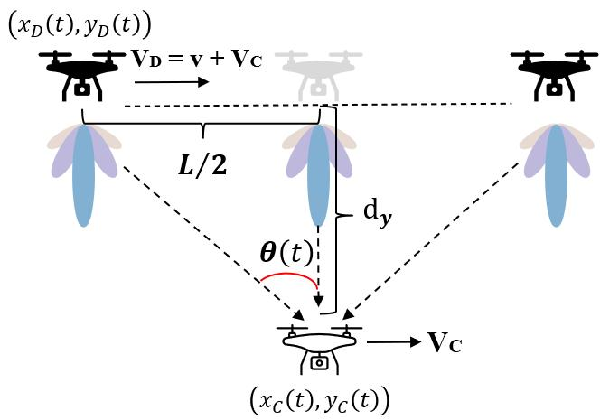  
FIGURE 3. UAV in-flight wireless charging scheme 2.

$$
[ P ( \nu _ { D } ) + P _ { t } ] \ast T \leq E _ { 0 } , T = \frac { L } { \nu } ,\tag{22}
$$

where $P ( \nu _ { D } )$ is the inherent power consumption at the D-UAV when moving at $\nu _ { D } = \nu + \nu _ { C }$ as shown in Fig. 3, $\nu _ { C } \left( \nu _ { C } \ge 0 \right)$ is the speed of the C-UAV, and v is their difference.

Note that only when $\begin{array} { r } { x _ { D } ( t ) = x _ { C } ( t ) , \mathrm { i . e . , a t } t = \frac { L } { 2 \nu } } \end{array}$ , the beam collection efficiency is the highest because the main lobes of the transmitting and receiving antennas are aligned. In other words, the received power of the C-UAV mainly comes from the side lobes of the D-UAV beam at others times. To address this issue, cos (θ (t)) (θ(t) = 0, when $x _ { D } ( t ) = x _ { C } ( t )$ as shown in Fig. 3) is used to describe the power difference caused by the main and side lobes of the antenna at different times as

$$
P _ { t } ( \theta ( t ) ) = P _ { t } \cos ( \theta ( t ) ) ,\tag{23}
$$

$$
\theta ( t ) = - \arctan \left( \frac { \frac { L } { 2 } - \nu t } { d _ { y } } \right) , 0 \leq t \leq \frac { L } { \nu } ,\tag{24}
$$

where $d _ { y } ~ = ~ | y _ { D } ( t ) - y _ { C } ( t ) |$ is the distance in the y-axis direction. As a result, using (4), (8) – (13) and $( 2 1 ) - ( 2 3 )$ , the received power at the C-UAV at time t can be expressed as

$$
\begin{array} { r l } & { P _ { r - 2 } ( t ) } \\ & { = \left\{ \begin{array} { l l } { \displaystyle \eta _ { b ( t ) } \frac { P _ { t } \cos ( \theta ( t ) ) G _ { t } G _ { r } \lambda ^ { 2 } } { ( 4 \pi d ( t ) ) ^ { 2 } } \gamma _ { A } \left( d ( t ) \right) , } & { d ( t ) \in F Z , } \\ { \displaystyle \eta _ { b ( t ) } \frac { P _ { t } \cos ( \theta ( t ) ) G _ { t } G _ { r } \lambda ^ { 2 } } { ( 4 \pi d ( t ) ) ^ { 2 } } , } & { d ( t ) \geq \frac { 2 { D _ { t } } ^ { 2 } } { \lambda } , } \end{array} \right. } \end{array}\tag{25}
$$

where

$$
\eta _ { b ( t ) } = 1 - e ^ { - \frac { A _ { t } A _ { r } } { \lambda ^ { 2 } d ( t ) ^ { 2 } } } , \ 0 \leq t \leq \frac { T } { 2 } ,\tag{26}
$$

Algorithm 2 Optimization of (31)   
1: Input: $D _ { t } , D _ { r } , f , C _ { \epsilon 2 } , E _ { 0 } , \delta _ { 2 } ,$ vD and vC   
2: Calculate $\lambda = C / f , P ( \nu _ { D } ) , \nu = \nu _ { D } - \nu _ { C } , G _ { t } , G _ { r }$ and T   
using (3), (2) and (22)   
// Calculate Fresnel Zone using D and λ   
3: $\begin{array} { r } { I _ { f z } = \left\lceil 0 . 6 2 \sqrt { \frac { ( D _ { t } ) ^ { 3 } } { \lambda } } , \frac { 2 ( D _ { t } ) ^ { 2 } } { \lambda } \right\rceil } \end{array}$   
// Set search range (SR)   
4: $\begin{array} { r } { S R = \left[ m i n \left( d ( t ) i n \left( 2 8 \right) , 0 . 6 2 \sqrt { \frac { ( D _ { t } ) ^ { 3 } } { \lambda } } \right) , \frac { 2 ( D _ { t } ) ^ { 2 } } { \lambda } \right] } \end{array}$   
// Set precision ϵ   
5: $\epsilon = 0 . 0 1 , S R _ { L } = S R ( 1 ) , S R _ { R } = S R ( 2 )$   
6: while $S R _ { R } - S R _ { L } > \epsilon$ do   
7: // Calculate the midpoint of the interval SR   
8: $S R _ { C } = ( S R _ { R } + S R _ { L } ) / 2$   
9: $t _ { c p } = \frac { \frac { L } { 2 } - \sqrt { \frac { 2 ( D _ { t } ) ^ { 2 } } { \lambda } - S R _ { C } ^ { 2 } } } { \nu }$   
// Calculate the total energy received by the C-UAV in   
far-field   
10: $\begin{array} { r } { E _ { r - 2 - f a r } ( S R _ { C } ) = \int _ { 0 } ^ { t _ { c p } } \eta \rho P _ { r - 2 } ( t ) | h _ { 2 } | ^ { 2 } \ d t } \end{array}$ dt   
// Calculate the total energy received by the C-UAV in   
near-field   
11: $\begin{array} { r } { E _ { r - 2 - n e a r } ( S R _ { C } ) = \int _ { t _ { c p } } ^ { \frac { L } { 2 \nu } } \eta \rho P _ { r - 2 } ( t ) | h _ { 2 } | ^ { 2 } } \end{array}$ dt   
12: $E _ { r - 2 } ( S R _ { C } ) = 2 \left[ E _ { r - 2 - f a r } ( S R _ { C } ) + E _ { r - 2 - n e a r } ( S R _ { C } ) \right]$   
13: if $E _ { r - 2 } ( S R _ { C } - \bar { \epsilon _ { } } ) < E _ { r - 2 } ( S R _ { C } + \epsilon _ { } )$ then   
14: $S R _ { L } = S R _ { C }$   
15: else   
16: $S R _ { R } = S R _ { C }$   
17: end if   
18: end while   
19: Calculate the maximum $E _ { r - 2 } ( ( S R _ { R } + S R _ { L } ) / 2 )$   
20: Calculate $d ^ { * } = { d _ { y } } ^ { * } = ( S R _ { R } + S R _ { L } ) / 2$   
21: Calculate $\rho ^ { * } \gets$ from the max $\rho$ using $d ^ { * } .$ , (30), (31b)   
and (31c)   
22: Output: Max $E _ { r - 2 } , d ^ { * }$ and $\rho ^ { * }$

$$
\gamma _ { A } \left( d ( t ) \right) = \left\{ \begin{array} { l l } { \displaystyle 1 - \alpha _ { E } \left( \frac { d ( t ) } { 2 \lambda G / \pi ^ { 2 } } \right) ^ { - 2 } , } & { \quad G \geq 1 0 d B , } \\ { \displaystyle 1 - \alpha _ { E } \left( \frac { d ( t ) } { 2 \lambda ( 2 G ) / \pi ^ { 2 } } \right) ^ { - 2 } , } & { \quad G < 1 0 d B , } \end{array} \right.\tag{27}
$$

$$
\begin{array} { r } { \mathrm { a n d } d ( t ) = \sqrt { ( \frac { L } { 2 } - \nu t ) ^ { 2 } + { d _ { y } } ^ { 2 } } , \ 0 \leq t \leq \frac { L } { \nu } \ \mathrm { w i t h } } \\ { \left\{ d ( t ) \geq \frac { \sqrt { \alpha _ { E } } 2 \lambda G } { \pi ^ { 2 } } , \quad G \geq 1 0 d B , \right. } \\ { \left. \ d ( t ) \geq \frac { \sqrt { \alpha _ { E } } 4 \lambda G } { \pi ^ { 2 } } , \quad G < 1 0 d B . \right. } \end{array}\tag{28}
$$

Using symmetry, the received energy at the C-UAV can be derived from (4), (13) and (25)

$$
E _ { r - 2 } = 2 \int _ { 0 } ^ { \frac { T } { 2 } } \eta \rho P _ { r - 2 } ( t ) | h _ { 2 } | ^ { 2 } d t ,\tag{29}
$$

where $h _ { 2 } \sim \mathcal { C N } ( \mu _ { 2 } , { \sigma _ { 2 } } ^ { 2 } )$ is the complex channel coefficient from the D-UAV to the C-UAV, $\mu _ { 2 }$ is the mean value and

$\sigma { _ 2 } ^ { 2 }$ is the average fading power, $P _ { r - 2 } ( t ) | h _ { 2 } | ^ { 2 }$ is the amount of power received by the C-UAV as its input at time t, and the achievable rate in bits/Hz during time $T$ can be calculated as

$$
C _ { 2 } = 2 \int _ { 0 } ^ { \frac { T } { 2 } } \log _ { 2 } \left( 1 + \frac { ( 1 - \rho ) P _ { r - 2 } ( t ) | h _ { 2 } | ^ { 2 } } { { \delta _ { 2 } } ^ { 2 } } \right) d t ,\tag{30}
$$

where $\delta _ { 2 } { } ^ { 2 }$ is the noise power. To derive the optimal distance that maximizes $E _ { r - 2 }$ under the condition that $C _ { 2 }$ is equal to the minimum achievable rate $C _ { \epsilon 2 }$ , with respect to $d _ { y } , \rho$ and $\nu ,$ the final optimization problem can be formulated as

$$
( P 2 ) : \operatorname* { m a x } _ { d , \rho } E _ { r - 2 } ,\tag{31a}
$$

$$
\begin{array} { r } { \mathrm { s . t . : ~ } 0 \leq \rho \leq 1 , } \end{array}\tag{31b}
$$

$$
C _ { 2 } \geq C _ { \epsilon 2 } ,\tag{31c}
$$

$$
T \ast \left[ P _ { t } + P \left( \nu \right) \right] \leq E _ { 0 } ,\tag{31d}
$$

where (31a) is the objective function, (31b) is the constraint on the PS factor, (31c) is the constraint on the minimum achievable rate and (31d) is the constraint on the total available energy $E _ { 0 }$ . Similar to the Scheme 1, the optimal $d ^ { * }$ can be derived numerically using a bisection search, and $\rho ^ { * }$ can be calculated using (30) and (31c) for a given $C _ { \epsilon 2 }$ . The solution to (31a) is summarized in Algorithm 2.

## C. FURTHER DISCUSSION

Schemes 1 and 2 are two typical cases for UAV in-flight wireless charging and communications, where the D-UAV and the C-UAV either remain relatively stationary or in relative motion. Environmental fluctuations caused by mobility may also have impact on the alignment and the charging efficiency. For example, UAVs may suffer from the fluctuations caused by air turbulence, which usually lead to a misalignment [18] between the D-UAV and the C-UAV. From [38], the fluctuations can be modeled as a Gaussian distributed random variable. Let $\Delta \theta \sim \mathcal { N } ( 0 , { \sigma _ { \theta } } ^ { 2 } )$ , where $\sigma _ { \theta }$ is the standard deviation of $\Delta \theta$ . For Schemes 1 and $2 , P _ { t }$ can be rewritten as

$$
P _ { t } ( \Delta \theta ) = P _ { t } \cos ( \Delta \theta ) ,\tag{32}
$$

$$
P _ { t } ( \theta , \Delta \theta ) = P _ { t } \cos ( \theta + \Delta \theta ) ,\tag{33}
$$

respectively, and $\eta _ { b }$ can be written as

$$
\eta _ { b } ( d , \Delta \theta ) = 1 - e ^ { - \frac { A _ { t } A _ { r } \cos ( \Delta \theta ) } { \lambda ^ { 2 } d ^ { 2 } } } ,\tag{34}
$$

which can be used in the optimization problems (17) and (31) to study the optimal values in the presence of disturbance.

Further, the received power may change dynamically due to UAV misalignments or environmental disturbances, such as wind and turbulence, which directly affects the charging efficiency given the linear relationship between $P _ { D C }$ and $P _ { r }$ as defined in (13). Although [35] and [36] proposed linear models for low-power scenarios, it remains of interest to study new non-linear models tailored for UAV in-flight wireless charging applications.

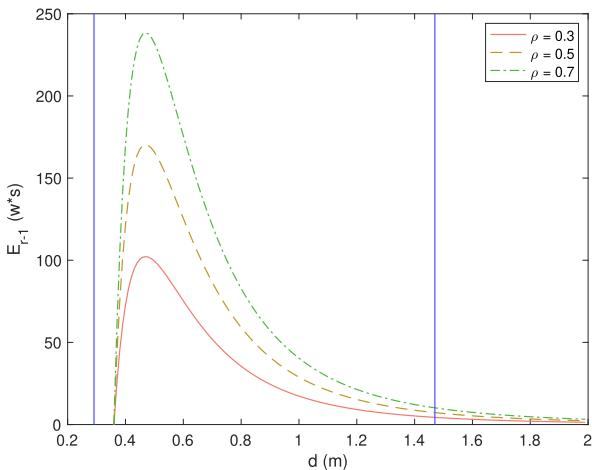

FIGURE 4. $\pmb { { \cal E } } _ { r - 1 }$ vs d in scheme 1.

## IV. NUMERICAL RESULTS AND DISCUSSION

In this section, numerical results are presented to show the optimal distance that maximizes the energy received by the C-UAV under the condition that the minimum achievable rate for communications is met. In the simulation, we set $f = 2 . 4 5 \ G H z , D _ { t } = D _ { r } = 0 . 3 \ m , P _ { t } = 1 0 \ W , \eta = 0 . 5 \ [ 4 0 ]$ $4 1 ] , [ 4 2 ] , \delta _ { 1 } { } ^ { 2 } = \delta _ { 2 } { } ^ { 2 } = 0 . 0 1$ , if not stated otherwise. For P(v), the UAV energy consumption model in [39, eq. (7)] and parameters in [11] is used. The achievable rate is calculated by averaging over 10000 random values of $| h _ { 1 } | ^ { 2 } \mathrm { o r } | h _ { 2 } | ^ { 2 }$

Fig. 4 shows the effect of the distance on the received energy $E _ { r - 1 }$ at the C-UAV in Scheme 1. In this figure, the area between two vertical lines represents the FZ as indicated in Fig. 2. One can see that the energy received by the C-UAV increases quickly and then decreases with the distance. This is because $\gamma _ { A }$ increases with d and $\eta _ { b }$ decreases with d and thus, there is an optimal d that maximizes $E _ { r - 1 }$ . From Fig. 2, one sees that, when $d$ changes from the left to the right of the FZ, the increase rate of $\gamma _ { A }$ and the decline rate of $\eta _ { b }$ are relatively fast, but when d exceeds the $\mathrm { F Z , }$ their rate of change becomes small. This is why $E _ { r - 1 }$ increases rapidly to its maximum and then decreases slowly in Fig. 4. As expected, the maximum value of $E _ { r - 1 }$ falls within the FZ as shown in Fig. 4. Also, for $\rho ~ = ~ 0 . 3 , \rho ~ = ~ 0 . 5$ and $\rho ~ = ~ 0 . 7$ , one sees that $E _ { r - 1 }$ increases with $\rho ,$ as from (15). Further, one can also see that the charging efficiency reduces greatly when the distance is slightly smaller than the optimal distance, while it does not change much when the distance is slightly larger than the optimal distance.

Fig. 5 shows the effect of the distance on the achievable rate at the C-UAV in Scheme 1. In this figure, similar observations to those in Fig. 4 can be made. One sees that the maximum achievable rate is achieved in the FZ because the maximum received power $P _ { r }$ is obtained in this area. From both Fig. 4 and Fig. 5, it can be observed that the optimum distances maximizing $E _ { r - 1 }$ and $C _ { 1 }$ remain the same across different $\rho$ or communications requirements. This is because $P _ { r }$ is independent of $\rho$ according to (12). In communicationconstrained applications, the received energy is inversely proportional to the required achievable rate where $\rho$ serves as the PS factor.

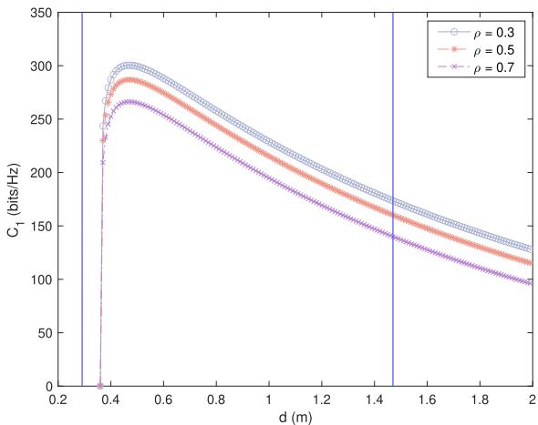  
FIGURE 5. $\pmb { c _ { 1 } }$ vs d in scheme 1.

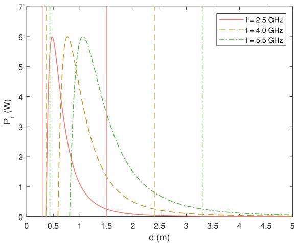  
FIGURE 6. $\pmb { P r }$ vs d with different frequencies in scheme 1.

Fig. 6 examines the effect of the distance on the received power $P _ { r }$ for different signal frequencies. One can see that the range of FZ increases with $_ { 1 f }$ . This is because a higherf leads to a shorter λ, which enlarges the FZ according to (6). Taking $f = 2 . 5 G H z , f = 4 . 0 G H z$ and $f = 5 . 5 G H z$ as an example, it can also be seen that the optimal distance increases with $f ,$ while the maximum $P _ { r }$ at different frequencies remains almost unchanged. Moreover, the relationship between the optimal distance and $f$ indicates that a higher $f$ is more likely to achieve the optimal distance when a minimum safe distance is given. For instance, if the safe distance is 1 m, the optimal distance can be achieved $\operatorname { a t } f = 5 . 5 G H z$

Fig. 7 further examines the effect of f on the received power P for different distances. One can see that $P _ { r }$ increases first and then decreases with $f .$ . This is because in the FZ asf increases, λ decreases, which results in greater antenna gains according to (2) and (3), thereby increasing $P _ { r }$ . However, a higher f also leads to a smaller $\gamma _ { A }$ from (10), which in turn reduces $P _ { r }$ according to (12) and thus, there exists an optimum f that maximizes $P _ { r }$ in this area. Specifically, for distances $d \ : = \ : 0 . 8 \ m , 0 . 9$ m and 1.0 m, the maximum $P _ { r }$ values are achieved at $f \ = \ 4 . 1 5 \ G H z , 4 . 6 5$ GHz and 5.15 GHz, respectively. Moreover, given $f ,$ , the value of $P _ { r }$ changes differently with different d. For example, when $f ~ = ~ 2 . 5 ~ G H z , P _ { r }$ decreases as d increases from 0.8 m to 1.0 m, which matches the trend shown in Fig. 6 where the optimal distance at $f \ = \ 2 . 5 \ G H z$ is around 0.5 m within FZ. Conversely, when $f = 5 . 5 G H z$ , the optimum distance is about 1.1 m according to Fig. 6 and hence, $P _ { r }$ increases with d increasing from 0.8 m to 1.0 m. This observation is very important for practical designs, as the maximum $P _ { r }$ depends on bothf and d.

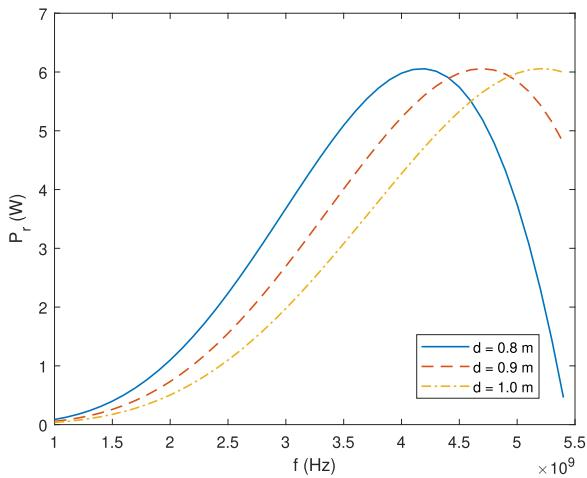  
FIGURE 7. Pr vs f in scheme 1.

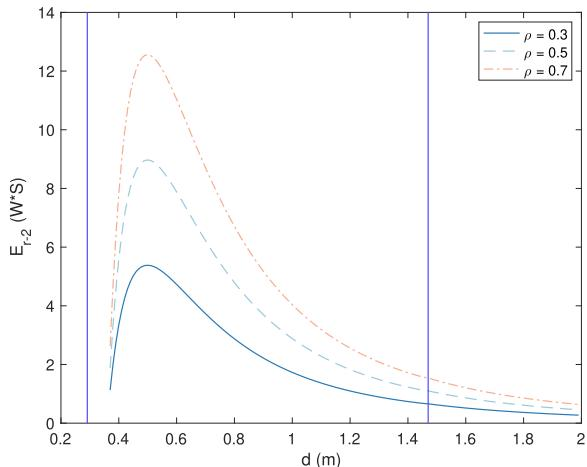  
FIGURE 8. $\pmb { { \cal E } } _ { r - 2 }$ vs d in scheme 2.

Fig. 8 shows the effect of the distance on the received energy $E _ { r - 2 }$ at the C-UAV in Scheme 2. In this figure, $L =$ $2 0 m , \nu = 0 . 5 m / s$ . One sees that the maximum $E _ { r - 2 }$ again falls within the FZ. However, the value of $E _ { r - 2 }$ in Scheme 2 is much lower than $E _ { r - 1 }$ in Scheme 1. This is because the path loss caused by the large distance in Scheme 2 is higher than that in Scheme 1. Nevertheless, Scheme 2 has more flexibility in charging than Scheme 1, as the two antennas do not need to align with each other so that charging can be performed during operation. Similarly, for the charging efficiency when the UAVs operate slightly outside the optimal distance, the same conclusion can be drawn as in Fig. 4.

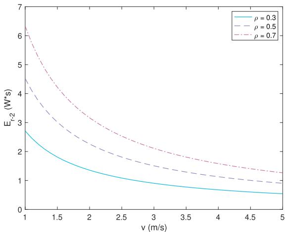  
FIGURE 9. $\pmb { { \cal E } } _ { r - 2 }$ vs v in scheme 2.

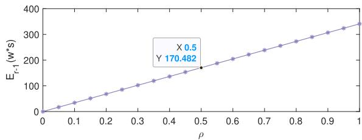

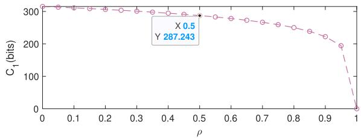  
FIGURE 10. $\pmb { { \cal E } } _ { r - 1 }$ and $\pmb { c } _ { 1 }$ vs ρ in scheme 1.

Fig. 9 investigates the effect of the relative speed v between the D-UAV and the C-UAV on the received energy $E _ { r - 2 }$ in Scheme 2. In this figure, $d = 0 . 5 m , L = 2 0 m$ , and the relative speed changes from $1 m / s \mathrm { t o } 5 m / s$ . From the figure, one sees that the received energy $E _ { r - 2 }$ decreases with the speed. This is because, for a given distance $L ,$ as the speed increases, the charging time decreases, resulting in reduction in the received energy. Therefore, in Scheme 2, a smaller relative speed is more conductive to maximizing the received energy.

Fig. 10 shows the change of the received energy $E _ { r - 1 }$ and the achievable rate $C _ { 1 }$ with the PS factor $\rho$ in Scheme 1. In this figure, $d = 0 . 5$ m and the PS factor $\rho$ changes from 0 to 1. From the figure, one can see that the received energy $E _ { r - 1 }$ increases with the PS factor $\rho _ { ; }$ , while the achievable rate $C _ { 1 }$ decreases, as indicated in (15) and (16). For given $C _ { \epsilon 1 }$ this figure also shows the relationship between the received energy $E _ { r - 1 }$ and the minimum communications requirement $C _ { \epsilon 1 }$ . For example, when $C _ { \epsilon 1 } = 2 8 7 . 2 4 3$ bits/Hz as shown in the lower part of the figure, one can calculate the maximum $\rho \mathrm { ~  ~ { ~ = ~ } ~ } 0 . 5$ according to (17c). By using $\rho \quad = \quad 0 . 5$ , the maximum energy $E _ { r - 1 }$ can be obtained, i.e., 170.482 w ∗ s in the upper part of the figure. When $C _ { \epsilon 1 }$ increases, the PS factor $\rho$ decreases, leading to the decrease of $E _ { r - 1 }$ , and vice versa.

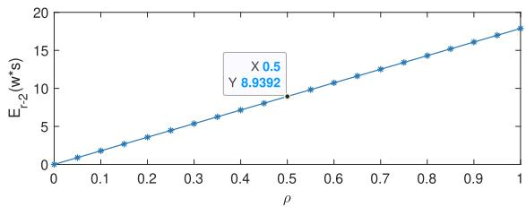

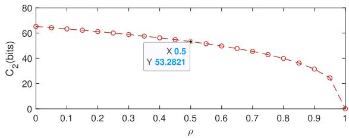  
FIGURE 11. $\pmb { { \cal E } } _ { r - 2 }$ and $c _ { 2 }$ vs ρ in scheme 2.

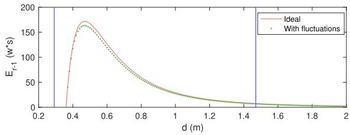

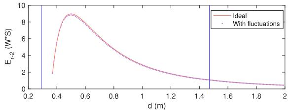  
FIGURE 12. $\pmb { { \cal E } } _ { r - 1 }$ and ${ \pmb { \varepsilon } } _ { r - 2 } { \pmb { v } }$ s d in schemes 1 and 2 considering fluctuations.

Fig. 11 shows the change of the received energy $E _ { r - 2 }$ and the achievable rate $C _ { 2 }$ with the PS factor $\rho$ in Scheme 2. Similar to Fig. 10, the received energy $E _ { r - 2 }$ increases with $\rho ,$ while the achievable rate $C _ { 2 }$ decreases. For a given minimum communications requirement $C _ { \epsilon 2 } \ = \ 5 3$ .2821 bits/Hz, one can obtain the maximum $\rho ~ = ~ 0 . 5$ according to the lower part of the figure as $C _ { 2 } = C _ { \epsilon 2 }$ . Then, the maximum received energy $E _ { r - 2 } = 8 . 9 3 9 2$ w∗s can be obtained using $\rho = 0 . 5$ in the upper part of the figure. Compared with Scheme 1, both the received energy $E _ { r - 2 }$ and the achievable rate $C _ { 2 }$ are smaller than that in Scheme 1 due to the path loss caused by the large distance in Scheme 2. However, Scheme 2 is more flexible in charging as it does not need to be aligned. This is particularly suitable for charging in motion, such as UAV in-flight charging [18].

Fig. 12 shows a comparison between the ideal case and the case with angular fluctuations in Schemes 1 (upper part) and 2 (lower part), respectively. In this figure, (32) to (34) are used, with the standard deviation $\sigma _ { \theta }$ set to $1 5 ^ { \circ }$ . Overall, the presence of fluctuations leads to a reduction in the total received energy, which is observable around the optimal distance in both schemes. Particularly, one can also see that the impact is more pronounced in Scheme 1 than in Scheme 2. This can be explained as follows: In Scheme 1, since both the D-UAV and the C-UAV remain relatively stationary, fluctuations in any direction tend to cause great energy loss. In contrast, in Scheme 2, the D-UAV moves at a relative speed v, and fluctuations toward the C-UAV may partially compensate for the deviation, resulting in less energy loss. As a result, one can conclude that angular fluctuations have a smaller impact on Scheme 2 than Scheme 1.

## V. CONCLUSION

In this paper, we have studied the optimal distance for UAV in-flight wireless charging and communications. Two typical schemes have been proposed. By maximizing the energy received by the C-UAV, the optimal distance has been derived. For both schemes, numerical results show that the maximum received power or energy occurs in the FZ, and that the maximum value of the received power depends on the values of $f$ and $d .$ Given either $f$ or d, $P _ { r }$ first increases and then decreases within the FZ with the other. In other words, there exists an optimum combination of f and d that maximizes $P _ { r }$ . Besides, using the optimal distance, the optimal PS factor $\rho$ can be derived to balance the minimum communications requirements and the received energy. Although the received energy and achievable rate in Scheme 1 are higher than that in Scheme 2, Scheme 2 has more flexibility in charging than Scheme 1, and Scheme 2 is less affected by environmental fluctuations than Scheme 1. These results have provided very useful guidance for UAV in-flight wireless charging and communications system design.

Our findings also suggest several potential directions for future research: (1) considering advanced antenna theory and more practical path loss models with higher frequency signals, such as terahertz (THz), could enable more efficient wireless charging in future applications, as higher frequency signals can concentrate energy more efficiently. However, this also requires careful consideration of regulatory constraints and potential interference; (2) Such high frequency signals produce narrow beam widths, which brings challenges for beam alignment, especially in environments subject to disturbances or fluctuations as discussed in Subsection C in Section III; (3) It is also interesting and challenging to explore scenarios of simultaneous charging of multiple UAVs. For instance, Scheme 1 can be extended to support multi-UAV charging by implementing beam-steering towards different locations at different time slots, while Scheme 2 enables the D-UAV to fly above different C-UAVs sequentially for charging purposes.

## REFERENCES

[1] M. Amjad, M. Farooq-i-Azam, Q. Ni, M. Dong, and E. A. Ansari, ‘‘Wireless charging systems for electric vehicles,’’ Renew. Sustain. Energy Rev., vol. 167, Oct. 2022, Art. no. 112730.

[2] S. Alshahrani, M. Khalid, and M. Almuhaini, ‘‘Electric vehicles beyond energy storage and modern power networks: Challenges and applications,’ IEEE Access, vol. 7, pp. 99031–99064, 2019.

[3] N. Shinohara, Y. Kubo, and H. Tonomura, ‘‘Wireless charging for electric vehicle with microwaves,’’ in Proc. 3rd Int. Electr. Drives Prod. Conf. (EDPC), Oct. 2013, pp. 1–4.

[4] I. Ahmed, E. A. ElGhanam, M. S. Hassan, and A. Osman, ‘‘Study of the feasibility of using microwave power transfer for dynamic wireless electric vehicle charging,’’ in Proc. IEEE Transp. Electrific. Conf. Expo. (ITEC), Jun. 2020, pp. 365–370.

[5] S. Inamdar and J. Fernandes, ‘‘Review of wireless charging technology for electric vehicle,’’ in Proc. IEEE 10th Power India Int. Conf. (PIICON), Nov. 2022, pp. 1–5.

[6] J. Hu, X. Xu, T. Zheng, H. Lan, D. Cao, and G. Liu, ‘‘Experimental study of radiated magnetic field from electric vehicle wireless charging system,’ IEEE Electromagn. Compat. Mag., vol. 10, no. 4, pp. 46–51, Feb. 2021.

[7] M. Abdolmaleki, N. Masoud, and Y. Yin, ‘‘Vehicle-to-vehicle wireless power transfer: Paving the way toward an electrified transportation system,’’ Transp. Res. C, Emerg. Technol., vol. 103, pp. 261–280, Jun. 2019.

[8] R. Wang, H. Wang, K. Zhu, C. Yi, P. Wang, and D. Niyato, ‘‘Mobile charging services for the Internet of Electric Vehicles: Concepts, scenarios, and challenges,’’ IEEE Veh. Technol. Mag., vol. 18, no. 3, pp. 110–119, Sep. 2023.

[9] A. Yassine and M. S. Hossain, ‘‘Match maximization of vehicle-to-vehicle energy charging with double-sided auction,’’ IEEE Trans. Intell. Transp. Syst., vol. 24, no. 11, pp. 13250–13259, Nov. 2023.

[10] H. Yan, Y. Chen, and S.-H. Yang, ‘‘Analysis of energy transfer efficiency in UAV-enabled wireless networks,’’ Phys. Commun., vol. 37, Dec. 2019, Art. no. 100849.

[11] H. Yan, Y. Chen, and S.-H. Yang, ‘‘UAV-enabled wireless power transfer with base station charging and UAV power consumption,’’ IEEE Trans. Veh. Technol., vol. 69, no. 11, pp. 12883–12896, Nov. 2020.

[12] H. Yan, Y. Chen, and S.-H. Yang, ‘‘Time allocation and optimization in UAV-enabled wireless powered communication networks,’’ IEEE Trans. Green Commun. Netw., vol. 6, no. 2, pp. 951–964, Jun. 2022.

[13] P. K. Chittoor, B. Chokkalingam, and L. Mihet-Popa, ‘‘A review on UAV wireless charging: Fundamentals, applications, charging techniques and standards,’’ IEEE Access, vol. 9, pp. 69235–69266, 2021.

[14] A. Le, L. Truong, T. Quyen, C. Nguyen, and M. Nguyen, ‘‘Wireless power transfer near-field technologies for unmanned aerial vehicles (UAVs): A review,’’ EAI Endorsed Trans. Ind. Netw. Intell. Syst., vol. 7, no. 22, Jan. 2020, Art. no. 162831.

[15] Y. Wang, Z. Su, N. Zhang, and R. Li, ‘‘Mobile wireless rechargeable UAV networks: Challenges and solutions,’’ IEEE Commun. Mag., vol. 60, no. 3, pp. 33–39, Mar. 2022.

[16] N. W. Najeeb and C. Detweiler, ‘‘UAV based wireless charging of sensor networks without prior knowledge,’’ in Proc. IEEE/RSJ Int. Conf. Intell. Robots Syst. (IROS), Madrid, Spain, Oct. 2018, pp. 3151–3158.

[17] H. Wang, Y. Wu, X. Li, X. Dai, Y. Sun, and J. Hu, ‘‘Advanced magnetic coupler design with multi-directional anti-misalignment capabilities for wireless charging unmanned aerial vehicles,’’ IEEE Trans. Circuits Syst. II, Exp. Briefs, vol. 71, no. 6, pp. 3231–3235, Jun. 2024.

[18] K. Chen and Z. Zhang, ‘‘In-flight wireless charging: A promising application-oriented charging technique for drones,’’ IEEE Ind. Electron. Mag., vol. 18, no. 1, pp. 6–16, Mar. 2024.

[19] K. Sukvanachaikul, N. Hatchavanich, S. Nutwong, S. Naetiladdanon, A. Sangswang, and E. Mujjalinvimut, ‘‘Wireless power transfer system for multiple drones in-flight charging applications under wide charging tolerance with constant charging current,’’ in Proc. 27th Int. Conf. Electr. Mach. Syst. (ICEMS), Fukuoka, Japan, Nov. 2024, pp. 1–6.

[20] Y. Gu, J. Wang, Z. Liang, and Z. Zhang, ‘‘Flexible constant-power range extension of self-oscillating system for wireless in-flight charging of drones,’’ IEEE Trans. Power Electron., vol. 39, no. 11, pp. 15342–15355, Nov. 2024.

[21] A. Jaiswal and S. Bhunia, ‘‘D2DC: Mid–air drone-to-drone charging to enhance flight endurance,’’ in Proc. Int. Conf. Unmanned Aircr. Syst. (ICUAS), Jun. 2024, pp. 893–898.

[22] H. Zhang, N. Shlezinger, F. Guidi, D. Dardari, M. F. Imani, and Y. C. Eldar, ‘‘Near-field wireless power transfer with dynamic metasurface antennas,’ in Proc. IEEE 23rd Int. Workshop Signal Process. Adv. Wireless Commun. (SPAWC), Jul. 2022, pp. 1–5.

[23] A. Ağçal and T. H. Doğan, ‘‘A novel folding wireless charging station design for drones,’’ Drones, vol. 8, no. 7, p. 289, Jun. 2024.

[24] X. Mou, D. Gladwin, J. Jiang, K. Li, and Z. Yang, ‘‘Near-field wireless power transfer technology for unmanned aerial vehicles: A systematical review,’’ IEEE J. Emerg. Sel. Topics Ind. Electron., vol. 4, no. 1, pp. 147–158, Jan. 2023.

[25] V. Palazzi, R. Correia, X. Gu, S. Hemour, K. Wu, A. Costanzo, D. Masotti, E. Fazzini, A. Georgiadis, H. Kazemi, R. Pereira, N. Shinohara, D. Schreurs, J.-C. Chiao, A. Takacs, D. Dragomirescu, and N. B. Carvalho, ‘‘Radiative wireless power transfer: Where we are and where we want to go,’’ IEEE Microw. Mag., vol. 24, no. 2, pp. 57–79, Feb. 2023.

[26] H. Zhang, N. Shlezinger, F. Guidi, D. Dardari, M. F. Imani, and Y. C. Eldar, ‘‘Near-field wireless power transfer for 6G Internet of Everything mobile networks: Opportunities and challenges,’’ IEEE Commun. Mag., vol. 60, no. 3, pp. 12–18, Mar. 2022.

[27] J. Xu, Y. Zeng, and R. Zhang, ‘‘UAV-enabled wireless power transfer: Trajectory design and energy optimization,’’ IEEE Trans. Wireless Commun., vol. 17, no. 8, pp. 5092–5106, Aug. 2018.

[28] Y. Liu, Z. Wang, J. Xu, C. Ouyang, X. Mu, and R. Schober, ‘‘Near-field communications: A tutorial review,’’ IEEE Open J. Commun. Soc., vol. 4, pp. 1999–2049, 2023.

[29] IEEE Standardfor Definitions ofTermsfor Antennas, Standard 145-2013 (Revision of IEEE Std 145-1993), Mar. 2014, pp. 1–50.

[30] C. T. Rodenbeck, P. I. Jaffe, B. H. Strassner II, P. E. Hausgen, J. O. McSpadden, H. Kazemi, N. Shinohara, B. B. Tierney, C. B. DePuma, and A. P. Self, ‘‘Microwave and millimeter wave power beaming,’’ IEEE J. Microw., vol. 1, no. 1, pp. 229–259, Jan. 2021.

[31] P. F. Goldsmith, ‘‘Quasi-optical techniques,’’ Proc. IEEE, vol. 80, no. 11, pp. 1729–1747, Aug. 1992.

[32] L. Xiao, Y. Xie, P. Wu, and J. Li, ‘‘Near-field gain expression for aperture antenna and its application,’’ IEEE Antennas Wireless Propag. Lett., vol. 20, pp. 1225–1229, 2021.

[33] C. A. Balanis, Antenna Theory: Analysis and Design. Hoboken, NJ, USA: Wiley, 2005.

[34] I. Kim, S. Xu, and Y. Rahmat-Samii, ‘‘Generalised correction to the Friis formula: Quick determination of the coupling in the Fresnel region,’’ IET Microw., Antennas Propag., vol. 7, no. 13, pp. 1092–1101, Oct. 2013.

[35] Y. Chen, K. T. Sabnis, and R. A. Abd-Alhameed, ‘‘New formula for conversion efficiency of RF EH and its wireless applications,’’ IEEE Trans. Veh. Technol., vol. 65, no. 11, pp. 9410–9414, Nov. 2016.

[36] Y. Chen, N. Zhao, and M.-S. Alouini, ‘‘Wireless energy harvesting using signals from multiple fading channels,’’ IEEE Trans. Commun., vol. 65, no. 11, pp. 5027–5039, Nov. 2017.

[37] Y. Chen, Energy Harvesting Communications: Principles and Theories, 1st ed., Hoboken, NJ, USA: Wiley, 2019, pp. 125–173. [Online]. Available: https://0-doi-org.pugwash.lib.warwick.ac.uk/10.1002/9781119 383062.ch6

[38] R. Tavakoli, E. M. Dede, C. Chou, and Z. Pantic, ‘‘Cost-efficiency optimization of ground assemblies for dynamic wireless charging of electric vehicles,’’ IEEE Trans. Transport. Electrific., vol. 8, no. 1, pp. 734–751, Mar. 2022.

[39] H. Yan, S.-H. Yang, Y. Ding, and Y. Chen, ‘‘Energy consumption models for UAV communications: A brief survey,’’ in Proc. IEEE Int. Conferences Internet Things (iThings) IEEE Green Comput. Commun. (GreenCom) IEEE Cyber, Phys. Social Comput. (CPSCom) IEEE Smart Data (SmartData) IEEE Congr. Cybermatics (Cybermatics), Aug. 2022, pp. 161–167.

[40] Z. Zhang, Y. Liu, Z. Wang, X. Mu, and J. Chen, ‘‘Simultaneous wireless information and power transfer in near-field communications,’’ IEEE Internet Things J., vol. 11, no. 16, pp. 27760–27774, Aug. 2024.

[41] Y. Zhang and C. You, ‘‘SWIPT in mixed near- and far-field channels: Joint beam scheduling and power allocation,’’ IEEE J. Sel. Areas Commun., vol. 42, no. 6, pp. 1583–1597, Jun. 2024.

[42] Y. Ma, Q. Yang, and B. Wang, ‘‘RIS-assisted near-field integrated sensing and wireless power transfer systems,’’ in Proc. IEEE Int. Conf. Commun. Workshops (ICC Workshops), Denver, CO, USA, Jun. 2024, pp. 1000–1005.

  
HUA YAN (Member, IEEE) received the Ph.D. degree from the University of Warwick, U.K., in 2022. He was a Postdoctoral Research Associate with the Department of Engineering, Durham University, U.K., and a Research Fellow with the School of Engineering, University of Warwick. He is currently a Lecturer with the School of Computer Science, Leeds Trinity University, U.K. His research interests include UAV communications, THz-integrated sensing, communications  
and powering, and wireless charging and communications.

YUNFEI CHEN (Senior Member, IEEE) received the B.E. and M.E. degrees in electronics engineering from Shanghai Jiao Tong University, Shanghai, China, in 1998 and 2001, respectively, and the Ph.D. degree from the University of Alberta, in 2006. He is currently a Professor with the Department of Engineering, Durham University, U.K. His research interests include wireless communications, performance analysis, joint radar communications designs, cognitive

radios, wireless relaying, and energy harvesting.