# QoS-Aware Scheduling of Airship-Assisted Millimeter Wave Communications for High-Speed Railway

Lei Liu, Bo Ai , Fellow, IEEE, Yong Niu , Senior Member, IEEE, Zhu Han , Fellow, IEEE, and Ning Wang , Member, IEEE

Abstract—With the rapid growth of mobile data demand, millimeter-wave (mmWave) communication has become one of the candidate technologies to improve data rates for high-speed railway (HSR). However, the cost of covering HSR lines through terrestrial base stations (BSs) alone is unaffordable, especially in remote areas. In this paper, we consider a scheme ofthe airship-assisted mmWave communication for HSR in the space-air-ground integrated network (SAGIN). Furthermore, we introduce an optimal scheduling problem of maximizing the number of flows that satisfy the quality of service (QoS) requirements between the airship and the train’s mobile relays (MRs). To solve the above problem, we propose a MR selection algorithm to determine the number of MRs within the airship’s coverage at every frame. Then we propose a maxflow scheduling algorithm based on the MR selection algorithm, which can increase the number of successfully scheduled flows by optimizing the scheduling order of the flows. Finally, simulation results show that our proposed algorithm can effectively improve the number of successfully scheduled flows and bits. We also verify that the proposed algorithm can further improve the system performance with increasing the number of MRs.

Index Terms—The space-air-ground integrated network, highspeed railway, millimeter-wave, airship-assisted, QoS requirement.

Received 26 December 2023; revised 5 July 2024; accepted 19 August 2024. Date of publication 27 August 2024; date of current version 19 December 2024. This work was supported in part by the National Key Research and Development Program of China under Grant 2021YFB2900301, in part by the National Natural Science Foundation of China under Grant 62221001, Grant 62231009, and Grant U21A20445, in part by Beijing Natural Science Foundation under Grant L232042, in part by the Fundamental Research Funds for the Central Universities under Grant 2023JBMC030, in part by the Fundamental Research Funds for the Central Universities under Grant 2022JBXT001 and Grant 2022JBQY004, in part by the National Key R&D Project of China under Grant 2022YFE0111900, in part by NSF under Grant CNS-2107216, Grant CNS-2128368, Grant CMMI-2222810, and Grant ECCS-2302469, in part by US Department of Transportation, Toyota, and in part by the Amazon and Japan Science and Technology Agency (JST) Adopting Sustainable Partnerships for Innovative Research Ecosystem (ASPIRE) under Grant JPMJAP2326. The review of this article was coordinated by Prof. Yulin Hu. (Corresponding authors: Bo Ai; Yong Niu.)

## I. INTRODUCTION

H IGH-SPEED railway (HSR), as a critical component oftransportation infrastructure, has experienced rapid de- transportation infrastructure, has experienced rapid development in recent years [1], [2]. Up to 2022, the total length of constructed HSR has reached 67,000 kilometers in the world, where China has by far the longest HSR lines with almost 40,500 kilometers. The country is followed by Spain and Japan, both with more than 3,000 kilometers [3]. However, with the sharp increase in demand of mobile data for HSR users, the required data rate per train carriage is expected to reach 0.5–5Gbps in the future, which is a significant challenge to the current HSR wireless communication systems [4].

To cater to the demands of data rates that are growing too fast, the mmWave technology is considered to be an effective solution with massive bandwidth and fewer sources of interference. The mmWave bands from 30 GHz to 300 GHz can support in the thousands of terabits for user terminals, which the current communication systems for railways like Global System for Mobile Communications-Railway (GSM-R) and Long Term Evolution for Railways (LTE-R) are unable to provide [5], [6]. Nevertheless, using mmWave communications for HSR introduces unique challenges due to the dynamics of high-speed mobility and the specific propagation characteristics of mmWave signals. High-speed mobility leads to significant doppler shifts for mmWave signals, affecting the stability of communication links. Signal propagation of mmWave suffers from higher path loss and is more susceptible to attenuation, particularly in humid conditions. Obstructions such as bridges, tunnels, and terrain can severely block or reflect these signals, potentially causing intermittent connectivity. Meanwhile, when the base station (BS) transmits signals directly to the users in the carriages, it will cause the signal strength to be attenuated by at least 22 dB as the signals penetrate the train body [7], [8]. To this end, on the one hand, directional antennas and beamforming techniques have been commonly used to compensate for the large path loss of the mmWave. On the other hand, the mobile relays (MRs) equipped on the roof of the train can greatly avoid mmWave signal attenuation caused by train body [9], [10].

Despite a better network performance offered by mmWave technology, the deployment of large-scale mmWave networks requires extremely high costs for covering the HSR lines, especially in remote areas [11], [12]. To cope with the network coverage limitation for HSR, the space-air-ground integrated network (SAGIN) has become a valid solution [13], [14]. 3GPP. 38.821 pointed out that the combination of satellite communications and mmWaves can significantly enhance data rates and provide global network services [15]. 3GPP 38.104 has introduced specification work for a new infrastructure paradigm called non-terrestrial networking since Release 17, in which space-borne (such as satellites) and airborne vehicles (such as airships and unmanned aerial vehicles) are deployed as nonterrestrial BSs [16], [17]. Moreover, researchers have focused on SAGIN from academia to industry. Specifically, SpaceX has proposed the Starlink project and will launch more than 12,000 satellites over the next few decades to provide global network coverage [11]. OneWeb expected to use 1980 low earth orbit (LEO) satellites to provide broadband services for every corner in the world [18]. Besides, the SAGIN can provide network services for various airborne vehicles and terrestrial devices, but its diversity of the quality of service (QoS) requirements makes network resource allocation extremely difficult, which leads to traditional optimization methods being inefficient and slow, unable to adapt to the complex and dynamic network environment [19], [20].

Existing resource allocation methods mainly consider to improve the transmission rate, the number of user accesses and energy consumption of the system in SAGIN, and there are fewer studies on the completion of QoS requirements for the flows between the airborne vehicles and the HSR. Chen et al. [18] proposed two fair optimization strategies including resource allocation and resource auction to adapt to different network load conditions, which could effectively improve the sum rate of the system and the ratio of users accessing macro cell. Qin et al. [21] developed a content service-oriented resource allocation approach for SAGIN 6G network utilizing three-sided cyclic matching, which performed well at system throughput and user satisfaction. Qin et al. [22] researched the energy-efficient maximization issue in SAGIN-IPIoT by jointly optimizing the subchannel allocation and terminal transmission power control, and their approach had superior performance in energy efficiency.

In this paper, we consider the airship-assisted mmWave communication for HSR in SAGIN. And the main problem that we address is maximizing the number of flows between the airship and train’s MRs, where the flows is required to meet the QoS requirements. Besides, the channel between the airship and MRs changes constantly, and the superframe length and number of time slot (TS) need to reset based on the train’s speed. The number of MR in the airship’s coverage area is changed at different frames, and we propose a MR selection algorithm to determine the number of MRs access at each frame. Finally, we propose a max-flow scheduling algorithm to enhance the number of successfully scheduled flows during the entire movement of the train. The main contributions of this paper are summarized as follows.

\- We introduce an airship-assisted HSR mmWave communication scheme. In this scheme, we formulate an optimization problem for maximizing the number of flows within the finite communication time. And we design the length of the superframe and the number of TSs at each frame according to the train’s speed, which ensures that the channel is almost unchanged between the airship and the MRs within one frame time.

We propose a MR selection algorithm, which divides the finite communication time between the airship and the MRs into three phases, and records the number of MRs in the airship’s coverage area at each phase.

Based on the MR selection algorithm, we propose a maxflow scheduling algorithm, which can obtain the number of TSs to be used by the flows according to the transmission rate and the QoS-aware. Then the scheduling order of the flows can be determined at each frame, which will effectively enhance the number of successfully scheduled flows during the entire movement of the train.

We evaluate the proposed algorithms with airship-assisted HSR mmWave communication scheme by simulations. Compared with other flow scheduling algorithms, the simulation results show that the proposed algorithm achieves excellent performance in terms of the number of successfully scheduled flows and bits. In addition, we also verify the effectiveness of the proposed algorithm after the significant increase in the number of MRs.

The remainder of this paper is organized as follows. The related work is discussed in Section II. Section III describes the system overview and assumption, including the system model, system throughput, train movement model and antenna model. Mathematical analysis and problem formulation are presented in Section IV. Section V propose a MR selection algorithm and a max-flow scheduling algorithm for the airship-assisted scheduling scheme. Extensive simulations are conducted and evaluated in Section VI. The conclusions of this paper are drawn in Section VII.

## II. RELATED WORK

The mmWave have begun to be used in HSR systems, such as the Shinkansen in Japan and the Maglev train in Shanghai [23]. Currently, mmWave communication is mainly studied in 28 GHz, 38 GHz (with 3–4 GHz available spectrum) and E-band (71–76 GHz and 81–86 GHz) (with 10 GHz available spectrum) [24], [25], [26]. Moreover, with the advancement of mmWave transceiver design technology, there is growing interest in standardization efforts, including IEEE 802.15.3c, IEEE 802.11 VHT, and ECMA International TC48. And the rapid development of the CMOS radio frequency (RF) allows for higher gain and output power, enabling mmWave to deliver unprecedented data rates [5], [27]. In addition, 3GPP 38.821 specifies that LEO satellites and high elliptical orbit (HEO) satellites can utilize mmWave for communications, where the altitude range of the LEO and HEO are 300–1,500 km and 400–50,000 km [15]. And their reference spectrum is 20 GHz in the downlink and 30 GHz in the uplink, respectively. The max channel bandwidth is 1 GHz [28], [29].

Recently, there have been a few studies on airship-assisted mobile networks. Wang et al. [30] considered the airship, as the space mobile BS, can be used to solve the problem of establishing wireless communication links in areas such as islands and remote mountain villages. To ensure the stability of airship communication, Wang et al. [31] proposed a communication reception method based on avalanche photodiode detector (APD) gain factor closed-loop regulation control. Yang et al. [32] proposed a UE-driven based deep reinforcement learning (DRL) scheme for multi-user access control, which could enhance the long-term throughput by each UE acting as a DRL agent. Zdenek et al. [33] analyzed the relationship between the total capacity and flight energy consumption of airship, when the airship served for mobile users (UEs). And a minimizing energy consumption algorithm was proposed to decrease the energy of the airship while guaranteeing a near-optimal sum capacity. However, there is a lack of research on increasing the number of successfully scheduled flows that satisfy QoS in airship-assisted HSR mmWave communication in SAGIN.

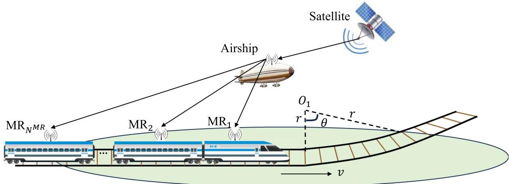  
Fig. 1. The airship-assisted HSR mmWave communication in SAGIN.

For scheduling schemes of the flows, many existing schemes are designed to meet the QoS requirement of each flow with the aim of achieving different optimization goals. Qiao et al. [34] proposed a heuristic algorithm in mmWave networks. In this algorithm, if scheduling one flow could increase the system throughput, then it would be scheduled. But it didn’t consider that the order of the scheduled flows also had an impact on system throughput. Zhu et al. [35] proposed a maximum QoS aware independent set (MQIS) based scheduling algorithm and achieved more successfully scheduled flows. Niu et al. [36] proposed a relay-assisted and QoS aware scheduling (RAQS) scheme for the blockage problem in mmWave backhaul networks, which ensured that the number of completed flows and throughput was at a high level. However, the algorithms in [35], [36] didn’t provide a solution to mobile scenarios. Zhang et al. [5] proposed a coalition game algorithm to solve the user association and transmission scheduling problems in the mmWave train-ground communication system with MRs, which effectively improved the sum rate in the mobile scenarios, but it didn’t further explore the performance of the proposed algorithm on flow number enhancement. Wang et al. [37] proposed a unmanned aerial vehicle (UAV) assisted HSR mmWave communication scheme, which helped train’s MRs to maximize the number of flows while satisfying their QoS requirements, but it didn’t take into account the connection to the UAV with train’s MRs while the train is on the movement, and defaulted to the assumption that all MRs could communicate with the UAV.

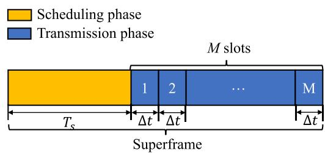  
Fig. 2. The structure of one superframe.

To sum up, all these works mentioned above do not combine the mmWave communication, the airship and the HSR together in SAGIN. And none of them considered the impact of MRs’ movement on the number of successfully scheduled flows. In this paper, we introduce a scheme of the airship-assisted HSR mmWave communication in SAGIN. Then we propose a MR algorithm and a max-flow scheduling algorithm, which can effectively enhance the number of successfully scheduled flows by detecting the number of MRs access and optimizing the scheduling order of the flows.

## III. SYSTEM OVERVIEW AND ASSUMPTION

## A. System Model

We consider the airship-assisted HSR mmWave communication in SAGIN, as shown in Fig. 1. The train is moving forward along the tracks with speed v. The MRs are equipped on the roof of the train with height $h _ { 1 }$ . The airship is directly above the railway track with height $h _ { 2 }$ . When the satellite has data to transmit to HSR users, the satellite first sends the data to the airship. Then the airship forwards the data to the train’s MRs. Finally, the train’s MRs forwards the data to the HSR users. The frequency band of the wireless communication is $f _ { c } .$

During the communications between the airship and the train’s MRs, time is divided into a series of superframes [23], as shown in Fig. 2. Each superframe consists of the scheduling phase and the transmission phase. The scheduling phase is responsible for collecting the link requests from the train’s MRs and its length is $T _ { s }$ . In the transmission phase, the superframe is further divided into M equal TS and each TS can be used to transmit flows, where the length of the TS is $\Delta t$ . Since both the transmitter and receiver are equipped with the single antenna, only one flow can be scheduled for each TS.

This paper mainly focuses on the flows scheduling between the airship and the train’s MRs. Unlike traditional mmWave network designs, which primarily focus on two-dimensional interactions between ground BSs and HSR, using the airship as the transmitter necessitates expanding the model to threedimensional space to accurately simulate signal propagation paths and coverage areas. Moreover, we assume that the beam between the airship and the MR is perfectly aligned in each frame and ignore the signal interference between different MRs. Meanwhile, we consider that the communication between the airship and MRs is usually in the open scenario, so the propagation of mmWave signals is dominated by line-of-sight (LoS) [37]. Besides, since the train travels along the track, its direction and speed are known and predictable. Then we can obtain the doppler shifts easily between the airship and the MRs in each frame. These known doppler shifts can be eliminated by existing techniques, so we ignore the effect of the doppler shift while calculating the data rate in the next subsection [9].

Finally, we assume that the channel between the airship and the train’s MRs remains unchanged when the train moves the distance less than 3m. In order to ensure that the train moves the distance ${ d ^ { f r a m e } } = 3$ m within each superframe, the length of superframes needs to vary with train’s speed v. In this paper, the length of the superframe and the number of TSs can be expressed as $T ^ { f r a m e } = T _ { s } + M \Delta t$ and $M = \lfloor ( d ^ { f r a m e } / v - T _ { s } ) / \Delta t \rfloor$ , respectively.

## B. System Throughput

The transmission of mmWave signals between the airship and the train’s MRs is mainly based on the LoS path. We assume that the transmitter (airship) and the receiver are s and $r _ { i }$ for flow $i ,$ respectively. The antenna gain from s to $r _ { i }$ is $G _ { n } ^ { t } ( s , r _ { i } )$ at the n-th frame. The antenna gain from $r _ { i }$ to s is $G _ { n } ^ { r } ( r _ { i } , s )$ . The distance between the transmitter s and receiver $r _ { i }$ is $d _ { i , n } ^ { - \gamma }$ at the n-th frame, where γ is the path loss exponent. When the transmit power of flow i is $P ^ { t } ( i )$ , the received power $P _ { n } ^ { r } ( i )$ at the n-th frame is

$$
P _ { n } ^ { r } ( i ) = k _ { 0 } G _ { n } ^ { t } ( s , r _ { i } ) G _ { n } ^ { r } ( r _ { i } , s ) d _ { i , n } ^ { - \gamma } P ^ { t } ( i ) ,\tag{1}
$$

where $k _ { 0 }$ is a factor that is proportional to $\scriptstyle { \big ( } { \frac { \lambda } { 4 \pi } } { \big ) } ^ { 2 }$ , and λ is the wave length. Then the received signal-to-noise power ratio (SNR) of flow i at the n-th frame can be expressed as

$$
\mathrm { S N R } _ { i , n } = \frac { P _ { n } ^ { r } ( i ) } { N _ { 0 } W } = \frac { k _ { 0 } G _ { n } ^ { t } \left( s , r _ { i } \right) G _ { n } ^ { r } \left( r _ { i } , s \right) d _ { i , n } ^ { - \gamma } P ^ { t } ( i ) } { N _ { 0 } W } ,\tag{2}
$$

where $W$ is the bandwidth. $N _ { 0 }$ is the unilateral noise power spectral density of the Gaussian channel.

According to the Shannon’s channel capacity [23], the achievable data rate of flow i at the m-th TS of the n-th frame can be represented as

$$
R _ { i , n , m } = \eta W \log _ { 2 } \left( 1 + \frac { a _ { i , n , m } P _ { n } ^ { r } ( i ) } { N _ { 0 } W } \right) ,\tag{3}
$$

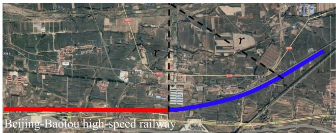

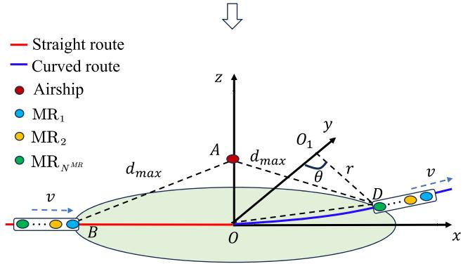  
Fig. 3. The train movement model.

where $\eta \in ( 0 , 1 )$ is the efficiency of the transceiver design. $a _ { i , n , m }$ is the binary variable to indicate whether the m-th TS of the n-th frame is occupied by flow i. If so, $a _ { i , n , m } = 1$ ; otherwise, $a _ { i , n , m } = 0$ . Then the throughput of flow i at the n-th frame can be calculated as

$$
q _ { i , n } = \frac { \sum _ { m = 1 } ^ { M } R _ { i , n , m } \Delta t } { T _ { s } + M \Delta t } .\tag{4}
$$

## C. Train Movement Model

We refer the part of the HSR route from Beijing to Baotou to formulate the train movement model. As shown in Fig. 3, the red line section is the straight route and the blue line section is the curved route, where the curvature radius of the curved route is $r _ { \cdot }$ Then we build the axes, with the origin O at the junction of the straight and curved route. The coordinates of the airship are $A ( 0 , 0 , \Delta h )$ , where $\Delta h = h _ { 2 } - h _ { 1 }$ is the vertical distance difference between the airship and the train’s MRs. when MRs enter the airship’s coverage area, the initial position of them is $B ( - \sqrt { d _ { \operatorname* { m a x } } ^ { 2 } - \Delta h ^ { 2 } } , 0 , 0 )$ , where $d _ { \mathrm { m a x } }$ is the farthest distance of the communication between the airship and the train’s MRs and can be expressed as

$$
d _ { \operatorname * { m a x } } = \left( \frac { k _ { 0 } G _ { n } ^ { t } \left( s , r _ { i } \right) G _ { n } ^ { r } \left( r _ { i } , s \right) P ^ { t } ( i ) } { R _ { s } } \right) ^ { \frac { 1 } { \gamma } } ,\tag{5}
$$

where $R _ { s }$ is the received sensitivity.

Then the coverage of the airship is the circle centered at O with radius $\sqrt { d _ { \operatorname* { m a x } } ^ { 2 } - \Delta h ^ { 2 } }$ . Note that the condition for (5) to hold is $d _ { \operatorname* { m a x } } > \Delta h$ . When the MRs leaves the coverage area of the airship, the coordinates of MRs are located at the intersection point D of circle O and circle $O _ { 1 }$ . The coordinates of point D can be obtained by the following equation

$$
\begin{array} { r } { \left\{ x ^ { 2 } + y ^ { 2 } = d _ { \mathrm { m a x } } ^ { 2 } - \Delta h ^ { 2 } , \right. } \\ { \left. x ^ { 2 } + \left( y - r \right) ^ { 2 } = r ^ { 2 } . \right. } \end{array}\tag{6}
$$

Solving (6) yields the coordinates of point $D ( \sqrt { ( 2 r - 1 ) ( \Delta h ^ { 2 } - d _ { m a x } ^ { 2 } ) / ( 2 r ) } , ( d _ { m a x } ^ { 2 } - \Delta h ^ { 2 } ) / ( 2 r ) , 0 )$ Then the length of straight and curved route in the airship’s coverage area are $\sqrt { d _ { \operatorname* { m a x } } ^ { 2 } - \Delta h ^ { 2 } }$ and $\frac { \varepsilon } { 1 8 0 } \pi r$ , respectively, where the radian ε can be expressed as

$$
\varepsilon = \operatorname { a r c c o s } { \frac { r - { \frac { d _ { m a x } ^ { 2 } - \Delta h ^ { 2 } } { 2 r } } } { r } } = \operatorname { a r c c o s } \left( 1 - { \frac { d _ { m a x } ^ { 2 } - \Delta h ^ { 2 } } { 2 r ^ { 2 } } } \right)\tag{7}
$$

Therefore, the total length of straight route and curved route can be given as

$$
d = \sqrt { d _ { m a x } ^ { 2 } - \Delta h ^ { 2 } } + \frac { \pi r \arctan \left( 1 - \frac { d _ { m a x } ^ { 2 } - \Delta h ^ { 2 } } { 2 r ^ { 2 } } \right) } { 1 8 0 } .\tag{8}
$$

The total communication time for the airship can be represented as

$$
t _ { m a x } = \frac { d + ( N ^ { M R } - 1 ) d ^ { M R } } { v } ,\tag{9}
$$

where $d ^ { M R }$ is the distance between the MRs.

## D. Antenna Model

Directional antennas play a vital role in mmWave communication systems. We consider to use the directional antennas on both the airship and the train’s MRs. These directional antennas can achieve perfect beam alignment during the moving of the train. Then we adopt the directional antenna model mentioned in the literature [37], [38], and the antenna gain can be expressed as

$$
\begin{array} { r } { G ( \theta ) = \left\{ G _ { m } - 3 . 0 1 \cdot \left( \frac { 2 \theta } { \theta _ { - 3 d B } } \right) ^ { 2 } , \quad 0 ^ { \circ } \leq \theta \leq \theta _ { m l } / 2 , \right. } \\ { G _ { s l } , \qquad \left. \theta _ { m l } / 2 \leq \theta \leq 1 8 0 ^ { \circ } , \right. } \end{array}\tag{10}
$$

where θ is the angle between the airship and the train’s MRs. $\theta _ { m l } = - 2 . 6 \cdot \theta _ { - 3 d B }$ is the main lobe width. $\theta _ { - 3 d B }$ is the angle of the half-power beam width. The maximum antenna gain $G _ { m }$ and the sidelobe gain $G _ { s l }$ can be expressed as

$$
G _ { m } = 1 0 \log _ { 1 0 } \left( 1 . 6 1 6 2 \cdot \sin \left( \theta _ { - 3 d B } / 2 \right) \right) ^ { 2 } ,\tag{11}
$$

$$
G _ { s l } = \mathrm { ~ - 0 . 4 1 1 1 \log \left( \theta _ { - 3 d B } \right) - 1 0 . 5 7 9 . }\tag{12}
$$

## IV. PROBLEM FORMULATION AND ANALYSIS

In this section, we consider the resource scheduling problem between the airship and train’s MRs. It’s assume that there are $N _ { n } ^ { f l o w }$ requested flows from the train’s MRs in the n-th frame and each flow has its own QoS requirement ${ \hat { q } } _ { i , n } .$ Our goal is that the airship can schedule more flows that satisfies the QoS requirements to the train’s MRs in the limited time. We define a binary variable $Q _ { i , n }$ to indicate whether the QoS requirement of flow i is satisfied at the n-th frame. If so, $Q _ { i , n } = 1$ ; otherwise, $Q _ { i , n } = 0$ . Therefore, the optimal scheduling problem is formulated as (P1)

$$
\operatorname* { m a x } \sum _ { n = 1 } ^ { N ^ { f r a m e } } \sum _ { i = 1 } ^ { N _ { n } ^ { f l o w } } Q _ { i , n } .\tag{13}
$$

If the throughput at the n-th frame is more than the QoS requirement $\hat { q } _ { i , n }$ for flow i, flow i can be scheduled successfully, which can be expressed as

$$
Q _ { i , n } = \left\{ \begin{array} { l l } { 1 , \mathrm { ~ i f ~ } q _ { i , n } = \frac { \sum _ { m = 1 } ^ { M } R _ { i , n , m } \Delta t } { T _ { s } + M \Delta t } \geq \hat { q } _ { i , n } , } \\ { 0 , \mathrm { ~ o t h e r w i s e , } } \end{array} \right.\tag{14}
$$

Moreover, allocating the TSs to the right flows in each frame is the key to scheduling more flows. According to (3) and (14), whether the throughput offlow i provided by the airship can meet its QoS requirement primarily depends on the binary variable $a _ { i , n , m }$ . The role of the binary variable $a _ { i , n , m }$ is to control whether the m-th TS of the n-th frame is used to schedule flow i. This is the critical variable that needs to be optimized for the problem P1. Meanwhile, the binary variable $a _ { i , n , m }$ needs to satisfy conditions as follows

$$
\sum _ { i = 1 } ^ { N _ { n } ^ { f l o w } } a _ { i , n , m } \leq 1 , \forall n , m .\tag{15}
$$

We assume that the MRs automatically access the airship network when they enter the airship’s coverage area. Since the airship transmits at most one flow to each MR in a frame, the maximum number of flows scheduled by the airship in the n-th frame needs to satisfy

$$
N _ { n } ^ { f l o w } \leq N ^ { M R } ,\tag{16}
$$

where the variable $N _ { n } ^ { f l o w }$ is the number of flows that the airship needs to schedule and is the same as the number of MRs in the airship’s coverage area in the n-th frame. The constant $N ^ { M R } \mathrm { i s }$ the total number of MRs on the train.

In summary, the optimal scheduling problem of maximizing the amount of successfully scheduled flows in the limited frames can be expressed as

$$
( \mathbf { P 1 } ) \operatorname* { m a x } \sum _ { n = 1 } ^ { N ^ { f r a m e } } \sum _ { i = 1 } ^ { N _ { n } ^ { f l o w } } Q _ { i , n } ,
$$

$$
{ \mathrm { s . t . } } \operatorname { C o n s t r a i n t s } ( 1 4 ) - ( 1 6 ) .\tag{17}
$$

The objective function is nonlinear since the achievable data rate of each flow includes a logarithmic function. Therefore, problem P1 is a mixed-integer nonlinear programming problem with binary variable $Q _ { i , n }$ . The MR’s movement trajectory, QoS requirements, and throughput between the airship and the MRs will jointly determine the scheduling scheme of the flows, which is more complex than the 0-1 knapsack problem [34], [39]. In the next section, we will introduce a QoS-aware scheduling scheme to solve problem P1.

## V. THE AIRSHIP-ASSISTED SCHEDULING SCHEME

In this section, we introduce a QoS-aware scheduling scheme ofthe airship-assisted HSR mmWave communication in SAGIN. It mainly includes two parts. The first part is the MR selection algorithm, and the second part is the max-flow scheduling algorithm. In particular, once the MRs enter the airship’s coverage area, they will automatically access the airship and request flows at each frame. When a flow’s QoS requirement is satisfied, this flow is called the completed flow.

## A. Mobile Relay Selection Algorithm

The selection of MRs depends on the relative positions of the MRs and the airship. Considering that different MRs enter the airship’s coverage area at different times, we define that all MRs in the set $S _ { a l l } ^ { M R } \overset { \cdot } { = } \left\{ \mathbf { M } \mathbf { R } _ { 1 } , \mathbf { M } \mathbf { R } _ { 2 } , \dots , \mathbf { M } \mathbf { R } _ { N ^ { M R } } \right\}$ . And the time of the $N ^ { M R }$ -th MR entering and exiting the airship’s coverage area are $t _ { N ^ { M R } } ^ { i n i t i a l }$ and $t _ { N ^ { M R } } ^ { e n d }$ , respectively. Since the distances between the MRs are the same, the time difference between neighboring MRs entering the airship’s coverage area can be expressed as

$$
\Delta t _ { 1 } = t _ { N ^ { M R } } ^ { i n i t i a l } - t _ { N ^ { M R } - 1 } ^ { i n i t i a l } = t _ { N ^ { M R } } ^ { e n d } - t _ { N ^ { M R } - 1 } ^ { e n d } = \frac { d ^ { M R } } { v } .\tag{18}
$$

Then the duration during which every MR accesses the airship can be expressed as $\Delta t _ { 2 } = t _ { N ^ { M R } } ^ { i n i t i a l } - t _ { N ^ { M R } } ^ { e n d }$ . During the time $\Delta t _ { 1 }$ and $\Delta t _ { 2 }$ , the number of frames can be represented as

$$
N _ { 1 } ^ { f r a m e } = \frac { \Delta t _ { 1 } } { T _ { s } + M \Delta t } = \frac { d ^ { M R } } { v ( T _ { s } + M \Delta t ) } ,\tag{19}
$$

$$
N _ { 2 } ^ { f r a m e } = \frac { \Delta t _ { 2 } } { T _ { s } + M \Delta t } = \frac { d } { v ( T _ { s } + M \Delta t ) } .\tag{20}
$$

According to (19) and (20), the total number of frames during the communication can be calculated as

$$
N _ { t o t a l } ^ { f r a m e } = \left( N ^ { M R } - 1 \right) N _ { 1 } ^ { f r a m e } + N _ { 2 } ^ { f r a m e } .\tag{21}
$$

Then the MR selection can be categorized into the following three cases.

1) Joining Phase: Starting with the first MR entering airship coverage and ending with a phase where all MRs enter airship’s coverage area. For example, i $Y 1 \le n < N _ { 1 } ^ { f r a m e }$ the airship can communicate with $\mathrm { M R } _ { 1 }$ , but not with other $\mathbf { M } \mathbf { R } \mathbf { s } ; \mathrm { i f } \stackrel { \cdot } { N } _ { 1 } ^ { f r a m e } \leq n < N _ { 2 } ^ { f r a m e }$ , the airship can communicate with $\mathrm { { M R } _ { 1 } }$ and $\begin{array} { r } { \mathbf { M } \mathbf { R } _ { 2 } , } \end{array}$ but not with other MRs. The duration of this phase is $1 \leq n < ( N ^ { M R } - 1 ) N _ { 1 } ^ { f r a m e }$

2) Full Access Phase: All MRs are in the airship’s coverage area. The total number of flows that the airship needs to schedule in this phase is given by $N _ { n } ^ { f l o w } = N ^ { M R }$ The duration of this phase is $( N ^ { M R } - 1 ) \bar { N } _ { 1 } ^ { f r a m e } \leq n \leq$ $N _ { 2 } ^ { f r a m e }$

3) Departure Phase: Starting with the first MR leaving the airship’s coverage area until all MRs are out of the airship’s coverage area. For example, if $N _ { 2 } ^ { f r a m e } < n \leq$ $N _ { 1 } ^ { f r a m e } + N _ { 2 } ^ { f r a m e }$ , the airship cannot communicate with $\mathrm { M R } _ { 1 }$ , but can communicate with other MRs; if $N _ { 1 } ^ { f r a m e } +$ $N _ { 2 } ^ { f r a m e } < n \leq 2 N _ { 1 } ^ { f r a m e } + N _ { 2 } ^ { f r a m e }$ , the airship cannot communicate with $\mathrm { M R } _ { 1 }$ and ${ \mathrm { M R } } _ { 2 }$ , but can communicate with other MRs; and so on. The duration of this phase is $N _ { 2 } ^ { f r a m e } < n \leq N _ { t o t a l } ^ { f r a m e }$

The MR selection algorithm is summarized in Algorithm 1, where $S _ { n } ^ { M R }$ is the set that includes the MRs in the airship’s coverage area in the n-th frame. If the frame $1 \leq n < ( N ^ { M \bar { R } } -$ $1 ) N _ { 1 } ^ { f r a m e }$ , it is in the joining phase. Then we calculate the distance between the airship and the MRs in this phase. When the j-th MR enters the airship’s coverage area in the n-th frame, the set $S _ { n } ^ { M R } = S _ { n } ^ { M R } \cup j$ . If the frame $( N ^ { M R } - 1 ) N _ { 1 } ^ { f r a m e } \leq$ $n \leq N _ { 2 } ^ { f r a m e }$ , it is in the full access phase. The airship can schedule flows to all MRs and $S _ { n } ^ { M R } = S _ { a l l } ^ { M R }$ . If the frame $N _ { 2 } ^ { f r a m e } < n < N _ { t o t a l } ^ { f r a m e }$ , it is in the departure phase. When the j-th MR leave the airship’s coverage area in the n-th frame, the set $S _ { n } ^ { M R } = S _ { n } ^ { M R } - j$ . Besides, in order to enhance the number of completed flows in different phases, we further propose the max-flow scheduling algorithm in the next subsection.

Algorithm 1: The MR Selection Algorithm.   
Input: $S _ { a l l } ^ { M R } , S _ { n } ^ { M R } = \emptyset$   
Output: ${ \check { S } } _ { n } ^ { M R }$   
1 for frame n $( 1 \leq n < ( N ^ { M R } - 1 ) N _ { 1 } ^ { f r m a e } )$ do   
2 for relay $j ( 1 \leq j \leq | S _ { a l l } ^ { M R } | )$ do   
3 Calculate the distance $d _ { j }$ between the airship   
and $\operatorname { M R } _ { j } ;$   
4 if $d _ { j } \leq \sqrt { d _ { m a x } ^ { 2 } - \Delta h ^ { 2 } }$ then   
5 $\begin{array} { r } { \ L \ L \ L \ L \ L \dot { S _ { n } ^ { M R } } = \bar { S _ { n } ^ { M R } } \cup \ O { j } ; } \end{array}$   
6 else   
7 break;   
8 for frame $n ( ( N ^ { M R } - 1 ) N _ { 1 } ^ { f r m a e } \leq n < N _ { 2 } ^ { f r m a e } )$ do   
9 for relay $j ( 1 \leq j \leq | S _ { a l l } ^ { \mathbf { \dot { M } } R } | )$ do   
10 $\begin{array} { r }  \ L \ L \ L \ L \ L \ L \ L \ L \ L \ L \ L \ L \ L \ L \ L \ L \ L \ L \ L \ L \ L \ L \ L \ L \ L \ L \ L \ L \ L \ L \ L \ L \ L \ L \ L \ L \ L \ L \ L \ L \ L \ L \ L \ L \ L \ L \ L \ L \ L \ L \ L \ L \ L \ L \ L \ L \ L \ L \ L \ L \ L \ L \ L \ L \ L \ L \ L \ L \ L \ L \ L \ L \ L \ L \ L \ L \ L \ L \ L \ L \ L \ L \ L \ L \ L \ L \ L \ L \ L \ L \ L \ L \ L \ L \ L \ L \ L \ L \ L \ L \ L \ L \ L \ L \ L \ L \ L \ L \ L \ L \ L \ L \ L \ L \ L \ L \ L \ L \ L \ L \ L \ L \ L \ L \ L \ L \ L \ L \ L \ L \ L \ L \ L \ L \ L \ L \ L \ L \ L \ L \ L \ L \ L \ L \ L \ L \ L \ L \ L \ L \ L \ L \ L \ L \ L \ L \ L \ L \ L \ L \ L \ L \ L \ L \ L \ L \ L \ L \ L \ L \ L \ L \ L \ L \ L \ L \ L \ L \ L \ L \ L \ L \ L \ L \ L \ L \ L \ L \ L \ L \ L \ L \ L \ L \ L \ L \ L \ L \ L \ L \ L \ L \ L \ L \ L \ L \ L \ L \ L \ L \ L \ L \ L \ L \ L \ L \ L \ L \ L \ L \ L \ L \ L \ L \ L \ L \ L \ L \ L \ L \ L \ L \ L \ L \ L \ L \ L \ L \ L \ L \ L \ L \ L \ L \ L \ L \ L \ L \ L \ L \ L \ L \ L \ L \ L \ L \ L \ L \ L \ L \ L \ L \ L \ L \ L \ L \ L \ L \ L \ L \ L \ L \ L \ L \ L \ L \ L \ L \ L \ L \ L \ L \ L \ L \ L \ L \ L \ L \ L \ L \ L \ L \ L \ L \ L \ L \ L \ L \ L \ L \ L \ L \ L \ L \ L \ L \ L \ L \ L \ L \ L \ L \ L \ L \ L \ L \ L \ L \ L \ L \ L \ L \ L \ L \ L \ L \ L \ L \ L \ L \ L \ L \ L \ L \ L \ L \ L \ L \ L \ L \ L \ L \ L \ L \ L \ L \ L \ L \ L \ L \ L \ L \ L \ L \ L \ L \ L \ L \ L \ L \ L \ L \ L \ L \ L \ L \ L \ L \ L \ L \ L \ L \ L \ L \ L \ L \ L \ L \ L \ \end{array}$   
11 for frame $ { n ( N _ { 2 \ldots } ^ { f r m a e } } \leq  { n } <  { N _ { t o t a l } ^ { f r a m e } } )$ do   
12 ${ \bf { \bar { \it S } } } _ { n } ^ { M R } = { \bf { \bar { \it S } } } _ { a l l } ^ { { \tilde { M } } R } ;$   
13 for relay $j ( 1 \leq j \leq | S _ { a l l } ^ { M R } | )$ do   
14 Calculate the distance $d _ { j }$ between the airship   
and $\operatorname { M R } _ { j } ;$   
15 if $d _ { j } > \sqrt { d _ { \operatorname* { m a x } } ^ { 2 } - \Delta h ^ { 2 } }$ then   
16 $\\L ~ \ L ~ \bar { S } _ { n } ^ { M R } = \widetilde { S } _ { n } ^ { \hat { M } R } - j ;$

## B. Max-Flow Scheduling Algorithm

When MRs enter the coverage area of the airship, MRs will report the QoS requirements of flows to the airship during the scheduling phase at each frame, which is called QoS-aware [40]. Then the airship sends the corresponding flows for MRs during the transmission phase. However, it is not the case that choosing an arbitrary MR to transmit the flows can achieve the QoS requirements of more flows, especially when the MRs move at high speed. On the one hand, if the MR is too far away from the airship, even scheduling only one flow in the transmission phase may not complete the QoS requirements of the flow. On the other hand, when the train’s speed increases, the number of TSs at each frame will be reduced to guarantee that the MRs channel remains unchanged during a frame, which also result in the QoS requirements of partial flows not being accomplished in the transmission phase [37].

To maximize the number of completed flows within the limited frames, we prioritize the flows that occupy the less number of TSs at each frame. Moreover, the number of TSs occupied by a flow that satisfies QoS requirements is related to the throughput that the airship can provide [35]. Therefore, the number of TSs occupied by flow i at the n-th frame can be estimated as

Algorithm 2: The Max-Flow Scheduling Algorithm.   
Input: $Q _ { i , n } = 0 , N _ { n } ^ { b i t } = 0$   
Output: $Q _ { i , n } , N _ { n } ^ { b i t }$   
1 Calculate M;   
2 for frame $n ( 1 \leq n \leq N _ { t o t a l } ^ { f r a m e } )$ do   
3 Get set $\dot { S } _ { n } ^ { M R }$ by Algorithm 1;   
4 $N _ { n } ^ { f l o w } = \ddot { | } S _ { n } ^ { M \dot { R _ { \mathbf { \lambda } } } } | ;$   
5 $r ^ { s l o t } = M ;$   
6 for flow $i ( 1 \leq i \leq N _ { n } ^ { f l o w } )$ do   
7 |Calculate $R _ { i , n , m } ;$   
8 Sort the flows at the n-th frame according to (22)   
and record in the set $S _ { n } ^ { s o r t } ;$   
9 for flow $i ( 1 \leq i \leq | S _ { n } ^ { s o r \dot { t } } | )$ do   
10 if $E _ { n } ( i ) \leq r ^ { s l o t }$ then   
11 $Q _ { i , n } = 1 ;$   
12 $N _ { n } ^ { b i t } = R _ { i , n , m } E _ { n } ( i ) \Delta t ;$   
13 $r ^ { s l o t } = r ^ { s l o t } - E _ { n } ( i ) ;$   
14 else   
15 if $i = 1$ then   
16 $\begin{array} { r }  \ L \ L \ L \ L \ L \ L \ L \ L \ L \ L \ L \ L \ L \ L \ L \ L \ L \ L \ L \ L \ L \ L \ L \ L \ L \ L \ L \ L \ L \ L \ L \ L \ L \ L \ L \ L \ L \ L \ L \ L \ L \ L \ L \ L \ L \ L \ L \ L \ L \ L \ L \ L \ L \ L \ L \ L \ L \ L \ L \ L \ L \ L \ L \ L \ L \ L \ L \ L \ L \ L \ L \ L \ L \ L \ L \ L \ L \ L \ L \ L \ L \ L \ L \ L \ L \ L \ L \ L \ L \ L \ L \ L \ L \ L \ L \ L \ L \ L \ L \ L \ L \ L \ L \ L \ L \ L \ L \ L \ L \ L \ L \ L \ L \ L \ L \ L \ L \ L \ L \ L \ L \ L \ L \ L \ L \ L \ L \ L \ L \ L \ L \ L \ L \ L \ L \ L \ L \ L \ L \ L \ L \ L \ L \ L \ L \ L \ L \ L \ L \ L \ L \ L \ L \ L \ L \ L \ L \ L \ L \ L \ L \ L \ L \ L \ L \ L \ L \ L \ L \ L \ L \ L \ L \ L \ L \ L \ L \ L \ L \ L \ L \ L \ L \ L \ L \ L \ L \ L \ L \ L \ L \ L \ L \ L \ L \ L \ L \ L \ L \ L \ L \ L \ L \ L \ L \ L \ L \ L \ L \ L \ L \ L \ L \ L \ L \ L \ L \ L \ L \ L \ L \ L \ L \ L \ L \ L \ L \ L \ L \ L \ L \ L \ L \ L \ L \ L \ L \ L \ L \ L \ L \ L \ L \ L \ L \ L \ L \ L \ L \ L \ L \ L \ L \ L \ L \ L \ L \ L \ L \ L \ L \ L \ L \ L \ L \ L \ L \ L \ L \ L \ L \ L \ L \ L \ L \ L \ L \ L \ L \ L \ L \ L \ L \ L \ L \ L \ L \ L \ L \ L \ L \ L \ L \ L \ L \ L \ L \ L \ L \ L \ L \ L \ L \ L \ L \ L \ L \ L \ L \ L \ L \ L \ L \ L \ L \ L \ L \ L \ L \ L \ L \ L \ L \ L \ L \ L \ L \ L \ L \ L \ L \ L \ L \ L \ L \ L \ L \ L \ L \ L \ L \ L \ L \ L \ L \ L \ L \ L \ L \ L \ L \ L \ L \ L \ L \ L \ L \ L \ L \ L \ L \ L \ L \ L \ L \ L \ L \ L \ L \ L \ L \ L \ L \ L \ L \ L \ L \ L \ L \ \end{array}$   
17 else   
18 $N _ { n } ^ { b i t } = R _ { i , n , m } r ^ { s l o t } \Delta t ;$

$$
\varpi _ { i , n } = \frac { \hat { q } _ { i , n } \left( T _ { s } + M \Delta t \right) } { q _ { i , n } \Delta t } .\tag{22}
$$

The max-flow scheduling algorithm is summarized in Algorithm 2. First, we determine the number of TSs at each frame based on the train’s speed, so that the length of the frame can be obtained. Then we sort the scheduled flows according to the number of TSs occupied in the n-th frame and record them into set $S _ { n } ^ { s o r t }$ . Meanwhile, we record the number of TSs occupied by each flow to the set $E _ { n }$ in the n-th frame. If the number of TSs occupied by the flow i in the n-th frame is less than or equal to the number of TSs available $( E _ { n } ( i ) \leq r ^ { s l o t } )$ , the airship can successfully schedule flow i and $Q _ { i , n } = 1$ . Then the airship schedules flows sequentially according to the set $S _ { n } ^ { s o r t }$ and $E _ { n }$ in the n-th frame until the number of remaining TSs is not enough to be used by the remaining flows $( E _ { n } ( i ) > r ^ { s l o t } )$ . It should be emphasized that if the remaining TSs are not enough to be used by flow i in the n-th frame, we still allocate the remaining TSs to flow $i ,$ but flow i is not considered a completed flow and $Q _ { i , n } = 0$ . Finally, the output of Algorithm 2 is the number of successfully scheduled flows in each frame and the number of successfully transmitted bits. To obtain the final result for the problem P1, we need to accumulate the scheduling output $Q _ { i , n }$ for all flows in each frame in Algorithm 2.

For the complexity of the max-flow scheduling algorithm, we can observe the outer for loop has $N _ { t o t a l } ^ { f r a m \overline { { e } } }$ iterations. The inner for loop has $2 N ^ { M R }$ iterations in the worst case.

TABLE I  
SIMULATION PARAMETERS
<table><tr><td>Parameter</td><td>Symbol</td><td>Value</td></tr><tr><td>Frequency band</td><td> $f _ { c }$ </td><td>28 GHz</td></tr><tr><td>Bandwidth</td><td> $\bar { W }$ </td><td>850 MHz</td></tr><tr><td>Height of the MRs</td><td> $h _ { 1 }$ </td><td>4m</td></tr><tr><td>Distance of between the MRs</td><td> $d ^ { \hat { M } R }$ </td><td>30 m</td></tr><tr><td>Transmitted power</td><td> $P _ { t }$ </td><td>10 W</td></tr><tr><td>Received sensitivity</td><td> $R _ { s }$ </td><td>-80 dBm</td></tr><tr><td>Transceiver efficiency factor</td><td> $\eta$ </td><td>0.5</td></tr><tr><td>Background noise</td><td> $N _ { 0 }$ </td><td>-134 dBm/MHz</td></tr><tr><td>Slot time</td><td> $\Delta t$ </td><td>18 µs</td></tr><tr><td>Beacon period</td><td> $T _ { s }$ </td><td>850 µs</td></tr><tr><td>Half-power beamwidth</td><td>θ  $\underline { { 3 d B } }$ </td><td>30°</td></tr></table>

Therefore, the computational complexity of the algorithm is $\mathcal { O } ( 2 N _ { t o t a l } ^ { f r a m e } N ^ { M R } )$ , which can be implemented in practice.

## VI. PERFORMANCE EVALUATION

In this section, we evaluate the performance of the proposed algorithm based on the number of completed flows, the number of transmitted bits with other scheduling algorithms for the airship-assisted HSR mmWave communication in SAGIN.

## A. Simulation Setup

We consider the scheduling scheme of the flows between the airship and the train’s MRs. The distance between MRs is set to $d ^ { M R } = 3 0 \mathrm { m }$ . The frequency band and the bandwidth are set to $f _ { c } = 2 8$ GHz and W = 850 MHz [16], [37]. The position information of the MRs needs to be updated periodically when the train is moving at high speed. In order to ensure that the channel between the airship and the MRs remains constant in a frame, we require that the train moves no more than 3m during a frame. In addition, the QoS requirements offlows are determined by the demands of HSR users, and the QoS requirements of the different flows is dynamic. The specific parameters are shown in Table I [9], [37], [36].

For the performance evaluation study, the following performance metrics are used.

Total number of completed flows: The total number of successfully scheduled flows that satisfy the QoS requirements when the train passes through the airship’s coverage area. If the number of available TSs does not satisfy the QoS requirements of requested flows, the scheduled flows will not be counted as completed flows [35].

\- Total number of transmitted bits: During the communication time, the total number of bits from the airship to the MRs is recorded.

For comparison, we implement three benchmark algorithms, including random communication (RC) algorithm, single MR communication (SMR ) algorithm and single $\mathrm { M R } _ { 2 }$ communication $( \mathrm { S M R } _ { 2 } )$ algorithm.

RC [36]: When MRs enter the airship’s coverage area, the airship randomly selects a MR to schedule the flow that satisfies its QoS requirement. If there are remaining TSs unused, the airship will continue to schedule flows for the remaining MRs until the TSs are used up or the QoS requirements of all requested flows are satisfied.

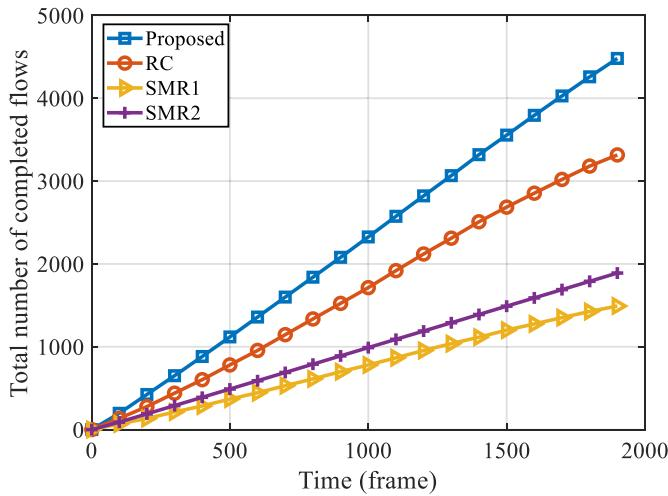  
Fig. 4. Total number of completed flows versus different time.

$S M R _ { 1 } .$ : The airship schedules flows only for $\mathrm { M R } _ { 1 }$ , but does not schedule flows for the other MRs. Note that $\mathrm { M R } _ { 1 }$ enters the airship’s coverage area in the frame $n \in [ 1 , N _ { 2 } ^ { f r a m e } ]$

$S M R _ { 2 } { \it : }$ The airship schedules flows only for $\mathrm { M R } _ { 2 }$ , but does not schedule flows for the other MRs. Note that $\mathrm { M R } _ { 2 }$ enters the airship’s coverage area in the frame $n \in$ $\left[ N _ { 1 } ^ { f r a m e } , N _ { 1 } ^ { f r a m e } + \dot { N } _ { 2 } ^ { f r a m e } \right]$

## B. Comparison With Other Algorithms

1) Under Different Time: In this case, we set that the time is from 0 to 1,900 frames. The number of MRs is set to $N ^ { M R } = 3$ The height of the airship is set to $h _ { 2 } = 1$ km. The radius of curvature ofthe curved route is set to $r = 2$ km. The train’s speed is set to $v = 5 0 0$ km/h. We assume that the QoS requirements of flows are uniformly distributed between 100Mbps and 5Gbps for $\mathrm { M R } _ { 1 } .$ and between 100Mbps and 2Gbps for $\mathrm { M R } _ { 2 }$ and $\mathrm { M R } _ { 3 }$

Fig. 4 presents that the change of the total number of completed flows with different time. As the time increases, we can see that the completed flows of the four algorithms are rising. For the proposed algorithm, it schedules the maximum number of the flows in the limited time. In addition, the total number of completed flows by the RC algorithm is more than that of $\mathrm { S M R } _ { 1 }$ and SMR2 because the RC algorithm can schedule up to three flows in a frame, while the $\mathbf { S M R } _ { 1 }$ and $\mathrm { S M R } _ { 2 }$ algorithms can schedule only one flow in a frame. Moreover, since the lower QoS requirements of flows are more easily to schedule successfully, the $\mathrm { S M R } _ { 2 }$ algorithm is better than $\mathbf { S M R } _ { 1 }$ algorithm in scheduling more flows. Finally, after the MR enters the airship’s coverage area for 1,900 frames, the proposed algorithm outperforms the RC algorithm with a gain of 36% and the $\mathrm { S M R } _ { 2 }$ algorithm with a gain of 131%.

Fig. 5 presents that the change of the total number of transmitted bits with different time. The result shows that the total number of transmitted bits of the four algorithms are all increasing with the increased time. Moreover. the number of transmitted bits for the proposed algorithm is significantly higher than that of the other algorithms. Besides, the total number of transmitted bits for the SMR1 algorithm is better than that of $\mathrm { S M R } _ { 2 }$ algorithm due to its higher QoS requirements of flows. Finally, after the $\mathrm { M R } _ { 1 }$ enters airship’s coverage area for 1,900 frames, the proposed algorithm outperforms the RC algorithm with a gain of 21% and $\mathbf { S M R } _ { 1 }$ algorithm with a gain of 85%.

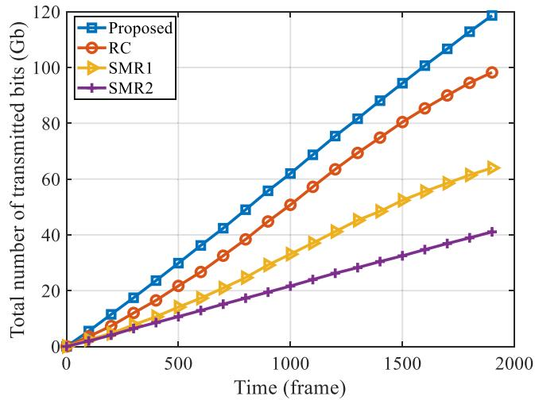  
Fig. 5. Total number of transmitted bits versus the different time.

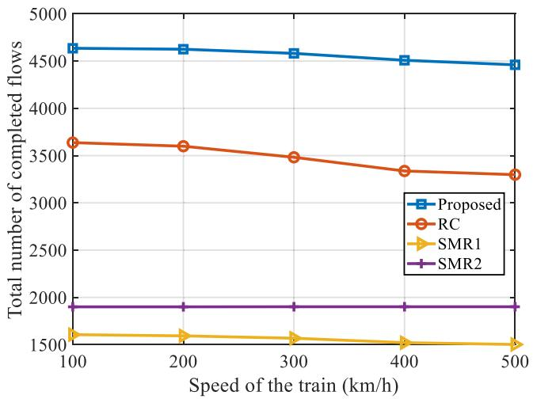  
Fig. 6. Total number of completed flows versus different speeds of the train.

2) Under Different Speeds of the Train: In this case, we choose the train’s speed v is from 100 to 500 km/h. The number of MRs is set to $\bar { N } ^ { M R } = 3$ . The height of the airship is set to $h _ { 2 } = 1$ km. The radius of curvature of the curved route is set to $r = 2$ km. We assume that the QoS requirements of flows are uniformly distributed between 100Mbps and 5Gbps for $\mathrm { M R } _ { 1 }$ and between 100Mbps and 2Gbps for $\mathrm { M R } _ { 2 }$ and $\mathrm { M R } _ { 3 }$ . The time is set to 1,900 frames.

Fig. 6 presents that the change of the number of completed flows with different speeds of the train. It can be seen that the number of completed flows for proposed algorithm, RC algorithm and $\mathbf { S M R } _ { 1 }$ algorithm gradually decreases with train’s speed increases. This is because as the train’s speed increases, the duration of each frame becomes shorter and the number of TSs at each frame decreases. It should be noted that the throughput of MRs in a frame is proportional to the number of TSs. Therefore, when the train’s speed $v = 5 0 0$ km/h, the throughput for MRs is the worst, which results in a decrease for the number of completed flows. In addition, the train’s speed has the least effect on SMR algorithm. The reason is that the QoS requirements of MR are lower, and its scheduling flows are almost always scheduled successfully at different speeds.

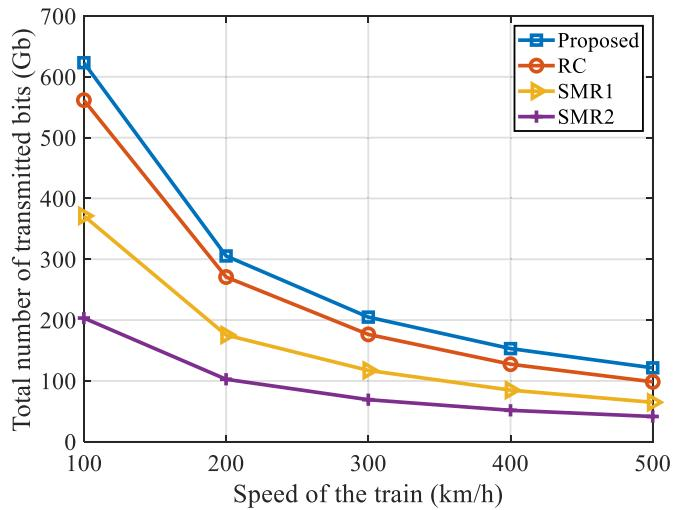

Fig. 7. Total number of transmitted bits versus different speeds of the train.  
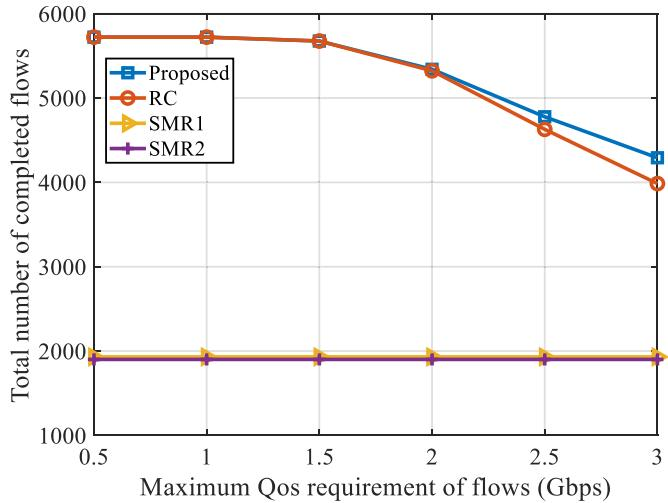  
Fig. 8. Total number of completed flows versus different maximum QoS requirement of flows.

Fig. 7 presents that the change of the total number of transmitted bits with different speeds of the train. For the proposed algorithm, its total number of transmitted bits is better than other algorithms, especially when v is smaller. And its total number of transmitted bits is 20% higher than that of RC algorithm when $v = 1 0 0$ km/h.

3) Under different QoS Requirements ofFlows: In this case, we set that the QoS requirements of flows are from 100Mbps to $\mathrm { Q o S } _ { \mathrm { m a x } }$ , where the maximum QoS requirements $\mathrm { Q o S } _ { \mathrm { m a x } } =$ $0 . 5 \sim 3$ Gbps. The number of MRs is set to $N ^ { M R } = 3$ . The height of the airship is set to $h _ { 2 } = 1$ km. The radius of curvature of the curved route is set to $r = 2$ km. The train’s speed is set to $v = 5 0 0$ km/h. The time is set to 1,900 frames.

Fig. 8 presents that the change of the number of completed flows with different maximum QoS requirements of flows. It can be seen that the number of completed flows for the proposed algorithm and RC algorithm gradually decreases as maximum QoS requirements increases. When the maximum QoS requirement $\mathrm { Q o S } _ { \mathrm { m a x } } \le 1 . 5$ Gbps, the proposed algorithm completes almost the same number ofcompleted flows as the RC algorithm. When the maximum QoS requirement $\mathrm { Q o S } _ { \mathrm { m a x } } > 1 . 5$ Gbps, the proposed algorithm completes significantly more flows than the other algorithms. When $\mathrm { Q o S } _ { \mathrm { m a x } } = 3$ Gbps, the proposed algorithm outperforms the RC algorithm with a gain of 10% and $\mathbf { S M R } _ { 1 }$ algorithm with a gain of 120%. Besides, $\mathbf { S M R } _ { 1 }$ and $\mathrm { S M R } _ { 2 }$ algorithms have almost the same number of completed flows.

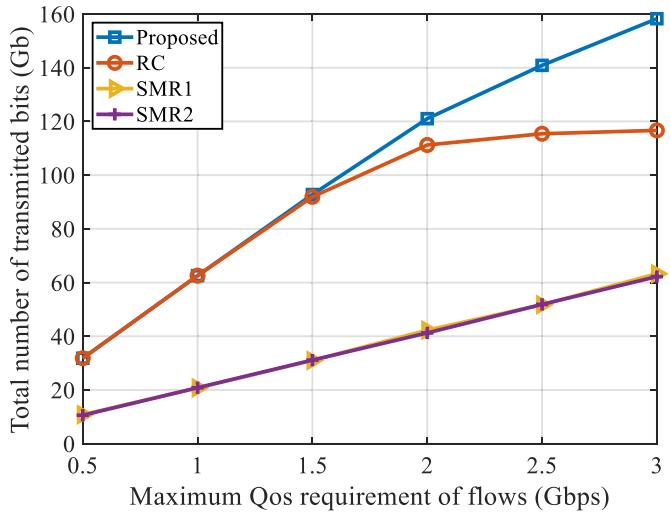  
Fig. 9. Total number of transmitted bits versus different maximum QoS requirement of flows.

Fig. 9 presents that the change of the total number of transmitted bits with different maximum QoS requirements of flows. As the maximum QoS requirements of flows increases, we can see that the total number of transmitted bits of the four algorithms are rising. When the maximum QoS requirement $\mathrm { Q o S } _ { \mathrm { m a x } } \le 1 . 5 ,$ , the proposed algorithm completes almost the same number of transmitted bits as the RC algorithm. When $\mathrm { Q o S } _ { \mathrm { m a x } } > 1 . 5 \mathrm { G b p s }$ , the proposed algorithm is the optimal. And its total number of transmitted bits is 34% higher than that of RC algorithm when $\mathrm { Q o S } _ { \mathrm { m a x } } = 3$ Gbps. Besides, SMR and SMR algorithms have almost the same number of transmitted bits.

4) Under Different Radius ofCurvature ofthe Curved Route: In this case, we set the radius of curvature of the curved route is from 2 to 14 km. The number of MR is set to $N ^ { M R } = 3$ . The height of the airship is set to $h _ { 2 } = 1$ km. The train’s speed is set to $v = 5 0 0$ km/h. We assume that the QoS requirements of flows are uniformly distributed between 100 Mbps and 5 Gbps for $\mathrm { { M R } _ { 1 } } .$ , and between 100 Mbps and 2 Gbps for $\mathrm { M R } _ { 2 }$ and MR . The time is set to 1,900 frames.

Fig. 10 presents the total number of completed flows with different radius of curvature of the curved route. It can be seen that the proposed algorithm has the highest number ofcompleted flows at different radius of curvature. Moreover, when the radius of curvature is from 2 to 4km, the total number of completed flows is decreasing for four algorithms. This is because as the radius of curvature increases, the curved route becomes shorter in the airship’s coverage. However, when the radius of curvature is more than 4 km, the curved route in the airship’s coverage area can be viewed almost as the straight route. Therefore, when the radius of curvature is greater than 4 km, all algorithms no longer have a significant change in term of the number of completed flows.

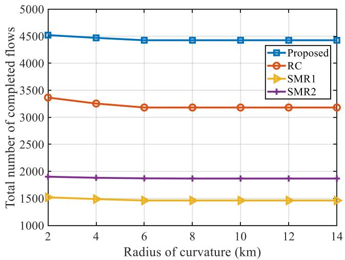  
Fig. 10. Total number of completed flows versus different radius of curvature of the curved route.

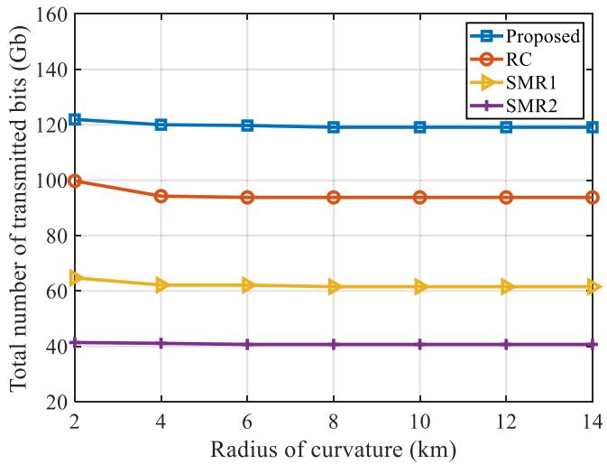  
Fig. 11. Total number of transmitted bits versus different radius of curvature of the curved route.

Fig. 11 presents the total number of transmitted bits with different radius of curvature of the curved route. It can be seen that the total number of transmitted bits is decreasing with increasing of the radius of curvature, when the radius of curvature is less than 4km. Moreover, it can also be seen that all algorithms no longer have a significant change in the number of transmitted bits, when the radius of curvature is greater than 4km.

5) Under Different Heights of the Airship: In this case, we set the height of the airship is from 800 m to 2,200 m. The number of MRs is set to $N ^ { \bar { M } R } = 3$ . The radius of curvature of the curved route is set to $r = 2$ km. The train’s speed is set to v = 500 km/h. We assume that the QoS requirements of flows are uniformly distributed between 100 Mbps and 5 Gbps for MR , and between 100 Mbps and 2 Gbps for MR and MR . The time is set to 1,900 frames.

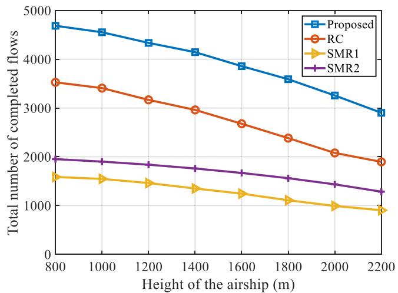  
Fig. 12. Total number of completed flows versus different heights of the airship.

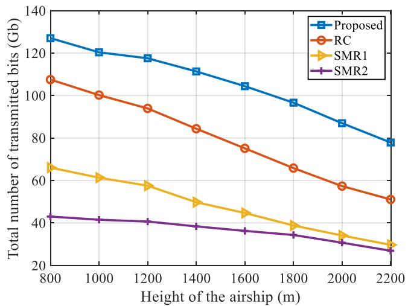  
Fig. 13. Total number of transmitted bits versus different heights of the airship.

Fig. 12 presents the total number of completed flows with different heights of the airship. It can be seen that the number of completed flows decreases with increasing the height of the airship for four algorithms. When the height of the airship is $h = 2 , 2 0 0 \mathrm { m }$ , the number of completed flows for the proposed algorithm can reach 2,900, which is 53% higher than RC algorithm. Besides, the number of completed flows for the proposed algorithm is optimal at different heights of the airship.

Fig. 13 presents the total number of transmitted bits with different heights of the airship. It can be seen that the total number of transmitted bits is decreasing significantly with increasing of the height of the airship. Moreover, it can also be seen that the proposed algorithm has the highest number of transmitted bits at different heights of the airship.

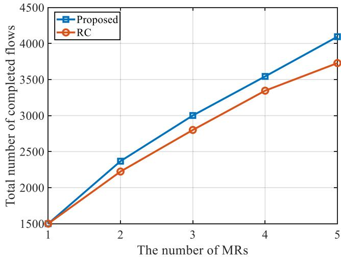  
Fig. 14. Total number of completed flows versus different numbers of MRs.

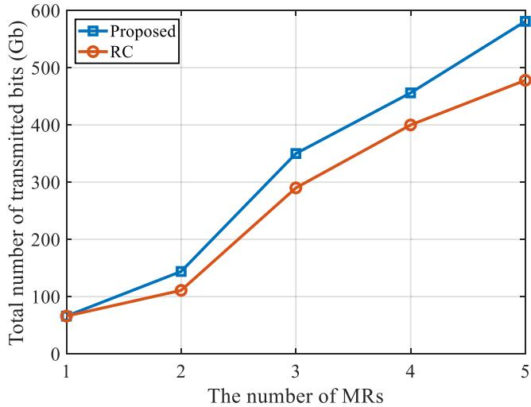  
Fig. 15. Total number of transmitted bits versus different numbers of MRs.

6) Under Different Numbers of MRs: In this case, we choose the number of MRs ranging from 1 to 5. The QoS requirements of flows are from 100Mbps to 5Gbps for all MRs. The speed of the train is set to v = 500 km/h. The time is set to 1,900 frames.

Fig. 14 presents the total number of completed flows with different numbers of MRs. It can be seen that the total number of completed flows is growing with increasing of the number of MRs. The reason for this is that when the number of MRs increases, the number of flows that need to be scheduled increases, and as a result, the number of completed flows will increase. Moreover, when the number of MRs is more than 2, the total number of completed flows of the proposed algorithm is significantly higher than that of the RC algorithm. When the number of MRs is 5, the total number of completed flows of the proposed algorithm is 9% higher than that of the RC algorithm.

Fig. 15 presents the total number of transmitted bits with different numbers of MRs. It can be seen that the total number of transmitted bits is increasing rapidly with increasing of the number of MRs. The reason is that as the number of MRs increases, the number of flows that need to be scheduled grows. Besides, it can be seen that the proposed algorithm has the highest number of transmitted bits at different numbers of MRs. When the number of MRs is 5, the total number of transmitted bits of the proposed algorithm is 21% higher than that of the RC algorithm.

## VII. CONCLUSION

In this paper, we consider a problem of maximizing the number of flows with their QoS requirements satisfied between the airship and the train’s MRs in SAGIN. First, we propose the MR selection algorithm to determine the number of MRs in each frame that can be covered by the airship during train movement. Furthermore, we propose a max-flow scheduling algorithm based on the MR selection algorithm, which can select the optimal scheduling order of the flows at each frame and maximize the number of completed flows during the whole communication time. Simulation results show that the proposed algorithm can effectively increase the number of completed flows and transmitted bits. Especially when the upper limit of the QoS requirements of flows are increased, the proposed algorithm completes the number of flows significantly better than the other algorithms. Besides, we find that the number of completed flows is also affected by the radius of curvature of the route and the height of the airship. As the radius of curvature of the route and the height of the airship rise, the number of completed flows will reduce. Finally, we verify that the number of completed flows for the proposed algorithm is further improved when the number of MRs increases.

## REFERENCES

[1] B. Ai, A. F. Molisch, M. Rupp, and Z.-D. Zhong, “5G key technologies for smart railways,” Proc. IEEE, vol. 108, no. 6, pp. 856–893, Jun. 2020.

[2] R. He et al., “High-speed railway communications: From GSM-R to LTE-R,” IEEE Veh. Technol. Mag., vol. 11, no. 3, pp. 49–58, Sep. 2016.

[3] Statista Research Department, “Length of the high speed railway lines in operation worldwide in 2022, by country,” 2023 [Online]. Available: https://www.statista.com/statistics/1265995/length-ofhighspeed-railway-lines-in-use-worldwide-by-country/

[4] Z. Lin, M. Lin, B. Champagne, W.- P. Zhu, and N. Al-Dhahir, “Secrecyenergy efficient hybrid beamforming for satellite-terrestrial integrated networks,” IEEE Trans. Commun., vol. 69, no. 9, pp. 6345–6360, Sep. 2021.

[5] X. Zhang et al., “QoS-aware user association and transmission scheduling for millimeter-wave train-ground communications,” IEEE Trans. Intell. Transp. Syst., vol. 24, no. 9, pp. 9532–9545, Sep. 2023.

[6] B. Xiong, Z. Zhang, H. Jiang, J. Zhang, L. Wu, and J. Dang, “A 3D non-stationary MIMO channel model for reconfigurable intelligent surface auxiliary UAV-to-ground mmwave communications,” IEEE Trans. Wireless Commun., vol. 21, no. 7, pp. 5658–5672, Jul. 2022.

[7] L. Li et al., “Resource allocation and computation offloading in a millimeter-wave train-ground network,” IEEE Trans. Veh. Technol., vol. 71, no. 10, pp. 10615–10630, Oct. 2022.

[8] N. Jamaly, D. Scanferla, C. Genoud, and H. Lehmann, “Analysis and measurement of penetration loss for train wagons with coated vs uncoated windows,” in Proc. 12th Eur. Conf.Antennas Propag., London, U.K., 2018, pp. 1–5.

[9] P. Li et al., “RIS-assisted scheduling for high-speed railway secure communications,” IEEE Trans. Veh. Technol., vol. 72, no. 3, pp. 3488–3501, Mar. 2023.

[10] J. Zhang, H. Du, P. Zhang, J. Cheng, and L. Yang, “Performance analysis of 5G mobile relay systems for high-speed trains,” IEEE J. Sel. Areas Commun., vol. 38, no. 12, pp. 2760–2772, Dec. 2020.

[11] X. Shen et al., “Space-air-ground integrated networks: Review and prospect,” Chin. J. Internet Things, vol. 4, no. 3, pp. 3–19, Sep. 2020.

[12] J. Liu, Y. Shi, Z. M. Fadlullah, and N. Kato, “Space-air-ground integrated network: A survey,” IEEE Commun. Surv. Tut., vol. 20, no. 4, pp. 2714–2741, Fourth Quarter 2018.

[13] N. Cheng et al., “A comprehensive simulation platform for space-airground integrated network,” IEEE Wireless Commun., vol. 27, no. 1, pp. 178–185, Feb. 2020.

[14] N. Kato et al., “Optimizing space-air-ground integrated networks by artificial intelligence,” IEEE Wireless Commun., vol. 26, no. 4, pp. 140–147, Aug. 2019.

[15] 3rd Generation Partnership Project, “Solutions for NR to support nonterrestrial networks (NTN),” 3rd Generation Partnership Project, Sophia Antipolis, France, Tech. Rep. 38.821 (V16.2.0), Mar. 2023.

[16] 3rd Generation Partnership Project, “Base Station (BS) radio transmission and reception,” 3rd Generation Partnership Project, Sophia Antipolis, France, Tech. Rep. 38.104 (V18.0.0), Dec. 2022.

[17] Z. Ming, Y. Shi, L. Haoquan, and Z. Xiayang, “Near space airship conceptual design and optimization,” J. Commun. Inf. Netw., vol. 1, no. 1, pp. 125–133, Jun. 2016.

[18] Q. Chen, W. Meng, S. Han, and C. Li, “Service-oriented fair resource allocation and auction for civil aircrafts augmented space-airground integrated networks,” IEEE Trans. Veh. Technol., vol. 69, no. 11, pp. 13658–13672, Nov. 2020.

[19] S. Chen, S. Sun, and S. Kang, “System integration of terrestrial mobile communication and satellite communication—the trends, challenges and key technologies in B5G and 6G,” China Commun., vol. 17, no. 12, pp. 156–171, Dec. 2020.

[20] H. Guo, J. Li, J. Liu, N. Tian, and N. Kato, “A survey on space-air-groundsea integrated network security in 6G,” IEEE Commun. Surv. Tut., vol. 24, no. 1, pp. 53–87, First Quarter 2022.

[21] P. Qin, M. Wang, X. Zhao, and S. Geng, “Content service oriented resource allocation for space–air–ground integrated 6G networks: A three-sided cyclic matching approach,” IEEE Internet Things J., vol. 10, no. 1, pp. 828–839, Jan. 2023.

[22] P. Qin et al., “Energy-efficient resource allocation for space–air–ground integrated industrial power Internet of Things network,” IEEE Trans. Ind. Inf, vol. 20, no. 4, pp. 5274–5284, Apr. 2024.

[23] Y. Ma et al., “Robust transmission scheduling for UAV-assisted millimeterwave train-ground communication system,” IEEE Trans. Veh. Technol., vol. 71, no. 11, pp. 11741–11755, Nov. 2022.

[24] A. Ghosh et al., “Millimeter-wave enhanced local area systems: A highdata-rate approach for future wireless networks,” IEEE J. Sel. Areas Commun., vol. 32, no. 6, pp. 1152–1163, Jun. 2014.

[25] L. Yan, X. Fang, Y. Fang, L. Hao, Q. Xue, and C. Xu, “KF-LSTM based beam tracking for UAV-assisted mmwave HSR wireless networks,” IEEE Trans. Veh. Technol., vol. 71, no. 10, pp. 10796–10807, Oct. 2022.

[26] H. Tataria, M. Shafi, A. F. Molisch, M. Dohler, H. Sjöland, and F. Tufvesson, “6G wireless systems: Vision, requirements, challenges, insights, and opportunities,” Proc. IEEE, vol. 109, no. 7, pp. 1166–1199, Jul. 2021.

[27] G. Niu, Q. Cao, and M.-O. Pun, “QoS-aware resource allocation for mobile edge networks: User association, precoding and power allocation,” IEEE Trans. Veh. Technol., vol. 70, no. 12, pp. 12617–12630, Dec. 2021.

[28] H. Lin, C. Zhang, Y. Huang, R. Zhao, and L. Yang, “Fine-grained analysis on downlink LEO satellite-terrestrial mmWave relay networks,” IEEE Wireless Commun. Lett., vol. 10, no. 9, pp. 1871–1875, Sep. 2021.

[29] L. Zhen, A. K. Bashir, K. Yu, Y. D. Al-Otaibi, C. H. Foh, and P. Xiao, “Energy-efficient random access for LEO satellite-assisted 6G internet of remote things,” IEEE Internet Things, vol. 8, no. 7, pp. 5114–5128, Apr. 2021.

[30] T. Wang et al., “Blimp-borne laser communication technology based on space dynamic base station,” IEEE Photon. J., vol. 13, no. 5, Oct. 2021, Art. no. 7900107.

[31] T. Wang, X. Zhao, Y. Song, J. Wang, X. Yu, and Y. Zhang, “Atmospheric laser communication technology based on detector gain factor regulation control,” IEEE Access, vol. 9, pp. 43339–43348, 2021.

[32] Y. Cao, S.-Y. Lien, and Y.-C. Liang, “Deep reinforcement learning for multi-user access control in non-terrestrial networks,” IEEE Trans. Commun., vol. 69, no. 3, pp. 1605–1619, Mar. 2021.

[33] Z. Becvar, M. Nikooroo, and P. Mach, “On energy consumption of airshipbased flying base stations serving mobile users,” IEEE Trans. Commun., vol. 70, no. 10, pp. 7006–7022, Oct. 2022.

[34] J. Qiao, L. X. Cai, X. Shen, and J. W. Mark, “STDMA-based scheduling algorithm for concurrent transmissions in directional millimeter wave networks,” in Proc. IEEE Int. Conf. Commun., Ottawa, Canada, 2012, pp. 5221–5225.

[35] Y. Zhu, Y. Niu, J. Li, D. O. Wu, Y. Li, and D. Jin, “QoS-aware scheduling for small cell millimeter wave mesh backhaul,” in Proc. IEEE Int. Conf. Commun., Kuala Lumpur, Malaysia, 2016, pp. 1–6.

[36] Y. Niu et al., “Relay-assisted and QoS aware scheduling to overcome blockage in mmwave backhaul networks,” IEEE Trans. Veh. Technol., vol. 68, no. 2, pp. 1733–1744, Feb. 2019.

[37] Y. Wang et al., “Scheduling of UAV-assisted millimeter wave communications for high-speed railway,” IEEE Trans. Veh. Technol., vol. 71, no. 8, pp. 8756–8767, Aug. 2022.

[38] Y. Chen et al., “Sub-channel allocation for full-duplex access and device-to-device links underlaying heterogeneous cellular networks using coalition formation games,” IEEE Trans. Veh. Technol., vol. 69, no. 9, pp. 9736–9749, Sep. 2020.

[39] I. K. Son, S. Mao, M. X. Gong, and Y. Li, “On frame-based scheduling for directional mmWave WPANs,” in Proc. IEEE INFOCOM, Orlando, USA, 2012, pp. 2149–2157.

[40] Q. Gao et al., “Robust QoS-aware cross-layer design of adaptive modulation transmission on OFDM systems in high-speed railway,” IEEE Access, vol. 4, pp. 7289–7300, 2016.

Lei Liu received the B.E. degree in electronic information engineering from Nantong University, Nantong, China, in 2017, and the M.S. degree in electronic and communication engineering from Inner Mongolia University, Hohhot, China, in 2021. He is currently working toward the Ph.D. degree with the School of Electronic and Information Engineering, Beijing Jiaotong University, Beijing, China. His research includes millimeter-wave wireless communications, resource allocation and channel estimation.

Bo Ai (Fellow, IEEE) received the M.S. and Ph.D. degrees from Xidian University, Xi’an, China. He studies as a Postdoctoral Student with Tsinghua University, Beijing, China. He was a Visiting Professor with the Electrical Engineering Department, Stanford University, Stanford, CA, USA, in 2015. He is currently with Beijing Jiaotong University, Beijing, as a Full Professor and a Ph.D. Candidate Advisor, where he is the Deputy Director of the State Key Laboratory of Rail Traffic Control and Safety and the International Joint Research Center. He is one

of the main people responsible for the Beijing Urban Rail Operation Control System, International Science and Technology Cooperation Base. He is also a member of the Innovative Engineering Based jointly granted by the Chinese Ministry of Education and the State Administration of Foreign Experts Affairs. He was honored with the Excellent Postdoctoral Research Fellow by Tsinghua University in 2007. He has authored/coauthored eight books and published more than 300 academic research papers in his research field, which include the research and applications of channel measurement and channel modeling and dedicated mobile communications for rail traffic systems. He holds 26 invention patents. He has been the research team leader for 26 national projects. He has been notified by the Council of Canadian Academies that, based on Scopus database, he has been listed as one of the Top 1% authors in his field all over the world. He has also been feature interviewed by the IET Electronics Letters. He has received some important scientific research prizes. Dr. Ai was the recipient of many awards, such as the Outstanding Youth Foundation from the National Natural Science Foundation of China, the Qiushi Outstanding Youth Award by the Hong Kong Qiushi Foundation, the New Century Talents by the Chinese Ministry of Education, the Zhan Tianyou Railway Science and Technology Award by the Chinese Ministry of Railways, and the Science and Technology New Star by the Beijing Municipal Science and Technology Commission. He is an Editorial Committee Member of the Wireless Personal Communications. He was the Co-Chair or a session/track chair for many international conferences. He is an IEEE VTS Beijing Chapter Vice Chair and an IEEE BTS Xi’an Chapter Chair. He is the IEEE VTS Distinguished Lecturer. He is the Editor of IEEE TRANSACTIONS ON CONSUMER ELECTRONICS. He is the Lead Guest Editor of Special Issues of IEEE TRANSACTIONS ON VEHICULAR TECHNOLOGY, IEEE ANTENNAS AND WIRELESS PROPAGATION LETTERS, and the International Journal of Antennas and Propagation. He is a Fellow of the Institution of Engineering and Technology.

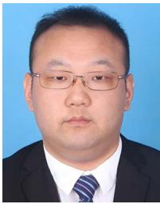

Yong Niu (Senior Member, IEEE) received the B.E. degree in electrical engineering from Beijing Jiaotong University, Beijing, China, in 2011, and the Ph.D. degree in electronic engineering from Tsinghua University, Beijing, in 2016. From 2014 to 2015, he was a Visiting Scholar with the University of Florida, Gainesville, FL, USA. He is currently an Associate Professor with the State Key Laboratory of Advanced Rail Autonomous Operation, Beijing Jiaotong University. His research interests include networking and communications, including millime-

ter wave communications, device-to-device communication, medium access control, and software-defined networks. He was the recipient the Ph.D. National Scholarship of China in 2015, the Outstanding Ph.D. Graduates and Outstanding Doctoral Thesis of Tsinghua University in 2016, the Outstanding Ph.D. Graduates of Beijing in 2016, and the Outstanding Doctorate Dissertation Award from the Chinese Institute of Electronics in 2017. He was the Technical Program Committee Member for IWCMC 2017, VTC2018-Spring, IWCMC 2018, INFOCOM 2018, and ICC 2018. He was the Session Chair for IWCMC 2017. He was also the recipient of the 2018 International Union of Radio Science Young Scientist Award.

Zhu Han (Fellow, IEEE) received the B.S. degree in electronic engineering from Tsinghua University, Beijing, China, in 1997, and the M.S. and Ph.D. degrees in electrical and computer engineering from the University of Maryland, College Park, MD, USA, in 1999 and 2003, respectively. From 2000 to 2002, he was an R&D Engineer of JDSU, Germantown, MD. From 2003 to 2006, he was a Research Associate with the University of Maryland. From 2006 to 2008, he was an Assistant Professor with Boise State University, Boise, ID, USA. He is currently a John and Rebecca Moores Professor with the Electrical and Computer Engineering Department as well as with the Computer Science Department, University of Houston, Houston, TX, USA. His main research targets on the novel game-theory related concepts critical to enabling efficient and distributive use of wireless networks with limited resources. His research interests include wireless resource allocation and management, wireless communications and networking, quantum computing, data science, smart grid, carbon neutralization, security and privacy. Dr. Han was the recipient ofthe N S F Career Award in 2010, the Fred W. Ellersick Prize of the IEEE Communication Society in 2011, the EURASIP Best Paper Award for the Journal on Advances in Signal Processing in 2015, IEEE Leonard G. Abraham Prize in the field of Communications Systems (best paper award in IEEE JSAC) in 2016, IEEE Vehicular Technology Society 2022 Best Land Transportation Paper Award, and several best paper awards in IEEE conferences. Dr. Han was an IEEE Communications Society Distinguished Lecturer from 2015 to 2018 and ACM Distinguished Speaker from 2022 to 2025, AAAS Fellow since 2019, and ACM Fellow since 2024. Dr. Han is a 1% highly cited Researcher since 2017 according to Web of Science. Dr. Han is also the winner of the 2021 IEEE Kiyo Tomiyasu Award (an IEEE Field Award), for outstanding early to mid-career contributions to technologies holding the promise of innovative applications, with the following citation: for contributions to game theory and distributed management of autonomous communication networks.

Ning Wang (Member, IEEE) received the B.E. degree in communication engineering from Tianjin University, Tianjin, China, in 2004, the M.A.Sc. degree in electrical engineering from The University of British Columbia, Vancouver, BC, Canada, in 2010, and the Ph.D. degree in electrical engineering from the University of Victoria, Victoria, BC, in 2013. From 2004 to 2008, he was with the China Information Technology Design and Consulting Institute, as a Mobile Communication System Engineer, specializing in planning and design of commercial mobile com-

munication networks, network traffic analysis, and radio network optimization. From 2013 to 2015, he was a Postdoctoral Research Fellow with the Department of Electrical and Computer Engineering, The University of British Columbia. Since 2015, he has been with the School ofInformation Engineering, Zhengzhou University, Zhengzhou, China, where he is currently an Associate Professor. He also holds adjunct appointments with the Department of Electrical and Computer Engineering, McMaster University, Hamilton, ON, Canada, and the Department of Electrical and Computer Engineering, University of Victoria. His research interests include resource allocation and security designs of future cellular networks, channel modeling for wireless communications, statistical signal processing, and cooperative wireless communications. He was with the technical program committees of international conferences, including the IEEE GLOBECOM, IEEE ICC, IEEE WCNC, and CyberC. He was the Finalist of the Governor Generals Gold Medal for Outstanding Graduating Doctoral Student with the University of Victoria, Victoria, BC, Canada, in 2013.