# Resource Allocation and Trajectory Optimization for QoE Provisioning in Energy-Efficient UAV-Enabled Wireless Networks

Fanzi Zeng , Member, IEEE, Zhenzhen Hu, Zhu Xiao , Senior Member, IEEE, Hongbo Jiang , Senior Member, IEEE, Siwang Zhou , Member, IEEE, Wenping Liu , Member, IEEE, and Daibo Liu , Member, IEEE

Abstract—In the past several years, unmanned aerial vehicle (UAV) have been employed to provide enhanced coverage or relay service to mobile users in a scenario with limited or even no infrastructure since they can be deployed to almost everywhere and can be manipulated at anytime. This paper studies UAV as aerial base station (BS) enabled wireless communication system, where a UAV is dispatched to provide wireless communication service to a set of ground users with difference quality-of-experience (QoE) requirements. In real world, user requirements are randomly and unevenly distributed. In addition, UAV communication coverage and onboard energy are limited and system resources are also limited (e.g., transmission power, spectrum). In order to meet the QoE ofall users with limited system resources and limited UAV energy, we jointly optimize user communication scheduling, UAV trajectory, transmit power and bandwidth allocation to maximize energy-efficiency and satisfy user QoE requirement. The formulated problem is mixes integer non-convex and non-concave so it is difficult to solve. In this paper, we solvevv the problem with two steps as follows. Firstly, we transform the objective function into a tractable form. Secondly, we divide the optimal problem into four sub-optimal problems, and then use a powerful iterative algorithm with the Dinkelbach and block coordinate descent to solve the optimal problem. That is to say, the user scheduling, UAV trajectory, transmission power and bandwidth allocation are alternately optimized in each iteration. Extensive simulation results present that our proposed method can obtain higher energy efficiency than that of baselines. Specifically, the energy efficiency obtained by our proposed method is 12.5% higher than the approach that only maximizes throughput.

Manuscript received January 3, 2020; revised February 14, 2020; accepted April 6, 2020. Date of publication April 13, 2020; date of current version July 16, 2020. This work was supported in part by the National Natural Science Foundation of China under Grants 61772184, 61732017, 61502162, 61572219, 61702175, and 61471164, in part by the Hunan Provincial Innovation Foundation for Postgraduate under Grant CX20190308, in part by the Natural Resources Scientific Research Project of the Department of the Natural Resources of Hunan Province under Grant 201910, and in part by the Key R&D Project of Hunan Province of China under Grant 2018GK2014. The review of this article was coordinated by Dr. F. Tang. (Fanzi Zeng, Zhu Xiao, and Hongbo Jiang contributed equally to this work.) (Corresponding authors: Zhu Xiao; Hongbo Jiang.)

Index Terms—Energy-efficient, resource allocation, UAV trajectory optimization, user quality-of-experience.

## I. INTRODUCTION

W <sup>ITH</sup> <sup>the</sup> <sup>gradually</sup> <sup>increasing</sup> <sup>demand</sup> <sup>of</sup> <sup>mobile</sup> <sup>users,</sup>the future fifth generation (5G) radio access network the future fifth generation (5G) radio access network is expected to provide ubiquitous, sustainable high data-rate communication service. The traditional wireless communication system mainly consists of fixed terrestrial infrastructure, such as ground base stations, access points and relays. However, the ground base stations deployments are static, which may sometimes limit their ability to cater to some scenarios, for example, surging traffic demands in hots-spots (e.g., stadiums, holidays, etc) as well as their availability in emergency situations (e.g. nature disasters), where the infrastructure is compromised [1]. The aforementioned two scenarios have been identified as two of the five key scenarios that need to be effectively addressed in fifth generation (5G) wireless communication [2].

Recently, the rapid development of electronics, sensors and communication technology has facilitated the explosion of unmanned aerial vehicle (UAV)-aided applications, such as navigation, precision agriculture, filming, geological exploration, and so on [3]–[6]. Owing to the absolute advantages in fast deployment, controllable mobility, low cost and high probabilistic line-of-sight of air-to-ground link, UAVs are most likely to function as an aerial communication platform for the future fifth generation [7], [8]. In particular, UAV as an aerial base station has been considered as a promising solution for rapid service recovery after partial or complete infrastructure damage due to natural disaster, and base station offloading in extremely crowded areas. Currently, there are some successful drone communication prototypes. For example, high altitude drone BS include Facebook’s Aquila and Google’s Loon, and low altitude drone BS include Nokia’s F-cell and Eurecom’s perfume [7].

Despite the many benefits mentioned above, one challenge is the limited available frequencies of UAV-enabled wireless communication network [9]. This leads to a set of contradictions on the supply and demand of radio resources. In fact, the data rate requirements of wireless multimedia services may vary dramatically in a large scale from a few hundred kbits, such as online games or live video, to dozens of kbits for visiting a website and sending/receiving messages [10]. For instance, some ground cellular users need to be served all time and need high data rate, while other users need not to be served all time. For this end, an optimal 3-D UAV deployment is proposed in [11] to maximize coverage and met different QoS requirements of users. However, this increases the cost to deploy stationary UAV. In order to reduce the cost of base station construction, an effective way is to utilize a mobile UAV. Mobile UAV can not only shorten the distance between UAV and ground users, but also make fuller use of limited radio resources [12]. The authors in [13] provided a method of random resources allocation. In [14] the authors take the users’ QoS requirements into consideration during the process of resources allocation to maximize the total throughput. To maximize the minimal throughput among ground users, in [12] the authors provided a method of optimizing the trajectory for multi-UAVs. The authors in [10] take the users’ QoS into account during the trajectory optimization for multi-UAV to maximize the common throughput. However, the above-mentioned mobile UAV aerial base station may not meet the QoE requirements of some users when the radio resource is insufficient. Moreover, the UAV flying at a fixed altitude cannot cover the users who need services. Therefore, it is important to study 3D trajectory of UAV to meet QoE requirements of all users and to cover users requesting services. Although there have been some studies on UAV 3D trajectory design and resource allocation on demand, there have several challenges have to be addressed for the UAV-aided wireless communication networks. First, in real world, the users’ QoE requirements are diversity and randomly distributed. For instance, some users not only require to be served at all time but also have high data rate requirements (e.g. watching live video, online games, and so on) in large sport venues (or concert). Moreover, some users’ requirements can not be satisfied by UAV flying at a fixed altitude that covers the furthest users when radio resources are insufficient [15]. It is easy to design a 3D trajectory to meet users’ QoE requirements, but consuming more energy. Therefore, the challenge is how to design a reasonable 3D trajectory of the UAV, which can meet the needs of all users and maximizing energy efficiency. Second, consider the difference in link quality between UAV and ground user during UAV flight, and different QoE requirements of users served in different time slots. The resource allocation should take the real-time QoE requirements of the users into account to provide better service to them [14]. This is because the resources are not allocated to users reasonably ifthe real-time QoE requirements of the users have not been taken into account. So another challenge is how to allocate the resources (e.g., frequency, power) reasonably in a given users communication schedule and association, UAV positions, and real-time QoE requirements of users.

Due to the diversity QoE requirements of users, the link quality of UAV and ground users varies with trajectory, limited on-board energy and coverage range. To overcome these shortcomings, in this paper wejointly optimize the UAV 3-D trajectory, users scheduling and association, power allocation and bandwidth allocation to maximize the energy efficiency of UAV enabled wireless communication system, and meet all users QoE requirements. Our goal is maximizing the total throughput of all users, minimizing the energy consumption of UAV, and meet all users’ QoE requirements. The main contributions of this paper are summarized as follows.

We propose a novel scheme to design an appropriate 3-D trajectory of UAV and achieve system resources allocation on demand. This scheme designs an optimization model for energy efficiency, which takes the real-time QoE requirements of users and limited system resources into account. Specifically, during the optimization model design process, we derive a close form of UAV 3-D flight energy consumption according to [16] and establish an energy-efficiency model for UAV 3-D flight by analyzing the energy consumption of UAV and the user throughput. Then we formulate an optimization problem of energy-efficiency of UAV-enabled wireless communication by considering the users communication schedule and association, the UAV trajectory, transmission power and bandwidth constraints.

Because the optimization problem of the above design is non-convex non-concave, and the form of the objective function is complex, it cannot be solved directly using existing optimization algorithms. Toward this end, we solve this optimization problem by using Dinkelbach algorithm [17] and BCD algorithm. The original problem by decomposing it into four sub-problems that are solved by (BCD) algorithm [18] at first. After that, we use the Dinkelbach-based iterative algorithm to get the optimal energy efficiency.

We conduct extensive simulation to verify the advantages of our work in two different cases. In the case of sufficient resources, we obtained an optimal flight altitude of UAV and prove that the energy efficiency obtained by the UAV flying at fixed altitude is significantly higher than that of the static UAV. In the case of insufficient resources, we come to two important conclusions, namely that (1) the energy efficiency of our proposed approach are higher than that of the baseline; (2) the energy consumption of UAV at inclined climb (descent) is lower than that of UAV at vertical climb (descent).

The rest of this paper is organized as follows. In Section II, we introduce the related works. In Section III, the system model is described. In Section IV, we present the optimization problem formulation for UAV wireless network. In Section V, an efficient iteration algorithm is proposed to deal with the formulated optimization problem. Section VI presents the numerical results to verify the performance of our proposed method are outperforms state-of-art solutions. Finally, we conclude the paper in Section VII.

## II. RELATED WORK

To minimize the hover time of UAVs, [19] optimized the UAVs’ horizontal position. The authors in [20] optimized the horizontal location of multi-UAVs for fast deployment, which uses heterogeneity UAVs to cover whole target. This paper studies how to minimize the maximal deployment delay among all UAVs for fairness consideration and minimize total deployment delay for efficiency consideration. The [21] studied a cache-enabled UAV deployment to optimize users quality-ofexperience. In order to provide ubiquitous coverage, the author in [22] studied UAV cluster-assisted terrestrial cellular networks. In [23] the authors studied an algorithm of UAV airborne networks deployment for on-demand coverage.

An optimal trajectory of a UAV is designed in [24] so as to minimize its mission completion time, while ensuring that each ground terminal (GT) successfully recovers the file with a desired high probability. In order to improve the mobile terminals (MT) performance at the conventional terrestrial cellular network edge, the authors in [25] used the UAV as aerial mobile base station to offload data traffic of cell-edge MTs. The trajectory optimization is done when the altitude of the UAV is dynamic. In [26] the authors studied optimal 3D-trajectory design to maximize the minimal rate among all users. Though proving a fair service to users, it is high energy consumption. In [27] designed an optimal UAV trajectory to minimize the UAV flight time in wireless sensors networks. The authors in [28] studied the trajectory design and resource allocation for mobile-UAV enabled networks.

In order to overcome the UAV endurance issue, the authors in [29] proposed a novel scheme for UAV enabled communication by utilizing the promising technique of proactive caching at the users. To this end, [15] proposed a novel framework for optimizing deployment and mobility of multiple UAVs, for the purpose of energy-efficient uplink data collection from ground IoT devices. The paper to jointly minimize the UAV mobility energy consumption and IoT devices total transmission power while the reliability of the link of IoT devices-to-UAVs can be satisfied. [30] proposed a network architecture to optimize the number of hop that is feasible for such device-to-device communications, the average energy consumption of UAVs, video recording, and wireless communication costs. In order to reveal the trade off between communication throughput and UAV energy consumption, [31] proposed a method to maximize the UAV energy efficiency by optimizing the UAV trajectory. Though providing a general framework for energy-efficient optimization in 2D space, the studies in [31] only on the setup with single UAV and single ground user. For UAV-enabled multi-users system, in [19], [32] the authors form effective and fair communication coverage to study UAV energy efficiency control in large regions, but the reliability of the link of air-toground is not taken into account. In order to save the energy of ground sensors, [33] studied energy-efficient cooperative relaying for unmanned aerial vehicles. [34] provided an approach to minimize the UAVs energy consumption, while satisfying the communication throughput requirement of each GN. The approach is not efficient if the number of UAV is not enough. The altitude of UAV has significant impact on the coverage and reliability of air-to-ground link [35].

The metric of QoE of each user involves a large parameter space including the location, delay, jitter, data rate, outage probability, and device type. The outage event takes place when the data rate of transmission link is below the predefined target rate based on [36]. In addition to the above mentioned metric, the security of mobile devices in wireless communication system is also important based on [37]. There have a lot of method to solving optimization problem. For a common optimization problem, the authors in [38] studied partially overlapping channels and game theory method to allocate channels. The authors in [39] adopted a descent greedy approach to solve the optimization problem which is maximizing the overall utility of multiple tasks and guaranteeing the individual task quality. The authors in [40] proposed a nested-loop greedy process to select the opportunistic workers by pre-considering future online online task assignment of the participatory workers. For a non-convex optimization problem, the authors in [41] proposed a lagrangian optimization algorithm based on KKT conditions to solve the optimization problem. The authors in [42] transform the non-convex problem into convex problem by using slack method.

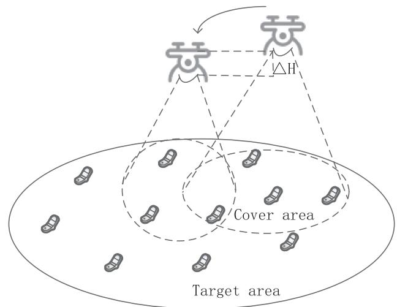  
Fig. 1. UAV-enabled wireless communication network.

## III. SYSTEM MODEL

As shown in Fig. 1, we consider a wireless communication system consisting of M users denoted by the set m <sub>=</sub> $\{ 1 , . . . . . . , M \}$ , with the location of user m denoted as $u _ { m } \in$ $R ^ { 2 \times 1 } , m \in M$ . The distribution of users is random and uniform. In this paper, considering a downlink scenario in which UAV combines time divide multi-access (TDMA) technique with frequency divide multi-access (FDMA) technique to communicate with users over consecutive periods in each duration $T > 0$ . We assume that the users’ locations are fixed and have been known by the UAV. The QoE requirements of users are diversity, randomly distributed and change per period T. The UAV collects user traffic request information from the cloud center server at each period. The resources of system is constant and already known by the UAV. Without loss of generality, this paper studies the user communication schedule and association, trajectory design, power and bandwidth allocation in any period T. The UAV’s time-varying coordinates are denoted by $q ( t ) = ( x ( t ) , y ( t ) , z ( t ) )$ ). The maximal speed for UAV mobility is $v _ { \mathrm { m a x } } .$ , maximal transmission power is $p _ { \mathrm { m a x } }$ , and the total bandwidth of the system is BW. The UAV trajectory needs to meet the following constraints.

$$
| | q ( t ) | | < = v _ { \mathrm { m a x } } ,\tag{1a}
$$

$$
R _ { m } ( t ) \geq R _ { t h } ^ { m } .\tag{1b}
$$

(1)

Where $v _ { \mathrm { m a x } }$ represents the possible maximal velocity of the UAV. $R _ { t h } ^ { m }$ denotes the required minimal constant data rate for user m at each instant time. The time-dependent distance between the UAV and the GTs can then be written as

$$
d _ { m } ( t ) = \sqrt { \left( x ( t ) - x _ { m } \right) ^ { 2 } + \left( y ( t ) - y _ { m } \right) ^ { 2 } + ( z ( t ) ) ^ { 2 } } .\tag{2}
$$

Define the following indicator function

$$
\lambda _ { m } ( t ) = \left\{ \begin{array} { c c } { 1 , } & { R _ { m } ( t ) \geq R _ { m , t h } } \\ { 0 , } & { \mathrm { o t h e r w i s e } } \end{array} \right. .\tag{3}
$$

We assume that the time-division multiple access (TDMA) protocol is applied for the UAV to serve the M ground users, so as to design adequate trajectory fully exploiting the time-varying channel. Let random variable $\lambda _ { m } ( t )$ denote whether user m is scheduled for communication with UAV at time instant t, with $\lambda _ { m } ( t ) = 1$ indicating that user m is scheduled for communication at instant t and $\lambda _ { m } ( t ) = 0$ otherwise. Assuming that the UAV can connect multiple users at each instant time, and each user can be served more than one time, thus the users’ communication schedule and association constraint can be expressed as follows

$$
\begin{array} { c } { \displaystyle { \int _ { t = 0 } ^ { T } \lambda _ { m } ( t ) d t \geq 1 , \forall m , t } } \\ { \displaystyle { \ } } \\ { \displaystyle { \ \lambda _ { m } ( t ) \in \{ 0 , 1 \} . } } \end{array}\tag{4}
$$

In our paper, the value of $\lambda _ { m } ( t )$ depend on the quality of link and coverage range. If the data rate is large than the minimal data rate of users’ required, and the user within the UAV coverage range, we set the value of ${ \bf \lambda } _ { { \lambda } _ { m } } ( t )$ is 1, otherwise is 0. The equation (3) has two functions, on one hand, it is used to define the users communication schedule and association, on the other hand, it is used to determine the priority of users service.

Considering the UAV can connect to multiple users at each instant time, we apply FDMA technique to communicate with users at one instant time. $b _ { m } ( t )$ denotes the bandwidth allocated to user m at instant time $t , p _ { m } ( t )$ represents the transmitting power allocated to user m at instant time t. The constraints of bandwidth and transmission power are

$$
\begin{array} { l } { \displaystyle \sum _ { m = 1 } ^ { M } \lambda _ { m } ( t ) b _ { m } ( t ) \leq B W , } \\ { \displaystyle \sum _ { m = 1 } ^ { M } \lambda _ { m } ( t ) p _ { m } ( t ) \leq p _ { \operatorname* { m a x } } . } \end{array}\tag{5}
$$

The ground-to-air path loss model in this paper takes into account the locations of ground users and the types of environment with great differences (e.g. rural, suburban, urban, high-rise urban, etc.) that are precisely available in the actual scenario. Note that, in such real scenarios, one may not have any additional information about the exact locations, heights, and the number of obstacles. Therefore, the randomness associated with the LoS and non-line-of-sight (NLoS) links is a necessary or unavoidable factor as long as we design the UAV-based communication system. In other words, there is a certain probability of LoS and NLoS connections between the UAV and the ground users. This LoS probability depends on the environment, users’ and UAV location as well as the elevation angle [15]. Then one suitable expression for LoS probability is given by

$$
P _ { m , L \mathrm { o } S } ( t ) = b _ { 1 } \bigg ( \frac { 1 8 0 } { \pi } \theta _ { m } ( t ) - 1 5 \bigg ) ^ { b _ { 2 } } .\tag{6}
$$

where $\begin{array} { r } { \theta _ { m } ( t ) = \frac { 1 8 0 } { \pi } \times \sin ^ { - 1 } ( \frac { h _ { m } ( t ) } { d _ { m } ( t ) } ) } \end{array}$ is the elevation angle between the UAV and the user. Also $b _ { 1 }$ and $b _ { 2 }$ are constant values that reflect the environment impact. Note that, the NLoS probability is $P _ { m , N L o S } ( t ) = 1 - P _ { m , L o S } ( t )$ . Clearly, considering $d _ { 0 } = 1$ , and $\begin{array} { r } { \dot { K _ { 0 } } = ( \frac { 4 \pi f _ { c } } { c } ) ^ { 2 } } \end{array}$ , the average path loss is

$$
\bar { L _ { m } ( t ) } = K _ { 0 } d _ { m } ^ { 2 } ( t ) [ P _ { m , L o S } ( t ) . \mu _ { L o S } + P _ { m , N L o S } ( t ) . \mu _ { N L o S } ] .\tag{7}
$$

In equation (7), the variable of $f _ { c }$ is the carrier frequency, μ<sub>los</sub> and $\mu _ { n l o s }$ are different attenuation factors considered for LoS and NLoS links. $\theta _ { m } ( t )$ is determined by the communication distance and the height of UAV, $\begin{array} { r } { \theta _ { m } ( t ) = \mathrm { s i n } ^ { - 1 } ( \frac { h ( t ) } { d _ { i } ( t ) } ) } \end{array}$

We assume that small-scale fading in the channel between UAV and ground users can be well handled at the receivers. We define that the average channel gain between the UAV and the users is $\begin{array} { r } { g _ { m } ( t ) = \frac { 1 } { \bar { L } _ { m } } } \end{array}$ . Note that, by using the average path loss, there is no need to account for LoS and NLoS link separately, and hence, the SINR expression becomes more tractable. The elevation half-power beamwidths ofthe UAV antenna is assumed to be 3db. The link between the UAV and the users in the coverage area are LoS, according to [43]. Thus the probability of LoS is equal to 1. So the average path loss can be rewritten as

$$
\overline { { L _ { m } ( t ) } } = K _ { 0 } d _ { m } ^ { 2 } ( t ) \mu _ { L o S } .\tag{8}
$$

Then, the user m receiving the signal- noise-ratio in time slot n can be expressed as

$$
\gamma _ { m } ( t ) = \frac { p _ { m } ( t ) g _ { m } ( t ) } { \delta ^ { 2 } } .\tag{9}
$$

where $p _ { m } ( t )$ is the transmission power of the UAV allocating to user m at instant time t, and $\delta ^ { 2 }$ is the power of the additive white Gaussian noise (AWGN) at the receiver. Thus, the achievable rate of user m at any instant time t, denoted by $R _ { m } ( t )$ in bits/second/Hertz (bps/Hz), can be expressed as

$$
R _ { m } ( t ) = b _ { m } ( t ) \log ( 1 + \gamma _ { m } ( t ) ) .\tag{10}
$$

Therefore, the total communication throughput for user m is the function of $b _ { m } ( t ) , \ q ( t ) , \ \lambda _ { m } ( t ) , \ p _ { m } ( t )$ , which can be expressed as

$$
R _ { m } ( b _ { m } ( t ) , \{ q ( t ) \} , \lambda _ { m } ( t ) , p _ { m } ( t ) ) = \int _ { t = 0 } ^ { T } \lambda _ { m } ( t ) R _ { m } ( t ) d t
$$

$$
= \int _ { t = 0 } ^ { T } \lambda _ { m } ( t ) b _ { m } ( t ) \log ( 1 + \gamma _ { m } ( t ) ) d t .\tag{11}
$$

And the total throughput for M users can be written as follows

$$
R = \sum _ { m = 1 } ^ { M } R _ { m } ( b _ { m } ( t ) , \{ q ( t ) \} , \lambda _ { m } ( t ) , p _ { m } ( t ) ) .\tag{12}
$$

Generally speaking, quality of experience is regarded as an aggregate of quality of service and human user-related metrics. In this paper, we are mainly focuses on the outage probability and delay in the communication link between the UAV and ground users.

1) Outage probability: when the UAV-user link cannot support the desired common throughput R, we suppose that the link between the user m and UAV is outage. As we all know, the outage probability is determined by the data rate of the link. Thus, the outage probability can be calculated as follows

$$
P _ { m , \mathrm { o u t } } ( R _ { m } ( t ) \leq R _ { m } ^ { r e q } ) .\tag{13}
$$

In order to guarantee the data is transmitted with successfully between UAV and ground users, the data rate should meet the constraint.

$$
R _ { m } ( t ) \geq R _ { m } ^ { r e q } .\tag{14}
$$

2) Delay: The delay in this paper refers to the user connection delay. In real world, different user have different data rate requirements. We assume that the user with low data rate requirements is non-real-time users. The user with high data rate requirements is divided into real-time users and non-real-time users (such as live, game, regular vedio). The real-time users have extremely high latency requirements, while the non realtime users who have low or no latency requirements. This delay is expressed in terms of user service time requirements.

For ease of exposition, we define the $\tau _ { m }$ indicates the length of the time of user needed to be served. The $\tau _ { m }$ can be expressed as

$$
\tau _ { m } = \left\{ \begin{array} { c c } { { T , } } & { { \mathrm { r e a l - t i m e u s e r } } } \\ { { k T , } } & { { \mathrm { o t h e r w i s e } } } \end{array} \right. .\tag{15}
$$

Moreover, in order to guarantee all users service time requirements, the actual service time obtained by the user must meet the following constraint $\sum _ { t = 1 } ^ { T } \lambda _ { m } ( t ) \geq \tau _ { m }$

## IV. PROBLEM FORMULATION

The performance and operational duration of a UAV systems is fundamentally constrained by the limited onboard energy. From the operational perspective, this problem can be addressed through two approaches. First, effective energy-aware deployment mechanisms are needed for timely onboard energy replenishment, without noticeably interrupting the communication service supported. Second, energy-efficient operation through smart energy management is essentially necessary, that is, accomplishing the mission with minimum energy consumption. This paper focuses on the latter of the above energy-efficient operation. The energy consumption of the UAV includes two aspects of thrust energy consumption and communication energy consumption. Assuming that Communication energy consumption mainly refers to that of communication circuits and information transmission, that are related to the transmission power of the UAV. Therefore, energy consumption can be reduced by optimizing the transmit power of the drone. Due to the short acceleration time of UAV, this article ignores the energy consumption during UAV acceleration. So the thrust energy consumption is mainly related to the flying speed the UAV. According to [16], we set up the 3D flight energy consumption

model of UAV as follows

$$
\begin{array} { c } { { p ( v ( t ) ) = P _ { o } \left( 1 + \displaystyle \frac { 3 v ^ { 2 } ( t ) } { U _ { t i p } ^ { 2 } } \right) + P _ { i } k \left( \displaystyle \sqrt { k ^ { 2 } + \displaystyle \frac { v ^ { 4 } ( t ) } { 4 v _ { 0 } ^ { 2 } } } - \displaystyle \frac { v ^ { 2 } ( t ) } { 2 v _ { 0 } ^ { 2 } } \right) ^ { \frac { 1 } { 2 } } } } \\ { { + \displaystyle \frac { 1 } { 2 } d _ { 0 } \rho S A v ^ { 3 } ( t ) + \vartheta v _ { c } . } } \end{array}
$$

where $U _ { t i p }$ denotes the tip speed of the rotor blade, and $v _ { 0 }$ is known as the mean rotor induced velocity in hover. $d _ { 0 }$ and S are the fuselage drag ratio and rotor solidity, respectively. $\rho$ and A separately denote the air density and rotor disc area. ϑ represents propulsive and $v _ { c }$ denotes speed of climb. $\begin{array} { r } { \mathrm { p } _ { o } = \frac { \partial } { 8 } \bar { \rho } s A \omega ^ { 3 } r ^ { 3 } } \end{array}$ and $\begin{array} { r } { p _ { i } = ( 1 + \alpha ) \frac { W ^ { 3 / 2 } } { \sqrt { 2 \rho A } } } \end{array}$ are related to the UAV attributes, which represent the blade profile power and induced power in hovering status. The parameter of $\begin{array} { r } { \vartheta = W + \frac { 1 } { 2 } \rho s _ { s p } v ^ { 2 } } \end{array}$ sin $\varphi$ denote the thrust of UAV, $\varphi$ is climb (descent) angle, $\displaystyle s _ { s p }$ is constant, and is vertical speed of UAV.

By combining the communication-related energy and propulsion energy, the total energy consumption can be expressed as

$$
\begin{array} { l } { { \displaystyle E \left( T , \{ q ( t ) \} , \{ \lambda _ { m } ( t ) \} \right) = \int _ { t = 0 } ^ { T } \left( p ( v ( t ) ) \right. } } \\ { { \displaystyle \left. + \lambda _ { m } ( t ) \sum _ { i = 1 } ^ { N _ { F } } \sum _ { m = 1 } ^ { M } p _ { i } ^ { m } ( t ) \right) d t } . } \end{array}\tag{17}
$$

UAV energy efficiency is defined as the number of information bits that can be transmitted per unit of energy consumption. The energy efficiency is

$$
\begin{array} { l } { \displaystyle { E E ( \{ \lambda _ { m } \} , \{ b _ { m } \} , \{ q \} , \{ p _ { m } \} ) } } \\ { \displaystyle { = \frac { R ( \{ \lambda _ { m } \} , \{ b _ { m } \} , \{ q \} , \{ p _ { m } \} ) } { E ( \{ \lambda _ { m } \} , \{ a _ { m } \} , \{ q \} , \{ p _ { m } \} ) } . } } \end{array}\tag{18}
$$

At any instant time $t ,$ let the set $\alpha = \{ \lambda _ { m } ( t ) , \forall t , m \}$ denotes user communication scheduling and association, the set $Q = \{ \boldsymbol { q } ( t ) , \forall \ : t \}$ represents the UAV flight trajectory, the set $\beta = \{ b _ { m } ( t ) , \forall t , m \}$ expresses the subcarrier allocated to user m, and the set $P = \{ p _ { m } ( t ) , \forall t , m \}$ shows the UAV’s transmission power allocated to user m.

Assume that the UAV is aware of the ground users’ locations, our goal is to maximize the energy efficiency of the UAV while the rate requirements of ground users are guaranteed to meet. By jointly optimizing the flight trajectory of UAV, user scheduling and association, bandwidth allocation and power allocation during a task period, the optimization problem can be formulated as (19).

$$
\operatorname* { m a x } _ { \alpha , \beta , Q , P } E E
$$

s.t

$$
\lambda _ { m } ( t ) b _ { m } ( t ) \log \left( 1 + \frac { p _ { m } ( t ) } { L _ { m } ( t ) \delta ^ { 2 } } \right)
$$

$$
\geq R _ { t h , m } , \forall m , t ,\tag{19a}
$$

$$
\lvert | q ( t ) \rvert | \leq v _ { \mathrm { m a x } } ,\tag{19b}
$$

$$
\tau _ { m } = \left\{ \begin{array} { c c } { { T , } } & { { \mathrm { r e a l - t i m e u s e r } ) } } \\ { { k T } } & { { \mathrm { o t h e r w i s e } } } \end{array} , \right.\tag{19c}
$$

$$
\lambda _ { m } ( t ) \in \{ 0 , 1 \} ,\tag{19d}
$$

$$
\sum _ { m = 1 } ^ { M } \lambda _ { m } ( t ) b _ { m } ( t ) \leq B W ,\tag{19e}
$$

$$
b _ { m } ( t ) \geq 0 ,\tag{19f}
$$

$$
\sum _ { m = 1 } ^ { M } \lambda _ { m } ( t ) p _ { m } ( t ) \leq p _ { \operatorname* { m a x } } ,\tag{19g}
$$

$$
p _ { m } ( t ) \geq 0 .\tag{19}
$$

(19h)

Where $T$ is an integer multiple of $\tau _ { m }$ . In the constraints condition above, (19a)–(19b) are the UAV trajectory constraints. (19c)–(19d) denotes the communication scheduling and association constraint for ground users, (19e)–(19f) represents constraints of bandwidth constraints, (19g)–(19h) signify the transmission power constraints. Problem (19) requires optimizing the UAV trajectory $Q = \{ \boldsymbol { q } ( t ) , \forall t \}$ , communication scheduling $\alpha = \{ \lambda _ { m } ( t ) , \forall t , m \}$ , bandwidth allocation $\beta = \{ b _ { m } ( t ) , \forall t , m \}$ and $P = \{ p _ { m } ( t ) , \forall t , m \}$ power allocation that are both continuous functions with respect to time t. Therefore, the original problem essentially involves the infinite number of optimization variables, which further include a complicated cost function for the UAV energy efficiency, as well as non-convex constraints in (19a), binary constraints in (19d). Thus it can be seen that the optimal problem is difficult to be directly solved. For ease of exposition, the period $T$ is discretized into N equal-time slots, indexed by $n = 1 , . . . , N$ . Suppose that the element slot length $\begin{array} { r } { \delta _ { t } = \frac { T } { N } } \end{array}$ is sufficiently small such that a UAV location is regarded as to be approximately unchanged within each time slot even when a UAV reaches maximum speed $V _ { \mathrm { m a x } } .$ As a result, the trajectory of UAV can be approximated by the N-dimensional sequence $\dot { q } [ n ] = [ x [ n ] , y [ n ] , \dot { z } [ n ] ] ^ { T } , n = \dot { 1 } , . . . , N$ . Furthermore, the optimal problem can be equivalently written as

$$
\operatorname* { m a x } _ { \alpha , \beta , Q , P } E E
$$

s.t

$$
\lambda _ { m } [ n ] b _ { m } [ n ] \log \left( 1 + \frac { p _ { m } [ n ] } { L _ { m } [ n ] \delta ^ { 2 } } \right)
$$

$$
\geq R _ { t h , m } , \forall m , n ,\tag{20a}
$$

$$
| | q [ n + 1 ] - q [ n ] | | \leq S _ { \mathrm { m a x } } ,\tag{20b}
$$

$$
\tau _ { m } = \left\{ \begin{array} { l l } { { T , } } & { { \mathrm { r e a l - t i m e u s e r } ) } } \\ { { k T } } & { { \mathrm { o t h e r w i s e } , } } \end{array} \right.\tag{20c}
$$

$$
\lambda _ { m } [ n ] \in \{ 0 , 1 \} ,\tag{20d}
$$

$$
\sum _ { m = 1 } ^ { M } \lambda _ { m } [ n ] b _ { m } [ n ] \leq B W ,\tag{20e}
$$

$$
b _ { m } [ n ] \geq 0 ,\tag{20f}
$$

$$
\sum _ { m = 1 } ^ { M } \lambda _ { m } [ n ] p _ { m } [ n ] \leq p _ { \operatorname* { m a x } } ,\tag{20g}
$$

$$
p _ { m } [ n ] \ge 0 ,\tag{20h}
$$

(20)

where the user scheduling and association can be rewritten as $\alpha = \{ \lambda _ { m } [ n ] , \forall n , m \}$ , the UAV trajectory can be rewritten as $Q = \{ q [ n ] , \forall n \}$ , subcarrier schedule can be rewritten as $\beta =$ $\{ b _ { m } [ n ] , \forall n , m \}$ , and transmission power can be rewritten as $P =$ $\{ p _ { m } [ n ] , \forall m , n \} . S _ { \mathrm { m a x } }$ expresses the maximum flight distance of UAV in one timeslot.

## V. OPTIMIZE SOLUTION

It is shown that the (20a) is non-convex constraints, (20d) is binary constraints, and the objective function is a fractional function consisting of two non-convex non-concave functions. Therefore, the maximization optimization problem is a mixes integer non-convex non-concave optimization problem, which cannot be solved by the traditional convex optimization method. This paper solve the original optimization problem in the following three steps. Firstly, the fractional function is converted into a subtraction form. However, the non-convex property of the objective function after transformation does not change. Thus the new problem is still a difficult non-convex optimization problem. The BCD method can divide the complex original problem into multiple simple sub-problems, and each sub-problem is easy to solve and result is easy to save. Secondly, we decompose the original problem into four sub-optimal problems, namely, user communication scheduling and association optimization, UAV trajectory optimization, bandwidth allocation optimization and transmission power allocation optimization. After that, each sub-problem is solved by using the existing convex optimization method respectively. Finally, using the Dinkelbach-based iterative algorithm to obtain optimal parameters $\{ \alpha ^ { ' } , Q ^ { ' } , \beta ^ { ' } , P ^ { ' } \}$ and maximal energy efficiency $\boldsymbol { \xi } ^ { \prime }$

## A. Objective Function Transform

Assume that the maximal value obtained by the objective function in the original problem is $\xi ^ { * }$ , and $\xi ^ { * }$ satisfies the following equation.

$$
\begin{array} { l } { { \displaystyle \xi ^ { * } = \frac { R ( \alpha ^ { * } , Q ^ { * } , \beta ^ { * } , P ^ { * } ) } { E ( \alpha ^ { * } , Q ^ { * } , \beta ^ { * } , P ^ { * } ) } } } \\ { { \displaystyle \ = \ \operatorname* { m a x } _ { \{ \{ \alpha , Q , \beta , P \} } } \frac { R ( \alpha , Q , \beta , P ) } { E ( \alpha , Q , \beta , P ) } . }  \end{array}\tag{21}
$$

In our paper, the parameter $\xi$ is denote the energy efficiency of the original problem. The $\xi ^ { * }$ is maximal value of the objective function when the UAV communication scheduling and association, UAV trajectory, transmission power and bandwidth are achieving optimal In equation (21). The equation (22) is a function with variable ξ. Therefore, the maximal value obtained by the objective function can solve the original problem. Where $\left\{ \alpha ^ { * } , Q ^ { * } , \beta ^ { * } , P ^ { * } \right\} = \left\{ \alpha , Q , \beta , P \right\}$ represents the UAV communication scheduling and association, UAV trajectory, transmission power and bandwidth correspond to the $\xi ^ { * }$ . Hence the objective function can be written as

Algorithm 1: Dinkelbach-Based Iterations Algorithm.   
Require: maximum number of iterations \_ ; initial   
maximum tolerate $\varepsilon ;$ initial EE $\xi = 0 ;$ iteration index   
$i = 0 ;$   
Ensure: optimal $\xi ^ { ' } , \{ \alpha ^ { ' } , Q ^ { ' } , \beta ^ { ' } , P ^ { ' } \}$   
1: repeat   
2: slove the problem (23) for a given $\xi$ and obtain the   
user schedule and association, UAV trajectory,   
power allocation and bandwidth allocation   
$\{ \alpha , Q , \beta , P \}$ via algorithm 2;   
3: compute   
4: $\varepsilon ^ { * } = R ( \alpha , Q , \beta , P ) - \xi E ( \alpha , Q , \beta , P ) ;$   
5: $\mathbf { i f } \varepsilon ^ { * } < \varepsilon$ then   
6: $\{ \alpha ^ { ' } , Q ^ { ' } , \beta ^ { ' } , P ^ { ' } \} = \{ \alpha , Q , \beta , P \}$ and   
$\begin{array} { r } { \xi ^ { \prime } = \frac { R \{ \alpha ^ { \prime } , Q ^ { \prime } , \beta ^ { \prime } , P ^ { \prime } \} } { \cdot } } \end{array}$   
$\begin{array} { r } { \xi = \frac { \cdot } { E \{ \alpha ^ { \prime } , Q ^ { \prime } , \beta ^ { \prime } , P ^ { \prime } \} } } \\ { \quad \cdot \overline { { \mathbf { \Omega } } } ^ { \prime } } \end{array}$   
7: else   
8: $\begin{array} { r } { \xi = \frac { R \{ \alpha , Q , \beta , P \} } { E \{ \alpha , Q , \beta , P \} } } \end{array}$ and $r = r + 1 ;$   
9: until covergence <sub>=</sub> ture or $r = r _ { - }$ max

$$
F ( \alpha , Q , \beta , P , \xi ) = R ( \alpha , Q , \beta , P ) - \xi E ( \alpha , Q , \beta , P ) .\tag{22}
$$

The original problem (21) can be transformed into the following one with parameter

$$
\begin{array} { r l } & { \underset { \left\{ \alpha , Q , \beta , P , \xi \right\} } { \operatorname* { m a x } } F } \\ & { \mathrm { s . t . } } \\ & { ( 2 0 \mathrm { a } ) - ( 2 0 \mathrm { h } ) . } \end{array}\tag{23}
$$

The optimization problem (23) is still difficult to solve due to the non-convex non-concave objective function, under a given the non-convex constraints in (20a) and binary constraints in (20 d). To work out the above non-convex optimization problem, this paper uses the method of CCCP to convert non-convex objective functions and constraints into convex in the process of using the BCD algorithm. To obtain the optimal ξ, we combine the Dinkelbach-based iterative algorithm [18] with BCD algorithm to solve optimization problem (23) by iteration. Dinkelbach is similar to binary search, which is usually used to solve a fractional optimization problem. Moreover, it can use the binary variable ξ and max $f ( \xi )$ . The convergence of this method is fast than the method of traditional binary search. Dinkelbach is an iterative algorithm in essentially. This method is a modified method based on the traditional binary search method. Before the algorithm starts, initialize the parameter ξ to any positive number. Then continuously update the parameter $\xi$ according to the better solution ε to approximate the optimal solution, as show in lines 4–8 of Algorithm 1.

The Dinkelbach-based iteration algorithm consists of two loops. The inner loop in Algorithm 1 contains four variables that can be solved via Algorithm 2 in polynomial time. The external loop has only one variable, and its algorithm complexity depends on parameter ε. Since the parameter is infinite, the external loop can be finished in polynomial time. So Algorithm 1 can work out in polynomial time.

```latex
Algorithm 2: Block Coordination Descent Algorithm.
Require: initialize trajectory, bandwidth allocation and
power allocation $\{ Q , \beta , P \}$ , iteration index $l , ;$
Ensure: optimal $\{ \stackrel { \cdot } { \alpha ^ { r + 1 } } , Q ^ { r + 1 } , \beta ^ { r + 1 } , P ^ { r + 1 } \}$
1: repeat
2: solve the problem (29) by CVX for a given
$\{ Q , \beta , P \}$
$3 { : }$ update users communication schedule and
association $\{ \alpha \}$ with optimal solution as $\{ \alpha ^ { l + 1 } \}$
4: solve the problem (p2) by CVX for a given
$\{ \alpha ^ { l + 1 } , \bar { H , \beta , P } \}$
5: update horizontal trajectory {U} with optimal
solution as $\{ U ^ { l + 1 } \}$
6: solve the problem (p4) by CVX for a given
$\{ \alpha ^ { l + 1 } , U ^ { \hat { l } + 1 } , \beta , P \}$
7: update vertical trajectory {H} with optimal solution
as $\{ H ^ { l + 1 } \}$
8: solve the problem (41) by CVX for a given
$\{ \alpha ^ { l + 1 } , { \cal U } ^ { \hat { l + 1 } } , { \cal H } ^ { l + 1 } , { \cal P } \}$
9: update bandwidth $\beta$ with optimal solution as $\{ \beta ^ { l + 1 } \}$
10: solve the problem (41) by CVX for a given
$\{ \alpha ^ { l + 1 } , { \cal U } ^ { \dot { l + 1 } } , { \cal H } ^ { l + \dot { 1 } } , \beta ^ { \dot { l } + \dot { 1 } } \}$
11: update bandwidth $P$ with optimal solution as $\{ P ^ { l + 1 } \}$
12: until the increase of the objective value is below a
threshold $\underline { { \varepsilon } }$
```

This paper uses block coordinate descent method and successive convex technique to deal with the complex multi-parameter optimization problem. In the process of optimizing and updating user scheduling and association, we set the UAV trajectory, power allocation, and bandwidth allocation to constant (lines 1–2). Then, using the optimal user scheduling and association obtained by the first step, power allocation and bandwidth allocation to optimize and update the UAV trajectory (lines 3–4). Next, Optimizing and updating the power allocation and bandwidth allocation based on the new user scheduling and UAV trajectory (lines 5–11). The complexity of BCD algorithm is related to the number of parameters, the number of users and the number of time slots. The algorithm can be complemented with fast convergence due to the infinite parameters, users and time slots. The BCD iteration algorithm is summarized in Algorithm 2.

Algorithm 2 contains four sub-problems. These four subproblems are solved by orderly, and they are input to each other. The optimal variable is O(4MN). We assume the maximum iteration times is . The complexity of the Algorithm 1 is $O ( 4 \varpi M N )$ .

It can be verified that the horizontal power function $p ( v [ n ] )$ is neither convex nor concave with respect to v[n]. Due to the disc plane of UAV is small, the drag of fuselage is also small. Since the thrust of UAV is $\begin{array} { r } { \vartheta = \bar { W } + \frac { 1 } { 2 } \rho s _ { s p } \bar { v ^ { 2 } } } \end{array}$ sin $\varphi .$ The air density is 1.225, the Fuselage equipment flat plate area $s _ { s p } \ll 1$ and $0 \leq \sin \varphi \leq 1$ . So the second term $\scriptstyle { \frac { 1 } { 2 } } \rho s _ { s p } v ^ { 2 }$ sin $\varphi \ll 1$ Furthermore, the thrust-to-weight ratio $k = 1 + \textstyle { \frac { { \frac { 1 } { 2 } } \rho v ^ { 2 } \sin \varphi } { W } }$ , and the second term ${ \frac { { \frac { 1 } { 2 } } \rho v ^ { 2 } \sin \varphi } { W } } \approx 0$ . Thus, the thrust-to-weight ratio is equal to 1. Thus, the thrust-to-weight ratio $k \approx 1$ . In order to overcome this challenge, we rewrite the denominator of the objective function in an equivalent form as follows

$$
( y [ n ] ) ^ { 2 } \geq { \sqrt { \phi [ n ] } } - \varphi [ n ] , \qquad \forall n
$$

$$
\varphi [ n ] \geq { \frac { ( v [ n ] ) ^ { 2 } } { 2 v _ { 0 } ^ { 2 } } } ,
$$

$$
\phi [ n ] \geq 1 + ( \varphi [ n ] ) ^ { 2 } , \qquad \forall n
$$

$$
y [ n ] \geq 0 , \varphi [ n ] \geq 0 , \phi [ n ] \geq 0 . \forall n\tag{24}
$$

Thus the energy consumption can be re-modeled as follows

$$
\begin{array} { l } { \displaystyle p ^ { ' } ( v [ n ] ) = P _ { o } \left( 1 + \frac { 3 v ^ { 2 } [ n ] } { U _ { t i p } ^ { 2 } } \right) + P _ { i } y [ n ] } \\ { \displaystyle ~ + \frac { 1 } { 2 } d _ { 0 } \rho S A v ^ { 3 } [ n ] + \vartheta v _ { c } [ n ] . } \end{array}\tag{25}
$$

Therefore, the objective function is rewritten as follows

$$
F ^ { ' } ( \alpha , Q , \beta , P , \xi ) = R ( \alpha , Q , \beta , P ) - { \xi } E ^ { ' } ( \alpha , Q , \beta , P ) .\tag{26}
$$

The optimization model is re-represented as follows

$$
\begin{array} { r l } & { \quad \quad \underset { ( 2 , 3 , 6 , 5 , 6 ] } { \mathrm { m a x } } ~ \overset { F ^ { \prime } } { = } } \\ & { \quad \mathrm { s . t . } } \\ & { \quad ( 2 3 \mathrm { a } ) - ( 2 3 \mathrm { h } ) , } \\ & { \quad ( 2 1 : ( y [ n ] ) ^ { 2 } \geq \sqrt { \phi [ n ] } - \varphi [ n ] , \quad \forall n } \\ & { \quad { \mathcal { C } } 2 : \varphi [ n ] \geq \frac { ( \tau [ n ] ) ^ { 2 } } { 2 \sigma _ { 0 } ^ { 2 } } , \quad \quad \quad \forall n } \\ & { \quad { \mathcal { C } } 3 : \phi [ n ] \geq 1 + ( \varphi [ n ] ) ^ { 2 } , \quad \quad \forall n } \\ & { \quad { \mathcal { C } } 4 : y [ n ] \geq 0 , \quad \varphi [ n ] \geq 0 , \quad \forall n } \end{array}\tag{27}
$$

So far, the second term of the objective function has become convex. The optimization model contains four parameters, which are more difficult to solve directly. Next, we will solve four sub-optimization problems: user scheduling, UAV trajectory, power allocation and bandwidth allocation.

## B. User Scheduling and Association

For any given UAV trajectory $\{ Q , \beta , P \}$ and $\xi ,$ the user scheduling and association of $\{ \alpha \}$ problem can be optimized by solving the following problem.

$$
\begin{array} { r l } & { \underset { \alpha } { \operatorname* { m a x } } F ^ { ' } } \\ & { } \\ & { \mathrm { s . t . } } \end{array}
$$

$$
\lambda _ { m } [ n ] b _ { m } [ n ] \log \left( 1 + \frac { p _ { m } [ n ] } { L _ { m } [ n ] \delta ^ { 2 } } \right)\tag{28}
$$

$$
\geq R _ { t h , m } ,
$$

$$
\forall m , n\tag{28a}
$$

$$
\lambda _ { m } [ n ] \in \{ 0 , 1 \} .\tag{28b}
$$

Since problem (28) is a standard LP, it can be solved efficiently by existing optimization tool such as CVX [44] in Algorithm 2. Furthermore, it is easy to see that the constraints (30c)–(30f) are met with equalities when the optimal solution is attained under given $\{ Q , \beta , P \}$

## C. UAV Trajectory Optimization

1) Horizontal Trajectory Optimization: We consider the trajectory of UAV is 3D. There have difficult to optimize the 3D trajectory directly. Therefore, we use iterative methods to optimize the horizontal and vertical trajectories of the UAV.

For any given user scheduling and association, power allocation, bandwidth allocation and altitude of UAV $\{ \alpha ^ { ' } , \beta , P , H _ { 0 } \}$ and $\xi ,$ where $H _ { 0 } = h _ { 0 } [ n ]$ , the horizontal trajectory {U} of UAV can be optimized by solving the following problem.

$$
\operatorname* { m a x } _ { U } { F ^ { ' } }
$$

s.t.

$$
\lambda _ { m } [ n ] b _ { m } [ n ] \log \left( 1 + \frac { p _ { m } [ n ] } { L _ { m } ( u [ n ] ) \delta ^ { 2 } } \right)
$$

$$
\geq R _ { t h , m } , \forall m , n ,\tag{29a}
$$

$$
\begin{array} { r } { | | u [ n + 1 ] - u [ n ] | | \leq v _ { \operatorname* { m a x } } \delta _ { t } , } \end{array}\tag{29b}
$$

$$
( y ( u [ n ] ) ) ^ { 2 } \geq { \sqrt { \phi ( u [ n ] ) } } - \varphi ( u [ n ] ) , \forall n ,\tag{29c}
$$

$$
\varphi ( u [ n ] ) \geq \frac { \left( v ( u [ n ] ) \right) ^ { 2 } + \left( v ( h _ { 0 } [ n ] ) \right) ^ { 2 } } { 2 v _ { 0 } ^ { 2 } } , \forall n ,\tag{29d}
$$

$$
\phi ( u [ n ] ) \geq 1 + ( \varphi ( u [ n ] ) ) ^ { 2 } , \forall n ,
$$

$$
y ( u [ n ] ) \geq 0 , \varphi ( u [ n ] ) \geq 0 , \phi ( u [ n ] ) \geq 0 . \forall n .\tag{29e}
$$

(29)

(29f)

Note that Problem (29) is neither a concave nor convex problem, because the first term of the objective function is a non-concave function on the trajectory ofUAV and the constraint (29a) is non-convex. Next, we adopt the successive convex optimization technique to deal with the non-concave objective function and non-convex constraints in each iteration, and the original function is approximated by a more tractable function at a given local point. Specifically, define $\boldsymbol { u } ^ { l } = \{ u ^ { l } [ n ] , \forall n \}$ as given trajectory of UAV in the ith iteration. We think over the $R ( u [ n ] )$ ), which is not concave with respect to u[n] and is convex with respect to $| | u [ n ] - w _ { k } | | ^ { 2 }$ . To facilitate processing, we define $t [ n ] = | | u [ n ] - w _ { k } | | ^ { 2 }$ . By using a first-order Taylor approximate at $t ^ { l } = \{ t ^ { l } [ n ] , \forall n \}$ , one can obtain the following bound of $R ( t [ n ] )$

$$
\begin{array} { l } { \displaystyle l R ( t [ n ] ) = \log 2 \left( 1 + \frac { p _ { m } [ n ] } { L _ { m } ( t [ n ] ) \delta ^ { 2 } } \right) } \\ { \displaystyle \geq A 1 _ { m } ^ { l } [ n ] ( t [ n ] - t ^ { l } [ n ] ) } \\ { \displaystyle \qquad + B 1 _ { m } ^ { l } [ n ] \stackrel { \Delta } { = } R ^ { l b } ( t [ n ] ) , } \end{array}\tag{30}
$$

Where

$$
A 1 _ { m } ^ { l } [ n ] = \frac { \partial ( R _ { 2 } ( t [ n ] ) ) } { \partial t [ n ] } | _ { t [ n ] = t ^ { l } [ n ] } , \ \forall m , n\tag{31}
$$

$$
B \boldsymbol { 1 } _ { m } ^ { l } [ n ] = R ( t ^ { l } [ n ] ) , \forall m , n .\tag{32}
$$

Therefore, Problem (29) can be rewritten by

$$
\begin{array} { l } { \displaystyle \operatorname* { m a x } _ { U } F } \\ { \mathrm { s . t . } } \\ { b _ { m } [ n ] R ^ { l b } ( \mathrm { t } [ n ] ) \geq R _ { t h , m } , \quad \forall m , n \quad ( 3 3 \mathrm { a } ) } \\ { ( 2 9 \mathsf { b } ) - ( 2 9 \mathrm { f } ) . } \end{array}\tag{33}
$$

Thus, Constraint (33a) becomes convex. Meanwhile, the constraints of (29b), (29d)–(29f) are all convex. Therefore, Problem (33) is a convex optimization problem that can be efficiently solved by standard convex optimization solvers such as CVX [44] in Algorithm 2. It is worth noting that the lower bounds adopted in (33a) show that anything feasible solution for Problem (33) is also works for Problem (29), but the reverse does not hold in general. As a result, the optimal objective value, obtained from the approximate problem in (33), serves as a lower bound of that of Problem (29).

2) Vertical Trajectory Optimization: As well, the vertical trajectory of UAV under optimal horizontal trajectory can be optimized by solving the following problem.

$$
\lambda _ { m } [ n ] b _ { m } [ n ] \log \left( 1 + \frac { p _ { m } [ n ] } { L _ { m } ( z [ n ] ) \delta ^ { 2 } } \right)
$$

$$
\geq R _ { t h , m } , \forall m , n ,\tag{34a}
$$

$$
| | z [ n + 1 ] - z [ n ] | | \leq v _ { z \operatorname* { m a x } } \delta _ { t } ,\tag{34b}
$$

$$
( y ( z [ n ] ) ) ^ { 2 } \geq { \sqrt { \phi ( z [ n ] ) } } - \varphi ( z [ n ] ) , \forall n ,\tag{34c}
$$

$$
\varphi ( z [ n ] ) \geq \frac { ( v _ { u } ^ { * } [ n ] ) ^ { 2 } + ( v ( z [ n ] ) ) ^ { 2 } } { 2 v _ { 0 } ^ { 2 } } , \forall n ,\tag{34d}
$$

$$
\phi ( z [ n ] ) \geq 1 + ( \varphi ( z [ n ] ) ) ^ { 2 } , \forall n ,\tag{34e}
$$

$$
y ( z [ n ] ) \ge 0 , \varphi ( z [ n ] ) \ge 0 , \phi ( z [ n ] ) \ge 0 , \ \forall n .\tag{34}
$$

(34f)

Due to the non-concave of the first term in the objective function and non-convex of Constraint (34a), so Problem (34) is neither a concave nor convex problem. We cannot directly use traditional convex optimization methods to solve this problem. Fortunately, we can use convex approximation to deal with this problem. That is to say, the original function is approximated by a more tractable function at a given local point. Specifically, define $H ^ { l } = \{ z ^ { l } [ n ] , \forall \ n \}$ as given vertical trajectory of UAVs in the ith iteration. The $R ( z [ n ] )$ has the same properties as $R ( u [ n ] )$ , which is not concave with respect to $z [ n ]$ and is convex with respect to $( z [ n ] ) ^ { 2 }$ . Same as the horizontal trajectory optimization, the first-order Taylor expansion method is used to convert the original non-convex problem into a convex problem, we can obtain the following bound of $R ( z [ n ] )$ .

$$
\begin{array} { l } { { \displaystyle R ( z [ n ] ) = l o g 2 \left( 1 + \frac { p _ { m } [ n ] } { L _ { m } ( z [ n ] ) \delta ^ { 2 } } \right) } } \\ { ~ \geq A 2 _ { m } ^ { l } [ n ] ( ( z [ n ] ) ^ { 2 } - ( z ^ { l } [ n ] ) ^ { 2 } ) } \\ { ~ + B 2 _ { m } ^ { l } [ n ] \stackrel { \Delta } { = } R ^ { l b } ( z [ n ] ) . } \end{array}\tag{35}
$$

Where

$$
A 2 _ { m } ^ { l } [ n ] = \frac { \partial ( R _ { 2 } ( z [ n ] ) ) } { \partial ( ( z [ n ] ) ^ { 2 } ) } | _ { z = z ^ { l } } , \forall m , n .\tag{36}
$$

$$
B \boldsymbol { 2 } _ { m } ^ { l } [ n ] = R ( \boldsymbol { z } ^ { l } [ n ] ) , \forall m , n .\tag{37}
$$

Therefore, Problem (33) can be rewritten as follows:

$$
\begin{array} { r c l } { \displaystyle \operatorname* { m a x } _ { Z } F ^ { ' } } \\ { \displaystyle } \\ { \mathrm { s . t . } } \\ { \displaystyle b _ { m } [ n ] R ^ { l b } ( \mathrm { z } [ n ] ) \geq R _ { t h , m } , } & { \forall m , n } & { ( 3 8 \mathrm { a } ) } \\ { \displaystyle } & { ( 3 4 \mathrm { b } ) - ( 3 4 \mathrm { f } ) . } \end{array}\tag{38}
$$

Then, the left-hand-side of Constraint (38a) becomes convex, and all other constraints of (34b), (34d)–(34g) are convex. The problem (p4) can be efficiently solved by existing convex optimization approach such as CVX [44] in Algorithm 2 because the problem is a convex optimization problem. It is worth noting that although the constraint (39a) in Problem (38) adopt the lower bound of Problem (34) and the range of the feasible region is shortened, but it does not affect the optimally of the original problem. Therefore, anything feasible solution for Problem (38) is also adapted to Problem (34), but the revers does not hold in general.

## D. Resource Allocation

1) Power Allocation: For any given user scheduling and association $\{ Q ^ { ' } , \alpha ^ { ' } , \beta \}$ and ξ, the transmission power $\{ p _ { m } [ n ] \}$ of the problem can be optimized by solving:

$$
\begin{array} { l } { \displaystyle \sum _ { P } ^ { \operatorname* { m a x } _ { P } \boldsymbol { F } ^ { \prime } } } \\ { \displaystyle \mathrm { s . t . } } \\ { \displaystyle \lambda _ { m } [ n ] b _ { m } [ n ] \log \left( 1 + \frac { p _ { m } [ n ] } { L _ { m } ( t ) \delta ^ { 2 } } \right) } \\ { \displaystyle \geq H _ { t h , m } , ~ \forall m , n , } \\ { \displaystyle \sum _ { m = 1 } ^ { M } \lambda _ { m } [ n ] p _ { m } [ n ] \leq p _ { - } \operatorname* { m a x } , } \\ { \displaystyle p _ { m } [ n ] \succeq 0 . } \end{array}\tag{39a}
$$

(39b)

(39c)

(39)

Since the objective function and all constraints are convex, we can apply existing optimization tool such as CVX to solve the problem.

2) Bandwidth Allocation: For any given user scheduling and association $\{ Q ^ { \prime } , \alpha ^ { ' } , P \}$ and ξ, the sub-carrier schedule $b _ { m } [ n ]$ of problem can be optimized by solving the followingw problem.

$$
\begin{array} { r l } & { \underset { \beta } { \operatorname* { m a x } } F ^ { ' } } \\ & { \mathrm { s . t . } } \\ & { \lambda _ { m } [ n ] b _ { m } [ n ] \log \left( 1 + \frac { p _ { m } [ n ] } { L _ { m } ( t ) \delta ^ { 2 } } \right) } \\ & { \geq R _ { t h , m } , \ \forall m , n , } \end{array}\tag{40a}
$$

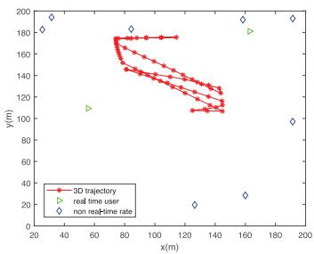  
Fig. 2. 2D trajectory with resource sufficient.

$$
\sum _ { m = 1 } ^ { M } \lambda _ { m } [ n ] b _ { m } [ n ] \leq B W ,\tag{40b}
$$

$$
b _ { m } [ n ] \geq 0 .\tag{40c}
$$

(40)

Since problem (41) is a standard LP, it can be solved efficiently by existing optimization tool such as CVX. Furthermore, it is easy to see that the constraints (35b) and (41c) are met with equalities when the optimal solution $\beta ^ { ' }$ is attained for given $\{ Q ^ { ' } , \alpha ^ { ' } , P \}$

## VI. NUMERICAL RESULTS

In this section, numerical results are provided to validate the proposed design. We take the experiment under two scenarios (the resource is enough or short). And we compared our scheme with other schemes:

\- Throughput maximization: In this scheme, the energy consumption is not take into account during the UAV at level flight [10] or 3D flight [14]. Although the throughput is large, the energy consumption is also large.

\- Energy minimization: This scheme only considers the UAV energy consumption. Despite the low energy consumption obtained by energy minimization, the low data rate received by users [34].

\- Static: In the case of resources is sufficient, which the UAV is placed at a fixed height to cover all users. However, energy consumption for UAV at hover state is large and the throughput is small.

\- Random resource allocation: The users’ requirements is not take into consideration during resources allocation in this scheme [26].

\- Benchmark: the real-time requirements of users are satisfied in the scheme. This scheme does not consider neither the UAV energy consumption minimization nor the total throughput maximization.

## A. Sufficient Resources

In this subsection, we evaluate the system performance of the proposed schemes under sufficient resources. The parameters setting of simulation are given in Table I. 10 ground users, that is to say $M = 1 0$ , are randomly and uniformly distributed within 2D area of $2 0 0 \times 2 0 0 \mathrm { m } ^ { 2 }$ . The altitude of the UAV is fixed when the system resource is enough. As illustrated in Fig. 2, the real-time users are denoted by $^ 6 \triangle ^ { \prime }$ with data rate of 100 kbits, while the data rate of a non-real-time users represented by $\cdot \zeta '$ is 1 kbits. We can get a result that the track point of the UAV are concentrated near real-time users and are flying at almost maximal speed from Fig. 2. One reason is that the energy consumption decreases with UAV speed within maximal speed. The other reason is that real-time users need to be served all the time and they have high data rate requirements. The non-real-time users do not need to be served all the time and they are with low data rate requirements. In order to obtain a higher energy-efficient and ensure that real-time users are always covered, the UAV cannot be too far away from real-time users.

TABLE I  
PARAMETER SETTING IN SIMULATION AND EXPERIMENT
<table><tr><td rowspan=1 colspan=1>Parameters Carrier center frequency $f _ { c }$ </td><td rowspan=1 colspan=1>2GHz</td></tr><tr><td rowspan=1 colspan=1>bandwidth BW</td><td rowspan=1 colspan=1>67kHz</td></tr><tr><td rowspan=1 colspan=1>Noise power $\overline { { \delta ^ { 2 } } }$ </td><td rowspan=1 colspan=1>-90dbm</td></tr><tr><td rowspan=1 colspan=1>maximal transmitted power p</td><td rowspan=1 colspan=1>100dbm</td></tr><tr><td rowspan=1 colspan=1>Attenuation of LoS link $\underline { { \mu _ { l o s } } }$ </td><td rowspan=1 colspan=1>3dB</td></tr><tr><td rowspan=1 colspan=1>maximal horizontal speed $v _ { x } y$ </td><td rowspan=1 colspan=1>10m/s</td></tr><tr><td rowspan=1 colspan=1>maximal vertical speed $\overline { { v _ { z } } }$ </td><td rowspan=1 colspan=1>5m/s</td></tr><tr><td rowspan=1 colspan=1>Task period T</td><td rowspan=1 colspan=1>60s</td></tr><tr><td rowspan=1 colspan=1>Aircraft weight W</td><td rowspan=1 colspan=1>20N</td></tr><tr><td rowspan=1 colspan=1>Air density ρ</td><td rowspan=1 colspan=1>1.225</td></tr><tr><td rowspan=1 colspan=1>Rotor radius r</td><td rowspan=1 colspan=1>0.4</td></tr><tr><td rowspan=1 colspan=1>Rotor disc area A</td><td rowspan=1 colspan=1>0.503</td></tr><tr><td rowspan=1 colspan=1>Blade angular velocity $\omega$ </td><td rowspan=1 colspan=1>300</td></tr><tr><td rowspan=1 colspan=1>Tip speed of the rotor blade $\overline { { U _ { t } i p } }$ </td><td rowspan=1 colspan=1>120</td></tr><tr><td rowspan=1 colspan=1>Rotor solidity s</td><td rowspan=1 colspan=1>0.05</td></tr><tr><td rowspan=1 colspan=1>Mean rotor induced velocity $v _ { 0 }$ </td><td rowspan=1 colspan=1>4.03</td></tr><tr><td rowspan=1 colspan=1>Incremental correction factor to induced power k</td><td rowspan=1 colspan=1>0.1</td></tr><tr><td rowspan=1 colspan=1>Profile drag coefficient $\alpha$ </td><td rowspan=1 colspan=1>0.012</td></tr><tr><td rowspan=1 colspan=1>Fuselage drag ratio $\overline { { d _ { 0 } } }$ </td><td rowspan=1 colspan=1>0.6</td></tr></table>

In Fig. 3, by comparing the energy efficiency, total throughput and energy consumption under different UAV altitudes, we can obtain an optimal UAV altitude for maximizing total throughput and minimizing energy consumption of UAV. As is illustrated in Fig. 3(a), our proposed scheme outperforms the other two baseline approaches in term of energy efficiency at any altitude of UAV. We see that the energy efficiency slightly increases and gets the maximal energy efficiency at altitude 103 of our proposed scheme with EE maximization, as shown in Fig. 3(a). In our proposed scheme, the energy consumption is minimal at altitude 103, after increasing with altitude as shown in Fig. 3(b). The energy consumption of the scheme of throughput maximization are higher than that of another two schemes. Thus the optimal altitude is 103 in term of energy consumption of UAV. From Fig. 3(c), we see that the total throughput of users decreases with altitude in our proposed method of EE maximization. The total throughput obtained by our proposed scheme of EE maximization is similar to the scheme of throughput maximization. The total throughput obtained by energy minimization hardly increases with height and is significantly lower than that of other two schemes. In Fig. 3(b), although the total throughput obtained at 100 is higher than 103, it still cannot offset energy consumption. Consequently, we obtain a result that the optimal altitude is 103 for UAV flight from Figs. 3.

As shown in Fig. 4, we compare the energy-efficiency by four different schemes, including 1) UAV at level flight, where the UAV flies at the optimal altitude, and maximizes the energy-efficiency; 2) scheme I, where the energy consumption minimized without taking the throughput of users into account during UAV flying at fixed altitude; 3) scheme II, where the total throughput of all users is maximized without taking the energy consumption of UAV into account during UAV at level flight; 4) UAV at Static, where the UAV is placed at the geometric center of users positions and remains stationary throughout the whole period T. Note that all four schemes of above mentioned are satisfy all users QoE requirements. In Fig. 4, we obtain the result that the energy-efficiency of the scheme of EE maximization are higher than other three schemes. This is because the scheme of EE maximization is takes the throughput and energy consumption into account when optimizing the UAV trajectory and resource allocation. While the scheme I and II consider only one of them, the energy efficiency is lower than the scheme of EE maximization. Although the static UAV also takes the throughput and energy consumption into account, the altitude of UAV is large to cover all users and the path loss is large. Thus, the energy efficiency is lower than the scheme of EE maximization. So we can get a conclusion that the static state is not the most energy-efficient status.

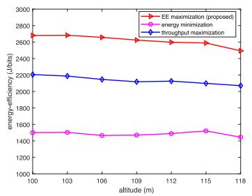  
(a)

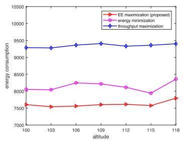  
(b)

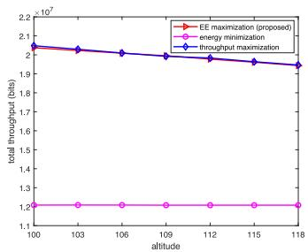  
(c)

Fig. 3. Impact of UAV transmit power on (a) Energy efficiency, (b) Energy consumption, (c) Total throughput.  
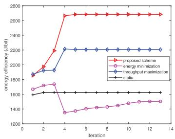  
Fig. 4. Convergence of correlated scheme.

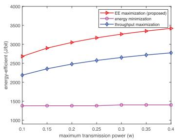  
Fig. 5. Energy-efficiency with UAV transmit power.

From Fig. 5, at the same transmit power, our proposes scheme ofEE maximization are higher than the other schemes in terms of energy efficiency under. The energy efficiency obtained by the scheme of energy minimization hardly changes with transmit power. The reason is that the scheme only needs to meet the requirements of users. In addition, the energy efficiency increase with the maximal transmit power of the UAV. This is because the quality of link between UAV and ground users becomes better as the transmit power increase. Consequently, the data rate was increased. This result show that increasing the transmit power helps improve throughput.

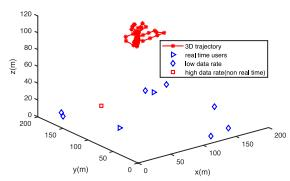  
(a)

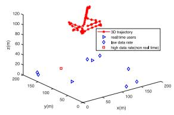  
(b)  
Fig. 6. 3D trajectory with correlated scheme. (a) Throughput maximization scheme. (b) Proposed scheme.

## B. Insufficient Resources

This subsection is based on insufficient system resources, and the height of the UAV changes dynamically with time slot n. The parameters settings are the same as in the previous subsection. In this subsection, we assume that the real-time users’ data rate requirement remain the same. Non-real-time users are divided into high data rate demand and low data rate demand users. As is illustrated in Fig. 6, the real-time users are denoted by ‘’ with data rate of 100 kbits, while the data rate of a non-real-time users represented by ‘♦’ is 1 kbits, and the rate indicated by ‘ is 100 kbits. Since the goal of throughput maximization is maximizing total throughput. It is not take UAV energy consumption into account. Moreover, some time slots only need to serve real-time users. In order to guarantee the real-time users data rate and provide a better channel quality, the UAV hover at an optimal position in some time slots. Furthermore, the coverage range of UAV can be increased by increase the altitude. The distances between non-real-time users and real-time users are different in different time slots. Therefore, UAV frequently fly up and down in some short time and small change in horizontal position. Consequently, the UAV trajectory almost hover at one point with a lot of time slots in the scheme of throughput maximization.

The 3D trajectory obtained by our scheme is relative smooth and fly up and down in 3D at a small climb angle (or descending foot) in Fig. 6(b). However, the trajectory obtained by the scheme of throughput maximization mostly in hover state or does vertical climbing (descending) in Fig. 6(a). In Fig. 6, when the distance between the non-real-time users and the real-time users is relatively close, the height of the UAV decreases, otherwise the height of the UAV goes up. In addition, we also get another conclusion that for non-real-time users with big data rate requirements, the height of UAV decreases, and in addition, the height of UAV increases. As can be seen from Fig. 6, when the distance between the non-real-time users and the real-time users is relatively close, the height of the UAV decreases, otherwise the height of the UAV goes up. In addition, we also get another conclusion that for non-real-time users with big data rate requirements, the height of UAV decreases, and in addition, the height of UAV increases.

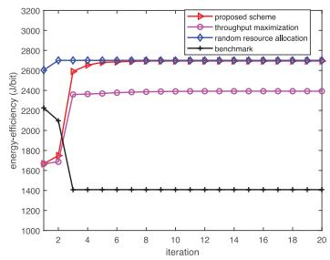  
Fig. 7. Energy efficiency with correlated scheme.

By observing Fig. 7 it can be concluded that our proposed scheme of 3D EE maximization outperforms the scheme of throughput maximization [14], the scheme ofresource allocation with random [26], the scheme of baseline in terms of energy efficiency and energy consumption. The scheme of baseline only considers the users QoE requirement and without taking the throughput and energy consumption into account. As can be seen from Fig. 7, the energy efficiency increases continuously in the first 5 iterations, and stabilizes after 6 iterations. It’s worth noting that in the beginning, the energy efficiency value of our proposed scheme is the same as that of scheme of throughput maximization. This is because the initialization parameters of the two schemes are identical. Over time, there is a big difference between the scheme of EE maximization and the scheme of throughput maximization. The performance of the scheme of baseline is lower than other three methods. This is because that the baseline only considers the users QoE requirement and the resource occupied by the users just meets their QoE requirement. Therefore, the throughput obtained by scheme of baseline is very low. The energy efficiency obtained by the schemes in [26] is similar to our proposed scheme. This is because in the resource allocation with random, each user can obtain the entire resource in one this slot, and the throughput is very large. Therefore, the energy efficiency is higher than the other two schemes expect our scheme. Only real-time users are serviced under initial parameters. Therefore, there only need ensure real-time users’ QoE requirements during optimization the UAV trajectory, power allocation and bandwidth allocation at first iteration. Furthermore, the height of UAV is changed with gradually at first iteration due to two users serviced in each time slots and short distance between two real-time users.

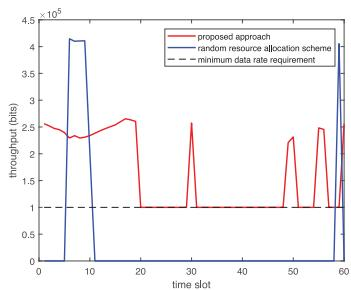  
Fig. 8. Throughput V time slot.

In order to service non-real-time users, the UAV need increase their flying height at different time slots. As a result, the UAV trajectory changed is larger than the first iteration in vertical. Moreover, the scheme of baseline is neither take the throughput of all users into account nor take the energy consumption into account. It is only consider the user data rate requirement. In the first 3 iteration, the throughput remains unchanged, and energy consumption increase with iteration. Therefore, the energy efficiency is decrease with iteration of the baseline scheme. Since the scheme of random resources allocation aim to maximize the minimal throughput among all users. Besides, it is not take the users’ QoE requirement into account. In order to maximize the minimal throughput among all users, the UAV as close as possible to ground users. Moreover, there only one user to be serviced at a time slot. So the whole bandwidth is allocated to one user at a time slot. As a result, the throughput is significantly larger than the method of our proposed method.

Although the energy consumption of our proposed method is slightly lower than the method of random resources allocation, it is cannot compensate the gap of throughput obtained by the random resource allocation scheme. Therefore, the energy efficiency obtained by random resource allocation scheme is higher than our proposed scheme. Although the energy efficiency of the scheme of random resource allocation [26] is very close to the scheme proposed in this paper, the users QoE cannot be satisfied. The scheme of random resource allocation does not takes the users QoE into account. As illustrated in Fig. 8, the real-time user’s minimal data rate requirement is set as 100 kbits and need service all time. In our scheme, the throughput obtained by the user in any time slot is greater than the minimum demand. In the random resource allocation scheme, although the throughput obtained by the user is significantly higher than our scheme, this is only a small number of time slots that can meet the needs of the user. This show that the random resource allocation scheme cannot meet the data requirement of real-time user. Since the random resource allocation scheme is not take the users’ QoE requirements into account. Moreover, the goal of random resource allocation scheme is maximization the minimal throughput among all users. The scheme consider only one user to be served at one time slot. Therefore, the throughput obtained by random resource allocation scheme is significantly higher than the scheme of this paper proposed.

In Fig. 9, the greater the transmission power, the greater the energy consumption. The energy consumption of our proposed scheme are lower than the scheme of throughput maximization and baseline. One reason is that our scheme takes the energy consumption into account. Another reason is that the UAV is flying at relatively small angle to climb (descent) and at level flight in our method. However, the UAV either vertically climbs (descents) or almost hovers. As well, the UAV in the benchmark scheme frequently flies up and down and has a large climb or descent angle. As we know, the fuel consumption for the vertical flight is estimated as 50% higher than the fast climb according to [45]. Therefore, the energy consumption of this two schemes are large. Beside, the energy consumption of the scheme of random resource allocation is close to our scheme or even lower than our scheme. This is because the UAV is almost at level flight. This suggest that the performance obtained by the UAV rising or falling at a small angle is very close to that obtained by the level model.

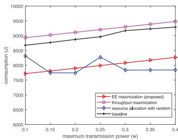  
Fig. 9. Energy consumption with UAV transmit power.

## VII. CONCLUSION

In this paper, we proposed a method to maximize energy efficiency of UAV wireless communication networks and satisfy the different QoE requirements for different users by jointly optimizing the UAV 3D trajectory, user communication schedule and association, and resource allocation on-demand. In order to study the energy efficiency of 3D flying UAV, we establish a model of energy consumption and a model of energy efficiency of UAV at 3D flight. Consider that the objective function is a fraction expression, which is not easy to handle. We transform the objective function into a subtraction form. Then, an algorithm containing two loops is adopted to solve the problem. We conducted extensive simulations to verify that our proposed method outperforms the other baselines. We execute the experiment in two different scenarios, namely, energy efficiency maximization under sufficient energy and insufficient energy. We obtain an optimal altitude of UAV with level flight under sufficient resources and an optimal 3D trajectory of UAV under insufficient resources.

## REFERENCES

[1] M. Moradi, K. Sundaresan, E. Chai, S. Rangarajan, and Z. M. Mao, “Skycore: Moving core to the edge for untethered and reliable UAV-based lte networks,” in Proc. 24th Annu. Int. Conf. Mobile Comput. Netw., 2018, pp. 35–49.

[2] Y. Zeng, R. Zhang, and T. J. Lim, “Wireless communications with unmanned aerial vehicles: Opportunities and challenges,” IEEE Commun Mag., vol. 54, no. 5, pp. 36–42, May 2016.

[3] I. Mademlis, N. Nikolaidis, A. Tefas, I. Pitas, T. Wagner, and A. Messina, “Autonomous unmanned aerial vehicles filming in dynamic unstructured outdoor environments,” IEEE Signal Process. Mag., vol. 36, no. 1, pp. 147– 153, Jan. 2019.

[4] Z. Feng, L. Ji, Q. Zhang, and W. Li, “Spectrum management for mmwave enabled UAV swarm networks: Challenges and opportunities,” IEEE Commun. Mag., vol. 57, no. 1, pp. 146–153, Jan. 2019.

[5] A. E. A. A. Abdulla, Z. M. Fadlullah, H. Nishiyama, N. Kato, F. Ono, and R. Miura, “An optimal data collection technique for improved utility in uas-aided networks,” in Proc. IEEE INFOCOM Conf. Comput. Commun., 2014, pp. 736–744.

[6] D. Yang, Q. Wu, Y. Zeng, and R. Zhang, “Energy tradeoff in ground-to-UAV communication via trajectory design,” IEEE Trans. Veh. Technol., vol. 67, no. 7, pp. 6721–6726, Jul. 2018.

[7] A. Fotouhi et al., “Survey on UAV cellular communications: Practical aspects, standardization advancements, regulation, and security challenges,” IEEE Commun. Surveys Tut., vol. 21, no. 4, pp. 3417–3442, Oct.–Dec. 2019.

[8] B. Li, Z. Fei, and Y. Zhang, “UAV communications for 5G and beyond: Recent advances and future trends,” IEEE Internet Things J., vol. 6, no. 2, pp. 2241–2263, Apr. 2019.

[9] Y. Takahashi, Y. Kawamoto, H. Nishiyama, N. Kato, F. Ono, and R. Miura, “A novel radio resource optimization method for relay-based unmanned aerial vehicles,” IEEE Trans. Wireless Commun., vol. 17, no. 11, pp. 7352– 7363, Nov. 2018.

[10] Q. Wu and R. Zhang, “Common throughput maximization in UAV-enabled ofdma systems with delay consideration,” IEEE Trans. Commun., vol. 66, no. 12, pp. 6614–6627, Dec. 2018.

[11] M. Alzenad, A. El-Keyi, and H. Yanikomeroglu, “3-d placement of an unmanned aerial vehicle base station for maximum coverage of users with different qos requirements,” IEEE Wireless Commun. Lett., vol. 7, no. 1, pp. 38–41, Feb. 2018.

[12] Q. Wu, Y. Zeng, and R. Zhang, “Joint trajectory and communication design for multi-UAV enabled wireless networks,” IEEE Trans. Wireless Commun., vol. 17, no. 3, pp. 2109–2121, Mar. 2018.

[13] Y. Sun, D. W. K. Ng, D. Xu, L. Dai, and R. Schober, “Resource allocation for solar powered UAV communication systems,” in Proc. IEEE 19th Int. Workshop Signal Process. Advances Wireless Commun., 2018, pp. 1–5.

[14] Y. Sun, D. Xu, D. W. K. Ng, L. Dai, and R. Schober, “Optimal 3Dtrajectory design and resource allocation for solar-powered UAV communication systems,” IEEE Trans. Commun., vol. 67, no. 6, pp. 4281–4298, Jun. 2019.

[15] M. Mozaffari, W. Saad, M. Bennis, and M. Debbah, “Mobile unmanned aerial vehicles (UAVs) for energy-efficient internet of things communications,” IEEE Trans. Wireless Commun., vol. 16, no. 11, pp. 7574–7589, Nov. 2017.

[16] A. R. S. Bramwell, G. Done, and D. Balmford, Bramwell’s Helicopter Dynamics (Butterworth-Heinemann), 2nd ed. Washington, DC, USA:AIAA, 2001.

[17] W. Hao, Z. Chu, F. Zhou, S. Yang, G. Sun, and K. Wong, “Green communication for NOMA-based CRAN,” IEEE Internet Things J., vol. 6, no. 1, pp. 666–678, Feb. 2019.

[18] M. Hong, M. Razaviyayn, Z. Luo, and J. Pang, “A unified algorithmic framework for block-structured optimization involving big data: With applications in machine learning and signal processing,” IEEE Signal Process. Mag., vol. 33, no. 1, pp. 57–77, Jan. 2016.

[19] C. H. Liu, Z. Chen, J. Tang, J. Xu, and C. Piao, “Energy-efficient UAV control for effective and fair communication coverage: A deep reinforcement learning approach,” IEEE J. Sel. Areas Commun., vol. 36, no. 9, pp. 2059–2070, Sep. 2018.

[20] X. Zhang and L. Duan, “Fast deployment of UAV networks for optimal wireless coverage,” IEEE Trans. Mobile Comput., vol. 18, no. 3, pp. 588– 601, Mar. 2019.

[21] M. Chen, M. Mozaffari, W. Saad, C. Yin, M. Debbah, and C. S. Hong, “Caching in the sky: Proactive deployment of cache-enabled unmanned aerial vehicles for optimized quality-of-experience,” IEEE J. Sel. Areas Commun., vol. 35, no. 5, pp. 1046–1061, May 2017.

[22] H. Wu, X. Tao, N. Zhang, and X. Shen, “Cooperative UAV cluster-assisted terrestrial cellular networks for ubiquitous coverage,” IEEE J. Sel. Areas Commun., vol. 36, no. 9, pp. 2045–2058, Sep. 2018.

[23] H. Zhao, H. Wang, W. Wu, and J. Wei, “Deployment algorithms for UAV airborne networks toward on-demand coverage,” IEEE J. Sel. Areas Commun., vol. 36, no. 9, pp. 2015–2031, Sep. 2018.

[24] Y. Zeng, X. Xu, and R. Zhang, “Trajectory design for completion time minimization in UAV-enabled multicasting,” IEEE Trans. Wireless Commun., vol. 17, no. 4, pp. 2233–2246, Apr. 2018.

[25] J. Lyu, Y. Zeng, and R. Zhang, “UAV-aided offloading for cellular hotspot,” IEEE Trans. Wireless Commun., vol. 17, no. 6, pp. 3988–4001, Jun. 2018.

[26] C. You and R. Zhang, “3D trajectory optimization in Rician fading for UAV-enabled data harvesting,” IEEE Trans. Wireless Commun., vol. 18, no. 6, pp. 3192–3207, Jun. 2019.

[27] J. Gong, T. Chang, C. Shen, and X. Chen, “Flight time minimization of UAV for data collection over wireless sensor networks,” IEEE J. Sel. Areas Commun., vol. 36, no. 9, pp. 1942–1954, Sep. 2018.

[28] F. Cui, Y. Cai, Z. Qin, M. Zhao, and G. Y. Li, “Multiple access for mobile-UAV enabled networks: Joint trajectory design and resource allocation,” IEEE Trans. Commun., vol. 67, no. 7, pp. 4980–4994, Jul. 2019.

[29] X. Xu, Y. Zeng, Y. L. Guan, and R. Zhang, “Overcoming endurance issue: UAV-enabled communications with proactive caching,” IEEE J. Sel. Areas Commun., vol. 36, no. 6, pp. 1231–1244, Jun. 2018.

[30] A. Trotta, F. D. Andreagiovanni, M. Di Felice, E. Natalizio, and K. R. Chowdhury, “When UAVs ride a bus: Towards energy-efficient city-scale video surveillance,” in Proc. IEEE INFOCOM Conf. Comput. Commun., 2018, pp. 1043–1051.

[31] Y. Zeng and R. Zhang, “Energy-efficient UAV communication with trajectory optimization,” IEEE Trans. Wireless Commun., vol. 16, no. 6, pp. 3747–3760, Jun. 2017.

[32] C. H. Liu, X. Ma, X. Gao, and J. Tang, “Distributed energy-efficient multi-UAV navigation for long-term communication coverage by deep reinforcement learning,” IEEE Trans. Mobile Comput., vol. 19, no. 6, pp. 1274–1285, Jun. 2020.

[33] K. Li, W. Ni, X. Wang, R. P. Liu, S. S. Kanhere, and S. Jha, “Energyefficient cooperative relaying for unmanned aerial vehicles,” IEEE Trans. Mobile Comput., vol. 15, no. 6, pp. 1377–1386, Jun. 2016.

[34] Y. Zeng, J. Xu, and R. Zhang, “Energy minimization for wireless communication with rotary-wing UAV,” IEEE Trans. Wireless Commun., vol. 18, no. 4, pp. 2329–2345, Apr. 2019.

[35] M. M. Azari, F. Rosas, K. Chen, and S. Pollin, “Ultra reliable UAV communication using altitude and cooperation diversity,” IEEE Trans. Commun., vol. 66, no. 1, pp. 330–344, Jan. 2018.

[36] Z. Xiao et al., “A joint information and energy cooperation framework for cr-enabled macro-femto heterogeneous networks,” IEEE Internet Things J., vol. 7, no. 4, pp. 2828–2839, Apr. 2020.

[37] L. Wu, J. Wang, K. R. Choo, and D. He, “Secure key agreement and key protection for mobile device user authentication,” IEEE Trans. Inf. Forensics Secur., vol. 14, no. 2, pp. 319–330, Feb. 2019.

[38] F. Tang, Z. M. Fadlullah, N. Kato, F. Ono, and R. Miura, “AC-POCA: Anticoordination game based partially overlapping channels assignment in combined UAV and D2D-based networks,” IEEE Trans. Veh. Technol., vol. 67, no. 2, pp. 1672–1683, Feb. 2018.

[39] J. Wang et al., “Multi-task allocation in mobile crowd sensing with individual task quality assurance,” IEEE Trans. Mobile Comput., vol. 17, no. 9, pp. 2101–2113, Sep. 2018.

[40] J. Wang et al., “Hytasker: Hybrid task allocation in mobile crowd sensing,” IEEE Trans. Mobile Comput., vol. 19, no. 3, pp. 598–611, Mar. 2020.

[41] F. Zeng, Q. Li, Z. Xiao, V. Havyarimana, and J. Bai, “A price-based optimization strategy of power control and resource allocation in fullduplex heterogeneous macrocell-femtocell networks,” IEEEAccess, vol. 6, pp. 42 004–42 013, 2018.

[42] F. Zeng et al., “Throughput maximization for two-way buffer-aided and energy-harvesting enabled multi-relay networks,” IEEE Access, vol. 7, pp. 157 972–157 986, 2019.

[43] M. Liu, J. Yang, and G. Gui, “DSF-NOMA: UAV-assisted emergency communication technology in a heterogeneous internet of things,” IEEE Internet Things J., vol. 6, no. 3, pp. 5508–5519, Jun. 2019.

[44] S. Prajna, P. A. Parrilo, and A. Rantzer, “Nonlinear control synthesis by convex optimization,” IEEE Trans.Autom. Control, vol. 49, no. 2, pp. 310– 314, Feb. 2004.

[45] A. Filippone, Flight performance of fixed and rotary wing aircraft (Butterworth-Heinemann). Washington, DC, USA: AIAA, 2006.

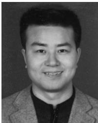  
Fanzi Zeng (Member, IEEE) received the Ph.D. degree in signal and information processing from Beijing Jiao tong University, Beijing, China, in 2005. Since 2005, he has been with the College of Computer Science and Electronic Engineering, Hunan University, Changsha, China, where he is currently a Professor. In 2009, he was with the Department of Electrical and Computer Engineering, Michigan Technological University, Houghton, as a Visiting Scholar. His current research focuses on cognitive radio technology and artificial intelligence.

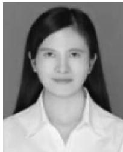

Zhenzhen Hu is currently working toward the Ph.D. degree at the College of Computer Science and Electronic Engineering, Hunan University, China. Her research interests include mobile and wireless networks, especially UAV wireless communication in wireless network.


Zhu Xiao (Senior Member, IEEE) received the M.S. and Ph.D. degrees in communication and information system from Xidian University, China, in 2007 and 2009, respectively. From 2010 to 2012, he was a Research Fellow with the Department of Computer Science and Technology, University of Bedfordshire, U.K. He is currently an Associate Professor with the College of Computer Science and Electronic Engineering, Hunan University, China. His research interests include mobile communications, wireless localization, Internet of Vehicles and mobile computing.


Hongbo Jiang (Senior Member, IEEE) received the Ph.D. from degree from Case Western Reserve University, in 2008. He is now a Full Professor in the College of Computer Science and Electronic Engineering, Hunan University. He ever was a Professor with the Huazhong University of Science and Technology. His research concerns computer networking, especially algorithms and protocols for wireless and mobile networks. He is serving as the editor for IEEE/ACM Transactions on Networking, the Associate Editor for IEEE TRANSACTIONS ON MOBILE

COMPUTING, and the Associate Technical Editor for IEEE Communications Magazine.

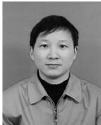

Siwang Zhou (Member, IEEE) received the B.S. degree from Fudan University, the M.S. degree from Xiangtan University, and the Ph.D. degree from Hunan University, China, respectively. He has been an Associate Professor at the College of Computer Science and Electronic Engineering in Hunan University, China. His research interests include sensor network, mobile crowdsensing, and image compressive sensing.


Wenping Liu (Member, IEEE) received the Ph.D. degree from the Huazhong University of Science and Technology, in 2012. He is currently a Full Professor with the School of Information Management and Statistcs, Hubei University of Economics, China. His research interests include mobile computing, the Internet of Things, smart city, and sensor networks.


Daibo Liu (Member, IEEE) received the Ph.D. degree in computer science and engineering from the University of Electronic Science and Technology of China, Chengdu, China, in 2018. He was a Visiting Researcher with School of Software, Tsinghua University from 2014–2016, and Department of Electrical and Computer Engineering, University ofWisconsin– Madison from 2016–2017. He is currently an Assistant Professor with the College of Computer Science and Electronic Engineering, Hunan University, Changsha, China. His research interests cover the broad areas of low power wireless networks, mobile and pervasive computing, and system security. He is a member of ACM.