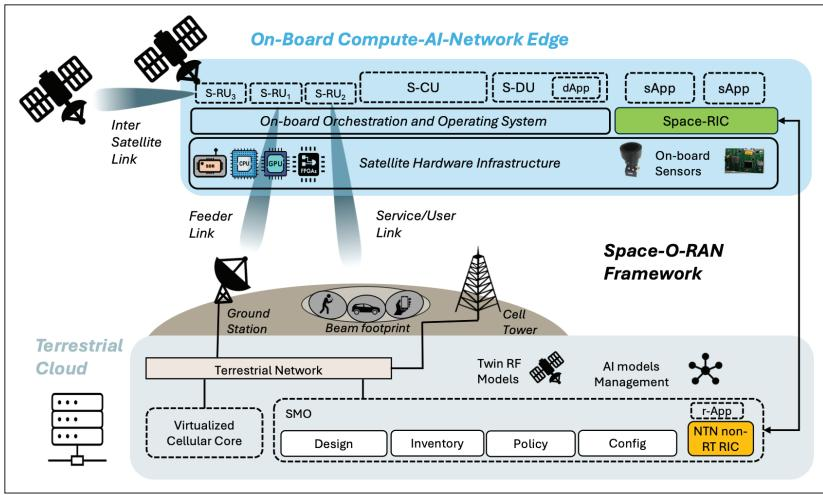
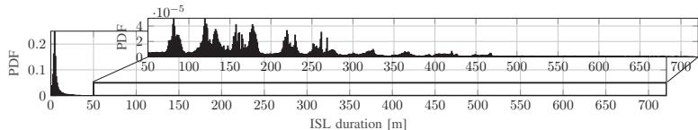
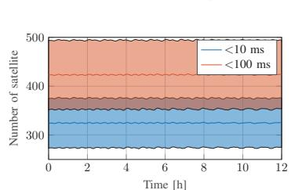
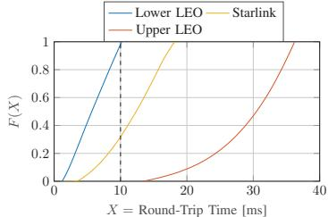
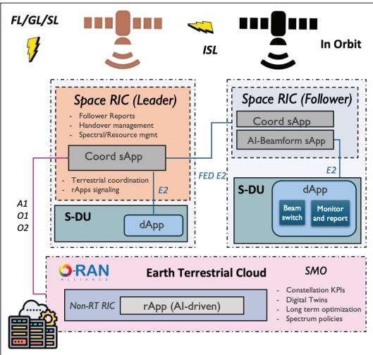
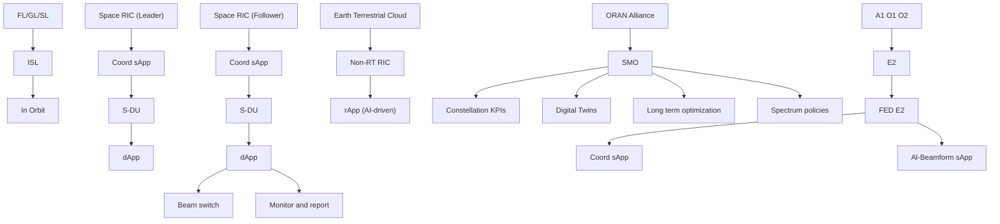

# Space-O-RAN: Enabling Intelligent, Open, and Interoperable Non-Terrestrial Networks in 6G

Eduardo Baena, Paolo Testolina, Michele Polese, Dimitrios Koutsonikolas, Josep Jornet, and Tommaso Melodia

## Abstra ct

Satellite networks are rapidly evolving, yet most Non-Terrestrial Networks (NTNs) remain isolated from terrestrial orchestration frameworks. Their control architectures are typically monolithic and static, limiting their adaptability to dynamic traffic, topology changes, and mission requirements. These constraints lead to inefficient spectrum use and underutilized network capacity. Although Artificial Intelligence (AI) promises automation, its deployment in orbit is limited by computing, energy, and connectivity limitations.

This article introduces Space-O-RAN, a distributed control architecture that extends Open RAN principles into satellite constellations through hierarchical, closed-loop control. Lightweight dApps operate onboard satellites, enabling real-time functions like scheduling and beam steering without relying on continuous ground access. Cluster-level coordination is managed via Space RAN Intelligent Controllers (Space-RICs), which leverage low-latency Inter-Satellite Links (ISLs) for autonomous decisions in orbit. Strategic tasks, including AI training and policy updates, are transferred to terrestrial platforms Service Management and Orchestrations (SMO) using digital twins and feeder links.

A key enabler is the dynamic mapping of the O-RAN interfaces to satellite links, supporting adaptive signaling under varying conditions. Simulations using the Starlink topology validate the latency bounds that inform this architectural split, demonstrating both feasibility and scalability for autonomous satellite RAN operations.

## Introducti on

The rapid growth of Non-Terrestrial Networks (NTNs), driven by large Low-Earth Orbit (LEO) constellations such as Starlink or Project Kuiper, reflects a growing need for global broadband access and connectivity in underserved regions [1, 2]. While these systems offer wide-area coverage, they are currently operated as closed, vertically integrated architectures, with limited programmability and no support for external coordination. Despite leveraging standardized spectrum and access technologies, NTNs remain isolated from the control plane of terrestrial networks and from each other, lacking the operational flexibility needed for modern service delivery.

More critically, this rigid design prevents finegrained coordination of radio, computational, and energy resources, resulting in unequal satellite utilization, underuse of Inter-Satellite Links (ISLs) routing, and inefficient use of feeder links for data egress. In current deployments, control decisions are either centralized on the ground or statically encoded, which becomes increasingly unsustainable as constellations scale. For example, feeder link bottlenecks and constrained on-board compute resources limit both user-plane performance and control-plane responsiveness, especially for applications requiring real-time reaction to orbital topology changes. Furthermore, the growing demand for Artificial Intelligence (AI)-driven services on board either for network management predictive tasks or application requiring satellite sensors competes for the same limited communication and power budgets as user services. Without integrated lifecycle management that includes both training and inference workflows spanning space and ground, AI adoption remains limited in practice [3, 4].

Standardization efforts such as Third Generation Partnership Project (3GPP) [2] and virtualized architectures [5] still assume that satellites behave like terrestrial base stations with extended delay. This ignores the challenges of orbital dynamics: shifting topologies, frequent Line-Of-Sight (LOS) loss, and short-lived ISL connections. To overcome these limitations, Space-O-RAN redefines satellites within the radio access network as intelligent autonomous nodes that actively participate in network control. By executing control loops in orbit, it avoids the delays inherent to ground-satellite communication and facilitates real-time decision making directly onboard. The architecture introduces four key innovations

• Space-RIC: A constellation-aware control plane that hosts satellite-resident application logic, allowing autonomous local decisions within each cluster. A leader–follower synchronization mechanism ensures consistent behavior in dynamic orbital topologies.  
• Hierarchical closed control loops: Control is distributed across three levels, local (onboard satellite), regional (intra-cluster), and global (terrestrial management), allowing coordinated adaptation under variable latency and intermittent connectivity [4].  
• Flexible disaggregated onboard RAN functions: Satellitedeployed Distributed Unit (DU), Centralized Unit (CU), and dApps enable

configurable placement and execution of RAN functions based on resource availability and control timescales without centralized infrastructure.

• Dynamic gateway and routing flexibility: Control and user-plane traffic are decoupled from static feeder link assignments, allowing realtime gateway selection across multi-hop ISLs.

The article is organized as follows. We review prior work and highlights the current limitations of 3GPP-based NTN integration. We outline the core architectural challenges and presents possible use cases. We detail the proposed architecture. Finally, we discuss future work and summarizes key technical contributions.

## Ba ckground a nd Rela ted Work

Recent 3GPP efforts have made substantial progress in defining NTN support within standardized systems. Releases 17, 18 and 19 have introduced critical extensions to 5G New Radio (NR) for satellite-based access, enabling transparent payload operation, Global Navigation Satellite System (GNSS)-based positioning, and protocol-level harmonization across terrestrial and satellite segments [6]. However, several technical limitations remain in current specifications. First, constellation-wide autonomous management is only marginally addressed through initial Self Organizing Network (SON) adaptations and resource model extensions [7], without mechanisms for distributed scheduling, in-orbit orchestration, or AI-driven control under dynamic conditions [8]. Moreover, current specifications restrict autonomous Radio Access Network (RAN) control during intermittent or degraded feeder link conditions to narrow use cases such as store-and-forward for Internet of Things (IoT), lacking general-purpose frameworks for operational continuity without constant ground access and failing to address the orchestration complexities introduced by dynamic multihop ISLs. Similarly, ITU Recommendation Y.3207 (2024) introduces the INCA framework for Fixed, Mobile, and Satellite Convergence (FMSC), proposing a centralized control model that spans heterogeneous domains. However, its practical adoption in LEO constellations remains limited due to assumptions of persistent control plane connectivity, high latency tolerance, and the absence of compute-aware resource management.

In parallel, the use of AI for optimization of the satellite network is gaining traction, but faces persistent challenges. Existing solutions either rely on periodic ground-side retraining or assume continuous feedback loops, both of which are infeasible under real-world orbital conditions. Latency fluctuations, data sparsity, and limited onboard compute power obstruct the lifecycle management of AI models, particularly in use cases requiring fine-grained inference (e.g., beam tracking or link prediction).

Work on modular and disaggregated RAN architectures using near-RT and non-RT RAN Intelligent Controllers (RICs) shows promise for dynamic control [9], yet often assumes static backhaul or ground-centered control loops. For NTNs, this creates a mismatch between architectural assumptions and operational realities: feeder links are bottlenecks, intraconstellation routing is volatile, and coordination must operate with degraded or disconnected ground access. Fully centralized control becomes impractical on scale and RAN decisions such as handovers, routing updates, or beam reconfiguration must be handled in situ with limited context. Although standardization bodies and recent proposals provide essential building blocks for NTN-Terrestrial Network (TN) control plane integration, they fall short of enabling decentralized, intelligent, and adaptive control in dynamic satellite constellations.

## Cha llenges a nd Use Ca ses

Integrating NTNs with terrestrial infrastructure involves managing a distributed, dynamic, and resource-constrained communication-computation environment. Traditional centralized architectures and standardized protocols [1, 2] focus primarily on direct-to-device connectivity and regenerative payload support without addressing autonomous coordination and resource-aware operations across satellite constellations. This section outlines major challenges and architectural design requirements.

## Cha llenges

Decentralized Control in Dynamic Topologies. The high mobility of LEO satellites requires frequent handovers and continuous network reconfiguration, causing dynamic latency, intermittent connectivity, and link failures [3]. Such conditions preclude conventional centralized management and mandate decentralized federated control. Decisions on handover, beam steering, and routing must occur autonomously and adaptively onboard satellites.

Unified Control Abstractions and Standardization Gaps. Current standards (3GPP, ITU-T Y.3207 [2]) primarily address user-plane compatibility without providing robust mechanisms for autonomous onboard management or adaptive multi-layer orchestration. There is a lack of standardized control abstractions capable of handling constellation-wide resource allocation and cross-layer decisions under operational dynamics.

Constrained AI Lifecycle Management. Deploying AI in NTNs faces substantial challenges due to limited computing resources on board, power constraints and intermittent connectivity [4]. Effective integration requires a lifecycle-sensitive orchestration that balances data collection, model inference onboard, and model training updates in terrestrial infrastructures without interfering with mission-critical user traffic.

Communication-Compute Resource Coupling. In satellite constellations, communication resources, computational capacity, and energy are closely interdependent and constrained [10]. Control signaling, telemetry data, and userplane traffic share the same limited satellite links, necessitating intelligent scheduling and resource allocation policies that jointly optimize these overlapping demands.

Flexible Ground Egress and Infrastructure Reuse. Dependence on fixed ground gateways limits current satellite networks, creating congestion and under-utilization issues [5]. Efficient use of infrastructure requires flexible and dynamic routing across available ISLs and gateways, optimizing resource usage by balancing traffic loads and ensuring robust network connectivity even when some feeder links are congested or compromised.

Existing solutions either rely on periodic groundside retraining or assume continuous feedback loops, both of which are infeasible under real-world orbital conditions.



<details>
<summary>flowchart</summary>

```mermaid
graph TD
  A["Inter Satellite Link"] --> B["S-RU3"]
  A --> C["S-RU1"]
  A --> D["S-RU2"]
  B --> E["S-CU"]
  C --> F["S-DU"]
  D --> G["dApp"]
  E --> H["sApp"]
  F --> I["sApp"]
  G --> J["Space-RIC"]
  K["Starellite Hardware Infrastructure"] --> L["On-board Sensors"]
  M["Ground Station"] --> N["Terrestrial Network"]
  O["Service/User Link"] --> P["Cell Tower"]
  Q["Virtualized Cellular Core"] --> R["SMO"]
  S["NTN non-RT RIC"] --> T["[f-App"]]
  U["Design"] --> V["Twin RF Models"]
  W["Inventory"] --> X["AI models Management"]
  Y["Policy"] --> Z["Config"]
  AA["Config"] --> AB["[f-App"]]
  AC["Design"] --> AD["Building Footprint"]
  AE["Inventory"] --> AF["Beam footprint"]
  AG["Policy"] --> AH["Cell Tower"]
  AI["Config"] --> AJ["Brain Tower"]
  AK["Design"] --> AL["Television/Orchestration and Operating System"]
  AM["Service/User Link"] --> AN["Television/Orchestration and Operating System"]
  AO["Starburst"] --> AP["S-GPU"]
  AQ["Satellite Hardware Infrastructure"] --> AR["S-GPU"]
  AS["On-board Sensors"] --> AT["S-GPU"]
  AU["On-board Compute-AI-Network Edge"] --> AV["S-GPU"]
  AW["Terrestrial Cloud"] --> AX["Starburst Network"]
```
</details>

FIGURE 1. Proposed Space-O-RAN architecture with partitioned control and shared infrastructure satellite and terrestrial operators.

Security and Resilient Operation. Integrating terrestrial and non-terrestrial segments enlarges the attack surface, introducing vulnerabilities in multi-hop communications, authentication processes, and control plane security [8]. Traditional security protocols are insufficient under frequent link interruptions and highly dynamic routing conditions. Ensuring secure operation requires novel federated authentication mechanisms, secure handover strategies, and robust encryption

Application-Aware Infrastructure. Current satellite architectures cannot dynamically instantiate or adapt application-specific network slices or workloads. The ability of satellites to function as intelligent edge platforms requires integrated management of communication, computational and application resources [11]. This integration supports prioritized traffic handling, mission-specific processing, and dynamic service deployment in orbit, transforming satellites into multifunctional and adaptive infrastructure nodes.

Addressing these challenges requires a novel architectural approach that combines decentralized control, federated resource orchestration, secure adaptive communications, and AI enabled predictive semi-autonomous operation [12].

## Use Ca ses

Addressing the abovementioned challenges opens the door to new classes of applications that cannot be effectively supported by current architectures.

On-Demand Remote Network Provisioning. In sparsely populated or infrastructure-poor regions, existing NTN systems are unable to flexibly deploy localized connectivity due to rigid control loops, static scheduling, and dependence on fixed feeder links. Overcoming these constraints would enable on-demand deployment of private network slices supported by orbital assets. This includes temporary 5G coverage in maritime or rural zones without relying on continuous backhaul or pre-positioned terrestrial support [2]. Such capabilities could significantly reduce deployment costs and extend service reach while minimizing energy consumption and idle resource utilization.

Autonomous and Resilient Disaster Response. Disasters frequently sever terrestrial links, rendering existing cellular systems non-operational. While satellites offer global coverage, current frameworks lack the real-time adaptability to dynamically re-route critical traffic through unaffected regions. Solving the challenges of multi-hop routing, in-situ scheduling, and secure, autonomous link reconfiguration would enable real-time emergency coordination, high-priority backhaul for edge devices, and telemetry aggregation for search-and-rescue operations, even under partial system degradation [3].

Distributed AI Workflows and Space-Edge Intelligence. Global-scale AI applications, such as environmental monitoring or predictive control, require distributed data ingestion and model retraining close to the edge. Predictive control leverages historical and real-time data to anticipate system behavior and adjust actions proactively, requiring fast, localized inference. Traditional architectures, based on periodic cloud updates and fixed connectivity assumptions, are unsuited for dynamic orbital environments. Coordinated management of compute and communication resources across satellite and terrestrial segments enables federated pipelines that adapt to shifting link conditions and resource availability [8, 9]. This supports time-sensitive autonomy and AI-driven use cases such as wildfire detection or fleet coordination.

Secure Multi-Domain Coordination. Integrating NTNs into terrestrial control planes introduces novel security risks, particularly when routing control plane traffic over variabledelay multi-hop satellite paths. Existing protocols assume stable authentication, time synchronization, and trusted infrastructure, which are difficult to guarantee in orbital contexts. Addressing these gaps would enable secure role assignment (e.g., leadership among satellites), robust policy enforcement under intermittent connectivity, and protected telemetry exchange across orbital and terrestrial links [8].

## Spa ce-O-RAN Archi tecture

The Space-O-RAN architecture implements a latency-aware, distributed control system tailored to the operational constraints of dynamic satellite constellations. Designed to operate in environments where persistent ground connectivity is neither available nor desirable, its control logic is hierarchically structured into three layers: onboard execution, intra-cluster coordination, and asynchronous terrestrial orchestration. Each layer corresponds to specific latency bounds, computational capabilities, and resilience requirements. This layered design is illustrated conceptually by the system architecture (Fig. 1), where onboard functions are handled by the Orchestration and Operating System, cluster coordination occurs via ISLs, and longer-term orchestration is delegated to the Service Management and Orchestration (SMO) and non-RT RIC.

At the physical level, each satellite node integrates modular RAN components designed for autonomous in-orbit operation. The Satellite Radio Unit (s-RU) manages radio connectivity over multiple link types, including Service Links (SLs), Feeder Links (FLs), ground-to-satellite links (GSLs), and ISLs. The Satellite Distributed Unit (s-DU), a lightweight DU variant adapted for constrained onboard compute, executes core MAC tasks such as scheduling, HARQ, and buffer management. The Satellite Central Unit (s-CU) oversees internode signaling and real-time control execution. Together, these components support AI-assisted onboard deployment of dApps responsible for time-critical tasks like beam switching, power control, or link monitoring. These operations, constrained by sub-10 ms timescales, require low-latency execution and are tightly coupled with the radio chain. To support additional services, each node may instantiate virtualized stacks (e.g., NB-IoT, RedCap) and optionally interface with a shared or tenantspecific onboard 5G core.

To enable coordination beyond single-node autonomy, the constellation is logically segmented into control clusters based on ISL connectivity and orbital proximity [13]. This design was evaluated through a full-constellation simulation of Starlink (6545 LEOs) using the MATLAB Satellite Communications Toolbox. Satellite trajectories were propagated over a 12-hour window (Nov. 11, 2024) at 60-second resolution using publicly available Two-Line Element Sets (TLEs).

As shown in Fig. 2a, the empirical PDF of ISL durations — filtered to retain links with RTT below 10ms and durations above one minute — shows most links last about 5 minutes, with a long tail reaching multiple hours. In Fig. 2b, each satellite maintains on average over 420 (375) low-latency ISLs at below 10ms (blue) and 100 ms (orange) oneway delay, respectively. Despite rapid topology changes, the constellation’s density and shell structure support sufficient link availability. Fig. 2c further shows the distribution of RTT for ground-to-satellite links across a range of LEO altitudes. Together, these results confirm the feasibility of stable, bounded-latency clusters for proactive coordination.

Within each cluster, a distributed control plane is instantiated through the Space RAN Intelligent Controller (Space5 RIC), which acts as the in-orbit analog to a non-RT RIC. The Space-RIC runs energy efficient Space Applications (sApps), adapted from terrestrial xApps, to manage local coordination tasks, for example, beam handovers, spectrum sharing, resource alignment or policy enforcement. Each sApp operates on shared state and propagates decisions via intra-cluster signaling to preserve alignment even under node mobility or partial link failures.

These interface mappings enable multiple control loops to coexist over shared physical links, each with distinct latency and reliability requirements. Near real-time signaling (e.g., over O-RAN Near-Real-Time Interface (E2), between near-RT RIC and RAN nodes) is prioritized over shortdelay paths via ISLs, allowing rapid adaptation to beam misalignment or interference. Less time-sensitive exchanges (e.g., model updates via O-RAN Policy Management Interface (A1), from non-RT to near-RT RIC) tolerate delay and are scheduled opportunistically when bandwidth and power permit. F1 (CU–DU), O-RAN Operations and Management Interface (O1) (RAN configuration and telemetry), and O2 (resource orchestration and lifecycle management) are routed based on timing and reliability demands. Interface coexistence is managed through logical separation and onboard schedulers that prioritize critical control during congestion or eclipse. The detailed mapping between O-RAN interfaces and physical link types is summarized in Table 1.

Long-term orchestration is offloaded to the terrestrial SMO and cloud-based AIs pipelines, which maintain a global Digital Twin (DT) of the constellation and issue periodic strategic updates through GSLs. Given the variability in GSL latency,chitecture (Fig. 1), where onboard functions are handled bythe Orchestration and Operating System, cluster coordination To enable cooconstellation is lo from 1.2 ms to over 37 ms depending on altitudeoccurs via ISLs, and longer-term orchestration is delegated to on ISL connectiv and geometry, these updates are used for policy       RT RIC.  link (6545 LEOs) synchronization and model refinement, not real-tions Toolbox. Sat time decisions. This separation ensures that satel-        RAN components designed for autonomous in-orbit operation.  publicly available lites remain responsive and self-sufficient during The Satellite Radio Unit (s-RU) manages radio connectivity As shown in extended ground disconnects.Links (FLs), ground-to-satellite links (GSLs), a



<details>
<summary>line chart</summary>

| ISL duration [m] | PDF     |
| ---------------- | ------- |
| 0                | 0.2     |
| 50               | 0.1     |
| 100              | 0.2     |
| 150              | 0.3     |
| 200              | 0.2     |
| 250              | 0.1     |
| 300              | 0.2     |
| 350              | 0.1     |
| 400              | 0.1     |
| 450              | 0.1     |
| 500              | 0.1     |
| 550              | 0.1     |
| 600              | 0.1     |
| 650              | 0.1     |
| 700              | 0.1     |
</details>

(a) Probability Density Function (PDF) of the ISL duration in minutes. We defined an ISL as a link between two satellites with a Round-Trip Time (RTT) lower than 10 ms, and of duration greater than one minute. Most of the ISL have a duration of about 5 minutes, but the zoomed-in plot shows the existence of several long-lived (above one hour) ISLs.



<details>
<summary>stacked bar chart</summary>

| Time [h] | <10 ms | <100 ms |
| :--- | :--- | :--- |
| 0 | 350 | 420 |
| 2 | 350 | 420 |
| 4 | 350 | 420 |
| 6 | 350 | 420 |
| 8 | 350 | 420 |
| 10 | 350 | 420 |
| 12 | 350 | 420 |
</details>

(b) Average number of available ISLs available at each satellite (solid line), that experience a latency below 10 ms (blue) and 100 ms (orange), in the Starlink constellation. The shaded area represents the corresponding standard deviation.



<details>
<summary>line chart</summary>

| X = Round-Trip Time [ms] | Lower LEO | Starlink | Upper LEO |
| ------------------------ | --------- | -------- | --------- |
| 0                        | 0         | 0        | 0         |
| 10                       | 1         | 0.4      | 0         |
| 20                       | 1         | 1        | 0.2       |
| 30                       | 1         | 1        | 0.6       |
| 40                       | 1         | 1        | 1         |
</details>

(c) Empirical Cumulative Distribution Function (ECDF) of the RTT between 33 ground stations and LEO satellites. The current (2024) Starlink constellation (yellow) orbits at around 550 km. Keeping the same constellation configuration, we varied its altitude between the minimum (180 km, blue) and maximum (2000 km, orange) LEO altitude.  
FIGURE 2. Duration (a) and number (b) of inter-satellite links below the latency thresholds, and propagation RTT for Fig. 2: Duration (a) and number (b) of inter-satellite links below the latency thresholds, and propagation RTT for ground-tsatellite (c), as simulated using the November 2024 Starlink constellation (6545 satellites) over 12 hours (12 AM-12 PM, No ground-tosatellite (c), as simulated using the November 2024 Starlink constellation (6545 satellites) over 12 hours 1th, 2024, 60 s sampling time). (12 AM–12 PM, Nov. 11th, 2024, 60 s sampling time).omputational capabilities, and resilience requirements.

To manage the tight coupling between com-tellite Distributed Unit (s-DU), a lightweight DU variant minutes, with a l munication compute, and energy resources, the       tasks such as scheduling, HARQ, and buffer management. The  latency ISLs at b onboard operating system dynamically instantiates Satellite Central Unit (s-CU) oversees inter-node signaling way delay, respec and scales virtualized RAN functions, sApps, and support AI-assisted onboard deployment of dApps responsible link availability. dApps based on current link conditions, traffic load,for time-critical tasks like beam switching, power control, RTT for ground and energy availability. This mechanism also sup-10 ms timescales, require low-latency execution and are tightly stable, bounded-l ports application-aware execution [11], enabling coupled with the radio chain. To support additional services, Within each cl mission-specific services to run as sApps (i.e. Earth Observation) directly integrated into the transmission loop, without relying on external orchestration.

## Onboa rd Autonomy a nd Cluster Coordi na ti on

Each coordination cluster operates as a self-contained control domain established via a distributed Space-RIC, where nodes collectively execute the functions required for intracluster operation. The Space-RIC hosts multiple sApps tailored to orbital execution constraints, similar to terrestrial xApps, managing tasks such as spectrum reuse to avoid interferences with other constellations and AI-based resource optimization.

At the core of the cluster, a dedicated Coordination sApp (Coord sApp), shown in Fig. 3, synchronizes the behavior of follower nodes, orchestrates the operation of other sApps, and interfaces with the terrestrial control plane via asynchronous policies and model updates. It acts as the control anchor of the cluster, ensuring a coherent execution across drifting nodes and variable links.

The Space-RIC employs a Leader–Follower architecture, where one satellite temporarily assumes coordination duties, aggregating local metrics, managing inter-satellite handovers, and disseminating control actions. The followers maintain softstate replicas of control parameters and execute delegated logic to ensure continuity. Leadership transitions are governed by Federated O-RAN Near-Real-Time Interface (FED-E2), an enhanced failover protocol built over the standard E2 interface. Beyond encoding leader election metadata, FEDE2 provides tolerance to link disruptions by allowing nodes to securely rejoin the cluster and resume synchronization once ISL connectivity is restored. This design enables stateful reconfiguration and continuity even in the presence of intermittent ISL dropouts, without requiring ground participation or manual recovery.

<table><tr><td>O-RAN Interface</td><td>Link Type</td><td>Primary Function</td><td>Notes</td><td>Typical Latency Target</td><td rowspan="5">RTT (Starlink)(P5/P50/P95)GSL: 5/12.3/16.7 msISL: 4/14.7/21.7 ms</td></tr><tr><td>Midhaul (F1-C/U)</td><td>ISL/FL/GSL</td><td>DU-CU communication</td><td>CU functions over FL/GSL may impair HARQ timing, dynamic scheduling, or beam switching responsiveness.</td><td>1.5-10 ms</td></tr><tr><td>Backhaul/Core(NG, N2/N3)</td><td>SL/FL/GSL</td><td>CU-5GC or core-plane communication</td><td>The links can tolerate moderate delay in NTN context</td><td>&lt; 50-100 ms(service-dependent)</td></tr><tr><td>Near-RT Control(E2)</td><td>ISL/FL/SL</td><td>Policy, RIC feedback loops</td><td>Fast loops feasible over ISL only; SL/FL need fallback to slower control</td><td>&lt; 10-20 ms</td></tr><tr><td>Management(O1, A1)</td><td>FL/GSL</td><td>SMO, policy, AI model sync</td><td>Not delay-sensitive; supports asynchronous operation</td><td>Tolerant (&gt; 100 ms)</td></tr></table>

TABLE 1. Dynamic interface-link mapping.



<details>
<summary>flowchart</summary>


</details>

FIGURE 3. Hierarchical coordination workflow.

Cluster-wide state is continuously synchronized over low-latency ISLs, which maintain bounded message delays in the 5–10 ms range even under orbital drift. In Fig. 3, the left satellite hosts the Coord sApp and acts as cluster leader, receiving AI model updates from the terrestrial rApp via A1/O1. The right node operates as a follower, executing AI driven sApps (e.g., beamforming, monitoring), whose decisions are enacted through dApps within s-DU.

The closed-loop sequence example (Fig. 3) begins with CSIdriven dApp decisions at the RAN layer, propagates through the Space-RIC for cluster-wide coherence, and if persistent anomalies are detected, triggers feedback to the SMO for non- RT policy adjustment. In this regard, continuous autonomy at the cluster level, even during extended disconnection from the terrestrial SMO is supported. Upon GSL restoration, updated models and strategic policies are propagated to the cluster leader and distributed locally without interrupting real-time responsiveness. Clusters are dynamically formed during orbital grouping events or in mission-defined coordination phases.

A leader is elected based on a weighted score that combines ISL connectivity, compute availability, and telemetry freshness. FED-E2 ensures continuity by enabling logical control to migrate to synchronized followers without external input. To prevent partitioned decision-making, a minimum quorum of state-synchronizedc nodes is required to sustain cluster-level coordination; otherwise, nodes revert to local-only operation.

## Ground-Ba sed Orchestra ti on a nd AI Pi peli nes

The terrestrial segment, jointly operated with the satellite provider, is responsible for global orchestration, policy generation, and AI lifecycle management across satellite clusters. These functions are distributed between two main components: the SMO, which collects telemetry, configures infrastructure, and monitors system health via the O1/O2 interfaces; and the non-RT RIC, which hosts rApps that drive long-term optimization using cloud-scale AI pipelines. rApps implement domain-specific analytics and control logic, transforming aggregated data into adaptive policies. These may include time-evolving spectrum coordination, congestion mitigation strategies, mobility forecasts, or slice prioritization rules. Each rApp operates asynchronously, combining historical traces and real-time inputs to refine predictive models and generate control strategies over medium-to long-term horizons.

These AI pipelines also serve as the backend for training two distinct but interlinked systems: digital twins (Digital Twins (DTs)) that emulate constellation-wide network behavior, and deployable inference models executed onboard each satellite. The DTs integrate orbital geometry, historical Key Performance Indicators (KPIs), and link performance data to simulate coordination bottlenecks, capacity fluctuations, and potential failure modes, providing a predictive foundation for global orchestration. Meanwhile, on-board models derived from these same pipelines enable localized real-time decision making with minimal ground interaction.

High-level policies and updated models are transmitted to Space-RIC via the A1 interface. These policies encode intentbased directives, for example spectrum reuse plans or energy budget swhich are interpreted by in-orbit sApps and enforced by co-located dApps at the RAN level.

Satellite telemetry used to feed these pipelines is compressed and selectively sampled to align with GSL bandwidth constraints, enabling asynchronous yet coherent model updates. To prevent congestion on feeder and gateway links, model updates are prioritized using anomaly scores computed locally at the cluster level. Only clusters exhibiting significant behavioral divergence initiate full-state uploads or receive complete model retraining. The rest continue operating with cached models, periodically refined through lightweight differential updates.

## Securi ty a nd Coordi na ti on Integri ty

Secure coordination is maintained through cryptographically grounded protocols that minimize the attack surface while ensuring responsiveness. Each node authenticates its control role via mutual certificate-based validation, with critical leadership functions assigned through a quorum-based election enforced by the FED-E2 protocol. This federated extension of the E2 interface restricts leadership promotion to candidates with verified cryptographic credentials and synchronized telemetry history.

All control interfaces (O1s, A1s, E2s) operate over lightweight encrypted channels using ephemeral session keys, derived from pre-distributed roots and rotated periodically to prevent replay and downgrade attacks. The onboard s-CU integrates a priority-aware scheduler that ensures authentication flows are prioritized, avoiding delays during high traffic or contention. Rapid link context switching is supported through pre-authentication of adjacent nodes, allowing seamless handovers without compromising integrity.

In adversarial conditions, for example, contested spectrum or suspected node compromise, satellites automatically reduce their control-plane exposure by disabling downstream reconfiguration via A1 and rejecting unsigned or tampered updates at the sApp layer. Leadership failover incorporates real-time integrity checks: if the acting Leader becomes unresponsive or diverges from expected behavior, a cluster-wide consensus process is triggered, promoting a valid Follower using cached keys and buffered telemetry to ensure continuity within a single control cycle.

## Future Outlook

Extending the proposed framework to lunar and deep-space scenarios introduces new architectural imperatives. The intermittency and propagation delays intrinsic to such environments challenge traditional coordination schemes and demand resilient, locally autonomous control structures. While protocols like the Bundle Protocol and High-Delay Tolerant Networking (HDTN) [14] offer improved delay-tolerant communication, they are not designed to support the real-time orchestration loops required for joint spectrum, compute, and queue arbitration under dynamic mission constraints.

Future lunar networks may integrate Space-RICs directly within surface assets to support close-proximity swarm coordination and shared control between landers, orbiters, and surface stations. This would enable fast reactive decisions within clusters while preserving synchronization with Earthbased or Lunar Base orchestration. In such settings, the use of steerable ISLs and directional spectrum reallocation must be extended to heterogeneous assets, which can be operated at FR3/THz frequencies to achieve low-latency high-bandwidth communication via short-range LOS links in vacuum with nearby assets [15]. However, these require dynamic adaptation to occlusions and relative motion, reinforcing the need for onboard arbitration mechanisms that prioritize control stability over throughput.

Space deployments will also benefit from a semantic control layer that interprets mission context, task intent, and data relevance to reduce protocol overhead and enhance autonomy. AI accelerators and inference processors, space-grade and energy-efficient, will need to support local adaptation, with federated learning enabling collaborative inference without raw data exchange.

## Conclusi ons

This work presented Space-O-RAN, a distributed control architecture that addresses a fundamental limitation in current NTN deployments: the inability to execute timely, adaptive decisions due to latency, intermittent connectivity, and on-board resource constraints. A three-tier control hierarchy aligned with physical link characteristics and onboard processing capabilities. Real-time decisions are handled autonomously in orbit by lightweight AI-driven apps, co-located with the radio stack, and tailored to local context. Cluster-level coordination is managed by the Space-RIC, enabling federated alignment and resilient operation even under partial link degradation. Long-term strategy and model training remain on the Terrestrial cloud, but inference is executed onboard, allowing for continuous adaptation without waiting for terrestrial input.

A key enabler is the dynamic mapping of O-RAN interfaces to available satellite links, allowing control loops to persist transparently over shared ISL, GSL, or feeder paths depending on latency and policy requirements. Simulation results validate the feasibility of maintaining sub-10 ms intra-cluster coordination over real-world ISL dynamics, while asynchronous updates from terrestrial digital twins enable refined policy evolution and AI model improvement over time. Together, these mechanisms offer a scalable foundation for autonomous, intelligent, and resilient NTNs beyond traditional architectures.

## Ref erences

[1] M. Y. Abdelsadek et al., “Future Space Networks: Toward the Next Giant Leap for Humankind,” IEEE Trans. Commun., vol. 71, no. 2, 2023, pp. 949–1007.  
[2] L. Cheng, W. Zhang, and Z. Wang, “6G Service-Oriented Space-Airground Integrated Network: A Survey,” IEEE Access, vol. 10, 2022, pp. 120,000–17.  
[3] L. Diana and P. Dini, “Review on Hardware Devices and Software Techniques Enabling Neural Network Inference Onboard Satellites,” Remote Sensing, vol. 16, no. 21, 2024; https://www.mdpi.com/2072-4292/16/21/3957.  
[4] A. Iqbal et al., “Empowering Non-Terrestrial Networks With Artificial Intelligence: A Survey,” IEEE Access, vol. 11, 2023.  
[5] Z. Jia et al., “Virtual Network Functions Orchestration in Software Defined LEO Small Satellite Networks,” ICC 2020 — 2020 IEEE Int’l. Conf. Commun. (ICC), 2020, pp. 1–6.  
[6] M. M. Saad et al., “Non-Terrestrial Networks: An Overview of 3GPP Release 17 & 18,” IEEE Internet of Things Mag., vol. 7, no. 1, 2024, pp. 20–26.  
[7] 3GPP, “Study on Management and Orchestration Aspects of Integrated Satellite Components in A 5G Network,” 3rd Generation Partnership Project (3GPP), Technical Report TR 28.808, April 2021, release 16; https://www.3gpp.org/ftp/ Specs/archive/28 series/28.808/.  
[8] S. Mahboob and L. Liu, “Revolutionizing Future Connectivity: A Contemporary Survey on AI-Empowered Satellite-Based Non-Terrestrial Networks in 6G,” IEEE Commun. Surveys &

Tutorials, vol. 26, no. 2, 2024, pp. 1279–1321.

[9] S. Mahboob et al., “Transforming Future 6G Networks via O-RAN-Empowered NTNs,” IEEE Commun. Mag., pp. 1–7, 2025.

[10] S. Wang and Q. Li, “Satellite Computing: Vision and challenges,” IEEE Internet of Things J., vol. 10, 2023, pp. 22,514–29.

[11] Q. Chen et al., “Space-ground Fluid AI for 6G Edge Intelligence,” 2025; https://arxiv.org/abs/2411.15845

[12] H. Al-Hraishawi et al., “Digital Twin for Enhanced Resource Allocation in 6G Non-Terrestrial Networks,” IEEE Commun. Mag., 2024, pp. 1–7.

[13] D.-H. Jung et al., “Satellite Clustering for Non-Terrestrial Networks: Concept, Architectures, and Applications,” IEEE Vehic. Tech. Mag., vol. 18, no. 3, 2023, pp. 29–37.

[14] R. Dudukovich et al., “Advances in High-Rate Delay Tolerant Networking On-Board the International Space Station,” IEEE Space Mission Challenges for Information Technology — IEEE Space Computing Conference (IEEE SMC-IT/SCC), 2024.

[15] W. Jiang et al., “Terahertz Communications and Sensing for 6G and Beyond: A Comprehensive Review,” IEEE Commun. Surveys & Tutorials, vol. 26, no. 4, 2024, pp. 2326–81.

## Bi ogra phi es

Eduardo Bae na is a postdoctoral research fellow at Northeastern University, with a Ph.D. in Telecommunication Engineering from the University of Malaga. His experience includes roles in the international private sector (2010–2017) and as Co-PI in several research projects.

Paolo Te st olina received a Ph.D. in information engineering from the University of Padova in 2022. He is a Research

Scientist at Northeastern University, with research interests in mmWave and sub-THz networks, including channel modeling, physical layer simulation, Non-Terrestrial Networks and spectrum sharing and coexistence.

Miche le Pole se is a Research Assistant Professor at Northeastern University’s Institute for the Wireless Internet of Things. He received his Ph.D. from the University of Padova in 2020 and focuses on protocols for 5G and beyond, mmWave/THz networks, spectrum sharing, and open RAN development.

Dim it rios Kout sonik olas is an Associate Professor in the department of Electrical and Computer Engineering and a member of the Institute for the Wireless Internet of Things at Northeastern University. He specializes in experimental wireless networking and mobile computing, with a focus on 5G/NextG networks and applications. He is a recipient of the IEEE Region 1 Technological Innovation Award and the NSF CAREER Award.

Josep M. Jornet [M’13, SM’20, F’24] is a Professor and Associate Director of the Institute for the Wireless Internet of Things at Northeastern University. His research focuses on terahertz communications and networking, pioneering advancements in nanoscale communications and wireless systems. He has authored over 250 peer-reviewed publications and holds five US patents.

Tomm aso Me lodia is the William Lincoln Smith Chair Professor at Northeastern University and Founding Director of the Institute for the Wireless Internet of Things. A recipient of the NSF CAREER award, he has served as an Associate Editor for leading IEEE journals.