# Spectral-Efficient Dynamic User Association in LEO Satellite Constellation-HAPS Cooperative Networks

Kazuma Mashiko Graduate Student Member, IEEE, Hiroaki Hashida , Member, IEEE, Yuichi Kawamoto , Member, IEEE, Nei Kato , Fellow, IEEE, Kohei Yoshida , Member, IEEE, and Masayuki Ariyoshi , Member, IEEE

Abstract—The demand for 6G wireless networks requires global, high-capacity coverage. Non-terrestrial networks using the low-earth orbit (LEO) satellites and the high-altitude platform station (HAPS) are promising solutions. Although originally designed for limited applications, evolving applications now require more efficient use of spectrum. Previous works have focused on HAPS relay links, but integrating satellite–ground direct links introduces new coordination challenges and the static nature of HAPS coverage can be inefficient. To overcome these issues, we propose a downlink user association method that leverages LEO satellites and HAPS by optimizing instantaneous link sets and adaptive long-term switching control to maximize spectral efficiency. Simulation results show our method outperforms conventional distance-based or fixed-interval approaches.

Index Terms—Low-earth orbit (LEO) satellite constellation, high-altitude platform station (HAPS), non-terrestrial networks (NTNs), spectral efficiency, 6G.

## I. INTRODUCTION

HE ADVANCEMENT of information and communication technologies (ICT) has had a significant impact on both industry and our social interactions. The demand for applications requiring low latency and high-capacity data communication, such as online conferencing, live streaming, online gaming, and metaverse, is on the rise. Consequently, the evolution of wireless communication technology is crucial to satisfy the demands of next-generation applications [1]. The International Telecommunication Union (ITU), a specialized agency of the United Nations for ICT, has set a goal of

Received 24 January 2025; revised 1 April 2025; accepted 9 May 2025. Date of publication 13 May 2025; date of current version 19 December 2025. The associate editor coordinating the review of this article and approving it for publication was L. P. Qian. (Corresponding author: Kazuma Mashiko.)

Kazuma Mashiko, Yuichi Kawamoto, and Nei Kato are with the Graduate School of Information Sciences, Tohoku University, Sendai 980-8579, Japan (e-mail: mashiko.kazuma.p3@dc.tohoku.ac.jp; yuichi.kawamoto.d4@tohoku.ac.jp; nei.kato.d3@tohoku.ac.jp).

Hiroaki Hashida is with the Graduate School of Information Sciences, and the Frontier Research Institute for Interdisciplinary Sciences, Tohoku University, Sendai 980-8579, Japan (e-mail: hiroaki.hashida.d6@tohoku.ac.jp).

Kohei Yoshida and Masayuki Ariyoshi are with the Advanced Network Research Laboratories, NEC Corporation, Kawasaki 211-8666, Japan (e-mail: kohe-yoshida@nec.com; m.ariyoshi@nec.com).

Digital Object Identifier 10.1109/TCCN.2025.3569603 achieving global digital inclusion. Research and development efforts to extend telecommunication networks to every corner of the world are gaining momentum [2]. Non-terrestrial networks (NTNs) have garnered significant attention as a solution to achieving global coverage [3], [4], [5], utilizing satellite and aerial communication equipment independently from conventional terrestrial networks (TNs), such as mobile communication networks [6], [7]. Currently, various use cases are being explored for integrating NTNs and TNs, such as distributing increasing network traffic and establishing alternative terrestrial communication networks in the event of a disaster [8], [9].

Among the NTN technologies, the low-earth orbit (LEO) satellite constellation and the high-altitude platform station (HAPS) have garnered significant attention in recent years [10], [11], [12], [13]. Commercial entities are actively participating in the communications sector using LEO satellite constellations, contributing to the rapid growth of the space economy [14], [15], [16]. LEO satellite constellations comprise satellites deployed in various orbits to provide coverage to all regions on Earth without ground stations. HAPS typically operates in the stratosphere, closer to the Earth’s surface than satellites navigate in the stratosphere and is closer to the ground than satellites. This proximity allows for low latency data transmission, with each HAPS capable of covering an area of approximately 100 km in diameter. Furthermore, the HAPS is anticipated to serve as relay nodes for satellite-ground communication, enhancing the quality of communication in satellite systems supporting applications requiring high-capacity data transmission [17]. Therefore, NTN coverage is expected to be extended to remote islands, oceans, mountainous areas, and other areas where ground stations are impractical. Efficient utilization of frequency resources is crucial for expanding coverage and accommodating more users through NTNs.

To achieve this, enhancing the capacity of satellite communication systems is imperative. The integration of free-space optical (FSO) communications has garnered attention. FSO communications typically operate within a frequency band of several hundred terahertz and do not necessitate licensing, enabling communication across a wide bandwidth. Therefore, much higher data rates can be achieved compared with that of radio frequency (RF) communications utilized in conventional satellite communication systems. Despite the advantages of FSO communications, challenges exist in their adoption. First, attenuation during atmospheric propagation is more pronounced in RF communications owing to refraction and diffraction [18], [19], [20]. The narrow beam footprint renders it unsuitable for one-to-many communications, such as RF communications. Moreover, because of the need to receive a narrow laser beam, the link can be momentarily disrupted if the optical axis shifts owing to satellite vibration or a minor error [21]. Furthermore, the gain of FSO communication depends on the received light intensity, making it challenging to use FSO near the ground during daylight hours owing to the influence of solar radiation. To utilize FSO communications in a satellite environment, hybrid FSO/RF communications have garnered attention [22], [23]. This approach leverages FSO communications at high altitudes where atmospheric interference is minimal while utilizing RF communications closer to the ground. Therefore, integrated hybrid FSO/RF NTN utilizing LEO satellite constellations and HAPS is gaining traction as a cutting-edge satellite communication system [22], [24], [25].

## A. Related Studies

Collaboration between LEO satellites and HAPS is crucial to ensure global coverage and enhance the overall transmission capacity of the system. Numerous studies have focused on designing systems that facilitate cooperation between LEO satellites and HAPS. Performance analyses, including assessments of ergodic capacity, outage probability, and bit error rates of communication links relayed by HAPS, are actively being pursued [26], [27], [28]. These studies demonstrated that HAPS can significantly enhance the transmission performance between LEO satellites and the ground by serving as relays. This has spurred further investigation into developing more intricate transmission control protocols and algorithms. Reference [29] investigated the performance of the LEO satellite-HAPS-ground relay link and proposed the optimal HAPS selection method for FSO links. Additionally, [30] proposed a method in which HAPS jointly optimizes transmission power with the destination LEO satellite in a data collection scenario. Furthermore, [31] developed an algorithm for matching users, HAPS, and LEO satellites in a spaceair-ground network, whereas [32] presented a framework for error control protocols with rate adaptation for FSO burst communications in HAPS-assisted space-air-ground integrated vehicular networks. Reference [33] utilized HAPS for data collection from ground users and proposed an algorithm to determine the most efficient path to ground stations through LEO satellites. These studies primarily focused on links relayed through HAPS (satellite-to-HAPS or ground-to-HAPS links). However, to extend NTN coverage, a satellite-to-ground link that bypasses HAPS is essential. Satellites operate at significantly higher altitudes than HAPS, resulting in broader coverage. Therefore, carefully considering the areas covered by satellites or HAPS over a broad ground area that extends beyond the beam coverage of HAPS is imperative. Accordingly, this study proposes a novel multi-link operation scheme that combines links via HAPS and direct links from satellites.

## B. Contributions

This study proposes a method for coordinating a LEO satellite constellation with HAPS to design a spectral-efficient coverage area using both relay and direct links. To enhance the transmission capacity of the system, the limited resource of RF bandwidth must be efficiently utilized, a concept defined in this study as spectral efficiency.

The main contributions of this study are as follows:

• Representation of the dynamic satellite communication environment through a time-extended graph (TEG), leading to the formulation of an optimization problem to determine the optimal set of links among nodes, such as satellites, HAPS, and ground cells.  
To obtain the most efficient solution with minimal computational effort, we developed an exploration scheme that narrows down the solution space by incorporating constraints from the optimization problem and establishing preferred paths. Through an analysis of the feasible link sets generated by this approach, we determined the optimal paths for instantaneous link sets.  
• Proposal of a flexible link set switching timing control scheme utilizing instantaneous optimal link sets to maximize spectral efficiency and enable digital inclusion with LEO satellite constellations and HAPS.  
• Validation of the proposed method’s superiority over conventional routing schemes through simulation evaluation.

## C. Paper Organization

The remainder of this paper is organized as follows. Section II describes the assumed network model and problem statement. Our proposed satellite-HAPS coordination method is examined in Section III. Section IV provides an overview of the performance evaluation and presents the results. Finally, Section V concludes the paper.

## II. NETWORK MODEL AND PROBLEM STATEMENT

## A. System Configuration

1) Dynamic NTN Model: This study assumes a downlink scenario within a network comprising a LEO satellite constellation, HAPS, and ground users, as shown in Fig. 1. Data transmission to ground users can occur either through a direct link from the LEO satellite or through a relay through HAPS. This communication involves FSO links between the LEO satellite and HAPS, with RF communication serving as a backup in case of temporary disruptions. Additionally, RF communication is utilized between HAPS and the ground, as well as between the satellite and the ground.

In the assumed NTN, the movement of LEO satellites introduces dynamic changes that complicate the analysis. To address this, a TEG is employed to represent the instantaneous topology of a dynamic NTN. An example of a TEG representing a dynamic NTN is shown in Fig. 2. The TEG is represented by $G = ( V , E )$ , where V represents the node set and E represents the edge set. The node set V comprises a satellite node $V _ { \mathrm { s } } ,$ HAPS node $V _ { \mathrm { h } } .$ , and ground node $V _ { \mathrm { g } } ,$ whereas the s hedge set E includes satellite-ground $E _ { \mathrm { s g } }$ g, satellite-HAPS $E _ { \mathrm { s h } }$ , and HAPS-ground $E _ { \mathrm { h g } }$ sg shlinks. Owing to the assumption of hgmultiple satellites and ground users in this study, S and G are denoted respectively as

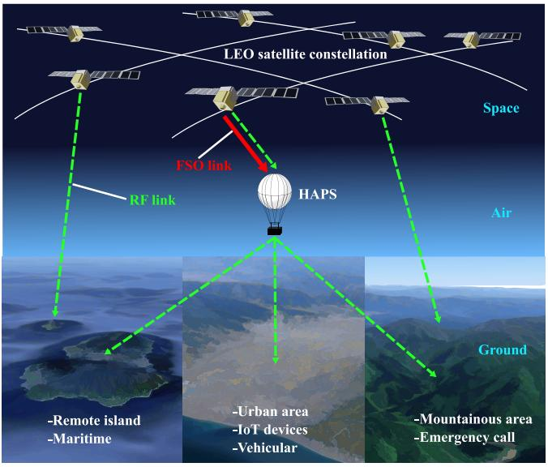

flowchart

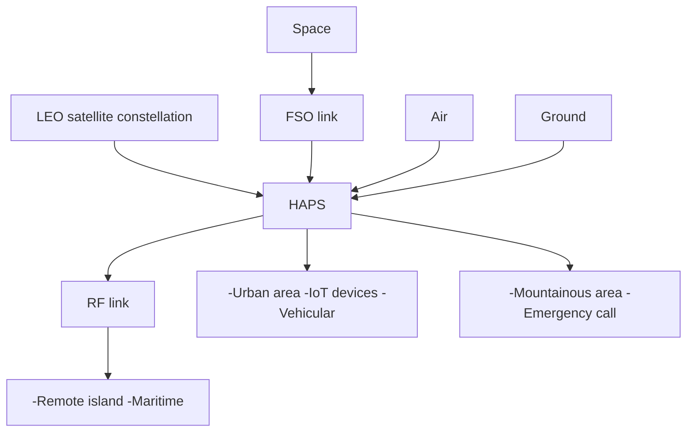

Fig. 1. Assumed hybrid FSO/RF NTN.

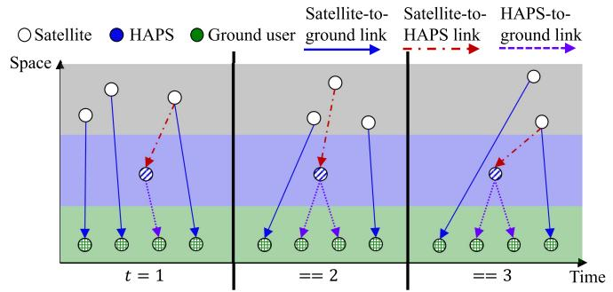

flowchart

Fig. 2. Representation of an NTN using a TEG. The number of satellites that can be observed from HAPS or ground users fluctuates with time.

$$
S = \left\{S ^ {1}, S ^ {2}, \dots , S ^ {N _ {\mathrm{s}}} \right\}, \tag {1}
$$

$$
G = \left\{G ^ {1}, G ^ {2}, \dots , G ^ {N _ {\mathrm{g}}} \right\}, \tag {2}
$$

where $N _ { \mathrm { s } }$ and $N _ { \mathrm { g } }$ denote the number of satellites and ground s gusers, respectively. A detailed representation of the nodes can be obtained by considering the time variation, with the set of satellite, HAPS, and ground users denoted as follows:

$$
V _ {\mathrm{s}} = \{i _ {t} | i \in S, 1 \leq t \leq T \}, \tag {3}
$$

$$
V _ {\mathrm{h}} = \left\{i _ {t} \mid i \in H, 1 \leq t \leq T \right\}, \tag {4}
$$

$$
V _ {\mathrm{g}} = \left\{i _ {t} \mid i \in G, 1 \leq t \leq T \right\}, \tag {5}
$$

where T and H denote the time horizon and HAPS, respectively. Next, to indicate whether an active link (edge) exists between two nodes $i _ { t }$ and $j _ { t }$ at time t, we define the link connection state as follows:

$$
x (i _ {t}, j _ {t}) = \left\{ \begin{array}{l} 1 \text {   if   a   link } (i _ {t}, j _ {t}) \text {   is   active }, \\ 0 \text {   otherwise }. \end{array} \right. \tag {6}
$$

The unique feature of the aforementioned network model is the variability in the positions of the satellites, as well as the potential fluctuation in the number of satellites within the space being considered. This variability poses a challenge for training machine learning models. Various methods for utilizing machine learning for resource control in TEG representing NTN have been explored in existing literature [34], [35]. However, these methods are effective when the number or location of nodes is fixed, which differs from the network assumed in this study. For example, in reinforcement learning, the agent determines the path or allocates resources within a given satellite environment and receives rewards for its actions. While this iterative cycle of action and reward typically leads to enhanced decision-making, it becomes less effective when the satellite environment undergoes significant changes. The network assumed in this study not only changes the position of the satellites, as shown in Fig. 2 but also the number of satellites to be controlled changes frequently. Therefore, training a unified machine learning model to control routing and resources in such a dynamic satellite environment is challenging.

2) Channel Model: In this study, we utilized channel models for both FSO and RF links to calculate the transmission capacity of the connections. These models consider the distance and elevation angle between the nodes. The foundation of these channel models is built upon various previous studies that have explored satellite-HAPS FSO and satellite-ground RF links [21], [25], [29], [36], [37].

## B. Problem Statement

1) User Association: In a system where satellites and HAPS cooperate, determining the appropriate downlink routes to assign to users who are widely distributed on the ground is imperative. This decision involves associating users with either the satellite or HAPS. As outlined in Section II, several previous studies have discussed cooperative strategies for systems in which LEO satellites and HAPS coexist. However, these studies do not account for the simultaneous utilization of direct satellite-ground and HAPS relay links as a service link. Therefore, HAPS is conventionally assumed to have a fixed coverage, neglecting the provision of communication services to users beyond the HAPS beam coverage. The proper allocation of users in all regions with satellites or HAPS is imperative to satisfy the increasing communication demands of NTN. Here, we highlight the challenges that arise when applying conventional methods with fixed HAPS coverage to the assumed network. First, as shown in Fig. 3(a), an excessive number of users outside of HAPS coverage can lead to reduced traffic demand satisfaction. This results in more users being covered solely by the satellite, requiring the satellite to allocate RF bandwidth intensively to the direct link to the ground. Furthermore, the conventional method selects the FSO link with the highest transmission capacity between the satellite and HAPS. Consequently, the satellite connecting to HAPS must allocate a portion of its RF bandwidth for the backup link between the satellite and HAPS, regardless of the distribution of ground users. This results in an imbalance between the traffic requirements of ground users and transmission capacity. For example, if the transmission capacity is insufficient to satisfy the traffic demand, some users may not obtain the desired transmission rate. Conversely, if the transmission capacity exceeds the traffic demand, RF bandwidth that could be allocated to other links may go unused. Second, as shown in Fig. 3(b), in scenarios of numerous users in HAPS coverage, the transmission capacity between HAPS and the ground may be insufficient. Recently, the use cases of HAPS have been considered for deployment in densely populated areas than in surrounding areas, such as islands, mountainous areas, cities, and ships. Therefore, traffic demands cannot be covered by HAPS alone in some cases. In the downlink transmission within the network, HAPS serves as the node in which the conversion from the high-capacity FSO link from the satellite to the low-capacity RF link occurs. Even if a large volume of data is transmitted to HAPS to fulfill ground user demands, congestion at HAPS can create a bottleneck in the HAPSground link. This congestion can result in issues, such as data loss, compression of buffer capacity, and transmission delays, ultimately diminishing the quality of communications for users within HAPS coverage.

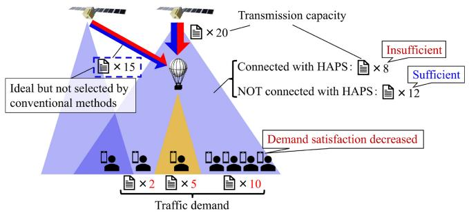

flowchart

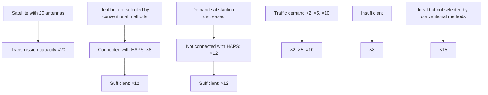

(a) Scenario with numerous users outside of HAPS coverage.

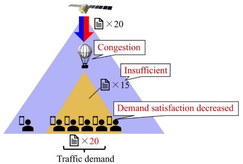

flowchart

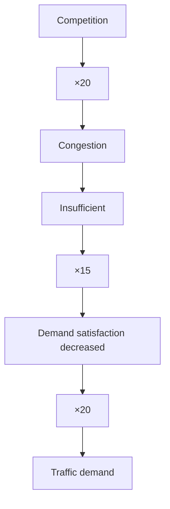

(b) Scenario with numerous users inside of HAPS coverage.  
Fig. 3. Challenges of user associations.

2) Link Switching: The frequent link switching caused by satellite movement is a common feature of LEO satellite constellations. The process of changing the connection state of each communication node in a typical satellite communication system is as follows:

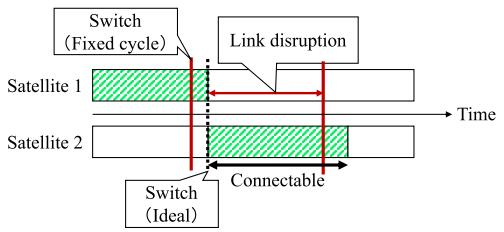

flowchart

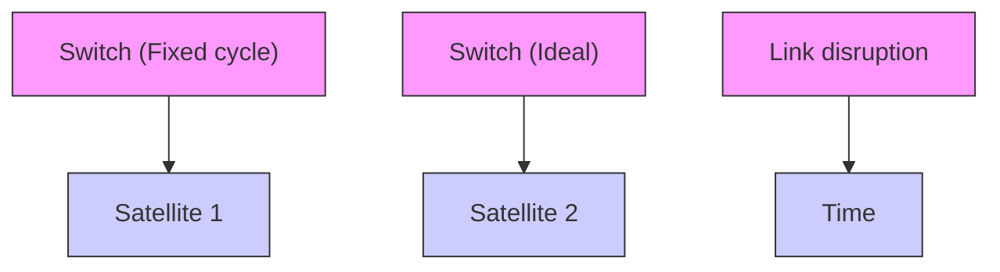

Fig. 4. Link disruption owing to a conventional fixed-period link switching method. First, only Satellite 1 can be connected to a specific node. At the switching timing (indicated by the red line), the system is compelled to change the link connection state, with Satellite 1 being the only available option. However, after this switch, link switching is not possible until the next red line. During this interval, Satellite 1 moves away from the node, resulting in a disrupted link. However, Satellite 2 approaches the node shortly after the initial red line. By anticipating this future contact, delaying the switching timing to the black line could be a more effective strategy. Unfortunately, in a conventional method, this level of flexible control over switching timing is not feasible.

First, the network operation center (NOC) on the ground calculates the appropriate link set and transfers this information to each satellite through the gateway. The main source of delay in this step is the computational time required by the NOC. This results from the extensive computational resources required to derive the optimal link set for a large network, such as the LEO satellite constellation.  
Next, each satellite controls the direction of its antenna, transmission power, and beam direction based on the control signal received, establishing a link with a new counterpart node. Delays in this phase are associated with mechanical control operations, such as satellite gimbal and attitude adjustments, as well as delays related to the establishment of the link. In satellite environments, establishing links over longer distances is a crucial aspect that requires careful consideration. Unlike terrestrial networks, satellite networks take tens of seconds to a few minutes for the link to stabilize. This becomes even more critical in FSO communications, where the beam footprint is narrower compared with RF communications, making pointing more challenging.

During each link switch, the process can take several minutes at most, impacting system performance. Even if the link switch is executed in the shortest cycle, the system may not necessarily achieve maximum efficiency. For example, consider a scenario in which only Satellite 1 is capable of communicating with HAPS until time t, as shown in Fig. 4, and the link switching timing in the shortest cycle arrives at time t − 1. When the control is updated at time t − 1, a control signal is sent to maintain the current link as only Satellite 1 can connect to HAPS. However, the link connection state cannot be altered for several tens of seconds after that period, resulting in the disruption of the Satellite 1-HAPS link after time t. Conversely, if Satellite 2 moves within range to communicate with HAPS at time t + 1, switching to the Satellite 2-HAPS link at time t + 1 instead of time t − 1 prevents long-term disruption as in the former case and optimizes the use of RF bandwidth. This level of flexible control is unattainable when link switching is fixed at a specific cycle, as traditionally practiced. Consequently, the conventional method cannot dynamically assign appropriate links, resulting in reduced spectral efficiency.

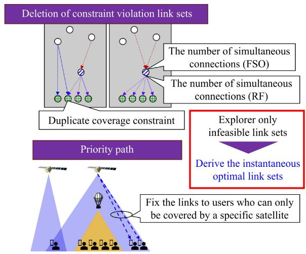

flowchart

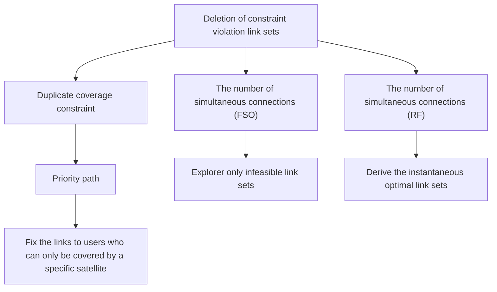

Fig. 5. Efficient search method for the instantaneous link set.

## III. PROPOSED LEO CONSTELLATION-HAPSCOORDINATION METHOD

In this section, we propose a LEO satellite constellation-HAPS inter-coordination method comprising instantaneous link set optimization and flexible link switching control to efficiently utilize the RF bandwidth. Initially, we determine the optimal link set at each time point and establish a mechanism to manage link switching timing to ensure the longest possible application of the optimal link during extended operations.

## A. Instantaneous Link Set Optimization

1) Spectral Efficiency: In this study, spectral efficiency is defined as a measure of RF bandwidth utilization efficiency as follows:

$$
\begin{array}{l} f _ {\mathrm{SE}} \left(i _ {t}, j _ {t}\right) = \frac {1}{B W} \left[ \sum_ {\left(i _ {t}, j _ {t}\right) \in E _ {\mathrm{sg}}} D \left(i _ {t}, j _ {t}\right) \right. \\ \left. + \sum_ {\left(i _ {t}, j _ {t}\right) \in E _ {\mathrm{hg}}} D \left(i _ {t}, j _ {t}\right) \right], \forall j _ {t} \in V _ {\mathrm{g}}, t \in T \tag {7} \\ \end{array}
$$

where BW denotes the total RF bandwidth and $D ( i _ { t } , j _ { t } )$ represents the transmission capacity of the link between $i _ { t }$ and $j _ { t } .$ . The optimization problem of maximizing spectral efficiency by adjusting the link connection state defined using Eq. (6) is formulated as follows:

$$
\mathbb {P} _ {1}: \max \sum_ {t \in T} \sum_ {(i _ {t}, j _ {t}) \in E} f _ {\mathrm{SE}} (i _ {t}, j _ {t}), \tag {8}
$$

$$
\text { s.t. } \sum_ {(i _ {t}, j _ {t}) \in E _ {\mathrm{sh}}} x (i _ {t}, j _ {t}) \leq 1, \forall i _ {t} \in V _ {s}, t \in T, \tag {9}
$$

$$
\sum_ {\left(i _ {t}, j _ {t}\right) \in E _ {\mathrm{sg}}} x \left(i _ {t}, j _ {t}\right) + \sum_ {\left(i _ {t}, j _ {t}\right) \in E _ {\mathrm{hg}}} x \left(i _ {t}, j _ {t}\right) = 1, \forall j _ {t} \in V _ {\mathrm{g}}, t \in T, \tag {10}
$$

$$
\sum_ {(i _ {t}, j _ {t}) \in E} x (i _ {t}, j _ {t}) \leq B _ {\mathrm{s}}, \forall i _ {t} \in V _ {\mathrm{s}}, t \in T, \tag {11}
$$

$$
\sum_ {(i _ {t}, j _ {t}) \in E} x (i _ {t}, j _ {t}) \leq B _ {\mathrm{h}}, \forall i _ {t} \in V _ {\mathrm{h}}, t \in T, \tag {12}
$$

where $B _ { \mathrm { s } }$ and $B _ { \mathrm { h } }$ represent the maximum number of beams for s ha satellite and HAPS, respectively. Eq. (9) imposes a constraint on the number of satellite-HAPS FSO links. Given that FSO communications operate on a one-to-one transmitter/receiver basis and both LEO satellites and HAPS must minimize onboard equipment weight for cost efficiency, the connectivity between satellites and HAPS is restricted. Furthermore, Eq. (10) imposes a constraint on the formation of multiple downlinks from a satellite or HAPS to a specific ground area to suppress inter-beam interference and maintain communication quality. Eq. (11) and Eq. (12) limit the number of nodes that satellites and HAPS can communicate with simultaneously, respectively. If the number of users exceeds these constraints, some may experience service disruption owing to access overload.

The optimization problem $\mathbb { P } _ { 1 }$ formulated in Eq. (8) is a 1combinatorial optimization problem with a nonlinear objective function, making it challenging to derive an optimal solution analytically. Therefore, to address this, we have developed an exploratory approach to obtain an exact optimal solution. Exploring all link sets, as in the brute-force algorithm, can be computationally intensive. Therefore, the exploration space must be reduced. An overview of our efficient solution search method is shown in Fig. 5. Our method is designed to derive optimal link sets quickly by identifying feasible link sets and calculating spectral efficiency only for those sets. Initially, we assess the constraints of the optimization problem $\mathbb { P } _ { 1 }$ and 1validate the compliance of the connection state within the TEG with these constraints. If the link set violates constraints, such as overlapping coverage or exceeding the number of simultaneous connections, the spectral efficiency is compromised owing to over-access or radio interference. Therefore, link sets that violate constraints can be eliminated from the exploration space. Second, given that HAPS beam coverage is more restricted than satellite coverage, some ground users may have limited path options from a specific satellite. Because these links must be utilized without exploration, they can serve as fixed routes in the link set. The exploration space reduction efficiently derives the optimal link set at each time.

## B. Long-Term Link Set Optimization

In $\mathbb { P } _ { 1 }$ , the constraints on the link switching interval are not 1considered. The optimal link set at each time is determined assuming that switching can occur at any given moment. Notably, the optimal link sets will vary as the network topology evolves over time. These changes do not occur regularly or at fixed intervals but rather occur sporadically. By solving $\mathbb { P } _ { 1 }$ , the list of timing when the optimal link set is 1updated can be obtained. As outlined in Section II, changing the connection state within a satellite communication system is more time-consuming compared with the same in a terrestrial network. In light of this system limitation, a new policy has been developed based on the optimal link set update times identified in $\mathbb { P } _ { 1 }$ . Our method aims to maximize the cumulative 1duration during which the optimal link set is utilized in extended operational scenarios. To achieve this maximization by adjusting the timing τ of link set switches, an optimization problem is formulated as follows:

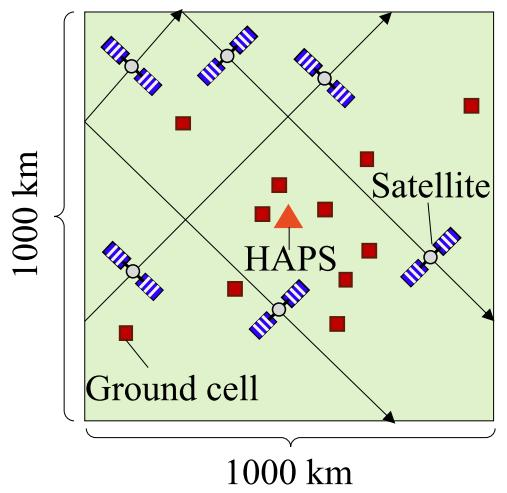

text_image

Ground cell
1000 km
Satellite
HAPS
1000 km

Fig. 6. Top view of the evaluation area.

$$
\mathbb {P} _ {2}: \max _ {\tau} \sum_ {t = 0} ^ {T} \alpha_ {t}, \tag {13}
$$

$$
\text { s   .   t   . } 0 <   \tau_ {1} <   \tau_ {2} <   \dots <   T, \tag {14}
$$

$$
\tau_ {i + 1} \geq \tau_ {i} + \tau_ {\min}, i \in \mathbb {Z} _ {+}, \tag {15}
$$

where $\tau _ { \mathrm { m i n } }$ represents the minimum switching time, αt mindenotes the status of optimal link set application. A value of 1 indicates that the set is currently in use, while 0 signifies that it is out of application period. Given the computational challenges associated with identifying the strictly optimal set of control switching timings over an extended period, a simplified approach is employed to reduce control complexity while deriving a set of quasi-optimal switching timings as follows.

• Monitoring the duration of the optimal link set at specific intervals following the last control switch.  
• If the duration falls within x s, link switching is deferred until the next scheduled update of the optimal link set.

By exploring and determining the appropriate value for x in the aforementioned process, the overall time during which the optimal link set is applied can be enhanced over time. Consequently, the spectral efficiency of the system can be enhanced over extended operational periods.

The process of the above proposed method consists in deriving the optimal set of links at each time in advance and controlling when to switch between them from a long-term perspective. Through the implementation of the aforementioned instantaneous and long-term link set optimization strategies, a method for enhancing the spectral efficiency of LEO satellite constellation-HAPS cooperation has been established.

## IV. PERFORMANCE EVALUATION

This section presents an overview and the results of simulations conducted to assess the effectiveness of the LEO satellite constellation-HAPS coordination method proposed in Section III.

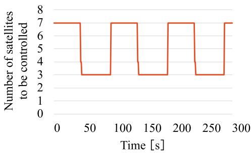

line chart

| Time [s] | Number of satellites to be controlled |
| -------- | -------------------------------------- |
| 0        | 7                                      |
| 50       | 3                                      |
| 100      | 7                                      |
| 150      | 3                                      |
| 200      | 7                                      |
| 250      | 3                                      |
| 300      | 7                                      |

Fig. 7. Fluctuation of the number of satellites to be controlled.

TABLE I PARAMETER SETTINGS

<table><tr><td>Parameter</td><td>Value</td></tr><tr><td>Satellite altitude</td><td>550 km</td></tr><tr><td>Satellite speed</td><td>7.585 km/s</td></tr><tr><td>Satellite beam coverage radius</td><td>750 km</td></tr><tr><td>HAPS altitude</td><td>20 km</td></tr><tr><td>HAPS beam coverage radius</td><td>100 km</td></tr><tr><td>RF bandwidth</td><td>20 MHz/link</td></tr><tr><td>Number of simultaneous connections</td><td>1-5</td></tr><tr><td>Evaluation period</td><td>90 min.</td></tr></table>

## A. Simulation Environment

In this study, we define a 1000 km square ground area as the evaluation area, where we have evaluated the spectral efficiency of the downlink to ground users located within this area, as shown in Fig. 6. A group of users in close proximity is considered a ground cell, with its center point utilized for performance evaluation. The HAPS is positioned over the center of the evaluation area, and the ground cells are distributed based on a Gaussian distribution with the mean just below the HAPS. This distribution aligns with the intended use case for HAPS, which is to be deployed in areas where users are concentrated in small areas, such as desert settlements, mountains, islands, and specific cities. While HAPS and cells are static elements, the LEO satellite constellation is dynamic. Four orbits exist above the evaluation area, with satellites navigating at 720 km intervals. Consequently, the number of satellites traversing the evaluation area that need to be controlled fluctuates with time, as shown in Fig. 7. Other simulation parameters are listed in Table I.

The following three methods were evaluated in this study:

Proposal: This method involves flexible control of link switching timing based on deriving the instantaneous optimal link set at each time during the evaluation period.  
• Method 1: In this method, the ground user attempts to connect to the nearest satellite or HAPS. Similar to the conventional system, the link switching timing is fixed, and the link is always switched in the shortest cycle.  
• Method 2: Ground users randomly select a connection from among the satellites or HAPS that can be connected at a distance.

## B. Results

1) Computational Complexity Analysis: To analyze the computational complexity of the proposed efficient search method shown in Fig. 8, the proposed method is compared with the brute-force algorithm, which exhaustively explores the solution space of $\mathbb { P } _ { 1 }$ . The brute-force algorithm explores 1all candidate link sets that satisfy the constraint that each ground cell has one or more links, the total number of which is expressed as

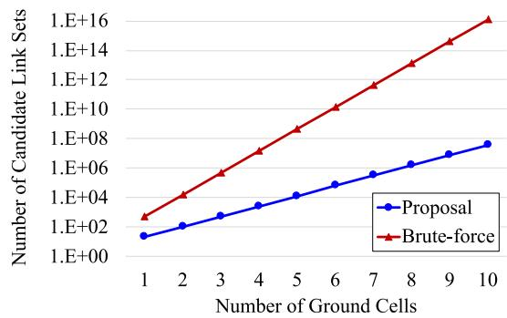

line chart

| Number of Ground Cells | Proposal | Brute-force |
| ---------------------- | -------- | ----------- |
| 1                      | 1E+02    | 1E+03       |
| 2                      | 1E+03    | 1E+04       |
| 3                      | 1E+04    | 1E+05       |
| 4                      | 1E+05    | 1E+06       |
| 5                      | 1E+06    | 1E+07       |
| 6                      | 1E+07    | 1E+08       |
| 7                      | 1E+08    | 1E+09       |
| 8                      | 1E+09    | 1E+10       |
| 9                      | 1E+10    | 1E+11       |
| 10                     | 1E+11    | 1E+12       |

Fig. 8. Number of candidate link sets against the number of ground cells.

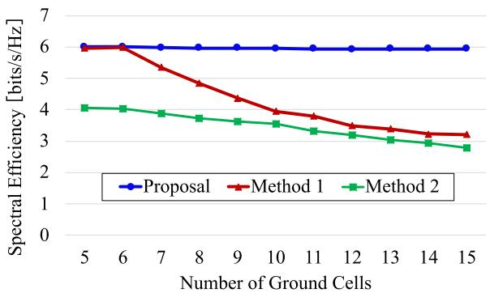

line chart

| Number of Ground Cells | Proposal | Method 1 | Method 2 |
| ---------------------- | -------- | -------- | -------- |
| 5                      | 6.0      | 6.0      | 4.0      |
| 6                      | 6.0      | 6.0      | 4.0      |
| 7                      | 6.0      | 5.5      | 3.9      |
| 8                      | 6.0      | 5.0      | 3.8      |
| 9                      | 6.0      | 4.5      | 3.7      |
| 10                     | 6.0      | 4.0      | 3.6      |
| 11                     | 6.0      | 3.8      | 3.4      |
| 12                     | 6.0      | 3.5      | 3.2      |
| 13                     | 6.0      | 3.3      | 3.0      |
| 14                     | 6.0      | 3.2      | 2.9      |
| 15                     | 6.0      | 3.1      | 2.8      |

Fig. 9. Spectral Efficiency against the number of ground cells.

$$
T _ {\mathrm{B}} (N _ {\mathrm{S}}, N _ {\mathrm{C}}) = 2 ^ {N _ {\mathrm{S}}} \times \left(2 ^ {N _ {\mathrm{S}} + 1} - 1\right) ^ {N _ {\mathrm{C}}} \tag {16}
$$

where $N _ { \mathrm { S } }$ and $N _ { \mathrm { C } }$ denote the number of the satellites and the S Cground cells, respectively. On the other hand, the proposed algorithm only considers candidate link sets that satisfy constraints such as overlapping coverage and the number of simultaneously available FSO/RF links, the total number of which is expressed as

$$
T _ {\mathrm{P}} \left(N _ {\mathrm{S}}, N _ {\mathrm{C}}\right) = N _ {\mathrm{S}} \times \sum_ { \begin{array}{c} x _ {1} + x _ {2} + \dots + x _ {N _ {\mathrm{S}} + 1} = N _ {\mathrm{C}} \\ 0 \leq x _ {i} \leq B _ {\mathrm{R}} \end{array} } \frac {N _ {\mathrm{C}} !}{x _ {1} ! x _ {2} ! \cdots x _ {N _ {\mathrm{S}} + 1} !}, \tag {17}
$$

where $B _ { \mathrm { R } }$ denotes the number of simultaneous connections.

RThe number of candidate link sets relative to the number of ground cells is shown in Fig. 8, assuming the number of satellites is 4. For both methods, the number of candidate link sets increases exponentially as the number of ground cells increases. However, the proposed method reduces the number of candidate link sets by more than 99% when there are multiple ground cells by narrowing the solution space.

2) Spectral Efficiency Analysis: The spectral efficiency against the number of ground cells is shown in Fig. 9. First, our proposed method achieves the maximum spectral efficiency regardless of the number of cells. Second, Method 1 demonstrates a significant decrease in performance when the number of cells exceeds 7. This decline is attributed to congestion resulting from excessive access to specific satellites or HAPS, caused by selecting the link with the satellite or

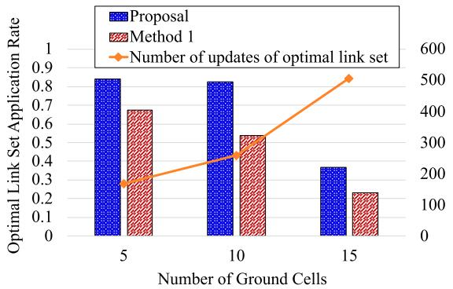

bar-line hybrid chart

| Number of Ground Cells | Proposal | Method 1 | Number of updates of optimal link set |
|---|---|---|---|
| 5 | 0.85 | 0.69 | 170 |
| 10 | 0.83 | 0.54 | 260 |
| 15 | 0.37 | 0.24 | 510 |

Fig. 10. Optimal link set application rate and the number of updates of the optimal link set (5, 10, 15 cells).

HAPS closest to each ground cell. Similarly, the performance of Method 2 was degraded by the increased number of candidate link sets resulting from the increase in the number of cells. These findings suggest that the proposed method, which involves collaboration between satellites and HAPS to flexibly control and avoid congestion, is more effective. Furthermore, the proposed method can extend the coverage of LEO satellite-HAPS cooperative NTN by maintaining high spectral efficiency as the number of ground cells increases. This improvement in total transmission capacity allows the system to accommodate more users compared with conventional methods.

To further validate the efficacy of our flexible link switching timing control, we introduced the concept of the optimal link set application rate. This rate, defined as the sum of times when the optimal link set is utilized during the evaluation period, was evaluated. The optimal link set application rate against the number of ground cells is shown in Fig. 10. In both cases, our proposed method outperforms the fixed-period link switching method, with an average improvement of 19.8% in the application rate across all scenarios. The decrease in the application rate with an increasing number of ground cells for both methods can be attributed to the frequent updates of the optimal link set, as shown in a line chart in Fig. 10. As the number of users in the system increases, more candidates for the link set are generated. Consequently, the instantaneous link set undergoes frequent changes, making it challenging to cope owing to the constraint of the minimum switching time. In conclusion, the superiority of the flexible control method over the method that switches link sets at a fixed period is shown in Fig. 10.

Fig. 11 compares the proposed method to the fixed-period control method, using the minimum control switching time as a system constraint variable. A shorter minimum switching time results in a higher optimal link application ratio, as it allows for easier tracking of the optimal link set updates. The proposed method maintains a higher optimal link set coverage than Method 1 as the minimum switching time increases. In a dynamic satellite environment, link switching takes longer than in a terrestrial system, particularly in FSO communications where optical axis alignment is more challenging than in RF communications. Link establishment in FSO communications can take several tens of seconds to several minutes. Therefore, the proposed method is deemed to be sufficiently effective in existing satellite communication systems.

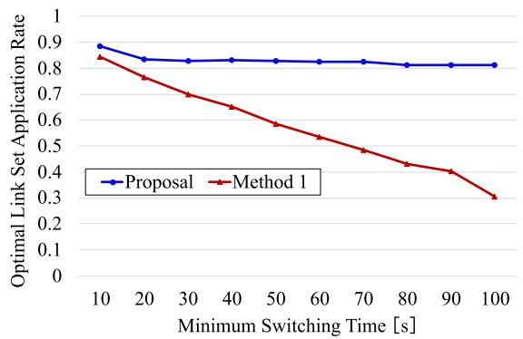

line chart

| Minimum Switching Time [s] | Proposal | Method 1 |
| -------------------------- | -------- | -------- |
| 10                         | 0.9      | 0.85     |
| 20                         | 0.85     | 0.75     |
| 30                         | 0.85     | 0.7      |
| 40                         | 0.85     | 0.65     |
| 50                         | 0.85     | 0.6      |
| 60                         | 0.85     | 0.55     |
| 70                         | 0.85     | 0.5      |
| 80                         | 0.8      | 0.45     |
| 90                         | 0.8      | 0.4      |
| 100                        | 0.8      | 0.3      |

Fig. 11. Optimal link set application rate against the minimum switching time of the system.

The results of the performance evaluation demonstrate that our proposed method significantly enhances spectral efficiency and the optimal link set application rate. This indicates that our method is crucial in extending coverage by fostering collaboration between the LEO satellite constellation and HAPS.

## V. CONCLUSION

Expanding NTN coverage is imperative for achieving digital inclusion and global connectivity, enabling Internet access globally. In addition to broadening beam coverage on Earth’s surface, enhancing transmission efficiency is vital to accommodate a larger user base for various applications. To address this, our study introduced a cooperative strategy between LEO satellite constellations and HAPS to maximize the utilization of limited RF resources. First, we modeled the intricate and dynamic topology of NTN using TEG, facilitating a straightforward mathematical representation. Subsequently, we formulated an optimization problem to determine an instantaneous optimal link set and developed an efficient solution search method. Finally, we devised a method to control the timing of link set switching to ensure that the updated optimal link set, which is updated irregularly, remained in use for an extended period, while considering the minimum control switching time required. Numerical analysis results validated that our proposed method outperformed conventional approaches by enhancing system spectral efficiency and optimal link set application rate. The study demonstrated the ability of the LEO satellite constellation and HAPS to collaborate to prevent congestion and radio interference resulting from the concentration of access to a particular node. Furthermore, flexible control of link switching timing was crucial in adapting to the frequent changes in network topology caused by satellite movements. Furthermore, this study contributed to narrowing the digital divide by enhancing the spectral efficiency of communication systems, particularly in underserved regions with limited terrestrial infrastructure. The integration of HAPS and satellite constellations, facilitated by our optimization framework, laid the foundation for nextgeneration communication networks that are both efficient and inclusive.

## REFERENCES

[1] F. Tang, C. Wen, X. Chen, and N. Kato, “Federated learning for intelligent transmission with space-air-ground integrated network toward 6G,” IEEE Netw., vol. 37, no. 2, pp. 198–204, Mar./Apr. 2023.

[2] International Telecommunication Union, “Digital inclusion of all,” 2023. Accessed: Nov. 6, 2024. [Online]. Available: https://www.itu.int/en/ mediacentre/backgrounders/Pages/digital-inclusion-of-all.aspx  
[3] M. M. Azari et al., “Evolution of non-terrestrial networks from 5G to 6G: A survey,” IEEE Commun. Surveys Tuts., vol. 24, no. 4, pp. 2633–2672, 4th Quart., 2022.  
[4] O. Kodheli et al., “Satellite communications in the new space era: A survey and future challenges,” IEEE Commun. Surveys Tuts., vol. 23, no. 1, pp. 70–109, 1st Quart., 2021.  
[5] B. Mao, X. Zhou, J. Liu, and N. Kato, “Digital twin satellite networks toward 6G: Motivations, challenges, and future perspectives,” IEEE Netw., vol. 38, no. 1, pp. 54–60, Jan. 2024.  
[6] Y. Hokazono, H. Kohara, Y. Kishiyama, and T. Asai, “Extreme coverage extension in 6G: Cooperative non-terrestrial network architecture integrating terrestrial networks,” in Proc. IEEE Wireless Commun. Netw. Conf. (WCNC), 2022, pp. 138–143.  
[7] B. Shang, X. Li, Z. Li, J. Ma, X. Chu, and P. Fan, “Multi-connectivity between terrestrial and non-terrestrial MIMO systems,” IEEE Open J. Commun. Soc., vol. 5, pp. 3245–3262, 2024.  
[8] F. Tang, H. Hofner, N. Kato, K. Kaneko, Y. Yamashita, and M. Hangai, “A deep reinforcement learning-based dynamic traffic offloading in space-air-ground integrated networks (SAGIN),” IEEE J. Sel. Areas Commun., vol. 40, no. 1, pp. 276–289, Jan. 2022.  
[9] K. Tamada, Y. Kawamoto, and N. Kato, “Bandwidth usage reduction by traffic prediction using transfer learning in satellite communication systems,” IEEE Trans. Veh. Technol., vol. 73, no. 5, pp. 7459–7463, May 2024.  
[10] X. Zhang et al., “Cost-effective hybrid computation offloading in satellite-terrestrial integrated networks,” IEEE Internet Things J., vol. 11, no. 22, pp. 36786–36800, Nov. 2024.  
[11] S. Liu et al., “LEO satellite constellations for 5G and beyond: How will they reshape vertical domains?” IEEE Commun. Mag., vol. 59, no. 7, pp. 30–36, Jul. 2021.  
[12] Y. Kawamoto et al., “HAPS-based interference suppression through null broadening with directivity control in space-air-ground integrated networks,” IEEE Trans. Veh. Technol., vol. 72, no. 12, pp. 16098–16107, Dec. 2023.  
[13] G. K. Kurt et al., “A vision and framework for the high altitude platform station (HAPS) networks of the future,” IEEE Commun. Surveys Tuts., vol. 23, no. 2, pp. 729–779, 2nd Quart., 2021.  
[14] J. Wang, C. Qi, S. Yu, and S. Mao, “Joint beamforming and illumination pattern design for beam-hopping LEO satellite communications,” IEEE Trans. Wireless Commun., vol. 23, no. 12, pp. 18940–18950, Dec. 2024.  
[15] N. Tieby, J. Khoury, and E. Bou-Harb, “Characterizing and analyzing LEO satellite cyber landscape: A starlink case study,” in Proc. IEEE Int. Conf. Commun., 2024, pp. 1352–1357.  
[16] M. Toyoshima, “Recent trends in space laser communications for small satellites and constellations,” J. Lightw. Technol., vol. 39, no. 3, pp. 693–699, Feb. 1, 2021.  
[17] X. Yuan, F. Tang, M. Zhao, and N. Kato, “Joint rate and coverage optimization for the THz/RF multi-band communications of space-airground integrated network in 6G,” IEEE Trans. Wireless Commun., vol. 23, no. 6, pp. 6669–6682, Jun. 2024.  
[18] E. S. Altubaishi and K. Alhamawi, “Capacity analysis of hybrid AF multi-hop FSO/RF system under pointing errors and weather effects,” IEEE Photon. Technol. Lett., vol. 31, no. 15, pp. 1304–1307, Aug. 2019.  
[19] W. Zhang, S. Hranilovic, and C. Shi, “Soft-switching hybrid FSO/RF links using short-length raptor codes: Design and implementation,” IEEE J. Sel. Areas Commun., vol. 27, no. 9, pp. 1698–1708, Dec. 2009.  
[20] X. Zhu and J. M. Kahn, “Free-space optical communication through atmospheric turbulence channels,” IEEE Trans. Commun., vol. 50, no. 8, pp. 1293–1300, Aug. 2002.  
[21] M. Miao, W. Cai, and X. Li, “Parameter estimation of gammagamma fading with generalized pointing errors in FSO systems,” Wireless Commun. Mobile Comput., vol. 2021, no. 1, 2021, Art. no. 1301878. [Online]. Available: https://onlinelibrary.wiley.com/ doi/abs/10.1155/2021/1301878  
[22] V. Bankey, S. Sharma, R. Swaminathan, and A. S. Madhukumar, “Physical layer security of HAPS-based space–air–ground-integrated network with hybrid FSO/RF communication,” IEEE Trans. Aerosp. Electron. Syst., vol. 59, no. 4, pp. 4680–4688, Aug. 2023.  
[23] H. Kaushal and G. Kaddoum, “Optical communication in space: Challenges and mitigation techniques,” IEEE Commun. Surveys Tuts., vol. 19, no. 1, pp. 57–96, 1st Quart., 2017.  
[24] M. Ariyoshi et al., “Challenges and machine learning solutions for optical communications in space-air- ground integrated networks for 6G,” IEEE Wireless Commun., vol. 31, no. 6, pp. 21–28, Dec. 2024.  
[25] T. V. Nguyen, H. D. Le, and A. T. Pham, “On the design of RIS–UAV relay-assisted hybrid FSO/RF satellite–aerial–ground integrated network,” IEEE Trans. Aerosp. Electron. Syst., vol. 59, no. 2, pp. 757–771, Apr. 2023.  
[26] D. Singh and R. Swaminathan, “Comprehensive performance analysis of hybrid FSO/RF space–air–ground integrated network,” Opt. Commun., vol. 527, Jan. 2023, Art. no. 128964. [Online]. Available: https://www. sciencedirect.com/science/article/pii/S0030401822006113  
[27] X. Liu, M. Lin, W.-P. Zhu, J.-Y. Wang, and P. K. Upadhyay, “Outage performance for mixed FSO-RF transmission in satellite-aerial- terrestrial networks,” IEEE Photon. Technol. Lett., vol. 32, no. 21, pp. 1349–1352, Nov. 2020.  
[28] H. Kong, M. Lin, Z. Wang, J. Ouyang, and J. Cheng, “Ergodic capacity of high throughput satellite systems with mixed FSO-RF transmission,” IEEE Wireless Commun. Lett., vol. 10, no. 8, pp. 1732–1736, Aug. 2021.  
[29] O. B. Yahia, E. Erdogan, G. K. Kurt, I. Altunbas, and H. Yanikomeroglu, “HAPS selection for hybrid RF/FSO satellite networks,” IEEE Trans. Aerosp. Electron. Syst., vol. 58, no. 4, pp. 2855–2867, Aug. 2022.  
[30] N. N. Ei, P. S. Aung, S.-B. Park, E.-N. Huh, and C. S. Hong, “Joint association and power allocation for data collection in HAP-LEOassisted IoT networks,” in Proc. Int. Conf. Inf. Netw. (ICOIN), 2023, pp. 206–211.  
[31] Z. Jia, M. Sheng, J. Li, D. Zhou, and Z. Han, “Joint HAP access and LEO satellite backhaul in 6G: Matching game-based approaches,” IEEE J. Sel. Areas Commun., vol. 39, no. 4, pp. 1147–1159, Apr. 2021.  
[32] H. D. Le, H. D. Nguyen, C. T. Nguyen, and A. T. Pham, “FSO-based space-air-ground integrated vehicular networks: Cooperative HARQ with rate adaptation,” IEEE Trans. Aerosp. Electron. Syst., vol. 59, no. 4, pp. 4076–4091, Aug. 2023.  
[33] Z. Jia, M. Sheng, J. Li, and Z. Han, “Toward data collection and transmission in 6G space–air–ground integrated networks: Cooperative HAP and LEO satellite schemes,” IEEE Internet Things J., vol. 9, no. 13, pp. 10516–10528, Jul. 2022.  
[34] Y. Huang et al., “A GNN-enabled multipath routing algorithm for spatialtemporal varying LEO satellite networks,” IEEE Trans. Veh. Technol., vol. 73, no. 4, pp. 5454–5468, Apr. 2024.  
[35] J. Yang, J. He, Z. Yin, D. Han, N. Cheng, and R. Sun, “Mobile edge caching in LEO satellite network: A graph convolution network-based approach,” in Proc. IEEE 23rd Int. Conf. Commun. Technol. (ICCT), 2023, pp. 1129–1134.  
[36] R. Swaminathan, S. Sharma, N. Vishwakarma, and A. S. Madhukumar, “HAPS-based relaying for integrated space–air–ground networks with hybrid FSO/RF communication: A performance analysis,” IEEE Trans. Aerosp. Electron. Syst., vol. 57, no. 3, pp. 1581–1599, Jun. 2021.  
[37] M. R. Bhatnagar and M. K. Arti, “Performance analysis of hybrid satellite-terrestrial FSO cooperative system,” IEEE Photon. Technol. Lett., vol. 25, no. 22, pp. 2197–2200, Nov. 2013.

natural_image

Portrait of a young man in formal attire (no text or symbols visible)

Kazuma Mashiko (Graduate Student Member, IEEE) received the B.E. degree in communications engineering from Tohoku University, Sendai, Japan, in 2024, where he is currently pursuing the M.S. degree with the Graduate School of Information Sciences. His research interests include satellite communications, delay/disruption tolerant networks, and free-space optical communications.

natural_image

Portrait of a young man in a collared shirt (no text or symbols visible)

Hiroaki Hashida (Member, IEEE) received the Ph.D. degree from the Graduate School of Information Sciences, Tohoku University, Sendai, Japan, where he is currently an Assistant Professor with the Frontier Research Institute for Interdisciplinary Sciences. His research interests include wireless communication networks and intelligent surface-aided wireless communication systems. He was a recipient of the Presidential Award for Outstanding Students from Tohoku University and Ikushi Prize from the Japan Society  
for the Promotion of Science in 2024. He is a member of the Institute of Electronics, Information, and Communication Engineers.

natural_image

Portrait of a smiling man in a suit and sweater (no text or symbols visible)

Yuichi Kawamoto (Member, IEEE) received the M.S. and Ph.D. degrees in information science from Tohoku University, Japan, in 2013 and 2016, respectively, where he is a Full Professor with the Graduate School of Information Sciences. He has published more than 60 peer-reviewed papers, including several high-quality publications in prestigious IEEE journals and conferences. His research interests cover a wide range of areas, including satellite communications, unmanned aircraft system networks, wireless and mobile networks, ad hoc and  
sensor networks, green networking, and network security. Notably, he received the best paper awards at several international conferences, including IEEE flagship events, such as the IEEE Global Communications Conference in 2013, the IEEE Wireless Communications and Networking Conference in 2014, and the IEEE International Conference on Communications in 2018. In addition, he was a recipient of the Dean’s and President’s Awards from Tohoku University in 2016. Moreover, he is a member of the Institute of Electronics, Information, and Communication Engineers.

natural_image

Portrait of a man in formal attire (no text or symbols visible)

Nei Kato (Fellow, IEEE) is a Full Professor and the Dean with the Graduate School of Information Sciences, Tohoku University. He has published more than 500 papers in prestigious peer-reviewed journals and conferences. He has studied computer networking, wireless mobile communications, satellite communications, ad hoc & sensor & mesh networks, UAV networks, AI, IoT, and big data. He is an Editor-in-Chief of IEEE INTERNET OF THINGS JOURNAL and the Director of the Magazine of the IEEE Communications Society. He is a Fellow  
of the Engineering Academy of Japan, and IEICE.

natural_image

Portrait photo of a young man in formal attire (no text or symbols visible)

Kohei Yoshida (Member, IEEE) received the B.S. degree in physics from the University of Tsukuba, Japan, in 2014, and the M.S. degree in physics from The University of Tokyo, Japan, in 2016. He joined NEC Corporation, Japan, in 2016, where he has been involved in research and development on satellite communication systems and RF devices equipped on satellites. He is currently a Researcher with Advanced Network Research Laboratories. His current research interests include beam control and radio resource allocation for satellite communica-  
tions. He is a member of IEICE.

natural_image

Portrait of a man in formal suit and tie (no text or symbols visible)

Masayuki Ariyoshi (Member, IEEE) received the B.E. and M.E. degrees in electrical engineering and the Ph.D. degree in information and computer science from Keio University, Japan. He has been engaged in research and development in the field of wireless communications and radar-based sensing for more than 30 years. He is currently a Senior Principal Researcher with the Advanced Network Research Laboratories, NEC Corporation, leading R&D projects whose scope includes network management optimisation for satellite constellations  
and non-terrestrial networks. He is currently appointed as a Research Professor with the Graduate School of Information Science, Tohoku University and is directing the NEC x Tohoku University Co-Creation Institute of Space-Integrated Network for Resilient Digital Transformation since its establishment in November 2023. He is a Fellow of IEICE.