# The Larger the Merrier? Efficient Large AI Model Inference in Wireless Edge Networks

Zhonghao Lyu , Member, IEEE, Ming Xiao , Senior Member, IEEE, Jie Xu , Fellow, IEEE, Mikael Skoglund , Fellow, IEEE, and Marco Di Renzo , Fellow, IEEE

Abstract—The growing demand for large artificial intelligence model (LAIM) services is driving a paradigm shift from traditional cloud-based inference to edge-based inference for low-latency, privacy-preserving applications. In particular, edgedevice co-inference, which jointly executes LAIM inference across edge devices and servers, has emerged as a promising strategy for resource-efficient LAIM execution in wireless networks. In this paper, we investigate a pruning-aware LAIM co-inference scheme, where a pre-trained LAIM is pruned and partitioned into on-device and on-server sub-models for deployment. For analysis, we first prove that the LAIM output distortion is upper bounded by its parameter distortion. Then, we derive a lower bound on the parameter distortion via rate-distortion theory, analytically capturing the relationship between pruning ratio and co-inference performance. Next, based on the analytical results, we formulate an LAIM co-inference distortion bound minimization problem by jointly optimizing the pruning ratio, split point, transmit power, and computation frequency under system latency, energy, and available resource constraints. Moreover, we propose an efficient algorithm to tackle the considered highly non-convex problem. Finally, extensive experimental results demonstrate the effectiveness of the proposed design. In particular, model parameter distortion is shown to provide a reliable bound on output distortion. Also, the proposed joint design achieves

Received 14 May 2025; revised 16 October 2025; accepted 5 December 2025. Date of publication 16 December 2025; date of current version 24 February 2026. This work was supported in part by Guangdong Science and Technology Program under Grant 2024B0101030002; in part by the Basic Research Project of the Hetao Shenzhen-HK Science and Technology Cooperation Zone under Grant HZQB-KCZYZ-2021067; in part by Swedish Government Agency for Innovation (VINNOVA) Project under Grant 2024-02435; in part by the National Natural Science Foundation of China under Grant 62471424, Grant U25A20390, and Grant 92267202; in part by Guangdong Provincial Key Laboratory of Future Networks of Intelligence under Grant 2022B1212010001; in part by Shenzhen Fundamental Research Program under Grant JCYJ20250604141209012; in part by European Commission through the Horizon Europe Project under Grant 101086228, Grant 101129618, Grant 101139161, and Grant 101182794; in part by the Agence Nationale de la Recherche (ANR) through France 2030 Project titled “ANR-PEPR Networks of the Future” under Grant NF-Founds 22-PEFT-0010; and in part by the CHIST-ERA Project titled “PASSIONATE” under Grant CHIST-ERA-22-WAI-04 and Grant ANR-23-CHR4-0003-01. (Corresponding authors: Ming Xiao; Jie Xu.)

Zhonghao Lyu, Ming Xiao, and Mikael Skoglund are with the Department of Information Science and Engineering, KTH Royal Institute of Technology, 10044 Stockholm, Sweden (e-mail: lzhon@kth.se; mingx@kth.se; skoglund@kth.se).

Jie Xu is with the School of Science and Engineering, the Shenzhen Future Network of Intelligence Institute, and the Guangdong Provincial Key Laboratory of Future Networks of Intelligence, The Chinese University of Hong Kong (Shenzhen), Guangdong 518172, China (e-mail: xujie@cuhk.edu.cn).

Marco Di Renzo is with Universite Paris-Saclay, CNRS, CentraleSup ´ elec, ´ Laboratoire des Signaux et Systemes, 91192 Gif-sur-Yvette, France, and ´ also with King’s College London, Centre for Telecommunications Research, Department of Engineering, WC2R 2LS London, U.K. (e-mail: marco.direnzo@universite-paris-saclay.fr; marco.di renzo@kcl.ac.uk).

Digital Object Identifier 10.1109/JSAC.2025.3645168 superior performance in balancing trade-offs among inference performance, system latency, and energy consumption compared with various benchmark schemes.

Index Terms—Large AI model (LAIM), edge-device co-inference, model pruning, edge intelligence, joint communication and computation design.

## I. INTRODUCTION

## A. Background and Related Works

HE rapid advancement of large artificial intelligence models (LAIMs) has marked a significant breakthrough in AI, drawing increasing attention from academia, industry, and the public. Built upon the transformer architecture, LAIMs leverage massive-scale parameters and extensive training data to achieve remarkable ability in understanding, reasoning, and generating human-like content [1], [2]. Representative examples, such as OpenAI’s GPT-4 [3], have transcended conventional AI limitations to tackle complex tasks across diverse domains, such as multi-modal data processing. Their widespread adoption has led to transformative applications, ranging from AI-powered virtual assistants to autonomous control systems.

However, the massive model size and high computational complexity of LAIMs pose significant challenges for efficient inference, particularly for latency-sensitive services in resource-limited scenarios [4]. Currently, most LAIM inference is conducted through centralized cloud-based paradigms (i.e., on-server inference), where raw data is transmitted to remote cloud servers for processing. Although efforts such as graphics processing unit (GPU) scheduling optimization have been proposed to accelerate cloud-based LAIM inference [5], [6], this paradigm still suffers from inherent limitations, such as high communication latency and potential privacy risks.

Alternatively, with the surging of edge computing for future mobile networks, e.g., the sixth-generation (6G) networks, the computation capability of edge servers and devices has continuously grown [7], making edge-based LAIM deployments increasingly feasible [8], [9]. A few recent works have investigated on-device inference. For example, EdgeMoE [10] and LiteMoE [11] are memory- and computation-efficient solutions for deploying LAIMs directly on edge devices for mobile applications. However, on-device inference is severely constrained by the limited memory, computation, and battery capacity of edge devices. For example, an inference task on GPT 6.7B (with FP16 precision, batch size 64, and input/output sequence length 512/32) requires 41.84 GB of running memory [12], far beyond what most existing edge devices can support.

To address these limitations, collaborative inference (co-inference) has emerged as a promising solution, where LAIMs are distributively executed across edge devices and edge/cloud servers [13]. Early works on co-inference have mainly focused on regular-scale AI models, exploring two primary strategies: task-oriented intermediate feature encoding and joint task offloading and resource allocation. For taskoriented intermediate feature encoding, raw data is encoded into compressed semantic features to reduce communication overhead. For instance, leveraging deep neural networks (DNNs) as powerful encoders has inspired the field of semantic/task-oriented communications [14], enabling various applications such as data reconstruction [15], [16], [17], intelligent task execution [18], [19], [20], and multi-task services [21]. For joint task-offloading and resource allocation, AI inference workloads are partitioned and allocated across distributed processing ends based on available communication and computation resources [22]. For example, [23], [24], [25], and [26] have considered model splitting and placement optimization in edge-device co-inference systems. Moreover, the authors of [27], [28], and [29] have further studied multi-user co-inference systems with joint communication and computation resource management.

However, directly applying the mentioned strategies to LAIMs is highly challenging. LAIM co-inference should consider their unique challenges of massive parameter scales and computation intensity. To this end, recent efforts have considered large-scale joint task-offloading and resource management, and model compression for efficient LAIM co-inference. For instance, [30] has explored cloud-edge active co-inference for LAIMs but underutilized the abundant computation potential of edge devices. To exploit this potential, [31], [32], [33] have studied LAIM co-inference between edge devices and servers. Specifically, [31] has analyzed the impact of different model splitting points under dynamic wireless channels via deep reinforcement learning (DRL). Also, [32] has proposed a hybrid large-small language model architecture, in which a small language model operates on the device and selectively skips uplink transmissions and cloud inference. Different from these single-device settings, [33] has extended to a general multi-device multi-server co-inference framework with joint device selection and model partitioning.

However, the above studies mainly focus on task and split-point scheduling, without considering model compression techniques to reduce the computational and memory burdens of LAIMs at resource-limited edges. Key methods include model pruning [34], [35], [36], quantization [37], and knowledge distillation [38]. Model pruning removes redundant parameters based on random [35] or magnitude-based [36] criteria, quantization reduces numerical precision using low-bit representations [37], and knowledge distillation trains compact student models to replicate full LAIM outputs [38]. These techniques can be integrated within LAIM co-inference systems to further enhance feasibility and performance at resource-limited edge environments.

## B. Motivations and Contributions

Despite the progress, most existing works on LAIM inference with compression focus on the design of pruning algorithms, lacking theoretical investigations into how model compression fundamentally affects inference performance and resource efficiency. This absence of analytical understanding leaves a fundamental research challenge unresolved: To what extent should LAIMs be compressed to well balance model complexity and inference quality? The challenge becomes particularly critical in resource-limited edge inference systems, where improper compression can severely affect system performance. Specifically, overly aggressive compression may significantly degrade inference quality, while under-compression may make the system infeasible, violating quality-of-service (QoS) requirements. However, theoretically characterizing the relationship between the compression ratio and inference performance is highly non-trivial. LAIMs are composed of complex, deeply stacked non-linear layers, which make the analysis of model compression induced distortion analytically elusive.

Furthermore, under practical QoS requirements, there generally exist inherent trade-offs among inference performance, system delay, and energy consumption. To effectively balance these trade-offs, it is essential to jointly optimize the compression and splitting strategies together with the communication and computation resource allocation. However, for LAIM edge co-inference, different model segments are executed across heterogeneous devices and servers with asymmetric communication and computation capabilities. Such heterogeneity makes the LAIM co-inference design even more challenging, which has not been investigated in the existing literature yet.

Motivated by the above research gaps, we take a theoretical and system-design perspective to establish a compressionaware framework for LAIM co-inference. Specifically, the pre-trained LAIM is partitioned into two sub-models deployed on the edge device and server, respectively. The device performs partial inference to extract intermediate embeddings, which are then transmitted to the edge server for final inference. To alleviate the computation and storage burden, we adopt model compression, particularly model pruning, to reduce the complexity of both the on-device and on-server models prior to deployment. We then theoretically characterize the relationship between the pruning ratio and inference distortion, which provides a useful guideline for the LAIM co-inference system design. The main contributions are summarized as follows.

• To address the analytical intractability of LAIM output distortion by model pruning, we first prove that the inference output distortion is upper bounded by the model parameter distortion, starting with fully-connected (FC) DNNs and extending to general AI models. We then derive a lower bound on inference quality distortion based on rate-distortion theory, which captures the influence of various important system parameters (such as pruning ratio and model entropy) on inference distortion.

• Building upon the theoretical distortion bound, we formulate an inference distortion bound minimization problem by jointly optimizing the pruning ratio, split point, transmit power, and computation frequency, subject to various constraints on the system resources (i.e., the maximum transmission power and computation clock frequency), latency, and energy consumption. However, the considered problem is highly non-convex and hard to solve due to the close coupling between the model pruning ratio, split point, and the computation/communication variables. To address the problem, we develop an efficient algorithm to obtain a high-quality sub-optimal solution.

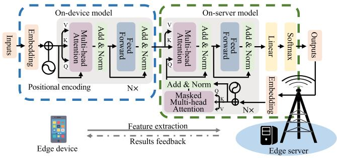

flowchart

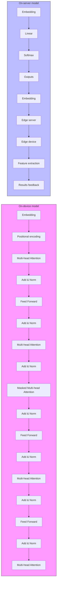

Fig. 1. Illustration of the considered LAIM co-inference system.

• Extensive performance evaluation results demonstrate the superiority of the proposed joint model pruning, split point, and communication-computation resource allocation design. Firstly, we show that LAIM parameter distortion is a reliable performance upper bound for the output distortion. Secondly, it is shown that the proposed design achieves improved inference quality compared with various benchmark schemes, effectively balancing the trade-offs between inference performance, system latency, and energy consumption via better leveraging system resources with adaptive pruning strategies and split point selection.

The remainder of this paper is organized as follows. Section II introduces the system model for LAIM co-inference. Section III presents the approximation of LAIM output distortion. Section IV provides the rate-distortion analysis for model pruning. Section V formulates the joint pruning ratio, split point, communication, and computation design problem, and develops an efficient algorithm to solve it. Section VI presents experimental results to validate the effectiveness of the proposed LAIM co-inference design. Section VII concludes the paper.

## II. SYSTEM MODEL

We consider an LAIM co-inference system with one edge server and one device as shown in Fig. 1, where the edge device and server cooperatively perform LAIM inference based on pre-trained LAIMs. This setup corresponds to many real-world application scenarios, such as users submitting multi-modal prompts to access LAIM services at the network edge.

Specifically, the pre-trained LAIM is partitioned into two segments (i.e., on-device and on-server models), each composed of several functional modules. Let the pre-trained LAIM be represented by a parameter vector $\pmb { w } _ { \mathrm { p } } \in \mathbb { R } ^ { q _ { \mathrm { p } } }$ , where $q _ { \mathrm { p } }$ denotes the total number of model parameters. Each parameter of ${ \pmb w } _ { \mathrm { p } }$ is assumed to be quantized with b bits for storage. We split ${ \pmb w } _ { \mathrm { p } }$ into two parts at a split point $L _ { D }$ , and denote the parameters of on-device and on-server sub-models as w $\epsilon \bar { \mathbb { R } ^ { q ( L _ { D } ) } }$ and $\pmb { v } ~ \in ~ \mathbb { R } ^ { s ( L _ { D } ) }$ , respectively, such that $q ( L _ { D } ) + s ( L _ { D } ) = q _ { \mathrm { p } }$ and ${ \pmb w } _ { \mathrm { p } } = \{ { \pmb w } ; { \pmb v } \}$ . Here, we omit the dependence on $L _ { D }$ in $q ( L _ { D } )$ and $s ( L _ { D } )$ for brevity.

Then, we deploy them on the edge device and server, respectively. Under this setup, the inference process involves two stages. The first stage is on-device inference, where the device computes intermediate embeddings via the on-device model from the input and transmits them to the server. The second stage is on-server inference, where the edge server completes the remaining inference task via the on-server model and returns the final results.

## A. On-Device Inference and Embeddings Transmission

We first introduce the on-device inference process performed at the edge device during forward propagation. For efficient inference, we further prune w to obtain a lightweight model $\hat { \textbf { \textit { w } } } \in \mathbb { R } ^ { \hat { q } }$ . The pruning ratio is defined as $\rho = \hat { q } / q . $ Denote $\phi$ as the input data, then the output intermediate embeddings generated by the on-device model are given by $\mathbf { o } = f ( \phi , \hat { w } )$ , where $f ( \cdot )$ denotes the computation process of the on-device model.

Next, the intermediate embeddings o are transmitted to the edge server for on-server processing. Let x represent the transmitted signal, and we assume each element $x _ { i }$ of x has normalized power, $\mathbf { i . e . , \mathbb { E } [ } | x _ { i } | ^ { 2 } \big ] = 1$ , without loss of generality. Then, let p denote the transmit power, which satisfies the maximum power constraint, i.e.,

$$
0 \leq p \leq P _ {\max}. \tag {1}
$$

Furthermore, let g denote the uplink channel power gain from the edge device to the server, which is assumed to be unchanged during each transmission period. Then the achievable uplink communication rate (in bits-per-second (bps)) is

$$
r (p) = B \log_ {2} \left(1 + \frac {g p}{B N _ {0}}\right), \tag {2}
$$

where B is the uplink bandwidth, and $N _ { 0 }$ is the power spectrum density (PSD) of the additive white Gaussian noise (AWGN) at the receiver of the edge server.

## B. On-Server Inference and Final Results Feedback

We now introduce the on-server inference process to acquire the final LAIM inference results. The edge server also prunes its sub-model v to obtain a lightweight version $\boldsymbol { \hat { v } } \in \mathbb { R } ^ { \boldsymbol { \hat { s } } }$ , where the pruning ratio is defined as $\widetilde { \rho } = \widehat { s } / s$ . It is worth noting that the overall model (with on-device and on-server parts) size (in bits) is $( \rho q + \tilde { \rho } s ) b$ .

Upon receiving the intermediate embeddings o from the edge device, the server then completes the inference task and generates the final output as

$$
\tilde {\boldsymbol {o}} = \tilde {f} (\boldsymbol {o}, \hat {\boldsymbol {v}}), \tag {3}
$$

1For ease of exposition, we define the pruning ratio as the remaining parameter ratio.

where $\tilde { f } ( \cdot )$ denotes the processing function of the on-server model with pruned parameters vˆ. Finally, the edge server sends the final inference result o˜ back to the edge device to complete the whole co-inference process.

## C. Inference Delay and Energy Consumption Analysis

We analyze the end-to-end inference delay and energy consumption of the considered LAIM co-inference system.

1) On-device inference: Denote the original on-device computational workload (in FLOPs), which depends on the split point $L _ { D }$ , as $N _ { \mathrm { F L O P } } ( L _ { D } )$ . After model compression, we assume the remaining workload is proportional to the pruning ratio $\rho ,$ resulting in a compressed workload of $\rho N _ { \mathrm { F L O P } } ( L _ { D } )$ . Denote $f$ and c as the clock frequency and the number of FLOPs per cycle of the processor at the edge device, respectively. Then, the delay for on-device inference is

$$
t ^ {\mathrm{I}} (\rho , f, L _ {D}) = \frac {\rho N _ {\mathrm{FLOP}} (L _ {D})}{f c}. \tag {4}
$$

Moreover, the corresponding energy consumption is

$$
e ^ {\mathrm{I}} (\rho , f, L _ {D}) = \eta \frac {\rho N _ {\mathrm{FLOP}} (L _ {D})}{c} \psi f ^ {2}, \tag {5}
$$

where $\eta$ and $\psi$ represent the power usage effectiveness (PUE) and a chip-specific power coefficient of the edge device.

2) Embeddings uploading: Let $\theta ( L _ { D } )$ denote the size of the intermediate embeddings o (in bits).2 According to the uplink communication rate defined in (2), the uploading duration of the embeddings o is

$$
t ^ {\mathrm{U}} (p, L _ {D}) = \frac {\theta (L _ {D})}{r (p)}, \tag {6}
$$

and the energy consumption for uploading embeddings is

$$
e ^ {\mathrm{U}} (p, L _ {D}) = \frac {p \theta (L _ {D})}{r (p)}. \tag {7}
$$

3) On-server inference: Let $\tilde { N } _ { \mathrm { F L O P } } ( L _ { D } )$ denote the total on-server computational workload before pruning. After compression with pruning ratio $\tilde { \rho } ,$ the workload becomes $\tilde { \rho } \tilde { N } _ { \mathrm { F L O P } } ( L _ { D } )$ . Denote $\breve { \tilde { f } }$ and c˜ as the clock frequency and FLOPs per cycle of the processor at the edge server, respectively. Then, the delay and energy consumption for on-server inference are given by

$$
\tilde {t} ^ {\mathrm{I}} (\tilde {\rho}, \tilde {f}, L _ {D}) = \frac {\tilde {\rho} \tilde {N} _ {\mathrm{FLOP}} (L _ {D})}{\tilde {f} \tilde {c}}, \tag {8}
$$

$$
\tilde {e} ^ {\mathrm{I}} (\tilde {\rho}, \tilde {f}, L _ {D}) = \tilde {\eta} \frac {\tilde {\rho} \tilde {N} _ {\mathrm{FLOP}} (L _ {D})}{\tilde {c}} \tilde {\psi} \tilde {f} ^ {2}, \tag {9}
$$

where $\tilde { \eta }$ and $\tilde { \psi }$ denote the PUE and power coefficient of the edge server, respectively. Generally, since the size of the final inference results is typically small and the downlink is less resource-constrained, we neglect the

2It is worth noting that this work primarily focuses on the inference distortion induced by model pruning. Accordingly, we assume an error-free transmission of embeddings.

feedback delay and energy consumption from the server to the device.

4) Total delay and energy consumption: The total endto-end inference delay including on-device embeddings computing, uploading, and final results obtaining is

$$
T (\rho , f, p, L _ {D}, \tilde {\rho}, \tilde {f}) = t ^ {\mathrm{I}} (\rho , f, L _ {D}) + t ^ {\mathrm{U}} (p, L _ {D}) + \tilde {t} ^ {\mathrm{I}} (\tilde {\rho}, \tilde {f}, L _ {D}), \tag {10}
$$

while the total energy consumption is

$$
E (\rho , f, p, L _ {D}, \tilde {\rho}, \tilde {f}) = e ^ {\mathrm{I}} (\rho , f, L _ {D}) + e ^ {\mathrm{U}} (p, L _ {D}) + \tilde {e} ^ {\mathrm{I}} (\tilde {\rho}, \tilde {f}, L _ {D}). \tag {11}
$$

## III. MODEL OUTPUT DISTORTION APPROXIMATION

To enable LAIM co-inference system optimization, it is essential to characterize the inference output distortion introduced by model pruning. Due to the highly non-linear nature of AI models, it is generally hard to directly characterize such distortion. To address this challenge, we first approximate the output distortion of FC DNNs, which provides useful insights on how pruning-induced model parameter distortion relates to the output distortion. Then, we extend the analysis to more general AI models to further examine the feasibility of the approximation.

## A. Approximation of Model Output Distortion on FC DNNs

To approximate the output distortion of an L-layer FC DNN under the co-inference paradigm, we first model the FC DNN explicitly. Specifically, the on-device model is given by

$$
f (\phi , \boldsymbol {W}) = \boldsymbol {W} ^ {(L _ {\mathrm{D}})} \sigma \big (\boldsymbol {W} ^ {(L _ {\mathrm{D}} - 1)} \sigma (\dots \boldsymbol {W} ^ {(1)} \phi) \big), \tag {12}
$$

and the on-server model is given as

$$
\tilde {f} (\phi , \boldsymbol {W}, \boldsymbol {V}) = \boldsymbol {V} ^ {(L _ {\mathrm{E}})} \sigma \left(\boldsymbol {V} ^ {(L _ {\mathrm{E}} - 1)} \sigma (\dots \boldsymbol {V} ^ {(1)} f (\phi , \boldsymbol {W}))\right), \tag {13}
$$

where $L _ { \mathrm { D } }$ and $L _ { \mathrm { E } }$ denote the total numbers of layers of on-device and on-server models, $\pmb { W } = \{ \pmb { W } ^ { ( 1 ) } , \cdots , \pmb { \dot { W } } ^ { ( L _ { \mathrm { D } } ) } \}$ and $V ~ = ~ \{ V ^ { ( 1 ) } , \cdot \cdot \cdot , V ^ { ( L _ { \mathrm { E } } ) } \}$ denote the sets of model parameters, and $\sigma ( \cdot )$ represents the activation function.

To facilitate the FC DNN output distortion analysis under the co-inference paradigm, we consider the following assumptions on the input data and activation function.

Assumption 1 (Normalized Input Data): The input data are normalized as $\| \phi \| ^ { 2 } \leq 1$ before being fed into DNNs.

Assumption 2 (Smoothness of the Activation Function): The activation function $\sigma ( \cdot )$ is 1-Lipschitz, i.e.,

$$
\| \sigma (\boldsymbol {x}) - \sigma (\boldsymbol {y}) \| \leq \| \boldsymbol {x} - \boldsymbol {y} \|. \tag {14}
$$

Furthermore, we assume $\sigma ( 0 ) = 0$ . Such assumptions correspond to various well-acknowledged activation functions such as tanh, ReLU, and LeakyReLU.

Based on these assumptions, we formulate the following lemma on the output of the l-th layer of the FC DNN.

Lemma 1: Denote the l-th layer of the FC DNN W as $\mathbf { \mathbf { } } W ^ { ( l ) }$ , and the first l layers of $W$ as $W ^ { ( 1 : l ) }$ , then we have

$$
\| f (\phi , \boldsymbol {W} ^ {(1: l)}) \| \leq \prod_ {j = 1} ^ {l} \| \boldsymbol {W} ^ {(j)} \| _ {\mathrm{F}}. \tag {15}
$$

Proof: From the Cauchy-Schwarz inequality, we have

$$
\begin{array}{l} \left\| f \left(\phi , \boldsymbol {W} ^ {(1: l)}\right) \right\| \leq \left\| \boldsymbol {W} ^ {(l)} \right\| _ {\mathrm{F}} \left\| \sigma \left(f \left(\phi , \boldsymbol {W} ^ {(1: l - 1)}\right)\right) \right\| \\ \leq \| \boldsymbol {W} ^ {(l)} \| _ {\mathrm{F}} \| f (\phi , \boldsymbol {W} ^ {(1: l - 1)}) \|, \tag {16} \\ \end{array}
$$

where the last inequality follows from Assumption 2. Then, we apply the same inequality to $\lVert f ( \phi , W ^ { ( 1 : l - 1 \bar { ) } } ) \rVert$ repeatedly. With normalized input data (as in Assumption 1), the proof is thus concluded. 

Based on Lemma 1, we obtain the following lemma on the output distortion of the l-th layer of the FC DNN.

Lemma 2: The output distortion of the l-th layer of an FC DNN model W is upper bounded by

$$
\begin{array}{l} \| f (\boldsymbol {\phi}, \boldsymbol {W} ^ {(1: l)}) - f (\boldsymbol {\phi}, \hat {\boldsymbol {W}} ^ {(1: l)}) \| \\ \leq \| \boldsymbol {W} ^ {(l)} - \hat {\boldsymbol {W}} ^ {(l)} \| _ {\mathrm{F}} \prod_ {j = 1} ^ {l - 1} \| \boldsymbol {W} ^ {(j)} \| _ {\mathrm{F}} \\ + \| \boldsymbol {W} ^ {(l)} \| _ {\mathrm{F}} \| f (\phi , \boldsymbol {W} ^ {(1: l - 1)}) - f (\phi , \hat {\boldsymbol {W}} ^ {(1: l - 1)}) \|. \tag {17} \\ \end{array}
$$

Proof: See Appendix A.

We apply (17) to $\| f ( \phi , W ^ { ( 1 : l - 1 ) } ) \ - \ f ( \phi , \hat { W } ^ { ( 1 : l - 1 ) } ) \|$ repeatedly, which, using some algebraic manipulations, leads to the following proposition for the output embedding distortion of the on-device model.

Proposition 1: An upper bound on the output embedding distortion of the on-device model is

$$
\left\| f (\boldsymbol {\phi}, \boldsymbol {W}) - f (\boldsymbol {\phi}, \hat {\boldsymbol {W}}) \right\| \leq \sum_ {l = 1} ^ {L _ {\mathrm{D}}} A ^ {(l)} \left\| \boldsymbol {W} ^ {(l)} - \hat {\boldsymbol {W}} ^ {(l)} \right\| _ {\mathrm{F}}, \tag {18}
$$

where $\begin{array} { r } { A ^ { ( l ) } = \prod _ { i = 1 , i \neq l } ^ { L _ { \mathrm { D } } } \| W ^ { ( i ) } \| _ { \mathrm { F } } . } \end{array}$

Finally, by denoting the total number of on-device and on-server layers as $L = L _ { \mathrm { D } } + L _ { \mathrm { E } }$ , the whole parameter set as $\Omega = \{ W , V \}$ , and the pruned model as ${ \hat { \Omega } } ,$ we have the following theorem about the overall output distortion of FC DNNs under the co-inference paradigm.

Theorem 1: The upper bound on the output distortion for FC DNN co-inference is

$$
\begin{array}{l} \left\| f (\phi , \boldsymbol {W}, \boldsymbol {V}) - f (\phi , \hat {\boldsymbol {W}}, \hat {\boldsymbol {V}}) \right\| \\ \leq \sum_ {l = 1} ^ {L _ {\mathrm{E}}} \tilde {A} ^ {(l)} \| \boldsymbol {V} ^ {(l)} - \hat {\boldsymbol {V}} ^ {(l)} \| _ {\mathrm{F}} + \| f (\boldsymbol {\phi}, \boldsymbol {W}) - f (\boldsymbol {\phi}, \hat {\boldsymbol {W}}) \| \\ = \sum_ {l = 1} ^ {L} \hat {A} ^ {(l)} \| \boldsymbol {\Omega} ^ {(l)} - \hat {\boldsymbol {\Omega}} ^ {(l)} \| _ {\mathrm{F}}, \tag {19} \\ \end{array}
$$

where $\begin{array} { r l r } { \tilde { A } ^ { ( l ) } } & { { } = } & { \prod _ { i = 1 , i \neq l } ^ { L _ { \mathrm { E } } } \| \boldsymbol { V } ^ { ( i ) } \| _ { \mathrm { F } } } \end{array}$ and $\hat { A } ^ { ( l ) } \quad = \quad$ $\begin{array} { r } { \prod _ { i = 1 , i \neq l } ^ { L } \| \Omega ^ { ( i ) } \| _ { \mathrm { F } } . } \end{array}$

Remark 1: Theorem 1 indicates that the distortion of the model output $\lVert f ( \phi , W , V ) - \ f ( \phi , \hat { W } , \hat { V } ) \rVert$ is upper bounded by the distortion of the model parameters $\lVert \boldsymbol { \Omega } - \hat { \boldsymbol { \Omega } } \rVert _ { \mathrm { F } }$ . Theorem 1 bridges model-level pruning with task-level performance distortion. It provides a theoretical foundation on the design of a distortion function to facilitate rate-distortion analysis in Section IV. Specifically, since $\hat { A } ^ { ( l ) }$ of (19) is independent of the pruning operation, we exclude it from the design of the distortion function. Consequently, a natural form of distortion function arising from (19) is

$$
d (\boldsymbol {\Omega}, \hat {\boldsymbol {\Omega}}) = \| \boldsymbol {\Omega} - \hat {\boldsymbol {\Omega}} \| _ {\mathrm{F}}. \tag {20}
$$

In the following, we show that the distortion function in (20) is also applicable to other general AI models (such as LAIMs), where it effectively approximates the output distortion (measured by the $\ell _ { 2 }$ norm) introduced by model pruning.

## B. Approximation of Model Output Distortion on General Ai Models

For a general AI model, let $\pmb { \varOmega } ^ { \prime }$ and $\hat { \pmb { \Omega } } ^ { \prime }$ denote the original and pruned models. The explicit expression of the model output $f ( \phi , \varOmega ^ { \prime } )$ , as well as the distortion measurement $\| f ( \phi , \Omega ^ { \prime } ) - f ( \phi , \hat { \Omega } ^ { ' } ) \|$ , is generally difficult to obtain due to the model’s high non-linearity and structural complexity.

To overcome this, we approximate the output distortion using the first-order Taylor expansion, i.e.,

$$
f (\phi , \hat {\boldsymbol {\Omega}} ^ {\prime}) \approx f (\phi , \boldsymbol {\Omega} ^ {\prime}) + \nabla_ {\boldsymbol {\Omega} ^ {\prime}} f (\phi , \boldsymbol {\Omega} ^ {\prime}): \left(\hat {\boldsymbol {\Omega}} ^ {\prime} - \boldsymbol {\Omega} ^ {\prime}\right), \tag {21}
$$

where: denotes the tensor contraction operation.

To further quantify this approximation, we make the following assumption on the gradient.

Assumption 3 (Gradient Bound): The Frobenius norm of the gradient is bounded by a positive constant G, i.e.,

$$
\left\| \nabla_ {\boldsymbol {\Omega} ^ {\prime}} f \left(\phi , \boldsymbol {\Omega} ^ {\prime}\right) \right\| _ {F} \leq G. \tag {22}
$$

Under this assumption, the output distortion caused by pruning can be upper bounded as follows.

Proposition 2: From (21) and Assumption 3, the upper bound on the output distortion of any general AI model $\pmb { \varOmega } ^ { \prime }$ is approximated as

$$
\begin{array}{l} \left\| f \left(\phi , \hat {\boldsymbol {\Omega}} ^ {\prime}\right) - f \left(\phi , \boldsymbol {\Omega} ^ {\prime}\right) \right\| \approx \left\| \nabla_ {\boldsymbol {\Omega} ^ {\prime}} f \left(\phi , \boldsymbol {\Omega} ^ {\prime}\right): \left(\boldsymbol {\Omega} ^ {\prime} - \hat {\boldsymbol {\Omega}} ^ {\prime}\right) \right\| \\ = \| \tilde {\nabla} _ {\boldsymbol {\Omega} ^ {\prime}} f (\phi , \boldsymbol {\Omega} ^ {\prime}) \cdot \operatorname{vec} \left(\boldsymbol {\Omega} ^ {\prime} - \hat {\boldsymbol {\Omega}} ^ {\prime}\right) \| \\ \leq G \| \boldsymbol {\Omega} ^ {\prime} - \hat {\boldsymbol {\Omega}} ^ {\prime} \| _ {F}, \tag {23} \\ \end{array}
$$

where $\tilde { \nabla } _ { \Omega ^ { \prime } } f ( \phi , \Omega ^ { \prime } )$ is the matrix form of $\nabla _ { \Omega ^ { \prime } } f ( \phi , \Omega ^ { \prime } )$ and vec(·) denotes the matrix vectorization operation.

Remark 2: Proposition 2 demonstrates that, for general AI models including transformer-based LAIMs, the output distortion caused by model pruning can be approximately upper bounded by the parameter distortion. This validates the use of the distortion function in (20) for broader model classes. Moreover, it provides theoretical justification for applying $d ( \cdot )$ in (20) as a distortion function in our subsequent rate-distortion analysis in Section IV, which characterizes the relationship between pruning ratio and LAIM co-inference performance.

## IV. RATE-DISTORTION ANALYSIS FOR MODEL PRUNING

To guide the design of pruning-aware LAIM co-inference systems, we analyze the relationship between the model pruning ratio and inference performance. This analysis motivates the derivation of a rate-distortion function for LAIM co-inference, which offers theoretical insights into the inference quality-compression trade-off. However, such analysis is quite challenging. On one hand, as discussed in Section III, the output distortion of LAIMs is analytically intractable. Inspired by the results in Propositions 1 and 2, we instead analyze the rate-distortion function of its upper bound, i.e., the model parameter distortion, under the distortion function in (20) and the weight distribution in Assumption 4. On the other hand, deriving the exact form of the ratedistortion function is also highly non-trivial, especially for high-dimensional data, such as LAIM parameters. To this end, we derive a lower bound, which provides a tractable approximation that effectively captures the relationship between the pruning ratio and model parameter distortion, and thereby reflects the expected output distortion in co-inference systems.

## A. Preliminaries of Rate-Distortion Analysis for Pruning

Before proceeding, we introduce the following definitions and assumptions for rate-distortion analysis.

Definition 1 (Achievable rate-distortion pair [39]): Consider a source sequence $\begin{array} { r c l } { W ^ { n } } & { = } & { \left\{ \pmb { w } _ { 1 } , \cdot \cdot \cdot , \pmb { w } _ { n } \right\} } \end{array}$ , which is a sequence of independent and identically distributed (i.i.d.) real-valued q-dimensional random vectors according to distribution $P _ { w } .$ If there exists a series of encoder and decoder $( e _ { n } ( \cdot ) , g _ { n } ( \cdot ) )$ , such that the alphabet of codeword has size $2 ^ { n R } .$ , and the expected distortion constraint $D$ is met under certain distortion function $d ( \cdot )$ , i.e., li $\operatorname { 1 } _ { n \to \infty } \mathbb { E } [ d ( W ^ { n } , g _ { n } ( e _ { n } ( W ^ { n } ) ) ) ] \leq D$ , then a rate-distortion pair $( R , D )$ is achievable.

Definition 2 (Rate-distortion function $I 3 9 { \cal I } ) .$ The ratedistortion function $R ( D )$ is the infimum of rate $R ,$ such that rate-distortion pair $( R , D )$ is achievable.

Definition 3 (Distortion-rate function $I 3 9 J .$ The distortionrate function $D ( R )$ is the infimum of all distortions, such that $( R , D )$ is achievable for a given rate R.

Remark 3: The rate-distortion function $R ( D )$ and distortionrate function $D ( R )$ are two equivalent approaches to depict the boundary of the rate-distortion region, which is the set of all achievable rate-distortion pairs.

Accordingly, we define the rate-distortion function for model pruning as follows.

Definition 4 (R(D) for Model Pruning): Assume that the set of model parameters w follows the distribution $P _ { w } ,$ , based on the distortion function defined in (20), the rate-distortion function for model pruning is defined as

$$
R (D) = \min _ {P _ {\hat {\boldsymbol {w}} | \boldsymbol {w}}: \mathbb {E} _ {\boldsymbol {w}, \hat {\boldsymbol {w}}} [ \| \boldsymbol {w} - \hat {\boldsymbol {w}} \| ] \leq D} I (\boldsymbol {w}; \hat {\boldsymbol {w}}). \tag {24}
$$

Before deriving the rate-distortion function $R ( D )$ for model pruning, we first introduce a source distribution that characterizes the statistical properties of the pre-trained model weights.

Assumption 4 (Parameter Distribution): The parameter vector $\pmb { w } \in \mathbb { R } ^ { q }$ of the pre-trained model is assumed to follow a multivariate Laplacian distribution with mean vector $\pmb { \mu }$ and scale parameter $\lambda .$ . The probability density function (PDF) is given by [40]

$$
P _ {\boldsymbol {w}} (\boldsymbol {w}) = \frac {1}{(2 \pi) ^ {q / 2}} \cdot \frac {2}{\lambda} \cdot \frac {K _ {(q / 2) - 1} \left(\sqrt {\frac {2}{\lambda} y (\boldsymbol {w})}\right)}{\left(\sqrt {\frac {\lambda}{2} y (\boldsymbol {w})}\right) ^ {(q / 2) - 1}}, \tag {25}
$$

where $K _ { \alpha } ( \cdot )$ denotes the modified Bessel function of the second kind of order $\alpha , \ y ( \pmb { w } ) \ = \ ( \pmb { w } - \pmb { \mu } ) ^ { \mathrm { T } } \pmb { \varGamma } ^ { - 1 } ( \pmb { w } - \pmb { \mu } )$ , and Γ is the covariance matrix of the distribution.

Remark 4: The assumption that the model parameters follow a Laplacian-type distribution is empirically supported. As shown in Fig. 2, we analyze the empirical distributions of weights from various pre-trained models. It is observed that the Laplacian distribution provides a better fit than the commonly assumed Gaussian distribution. Nonetheless, the multivariate Laplacian distribution offers a more general modeling, as it captures the intrinsic correlations among model parameters. Such an assumption is more theoretically desirable for ratedistortion analysis in the subsequent section.

## B. A Lower Bound on Rate-Distortion Function for Pruning

In the following, we derive a lower bound on the ratedistortion function to analyze the relationship between the pruning ratio and model parameter distortion. First, we introduce the following lemma on a lower bound of the ratedistortion function.

Lemma 3: Define $z = w - \hat { w }$ as the pruning error following from a distribution $P _ { z }$ . The rate-distortion function $R ( D )$ of model weights is lower bounded by

$$
R (D) \geq h (\boldsymbol {w}) - \Phi (D), \tag {26}
$$

where

$$
\Phi (D) \triangleq \sup _ {P _ {\boldsymbol {z}}: \mathbb {E} [ \| \boldsymbol {z} \| ] \leq D} h (\boldsymbol {z}), \tag {27}
$$

and $h ( w )$ is the differential entropy of ${ \pmb w } ,$ i.e.,

$$
h (\boldsymbol {w}) = - \int_ {\mathbb {R} _ {q}} P _ {\boldsymbol {w}} (\boldsymbol {w}) \log \left(P _ {\boldsymbol {w}} (\boldsymbol {w})\right) d \boldsymbol {w}. \tag {28}
$$

Proof: The lower bound of the mutual information is

$$
I (\boldsymbol {w}, \hat {\boldsymbol {w}}) = h (\boldsymbol {w}) - h (\boldsymbol {w} | \hat {\boldsymbol {w}})
$$

$$
\geq h (\boldsymbol {w}) - h (\boldsymbol {w} - \hat {\boldsymbol {w}} | \hat {\boldsymbol {w}}) \tag {29}
$$

$$
\geq h (\boldsymbol {w}) - h (\boldsymbol {w} - \hat {\boldsymbol {w}}) \tag {30}
$$

$$
\geq h (\boldsymbol {w}) - \sup _ {P _ {z}: \mathbb {E} [ \| z \| ] \leq D} h (z), \tag {31}
$$

where (29) follows from the fact that shifting the mean does not change differential entropy, and (30) follows from conditional entropy being no larger than the entropy. 

Next, we proceed with deriving $\Phi ( D )$ in (26). Specifically, scaling $z _ { \textrm { t o } } \tilde { z } = z / D$ such that $\mathbb { E } [ \left. \tilde { z } \right. ] \leq 1$ , we have

$$
\begin{array}{l} \Phi (D) = \sup _ {P _ {z}: \mathbb {E} [ \| z \| ] \leq D} h (\boldsymbol {z}) \\ = \sup _ {P _ {z}: \mathbb {E} [ \| z \| ] \leq D} - \int_ {\mathbb {R} _ {q}} \frac {d F _ {\tilde {z}} (z / D)}{d z} \log \left(\frac {d F _ {\tilde {z}} (z / D)}{d z}\right) d z \\ = \sup _ {P _ {\tilde {z}}: \mathbb {E} [ \| \tilde {z} \| ] \leq 1} - \int_ {\mathbb {R} _ {q}} P _ {\tilde {z}} (\tilde {z}) \log \left(\frac {1}{D ^ {q}} P _ {\tilde {z}} (\tilde {z})\right) d \tilde {z} \\ = \sup _ {P _ {\tilde {z}}: \mathbb {E} [ \| \tilde {z} \| ] \leq 1} h (\tilde {\boldsymbol {z}}) + \log (D ^ {q}) \\ = \Phi (1) + q \log (D), \tag {32} \\ \end{array}
$$

where $F _ { \widetilde { z } } ( \cdot )$ is the cumulative distribution function of z˜.

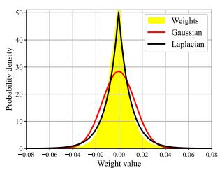

line chart

| Weight value | Weights | Gaussian | Laplacian |
| ------------ | ------- | -------- | --------- |
| -0.08        | 0       | 0        | 0         |
| -0.06        | 0       | 0        | 0         |
| -0.04        | 0       | 0        | 0         |
| -0.02        | 10      | 5        | 5         |
| 0.00         | 50      | 30       | 50        |
| 0.02         | 10      | 5        | 5         |
| 0.04         | 0       | 0        | 0         |
| 0.06         | 0       | 0        | 0         |
| 0.08         | 0       | 0        | 0         |

(a) ResNet-152

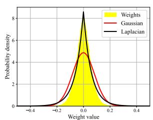

line chart

| Weight value | Weights | Gaussian | Laplacian |
| ------------ | ------- | -------- | --------- |
| -0.4         | 0.0     | 0.0      | 0.0       |
| -0.2         | 0.0     | 0.0      | 0.0       |
| 0.0          | 8.0     | 5.0      | 8.0       |
| 0.2          | 0.0     | 0.0      | 0.0       |
| 0.4          | 0.0     | 0.0      | 0.0       |

(b)ViT

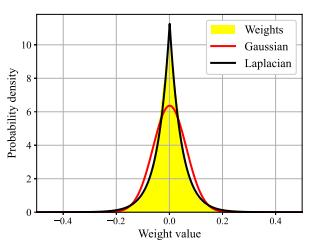

line chart

| Weight value | Weights | Gaussian | Laplacian |
| ------------ | ------- | -------- | --------- |
| -0.4         | 0.0     | 0.0      | 0.0       |
| -0.2         | 0.0     | 0.0      | 0.0       |
| 0.0          | 10.0    | 6.0      | 10.0      |
| 0.2          | 0.0     | 0.0      | 0.0       |
| 0.4          | 0.0     | 0.0      | 0.0       |

(c） VideoMAE

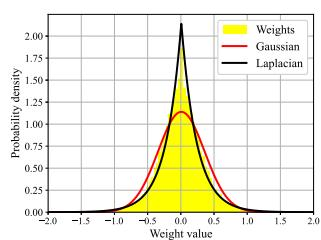

line chart

| Weight value | Weights | Gaussian | Laplacian |
| ------------ | ------- | -------- | --------- |
| -2.0         | 0.00    | 0.00     | 0.00      |
| -1.5         | 0.00    | 0.00     | 0.00      |
| -1.0         | 0.00    | 0.00     | 0.00      |
| -0.5         | 0.50    | 0.75     | 1.00      |
| 0.0          | 2.00    | 1.25     | 2.00      |
| 0.5          | 0.50    | 0.75     | 1.00      |
| 1.0          | 0.00    | 0.00     | 0.50      |
| 1.5          | 0.00    | 0.00     | 0.25      |
| 2.0          | 0.00    | 0.00     | 0.00      |

(d) GPT-3  
Fig. 2. Distribution of weights of various pre-trained models.

Then, we have the following lemma on $\Phi ( 1 )$ ,

Lemma 4: The value of $\Phi ( 1 )$ in (32) is given by

$$
\Phi (1) = \sup _ {P _ {z}: \mathbb {E} [ \| z \| ^ {2} ] \leq 1} h (z) = q \log \left(\frac {\sqrt {\pi} \mathrm{e}}{q}\right) + \log \left(\frac {2 \Gamma (q)}{\Gamma (q / 2)}\right). \tag {33}
$$

Proof: First, we define

$$
Q _ {\beta} (z) = \frac {\mathrm{e} ^ {- \beta \| z \|}}{B (\beta)}, (\beta > 0), \tag {34}
$$

where $B ( \beta )$ is defined as

$$
\begin{array}{l} B (\beta) = \int_ {\mathbb {R} _ {q}} \mathrm{e} ^ {- \beta \| z \|} d \boldsymbol {z} = \int_ {\mathbb {R} _ {q}} \int_ {\| z \|} ^ {\infty} \beta \mathrm{e} ^ {- \beta x} d x d \boldsymbol {z} \\ = \int_ {0} ^ {\infty} \beta \mathrm{e} ^ {- \beta x} \int_ {\| z \| \leq x} d z d x (35) \\ = \beta \frac {\pi^ {q / 2}}{\Gamma \left(\frac {q}{2} + 1\right)} \int_ {0} ^ {\infty} x ^ {q} \mathrm{e} ^ {- \beta x} d x (36) \\ = \frac {2 \Gamma (q) \pi^ {q / 2}}{\Gamma (q / 2) \beta^ {q}}, (37) \\ \end{array}
$$

where (35) follows from Fubini’s theorem, (36) follows from the properties of the Gamma function, where $\Gamma ( x ) =$ R ∞ tx−1e−tdt. With the defined Qβ(z), we have $\int _ { 0 } ^ { \infty } t ^ { x - 1 } \mathrm { e } ^ { - t } \dot { d t }$ $Q _ { \beta } ( z )$

$$
\begin{array}{l} \Phi (1) = \sup _ {P _ {z}: \mathbb {E} [ \| z \| ] \leq 1} h (z) \\ = \sup _ {P _ {z}: \mathbb {E} [ \| z \| ] \leq 1} - D _ {\mathrm{KL}} \left(P _ {z} (z) \| Q _ {\beta} (z)\right) + \mathbb {E} \left[ \log \frac {1}{Q _ {\beta} (z)} \right] \\ \leq \log B (\beta) + \beta / \ln 2, \tag {38} \\ \end{array}
$$

where the last inequality follows from the fact that the Kullback-Leibler (KL) divergence $D _ { \mathrm { K L } } \big ( P _ { z } ( z ) \| Q _ { \beta } ( z ) \big )$ is non-negative. Moreover, the lower bound is achievable if we set $P _ { z } ( z ) = Q _ { \beta } ( z )$ such that $D _ { \mathrm { K L } } \big ( P _ { z } ( z ) \lVert Q _ { \beta } ( z ) \big ) = 0$ .

Finally, we minimize (38) by setting its derivative with respect to (w.r.t.) $\beta$ equal to 0, i.e.,

$$
\frac {d \big (\log B (\beta) + \beta / \ln 2 \big)}{d \beta} = 0, \tag {39}
$$

and then substitute the obtained optimal $\beta$ into (38). This completes the proof. 

Finally, by substituting (32) and (33) into (26), we have the following theorem.

Theorem 2: Consider a multivariate Laplacian source. Under the distortion function in (20), its rate-distortion function is lower bounded by3

$$
R (D) \geq h (\boldsymbol {w}) + q \log \left(\frac {q}{\sqrt {\pi} \mathrm{e} D}\right) + \log \left(\frac {\Gamma (q / 2)}{2 \Gamma (q)}\right). \tag {40}
$$

Accordingly, for the considered co-inference system, with the original parameter dimension as $q _ { \mathrm { p } } = q + s$ and the pruned model rate (size) as $( \rho q + \tilde { \rho } s ) b$ , we have the lower bound of its distortion-rate function as

$$
D (R) \geq \frac {q + s}{\sqrt {\pi} \mathrm{e}} 2 ^ {- \frac {(\rho q + \tilde {\rho} s) b - h (\boldsymbol {w})}{q + s}} \left(\frac {\Gamma \left(\frac {q + s}{2}\right)}{2 \Gamma (q + s)}\right) ^ {\frac {1}{q + s}} \triangleq \hat {D} (\rho , \tilde {\rho}, L _ {D}). \tag {41}
$$

Remark 4.3: From Theorem $^ { 2 , }$ we have the following observations. First, $D ( R )$ and $R ( D )$ are inverse functions. Such duality relationship characterizes the inherent tradeoff between model pruning and inference quality. Second, Theorem 2 explicitly shows the influence of key system parameters on the inference distortion, including the pruning ratios $\rho$ and $\tilde { \rho } ,$ the model quantization level $b ,$ and the differential entropy $h ( w )$ . In particular, larger pruning ratios $\rho$ and $\tilde { \rho }$ lead to reduced distortion, but at the cost of increased delay and energy consumption for additional computation workloads. To this end, it is crucial to properly design pruning ratios, jointly with other communication and computation resources to balance the trade-offs among inference accuracy, latency, and energy consumption. Finally, the bound shows that for the same pruning ratio, models with higher entropy (i.e., larger $h ( w ) )$ experience a larger distortion after pruning. This implies that LAIMs with more information-rich parameters are more sensitive to pruning. Thus, task-oriented model selection is also beneficial for inference quality in resource-limited edge environments.

Remark 4.4 [Special-case on parallel Laplacian sources] Here we further assume that the weights follow a parallel (independent but not necessarily identical) Laplacian distribution. Specifically, each parameter $w _ { i } \in { \boldsymbol { w } }$ follows a Laplacian distribution with zero-mean and scale factor $\lambda _ { i } .$ , i.e.,

$$
P _ {w} (w _ {i}) = \frac {\lambda_ {i}}{2} \mathrm{e} ^ {- \lambda_ {i} | w _ {i} |}. \tag {42}
$$

3In practice, we estimate $h ( w )$ in (40) using a data-driven approach, without the need to separately estimate the parameters in (25). Specifically, we prune the pre-trained LAIM and collect empirical rate-distortion pairs under different pruning ratios. These samples are then used to fit the entropy term $h ( w )$ . This data-driven fitting procedure is commonly adopted in edge AI studies.

Based on this, we analyze the rate-distortion function in the following Proposition.

Proposition 3: Consider a parallel Laplacian source w, where each parameter $w _ { i } \in { \pmb w }$ follows a Laplacian distribution with zero-mean and scale factor $\lambda _ { i }$ . Under the distortion metric in (20), the rate-distortion function is lower bounded by

$$
R (D) \geq \sum_ {i = 1} ^ {q} \max \{- \log (\lambda_ {i} \mu), 0 \}, \tag {43}
$$

where $\mu$ is chosen as $\begin{array} { r } { \sum _ { i : \mu < \frac { 1 } { \lambda _ { i } } } \frac { \mu } { \sqrt { q } } + \sum _ { i : \mu \geq \frac { 1 } { \lambda _ { i } } } \frac { 1 } { \lambda _ { i } \sqrt { q } } = D . } \end{array}$

Proof: See Appendix B.

## V. JOINT PRUNING RATIO, SPLIT POINT, COMMUNICATION, AND COMPUTATION DESIGN FOR LAIM CO-INFERENCE

## A. Problem Formulation

This section jointly designs the pruning ratio, split point, communication, and computation resource management for LAIM co-inference. Specifically, we aim to jointly optimize the pruning ratios $\rho$ and $\tilde { \rho } ,$ the split point $L _ { D } ,$ , the computational frequencies $f$ and ${ \tilde { f } } ,$ and the transmit power $p ,$ to minimize the lower bound of the LAIM co-inference distortion in Theorem 2. The optimization is performed under the constraints of inference delay and energy consumption, as well as available system resource constraints (such as the maximum transmission power and computation clock frequency). Accordingly, the problem is formulated as

$$
\text {(P1)}: \min _ {\rho , f, p, L _ {D}, \tilde {\rho}, \tilde {f}} \hat {D} (\rho , \tilde {\rho}, L _ {D})
$$

$$
\text { s.t. } T (\rho , f, p, L _ {D}, \tilde {\rho}, \tilde {f}) \leq T _ {0} \tag {44a}
$$

$$
E (\rho , f, p, L _ {D}, \tilde {\rho}, \tilde {f}) \leq E _ {0} \tag {44b}
$$

$$
0 \leq \rho \leq 1 \tag {44c}
$$

$$
0 \leq \tilde {\rho} \leq 1 \tag {44d}
$$

$$
0 \leq f \leq f ^ {\max} \tag {44e}
$$

$$
0 \leq \tilde {f} \leq \tilde {f} ^ {\mathrm{max}}
$$

$$
(1), \tag {44f}
$$

where (44a) and (44b) indicate that the total inference delay and energy consumption should not exceed the given thresholds $T _ { 0 }$ and $E _ { 0 }$ . By properly adjusting $T _ { 0 }$ and $E _ { 0 } .$ , we can balance the trade-offs among the inference quality, delay, and energy consumption. Moreover, (44c) ∼ (44f) specify the domains of the optimization variables, where $f ^ { \mathrm { m a x } }$ and ˜f max denote the maximum clock frequencies of the processors on the edge device and server. However, in problem (P1), the constraints in (44a) and (44b) are non-convex, due to the close coupling of variables $\rho , f , p , L _ { D } , \tilde { \rho } ,$ and ${ \tilde { f } } .$ Furthermore, the integer variable $L _ { D }$ makes problem (P1) a mixed-integer nonlinear problem (MINLP). Therefore, problem (P1) is highly non-convex and non-trivial to be optimally solved in general.

## B. Proposed Solution of Problem (P1)

We propose an effective algorithm to solve problem (P1). In particular, we first use the successive convex approximation (SCA) technique to optimize $\rho , f , p , \tilde { \rho } ,$ and $\tilde { f }$ in (P1) under a given split point $L _ { D }$ , and then find the optimal $L _ { D }$ achieving the minimum objective value by exhaustive search. In the following, we first focus on optimizing $\rho , f , p , \tilde { \rho } ,$ and $\tilde { f }$ under given $L _ { D }$ .

Under fixed $L _ { D }$ , the objective of problem (P1) is convex w.r.t the pruning ratios $\rho$ and ${ \tilde { \rho } } .$ To deal with the non-convex constraints in (44a) and (44b), we first introduce the auxiliary variables $\rho ^ { \prime }$ and $\tilde { \rho } ^ { \prime } .$ . Then problem (P1) is reformulated as

$$
\mathrm{(P2)}: \min _ {\rho , f, p, \tilde {\rho}, \tilde {f}, \rho^ {\prime}, \tilde {\rho} ^ {\prime}} \hat {D} (\rho , \tilde {\rho})
$$

$$
\text { s.t. } \frac {N _ {\mathrm{FLOP}}}{\rho^ {\prime} f c} + \frac {\theta}{B \log_ {2} \left(1 + \frac {g p}{B N _ {0}}\right)}
$$

$$
+ \frac {N _ {\mathrm{FLOP}}}{\tilde {\rho} ^ {\prime} \tilde {f} \tilde {c}} \leq T _ {0} \tag {45a}
$$

$$
\eta \frac {N _ {\mathrm{FLOP}}}{\rho^ {\prime} c} \psi f ^ {2} + \frac {p \theta}{B \log_ {2} \left(1 + \frac {g p}{B N _ {0}}\right)}
$$

$$
+ \tilde {\eta} \frac {\tilde {N} _ {\mathrm{FLOP}}}{\tilde {\rho} ^ {\prime} \tilde {c}} \tilde {\psi} \tilde {f} ^ {2} \leq E _ {0} \tag {45b}
$$

$$
\rho \leq \frac {1}{\rho^ {\prime}} \tag {45c}
$$

$$
\tilde {\rho} \leq \frac {1}{\tilde {\rho} ^ {\prime}}
$$

$$
(1), (4 4 \mathrm{c}) \sim (4 4 \mathrm{f}). \tag {45d}
$$

It is worth noticing that the constraint (45a) is convex w.r.t. $\rho ^ { \prime } , f , p , \tilde { \rho } ^ { \prime }$ , and ${ \tilde { f } } .$ However, problem (P2) is still non-convex considering the non-convex constraints (45b) ∼ (45d). To address them, we use the SCA technique by approximating the non-convex terms with the first-order Taylor expansion in an iterative manner. For each iteration $k \geq 1$ , denote the local points as $p ^ { ( k ) } , \rho ^ { \prime ( k ) }$ , and $\tilde { \rho } ^ { \prime ( k ) }$ . Then, the second term on the left-hand side of (45b) is upper bounded by

$$
\frac {p \theta}{B \log_ {2} \left(1 + \frac {g p}{B N _ {0}}\right)}
$$

$$
\leq \frac {p ^ {(k)} \theta}{B \log_ {2} \left(1 + \frac {g p ^ {(k)}}{B N _ {0}}\right)} + u (p ^ {(k)}) (p - p ^ {(k)}) \triangleq \zeta^ {(k)} (p), \tag {46}
$$

where

$$
\begin{array}{l} u (p ^ {(k)}) = \frac {\theta}{B \log_ {2} \left(1 + \frac {g p ^ {(k)}}{B N _ {0}}\right)} \\ - \frac {p ^ {(k)} \theta g}{B \log_ {2} \left(1 + \frac {g p ^ {(k)}}{B N _ {0}}\right) ^ {2} (B N _ {0} + g p ^ {(k)}) \ln 2}. \tag {47} \\ \end{array}
$$

Also, for the non-convex constraints in (45c) and (45d), we approximate them based on their first-order Taylor expansions,

$$
\rho - \frac {1}{\rho^ {\prime}} \leq \rho - \frac {1}{\rho^ {(k)}} + \frac {1}{\rho^ {(k) 2}} (\rho^ {\prime} - \rho^ {(k)}) \leq 0, \tag {48}
$$

$$
\tilde {\rho} - \frac {1}{\tilde {\rho} ^ {\prime}} \leq \tilde {\rho} - \frac {1}{\tilde {\rho} ^ {(k)}} + \frac {1}{\tilde {\rho} ^ {(k) 2}} (\tilde {\rho} ^ {\prime} - \tilde {\rho} ^ {(k)}) \leq 0. \tag {49}
$$

Finally, for the k-th iteration, we obtain the approximate convex version of problem (P2) in problem (P3.k), via substituting $\zeta ^ { ( k ) } ( p )$ in (46) into the second term on the left-hand side of (45b), and replacing (45c) and (45d) as (48) and (49). Problem (P3.k) can be solved by standard convex optimization tools efficiently, such as CVX.

$$
\text{(P3.k)}:\min_{\substack{\rho ,f,p,\\ \tilde{\rho},\tilde{f},\rho^{\prime},\tilde{\rho}^{\prime}}}\frac{q + s}{\sqrt{\pi}\mathrm{e}} 2^{-\frac{(\rho q + \tilde{\rho}s)b - h(\boldsymbol {w})}{q + s}}\left(\frac{\Gamma\left(\frac{q + s}{2}\right)}{2\Gamma(q + s)}\right)^{\frac{1}{q + s}}
$$

$$
\text { s   .   t   . } \eta \frac {N _ {\mathrm{FLOP}}}{\rho^ {\prime} c} \psi f ^ {2} + \zeta^ {(k)} (p) + \tilde {\eta} \frac {\tilde {N} _ {\mathrm{FLOP}}}{\tilde {\rho} ^ {\prime} \tilde {c}} \tilde {\psi} \tilde {f} ^ {2} \leq E _ {0} \tag {50a}
$$

$$
\rho - \frac {1}{\rho^ {\prime (k)}} + \frac {1}{\rho^ {\prime (k) 2}} (\rho^ {\prime} - \rho^ {\prime (k)}) \leq 0 \tag {50b}
$$

$$
\tilde {\rho} - \frac {1}{\tilde {\rho} ^ {(k)}} + \frac {1}{\tilde {\rho} ^ {(k) 2}} (\tilde {\rho} ^ {\prime} - \tilde {\rho} ^ {(k)}) \leq 0
$$

$$
(1), (4 5 \mathrm{a}), (4 4 \mathrm{c}) \sim (4 4 \mathrm{f}). \tag {50c}
$$

For each $L _ { D } ,$ , by iteratively solving problem (P3.k), we obtain a series of solutions, leading to monotonically nonincreasing objective values of problem (P1). This guarantees the convergence of the proposed SCA-based algorithm for problem (P1). The iterative process stops when the decrease of the objective value is smaller than a given threshold . Then, among all candidate split points, we select the optimal $L _ { D }$ that achieves the minimum objective value of problem (P1).

## VI. EVALUATION

We present performance evaluation results to validate the proposed joint pruning ratio, split point, communication, and computation design for LAIM co-inference. All simulation experiments were conducted with PyTorch on NVIDIA RTX 3090 GPUs.

## A. Verification of Model Output Distortion Approximation

To validate the model output approximation derived in Section III, we quantify the theoretical upper bound based on the parameter distortion and compare it with the actual output distortion measured on the evaluation set. Specifically, for each pruning ratio, we compute both the empirical output distortion and the theoretical upper bound obtained from Theorem 1 and Proposition 2, where the model-dependent coefficient G is estimated in a data-driven manner as the empirical upper-bound constant that relates the output distortion to the corresponding parameter distortion.

We start with verifying the approximated upper bound on FC DNNs with 16 hidden layers, denoted as FCDNN-16. Then, we further validate the approximation on Vision Transformer (ViT) [41] and Video Masked Autoencoder (VideoMAE) [42]. Moreover, the adopted pruning strategy follows a widely-used magnitude-based criterion [36], which prioritizes the removal of weights with smaller magnitudes. We introduce the models in the following.

• FCDNN-16 is an auto-encoder with 16 hidden layers and ReLU activation functions. The encoder has 8 layers with sizes [64, 128, 256, 512, 256, 128, 64, 32], and the decoder is symmetric. All layers use the ReLU activation function. The network is trained using the mean squared error (MSE) loss and the Adam optimizer with a learning rate of 0.001 and a batch size of 64.

• ViT is a transformer-based architecture designed for image recognition tasks. We adopt the ViT-small version, which includes 12 transformer encoder blocks with a hidden size of 384. The model has approximately 22.88 million parameters and requires 1.122 GFLOPs for a single image inference.  
VideoMAE is designed for video understanding. We employ the VideoMAE-small version, which consists of 12 transformer encoder layers with a hidden size of 384. The model contains about 22.03 million parameters and requires 34.29 GFLOPs per inference.

Fig. 3 shows the relationships among theoretical parameter distortion, model output distortion, and inference-result distortion under varying pruning ratios across different model architectures. It is observed that the parameter distortion consistently serves as a reliable upper bound for the output distortion across all models. Furthermore, the output distortion closely tracks the inference-result distortion, indicating that the proposed distortion metric effectively characterizes the actual inference performance. When the pruning ratio exceeds 0.4 (i.e., more than 40 % of the model parameters are retained), the gap between the theoretical bound and the measured distortions becomes notably small, demonstrating the efficiency of our analytical approximation. It is worth noting that, since the inference result distortion lies on a different numerical scale (usually within [0, 1]), it is normalized by a fitted nonzero coefficient that minimizes the MSE against the output distortion, enabling magnitude-aligned comparison.

## B. Performance of the Proposed Design

We evaluate the proposed LAIM co-inference design on ViT and VideoMAE models under different system delay and energy consumption requirements. In this work, we focus on the inference phase and perform pruning directly on welltrained LAIMs without any additional training or fine-tuning after pruning, which aligns with practical edge deployment scenarios. Besides the magnitude-based pruning strategy, we additionally consider two other pruning schemes, namely random pruning and structured pruning. In random pruning, parameters are randomly set to zero. In structured pruning, specifically, magnitude-based row-structured pruning, the l -norm of each row in the weight matrix is computed, then the rows with the lowest norms are pruned until the desired pruning ratio is achieved. Two widely used datasets are employed, i.e., ImageNet-1K [43] and Kinetics-400 [44]. The datasets and corresponding performance metrics are summarized as follows.

• ImageNet-1K is a large-scale image classification dataset widely adopted for visual recognition. It contains 1.28 million training images and 50,000 validation images, covering 1,000 object categories. Each image is an RGB image with resolution of 224 × 224. The evaluation metric is the Top-1 accuracy.  
• Kinetics-400 is a large-scale human action recognition dataset covering 400 action categories. Each video clip lasts about 10 seconds being recorded at 25 fps. The

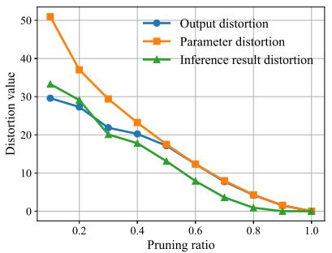

line chart

| Pruning ratio | Output distortion | Parameter distortion | Inference result distortion |
| ------------- | ----------------- | -------------------- | --------------------------- |
| 0.0           | 30                | 50                   | 32                          |
| 0.2           | 28                | 37                   | 28                          |
| 0.4           | 20                | 23                   | 19                          |
| 0.6           | 15                | 12                   | 8                           |
| 0.8           | 5                 | 5                    | 2                           |
| 1.0           | 0                 | 0                    | 0                           |

(a) FCDNN-16

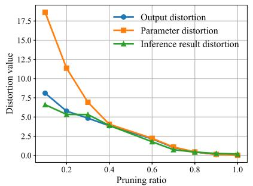

line chart

| Pruning ratio | Output distortion | Parameter distortion | Inference result distortion |
| ------------- | ----------------- | -------------------- | --------------------------- |
| 0.1           | 8.0               | 18.0                 | 6.5                         |
| 0.2           | 6.0               | 11.0                 | 5.5                         |
| 0.3           | 4.5               | 7.0                  | 5.0                         |
| 0.4           | 4.0               | 4.0                  | 4.0                         |
| 0.6           | 2.0               | 2.5                  | 2.0                         |
| 0.8           | 1.0               | 1.0                  | 1.0                         |
| 1.0           | 0.5               | 0.5                  | 0.5                         |

(b)ViT

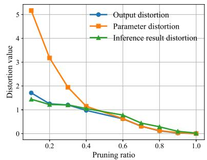

line chart

| Pruning ratio | Output distortion | Parameter distortion | Inference result distortion |
| ------------- | ----------------- | -------------------- | --------------------------- |
| 0.0           | 1.7               | 5.2                  | 1.4                         |
| 0.2           | 1.3               | 3.2                  | 1.2                         |
| 0.4           | 1.0               | 1.1                  | 1.1                         |
| 0.6           | 0.8               | 0.7                  | 0.8                         |
| 0.8           | 0.4               | 0.3                  | 0.4                         |
| 1.0           | 0.1               | 0.1                  | 0.1                         |

(c）VideoMAE

Fig. 3. Distortions of model outputs, parameters, and inference results w.r.t. pruning ratios.  
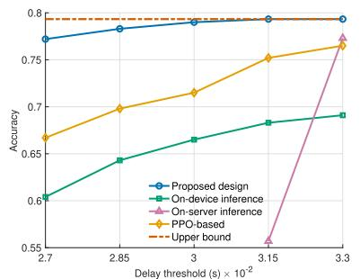

line chart

| Delay threshold (s) × 10⁻² | Proposed design | On-device inference | On-server inference | PPO-based | Upper bound |
| -------------------------- | --------------- | ------------------- | ------------------- | --------- | ----------- |
| 2.7                        | 0.77            | 0.60                | -                   | 0.67      | 0.80        |
| 2.85                       | 0.78            | 0.64                | -                   | 0.70      | 0.80        |
| 3.0                        | 0.79            | 0.66                | -                   | 0.72      | 0.80        |
| 3.15                       | 0.79            | 0.68                | 0.55                | 0.75      | 0.80        |
| 3.3                        | 0.79            | 0.69                | 0.77                | 0.76      | 0.80        |

(a) ViT-Magnitude

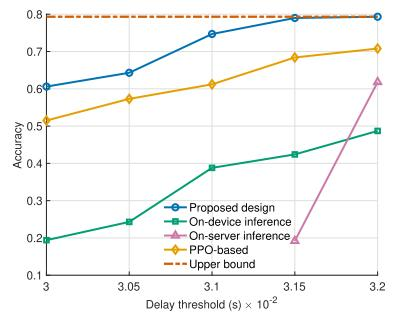

line chart

| Delay threshold (s) × 10⁻² | Proposed design | On-device inference | On-server inference | PPO-based | Upper bound |
| -------------------------- | --------------- | -------------------- | ------------------- | --------- | ----------- |
| 3.00                       | 0.60            | 0.20                 | 0.50                | 0.50      | 0.80        |
| 3.05                       | 0.65            | 0.25                 | 0.55                | 0.55      | 0.80        |
| 3.10                       | 0.70            | 0.35                 | 0.60                | 0.60      | 0.80        |
| 3.15                       | 0.75            | 0.40                 | 0.65                | 0.65      | 0.80        |
| 3.20                       | 0.78            | 0.45                 | 0.70                | 0.70      | 0.80        |
| 3.25                       | 0.80            | 0.48                 | 0.72                | 0.72      | 0.80        |

(b） ViT-Random

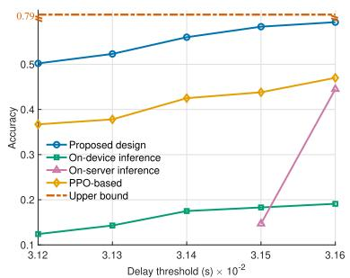

line chart

| Delay threshold (s) × 10⁻² | Proposed design | On-device inference | On-server inference | PPO-based |
| -------------------------- | --------------- | -------------------- | ------------------- | --------- |
| 3.12                       | 0.5             | 0.1                  | 0.1                 | 0.38      |
| 3.13                       | 0.52            | 0.12                 | 0.12                | 0.39      |
| 3.14                       | 0.55            | 0.15                 | 0.15                | 0.42      |
| 3.15                       | 0.58            | 0.17                 | 0.17                | 0.44      |
| 3.16                       | 0.6             | 0.18                 | 0.45                | 0.47      |

(c） ViT-Structured

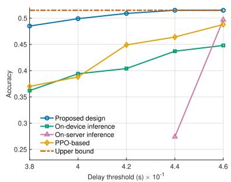

line chart

| Delay threshold (s) × 10⁻¹ | Proposed design | On-device inference | On-server inference | PPO-based | Upper bound |
| -------------------------- | --------------- | ------------------- | ------------------- | --------- | ----------- |
| 3.8                        | 0.49            | 0.37                | 0.37                | 0.37      | 0.51        |
| 4.0                        | 0.50            | 0.40                | 0.40                | 0.40      | 0.51        |
| 4.2                        | 0.51            | 0.41                | 0.45                | 0.45      | 0.51        |
| 4.4                        | 0.51            | 0.44                | 0.28                | 0.47      | 0.51        |
| 4.6                        | 0.51            | 0.45                | 0.50                | 0.50      | 0.51        |

(d) VideoMAE-Magnitude

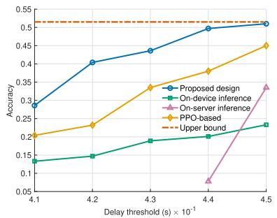

line chart

| Delay threshold (s) × 10⁻¹ | Proposed design | On-device inference | On-server inference | PPO-based | Upper bound |
| -------------------------- | --------------- | ------------------- | ------------------- | --------- | ----------- |
| 4.1                        | 0.28            | 0.13                | -                   | 0.20      | 0.50        |
| 4.2                        | 0.40            | 0.14                | -                   | 0.23      | 0.50        |
| 4.3                        | 0.44            | 0.19                | -                   | 0.33      | 0.50        |
| 4.4                        | 0.50            | 0.20                | 0.07                | 0.38      | 0.50        |
| 4.5                        | 0.52            | 0.23                | 0.34                | 0.46      | 0.50        |

(e） VideoMAE-Random

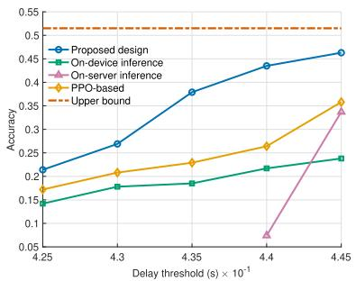

line chart

| Delay threshold (s) × 10⁻¹ | Proposed design | On-device inference | On-server inference | PPO-based | Upper bound |
| -------------------------- | --------------- | ------------------- | ------------------ | --------- | ----------- |
| 4.25                       | 0.2             | 0.15                | 0.15               | 0.17      | 0.5         |
| 4.3                        | 0.28            | 0.17                | 0.17               | 0.2       | 0.5         |
| 4.35                       | 0.38            | 0.18                | 0.18               | 0.23      | 0.5         |
| 4.4                        | 0.43            | 0.2                 | 0.06               | 0.27      | 0.5         |
| 4.45                       | 0.46            | 0.23                | 0.35               | 0.35      | 0.5         |

(f） VideoMAE-Structured  
Fig. 4. System performance w.r.t. different delay thresholds. (a), (b), and (c): Pruning ViT with the magnitude, random, and structured paradigms under the inference energy consumption threshold $E _ { 0 } = 4 \times 1 0 ^ { - 4 } ~ \mathrm { J } .$ . (d), (e), and (f): Pruning VideoMAE with the three pruning paradigms under the inference energy consumption threshold $\dot { E _ { 0 } } = 0 . 0 5 \mathrm { ~ J ~ }$ .

dataset consists of approximately 240,000 training videos and 20,000 validation videos. We report the Top-1 accuracy as the evaluation metric.

We consider simulation settings similar to those in [45]. We set the maximum clock frequencies to $f ^ { \mathrm { m a x } } = 1 \mathrm { G H z }$ and $\tilde { f } ^ { \mathrm { m a x } } = 4 ~ \mathrm { G H } z$ , and the number of FLOPs per cycle to $c = 3 2$ and $\tilde { c } = 1 2 8$ . For the wireless channel, we adopt independent and identically distributed (i.i.d.) Rayleigh fading with an average path loss of $1 0 ^ { - 5 } !$ , and perform 300 independent experiments to obtain the averaged results. Moreover, we set the bandwidth to $B = 5$ MHz, the maximum transmit power to $P _ { \mathrm { m a x } } ~ = ~ 0 . 5 ~ \mathrm { W }$ , and the PSD of the AWGN to $N _ { 0 } = 2 \times 1 0 ^ { - 1 9 } \mathrm { { \ W / H z \ ( i . e . , - 1 8 7 \ d B ) } }$ ), resulting in a noise power of −120 dBm. For energy modeling, we set the PUEs to $\eta \ : = \ : 1$ and ${ \tilde { \eta } } \ = \ 2 ,$ , and the power coefficients to $\psi =$ $5 \times 1 0 ^ { - 2 9 } \ \mathrm { W } / ( \mathrm { c y c l e / s } ) ^ { 3 }$ and ${ \tilde { \psi } = 1 \times 1 0 ^ { - 2 8 } \mathrm { \ W / ( c y c l e / s ) ^ { 3 } } }$ .

The following benchmark schemes are considered for performance comparison.

• On-device inference: The entire inference process is conducted on the edge device locally, and only the deviceside pruning ratio and clock frequency are optimized.  
• On-server inference: Raw (uncompressed) data samples are transmitted to the edge server, where we only optimize the server-side pruning ratio, clock frequency, and transmit power in problem (P1).  
• PPO-based [31]: A DRL baseline inspired by [31] is implemented via the proximal policy optimization (PPO) algorithm. The system is modeled as a Markov decision process. The state space includes instantaneous delay, energy consumption, and channel condition, while the action space consists of all decision variables. The reward function is defined as in (41), with large penalties applied when the total delay or energy exceeds the constraints.

Fig. 4 illustrates the system performance w.r.t. varying delay thresholds for both ViT and VideoMAE models under three pruning paradigms. As the delay threshold increases, the overall inference performance improves because more relaxed latency constraints allow for larger pruning ratios (i.e., more parameters are retained), thereby enhancing model accuracy. It is also observed that the proposed joint design consistently outperforms all benchmark schemes, validating the effectiveness of jointly optimizing pruning ratios, split point, communication, and computation resources in LAIM co-inference. In particular, the proposed approach achieves clear advantages over the PPO-based learning baseline. This is because DRL relies on sampling-based exploration and penalty-driven constraint handling, leading to unstable performance in our problem. Furthermore, under stringent delay constraints, the on-server inference scheme becomes infeasible due to the excessive transmission delay of raw data uploading.

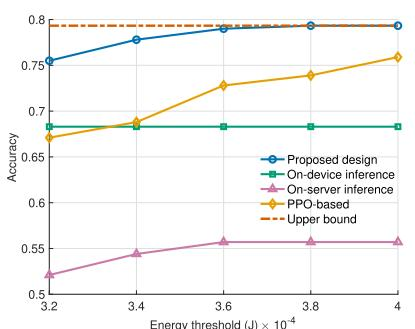

line chart

| Energy threshold (J) × 10⁻⁴ | Proposed design | On-device inference | On-server inference | PPO-based | Upper bound |
| --------------------------- | --------------- | -------------------- | ------------------- | --------- | ----------- |
| 3.2                         | 0.75            | 0.69                 | 0.52                | 0.68      | 0.8         |
| 3.4                         | 0.77            | 0.69                 | 0.54                | 0.69      | 0.8         |
| 3.6                         | 0.78            | 0.69                 | 0.55                | 0.73      | 0.8         |
| 3.8                         | 0.79            | 0.69                 | 0.55                | 0.74      | 0.8         |
| 4.0                         | 0.79            | 0.69                 | 0.55                | 0.76      | 0.8         |

(a) ViT-Magnitude

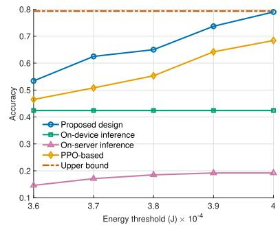

line chart

| Energy threshold (J) × 10⁻⁴ | Proposed design | On-device inference | On-server inference | PPO-based | Upper bound |
| --------------------------- | --------------- | ------------------- | ------------------- | --------- | ----------- |
| 3.6                         | 0.55            | 0.4                 | 0.15                | 0.45      | 0.8         |
| 3.7                         | 0.62            | 0.4                 | 0.17                | 0.5       | 0.8         |
| 3.8                         | 0.65            | 0.4                 | 0.18                | 0.55      | 0.8         |
| 3.9                         | 0.72            | 0.4                 | 0.19                | 0.65      | 0.8         |
| 4                           | 0.78            | 0.4                 | 0.19                | 0.7       | 0.8         |

(b) ViT-Random

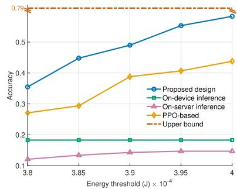

line chart

| Energy threshold (J) × 10⁻⁴ | Proposed design | On-device inference | On-server inference | PPO-based |
| --------------------------- | --------------- | -------------------- | ------------------- | --------- |
| 3.8                         | 0.35            | 0.18                 | 0.12                | 0.27      |
| 3.85                        | 0.45            | 0.18                 | 0.13                | 0.29      |
| 3.9                         | 0.50            | 0.18                 | 0.14                | 0.40      |
| 3.95                        | 0.55            | 0.18                 | 0.15                | 0.41      |
| 4                           | 0.60            | 0.18                 | 0.15                | 0.44      |

(c） ViT-Structured

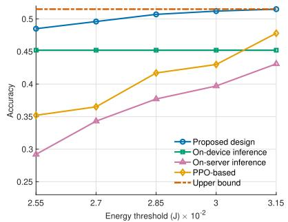

line chart

| Energy threshold (J) × 10⁻² | Proposed design | On-device inference | On-server inference | PPO-based |
| --------------------------- | --------------- | -------------------- | ------------------- | --------- |
| 2.55                        | 0.48            | 0.45                 | 0.29                | 0.35      |
| 2.7                         | 0.49            | 0.45                 | 0.34                | 0.37      |
| 2.85                        | 0.50            | 0.45                 | 0.38                | 0.42      |
| 3                           | 0.51            | 0.45                 | 0.40                | 0.43      |
| 3.15                        | 0.51            | 0.45                 | 0.44                | 0.47      |

(d） VideoMAE-Magnitude

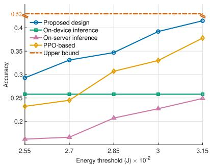

line chart

| Energy threshold (J) × 10⁻² | Proposed design | On-device inference | On-server inference | PPO-based |
| --------------------------- | --------------- | --------------------- | ------------------- | --------- |
| 2.55                        | 0.3             | 0.25                  | 0.1                 | 0.2       |
| 2.7                         | 0.35            | 0.25                  | 0.1                 | 0.25      |
| 2.85                        | 0.4             | 0.25                  | 0.2                 | 0.3       |
| 3                           | 0.4             | 0.25                  | 0.25                | 0.35      |
| 3.15                        | 0.45            | 0.25                  | 0.25                | 0.4       |

(e）VideoMAE-Random

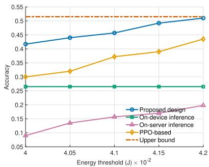

line chart

| Energy threshold (J) × 10⁻² | Proposed design | On-device inference | On-server inference | PPO-based |
| --------------------------- | --------------- | ------------------- | ------------------- | --------- |
| 4                           | 0.42            | 0.27                | 0.09                | 0.30      |
| 4.05                        | 0.44            | 0.27                | 0.13                | 0.32      |
| 4.1                         | 0.46            | 0.27                | 0.15                | 0.38      |
| 4.15                        | 0.49            | 0.27                | 0.16                | 0.39      |
| 4.2                         | 0.51            | 0.27                | 0.20                | 0.44      |

(f) VideoMAE-Structured  
Fig. 5. System performance w.r.t. different energy consumption thresholds. (a), (b), and (c): Pruning ViT with the magnitude, random, and structured paradigms under the inference delay threshold $T _ { 0 } = 3 . 1 5 \times 1 0 ^ { - 2 } \ s$ s. (d), (e), and (f): Pruning VideoMAE with the three pruning paradigms under the inference delay threshold $T _ { 0 } = 0 . 4 8 \mathrm { ~ s ~ }$ s.

Fig. 5 illustrates the system performance under different energy consumption thresholds. It is observed that the proposed design consistently outperforms all benchmark schemes, demonstrating its effectiveness in balancing the trade-offs among inference accuracy, latency, and energy efficiency in LAIM co-inference. Moreover, the on-device inference results remain nearly static across varying energy budgets. This is because the limited computational capability of edge devices causes excessive latency during on-device inference, making the delay threshold the dominant system bottleneck. Consequently, the device must adjust its pruning ratio primarily according to the delay requirement rather than the available energy. When latency is the governing constraint, merely increasing the energy budget cannot further enhance the overall system performance. In contrast, for the proposed design and some benchmarks, the inference accuracy generally improves as the energy threshold increases in the low-energy regime, indicating that the energy constraint is a dominant bottleneck.

text_image

Server (in the data center)
Router
Jetson AGX
Orig client

Fig. 6. Real-world testbed for pruning-aware LAIM co-inference.

Finally, we conduct real-world experiments using an NVIDIA Jetson AGX Orin 64G as the edge device and a Dell PowerEdge R740 server equipped with dual Intel Xeon Gold 6246R CPUs and two NVIDIA RTX 3090 GPUs as the edge server. The wireless link is established through an ASUS RT-AC88U dual-band Gigabit router, operating under stable 5 GHz Wi-Fi conditions. The Jetson platform provides up to 275 TOPS of AI computing power with a 12-core Arm Cortex-A78AE CPU and 64 Tensor-Core Ampere GPU. The complete testbed setup is shown in Fig. 6. In our current testbed, it is challenging to precisely control transmit power and computation frequency, as these parameters are governed by its internal power management and clock scheduling mechanisms. In contrast, the pruning ratio is a fully controllable variable that directly determines the model’s sparsity and computational load, thereby influencing inference quality, delay, and energy consumption. Moreover, it lies at the core of our proposed pruning-aware LAIM co-inference design. Therefore, as a first step toward practical validation, we focus on optimizing the pruning ratio while keeping other hardware-controlled parameters fixed. To conduct the experiments, we first measure the system parameters without pruning, including computation and communication delay/energy for on-device, on-server, and co-inference under different split points. These measurements are then substituted into equations (4)–(9). Finally, we solve Problem (P1) and deploy the optimized pruning ratio on the testbed for evaluation.

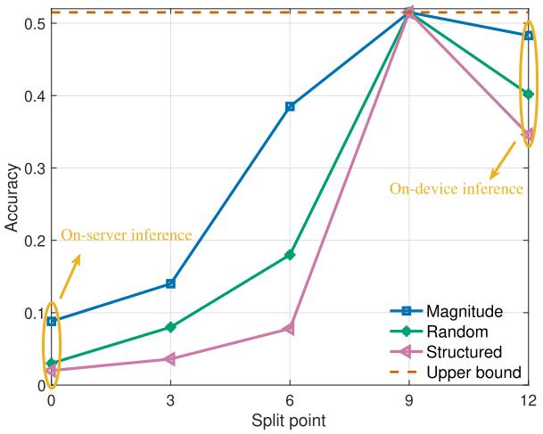

line chart

| Split point | Magnitude | Random | Structured |
| ----------- | --------- | ------ | ---------- |
| 0           | 0.1       | 0.03   | 0.01       |
| 3           | 0.14      | 0.08   | 0.03       |
| 6           | 0.39      | 0.18   | 0.08       |
| 9           | 0.5       | 0.5    | 0.5        |
| 12          | 0.49      | 0.4    | 0.35       |

Fig. 7. Inference accuracy w.r.t. different split points under magnitude-, random-, and structured-based pruning evaluated on the developed testbed.

Fig. 7 shows the testbed performance of the proposed framework under magnitude-, random-, and structured-based pruning on the VideoMAE model. It is observed that the proposed pruning-aware co-inference design consistently outperforms both on-device and on-server inference schemes, confirming the effectiveness of the proposed design in real edge environments. In future work, we plan to extend the real-world experiments to include dynamic control of transmit power, computation frequency, as well as multi-device cooperative inference under heterogeneous network conditions.

## VII. CONCLUDING REMARKS

We proposed a pruning-aware LAIM co-inference system, where a pre-trained LAIM is partitioned into on-device and on-server sub-models, and model pruning is applied to enable efficient inference under resource-constrained edge environments. For the proposed system, we first established that the output distortion of LAIMs is upper bounded by the parameter distortion, and then derived a lower bound on the parameter distortion via rate-distortion theory. Next, building upon the analytical result, we jointly optimized the pruning ratio, split point, transmit power, and computation frequency to minimize the inference distortion bound, subject to constraints on system available resources, latency, and energy consumption. Then we developed an efficient algorithm to tackle the considered highly non-convex optimization problem. Finally, experimental results verified that our design significantly outperforms other benchmark schemes. Moreover, several other interesting issues could be pursued in future work, as outlined below.

• Extension to multi-device and multi-server coinference: Generalizing the proposed framework to multi-device and multi-server scenarios is an important and interesting direction. This requires incorporating task offloading and device-server association, queueing delay and energy modeling, and hardware heterogeneity into the system formulation. For pruning-aware co-inference, the rate-distortion analysis should be extended to characterize each device’s heterogeneous contribution to the overall inference task. For the system design, additional consideration of offloading and association strategies will result in more complex optimization problems deserving further investigation.  
• More accurate approximations and complementarity with the information bottleneck (IB) principle: In this work, we approximate the output distortion of LAIMs using a first-order Taylor expansion. Extending this framework to incorporate higher-order Taylor terms or alternative distortion metrics, such as the Kullback-Leibler (KL) divergence, could provide a more accurate and fine-grained characterization of LAIM performance distortion. Moreover, our analysis is complementary to the IB principle, which focuses on feature-level compression. Combining these two perspectives may lead to a unified weight-feature compression framework that jointly enhances the efficiency and performance of LAIM co-inference systems.  
• Extension to recurrent neural networks (RNNs): Extending the proposed theoretical framework to neural networks with feedback structures, such as RNNs, is an important and challenging direction. The current analysis is primarily established for feed-forward architectures, which cover most Transformer-based LAIMs. Extending the analysis to recurrent architectures would allow the framework to capture temporal dependencies and feedback dynamics.  
• Extension to model quantization: Model quantization is another important compression technique. Integrating it into the proposed framework is a meaningful yet challenging direction. Unlike pruning, quantization introduces discrete parameter distributions and bounded distortions, which call for a dedicated performance analysis. Moreover, accurately modeling the impact of quantization bit width on the trade-off among inference quality, latency, and energy consumption remains non-trivial. Jointly optimizing the quantization bits with communication and computation resources, and validating the resulting tradeoffs under different quantization schemes, constitutes an important topic for future research.

## APPENDIX

## A. Proof of Lemma 2

The output distortion of the l-th layer of the FC DNN is upper bounded by

$$
\begin{array}{l} \left\| f \left(\phi , \boldsymbol {W} ^ {(1: l)}\right) - f \left(\phi , \hat {\boldsymbol {W}} ^ {(1: l)}\right) \right\| \\ = \| \boldsymbol {W} ^ {(l)} \sigma \big (f (\phi , \boldsymbol {W} ^ {(1: l - 1)}) \big) - \hat {\boldsymbol {W}} ^ {(l)} \sigma \big (f (\phi , \hat {\boldsymbol {W}} ^ {(1: l - 1)}) \big) \| \\ \end{array}
$$

$$
= \left\| \boldsymbol {W} ^ {(l)} \sigma \left(f (\phi , \boldsymbol {W} ^ {(1: l - 1)})\right) - \hat {\boldsymbol {W}} ^ {(l)} \sigma \left(f (\phi , \boldsymbol {W} ^ {(1: l - 1)})\right) \right.
$$

$$
+ \hat {\boldsymbol {W}} ^ {(l)} \sigma \big (f (\phi , \boldsymbol {W} ^ {(1: l - 1)}) \big) - \hat {\boldsymbol {W}} ^ {(l)} \sigma \big (f (\phi , \hat {\boldsymbol {W}} ^ {(1: l - 1)}) \big) \|
$$

$$
\leq \left\| \boldsymbol {W} ^ {(l)} \sigma \left(f (\phi , \boldsymbol {W} ^ {(1: l - 1)})\right) - \hat {\boldsymbol {W}} ^ {(l)} \sigma \left(f (\phi , \boldsymbol {W} ^ {(1: l - 1)})\right) \right\|
$$

$$
+ \left\| \hat {\boldsymbol {W}} ^ {(l)} \sigma \left(f \left(\phi , \boldsymbol {W} ^ {(1: l - 1)}\right)\right) - \hat {\boldsymbol {W}} ^ {(l)} \sigma \left(f \left(\phi , \hat {\boldsymbol {W}} ^ {(1: l - 1)}\right)\right) \right\| \tag {51}
$$

$$
\leq \| \boldsymbol {W} ^ {(l)} - \hat {\boldsymbol {W}} ^ {(l)} \| _ {\mathrm{F}} \| f (\phi , \boldsymbol {W} ^ {(1: l - 1)}) \|
$$

$$
+ \left\| \hat {\boldsymbol {W}} ^ {(l)} \right\| _ {\mathrm{F}} \| f (\phi , \boldsymbol {W} ^ {(1: l - 1)}) - f (\phi , \hat {\boldsymbol {W}} ^ {(1: l - 1)}) \| \tag {52}
$$

$$
\leq \| \boldsymbol {W} ^ {(l)} - \hat {\boldsymbol {W}} ^ {(l)} \| _ {\mathrm{F}} \prod_ {j = 1} ^ {l - 1} \| \boldsymbol {W} ^ {(j)} \| _ {\mathrm{F}}
$$

$$
+ \| \boldsymbol {W} ^ {(l)} \| _ {\mathrm{F}} \| f (\phi , \boldsymbol {W} ^ {(1: l - 1)}) - f (\phi , \hat {\boldsymbol {W}} ^ {(1: l - 1)}) \|, \tag {53}
$$

where (51) follows from the triangle inequality, (52) follows from the Cauchy-Schwarz inequality and Assumption 2, (53) follows from Lemma 1 and the fact that the Frobenius norm of pruned model parameters is always smaller than that of the original model.

## B. Proof of Proposition 3

To start with, we introduce a lemma on the rate-distortion function on a Laplacian source under the distortion function $d ( w , \hat { w } ) = | w - \hat { w } |$ .

Lemma 5: The rate-distortion function for a Laplacian source with zero-mean and scale factor of λ under distortion function $d ( w , \hat { w } ) = | w - \hat { w } |$ | is given by

$$
R (D) = \left\{ \begin{array}{l l} - \log (\lambda D), & 0 \leq D <   \frac {1}{\lambda} \\ 0, & D \geq \frac {1}{\lambda} \end{array} \right. \tag {54}
$$

Proof: Please refer to [39] for more details.

Next, we provide a lower bound on the rate-distortion function of a parallel Laplacian source w. Specifically, the mutual information is lower bounded by

$$
\begin{array}{l} I (\boldsymbol {w}, \hat {\boldsymbol {w}}) = \sum_ {i = 1} ^ {q} h (w _ {i}) - \sum_ {i = 1} ^ {q} h (w _ {i} | w _ {1}, \dots , w _ {i - 1}, \hat {\boldsymbol {w}}) \\ = \sum_ {i = 1} ^ {q} h (w _ {i}) - \sum_ {i = 1} ^ {q} h (w _ {i} | \hat {w} _ {i}) \\ = \sum_ {i = 1} ^ {q} I (w _ {i} | \hat {w} _ {i}). \tag {55} \\ \end{array}
$$

Then the rate-distortion function is lower bounded by

$$
\begin{array}{l} R (D) = \min _ {\mathbb {E} \left[ \sqrt {\sum_ {i = 1} ^ {q} (w _ {i} - \hat {w} _ {i}) ^ {2}} \right] \leq D} \sum_ {i = 1} ^ {q} I (w _ {i} | \hat {w} _ {i}) \\ \geq \min_ {\substack {\frac {\sum_ {i = 1} ^ {q} D _ {i}}{\sqrt {q}} \leq D \sum_ {i = 1} ^ {q} R (D _ {i}) \\ \text {if} i \in \mathbb {Z}, i \neq 0, \text {if} i \in \mathbb {Z}, i \neq 0, \text {if} i \in \mathbb {Z}, i \neq 0, \text {if} i \in \mathbb {Z}, i \neq 0, \text {if} i \in \mathbb {Z}}} (56) \\ = \min _ {\sum_ {i = 1} ^ {q} D _ {i} \leq \sqrt {q} D} \sum_ {i = 1} ^ {q} \max \left\{- \log (\lambda_ {i} D _ {i}), 0 \right\}, (57) \\ \end{array}
$$

where $D _ { i } = \mathbb { E } [ | w _ { i } - \hat { w } _ { i } | ]$ , (56) follows from the definition of the rate-distortion function and the fact that $\begin{array} { r } { \frac { \sum _ { i } ^ { q } x _ { i } } { q } \leq \sqrt { \frac { \sum _ { i } ^ { q } x _ { i } ^ { 2 } } { q } } } \end{array}$ ≤ , and (57) follows from Lemma 5. Then we construct the Lagrangian function of the problem as

$$
\mathcal {L} (\{D _ {i} \}, \mu) = \sum_ {i = 1} ^ {q} \max \left\{- \log (\lambda_ {i} D _ {i}), 0 \right\} + \mu D _ {i}, \tag {58}
$$

By setting the derivative w.r.t. $D _ { i }$ equal to 0, we obtain the final solution as

$$
R (D) \geq \sum_ {i = 1} ^ {q} \max \{- \log (\lambda_ {i} \mu), 0 \}, \tag {59}
$$

where $\mu$ is chosen as $\begin{array} { r } { \sum _ { i : \mu < \frac { 1 } { \lambda _ { i } } } \frac { \mu } { \sqrt { q } } + \sum _ { i : \mu \geq \frac { 1 } { \lambda _ { i } } } \frac { 1 } { \lambda _ { i } \sqrt { q } } = D } \end{array}$ i iMoreover, the corresponding distortion-rate function is

$$
D (R) \geq \sum_ {i = 1} ^ {q} \min \left\{\frac {\mu}{\sqrt {q}}, \frac {1}{\lambda_ {i} \sqrt {q}} \right\}, \tag {60}
$$

where $\begin{array} { r } { \sum _ { i : \mu < \frac { 1 } { \lambda _ { i } } } - \log ( \lambda _ { i } \mu ) = R . } \end{array}$

## REFERENCES

[1] L. Bariah, Q. Zhao, H. Zou, Y. Tian, F. Bader, and M. Debbah, “Large generative AI models for telecom: The next big thing?,” IEEE Commun. Mag., vol. 62, no. 11, pp. 84–90, Nov. 2024.  
[2] L. Dong et al., “LAMBO: Large AI model empowered edge intelligence,” IEEE Commun. Mag., vol. 63, no. 4, pp. 88–94, Apr. 2025.  
[3] J. Achiam et al., “GPT-4 technical report,” 2023, arXiv:2303.08774.  
[4] Y. Dong, H. Zhang, C. Li, S. Guo, V. C. M. Leung, and X. Hu, “Finetuning and deploying large language models over edges: Issues and approaches,” 2024, arXiv:2408.10691.  
[5] T. Griggs et al., “Melange: Cost efficient large language model serving ´ by exploiting GPU heterogeneity,” 2024, arXiv:2404.14527.  
[6] A. Agrawal, A. Panwar, J. Mohan, N. Kwatra, B. S. Gulavani, and R. Ramjee, “SARATHI: Efficient LLM inference by piggybacking decodes with chunked prefills,” 2023, arXiv:2308.16369.  
[7] M. Chen et al., “Distributed learning in wireless networks: Recent progress and future challenges,” IEEE J. Sel. Areas Commun., vol. 39, no. 12, pp. 3579–3605, Dec. 2021.  
[8] H. Zhou et al., “Large language model (LLM) for telecommunications: A comprehensive survey on principles, key techniques, and opportunities,” IEEE Commun. Surveys Tuts., vol. 27, no. 3, pp. 1955–2005, Dec. 2020.  
[9] K. B. Letaief, Y. Shi, J. Lu, and J. Lu, “Edge artificial intelligence for 6G: Vision, enabling technologies, and applications,” IEEE J. Sel. Areas Commun., vol. 40, no. 1, pp. 5–36, Jan. 2022.  
[10] R. Yi, L. Guo, S. Wei, A. Zhou, S. Wang, and M. Xu, “EdgeMoE: Empowering sparse large language models on mobile devices,” IEEE Trans. Mobile Comput., vol. 24, no. 8, pp. 7059–7073, Aug. 2025.  
[11] Y. Zhuang, Z. Zheng, F. Wu, and G. Chen, “LiteMoE: Customizing ondevice LLM serving via proxy submodel tuning,” in Proc. 22nd ACM Conf. Embedded Networked Sensor Syst., 2024, pp. 521–534.  
[12] Nvidia.(2023). Fastertransformer. [Online]. Available: https:// github.com/NVIDIA/FasterTransformer  
[13] G. Zhu et al., “Pushing AI to wireless network edge: An overview on integrated sensing, communication, and computation towards 6G,” Sci. China Inf. Sci., vol. 66, no. 3, pp. 1–19, Feb. 2023.  
[14] Z. Qin et al., “AI empowered wireless communications: From bits to semantics,” Proc. IEEE, vol. 112, no. 7, pp. 621–652, Jul. 2024.  
[15] J. Dai et al., “Nonlinear transform source-channel coding for semantic communications,” IEEE J. Sel. Areas Commun., vol. 40, no. 8, pp. 2300–2316, Aug. 2022.  
[16] H. Du et al., “Semantic communications for wireless sensing: RIS-aided encoding and self-supervised decoding,” IEEE J. Sel. Areas Commun., vol. 41, no. 8, pp. 2547–2562, Aug. 2023.  
[17] B. Soret et al., “Semantic and goal-oriented edge computing for satellite Earth observation,” 2024, arXiv:2408.15639.  
[18] J. Shao, Y. Mao, and J. Zhang, “Task-oriented communication for multidevice cooperative edge inference,” IEEE Trans. Wireless Commun., vol. 22, no. 1, pp. 73–87, Jan. 2023.  
[19] H. Zhou, Y. Deng, X. Liu, N. Pappas, and A. Nallanathan, “Goaloriented semantic communications for 6G networks,” IEEE Internet Things Mag., vol. 7, no. 5, pp. 104–110, Sep. 2024.  
[20] A. Mostaani, T. X. Vu, S. Chatzinotas, and B. Ottersten, “Task-oriented data compression for multi-agent communications over bit-budgeted channels,” IEEE Open J. Commun. Soc., vol. 3, pp. 1867–1886, 2022.  
[21] Z. Lyu, G. Zhu, J. Xu, B. Ai, and S. Cui, “Semantic communications for image recovery and classification via deep joint source and channel coding,” IEEE Trans. Wireless Commun., vol. 23, no. 8, pp. 8388–8404, Aug. 2024.  
[22] W.-Q. Ren et al., “A survey on collaborative DNN inference for edge intelligence,” Mach. Intell. Res., vol. 20, no. 3, pp. 370–395, Jun. 2023.  
[23] E. Li, L. Zeng, Z. Zhou, and X. Chen, “Edge AI: On-demand accelerating deep neural network inference via edge computing,” IEEE Trans. Wireless Commun., vol. 19, no. 1, pp. 447–457, Jan. 2020.  
[24] J. Yan, S. Bi, and Y.-J.-A. Zhang, “Optimal model placement and online model splitting for device-edge co-inference,” IEEE Trans. Wireless Commun., vol. 21, no. 10, pp. 8354–8367, Oct. 2022.  
[25] W. Shi, Y. Hou, S. Zhou, Z. Niu, Y. Zhang, and L. Geng, “Improving device-edge cooperative inference of deep learning via 2-Step pruning,” in Proc. IEEE Conf. Comput. Commun. Workshops (INFOCOM WKSHPS), Apr. 2019, pp. 1–6.  
[26] R. G. Pacheco, R. S. Couto, and O. Simeone, “Calibration-aided edge inference offloading via adaptive model partitioning of deep neural networks,” in Proc. IEEE Int. Conf. Commun., Jun. 2021, pp. 1–6.  
[27] Z. Liu, Q. Lan, and K. Huang, “Resource allocation for multiuser edge inference with batching and early exiting,” IEEE J. Sel. Areas Commun., vol. 41, no. 4, pp. 1186–1200, Apr. 2023.  
[28] S. F. Yilmaz, B. Hasircioglu, L. Qiao, and D. G ˘ und ¨ uz, “Private collabo- ¨ rative edge inference via over-the-air computation,” IEEE Trans. Mach. Learn. Commun. Netw., vol. 3, pp. 215–231, 2025.  
[29] C. Singhal, Y. Wu, F. Malandrino, M. Levorato, and C. F. Chiasserini, “Distributing inference tasks over interconnected systems through dynamic DNNs,” IEEE Trans. Netw., vol. 33, no. 4, pp. 1717–1730, Aug. 2025.  
[30] Y. He, J. Fang, F. R. Yu, and V. C. Leung, “Large language models (LLMs) inference offloading and resource allocation in cloud-edge computing: An active inference approach,” IEEE Trans. Mobile Comput., vol. 23, no. 12, pp. 11253–11264, Dec. 2024.  
[31] Y. Chen, R. Li, X. Yu, Z. Zhao, and H. Zhang, “Adaptive layer splitting for wireless LLM inference in edge computing: A model-based reinforcement learning approach,” 2024, arXiv:2406.02616.  
[32] S. Oh, J. Kim, J. Park, S.-W. Ko, T. Q. S. Quek, and S.-L. Kim, “Uncertainty-aware hybrid inference with on-device small and remote large language models,” 2024, arXiv:2412.12687.  
[33] M. Zhang, X. Shen, J. Cao, Z. Cui, and S. Jiang, “EdgeShard: Efficient LLM inference via collaborative edge computing,” IEEE Internet Things J., vol. 12, no. 10, pp. 13119–13131, May 2025.  
[34] B. Isik, T. Weissman, and A. No, “An information-theoretic justification for model pruning,” in Proc. AISTATS, 2021, pp. 3821–3846.  
[35] A. Gadhikar, S. Mukherjee, and R. Burkholz, “Why random pruning is all we need to start sparse,” in Proc. PMLR, 2022, pp. 10542–10570.  
[36] J. Lee, S. Park, S. Mo, S. Ahn, and J. Shin, “Layer-adaptive sparsity for the magnitude-based pruning,” in Proc. ICLR, 2020.  
[37] K. Egashira, J. He, R. Staab, M. Vechev, and M. Vero, “Exploiting LLM quantization,” in Proc. Adv. Neural Inf. Process. Syst. 37, 2024, pp. 41709–41732.  
[38] Y. Gu, L. Dong, F. Wei, and M. Huang, “MiniLLM: Knowledge distillation of large language models,” in Proc. ICLR, 2023.  
[39] T. Berger, Rate-distortion Theory. Hoboken, NJ, USA: Wiley, 2003.  
[40] T. Eltoft, T. Kim, and T.-W. Lee, “On the multivariate Laplace distribution,” IEEE Signal Process. Lett., vol. 13, no. 5, pp. 300–303, May 2006.  
[41] A. Steiner, A. Kolesnikov, X. Zhai, R. Wightman, J. Uszkoreit, and L. Beyer, “How to train your ViT? Data, augmentation, and regularization in vision transformers,” 2021, arXiv:2106.10270.  
[42] T. Zhan, Y. Song, J. Wang, and L. Wang, “VideoMAE: Masked autoencoders are data-efficient learners for self-supervised video pre-training,” in Proc. NIPS, 2022, pp. 10078–10093.  
[43] O. Russakovsky et al., “ImageNet large scale visual recognition challenge,” Int. J. Comput. Vis., vol. 115, no. 3, pp. 211–252, Apr. 2015.  
[44] W. Kay et al., “The kinetics human action video dataset,” 2017, arXiv:1705.06950.  
[45] Z. Lyu, Y. Li, G. Zhu, J. Xu, H. Vincent Poor, and S. Cui, “Rethinking resource management in edge learning: A joint pre-training and finetuning design paradigm,” IEEE Trans. Wireless Commun., vol. 24, no. 2, pp. 1584–1601, Feb. 2025.

natural_image

Portrait of a young man wearing glasses and a dark blazer (no text or symbols visible)

Zhonghao Lyu (Member, IEEE) received the B.Eng. degree in communication engineering from Dalian University of Technology, Dalian, China, in 2018, the M.Eng. degree in information and communication engineering from the University of Science and Technology of China, Hefei, China, in 2021, and the Ph.D. degree in computer and information engineering from The Chinese University of Hong Kong, Shenzhen, China, in 2024. He is currently a Post-Doctoral Research Fellow with the School of Electrical Engineering and Computer Science, KTH

Royal Institute of Technology, Sweden. His research interests include large AI models, edge intelligence, and UAV communications. He served as a Jury Member for Swedish Final of Huawei Sweden Tech Arena 2025. He served as the Co-Chair for IEEE PIMRC 2026 and IWCMC 2026.

natural_image

Portrait photo of a man in formal attire (no text or symbols visible)

Ming Xiao (Senior Member, IEEE) received the Ph.D. degree from the Chalmers University of Technology, Sweden, in November 2007. Since November 2007, he has been with the Department of Information Science and Engineering, School of Electrical Engineering and Computer Science, KTH Royal Institute of Technology, Sweden, where he is currently a Professor. He received the IEEE Vehicular Technology Society Best Magazine Paper Award 2023. He was an Editor of IEEE TRANSACTIONS ON COMMUNICATIONS from 2012 to 2017. He has

been an Editor of IEEE TRANSACTIONS ON WIRELESS COMMUNICATIONS since 2018. He has been an Area Editor of IEEE OPEN JOURNAL OF THE COMMUNICATIONS SOCIETY since 2019.

natural_image

Portrait of a man wearing glasses and a suit (no text or symbols visible)

Jie Xu (Fellow, IEEE) received the B.E. and Ph.D. degrees from the University of Science and Technology of China. He is currently an Associate Professor (tenured) with the School of Science and Engineering, Shenzhen Future Network of Intelligence Institute (FNii-Shenzhen), and Guangdong Provincial Key Laboratory of Future Networks of Intelligence, The Chinese University of Hong Kong, Shenzhen. His research interests include wireless communications, wireless information and power transfer, UAV communications, edge computing and intelligence, and integrated sensing and communication (ISAC). He was a recipient of the 2017 IEEE Signal Processing Society Young Author Best Paper Award, the IEEE/CIC ICCC 2019 Best Paper Award, the 2019 IEEE Communications Society Asia–Pacific Outstanding Young Researcher Award, and the 2019 Wireless Communications Technical Committee Outstanding Young Researcher Award. He is the Symposium Co-Chair of the IEEE GLOBECOM 2019 Wireless Communications Symposium and the IEEE ICC 2025 Communication Theory Symposium, the Workshop Co-Chair of several IEEE ICC and GLOBECOM workshops, the Tutorial Co-Chair of IEEE/CIC ICCC 2019/2022, the Chair of the IEEE Wireless Communications Technical Committee (WTC), and the Vice Co-Chair of the IEEE Emerging Technology Initiative (ETI) on ISAC. He served or is serving as the Associate Editor-in-Chief for IEEE TRANSACTIONS ON MOBILE COMPUTING, an Editor for IEEE TRANSACTIONS ON WIRELESS COMMUNICATIONS, IEEE TRANSACTIONS ON COMMUNICATIONS, IEEE WIRELESS COMMUNICA-TIONS LETTERS, and Journal of Communications and Information Networks, an Associate Editor for IEEE ACCESS, and a Guest Editor for IEEE WIRELESS COMMUNICATIONS, IEEE JOURNAL ON SELECTED AREAS IN COMMUNICATIONS, IEEE Internet of Things Magazine, Science China Information Sciences, and China Communications. He is a Distinguished Lecturer of the IEEE Communications Society.

natural_image

Portrait of a man wearing a blue-and-white checkered shirt, outdoors with blurred green foliage background (no text or symbols visible)

Mikael Skoglund (Fellow, IEEE) received the Ph.D. degree from the Chalmers University of Technology, Sweden, in 1997. In 1997, he joined the KTH Royal Institute of Technology, Stockholm, Sweden, where he was appointed to the Chair of Communication Theory in 2003. At KTH, he heads the Division of Information Science and Engineering. He has contributed to source-channel coding, coding and transmission for wireless communications, Shannon theory, information-theoretic security, information theory for statistics and learning, information and

control, quantum information, and signal processing. In these research fields, he has supervised more than 30 Ph.D. students to completion. He is a member of the ELLIS Society and an Elected Member of the IEEE Information Theory Society Board of Governors. He has served on numerous technical program committees for IEEE-sponsored conferences. He was the General Co-Chair of IEEE ITW 2019 and the TPC Co-Chair of IEEE ISIT 2022. From 2003 to 2008, he was an Associate Editor of IEEE TRANSACTIONS ON COMMUNICATIONS. He was on the Editorial Board of IEEE TRANSACTIONS ON INFORMATION THEORY from 2008 to 2012 and in Fall 2021.

natural_image

Portrait of a man wearing glasses and a suit (no visible text or symbols)

Marco Di Renzo (Fellow, IEEE) received the Laurea (cum laude) and Ph.D. degrees in electrical engineering from the University of L’Aquila, Italy, in 2003 and 2007, respectively, and the Habilitation a Diriger des Recherches (Doctor of \` Science) degree from Paris-Sud University (currently Universite Paris-Saclay), Paris, France, in 2013. He ´ was a France-Nokia Chair of Excellence in ICT at the University of Oulu, Finland, a Tan Chin Tuan Exchange Fellow of engineering at Nanyang Technological University, Singapore, a Fulbright Fellow

at The City University of New York, USA, a Nokia Foundation Visiting Professor at Aalto University, Finland, and a Royal Academy of Engineering Distinguished Visiting Fellow at Queen’s University Belfast, U.K. Currently, he is the CNRS Research Director (Professor) and the Head of the Intelligent Physical Communications Group with the Laboratory of Signals and Systems (L2S), CNRS, CentraleSupelec, Universit ´ e Paris-Saclay. Also, he is a Chair ´ Professor of telecommunications engineering, the Director of the Centre for Telecommunications Research, and the Head of the Telecommunications Group, Department of Engineering, King’s College London, London, U.K. He is a Voting Member of the Fellow Evaluation Standing Committee. He is a fellow of IET, EURASIP, and AAIA; an Academician of AIIA; an Ordinary Member of European Academy of Sciences and Arts, an Ordinary Member of the Academia Europaea, an Ordinary Member of Italian Academy of Technology and Engineering; an Ambassador of European Association on Antennas and Propagation; and a Highly Cited Researcher. His recent research awards include the Michel Monpetit Prize conferred by French Academy of Sciences, the IEEE Communications Society Heinrich Hertz Award, and the IEEE Communications Society Marconi Prize Paper Award in Wireless Communications. He is the Chair of the Publications Misconduct Ad Hoc Committee and the Director of Journals for the IEEE Communications Society. He served as the Editor-in-Chief for IEEE COMMUNICATIONS LETTERS from 2019 to 2023. Also, he is on the Editorial Board of PROCEEDINGS OF THE IEEE.