# UAV-Enabled Wireless Power Transfer With Base Station Charging and UAV Power Consumption

Hua Yan , Student Member, IEEE, Yunfei Chen , and Shuang-Hua Yang , Senior Member, IEEE

Abstract—Wireless power transfer (WPT) is a promising charging technology for battery-limited sensors. In this paper, we study the use of an unmanned aerial vehicle (UAV) as a charger for WPT. Unlike the previous works, our study takes into account the power consumption of the UAV (power consumption during hovering and flight), the charging process from a base station (BS) to the UAV and the conversion loss of the energy harvester. Both one-dimensional (1D) and two-dimensional (2D) WPT systems are considered. The sum-energy received by all sensors is maximized to find the optimal strategy for UAV deployment. Two different charging schemes are proposed. Numerical results show that the sum-energy received by all sensors is determined by sensors’ topology, the flight speed of the UAV and the transmit power. They also show that, when the BS charging process and the UAV power consumption are considered in the optimization, the optimal location of the UAV in the 1D and 2D WPT systems is closer to the BS than in the previous works that ignore these two practical factors.

Index Terms—Energy efficiency, energy harvesting, radio frequency, sensor, unmanned aerial vehicle, wireless power transfer.

## I. INTRODUCTION

I <sup>N</sup> <sup>RECENT</sup> <sup>years,</sup> <sup>unmanned</sup> <sup>aerial</sup> <sup>vehicles</sup> <sup>(UAVs)</sup> <sup>have</sup>found a significant number of applications in wireless communication and transportation systems due to their decreasing expense and increasing functionality [1]–[2]. From the viewpoint of communications, the UAV can be used as an aerial base station (BS) for wireless coverage, or as a mobile relay to provide reliable communication links for distant users [3]–[4]. For example, in remote areas when the communication infrastructure is damaged by natural disasters, UAVs can serve as an aerial BS to provide wireless services [5]. Other UAV applications include UAV-assisted wireless networking [6]–[8], future intelligent and secure UAV networks for 6G [9]. This paper mainly focuses on the application where a UAV employs radio frequency (RF) wireless power transfer (WPT) to charge a set of ground sensors in a remote area, that is, UAV-enabled WPT.

Wireless charging [10]–[11] has been recognized as a promising technique to provide energy supply for battery-limited nodes, such as Internet of Things (IoT) devices and sensors. There have been quite a few works on the use of UAVs for WPT. For instance, UAV-enabled WPT systems were proposed in [12]– [20], where the UAV was used to broadcast wireless energy to ground receivers. Due to the line-of-sight (LoS) links between the UAV and ground sensors, UAV-enabled WPT system can improve the energy transfer efficiency greatly by deploying UAV as a mobile energy transmitter in these works. Specifically, reference [12] studied the achievable energy region of a basic two-user UAV-enabled WPT system by optimizing the UAV’s trajectory with constraints on the UAV’s maximum speed. Reference [13] extended the work in [12] to the multi-user scenario and maximized the minimum energy received by all energy receivers to optimize the trajectory design. In [14], both UAV’s optimal hovering location for maximum sum-energy and UAV’s optimal hovering time to maximize the minimum received energy among all energy receivers were investigated by trajectory optimization. In [15], a one-dimensional (1D) UAV trajectory was designed for a multi-user WPT system, where all ground nodes stay on a line, such as a motorway or river. Reference [16] considered a two-user scenario, but the UAV was equipped with a directional antenna. In [17], a new UAV-enabled wireless powered communication network was studied, where a UAV is deployed as a mobile access point to charge the ground users in the air-to-ground (A2G) link and collect information from ground users in the ground-to-air (G2A) link. The uplink minimum throughput was maximized by optimizing both the UAV trajectory and other resources. In [18], the maximum network throughput was discussed in a UAV-enabled relaying system where the UAV receives both energy and information from a BS, and then forwards the information to the ground user. The authors in [19] studied the use of a rotary-wing UAV as an energy transmitter to charge a set of energy receiver (ERs) taking into account the UAV’s flight altitude and coverage performance. The energy harvested by all ERs was maximized via jointly optimizing the UAV’s placement, beam pattern and charging time. Finally, in [20], a UAV-Aided Air-to-Ground cooperative non-orthogonal multiple access system for cellular users was studied, where the energy efficiency and spectrum efficiency were improved by jointly scheduling cellular users and the UAV.

All the above works have provided very valuable guidance on the use of UAV-enabled WPT system. However, several challenges in this field remain. Firstly, the power consumption of the UAV (i.e., power consumption from its hovering for charging and discharging, and from its propulsion for flight) is very important in these applications, but this issue has been largely overlooked in the existing works. Secondly, the UAV is an energy-limited node itself. Thus, it has to be charged by a BS wirelessly without landing [21] before transferring power to remote nodes. Most works only consider the power transfer from the UAV to the remote sensors but do not consider the power transfer from the BS to the UAV. In [22], the energy transfer efficiency from BS to sensors by employing UAV as a mobile energy transmitter has been analysed without optimizing the location of UAV in multiple sensors case. Thirdly, many of the previous works (i.e., [14]–[16] and [18]) have ignored the radio frequency to direct current (RF-to-DC) energy conversion efficiency by assuming perfect discharging at the energy receiver. Due to the increased use of UAVs in communication systems [23]–[25], these issues require urgent attention. To the best of the authors’ knowledge, the UAV-enabled WPT problem considering all these three issues has not been studied yet.

Motivated by these observations, in this paper, we study the use ofthe UAV in a UAV-enabled WPT system, where the UAV is deployed to charge the ground sensors after being charged by the BS. In the study, we take into account the power consumption at the UAV, the power transfer from the BS to UAV and the practical conversion efficiency at the energy receiver. To do this, we will first derive the optimal location of the UAV when the ground sensors are deployed in a 1D topology, as the case in [15]. Then, we will investigate the more complicated case when the ground sensors are deployed in a two-dimensional (2D) topology. For both cases, the optimal locations of UAVs will be derived by maximizing the sum-energy received by all ground sensors. Numerical results will be presented to show that the optimal locations have to be closer to the BS than what was reported in previous works that did not consider the power consumption of the UAV. The main contributions ofthis work can be summarized as follows:

\- Two different charging schemes for both 1D and 2D topologies in UAV-enabled WPT systems are studied by considering the BS charging process and the UAV power consumption.

\- The optimal locations of the UAV in WPT system in these two different cases are derived analytically.

\- The effects of different system parameters on the energy transfer performance are examined to give useful guidance for system designs.

The rest of the paper is organized as follows. In Section II, the system model is explained. Section III and IV derive the optimal location of UAVs in WPT system in 1D and 2D cases, respectively. Section V presents numerical results. Finally, the work is concluded in Section VI.

## II. SYSTEM MODEL

Consider two typical scenarios, where the ground sensors are distributed either in a 1D or 2D topology, as shown in Fig. 1. A rotary-wing UAV is first charged by a BS wirelessly in its close proximity, then flies to $K \geqslant 2$ remote ground sensors to charge them wirelessly for sustained operations. Let k index the sensors with $1 \leqslant k \leqslant K$ . In our study, only the locations of the sensors are needed. The structure and topology of the ground sensor network will not affect the derivation. In Fig. 1(a), all ground sensors are located on a straight line, as the case in [15]. In Fig. 1(b), they are assumed to be located on a 2D surface. Let $( 0 , 0 , H _ { b s } )$ denote the location of the BS with a height of $H _ { b s }$ , and the kth ground sensor is located at $( x _ { k } , y _ { k } , H _ { s r } )$ with a common antenna height of $H _ { s r } , \mathrm { i . e . , } \left( x _ { k } , 0 , H _ { s r } \right)$ for 1D and $( x _ { k } , y _ { k } , H _ { s r } )$ for 2D. The UAV is assumed to fly at a fixed height H above the ground [12]–[17]. Thus, its location can be denoted as $( x , y , H )$ . Also, it is assumed that all sensors have enough battery capacity for charging.

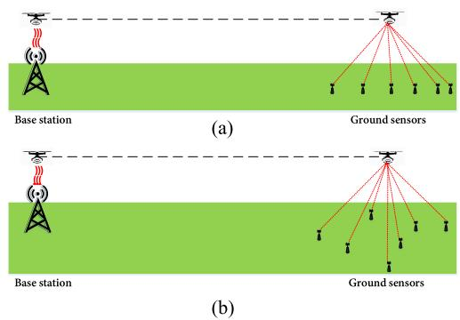  
Fig. 1. 1D and 2D topologies. (a) WPT system with 1D topology of ground sensors. (b) WPT system with 2D topology of ground sensors.

In this work, we assume wireless charging by the BS to the UAV. This is the case when there is no dedicated landing dock at the BS for wired charging, as in conventional BSs. This is also the case when it is not convenient or safe for the UAV to land due to the complicated environment surrounding the BS. In the case when wired charging is available at the BS, the following results are still valid by ignoring the Load stage of the BS charging or assuming zero loss from the BS to the UAV. In order to quantify the energy consumption of the UAV during the WPT from the UAV to ground sensors, the energy consumption in different phases of the process will be analysed. The energy consumption mainly comes from the transmission loss from the BS to the UAV, and from the UAV to the ground sensors, the conversion loss from RF to DC at both the UAV and ground sensors, and the UAV power consumption due to the UAV manoeuvring, such as hovering, acceleration, deceleration and flying at a constant speed. These will be discussed in the following.

## A. Transmission Loss

As the UAV hovers above the BS in its close proximity to be charged, a LoS link can be established between the BS and the UAV.<sup>1</sup> Similarly, we assume a LoS link between the UAV and ground sensors, as in [12]–[18]. According to the free-space path loss (FSPL) model, the transmission loss in these links can be expressed as

$$
P L _ { F S } = 2 0 \log \{ f \} + 2 0 \log \{ d \} - 1 4 7 . 5 5 d B ,\tag{1}
$$

where $d \ ( d \geqslant 1 )$ is the distance between the transmitter and the receiver, and f is the carrier frequency. Note that in FSPL model d $\geqslant 1$ , because the received power per unit area starts at a reference distance of 1 m [27].

As the channel between the BS and the UAV is dominated by LoS, the transmission loss from the BS to the UAV in both Fig. 1(a) and Fig. 1(b) can be expressed as

$$
P L _ { b s - u a v } = 2 0 \log ( f ) + 2 0 \log \left( H - H _ { b s } \right) - 1 4 7 . 5 5 d B ,\tag{2}
$$

where $H - H _ { b s } \geqslant$ 1 m is the distance between the BS and the UAV.

Also, since the wireless channel between the UAV and each ground sensor is dominated by LoS, similar to [12]–[18], the transmission loss from the UAV to the $k ^ { t h }$ sensor in Fig. 1(a) can be expressed by adopting the FSPL model in (1) as

$$
P L _ { u a v - g s } ^ { 1 D } = 2 0 \log ( f ) + 2 0 \log \left( d _ { u a v - g s _ { k } } ^ { 1 D } \right) - 1 4 7 . 5 5 d B ,\tag{3}
$$

and in Fig. 1(b) as

$$
P L _ { u a v - g s } ^ { 2 D } = 2 0 \log ( f ) + 2 0 \log \left( d _ { u a v - g s _ { k } } ^ { 2 D } \right) - 1 4 7 . 5 5 d B ,\tag{4}
$$

where $d _ { u a v - g s _ { k } } ^ { 1 D } = \sqrt { ( x - x _ { k } ) ^ { 2 } + ( H - H _ { s r } ) ^ { 2 } }$ is the distance between the UAV and the $k ^ { t h }$ sensor in the 1D case, $d _ { u a v - g s _ { k } } ^ { 2 D } =$ $\sqrt { \left( x - x _ { k } \right) ^ { 2 } + \left( y - y _ { k } \right) ^ { 2 } + \left( H - H _ { s r } \right) ^ { 2 } }$ in the 2D case, and $\dot { H } - H _ { s r } \geqslant 1$

## B. UAV Power Consumption

In addition to the energy transferred to the ground sensors, the UAV also requires energy for various manoeuvres (i.e. hovering, acceleration, deceleration and flying to fly to the sensors). For example, the authors in [28] studied the trade-off between power consumption and flight performance of fixed wing UAV. In [29], the authors derived an analytical propulsion power consumption model for rotary-wing UAVs flying at a speed of $V$ as

$$
\begin{array} { r l r } {  { P ( V ) = P _ { 0 } ( 1 + \frac { 3 V ^ { 2 } } { U _ { t i p } ^ { 2 } } ) + P _ { i } ( \sqrt { 1 + \frac { V ^ { 4 } } { 4 v _ { 0 } ^ { 4 } } } - \frac { V ^ { 2 } } { 2 v _ { 0 } ^ { 2 } } ) ^ { \frac { 1 } { 2 } } } } \\ & { } & { + \frac { d _ { 0 } \rho s A V ^ { 3 } } { 2 } , } \end{array}\tag{5}
$$

where $P _ { 0 }$ and $P _ { i }$ are two constants related to the physical properties of UAV and the flight environment, such as weight, rotor radius and air density, $U _ { t i p }$ denotes the tip speed of the rotor blade, $v _ { 0 }$ is the mean rotor induced velocity during hovering, $d _ { 0 }$ and s are the fuselage drag ratio and rotor solidity, respectively, and $\rho$ and A denote the air density and rotor disc area, respectively. Details and discussions on this model can be found in [29]. We will calculate the internal energy consumption of UAV using the above model. Denote the energy consumption during hovering, flying, acceleration and deceleration as $E _ { h o v e r } .$ $E _ { V } , E _ { A c c }$ and $E _ { D e c }$ , respectively. By substituting $V = 0$ into (5), the power consumption for hovering can be obtained as

$P ( 0 ) = P _ { 0 } + P _ { i }$ . Thus, the energy required for hovering can be calculated as

$$
E _ { h o v e r } = P ( 0 ) \cdot T _ { h o v e r } ,\tag{6}
$$

where $T _ { h o v e r }$ is the hovering time at a speed of 0. For flying at a speed of V, one has

$$
E _ { V } = P ( V ) \cdot T _ { f l y i n g } ,\tag{7}
$$

where $T _ { f l y i n g }$ is the flying time. For linear acceleration or deceleration, the relationship between velocity and time can be expressed as

$$
V = v _ { 0 } + a t ,\tag{8}
$$

where $v _ { 0 }$ is the initial velocity, a is the acceleration and t is the time. In this study, we consider the process when the UAV accelerates from an initial velocity of 0 to $V$ and continues to fly to the sensors at the speed of $V ,$ , and finally decelerates from $V$ to 0 to hover over the sensors for charging. Hence, the energy consumed by the UAV during the acceleration can be calculated as

$$
E _ { A c c } = \int _ { 0 } ^ { \frac { V } { a } } P ( t ) d t ,\tag{9}
$$

where $\frac { V } { a }$ is the acceleration time, as $\begin{array} { r } { v _ { 0 } = 0 , P ( t ) = } \end{array}$ $\begin{array} { r } { P _ { 0 } ( 1 + \frac { 3 ( a t ) ^ { 2 } } { U _ { t + n } ^ { 2 } } ) + P _ { i } ( \sqrt { 1 + \frac { ( a t ) ^ { 4 } } { 4 v _ { 0 } ^ { 4 } } } - \frac { ( a t ) ^ { 2 } } { 2 v _ { 0 } ^ { 2 } } ) ^ { \frac { 1 } { 2 } } + \frac { 1 } { 2 } d _ { 0 } \rho s A ( a t ) ^ { 3 } } \end{array}$ by substituting (8) into $( 5 )$ . Since acceleration and deceleration in this study are symmetric, the energy consumed during deceleration is the same as that during acceleration, i.e., $E _ { A c c } = E _ { D e c }$

For both the 1D case in Fig. 1(a) and the 2D case in Fig. 1(b), the UAV hovers above the BS to be charged wirelessly, then accelerates to a constant speed of $V$ and flies to the sensors. When it approaches the ground sensors, it decelerates from V to 0 and then hovers above the sensors to charge them before flying back to the BS in the same way. Thus, hovering, acceleration, deceleration, and flying are the four operations that need to be considered in our study.

## C. RF-to-DC Conversion Loss

In [30] and [31], linear and non-linear models for the RF-to-DC conversion efficiency have been obtained. From the simulation results in [30], it was found that the conversion efficiency depends on the input power. When the input power is below a threshold, the output power increases linearly with the input power. Thus, we assume that the energy harvester works in this linear region and the linear model is used in this case, similar to [12]–[13], [17] and [22]. One has the relationship between the input and output of the energy harvester as

$$
\begin{array} { r } { P _ { D C } = \eta \cdot P _ { R F } , } \end{array}\tag{10}
$$

where $P _ { R F }$ is the received RF power, η is the constant RF-to-DC conversion efficiency and $P _ { D C }$ is the converted DC power at the harvester.

Remark 1: Note that many factors could affect the optimal location of the UAV that maximizes the sum-energy received by all sensors, such as the number of sensors, the trajectory and the velocity of the UAV, etc. The UAV has to fly back to the BS after charging the sensors but needs to maximize the energy delivered to sensors. Firstly, the actual topology of the 1D and 2D WPT systems may be less important, as long as they are within the coverage area of the UAV WPT. If the area is too large, although the sum-energy is maximized, it may lead to unfairness among the sensors, especially those at the edge of the cell. Secondly, placing the UAV at different optimal locations for different sensors by exploiting the UAV’s trajectory designs, such as [13] and [14], will inevitably consume much more energy because of the extra propulsion power. This is not energy-efficient compared with our scheme that fixes the UAV at some point during charging and discharging to only consume hovering power.

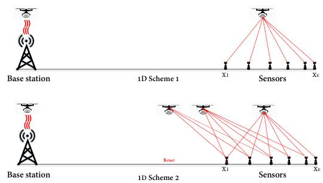  
Fig. 2. Schemes 1 and 2 of 1D case.

## III. OPTIMAL LOCATION OF UAV MAXIMIZING SUM-ENERGY IN 1D CASE

In this section, in order to study the optimal location of UAV that maximizes the sum-energy received by all sensors, the 1D case is considered first. As mentioned before, the UAV hovers above the BS to be charged, and then accelerates to a constant speed of V to fly to the destination. When it approaches the ground sensors, it decelerates and finally hovers above these sensors to charge them. Two schemes are considered, as shown in Fig. 2. In Scheme 1, the UAV only charges the sensors when it arrives and hovers at their top. This minimizes the transmission loss by having the shortest distance but limits the charging time. In Scheme 2, the UAV starts to charge the sensors before it arrives at their top, that is, the UAV starts charging while it is flying close to the sensors. This increases the charging time but suffers from possible larger transmission loss for each sensor.

## A. 1D Scheme 1

This scheme can be divided into three stages: load, $f l y$ and charge. In the first stage, the UAV is charged by the BS. This is the load stage. In the second stage, the UAV carries the stored energy and flies towards the ground sensors. This is the $f l y$ stage. Finally, the UAV hovers above these sensors to charge them by transferring wireless power. This is the charge stage.

1) Load: In the first stage, the received RF power in dB by the UAV can be derived as [22]

$$
P _ { u a v - r } ^ { 1 D s 1 } = P _ { t } + G _ { t } + G _ { u a v } - P L _ { b s - u a v } ,\tag{11}
$$

where $P _ { t }$ is the transmitted power in dBW, $G _ { t }$ is the gain of the transmitting antenna at the BS in dBi, $G _ { u a v }$ is the receiving antenna gain at the UAV in dBi (assumed to be the same as the transmitting antenna gain later), $P L _ { b s - u a v }$ is the path loss between the BS and the UAV in dB, as defined in (2). Then, the received DC energy can be calculated by applying the RF-to-DC conversion model in (10) as

```latex
Algorithm 1: Optimization of (20).
Input: Sensors' location array $S = [ x _ { 1 } , \ \cdot \cdot \cdot \ , x _ { k } , \cdot \cdot \cdot \ , \ x _ { K } ] ,$
$P _ { t } , G _ { t } , G _ { u a v } , G _ { g s } , \dot { P } _ { u a v \_ t , } \dot { V } , a , H , X = \operatorname* { m i n } ( \dot { S } )$
Step-size: max(S) and $T _ { l o a d i n } ^ { 1 D s 1 }$ g
Output: Optimal location $x ^ { * }$
1 for $\bar { i } \mathrm { = } 1 : l e n g t h ( X )$ do
2 Initialize $E _ { s u m } ^ { \scriptscriptstyle { 1 , 1 , \nu } \scriptscriptstyle { \frac { \partial } { \partial \ L } } s \scriptscriptstyle { 1 } }$
3 Calculate $E _ { a v a i l a b l e } ^ { 1 D s 1 } ( i )$ using (15)
4 if $E _ { a v a i l a b l e } ^ { 1 D s 1 } ( i ) \geq 0$ then
5 for $k { = } 1 \colon l e n g t h ( S )$ do
6 Calculate $Q _ { g s - k } ^ { 1 \dot { D } s 1 } ( k )$ using (16) − (19)
7 $E _ { s u m } ^ { 1 D s 1 } ( i ) = E _ { s u m } ^ { 1 D s 1 } ( i ) + \overleftarrow { Q } _ { g s - k } ^ { 1 D s 1 } ( k )$
8 else
9 break;
Result: $x ^ { * } = X ( i ^ { * } )  i ^ { * } = \arg \operatorname* { m a x } E _ { s u m } ^ { 1 D s 1 } ( i )$
```

$$
E _ { u a v - r } ^ { 1 D s 1 } = \eta 1 0 ^ { \frac { P _ { u a v - r } ^ { 1 D s 1 } } { 1 0 } } T _ { l o a d i n g } ^ { 1 D s 1 } ,\tag{12}
$$

where $T _ { l o a d i n g } ^ { 1 D s 1 }$ is the loading time. Note that, during the load stage, the UAV also consumes energy as it needs energy to keep aloft above the BS. This energy consumption can be calculated as

$$
E _ { h o v e r } ^ { T _ { l o a d i n g } ^ { 1 D s 1 } } = P ( 0 ) \cdot T _ { l o a d i n g } ^ { 1 D s 1 } .\tag{13}
$$

Also, to ensure that the UAV does not fall and is being charged,   
the received DC power must be greater than the hovering power 1Ds1   
$P ( 0 ) . { \mathrm { i . e . , } } \eta 1 0 ^ { \frac { x _ { \ u a v - r } } { 1 0 } } > P ( 0 )$

2) $F l y .$ Then, an acceleration –fly(v) – and – deceleration operation will be performed by the UAV to carry the charged energy to the sensors. We denote the final hovering position of the UAV as $( x _ { h } , 0 , H )$ since the BS and all sensors are located in a straight line. The energy required during the second stage can be calculated according to the propulsion power consumption model in (5) as

$$
\begin{array} { l } { E _ { f l y - t o } ^ { 1 D s 1 } = E _ { A c c } ^ { 1 D s 1 } + E _ { V } ^ { 1 D s 1 } + E _ { D e c } ^ { 1 D s 1 } } \\ { \mathrm { } } \\ { \displaystyle = 2 \int _ { 0 } ^ { \frac { V } { a } } P ( t ) d t + P ( V ) \frac { x _ { h } - \frac { V ^ { 2 } } { a } } { V } , } \end{array}\tag{14}
$$

where V is the final constant flight speed, a is the acceleration, and $P ( t )$ is the power consumption at time t. Note that, in order to ensure that the UAV has enough energy to fly back to the BS after charging the sensors, the energy for flying back should be considered and must not be less than that in the $f l y$ stage. Thus, the minimum energy required for flying back is $E _ { f l y - b a c k } ^ { 1 D s 1 } =$ $E _ { f l y - t o } ^ { 1 D s 1 }$ , assuming that the flying back operation is symmetric to the flying to operation.

3) Charge: After the UAV decelerates to a speed of 0 and hovers at $( x _ { h } , 0 , H )$ , it starts to transfer wireless power to the ground sensors. In this case, the amount of energy available for

transfer can be derived as

$$
E _ { a v a i l a b l e } ^ { 1 D s 1 } = E _ { u a v - r } ^ { 1 D s 1 } - E _ { h o v e r } ^ { T _ { l o a d i n g } ^ { 1 D s 1 } } - 2 E _ { f l y - t o } ^ { 1 D s 1 } .\tag{15}
$$

During this stage, the received RF power at the $k ^ { t h }$ sensor can be expressed as

$$
P _ { g s - k } ^ { 1 D s 1 } = P _ { u a v - t } + G _ { u a v } + G _ { g s } - P L _ { u a v - g s _ { k } } ^ { 1 D } ,\tag{16}
$$

where $P _ { u a v - t }$ is the transmission power of the UAV in dBW, $G _ { u a v }$ is the transmitting antenna gain, the same as the receiving antenna gain $G _ { u a v }$ in (11), $G _ { g s }$ is the receiving antenna gain at each sensor in dBi, assumed to be the same for all sensors, $P L _ { u a v - g s _ { k } } ^ { 1 D }$ is the path loss between the UAV and the $k ^ { t h }$ sensor in dB, defined in (3). Note that, during this stage, the UAV also consumes energy with a power of $P ( 0 )$ in watt to stay aloft, similar to the load stage. As a result, the charging time can be obtained as

$$
\begin{array} { r } { T _ { c h a r g i n g } ^ { 1 D s 1 } = \frac { E _ { a v a i l a b l e } ^ { 1 D s 1 } } { 1 0 ^ { \frac { P _ { u a v - t } } { 1 0 } } + P ( 0 ) } . } \end{array}\tag{17}
$$

Consequently, the DC energy received by the $k ^ { t h }$ sensor when the UAV hovers at $( x _ { h } , 0 , H )$ can be derived as

$$
Q _ { g s - k } ^ { 1 D s 1 } \left( x _ { h } , 0 , H \right) = \eta 1 0 ^ { \frac { P _ { g s - k } ^ { 1 D s 1 } } { 1 0 } } T _ { c h a r g i n g } ^ { 1 D s 1 } .\tag{18}
$$

The sum-energy received by all sensors can be calculated as

$$
E _ { s u m } ^ { 1 D s 1 } \left( x _ { h } , 0 , H \right) = \sum _ { k = 1 } ^ { K } Q _ { g s - k } ^ { 1 D s 1 } \left( x _ { h } , 0 , H \right) .\tag{19}
$$

The optimization problem can be formulated as

$$
( x ^ { * } , 0 , H ) = \arg \operatorname* { m a x } _ { x _ { h } } E _ { s u m } ^ { 1 D s 1 } \left( x _ { h } , 0 , H \right) ,\tag{20a}
$$

$$
\mathrm { s . t . } : E _ { a v a i l a b l e } ^ { 1 D s 1 } \geq 0 ,\tag{20b}
$$

where $x ^ { * }$ in (20a) is the optimal UAV location which maximizes the sum-energy function $E _ { s u m } ^ { 1 D s 1 } ( x _ { h } , 0 , H )$ , (20b) is the constraint on available energy to ensure the UAV can fly back.

4) Optimization: The solution to (20) is summarized in Algorithm 1, as it is challenging to derive its closed-form solution when K is large. The step-size setting in the algorithm determines the accuracy of $x ^ { * }$ , and it can be changed according to the accuracy requirement.

## B. 1D Scheme 2

The main difference between Scheme 1 and Scheme 2 is that in Scheme 2 the UAV starts to charge the sensors before it arrives at the top of sensors. Hence, in both deceleration and hovering operations, the sensors can receive power from the UAV. We denote the charging time in these two phases as $T _ { c h a r g e 1 } ^ { 1 D s 2 }$ and $T _ { c h a r g e 2 } ^ { 1 D s 2 }$ , and the energy received by sensors as $E _ { r e c e i v e d 1 } ^ { 1 D s 2 }$ and $E _ { r e c e i v e d 2 } ^ { 1 D s \bar { 2 } } ;$ , respectively. Since the energy harvester has an activation energy, a minimum power of $P _ { \epsilon }$ dB needs to be ensured at the closest sensor. This leads to a threshold value of $\boldsymbol { \mathscr { x } } _ { s t a r t }$ , at which the UAV starts energy transfer, as

$$
P _ { u a v - t } + G _ { u a v } + G _ { g s } - P L _ { u a v - g s _ { 1 } } ^ { 1 D } \geqslant P _ { \epsilon } d B ,\tag{21}
$$

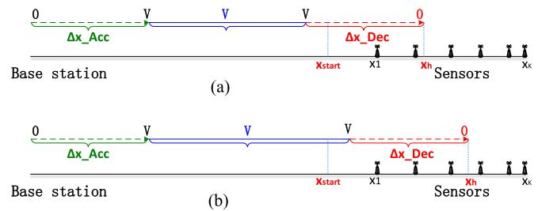  
Fig. 3. Two cases in 1D Scheme 2. (a) Xh-Xstart ≤ ΔX\_Dec. (b) Xh-Xstart > ΔX\_Dec.

where $P L _ { u a v - g s _ { 1 } } ^ { 1 D }$ is defined in (3), the distance between the UAV and the first sensor is $d _ { u a v - g s _ { 1 } } ^ { 1 D } = \sqrt { ( x _ { 1 } - x _ { s t a r t } ) ^ { 2 } + \Delta H ^ { 2 } }$ $\Delta H = H - H _ { s r }$ , and

$$
x _ { s t a r t } \geqslant x _ { 1 } - \sqrt { 1 0 ^ { \frac { P _ { u a v - t } + G _ { u a v } + G _ { g s } - 2 0 1  { \mathrm { g } } \{ f \} + 1 4 7 . 5 5 - P _ { \epsilon } } { 1 0 } } - \Delta H ^ { 2 } } .\tag{22}
$$

Denote the final static hovering position of the UAV as $( x _ { h } , 0 , H )$ . Two sub-cases needs to be discussed, as shown in Fig. 3.

1) Case a): In Fig. 3(a), when $x _ { h } - x _ { s t a r t } \leqslant \Delta X _ { D e c } ,$ the UAV is in the deceleration when it arrives at $x _ { s t a r t }$ . Thus, the velocity of the UAV when it starts energy transfer can be calculated as

$$
V _ { s t a r t } = \sqrt { - 2 a ( x _ { h } - x _ { s t a r t } ) } ,\tag{23}
$$

where $a ( a < 0 )$ is the deceleration. In the special case when $x _ { h } - x _ { s t a r t } = \Delta X _ { D e c }$ , we have $V _ { s t a r t } = V$ . Then, the charging time during deceleration is

$$
T _ { c h a r g e 1 } ^ { 1 D s 2 } = \frac { 0 - V _ { s t a r t } } { a } , a < 0 .\tag{24}
$$

Since deceleration from $V _ { s t a r t }$ to 0 is symmetric to the acceleration from 0 to $V _ { s t a r t } ,$ , the received RF power by the $k ^ { t h }$ sensor in $T _ { c h a r g e 1 } ^ { 1 D s 2 }$ period can be calculated as

$$
P _ { g s - k } ^ { 1 D s 2 } = \Omega - 2 0 \log \big ( d _ { u a v - g s _ { k } } ^ { 1 D } \big ) ,\tag{25}
$$

where

$$
\Omega = P _ { u a v - t } + G _ { u a v } + G _ { g s } - 2 0 \log ( f ) + 1 4 7 . 5 5 ,
$$

$d _ { u a v - g s _ { k } } ^ { 1 D } = \sqrt { \left( x _ { h } - \textstyle { \frac { 1 } { 2 } } a t ^ { 2 } - x _ { k } \right) ^ { 2 } + \Delta H ^ { 2 } , \ 0 \leqslant t \leqslant T _ { c h a r g e 1 } ^ { 1 D s 2 } } ,$ and a in $d _ { u a v - g s _ { k } } ^ { 1 D }$ is the acceleration when the UAV accelerates from $x _ { h }$ to $x _ { s t a r t }$ with the velocity from 0 to $V _ { s t a r t }$ , which is the same as deceleration from $V _ { s t a r t }$ to 0 when the UAV decelerates from $x _ { s t a r t }$ to $x _ { h } .$ . As a result, the total energy received by the $k ^ { t h }$ sensor can be obtained as

$$
\begin{array} { r l r } {  { Q _ { g s - k } ^ { 1 D s 2 } = \eta \int _ { 0 } ^ { T _ { \mathrm { c h a r g e l } } ^ { 1 D s 2 } } 1 0 ^ { \frac { P ^ { 1 D s 2 } } { g _ { 0 } } } d t } } \\ & { } & { = \frac { \eta 1 0 ^ { \frac { \Omega } { 1 0 } } } { 4 C _ { 1 } q ^ { 3 } \sin \alpha } \sin \frac { \alpha } { 2 } \ln \frac { \tau ^ { 2 } + 2 q \tau \cos \frac { \alpha } { 2 } + q ^ { 2 } } { \tau ^ { 2 } - 2 q \tau \cos \frac { \alpha } { 2 } + q ^ { 2 } } \qquad ( 2 } \\ & { } & { \quad + \frac { \eta 1 0 ^ { \frac { \Omega } { 1 0 } } } { 2 C _ { 1 } q ^ { 3 } \sin \alpha } \cos \frac { \alpha } { 2 } ( \mathrm { a r c t a n } \frac { \tau ^ { 2 } - q ^ { 2 } } { 2 q \tau \sin \frac { \alpha } { 2 } } + \pi / 2 ) , } \end{array}\tag{6}
$$

where $\begin{array} { r } { \alpha = \operatorname { a r c c o s } ( - \frac { B _ { 1 } } { 2 \sqrt { A _ { 1 } C _ { 1 } } } ) , \tau = T _ { c h a r g e 1 } ^ { 1 D s 2 } , q = \sqrt [ 4 ] { \frac { A _ { 1 } } { C _ { 1 } } } , A _ { 1 } = } \end{array}$ $\begin{array} { r } { ( x _ { h } - x _ { k } ) ^ { 2 } + \Delta H ^ { 2 } , ~ B _ { 1 } = - a ( x _ { h } - x _ { k } ) , ~ C _ { 1 } = \frac { 1 } { 4 } a ^ { 2 } } \end{array}$ , and we have used the integral in [32, eq. (2.161.1)]. Finally, the total energy received by all sensors in this case can be calculated as

$$
E _ { r e c e i v e d 1 } ^ { 1 D s 2 } = \sum _ { k = 1 } ^ { K } Q _ { g s - k } ^ { 1 D s 2 } .\tag{27}
$$

2) Case $b ) .$ In Fig. 3(b), when $x _ { h } - x _ { s t a r t } > \Delta X _ { D e c } ,$ the UAV has to fly at the constant speed of V for some time before decelerating, although it has already started energy transfer. Denote the time flying at a constant speed of V and decelerating as $T _ { c h a r g e 1 } ^ { 1 D s 2 - 1 }$ and $\dot { T _ { c h a r g e 1 } ^ { 1 D s 2 - 2 } }$ , respectively. Then, one has

$$
\begin{array} { r } { T _ { c h a r g e 1 } ^ { 1 D s 2 - 1 } = \frac { x _ { h } - x _ { s t a r t } - \Delta X _ { D e c } } { V } , } \\ { T _ { c h a r g e 1 } ^ { 1 D s 2 - 2 } = \frac { 0 - V } { a } , a < 0 , } \\ { T _ { c h a r g e 1 } ^ { 1 D s 2 - 1 } = T _ { c h a r g e 1 } ^ { 1 D s 2 - 1 } + T _ { c h a r g e 1 } ^ { 1 D s 2 - 2 } . } \end{array}\tag{28}
$$

If the received RF power at the $k ^ { t h }$ sensor during $T _ { c h a r g e 1 } ^ { 1 D s 2 - 1 }$ and $T _ { c h a r g e 1 } ^ { 1 D s 2 - 2 }$ are denoted by $P _ { g s - k } ^ { 1 D s 2 - 1 }$ and $P _ { g s - k } ^ { 1 D s 2 - 2 }$ , respectively. one has

$$
\begin{array} { r l } & { P _ { g s - k } ^ { 1 D s 2 - 1 } = \Omega - 2 0 \log \left( d _ { u a v - g s _ { k } } ^ { 1 D s 2 - 1 } \right) , } \\ & { P _ { g s - k } ^ { 1 D s 2 - 2 } = \Omega - 2 0 \log \left( d _ { u a v - g s _ { k } } ^ { 1 D s 2 - 2 } \right) , } \end{array}\tag{29}
$$

where

$$
\begin{array} { r } { d _ { u a v - g s _ { k } } ^ { 1 D s 2 - 1 } = \sqrt { \left( x _ { s t a r t } + V t - x _ { k } \right) ^ { 2 } + \Delta H ^ { 2 } } , } \\ { 0 \leqslant t \leqslant T _ { c h a r g e 1 } ^ { 1 D s 2 - 1 } , } \\ { d _ { u a v - g s _ { k } } ^ { 1 D s 2 - 2 } = \sqrt { \left( x _ { h } - \displaystyle \frac { 1 } { 2 } a t ^ { 2 } - x _ { k } \right) ^ { 2 } + \Delta H ^ { 2 } } , } \\ { a > 0 , 0 \leqslant t \leqslant T _ { c h a r g e 1 } ^ { 1 D s 2 - 2 } . } \end{array}\tag{30}
$$

Denote the total energy received by the $k ^ { t h }$ sensor during $T _ { c h a r g e 1 } ^ { 1 D s 2 - 1 }$ and $T _ { c h a r g e 1 } ^ { 1 D s 2 - 2 }$ as $Q _ { g s - k } ^ { 1 D s 2 - 1 }$ and $Q _ { g s - k } ^ { 1 D s 2 - 2 }$ , respectively. Then, one has

$$
\begin{array} { l } { { Q _ { g s - k } ^ { 1 D s 2 - 1 } = \eta \int _ { 0 } ^ { T _ { c h a r g e 1 } ^ { 1 D s 2 - 1 } } 1 0 ^ { \frac { P ^ { 1 D s 2 - 1 } } { q _ { 0 } } } d t } } \\ { { \ = \displaystyle \frac { 2 \eta 1 0 ^ { \frac { \Omega } { 1 0 } } } { \sqrt { 4 A _ { 2 } C _ { 2 } - B _ { 2 } ^ { 2 } } } \arctan \frac { B _ { 2 } + 2 C _ { 2 } T _ { c h a r g e 1 } ^ { 1 D s 2 - 1 } } { \sqrt { 4 A _ { 2 } C _ { 2 } - B _ { 2 } ^ { 2 } } } ( 3 1 ) } } \\ { { \ \ - \frac { 2 \eta 1 0 ^ { \frac { \Omega } { 1 0 } } } { \sqrt { 4 A _ { 2 } C _ { 2 } - B _ { 2 } ^ { 2 } } } \arctan \frac { B _ { 2 } } { \sqrt { 4 A _ { 2 } C _ { 2 } - B _ { 2 } ^ { 2 } } } , } } \end{array}
$$

where $A _ { 2 } = ( x _ { s t a r t } - x _ { k } ) ^ { 2 } + \Delta H ^ { 2 } , \ B _ { 2 } = 2 V ( x _ { s t a r t } - x _ { k } ) ,$ $C _ { 2 } = V ^ { 2 }$ , and the integral in [32, eq. (2.172)] is used here (or [32,

eq. (2.103.4)]). Similarly, during $T _ { c h a r g e 1 } ^ { 1 D s 2 - 2 }$ , one has

$$
\begin{array} { l } { { Q _ { g s - k } ^ { 1 D s 2 - 2 } = \eta \displaystyle \int _ { 0 } ^ { T _ { c h a r g e t 1 } ^ { 1 D s 2 - 2 } } 1 0 ^ { \frac { P ^ { 1 D s 2 - 2 } } { g s - k } } d t } } \\ { { \ \qquad = \displaystyle \frac { \eta 1 0 ^ { \frac { \Omega } { 1 0 } } } { 4 C _ { 1 } q ^ { 3 } \sin \alpha } \sin \frac \alpha 2 \ln \frac { T ^ { 2 } + 2 q T \cos \frac \alpha 2 + q ^ { 2 } } { T ^ { 2 } - 2 q T \cos \frac \alpha 2 + q ^ { 2 } } \qquad ( 3 2 ) } } \\ { { \ \qquad + \frac { \eta 1 0 ^ { \frac { \Omega } { 1 0 } } } { 2 C _ { 1 } q ^ { 3 } \sin \alpha } \cos \frac \alpha 2 \left( \arctan \frac { T ^ { 2 } - q ^ { 2 } } { 2 q T \sin \frac { \alpha } { 2 } } + \pi / 2 \right) , } } \end{array}
$$

where $\begin{array} { r } { \alpha = \operatorname { a r c c o s } ( - \frac { B _ { 1 } } { 2 \sqrt { A _ { 1 } C _ { 1 } } } ) , T = T _ { c h a r g e 1 } ^ { 1 D s 2 - 2 } , q = \sqrt [ 4 ] { \frac { A _ { 1 } } { C _ { 1 } } } , A _ { 1 } = } \end{array}$ $\begin{array} { r } { ( x _ { h } - x _ { k } ) ^ { 2 } + \Delta H ^ { 2 } , B _ { 1 } = - a ( x _ { h } - x _ { k } ) , C _ { 1 } = \frac { 1 } { 4 } a ^ { 2 } . } \end{array}$ , and the integral in [32, eq. (2.161.1)] has been used here. Hence, the total energy received by the $k ^ { t h }$ sensor during $T _ { c h a r g e 1 } ^ { 1 D s 2 }$ can be calculated as

$$
Q _ { g s - k } ^ { 1 D s 2 } = Q _ { g s - k } ^ { 1 D s 2 - 1 } + Q _ { g s - k } ^ { 1 D s 2 - 2 } ,\tag{33}
$$

and the sum-energy received by all sensors in this case can be calculated as

$$
E _ { r e c e i v e d 1 } ^ { 1 D s 2 } = \sum _ { k = 1 } ^ { K } Q _ { g s - k } ^ { 1 D s 2 } .\tag{34}
$$

After the UAV decelerates to the speed of 0, the energy available for transfer can be calculated as

$$
\begin{array} { r l } & { E _ { a v a i l a b l e } ^ { 1 D s 2 } = E _ { u a v - r } ^ { 1 D s 2 } - E _ { h o v e r } ^ { T _ { l o a d i n g } ^ { 1 D s 2 } } - 2 E _ { f l y - t o } ^ { 1 D s 2 } } \\ & { \qquad - \ 1 0 ^ { \frac { P _ { u a v - t } } { 1 0 } } \cdot T _ { c h a r g e 1 } ^ { 1 D s 2 } , } \end{array}\tag{35}
$$

where $E _ { u a v - r } ^ { 1 D s 2 } , E _ { h o v e r } ^ { T _ { l o a d i n g } ^ { 1 D s 2 } } , E _ { f l y - t o } ^ { 1 D s 2 }$ can be calculated using the method in Scheme 1, $P _ { u a v - t } T _ { c h a r g e 1 } ^ { 1 D s 2 }$ is the total energy delivered by the UAV from $\boldsymbol { \mathscr { x } } _ { s t a r t }$ to $x _ { h }$ . The received RF power at the $k ^ { t { \tilde { h } } }$ sensor can be expressed as

$$
P _ { g s - k } ^ { 1 D s 2 } = \Omega - 2 0 \log \left( d _ { u a v - g s _ { k } } ^ { 1 D } \right) ,\tag{36}
$$

where $d _ { u a v - g s _ { k } } ^ { 1 D } = \sqrt { \left( x _ { h } - x _ { k } \right) ^ { 2 } + \Delta H ^ { 2 } }$ . The delivery time can be derived as

$$
\begin{array} { r } { T _ { c h a r g e 2 } ^ { 1 D s 2 } = \frac { E _ { a v a i l a b l e } ^ { 1 D s 2 } } { 1 0 ^ { \frac { P _ { u a v - t } } { 1 0 } } + P ( 0 ) } . } \end{array}\tag{37}
$$

Hence, the DC energy received by $k ^ { t h }$ sensor in this time can be calculated as

$$
Q _ { g s - k } ^ { 1 D s 2 } ( x _ { h } , 0 , H ) = \eta 1 0 ^ { \frac { P _ { g s - k } ^ { 1 D s 2 } } { 1 0 } } T _ { c h a r g e 2 } ^ { 1 D s 2 } ,\tag{38}
$$

and the energy received by all sensors in $T _ { c h a r g e 2 } ^ { 1 D s 2 }$ can be derived as

$$
E _ { r e c e i v e d 2 } ^ { 1 D s 2 } = \sum _ { k = 1 } ^ { K } Q _ { g s - k } ^ { 1 D s 2 } ( x _ { h } , 0 , H ) .\tag{39}
$$

Finally, the sum-energy can be expressed as

$$
E _ { s u m } ^ { 1 D s 2 } = E _ { r e c e i v e d 1 } ^ { 1 D s 2 } + E _ { r e c e i v e d 2 } ^ { 1 D s 2 } ,\tag{40}
$$

which leads to the optimization problem

Algorithm 2: Optimization of (41).   
Input: Sensors' location array $S = [ x _ { 1 } , \ \cdot \cdot \cdot \ , x _ { k } , \cdot \cdot \cdot \ , \ x _ { K } ] , P _ { t } , G _ { t } ,$   
$G _ { u a v } , G _ { g s } , P _ { u a v \_ t , } V , a , \mathsf { \bar { H } } , P _ { \epsilon } , X = \operatorname* { m i n } _ { \epsilon } \langle S \rangle :$ Step-size   
: max(S) and ${ \cal T } _ { l o a d i n g } ^ { 1 D s 2 }$ which is equal to $T _ { l o a d i n g } ^ { 1 D s 1 } .$   
Output: Optimal location $x ^ { * } .$   
1 for i=1: length(X) do   
2 xstart, $\Delta X _ { D e c } $ calculate $x _ { s t a r t }$ using min(S), V, a and $P _ { \epsilon }$   
3 Initialize $E _ { s u m } ^ { 1 \breve { D } s 2 } , E _ { r e c e i v e d 1 } ^ { 1 D s 2 }$ and $\dot { E } ^ { 1 D s \tilde { 2 } }$ received2   
4 Calculate $E _ { a v a i l a b l e } ^ { 1 D s 2 } ( i )$ using (35)   
5 if $E _ { a v a i l a b l e } ^ { 1 D s 2 } ( i ) \geq 0$ then   
6 $\textbf { f } X ( i ) - x _ { s t a r t } \leq \Delta X _ { D e c }$ then   
7 for j=1: length(S) do   
8 Calculate $E _ { r e c e i v e d 1 } ^ { \mathrm { i } D _ { s 2 } } ( i )$ using (25) − (27)   
9 else   
10 for j=1: lenqth(S) do   
11 Calculate $E _ { r e c e i v e d 1 } ^ { \mathrm { i } D _ { s 2 } } ( i )$ using (28) − (34)   
12 for k=1: length(S) do   
13 Calculate $E _ { r e c e i v e d 2 } ^ { \mathrm { i } D _ { s 2 } } ( i )$ using (36) − (39)   
14 $E _ { s u m } ^ { 1 D s 2 } ( i ) = E _ { r e c e i v e d 1 } ^ { 1 D s 2 } ( i ) + E _ { r e c e i v e d 2 } ^ { 1 D s 2 } ( i )$   
15 else   
16 break;   
17 i\* = arg max $E _ { s u m } ^ { 1 D s 2 } ( i )$   
Result: ${ \bar { x } } ^ { * } = X ( i ^ { * } )$

$$
( x ^ { * } , 0 , H ) = \arg \operatorname* { m a x } _ { x _ { h } } E _ { s u m } ^ { 1 D s 2 } \left( x _ { h } , 0 , H \right) ,\tag{41a}
$$

$$
\mathrm { s . t . } : E _ { a v a i l a b l e } ^ { 1 D s 2 } \geq 0 ,\tag{41b}
$$

where $x ^ { * }$ in (41a) is the optimal UAV location that maximizes the sum-energy function $\bar { E } _ { s u m } ^ { 1 D s 2 }$ , (41b) is the constraint on the available energy to ensure the UAV can fly back to the BS. The objective function is determined by the delivery time allocation, velocity $V ,$ , acceleration a $( a > 0 \mathrm { o r } a < 0 )$ , and the number and distribution of sensors. It is too complicated to be solved analytically. We will solve it numerically. Details on the numerical solution to (41) is summarized in Algorithm 2. Note that, $\boldsymbol { \mathscr { x } } _ { s t a r t }$ in our work is calculated by using (22) to satisfy the minimum power $P _ { \epsilon } .$ . However, $x _ { s t a r t }$ can also be jointly optimized with $x _ { h }$ . This will be a future work.

## C. Further Discussion

The above results assume the RF-to-DC conversion efficiency is a constant that is linear and independent of the input power whether the input power is large or small. Nevertheless, it has been revealed that the RF-to-DC conversion efficiency actually depends on the input power [31] when the input power is relatively small, which means the RF-to-DC conversion efficiency is non-linear. One has the relationship between the input RF power x and output DC power $f ( x )$ of the energy harvester as [31]

$$
f ( x ) = \frac { a _ { 0 } x + b _ { 0 } } { x + c _ { 0 } } - \frac { b _ { 0 } } { c _ { 0 } } ,\tag{42}
$$

where $a _ { 0 }$ , b<sub>0</sub> and $c _ { 0 }$ are constants derived by standard curvefitting. As a result, the non-linear RF-to-DC conversion efficiency at the $k ^ { t h }$ sensor can be expressed as

$$
\eta _ { k } = \frac { P _ { D C } } { P _ { R F } } ,\tag{43}
$$

where $P _ { R F }$ is the received RF power at the $k ^ { t h }$ sensor, and $P _ { D C } = f ( P _ { R F } )$ is the output DC power changed non-linearly by $P _ { R F } ,$

According to [31], it is found that the $\eta _ { k }$ keeps unchanged when the $P _ { R F }$ is below a threshold and thus, the conversion efficiency in (12) in Load stage can be seen as a constant when $P _ { t }$ at the BS is chosen carefully. For the 1D Scheme 1, the UAV only charges sensors when hovering at the top of sensors. Hence, using (42) and (43), the RF-to-DC conversion efficiency in (18) is $\eta _ { k } = f ( 1 0 ^ { \frac { P ^ { 1 D s 2 } } { g s - k } } ) / 1 0 ^ { \frac { P ^ { 1 D s 2 } } { g s - k } }$

For the 1D Scheme 2, as the UAV charges sensors before it arrives at the top of the sensors. Therefore, the RF-to-DC conversion efficiency changes with the time in both deceleration and flying operation. In Case a, using (42) and (43), the total energy received by the $k ^ { t h }$ sensor in (26) can be obtained as

$$
\begin{array} { c } { { Q _ { g s - k } ^ { 1 D s 2 } = \displaystyle \int _ { 0 } ^ { T _ { c h a r g e t } ^ { 1 D s 2 } } \left( \frac { a _ { 0 } + 1 0 ^ { \frac { p _ { 1 } ^ { 1 D s 2 } } { p _ { 1 } ^ { 1 D s } } } + b _ { 0 } } { { I _ { 0 } } ^ { 1 D s 2 } } - \frac { b _ { 0 } } { c _ { 0 } } \right) d t } } \\ { { { } } } \\ { { = \frac { \left( a _ { 0 } c _ { 0 } - b _ { 0 } \right) 1 0 ^ { \frac { \Omega } { 1 0 } } } { 4 F _ { 1 } q ^ { 3 } \sin \alpha } \sin { \frac { \alpha } { 2 } } \ln { \frac { \pi ^ { 2 } + 2 q \tau \cos { \frac { \alpha } { 2 } } + q ^ { 2 } } { \pi ^ { 2 } - 2 q \tau \cos { \frac { \alpha } { 2 } } + q ^ { 2 } } } } } \\ { { { } } } \\ { { + \frac { \left( a _ { 0 } c _ { 0 } - b _ { 0 } \right) 1 0 ^ { \frac { \Omega } { 1 0 } } } { 2 F _ { 1 } q ^ { 3 } \sin \alpha } \cos { \frac { \alpha } { 2 } } \left( \arctan { \frac { \pi ^ { 2 } - q ^ { 2 } } { 2 q \tau \sin { \frac { \alpha } { 2 } } } + \pi / 2 } \right) , } } \end{array}
$$

where $\begin{array} { r } { \alpha = \operatorname { a r c c o s } ( - \frac { E _ { 1 } } { 2 \sqrt { D _ { 1 } F _ { 1 } } } ) , \tau = T _ { c h a r g e 1 } ^ { 1 D s 2 } , q = \sqrt [ 4 ] { \frac { D _ { 1 } } { F _ { 1 } } } , D _ { 1 } = } \end{array}$ $c _ { 0 } ( x _ { h } - x _ { k } ) ^ { 2 } + c _ { 0 } \Delta H ^ { 2 } + c _ { 0 } 1 0 ^ { \frac { \Omega } { 1 0 } } , \qquad E _ { 1 } = - a { ( x _ { h } - x _ { k } ) } { c _ { 0 } } ^ { 2 }$ $\begin{array} { r } { F _ { 1 } = \frac { 1 } { 4 } a ^ { 2 } { c _ { 0 } } ^ { 2 } . } \end{array}$ , and the integral in [32, eq. (2.161.1)] is used. In Case b, since the calculation during the deceleration is the same as that in Case $^ { a , }$ we only calculate the energy received by the $k ^ { t h }$ sensor during $T _ { c h a r g e 1 } ^ { 1 D s 2 - 1 }$ at constant speed. Using (42) and (43), the energy received by the $k ^ { t h }$ sensor in (31) can be obtained as

$$
\begin{array} { r } { Q _ { g s - k } ^ { 1 D s 2 - 1 } = \displaystyle \int _ { 0 } ^ { T _ { c h a r g e 1 } ^ { 1 D s 2 - 1 } } \left( \frac { a _ { 0 } * 1 D _ { \varepsilon } ^ { \frac { p ! D s 2 - 1 } { 2 } } + b _ { 0 } } { 1 0 ^ { \frac { p ! D s 2 - 1 } { 1 0 } } + c _ { 0 } } - \frac { b _ { 0 } } { c _ { 0 } } \right) d t } \\ { = \frac { 2 \left( a _ { 0 } c _ { 0 } - b _ { 0 } \right) 1 0 ^ { \frac { \Omega } { 1 0 } } } { \sqrt { 4 D _ { 2 } F _ { 2 } - E _ { 2 } ^ { 2 } } } \arctan \frac { E _ { 2 } + 2 F _ { 2 } T _ { c h a r g e 1 } ^ { 1 D s 2 - 1 } } { \sqrt { 4 D _ { 2 } F _ { 2 } - E _ { 2 } ^ { 2 } } } } \\ { - \frac { 2 \left( a _ { 0 } c _ { 0 } - b _ { 0 } \right) 1 0 ^ { \frac { \Omega } { 1 0 } } } { \sqrt { 4 D _ { 2 } F _ { 2 } - E _ { 2 } ^ { 2 } } } \arctan \frac { E _ { 2 } } { \sqrt { 4 D _ { 2 } F _ { 2 } - E _ { 2 } ^ { 2 } } } , } \end{array}\tag{45}
$$

where $D _ { 2 } = { c _ { 0 } } ^ { 2 } ( x _ { s t a r t } - x _ { k } ) ^ { 2 } + { c _ { 0 } } ^ { 2 } \Delta H ^ { 2 } + c _ { 0 } 1 0 ^ { \frac { \Omega } { 1 0 } }$ $E _ { 2 } = 2 { c _ { 0 } } ^ { 2 } V ( x _ { s t a r t } - x _ { k } ) , ~ F _ { 2 } = { c _ { 0 } } ^ { 2 } V ^ { 2 }$ , and the integral in [32, eq. (2.172)] is used here. Finally, considering the non-linear RF-to-DC conversion efficiency, the DC energy received by $k ^ { t h }$ sensor during hovering in (38) can be calculated as

$$
Q _ { g s - k } ^ { 1 D s 2 } ( x _ { h } , 0 , H ) = f ( 1 0 ^ { \frac { P _ { g s - k } ^ { 1 D s 2 } } { 1 0 } } ) T _ { c h a r g e 2 } ^ { 1 D s 2 } .\tag{46}
$$

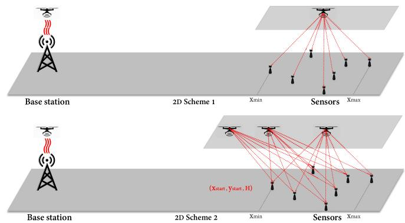  
Fig. 4. Schemes 1 and 2 of 2D case.

## IV. OPTIMAL LOCATION OF UAV MAXIMIZING SUM-ENERGY IN 2D CASE

In this section, we extend the result from 1D to 2D. Two schemes are depicted in Fig. 4.

## A. 2D Scheme 1

The charging process is similar to the 1D case in Scheme 1.

1) Load: The received RF power in dB during the load stage can be expressed as

$$
P _ { u a v - r } ^ { 2 D s 1 } = P _ { t } + G _ { t } + G _ { u a v } - P L _ { b s - u a v } ,\tag{47}
$$

where the symbols are defined the same as before. Thus, the received DC energy can be calculated as

$$
E _ { u a v - r } ^ { 2 D s 1 } = \eta 1 0 ^ { \frac { P _ { u a v - r } ^ { 2 D s 1 } } { 1 0 } } T _ { l o a d i n g } ^ { 2 D s 1 } ,\tag{48}
$$

where $T _ { l o a d i n g } ^ { 2 D s 1 }$ is the loading time. Since the UAV also consumes energy during hovering with a power of $P ( 0 )$ in watt, this can be calculated as

$$
E _ { h o v e r } ^ { T _ { l o a d i n g } ^ { 2 D s 1 } } = P ( 0 ) \cdot T _ { l o a d i n g } ^ { 2 D s 1 } .\tag{49}
$$

Again, to ensure that the UAV does not fall, $\eta 1 0 ^ { \frac { P _ { u a v - r } ^ { 2 D s 1 } } { 1 0 } } > P ( 0 )$ needs to be satisfied.

2) $F l y .$ Denote the energy required for carrying the obtained energy to the destination as $\dot { E } _ { f l y - t o } ^ { 2 D s 1 }$ . In the $f l y$ stage, one has

$$
\begin{array} { l } { { \displaystyle E _ { f l y - t o } ^ { 2 D s 1 } = E _ { A c c } ^ { 2 D s 1 } + E _ { V } ^ { 2 D s 1 } + E _ { D e c } ^ { 2 D s 1 } } } \\ { ~ } \\ { { \displaystyle ~ = 2 \int _ { 0 } ^ { \frac { V } { a } } P ( t ) d t + P ( V ) \frac { x _ { h } - \frac { V ^ { 2 } } { a } } { V } , x _ { h } > \frac { v ^ { 2 } } { a } . } } \end{array}\tag{50}
$$

Since the UAV also needs energy to fly back after each charging, we let $E _ { f l y - b a c k } ^ { 2 D s 1 } = E _ { f l y - t o } ^ { 2 D s 1 }$

3) Charge: In the final stage, the amount of energy available for transmission is

$$
E _ { a v a i l a b l e } ^ { 2 D s 1 } = E _ { u a v - r } ^ { 2 D s 1 } - E _ { h o v e r } ^ { T _ { l o a d i n g } ^ { 2 D s 1 } } - 2 E _ { f l y - t o } ^ { 2 D s 1 } .\tag{51}
$$

Then, the received RF power at the $k ^ { t h }$ sensor can be expressed as

$$
P _ { g s - k } ^ { 2 D s 1 } = P _ { u a v - t } + G _ { u a v } + G _ { g s } - P L _ { u a v - g s _ { k } } ^ { 2 D } ,\tag{52}
$$

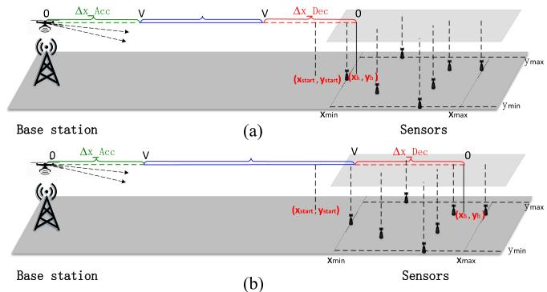  
Fig. 5. Sub-cases (a) and (b) of 2D Scheme 2. (a) sqrt((xh-xstart)<sup>∧</sup>2+(yhystart)<sup>∧</sup>2) ≤ Δx\_Dec. sqrt((xh-xstart)<sup>∧</sup>2+(yh-ystart)<sup>∧</sup>2) > Δx\_Dec.

where $G _ { u a v }$ is the transmitting antenna gain at the UAV in dBi, $G _ { g s }$ is the receiving antenna gain at the sensors in dBi, $P L _ { u a v - g s _ { k } } ^ { 2 D }$ is the path loss between the UAV and the $k ^ { t h }$ sensor in dB, which is defined in (4). Due to the extra energy for hovering, the charging time can be calculated as

$$
T _ { c h a r g i n g } ^ { 2 D s 1 } = \frac { E _ { a v a i l a b l e } ^ { 2 D s 1 } } { 1 0 ^ { \frac { P _ { u a v - t } } { 1 0 } } + P ( 0 ) } .\tag{53}
$$

Consequently, the DC energy received by the $k ^ { t h }$ sensor during $T _ { c h a r g i n g } ^ { 2 D s 1 }$ period can be obtained as

$$
Q _ { g s - k } ^ { 2 D s 1 } ( x _ { h } , y _ { h } , H ) = \eta 1 0 ^ { \frac { P _ { g s - k } ^ { 2 D s 1 } } { 1 0 } } T _ { c h a r g i n g } ^ { 2 D s 1 } ,\tag{54}
$$

and the sum-energy received by all sensors is

$$
E _ { s u m } ^ { 2 D s 1 } ( x _ { h } , y _ { h } , H ) = \sum _ { k = 1 } ^ { K } Q _ { g s - k } ^ { 2 D s 1 } ( x _ { h } , y _ { h } , H ) .\tag{55}
$$

Then, the optimization becomes

$$
( x _ { h } ^ { * } , y _ { h } ^ { * } , H ) = \arg \operatorname* { m a x } _ { x _ { h } , y _ { h } } E _ { s u m } ^ { 2 D s 1 } ( x _ { h } , y _ { h } , H ) ,\tag{56a}
$$

$$
\mathrm { s . t . } : E _ { a v a i l a b l e } ^ { 1 D s 2 } \geq 0 ,\tag{56b}
$$

where $( x _ { h } ^ { * } , y _ { h } ^ { * } , H )$ in (56a) is the optimal location of the UAV that maximizes the sum-energy received by all sensors, and (56b) is the constraint on the energy to ensure the UAV can fly back to the BS.

4) Optimization: The solution to (56) is summarized in Algorithm 3.

## B. 2D Scheme 2

Compared with Scheme 1, the UAV in Scheme 2 can fly at any directions as long as its destination is within the box mentioned earlier, as shown in Fig. 5. Let $T _ { c h a r g e 1 } ^ { 2 D s 2 }$ and $T _ { c h a r g e 2 } ^ { 2 D s 2 }$ denote the delivery time of these two phases, and $E _ { r e c e i v e d 1 } ^ { 2 D s 2 } , E _ { r e c e i } ^ { 2 D s 2 }$ ved2 denote the energy received by sensors, respectively. Since the received RF power by sensors is expressed as

$$
P _ { g s - k } ^ { 2 D s 2 } = P _ { u a v - r } + G _ { u a v } + G _ { g s } - P L _ { u a v - g s _ { k } } ^ { 2 D } ,\tag{57}
$$

Algorithm 3: Optimization of (56).   
Input: Sensors' location array   
$S = [ ( x _ { \underline { { 1 } } } , y _ { 1 } ) _ { \underline { { 1 } } } , \ \cdot \cdot \ , ( x _ { \underline { { k } } } , y _ { k } ) _ { \underline { { 1 } } } , \cdot \cdot \cdot , ( x _ { K } , y _ { K } ) ] , P _ { t } , G _ { t } ,$   
$G _ { u a v } , G _ { g s } , P _ { u a v - t } , V , a , H , X = \operatorname* { m i n } ( S \to x ) \colon$   
Step-size ${ \mathrm { : ~ } } \operatorname* { m a x } ( S \to x ) , Y = \operatorname* { m i n } ( S \to y )$ : Step-size   
: max $( S  y )$ and T2Ds1 loading'   
Output: Optimal location $x ^ { * }$ and $y ^ { * } .$   
1 for i=1: length(X) do   
2 for j=1: length(Y) do   
3 Initialize $E _ { s u m } ^ { 2 D s 1 } \ i n d e x ( i , j ) =$   
(X(i) − min(X)) \* length(Y) + Y(j) − min(Y) + 1   
4 Calculate $E _ { a v a i l a b l e } ^ { 2 D s 1 } ( i n d e x ( i , j ) )$ using (47) − (51)   
5 if E2Ds1 aDailable(index $( i , j ) ) \geq 0$ then   
6 for k=1: length(S) do   
7 Calculate $Q _ { g s - k } ^ { 2 D _ { s 1 } } ( k )$ using (52) − (54)   
8 E2Ds1 (index(i, j)) =   
$E _ { s u m } ^ { 2 D s 1 } ( i n d e x ( i , j ) ) + Q _ { g s - k } ^ { 2 D s 1 } ( k )$   
9 else   
10 |break;   
11 index\* (i, j) = arg max E2Ds1( sum 1(index(i, j))   
12 $i , j \gets i n d e x ^ { * } ( i , j )$   
Result: $x ^ { * } = { \dot { X } } ( i ) , y ^ { * } = Y ( i )$

$P _ { \epsilon }$ can be calculated through $P _ { g s - k } ^ { 2 D s 2 } > P _ { \epsilon }$ , where k depends on the flying direction. Denote the final hovering location of the UAV as $( x _ { h } , y _ { h } , H )$

1) Case a): In Fig. 5(a), when $\sqrt { ( x _ { h } - x _ { s t a r t } ) ^ { 2 } + ( y _ { h } - y _ { s t a r t } ) ^ { 2 } } \leqslant \Delta X _ { D e c } .$ the UAV is in deceleration when it passes over point $( x _ { s t a r t } , y _ { s t a r t } )$ Hence, the velocity of the UAV when it starts to broadcast wireless power can be expressed as

$$
V _ { s t a r t } = \sqrt { - 2 a \sqrt { ( x _ { h } - x _ { s t a r t } ) ^ { 2 } + ( y _ { h } - y _ { s t a r t } ) ^ { 2 } } } ,\tag{58}
$$

where $a \mathrm { ~ ( ~ } a < 0 \mathrm { ) ~ } \mathrm { i s }$ deceleration. When $\sqrt { ( x _ { h } - x _ { s t a r t } ) ^ { 2 } + ( y _ { h } - y _ { s t a r t } ) ^ { 2 } } = \Delta X _ { D e c } ,$ we have $V _ { s t a r t } = V . \mathrm { ~ A s ~ a ~ }$ result, the delivery time in this case can be expressed as

$$
T _ { c h a r g e 1 } ^ { 2 D s 2 } = \frac { 0 - V _ { s t a r t } } { a } , a < 0 .\tag{59}
$$

The received RF power by the $k ^ { t h }$ sensor in $T _ { c h a r g e 1 } ^ { 2 D s 2 }$ is

$$
P _ { g s - k } ^ { 2 D s 2 } = \Omega - 2 0 \log ( \sqrt { ( x ( t ) - x _ { k } ) ^ { 2 } + ( y ( t ) - y _ { k } ) ^ { 2 } + \Delta H ^ { 2 } } ) ,\tag{60}
$$

where $\Omega = P _ { u a v - t } + G _ { u a v } + G _ { g s } - 2 0 \log ( f ) + 1 4 7 . 5 5 ,$ $\begin{array} { r } { x ( t ) = x _ { h } - \frac { 1 } { 2 } a _ { x } t ^ { 2 } , y ( t ) = y _ { h } - \frac { 1 } { 2 } a _ { y } ^ { \circ } t ^ { 2 } , 0 \leqslant t \leqslant T _ { c h a r g e 1 } ^ { 2 D s 2 } , } \end{array}$ $\begin{array} { r } { a _ { x } = a \cos \arctan ( \frac { y _ { h } } { x _ { h } } ) } \end{array}$ and $\begin{array} { r } { a _ { y } = a \bar { \sin \arctan } ( \frac { y _ { h } } { x _ { h } } ) } \end{array}$ . Herein, $a _ { x }$ and $a _ { y }$ are the projected acceleration to x and y coordinates, as shown in Fig. $6 , \ a \ ( a > 0 )$ is acceleration when the UAV accelerates from $( x _ { h } , y _ { h } , H )$ to $( x _ { s t a r t } , y _ { s t a r t } , H )$ . Note that, although the UAV can fly in any direction, its trajectory is still a straight line to save flying time and internal power consumption. Thus its direction can be given by $\begin{array} { r } { \theta = \arctan \bigl ( \frac { y _ { h } } { x _ { h } } \bigr ) } \end{array}$ as shown in Fig. 6. Then, the total energy received by the $k ^ { t h }$ sensor during

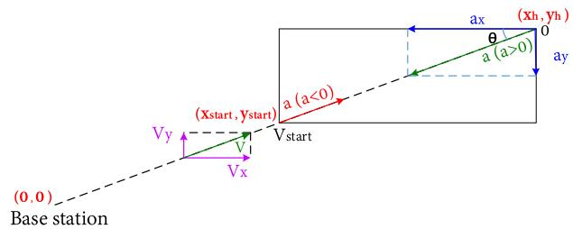  
Fig. 6. Symmetrical process of 2D Scheme 2.

$T _ { c h a r g e 1 } ^ { 2 D s 2 }$ can be calculated as

$$
\begin{array} { r l r } {  { Q _ { g s - k } ^ { 2 D s 2 } = \frac { \eta 1 0 ^ { \frac { \Omega } { 1 0 } } } { 4 C _ { 3 } q ^ { 3 } \sin \alpha } \sin \frac { \alpha } { 2 } \ln \frac { \tau ^ { 2 } + 2 q \tau \cos \frac { \alpha } { 2 } + q ^ { 2 } } { \tau ^ { 2 } - 2 q \tau \cos \frac { \alpha } { 2 } + q ^ { 2 } } } } \\ & { } & { + \frac { \eta 1 0 ^ { \frac { \Omega } { 1 0 } } } { 2 C _ { 3 } q ^ { 3 } \sin \alpha } \cos \frac { \alpha } { 2 } ( \arctan \frac { \tau ^ { 2 } - q ^ { 2 } } { 2 q \tau \sin \frac { \alpha } { 2 } } + \pi / 2 ) , } \end{array}
$$

where $\begin{array} { r } { \alpha = \operatorname { a r c c o s } ( - \frac { B _ { 3 } } { 2 \sqrt { A _ { 3 } C _ { 3 } } } ) , \quad \tau = T _ { c h a r g e 1 } ^ { 2 D s 2 } , \quad q = \sqrt [ 4 ] { \frac { A _ { 3 } } { C _ { 3 } } } , } \end{array}$ $A _ { 3 } = \left( x _ { h } - x _ { k } \right) ^ { 2 } + ( y _ { h } - y _ { k } ) ^ { 2 } + \Delta H ^ { 2 } , \qquad B _ { 3 } = - [ a _ { x } ( x _ { h } -$ $x _ { k } ) + a _ { y } ( y _ { h } - y _ { k } ) ] , C _ { 3 } = \textstyle { \frac { 1 } { 4 } } ( { a _ { x } } ^ { 2 } + { a _ { y } } ^ { 2 } )$ , and we have used the integral in [32, eq. $( 2 . 1 6 1 . 1 ) ]$ . Finally, the sum-energy received by all sensors in $T _ { c h a r g e 1 } ^ { 2 D s 2 }$ can be calculated as

$$
E _ { r e c e i v e d 1 } ^ { 2 D s 2 } = \sum _ { k = 1 } ^ { K } Q _ { g s - k } ^ { 2 D s 2 } .\tag{62}
$$

2) Case b): In Fig. 5(b), when $\sqrt { ( x _ { h } - x _ { s t a r t } ) ^ { 2 } + ( y _ { h } - y _ { s t a r t } ) ^ { 2 } } > \Delta X _ { D e c } ,$ the UAV starts to transfer wireless power at a the speed ofV before deceleration. Denote the time flying at a constant speed of V and decelerating as $T _ { c h a r g e 1 } ^ { 2 D s 2 - 1 }$ and $\dot { T _ { c h a r g e 1 } ^ { 2 D s 2 - 2 } }$ , respectively. Then, one has

$$
\begin{array} { l } { { { \cal T } _ { c h a r g e 1 } ^ { 2 D s 2 - 1 } = \displaystyle \frac { \sqrt { ( x _ { h } - x _ { s t a r t } ) ^ { 2 } + ( y _ { h } - y _ { s t a r t } ) ^ { 2 } } - \Delta X _ { D e c } } { V } , } } \\ { { { \cal T } _ { c h a r g e 1 } ^ { 2 D s 2 - 2 } = \displaystyle \frac { 0 - V } { a } , ~ a < 0 , } } \\ { { { \cal T } _ { c h a r g e 1 } ^ { 2 D s 2 } = T _ { c h a r g e 1 } ^ { 2 D s 2 - 1 } + T _ { c h a r g e 1 } ^ { 2 D s 2 - 2 } . } } \end{array}\tag{3}
$$

If we denote the received RF power by the $k ^ { t h }$ sensor as $P _ { g s - k } ^ { 2 D s 2 - 1 }$ and $P _ { g s - k } ^ { 2 D s 2 - 2 }$ , respectively, we have

$$
\begin{array} { r l } & { P _ { g s - k } ^ { 2 D s 2 - 1 } = \Omega - 2 0 \log \left( d _ { u a v - g s _ { k } } ^ { 2 D s 2 - 1 } \right) , } \\ & { P _ { g s - k } ^ { 2 D s 2 - 2 } = \Omega - 2 0 \log \left( d _ { u a v - g s _ { k } } ^ { 2 D s 2 - 2 } \right) . } \end{array}\tag{64}
$$

Herein,

$$
\begin{array} { r } { d _ { u a v - g s _ { k } } ^ { 2 D s 2 - 1 } = \sqrt { { \chi _ { 1 } } ^ { 2 } + { \gamma _ { 1 } } ^ { 2 } + \Delta H ^ { 2 } } , } \\ { d _ { u a v - g s _ { k } } ^ { 2 D s 2 - 2 } = \sqrt { { \chi _ { 2 } } ^ { 2 } + { \gamma _ { 2 } } ^ { 2 } + \Delta H ^ { 2 } } , } \end{array}\tag{65}
$$

where $\chi _ { 1 } = x _ { s t a r t } + V _ { x } t _ { 1 } - x _ { k } , \quad \gamma _ { 1 } = y _ { s t a r t } + V _ { y } t _ { 1 } - y _ { k }$ $0 \leqslant t _ { 1 } \leqslant T _ { c h a r q e 1 } ^ { 2 D s 2 - 1 } , V _ { x } = V$ cos θ, $V _ { y } = V$ sin θ, $\chi _ { 2 } = x _ { h } -$ $\begin{array} { r } { \frac { 1 } { 2 } a _ { x } { t _ { 2 } } ^ { 2 } - x _ { k } , \quad \gamma _ { 2 } = y _ { h } - \frac { 1 } { 2 } a _ { y } { t _ { 2 } } ^ { 2 } - y _ { k } , \quad 0 \leqslant t _ { 2 } \leqslant T _ { c h a r q e 1 } ^ { 2 D s 2 - 2 } , } \end{array}$ $a _ { x } = a *$ cos θ, $a _ { y } = a$ sin θ, θ = arctan $\left( { \frac { y _ { h } } { x _ { h } } } \right)$ . Thus, the total energy received by the $k ^ { t h }$ sensor during the $T _ { c h a r g e 1 } ^ { 2 D s 2 - 1 }$ can be

expressed as

$$
\begin{array} { r l r } {  { Q _ { g s - k } ^ { 2 D s 2 - 1 } = \frac { 2 \eta 1 0 ^ { \frac { \Omega } { 1 0 } } } { \sqrt { 4 A _ { 4 } C _ { 4 } - { B _ { 4 } } ^ { 2 } } } \arctan \frac { B _ { 4 } + 2 C _ { 4 } T _ { c h a r g e 1 } ^ { 2 D s 2 - 1 } } { \sqrt { 4 A _ { 4 } C _ { 4 } - { B _ { 4 } } ^ { 2 } } } } } \\ & { } & { - \frac { 2 \eta 1 0 ^ { \frac { \Omega } { 1 0 } } } { \sqrt { 4 A _ { 4 } C _ { 4 } - { B _ { 4 } } ^ { 2 } } } \arctan \frac { B _ { 4 } } { \sqrt { 4 A _ { 4 } C _ { 4 } - { B _ { 4 } } ^ { 2 } } } , } \end{array}
$$

where $A _ { 4 } = ( x _ { s t a r t } - x _ { k } ) ^ { 2 } + ( y _ { s t a r t } - y _ { k } ) ^ { 2 } + \Delta H ^ { 2 } ,$ $B _ { 4 } =$ $2 ( x _ { s t a r t } - x _ { k } ) V _ { x } + 2 ( y _ { s t a r t } - y _ { k } ) V _ { y } , C _ { 4 } = { V _ { x } } ^ { 2 } + { V _ { y } } ^ { 2 } ,$ and the integral in [32, eq. (2.172)] is used here. For $T _ { c h a r g e 1 } ^ { 2 D s 2 - 2 }$ , the total energy received by $k ^ { t h }$ sensor can be expressed as

$$
\begin{array} { l } { { Q _ { g s - k } ^ { 2 D s 2 - 2 } = \displaystyle \frac { \eta 1 0 ^ { \frac { \Omega } { 1 0 } } } { 4 C _ { 3 } q ^ { 3 } \sin \alpha } \sin \frac { \alpha } { 2 } \ln \frac { T ^ { 2 } + 2 q T \cos \frac { \alpha } { 2 } + q ^ { 2 } } { T ^ { 2 } - 2 q T \cos \frac { \alpha } { 2 } + q ^ { 2 } } \nonumber } } \\ { { \qquad + \displaystyle \frac { \eta 1 0 ^ { \frac { \Omega } { 1 0 } } } { 2 C _ { 3 } q ^ { 3 } \sin \alpha } \cos \frac { \alpha } { 2 } \left( \arctan \frac { T ^ { 2 } - q ^ { 2 } } { 2 q T \sin \frac { \alpha } { 2 } } + \pi / 2 \right) , } } \end{array}
$$

where $\begin{array} { r } { \alpha = \operatorname { a r c c o s } ( - \frac { B _ { 3 } } { 2 \sqrt { A _ { 3 } C _ { 3 } } } ) , \quad T = T _ { c h a r g e 1 } ^ { 2 D s 2 - 2 } \quad q = \sqrt [ 4 ] { \frac { A _ { 3 } } { C _ { 3 } } } , } \end{array}$ $A _ { 3 } = ( x _ { h } - x _ { k } ) ^ { 2 } + ( y _ { h } - y _ { k } ) ^ { 2 } + \Delta H ^ { 2 } .$ $B _ { 3 } = - [ a _ { x } ( x _ { h } -$ $x _ { k } ) + a _ { y } ( y _ { h } - y _ { k } ) ] , C _ { 3 } = \textstyle { \frac { 1 } { 4 } } ( { a _ { x } } ^ { 2 } + { a _ { y } } ^ { 2 } )$ , and we have used the integral in [32, eq. (2.161.1)].

The total energy received by the $k ^ { t h }$ sensor during $T _ { c h a r g e 1 } ^ { 2 D s 2 }$ can be calculated as

$$
Q _ { g s - k } ^ { 2 D s 2 } = Q _ { g s - k } ^ { 2 D s 2 - 1 } + Q _ { g s - k } ^ { 2 D s 2 - 2 } ,\tag{68}
$$

and the sum-energy received by all sensors in this period can be obtained as

$$
E _ { r e c e i v e d 1 } ^ { 2 D s 2 } = \sum _ { k = 1 } ^ { K } Q _ { g s - k } ^ { 2 D s 2 } .\tag{69}
$$

When the UAV decelerates to the speed of 0, and hovers above sensors at a location $( x _ { h } , y _ { h } , H )$ , the energy available for transfer can be calculated as

$$
\begin{array} { r l r } { \ } & { } & { E _ { a v a i l a b l e } ^ { 2 D s 2 } = E _ { u a v - r } ^ { 2 D s 2 } - E _ { h o v e r } ^ { T _ { l o a d i n g } ^ { 2 D s 2 } } - 2 E _ { f l y - t o } ^ { 2 D s 2 } } \\ & { } & { \ - \ 1 0 ^ { \frac { P u a v - t } { 1 0 } } \cdot T _ { c h a r g e 1 } ^ { 2 D s 2 } , \quad \quad } \end{array}\tag{70}
$$

where $E _ { u a v - r } ^ { 2 D s 2 } , E _ { h o v e r } ^ { T _ { l o a d i n g } ^ { 2 D s 2 } } , E _ { f l y - t o } ^ { 2 D s 2 }$ are calculated using the same method as in Scheme 1, $P _ { u a v - t } ^ { T _ { c h a r g e 1 } ^ { z D s . z } }$ is the total energy delivered by the UAV in the process of from $( x _ { s t a r t } , y _ { s t a r t } , H )$ to $( x _ { h } , y _ { h } , H )$ . The received RF power at the $k ^ { t h }$ sensor can be expressed as

$$
P _ { g s - k } ^ { 2 D s 2 } = \Omega - 2 0 \log \left( d _ { u a v - g s _ { k } } ^ { 2 D } \right) ,\tag{71}
$$

where $d _ { u a v - g s _ { k } } ^ { 2 D } = \sqrt { ( x _ { h } - x _ { k } ) ^ { 2 } + ( y _ { h } - y _ { k } ) ^ { 2 } + \Delta H ^ { 2 } }$ . As a result, the charge time is

$$
T _ { c h a r g e 2 } ^ { 2 D s 2 } = \frac { E _ { a v a i l a b e l } ^ { 2 D s 2 } } { 1 0 ^ { \frac { P _ { u a v - t } } { 1 0 } } + P ( 0 ) } ,\tag{72}
$$

where $P ( 0 )$ is the power for hovering. Hence, the DC energy received by the $k ^ { t h }$ sensor in $T _ { c h a r g e 2 } ^ { 2 D s 2 }$ can be expressed as

$$
\begin{array} { r } { Q _ { g s - k } ^ { 2 D s 2 } \left( x _ { h } , y _ { h } , H \right) = \eta 1 0 ^ { \frac { P _ { g s - k } ^ { 2 D s 2 } } { 1 0 } } T _ { c h a r g e 2 } ^ { 2 D s 2 } , } \end{array}\tag{73}
$$

```latex
Algorithm 4: Optimization of (76).
Input: Sensors' location array
$S = [ ( x _ { 1 } , y _ { 1 } ) , \ \cdot \cdot \cdot \ , ( \dot { x } _ { k } , y _ { k } ) , \cdot \cdot \cdot , \ ( x _ { K } , y _ { K } ) ] , P _ { t } , G _ { t } ,$
$G _ { u a v } , G _ { g s } , P _ { u a v - t } , V , a , H , P _ { \epsilon } ,$
X = min(S → x): Step-size : max(S → x),
Y = min(S → y): Step-size : max(S → y) and
$T _ { l o a d i n g } ^ { 2 D s 2 }$
Output: Optimal location $x ^ { * }$ and $y ^ { * }$
1 for i=1: length(X) do
2 for $j { = } 1 \colon \operatorname { l e n j } t \operatorname { \dot { h } } ( Y )$ do
3 Calculate $x _ { s t a r t } , y _ { s t a r t } , \Delta X _ { D e c } \gets$ using min(S), V,
a and $P _ { \epsilon }$
4 Initialize $\ ` E _ { s u m } ^ { 2 D s 2 } , E _ { r e c e i v e d 1 } ^ { 2 D s 2 }$ and $E _ { r e c e i v e d 2 } ^ { 2 D s 2 }$
5 $i n d e x ( i , j ) =$
$( X ( i ) - \operatorname* { m i n } _ { \bf \lambda \to \lambda } ( X ) ) * l e n g t h ( Y ) + Y ( j ) - \operatorname* { m i n } ( Y ) + 1$
6 Calculate $E _ { a v a i l a b l e } ^ { 2 D s 2 } ( i n d e x ( i , j ) )$ using (35)
7 if $E _ { a v a i l \underline { { { a } } } b l e } ^ { 2 D s 2 } ( i n d e x ( i , j ) ) \geq 0$ then
8 i $\cdot \sqrt { ( X ( i ) - x _ { s t a r t } ) ^ { 2 } + ( Y ( j ) - y _ { s t a r t } ) ^ { 2 } } \leq$
$\dot { \Delta X _ { D e c } }$ then
9 for $k { = } 1 \colon l e n g t h ( S )$ do
10 Calculate $E _ { r e c e i v e d 1 } ^ { 2 D i 2 } ( i n d e x ( i , j ) ) \gets$
using (57) − (62) / / Case a
11 else
12 for k=1: length(S) do
13 Calculate $E _ { r e c e i v e d 1 } ^ { 2 D i 2 } ( i n d e x ( i , j ) ) \gets$
using (63) − (69) / / Case b
14 for k=1: length(S) do
15
(71) − (75)
16 $E _ { s u m } ^ { 2 D s 2 } ( i n d e x ( i , j ) ) = E _ { r e c e i v e d 1 } ^ { 2 D s 2 } ( i n d e x ( i , j ) ) +$
$E _ { r e c e i v e d 2 } ^ { 2 D s 2 } ( i n d e x ( i , j ) )$
17 else
18 break;
19 index* (i, j) = arg max $E _ { s u m } ^ { 2 D s 2 } ( i n d e x ( i , j ) )$
20 $i , j \gets i n d e x ^ { * } ( i , j )$
Result: $x ^ { * } = { \dot { X } } ( { \dot { i } } ) , y ^ { * } = Y ( i )$
```

and the total energy received by all sensors in $T _ { c h a r g e 2 } ^ { 2 D s 2 }$ can be derived as

$$
E _ { r e c e i v e d 2 } ^ { 2 D s 2 } \left( x _ { h } , y _ { h } , H \right) = \sum _ { k = 1 } ^ { K } Q _ { g s - k } ^ { 2 D s 2 } \left( x _ { h } , y _ { h } , H \right) .\tag{74}
$$

Finally, the sum-energy can be derived as

$$
E _ { s u m } ^ { 2 D s 2 } \left( x _ { h } , y _ { h } , H \right) = E _ { r e c e i v e d 1 } ^ { 2 D s 2 } + E _ { r e c e i v e d 2 } ^ { 2 D s 2 } ,\tag{75}
$$

and the optimization problem is obtained as

$$
( x ^ { * } , y ^ { * } , H ) = \arg \operatorname* { m a x } _ { x _ { h } , y _ { h } } E _ { s u m } ^ { 2 D s 2 } \left( x _ { h } , y _ { h } , H \right) .\tag{76a}
$$

$$
\mathrm { s . t . } : E _ { a v a i l a b l e } ^ { 2 D s 2 } \geq 0 ,\tag{76b}
$$

where $( x ^ { * } , y ^ { * } , H )$ in the objective function (76a) is the optimal UAV location which maximizes the sum-energy function $E _ { s u m } ^ { 2 D s 2 }$ (76b) is the constraint on the energy to ensure the UAV can fly back to the BS. Details on the solution to (76) is summarized in Algorithm 4. The calculation using non-linear RF-to-DC model is similar to the 1D case, and they are not discussed here to make the paper compact.

TABLE I UAV PARAMETERS
<table><tr><td rowspan=1 colspan=1>Notation</td><td rowspan=1 colspan=1>Physical meaning</td><td rowspan=1 colspan=1>Value</td></tr><tr><td rowspan=1 colspan=1>m</td><td rowspan=1 colspan=1>Airframe mass in kg</td><td rowspan=1 colspan=1>0.8</td></tr><tr><td rowspan=1 colspan=1>W</td><td rowspan=1 colspan=1>Aircraft weight in Newton, $\overline { { g = 9 . 8 ~ m / s ^ { 2 } } }$ </td><td rowspan=1 colspan=1>7.84</td></tr><tr><td rowspan=1 colspan=1>ρ</td><td rowspan=1 colspan=1>Air density in $\overline { { k g / m ^ { 3 } } }$ </td><td rowspan=1 colspan=1>1.225</td></tr><tr><td rowspan=1 colspan=1>6</td><td rowspan=1 colspan=1>Number of blades</td><td rowspan=1 colspan=1>4</td></tr><tr><td rowspan=1 colspan=1>R</td><td rowspan=1 colspan=1>Rotor radius in meter m</td><td rowspan=1 colspan=1>0.2</td></tr><tr><td rowspan=1 colspan=1>A</td><td rowspan=1 colspan=1>Rotor disc area in $m ^ { 2 } , A = \pi R ^ { 2 }$ </td><td rowspan=1 colspan=1>0.1256</td></tr><tr><td rowspan=1 colspan=1>c</td><td rowspan=1 colspan=1>Blade or aerofoil chord length</td><td rowspan=1 colspan=1>0.0196</td></tr><tr><td rowspan=1 colspan=1>S</td><td rowspan=1 colspan=1>Rotor solidity, $\begin{array} { r } { s \triangleq \frac { b c } { \pi R } } \end{array}$ </td><td rowspan=1 colspan=1>0.1248</td></tr><tr><td rowspan=1 colspan=1>δ</td><td rowspan=1 colspan=1>Profile drag coefficient</td><td rowspan=1 colspan=1>0.012</td></tr><tr><td rowspan=1 colspan=1> $\overline { { \Omega } }$ </td><td rowspan=1 colspan=1>Blade angular velocity in radians/second</td><td rowspan=1 colspan=1>400</td></tr><tr><td rowspan=1 colspan=1> $\overline { { k } }$ </td><td rowspan=1 colspan=1>Incremental correction factor to induced power</td><td rowspan=1 colspan=1>0.05</td></tr><tr><td rowspan=1 colspan=1> $U _ { t i p }$ </td><td rowspan=1 colspan=1>Tip speed of the rotor blade, ${ U _ { t i p } } \triangleq \Omega R$ </td><td rowspan=1 colspan=1>80</td></tr><tr><td rowspan=1 colspan=1> $v _ { 0 }$ </td><td rowspan=1 colspan=1>Mean rotor induced velocity, $\begin{array} { r } { \underline { { v _ { 0 } = \sqrt { \frac { W } { 2 \rho A } } } } } \end{array}$ </td><td rowspan=1 colspan=1>5.0463</td></tr><tr><td rowspan=1 colspan=1> $S _ { F P }$ </td><td rowspan=1 colspan=1>Fuselage equivalent flat plate area in $m ^ { 2 }$ </td><td rowspan=1 colspan=1>0.0079</td></tr><tr><td rowspan=1 colspan=1> $d _ { \mathrm { 0 } }$ </td><td rowspan=1 colspan=1>Fuselage drag ratio, $\begin{array} { r } { \overline { { d _ { 0 } \overset { \Delta } { = } \frac { S _ { F P } } { s A } } } } \end{array}$ </td><td rowspan=1 colspan=1>0.5009</td></tr><tr><td rowspan=1 colspan=1> $P _ { 0 }$ </td><td rowspan=1 colspan=1>Blade power, $\begin{array} { r } { \overline { { P _ { 0 } = \frac { \delta } { 8 } \rho s A \Omega ^ { 3 } R ^ { 3 } } } } \end{array}$ </td><td rowspan=1 colspan=1>14.7517</td></tr><tr><td rowspan=1 colspan=1> $P _ { i }$ </td><td rowspan=1 colspan=1>Induced power, $\begin{array} { r } { { P } _ { i } = ( 1 + k ) \frac { W ^ { \frac { 3 } { 2 } } } { \sqrt { 2 \rho A } } } \end{array}$ </td><td rowspan=1 colspan=1>41.5409</td></tr></table>

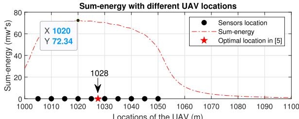

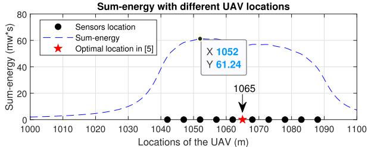  
Fig. 7. Optimal location of UAV in 1D Scheme 1.

## V. NUMERICAL RESULTS AND DISCUSSION

In this section, numerical examples are presented to show the optimal UAV location maximizing the sum-energy received by all sensors. In the simulation, we set $P _ { t } = 3 5 . 6 8$ dBW, $G _ { t } =$ 15 dBi [33], $G _ { u a v } = 2 \ \mathrm { d B i } , G _ { g s } = 5$ dBi, $P _ { u a v - t } = 1 0$ dBW, $H _ { b s } = 4 . 5 ~ m$ , H = 5.5 m, H = 0.5 m, f = 915 MHz, a = $1 \ \mathrm { m / s } ^ { 2 } , K = 1 0$ and the $\mathrm { R F - t o - D C }$ conversion efficiency $\eta =$ $0 . 6 ,$ if not stated otherwise. Our expressions are general enough for all possible values of parameters but these values are chosen as examples. The time for the UAV to load energy from the BS is set to 600 s, and the parameters of the UAV are summarized in Table I.

Fig. 7 shows the optimal location that maximizes the sumenergy in 1D Scheme 1, and compares it with the optimal location derived in [14]. In this figure, V is set to 10 $\mathrm { m } / \mathrm { s } ,$ In the upper part of the figure, ten sensors with X coordinates (1005, 1010, 1015, 1020, 1025, 1030, 1035, 1040, 1045, 1050) are used as a case study. One can see that the curve of the sum-energy increases first and then decreases when the flight distance increases, as expected as, when the UAV flies from the left side of the sensors to the right side, the distance-dependent path loss decreases first and then increases. The optimal location derived in [14] marked by five-pointed star is $x = 1 0 2 8$ , which is at the centre position of the sensors. However, the optimal location in our study is $x = 1 0 2 0$ , smaller than that in [14] or closer to the BS. This is because we have taken the UAV power consumption and BS charging process into account, while [14] ignored them. When the UAV flies from $x = 1 0 2 0 \mathrm { t o } x = 1 0 2 8$ more propulsion energy is needed, which will reduce the energy harvested by the sensors. In the lower part of the figure, another ten sensors with X coordinates (1042, 1047, 1052, 1057, 1062, 1068, 1073, 1078, 1083, 1088) are used. Similar observations can be made. Note that the optimal locations of our study and [14] are 1052 and 1065, respectively in this case. The gap between these two optimal locations is 13 $m ,$ , which is larger than 8 m in the upper part. This is due to the fact that, when the sensors are placed further away from the BS, the UAV needs to consume more extra energy, which in turn leads to less energy that can be transferred to the sensors, 61.24 mw·s and 72.34 mw·s in the figure. As a result, the optimal location has to be closer to the BS.

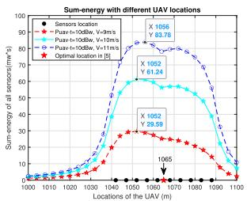  
(a)

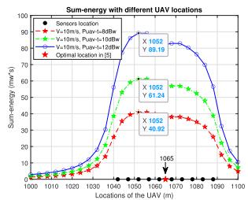  
(b)  
Fig. 8. The effects of different system parameters on 1D case. (a) The effect of the speed on 1D Scheme 1. (b) The effect of the transmit power on 1D Scheme 1.

Fig. 8 examines the effects of the speed and the UAV transmit power on the sum-energy received by all sensors at different hovering locations in 1D Scheme 1. Ten sensors with X coordinates (1042, 1047, 1052, 1057, 1062, 1068, 1073, 1078, 1083, 1088) are used as a case study. In Fig. 8(a), we fix $P _ { u a v - t } = 1 0$ dBW to examine the speed. From Fig. 8(a), one can see that the sum-energy received by all sensors increases with the speed. This is because the propulsion power of the UAV decreases when the speed increases [29], and hence this reduces the UAV power consumption and the gap between the optimal location in our study and the one in [14]. However, as seen from Fig. 8(a), the change in energy becomes marginal when the speed is large. This is because high speed requires more time to accelerate from and decelerate to the speed of 0 for hovering and acceleration or deceleration consume extra energy. Next, we examine the transmit power by fixing $V = 8 ~ \mathrm { m / s }$ in Fig. 8(b). One can see that the sum-energy received by all sensors increases with the transmit power. This is because the time for hovering decreases with the increase of the transmit power and the power consumption for hovering can be saved or reduced to transfer more energy to sensors. Note that there is a valley near the five-pointed star position. This is because the sensors are not placed equidistant. As shown in the lower or right part of Fig. 7 and Fig. 8, the distance between the $5 ^ { t h }$ sensor and the $6 ^ { t h }$ sensor is larger than others and thus, it leads to a relatively low sum-energy with local peak points. In this case, the UAV can be dispatched to the two peak points alternately to charge them in turn to improve fairness.

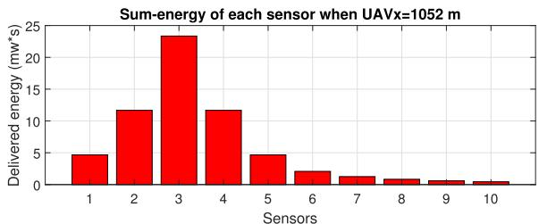

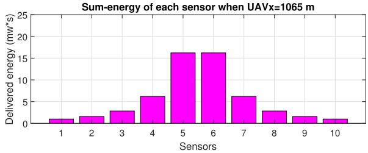  
Fig. 9. Comparison of total energy received by each sensors in 1D Scheme 1 when x = 1052 as optimal UAV location in our study and $x = 1 0 6 5$ as optimal UAV location in [14].

For the optimal sum-energy shown in Fig. 8, Fig. 9 shows the energy received by the individual sensors. In this figure, V is set to $1 0 ~ \mathrm { m / s } ,$ , and $P _ { u a v - t }$ is set 10 dBW. Firstly, we compare the optimal location of [14] with the one derived in our study. As seen from Fig. 9, there is unfairness among different sensors. In the upper part of the figure, the sensors located closer to the BS harvest more energy than those further away from the BS. In the lower part of the figure, the sensors located in the middle have much more energy than those at the edge. This is because the optimal location in [14] is the physical centre of the sensors. Besides, the total energy received by 1st, 2nd, 3rd and $t ^ { t h }$ sensor, when $x ^ { * } = 1 0 5 2$ , is much higher than that in [14] when $x ^ { * } = 1 0 6 5$ . From the viewpoint of the sum-energy, the optimal location derived in our study has a higher WPT efficiency. However, for a fixed spatial distribution, the unbalanced energy among sensors is a problem. One possible solution is to use multiple UAVs.

Fig. 10 shows the optimal location that maximizes the sum-energy in 1D Scheme 2. Ten sensors with X coordinates (1000, 1008, 1011, 1014, 1018, 1022, 1028, 1031, 1038, 1044) are used in this simulation. In Fig. 10(a), one can see that the sum-energy received by all sensors increases with the speed when the transmit power is fixed. The optimal locations derived in [14] $x ^ { * } = 1 0 1 8$ . In our study, when the speed is set to 9 m/s, 10 m/s and $1 1 \mathrm { m / s } ,$ the optimal location is $x ^ { * } = 1 0 1 3$ Again, this is because when the speed increases, the propulsion power reduces and the flight time reduces to save more energy transferred to the sensors. This was ignored in [14]. However, the change in energy becomes marginal when the speed is large, as in Fig. 8(a). Next, we examine the total energy received by individual sensors for $V = 9 ~ \mathrm { m / s }$ and $P _ { u a v - t } = 1 0 ~ \mathrm { d B W } .$ As seen in Fig. 10(b), the first four sensors receive more energy when $x ^ { * } = 1 0 1 3 \ m$ than when $x ^ { * } = 1 0 1 8 m$ . As expected, the maximum sum-energy received by all sensors in our schemes is much more than that in previous works, and thus it has much higher energy efficiency. Comparing with Scheme 1 and Scheme 2 of 1D case, as seen from Fig. 7 and Fig. 10(a), Scheme 2 has much higher energy efficiency than Scheme 1. Hence, a longer charging time is more beneficial than a lower transmission loss in this case.

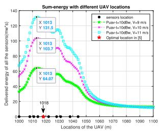  
(a)

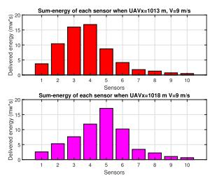  
(b)

Fig. 10. Simulation results of 1D Scheme 2. (a) The effect of the speed on 1D Scheme 2. (b) Comparison of the received energy by each sensor.  
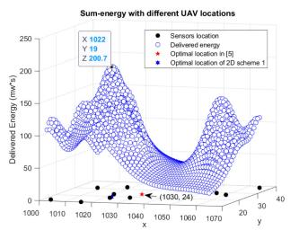  
(a)

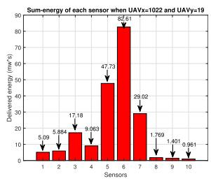  
(b)  
Fig. 11. Simulation results of 2D Scheme 1. (a) The sum-energy of hovering at different locations. (b) Comparison of the received energy by each sensor.

Fig. 11 shows the optimal location that maximizes the sum-energy, and compares the energy received by individual sensors when the UAV hovering at the optimal location in Scheme 1 of 2D case. In this simulation, ten sensors with (1003, 13), (1008, 31), (1016, 11), (1018, 33), (1020, 23), (1022, 18), (1029, 19), (1055, 29), (1060, 27), (1065, 38) as 2D coordinates are used and we set $V = 9 ~ { \mathrm { m / s } } .$ As seen from Fig. 11(a), the optimal location tends to be above the area where sensors are denser. In this scheme, the optimal location is $( x ^ { * } = 1 0 2 0 , y ^ { * } = 2 3 )$ with a sum-energy of 200.7 mw·s. Compared with the one $( x ^ { * } = 1 0 3 0 , y ^ { * } = 2 4 )$ from the previous works, it tends to be closer to the BS. In Fig. 11(b), one can see that the total energy received by individual sensors decreases as the distance from the UAV increases. In particular, as the UAV hovers above the $6 ^ { t h }$ sensor, the sum-energy reaches its maximum, as expected. The $1 0 ^ { t h }$ sensor receives the minimum energy as it is the farthest. Next, we investigate Scheme 2.

Fig. 12 shows the optimal location that maximizes the sumenergy in Scheme 2 of 2D case. Similar observations can be made. Again, the denser the sensors are, the higher the sumenergy they can receive. As shown in Fig. 12(a), it reaches the maximum 207.8 mw·s when the UAV hovers at $( x ^ { * } =$ $1 0 2 2 , y ^ { * } = 1 9 )$ , and hence $( x ^ { * } = 1 0 2 2 , y ^ { * } = 1 9 )$ is the optimal location in this scheme. In Fig. 12(b), the energy received by individual sensors is presented when the UAV hovering at the optimal location. The $6 ^ { t h }$ sensor receives more energy than others, as expected, as it is the closest to the UAV. Comparing Scheme 1 and Scheme 2 in 2D case, as can be seen from Fig. 11 and Fig. 12, both the maximum sum-energy and the energy received by individual sensor in Scheme 2 are larger than Scheme 1. The optimal locations in Scheme 1 and 2 are the same when V is not large. Both are close to the BS.

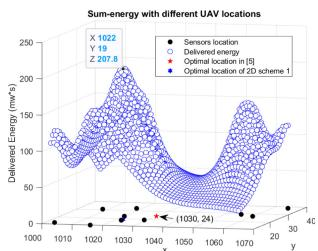  
(a)

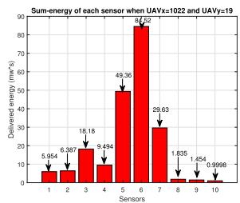  
(b)  
Fig. 12. Simulation results of 2D Scheme 2. (a) The sum-energy of hovering at different locations. (b) Comparison of the received energy by each sensor.

## VI. CONCLUSION

In this paper, we have studied the optimal location of UAVenabled WPT by taking the UAV power consumption, the conversion loss and the BS charging process into account. We have proposed two schemes for UAV-enabled WPT in both 1D and 2D cases. Algorithms 3 and 4 in the 2D case are similar to Algorithms 1 and 2 in the 1D case. However, the calculations in Algorithms 3 and 4 are more complicated, because the velocity in the 2D case is decomposed to $V _ { x }$ and $V _ { y } ,$ and so does the acceleration a. By maximizing the sum-energy received by all sensors, the optimal locations for the UAV have been derived. Numerical results have shown that the optimal locations of the UAV tend to be close to the BS compared with the optimal locations in previous works that ignore the BS charging process or the UAV power consumption. In both 1D and 2D cases, Scheme 2 shows a better energy efficiency than Scheme 1. Moreover, the higher the speed and transmit power, the higher the sum-energy will be.

## REFERENCES

[1] S. Hayat, E. Yanmaz, and R. Muzaffar, “Survey on unmanned aerial vehicle networks for civil applications: A communications viewpoint,” IEEE Commun. Surv. Tut., vol. 18, no. 4, pp. 2624–2661, Oct.–Dec. 2016.

[2] Y. Zeng, R. Zhang, and T. J. Lim, “Wireless communications with unmanned aerial vehicles: Opportunities and challenges,” IEEE Commun. Mag., vol. 54, no. 5, pp. 36–42, May 2016.

[3] Y. Chen, W. Feng, and G. Zheng, “Optimum placement of UAV as relays,” IEEE Commun. Lett., vol. 22, no. 2, pp. 248–251, Feb. 2018.

[4] Y. Chen, N. Zhao, Z. Ding, and M.-S. Alouini, “Multiple UAVs as relays: Multi-hop single link versus multiple dual-hop links,” IEEE Trans. Wirel. Commun., vol. 17, no. 9, pp. 6348–6359, Sep. 2018.

[5] R. I. Bor-Yaliniz, A. El-Keyi, and H. Yanikomeroglu, “Efficient 3-D placement of an aerial base station in next generation cellular networks,” in Proc. IEEE Int. Conf. Commun., 2016, pp. 1–5.

[6] F. Tang, Z. M. Fadlullah, B. Mao, N. Kato, F. Ono, and R. Miura, “On a novel adaptive UAV-mounted cloudlet-aided recommendation system for LBSNs,” IEEE Trans. Emerg. Top. Comput., vol. 7, no. 4, pp. 565–577, Oct. 2019.

[7] X. Liu, Y. Liu, Y. Chen, and L. Hanzo, “Trajectory design and power control for multi-UAV assisted wireless networks: A machine learning approach,” IEEE Trans. Veh. Technol., vol. 68, no. 8, pp. 7957–7969, May 2019.

[8] F. Tang, Z. M. Fadlullah, N. Kato, F. Ono, and R. Miura, “AC-POCA: Anticoordination game based partially overlapping channels assignment in combined UAV and D2D-based networks,” IEEE Trans. Veh. Technol., vol. 67, no. 2, pp. 1672–1683, Feb. 2018.

[9] F. Tang, Y. Kawamoto, N. Kato, and J. Liu, “Future intelligent and secure vehicular network toward 6G: Machine-learning approaches,” Proc. IEEE, vol. 108, no. 2, pp. 292–307, Feb. 2020.

[10] X. Lu, P. Wang, D. Niyato, D. I. Kim, and Z. Han, “Wireless charging technologies: Fundamentals, standards, and network applications,” IEEE Commun. Surv. Tut., vol. 18, no. 2, pp. 1413–1452, 2016.

[11] M. Lu, M. Bagheri, A. P. James, and T. Phung, “Wireless charging techniques for UAVs: A review, reconceptualization, and extension,” IEEE Access, vol. 6, pp. 29865–29884, 2018.

[12] J. Xu, Y. Zeng, and R. Zhang, “UAV-enabled wireless power transfer: Trajectory design and energy region characterization,” in Proc. IEEE Globecom Workshops, 2017, pp. 1–7.

[13] J. Xu, Y. Zeng, and R. Zhang, “UAV-enabled multiuser wireless power transfer: Trajectory design and energy optimization,” in Proc. 23rd Asia-Pacific Conf. Commun., 2017, pp. 1–6.

[14] J. Xu, Y. Zeng, and R. Zhang, “UAV-enabled wireless power transfer: Trajectory design and energy optimization,” IEEE Trans. Wirel. Commun., vol. 17, no. 8, pp. 5092–5106, Aug. 2018.

[15] Y. Hu, X. Yuan, J. Xu, and A. Schmeink, “Optimal 1D trajectory design for UAV-enabled multiuser wireless power transfer,” IEEE Trans. Commun., vol. 67, no. 8, pp. 5674–5688, May 2019.

[16] Y. Wu, L. Qiu, and J. Xu, “UAV-enabled wireless power transfer with directional antenna: A two-user case (invited paper),” in Proc. 15th Int. Symp. Wireless Commun. Syst., 2018, pp. 1–6.

[17] L. Xie, J. Xu, and R. Zhang, “Throughput maximization for UAV-enabled wireless powered communication networks,” IEEE Internet Things J., vol. 6, no. 2, pp. 1690–1703, Apr. 2019.

[18] M. Hua, C. Li, Y. Huang, and L. Yang, “Throughput maximization for UAV-enabled wireless power transfer in relaying system,” in Proc. 9th Int. Conf. Wireless Commun. Signal Process., 2017, pp. 1–5.

[19] W. Feng et al., “Joint 3D trajectory design and time allocation for UAVenabled wireless power transfer networks,” IEEE Trans. Veh. Technol., p. 1, Feb. 2020.

[20] M. Liu, G. Gui, N. Zhao, J. Sun, H. Gacanin, and H. Sari, “UAV-aided air-to-ground cooperative nonorthogonal multiple access,” IEEE Internet Things J., vol. 7, no. 4, pp. 2704–2715, Apr. 2020.

[21] “Wirelessly powered drone – GLOBAL ENERGY TRANSMISSION,” Getcorp.com, 2020. [Online]. Available: http://getcorp.com/wirelesslypowered-drone/

[22] H. Yan, Y. Chen, and S.-H. Yang, “Analysis of energy transfer efficiency in UAV-enabled wireless networks,” Phys. Commun., vol. 37, Dec. 2019, Art. no. 100849.

[23] W. Feng, J. Wang, Y. Chen, X. Wang, N. Ge, and J. Lu, “UAV-aided MIMO communications for 5G Internet ofThings,” IEEE Internet Things J., vol. 6, no. 2, pp. 1731–1740, Apr. 2019.

[24] J. Kakar, A. Chaaban, V. Marojevic, and A. Sezgin, “UAV-aided multiway communications,” in Proc. IEEE 29th Annu. Int. Symp. Pers., Indoor Mobile Radio Commun., 2018, pp. 1169–1173.

[25] J.-I. Hernández-Vega et al., “Internet of things (IoT) for monitoring air pollutants with an unmanned aerial vehicle (UAV) in a smart city,” in Lecture Notes of the Institute for Computer Sciences, Social-Informatics and Telecommunications Engineering, LNICST, vol. 213, Springer International Publishing, 2018, pp. 108–120.

[26] J. Hou, Z. Yang, and M. Shikh-Bahaei, “Energy-efficient data collection and wireless power transfer using A MIMO full-duplex UAV,” Nov. 2018. [Online]. Available: https://arxiv.org/abs/1811.10134

[27] G. L. Stüber, Principles of Mobile Communication, 4th ed. New York, NY, USA: Springer, 2017.

[28] E. Bertran and A. Sanchez-Cerda, “On the tradeoff between electrical power consumption and flight performance in fixed-wing UAV autopilots,” IEEE Trans. Veh. Technol., vol. 65, no. 11, pp. 8832–8840, Nov. 2016.

[29] Y. Zeng, J. Xu, and R. Zhang, “Energy minimization for wireless communication with rotary-wing UAV,” IEEE Trans. Wirel. Commun., vol. 18, no. 4, pp. 2329–2345, Apr. 2019.

[30] Y. Chen, K. T. Sabnis, and R. A. Abd-Alhameed, “New formula for conversion efficiency of RF EH and Its wireless applications,” IEEE Trans. Veh. Technol., vol. 65, no. 11, pp. 9410–9414, Nov. 2016.

[31] Y. Chen, N. Zhao, and M.-S. Alouini, “Wireless energy harvesting using signals from multiple fading channels,” IEEE Trans. Commun., vol. 65, no. 11, pp. 5027–5039, Nov. 2017.

[32] I. S. Gradshteyn, Tables of Integrals, Series, and Products, 7th ed. vol. 56. New York, NY, USA: American Journal of Physics, 2007.

[33] O. Arnold, F. Richter, G. Fettweis, and O. Blume, “Power consumption modeling of different base station types in heterogeneous cellular networks,” in Proc. Future Netw. Mobile Summit, Florence, 2010, pp. 1–8.

  
Hua Yan (Student Member, IEEE) received the B.E. degree in computer science from Bengbu University, Bengbu, China, and the M.E. degree in advanced computer science from Loughborough University, Loughborough, U.K., in 2014 and 2017, respectively. He is currently working toward the Ph.D. degree at the University of Warwick, U.K. His research interests include UAV-enabled wireless communications, the Internet of Things (IoT), data science and computational mathematics.


Yunfei Chen received the B.E. and M.E. degrees in electronics engineering from Shanghai Jiaotong University, Shanghai, P.R. China, in 1998 and 2001, respectively, and the Ph.D. degree from the University of Alberta, in 2006. He is currently working as an Associate Professor with the University of Warwick, U.K. His research interests include wireless communications, cognitive radios, wireless relaying and energy harvesting.


Shuang-Hua Yang (Senior Member, IEEE) received the B.S. degree in instrument and automation and the M.S. degree in process control from the China University of Petroleum (Huadong), Beijing, China, in 1983 and 1986, respectively, and the Ph.D. degree in intelligent systems from Zhejiang University, Hangzhou, China, in 1991. He was awarded D.Sc. from Loughborough University, in 2014 to recognize his academic contribution to wireless monitoring research. He is currently a Chair Professor of computer science and Vice Dean of graduate school with South-

ern University of Science and Technology (SUSTech), Shenzhen, China. Before joining SUSTech in 2016 he had spent over two decades in Loughborough University, as a Professor in computer science and Head of Department. His current research interests include cyber-physical system safety and security, Internet of Things, wireless network-based monitoring and control. He is a Fellow of IET and a Fellow of InstMC, U.K. He is an Associate Editor of the IET Journal Cyber-Physical Systems Theory and applications, the InstMC Journal Measurement and Control, and the International Journal ofComputing and Automation.