Received 11 April 2022; accepted 19 May 2022. Date of publication 25 May 2022; date of current version 23 June 2022. The review of this article was coordinated by Editor E. Vinogradov. Digital Object Identifier 10.1109/OJVT.2022.3177946

# Unleashing the Potential of Networked Tethered Flying Platforms: Prospects, Challenges, and Applications

BAHA EDDINE YOUCEF BELMEKKI AND MOHAMED-SLIM ALOUINI (Fellow, IEEE)

Computer, Electrical and Mathematical Science and Engineering Division, King Abdullah University of Science and Technology, Thuwal 23955-6900, Saudi Arabia

CORRESPONDING AUTHOR: BAHA EDDINE YOUCEF BELMEKKI (e-mail: bahaeddine.belmekki@kaust.edu.sa).

This article has supplementary downloadable material available at https://doi.org/10.1109/OJVT.2022.3177946, provided by the authors.

ABSTRACT Networked Tethered Flying Platforms (NTFPs) have gained growing interest in recent years due to their versatility and cost-efficiency. These aerial platforms are linked to ground stations via tethers that supply them with continuous power and data. The main advantages of NTFPs include endurance, broad coverage, and robust backhaul capacity, allowing them to carry various types of applications. This survey provides a comprehensive overview of NTFPs from a general and wireless communication perspective. We start with a general overview of this solution by reviewing all the existing types of NTFPs, including their components, characteristics, applications, advantages, and regulations. We also describe several case studies in various fields. Then, we investigate the role of NTFPs in wireless communications and their integration in Non-Terrestrial Networks (NTNs) alongside free-flying platforms and satellites in Sixth Generation (6G) cellular technology. We present NTFPs system models and emerging works on NTFPs performance. We show how 6G key technologies will be integrated into NTFPs and discuss how NTFPs will enable 6G use cases. The related channel models to NTFPs deployment are also covered. For completeness, we provide an economic analysis of the use of NTFPs. Finally, we discuss the challenges and open problems.

INDEX TERMS Aerostat, Electric Vertical Take-Off and Landing (EVTOL), Helikites, High Altitude Platforms (HAPs), Low Altitude Platforms (LAPs), Networked Tethered Flying Platforms (NTFPs), sixth generation (6G), tethered balloons, tethered blimps, tethered UAVs (tUAVs).

## I. INTRODUCTION

Since the dawn of time, humans always had the need to connect with one another. In the 1980 s, the First Generation (1G) of cellular networks allowing voice communication was launched. Nearly forty years after the introduction of 1G, three generations of cellular communication networks have been launched, namely the Second, Third, and Fourth Generation (2G, 3G, and 4G) of cellular networks. At the time of writing this paper, the Fifth Generation (5G) of cellular technology is being commercialized in some countries, such as Switzerland, South Korea, United States, and the United Kingdom. Evolving standards throughout this saga of communications have resulted in increased data rates and decreased latency from each generation to the next.

Now, researchers have begun speculating about what is Beyond 5G (B5G) or the Sixth Generation (6G) will be [1]–[7]. The reasons why researchers have already started thinking about 6G are the expected massive growth of mobile traffic in the next decade and the new type of disruptive services that are envisioned. Some of the applications and services that 6G can offer, such as enhancing the conventional mobile communications, increasing the accuracy of indoor positioning, providing holographic telepresence, tactile communications, extended reality, worldwide connectivity, and integrated networking have been presented elsewhere [1].

Although these applications and use cases are propelling us into the future, more than half of the people on Earth may not have access to these applications. That is what makes worldwide connectivity a major concern, especially since 3 billion people remained unconnected at the end of 2021 [8]. Indeed, a large proportion of people around the world do not have access to an internet connection, especially in rural, sparse, and poor areas. Services that are lacking in these areas, but can be further facilitated by internet connection, include eHealth, eEducation, eFarming, eCommerce, and eGovernment. 6G has the potential not only to hyper-connect the already connected but to bridge the digital divide by connecting the unconnected [9], [10].

To facilitate worldwide connectivity, 6G will rely on the following trifecta: terrestrial communications, satellite communications, and airborne communications. Terrestrial communications and tower masts are expensive for telecommunication companies in poor or rural areas. Plus, it takes time to construct terrestrial infrastructures. Also, terrestrial communications are only suitable for two-dimensional scenarios in which the height of the users is relatively negligible. For instance, terrestrial communications would be ill-suited to connect flying cars [11].

On the other hand, satellite communications, especially Low Earth orbit (LEO) satellites, have ubiquitous coverage and have lower channel loss compared to Geosynchronous Equatorial Orbit (GEO) satellites. However, the cost of launching large-scale constellations of LEO satellites is extremely high. Additionally, satellites take time to be deployed, and their communications are subject to latency due to the distance between the satellite and the users, which cannot be overlooked for critical communications, especially for autonomous vehicles and flying cars. At the time of writing this paper, there are two companies working on solutions to connect regular phones with satellites: Lynk Global [12] and AST & Science [13]. However, development is in the early stages, and these companies plan to offer global satellite communications via regular phone in a decade or two.

The last type of aforementioned communications is airborne communications which are considered as one of the key enablers in the 6G architecture [14], [15]. Recently this type of communications has drawn considerable attention from researchers due to the intrinsic flying properties, which allow broad coverage. These airborne communications include different types of flying platforms. Some fly at a lower altitude, such as Unmanned Aerial Vehicles (UAVs) [16]. Others fly at a higher altitude, such as High-Altitude Platforms (HAPs) [17]. These flying platforms overcome some of the limitations of satellite and terrestrial communications, such as high cost, delay, and slow deployment. However, these flying platforms also have some limitations in persistence, endurance, backhaul connection, security, and UAV flyaway problems. To deal with these limitations, another type of flying platform is currently used by government, military, and telecommunications companies: Networked Tethered Flying Platforms (NTFPs). NTFPs can be incorporated into the Non-Terrestrial Networks (NTNs) in the future 3 rd Generation Partnership Project (3GPP) releases to bypass the limitations of the aforementioned communication infrastructures [18].

Thus, creating a communication ecosystem involving different infrastructures that work synergically to provide ubiquitous coverage.

NTFPs, as their name suggests, are flying platforms tethered to a ground unit. The tether continuously supplies the flying platforms with data and power. NTFPs are cost-efficient and inexpensive to operate compared to free-flying platforms. Also, from a wireless communications perspective, they are cheaper than other communication infrastructures, such as tower masts and satellites. Another aspect that makes NTFPs an attractive solution compared to free-flying platforms are their endurance and persistence which are crucial to telecommunication and surveillance missions. They are also quick and relatively easy to deploy. But, the most relevant properties of NTFPs are their backhaul capacity, endurance, persistence, constant power supply, and security. The main limitation of NTFPs is mobility. They cannot move freely as free-flying platforms. In addition, the optimal positioning of NTFPs is constrained by the tether length. Applications of NTFPs beyond communications include energy harvesting, entertainment, science, research, public safety, disaster relief, government, and defense.

Although these platforms have great potential to be one of the key enablers for 6G in NTN [19], a comprehensive and unifying documentation on this subject is lacking. We intend, through this paper, to provide a comprehensive overview about this solution for readers interested in this solution irrespective of their backgrounds (Section II and Section III). We also provide a comprehensive analysis on NTFPs from a wireless communications perspective (Section IV, Section V, and Section VI).

This survey paper does not dive into a detailed technical usage of NTFPs in 6G but rather provides a broad and comprehensive description of NTFPs as a solution for future NTNs. Then describes what is the role of NTFP from a wireless communication perspective without addressing the specifics of 6G target requirements. It also details the usage of NTFPs in future 6G use cases such Electric Vertical Take-Off Landing (EVTOL) in Urban Air Mobility (UAM), remote communications, maritime communications, autonomous vehicles, and satellite communications. Finally, we detail how NTFPs will be used with the future key enabler technologies proposed in B5G/6G.

To the best of our knowledge, there are no papers surveying NTFPs in the literature. Although there are some papers dealing with tethered aerostats from a design and manufacturing perspective, such as [20], no prior works have considered a comprehensive overview of NTFPs, and we hope that our survey fills this gap.

The organization of this paper is depicted in Fig. 1. The paper is divided into two parts. The first part that comprises Section II and Section III provide a general overview and a broad description of NTFPs for readers interested in this solution regardless of their background. The second part that comprises Section IV, Section V, and Section VI cover the usage of NTFPs from a wireless communications perspective. The paper is structured as follows:

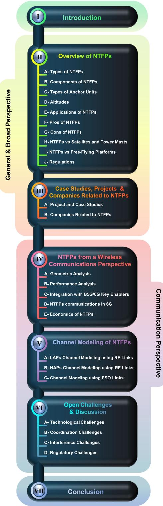  
FIGURE 1. Outline and organization of this survey paper.

\- Section II: We provide a general and broad overview of NTFPs for readers interested in these types of platforms irrespective of their background and their field. We review the existing types of NTFPs, their main components, what are their different anchor points, and their altitudes. Also, we highlight their various and diverse applications from different fields as well as their main pros and cons. In addition, we compare NTFPs with other communication infrastructures and with their free-flying counterparts. Finally, we present the current regulations regarding NTFPs.

\- Section III: We show the numerous and diverse use cases of NTFPs from real-life scenarios. We aim through this section to highlight the various applications from different fields. Also, we list the major companies that manufacture and sell NTFPs.

\- Section IV: We address NTFPs from a wireless communications perspective. First, we carry out geometrical modeling between a given NTFP and the Earth. Second, we present the works that analyze the performance NTFPs in wireless communications. Then, we show how NTFPs will be used with some of the proposed key enablers in B5G/6G, and the role of NTFPs in future use cases envisioned in 6G. For the sake of completeness, we added a section that deals with the economic aspect of NTFPs in a wireless communications context, with a CApital EXpenditure (CAPEX) and OPerating EXpenditure (OPEX) analysis to emphasize their costefficiency.

\- Section V: We provide a comprehensive channel modeling for NTFPs. Although this section is titled channel modeling for NTFPs, the models presented are valid for all types of platforms whether they are tethered or untethered (free-flying). We split the models according to the altitude of the platforms, that is, Low-Altitude Platforms (LAPs) and HAPs, and the type of link used, that is, Radio Frequency (RF) and Free-Space Optics (FSO).

\- Section VI: We address some of the main challenges related to NTFPs as communication infrastructures such as technological challenges, coordination challenges, interference challenges, and regulatory challenges. We also propose some solutions to solve these challenges.

\- Section VII: We conclude the survey paper with a summary.

## II. OVERVIEW OF NTFPS

## A. TYPES OF NTFPS

Airborne platforms are vehicles that can fly in the air by opposing the force of gravity either using a static lift or a dynamic lift. For instance, balloons and blimps use a static lift and they belong to the Lighter-Than-Air (LTA) category, whereas airplanes and UAVs use a dynamic lift and they belong to the Heavier-Than-Air (HTA) category. There is also a hybrid category of platforms that use both static lift and dynamic lift. In this survey, we are only interested in NTFPs; hence, free-flying platforms are out of the scope of this paper. The different categories and types of NTFPs are shown in Fig. 8.

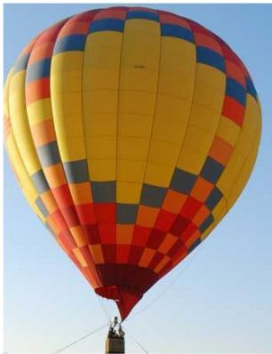  
(a)

  
(b)  
FIGURE 2. Different shapes of balloons.

## 1) LIGHTER-THAN-AIR (LTA) NTFPS

The LTA platforms that use a static lift or aerostatic lift are called aerostats. They are filled with a low-density LTA gas such as helium. The difference between the density of the air outside the envelope of the aerostat and the density of the LTA gas produces buoyancy according to Archimedes’ principle. The most popular LTA NTFPs are balloons and blimps.

a) Balloons: Spherical balloons have been the most commonly used for NTFPs, or more precisely, tethered aerostats (Fig. 2). They are easy to design and manufacture at a lower cost than the other tethered aerostats. They are also easy to deploy. The maximum altitude a tethered balloon can reach is around 600 m to 700 m, and the maximum payload they can carry is around 50 kg. However, they are not designed to sustain high-speed wind since their shape is not designed to cope with it. Tethered balloons can sustain wind speeds around 20 km/h to 40 km/h.

b) Blimps: Blimps, also known as streamlined aerostats, are high-performance platforms that can sustain high-speed wind, carry heavy payloads, and stay aloft at high altitudes (Fig. 3). There are several categories of blimps, and they differ in size, altitude, and maximum payload [21]. For instance, Tethered Communications Of Maryland (TCOM) categorizes its blimps into three classes, tactical class, operational class, and strategic class:

\- Tactical Class: Tactical class blimps are compact and can be deployed rapidly. Their envelope size ranges from 12 m and 17 m. They are suitable for surveillance missions with tactical needs. They have been used in Iraq and Afghanistan by the U.S. army and for border surveillance between the U.S. and Mexico. They can carry 27 kg of payload and reach an altitude of 300 m. Also, they can stay aloft for seven days and sustain wind speeds up to 100 km/h (see Fig. 3(a)).

\- Operational Class: Operational class blimps have a medium-sized envelope that ranges between 22 m and 28 m. They combine portability and flexibility for quick deployment and retrieval. They can carry a payload up to 200 kg and can reach an altitude of 1 km. This class of blimps is suitable for surveillance and monitoring operations where land-based surveillance is infeasible. Also, they are suitable for maritime surveillance and border surveillance. Operational class blimps can stay aloft for two weeks and can sustain wind speeds up to 130 km/h (see Fig. 3(b)).

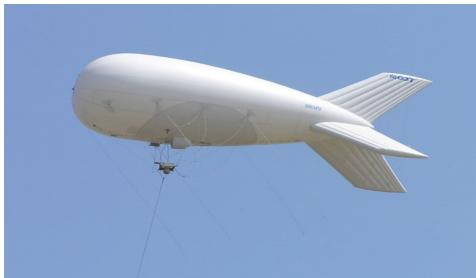

(a) Tactical TCOM blimp (17M).  
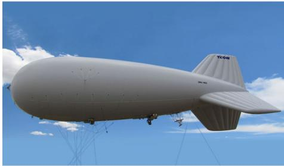

(b) Operational TCOM blimp (28M).  
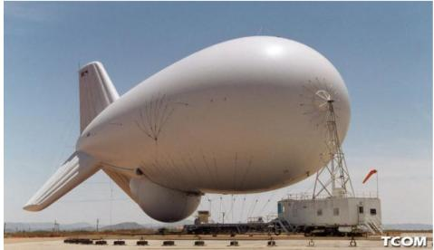

(c) Strategic TCOM blimp (71M).  
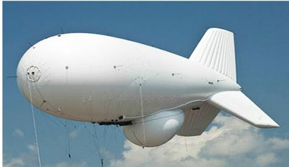  
(d) Strategic TCOM blimp (74M).  
FIGURE 3. Different types of TCOM blimps [21].

\- Strategic Class: Strategic class blimps are arguably the largest NTFPs on the market. Their envelope size ranges from 71 m to 74 m and they can carry a large payload of 2300 kg. They are ideal for long surveillance and monitoring missions since they can stay in the air for 30 days and sustain a maximum wind speed of 166 km/h. They can also reach an altitude of 4.6 km allowing them to cover a large area. They have been used to detect low-flying aircraft or cruise missiles (see Fig. 3(c) and Fig. 3(d)).

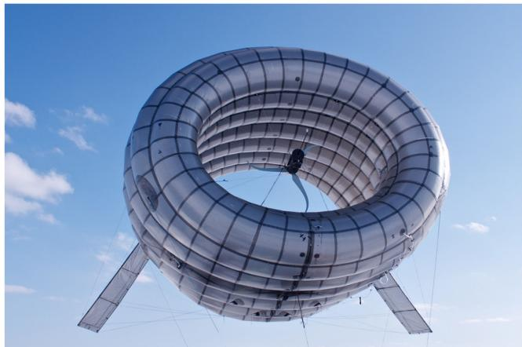  
FIGURE 4. Altaeros BATs [22].

  
FIGURE 5. tUAVs by Elistair [23].

c) Buoyant Airborne Turbines (BATs): BATs are wind turbines manufactured by Altaeros [22]. They can reach an altitude of 600 m, where wind speeds are higher than on the ground. They can harvest twice as much energy compared to land-based tower turbines [24]–[27]. Their envelope is filled with helium, and they have a tether that holds them in place while they transmit the harvested power to a ground station (see Fig. 4).

## 2) HEAVIER-THAN-AIR (HTA) NTFPS

The HTA platforms that use a dynamic lift or aerodynamic lift are called aerodynes. Their lift is produced by the relative motion between the HTA platform and the air, which pushes the platform upwards by Bernoulli’s principle. The most popular HTA NTFPs are tethered UAVs (tUAVs) and airborne turbine kites.

a) tUAVs: tUAVs are UAVs with a physical link called a tether that supplies them with power and data. They can reach an altitude of 200 m and carry a payload up to 15 kg (Fig. 5).

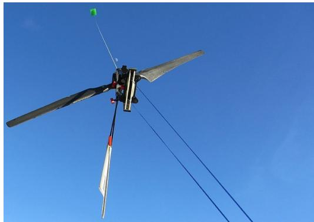

(a) Kitewinder [31].  
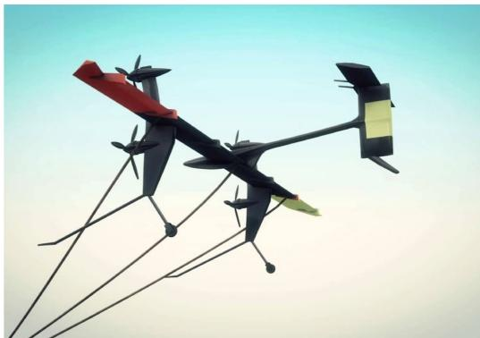  
(b) Makani power air turbine [32].  
FIGURE 6. Airborne wind turbines.

They usually have a battery pack in case the tether is damaged or if there is a power cut. Since tUAVs have a constant power supply, they can, in theory, stay in the air for an indefinite period. However, the main limiting factor is the motor of the UAV, which starts to overheat after two to four days aloft.

b) Airborne Turbine Kite: Airborne turbine kites are wind turbines used to harvest wind power in the air since wind speed is higher at higher altitudes (see Fig. 6). Thus, they can harvest more energy than a tower, and they are also cheaper to construct. Their electrical generator can be land-based (on the ground) or airborne (in the air). The tether transmits the harvested energy to the ground. They can be maintained aloft at lower or higher altitudes up to 4600 m [28]–[30].

## 3) HYBRID NTFPS

As mentioned before, hybrid platforms use both static lift and dynamic lift. The static lift is produced by buoyancy (Archimedes’ principle), and the dynamic lift is produced by the relative motion between the aircraft and the air pushing the aircraft upwards (Bernoulli’s principle). The hybrid NTFP used most often is the Helikite. Also, hybrid airships can be tethered to the ground.

a) Helikites: Helikites are hybrid aerostats that benefit from both static lift and dynamic lift. The term Helikite is a portmanteau of helium and kite. Helikites were designed and patented by the company Sandy Allsopp in 1993 (see Fig. 7).

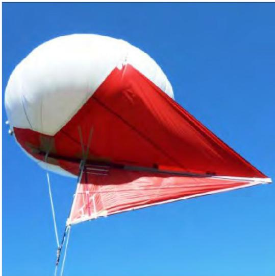  
FIGURE 7. Desert Star Helikites by Allsopp [33].

A Helikite is composed of an oblate-spheroid balloon filled with helium to provide static lift, and a kite structure to provide dynamic lift. Combining these two lifts reduces the amount of helium required compared to other similarly sized aerostats, and Helikite can fly at much higher altitudes than other aerostats of the same size. Helikites also offer several advantages compared to other NTFPs: 1) Their compact design allows them to be deployed by fewer personnel. 2) They are not brought down by high-speed winds since winds force them to go upward. 3) They are smaller, thus, they have few problems with helium leakage and use less helium because they benefit from a dynamic lift. Helikites can stay in the air for two weeks at an altitude of 1.5 km carrying a payload of 23 kg. Allsopp claims that their Desert Star Helikites can carry a payload of 220 kg at an altitude of 3.4 Km, but qualify that claim as the estimated performance [33].

b) Hybrid Airships: Hybrid airships are hybrid aircraft, which means 60% of their lift comes from the buoyant lift (aerostatic lift), and the remaining 40% comes from an aerodynamic lift. Hybrid airships do not need airports since they can take off and land anywhere with a large open and flat field. They can reach an altitude of 6000 m and carry a payload of 60,000 kg [34], [35]. Although the main usage of hybrid airships is to transport passengers and deliver heavy cargo, they can still be used for other purposes. They can also be tethered to the ground, then removed and deployed elsewhere if needed. They are expected to be in service by 2024 [36], [37].

## B. COMPONENTS OF NTFPS

We detail in this section, the different components of NTFPs, which are also summarized in Fig. 9.

## 1) ENVELOPE/SHELL

The envelope of NTFPs contains gas, which allows the platforms to soar and stay aloft. Some envelopes have spherical forms (balloons), as shown in Fig. 9, others have a fish-shaped or streamlined form (blimps). The lifts of those envelopes rely solely on buoyant gas. Other envelopes have kites attached to them, which provide an aerodynamic lift to improve their performance in the presence of strong winds, such as Helikites. Envelopes are usually made from a synthetic material, such as polyester, polyurethane, or polyvinyl. Envelopes may contain materials such as laminates to prevent degradation from ultraviolet light exposure or materials to prevent the envelope from abrasions.

TABLE 1. Comparisons Between Hydrogen and Helium
<table><tr><td rowspan=1 colspan=1>Gas</td><td rowspan=1 colspan=1>Hydrogen</td><td rowspan=1 colspan=1>Helium</td></tr><tr><td rowspan=1 colspan=1>Advantages</td><td rowspan=1 colspan=1>- Lightest existing gas- Easily produced inlarge quantities</td><td rowspan=1 colspan=1>- Second lightest gas- Non-combustible</td></tr><tr><td rowspan=1 colspan=1>Disadvantages</td><td rowspan=1 colspan=1>- Highly flammable</td><td rowspan=1 colspan=1>- Expensive- Scarce- Non-renewable resource</td></tr></table>

tUAVs have shells or frames instead of envelopes, as shown in Fig. 9. The shell defines the shape and look of the UAV and also contains the necessary components, such as the motor, blades, protection cover, landing gears, etc. The motors provide force and lift to the tUAVs. Generally, UAVs have between four and eight motors. A UAV with four motors is called a quadcopter, a UAV with six motors is called a hexacopter, and a UAV with eight motors is called an octocopter. The number of motors used depends on the type of mission. Also, landing gear is used for UAVs that require larger ground clearance.

## 2) LIFTING GAS

The envelope of the aerostat is filled with lifting gas, also called an LTA gas, which has a lower density than the air (atmospheric gas); hence it creates buoyancy according to Bernoulli’s principle. Hydrogen and helium are the most common and lightest gases used for aerostats. However, each gas has pros and cons, as shown in Table 1.

The main advantages of hydrogen are that it is the lightest existing gas, and it can be easily produced. However, its main disadvantage is its high flammability. Some countries have prohibited its use, especially after the Hindenburg incidents [38], [39]. Helium, on the other hand, is the second lightest gas, and unlike hydrogen, is a non-flammable gas. However, helium is expensive, scarce, and a non-renewable resource. Although helium is the gas most commonly used for NTFPs, its aforementioned disadvantages are leading researchers and manufacturers to reconsider hydrogen usage and cope with its related safety issues. Also, some vendors are designing an aerostat that uses both hydrogen and helium.

## 3) PAYLOAD

The payload is the weight that the NTFP can carry while in the air (Fig. 9). The payload differs from one NTFP to the next as shown in Table 2. Table 2 and Fig. 15 show a comparison among different types of NTFPs. To be more specific, we define the total capacity payload as the total weight the platform can lift, excluding its weight and the weight of its tether, at the desired altitude. The total capacity payload is divided into

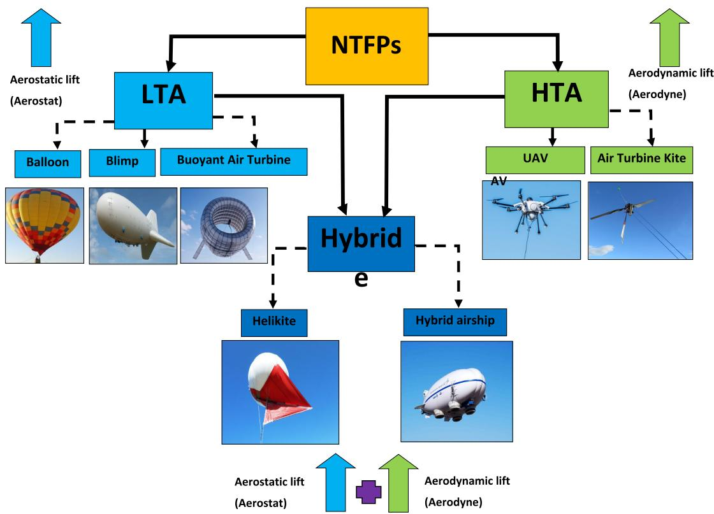  
FIGURE 8. Different categories and types of NTFPs.

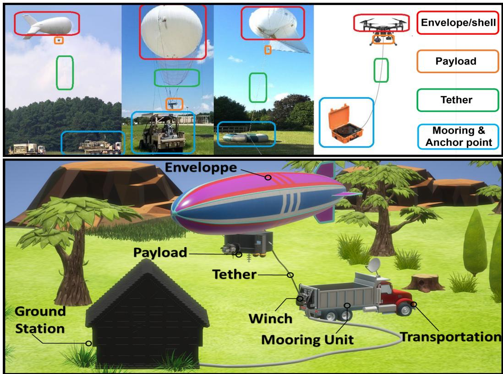  
FIGURE 9. Different NTFPs and their components (top figure from left to right): TCOM blimp [21], Drone Aviation Corp. balloon [40], Helikite [33], and Elistair tethered drone [23]. Components of a tethered blimp (bottom figure).

TABLE 2. Comparisons Among Different NTFPs
<table><tr><td rowspan=1 colspan=1>Properties</td><td rowspan=1 colspan=1>UAVs</td><td rowspan=1 colspan=1>Ballons</td><td rowspan=1 colspan=1>Helikite</td><td rowspan=1 colspan=1>Blimps</td><td rowspan=1 colspan=1>BATs</td></tr><tr><td rowspan=1 colspan=1>Payload</td><td rowspan=1 colspan=1> $\overline { { 1 \mathrm { k g } - 1 5 \mathrm { k g } } }$ </td><td rowspan=1 colspan=1> $\overline { { 5 \mathrm { ~ k g } - 5 0 \mathrm { ~ k g } } }$ </td><td rowspan=1 colspan=1> $2 \mathrm { k g } { - } 2 5 \mathrm { k g }$ </td><td rowspan=1 colspan=1>16 kg-2600 kg</td><td rowspan=1 colspan=1>NA</td></tr><tr><td rowspan=1 colspan=1>Altitude</td><td rowspan=1 colspan=1> $\overline { { 1 5 0 \ \mathrm { m } ^ { - 2 0 0 } \mathrm { m } } }$ </td><td rowspan=1 colspan=1>150 m−700 m</td><td rowspan=1 colspan=1>100 m-1.5 km</td><td rowspan=1 colspan=1>100 m-5 km</td><td rowspan=1 colspan=1>150 m–600 m</td></tr><tr><td rowspan=1 colspan=1>Wind Speed</td><td rowspan=1 colspan=1>40 km/h-55 km/h</td><td rowspan=1 colspan=1>20 km/h-40 km/h</td><td rowspan=1 colspan=1>90 km/h</td><td rowspan=1 colspan=1>75 km/h-165 km/h</td><td rowspan=1 colspan=1>160 km/h</td></tr><tr><td rowspan=1 colspan=1>Flight Duration</td><td rowspan=1 colspan=1>2-4 days</td><td rowspan=1 colspan=1>1 day-7 days</td><td rowspan=1 colspan=1>2-4 days</td><td rowspan=1 colspan=1>1 day-30 days</td><td rowspan=1 colspan=1>NA</td></tr><tr><td rowspan=1 colspan=1>Deployment Time</td><td rowspan=1 colspan=1>Fast</td><td rowspan=1 colspan=1>Moderate</td><td rowspan=1 colspan=1>Fast</td><td rowspan=1 colspan=1>Slow</td><td rowspan=1 colspan=1>Fast</td></tr><tr><td rowspan=1 colspan=1>Cost</td><td rowspan=1 colspan=1>Low/Moderate</td><td rowspan=1 colspan=1>Low/Moderate</td><td rowspan=1 colspan=1>Low/Moderate</td><td rowspan=1 colspan=1>Moderate/High</td><td rowspan=1 colspan=1>NA</td></tr></table>

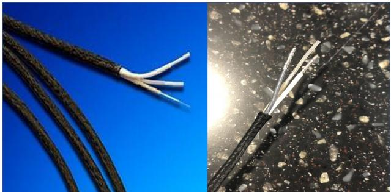

(a) UAV tether cable [41].  
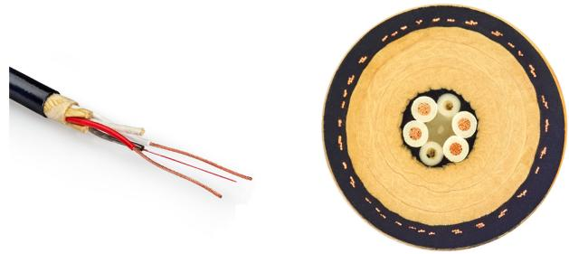  
(b) Aerostats tether cables [42].  
FIGURE 10. Aerostats and UAVs tether cables

\- The supporting system payload, which includes all the equipment necessary to operate the platform, such as the power system, communication repeaters, backup batteries, lights, etc, and

\- The operational payload, which includes equipment related to the mission, such as High-Definition (HD) camera, telescope, electronics, panchromatic imaging camera, electro-optical/infra-red sensors, acoustic detectors. The type of equipment varies from one mission to another.

## 4) TETHER

The tether is rolled up around a winch at one extremity and is attached to the envelope/shell at the other. Fig. 10 shows pictures of a tether cable. Tethers are usually made of synthetic fibers and, depending on the type and size of the NTFP, the tether’s length, diameter, resistance, and weight will differ.

For a large platform, several tethers may be used. A tether has the following purposes:

\- Maintain and stabilize the platform in the air to the ground;

\- Provide power to the platform through a power line; and

\- Provide data to the platform through optical fibers.

Also, the tether must be weather-proof to withstand extreme temperatures, humidity, rain, snow, lightning, and other weather conditions.

## 5) MOORING STATIONS AND ANCHOR UNITS

a) Mooring Stations: The mooring station is the system that holds the envelope of the aerostat while it is inflated before the launching process, while it is deflated after the flight, and during maintenance. The moorings stations differ in size, form, and complexity, as depicted in Fig. 9. For instance, large blimps require large and heavy mooring stations, while smaller platforms, such as Helikites, require lighter and simpler mooring stations. The mooring stations also depend on the environment in which the NTFPs will be used. For instance, NTFPs can be deployed over the sea or ocean; therefore, they must have mooring stations designed for maritime applications.

b) Anchor Points: The anchor point or anchor unit is the unit that the platform is anchored into, and it maintains the platform in place while aloft. There are different types and sizes of anchor units, which we will present in more detail in section II-C. Mooring stations can also serve as anchor points.

## 6) WINCHES

A winch is a device used to let out the tether during the launching process, adjust its tension while the platform is aloft, or pull it back in during the recovery process. The tether is wound around a drum called the winch drum. The size and type of winch vary. Smaller NTFPs can be winched manually using a crank, whereas larger NTFPs require power or motored winch. The winch can be attached to a mooring station or mounted on a trailer, such as a flatbed or a truck bed. Fig. 11 shows different types of winches.

## 7) GROUND CONTROL STATION

Ground control stations serve as the operation base for NTFPs, as shown in Fig. 12. They can be used to

\- Control the altitude of the platforms;

\- Monitor and control the platforms and the equipment they carry; and

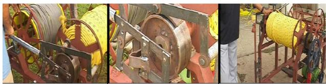

(a)  
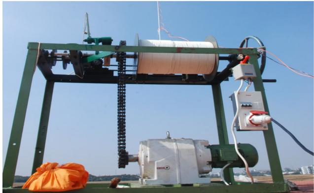

(b)  
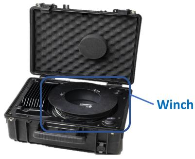  
(c)  
FIGURE 11. Winches for a NTFP. Source: (a) [43]; (b) [44]; (c) [23].

\- Store, and in some cases process, the data related to the mission, such as videos and images.

Depending on the mission type, a ground control station may be a building, a tent, a vehicle, a container, or any place that serves as a shelter.

## 8) TRANSPORTATION

The components of NTFPs (mooring stations, winch, envelope, etc.) must be transported to the deployment location. Trucks may be used to transport NTFPs on the ground, whereas for maritime applications, ships are used as transportation. Fig. 13 depicts ground and sea transportation options for NTFPs.

## C. TYPES OFANCHOR UNITS

## 1) GROUND ANCHOR UNIT

\- Mooring stations: NTFPs can be anchored to the mooring station; this is usually the case for blimps.

\- Building: NTFPs can be anchored to a building rooftop. UAVs, which can reach a maximum altitude of 150 m, gain more altitude when placed on top of buildings [47]–[49].

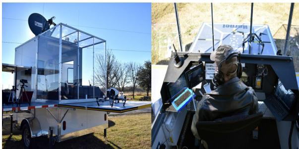

(a) tUAV ground control station [45], [46]  
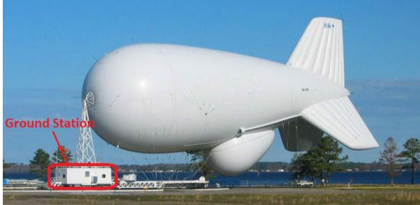  
(b) TCOM blimp ground control station [21].  
FIGURE 12. Ground control stations for a tUAV and blimp.

\- Vehicles: NTFPs can be anchored to a vehicle, such as a truck, and thus benefit from the mobility of the vehicle [50].

\- Ground: tUAVs can be placed on the ground since they are very compact and, unlike other NTFPs such as blimps or balloons, do not require additional infrastructure [51].

## 2) SEA ANCHOR UNIT

\- Ship: When NTFPs are used in a maritime context, they use the ship or another offshore floating structure as an anchor unit. The anchor point must be designed to satisfy the requirements of maritime applications [52], [53].

\- Buoy: When deployed over the sea or ocean, NTFPs can be anchored to oceanographic buoys [54].

\- Drag Sail: Drag sails can be used as an anchor unit for NTFPs. For instance, the authors in [55] proposed a configuration where the platform, a balloon, in this case, was launched with its tether wound around a reel. The tether had a drag sail at the end. After reaching the desired altitude, the tether anchored the platform into the sea. At the end of the mission, the tether was released and the balloon became a free-flying platform.

## 3) AIR ANCHOR UNIT

Although it has never been tested before, the authors in [56] proposed an interesting setup to cope with winds that blow in different directions across the stratosphere. The idea is to tether the platform to an HTA glider flying at a lower altitude than the platform itself.

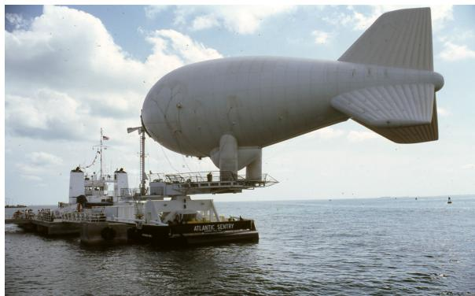

(a) Transportation by sea [57]  
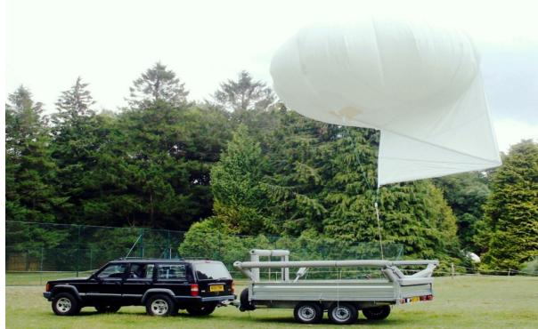  
(b) Transportation on land [33].

FIGURE 13. Transportation of NTFPs by sea and land.  
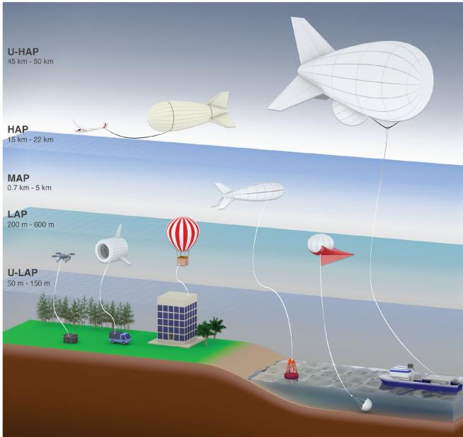  
FIGURE 14. Altitudes and anchor units of NTFPs.

## D. ALTITUDES

The different altitudes at which NTFPs can fly are shown in Fig. 14. We classify NTFPs as Ultra LAPs (U-LAPs), LAPs, Medium-Altitude Platforms (MAPs), HAPs, and Ultra HAPs (U-HAP).

## 1) U-LAPS (50 M–150 M)

Generally, tUAVs, balloons, Helikites, and BATs fly at this altitude. This altitude is suitable for quick operations such as disaster relief because NTFPs can be rapidly deployed with decent range and coverage [23], [48].

## 2) LAPS (200 M–600 M)

tUAVs do not reach this altitude, but balloons, Helikites, and blimps can, although balloons usually do not fly higher than 400 m. This altitude is suitable for missions that last between three and seven days, and the NTFPs have more coverage than at U-LAP altitudes [21], [22], [33].

## 3) MAPS (0.7 KM–5 KM)

Only Helikites and blimps can reach this altitude. Although Helikites usually do not fly beyond 1.5 km, estimates available on their website claim they can reach 3 km [33]. Blimps can reach an altitude of around 4.6 km for long-duration operations and surveillance missions. At these altitudes, NTFPs benefit from a higher range and coverage [21], [33].

## 4) HAPS (15 KM–22 KM)

To this day, no NTFP has reached these high altitudes. However, there are several studies that demonstrate the feasibility of high altitude NTFPs [55], [56], [58]–[65]. We recall that these works are theoretical, and none of the above references have been tested before in real-world settings.

## 5) U-HAP (45 KM–50 KM)

Although these altitudes seem extreme and unreachable by NTFPs, there is one paper that studied the feasibility of NTFPs flying at an ultra-high altitude [66]. The authors ought to mention this reference since the paper at hand surveys all the works related to NTFPs.

## E. APPLICATIONS OF NTFPS

## 1) GOVERNMENT & DEFENSE

a) Tactical Operations: NTFPs helps the military to conduct tactical operations via accurate environment perceptions and real-time imaging [21], [67]–[69].

b) Observation and Surveillance: NTFPs offer continuous aerial surveillance and reconnaissance by day or night for up to several days, enabling target tracking for enemies and reduced exposure of allies [21], [68]–[72].

c) Telecommunications: NTFPs play a crucial role during military operations as they extend communication in areas where cellular coverage is lacking [67], [73].

d) Surveillance of Sensitive Sites and Border Control: NTFPs allow the aerial surveillance of sensitive sites, such as military bases, nuclear plants, industrial sites, offshore platforms, harbors, and airports [21], [68], [71], [72]. Also, NTFPs are used to track unauthorized personnel, arms smugglers, and narcotics traffickers, and to detect and prevent enemy forces from crossing borders [21], [68], [69], [71], [74].

e) Detection ofAircraft: Depending on their altitude, NTFPs are capable of detecting low-flying aircraft within their area of coverage [21], [69].

## 2) PUBLIC SAFETY AND DISASTER RELIEF

a) Search and Rescue Missions: For search and rescue missions, NTFPs increase the search area. Also, they provide cellular coverage in areas such as deserts or mountains [68], [75]–[78].

b) Firefighting Missions and Wildfire Monitoring: During firefighting missions, NTFPs not only bring cellular coverage to the area but can also take remote-sensing aerial infrared images for temperature maps in order to detect and identify a critical hot spot. This helps managers make decisions and give precise directions their the crew [68], [79].

c) Emergency Communications: Cellphone connectivity and coverage are paramount in the aftermath of natural disasters. Earthquakes, tsunamis, hurricanes, and floods can destroy cell phone towers. Providing cellular coverage via NTFPs helps rescue crews to communicate and identify the areas that are most affected by the disaster [75]–[78], [80], [81].

d) First Operations: During rescue operations to find and help victims, first responders need to communicate with each other to coordinate their tasks. NTFPs help first responders to assess the situation by providing communication coverage and visual coverage [75]–[77], [81].

e) Crowd Control and Management: NTFPs are very useful when it comes to crowd management and riot control [68], [72], [74].

f) Aerial Observations: For aerial observations and surveillance tasks, height is a huge advantage. Hence, NTFPs can be used for surveillance purposes, such as control of illegal fishing activities or homeland security and anti-terrorism activities [68], [71], [72], [74], [82].

g) Traffic Regulation, Accidents Management, and Vehicle Surveillance: NTFPs can be useful for traffic regulations. They can also help with anticipating traffic jams and alerting vehicles about accidents happening in their vicinity. Finally, they can be used to locate suspect vehicles or track vehicles during car chases.

## 3) COMMUNICATIONS

a) Cellular Coverage: NTFPs overcome the limitations of terrestrial communication towers. Due to their higher altitude, they have a larger coverage area and better Line-Of-Sight (LOS). Plus, they are less costly to deploy and construct than cell towers and satellites [44], [48], [74], [83]–[85].

b) Coverage in Rural and Remote Areas: Almost half of the global population lives in remote or rural areas. It is not economical or profitable for phone operators to erect cell towers in these areas; consequently, most of the people living in these areas do not have access to an internet connection. NTFPs can bridge this gap by providing internet connection to these people while being economically profitable for phone operators [43], [44], [77], [83], [86].

c) Temporary Communications: In certain situations, there is a need for temporary communications. NTFPs can be used as temporary transmitters or as relays [67], [75]–[78], [80], [81]. d) Remote Sea and Ocean Area Coverage: Seas and oceans are lacking cellular coverage, which makes NTFPs useful in these areas to sailors, fishermen, personnel on floating structures [49], [53], [54].

## 4) ENTERTAINMENT

a) Coverage of Major Sport Events: Major sports events, such as football, baseball, rugby, etc, gather massive crowds of people, making NTFPs an excellent choice for broadcasting these events and bringing coverage to these areas.

b) Surveillance ofLarge Public Events: The need for surveillance of large public events cannot be overstated. NTFPs permit a wide view of those events [68], [71], [72], [74].

c) Aerial Recording and Photography: NTFPs can be used to take aerial photos from a perspective that is hard to access from a regular height. They can also be used to record videos and movies [68].

d) Advertisement: NTFPs are also used for advertisement purposes. The NTFP may have a written sign on it, or it can lift an advertisement sign. The NTFPs can be illuminated at night for better visibility of the advertisement or deployed during major sports events to attract people’s attention.

## 5) SCIENCE, RESEARCH AND ENVIRONMENTS

a) Remote Sensing: NTFPs can be equipped with remote sensing. The sensor can be deployed to collect data for various applications, such as detecting landslides and habitat destruction [52], [87]–[92].

b) Education: NTFPs can be used as an educational tool to show students phenomena that can only be seen from a certain altitude.

c) Meteorological Data Recording and Aerial Seismology: NTFPs are used to gather meteorological data, such as atmospheric temperature, wind speed, air pressure, and humidity [93]–[95]. They are also used in aerial seismology to detect earthquakes [96], [97].

d) Telescopes: Since they have a better view at higher altitudes, NTFPs are used as aerial telescopes [98]–[101].

e) Agriculture and Farming: NTFPs help farmers identify several types of plants via aerial images, and may prevent farming fraud [89], [102], [103].

f) Deforestation and Vegetation Mapping: NTFPs can be used to capture aerial images from a high altitude, which are used to detect and prevent deforestation. These aerial images can also be used to understand changes in biodiversity over time [89], [104].

g) Pollution: NTFPs are used to detect oil spills and floating debris. They are also used to detect and monitor light pollution [105].

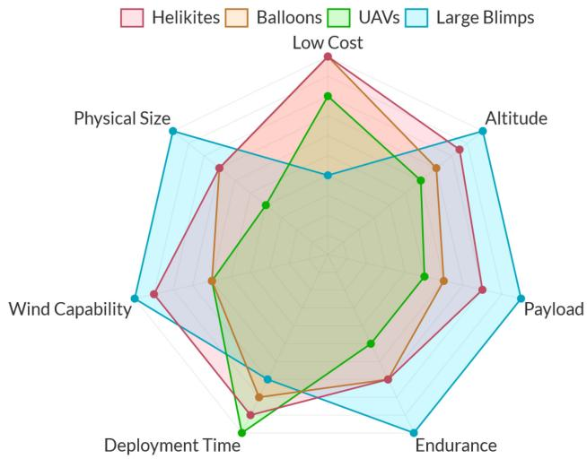  
FIGURE 15. Comparisons among Helikites, balloons, UAVs, and larger blimps.

## 6) ENERGY HARVESTING

a) Solar Energy: The power harvested by ground photovoltaic panels depends heavily on the weather. Thus, the efficiency of these panels decreases drastically in countries with fewer sunny days such as the United Kingdom. However, NTFPs can fly above the clouds, and get more solar exposure [50], [58], [106]–[108].

b) Wind Energy: Wind speed is much higher at an altitude of 150 m than at the ground. Hence, NTFPs at high altitudes can harness more powerful winds and can generate twice the energy of comparable ground-based turbines [27]–[29].

## F. PROS OF NTFPS

Fig. 17(a) summarizes the pros of using NTFPs.

## 1) LARGE PAYLOADS

NTFPs can carry heavy payloads (up to 2600 kg). This allows them to carry all the necessary equipment to perform several and various tasks using a single NTFP.

## 2) COST-EFFICIENT

NTFPs are cost-efficient compared to free-flying platforms and other communication infrastructures such as tower masts and satellites. NTFPs have a low operation cost overall compared to free-flying platforms. For instance, they are cheaper to purchase, maintain, and service compared to free-flying platforms. Additionally, they require less training to operate and fewer operators. In additions, the coverage of an NTFP flying at an altitude of 250 m equals the coverage provided by 16 tower masts1 with 50% of the cost (please refer to Table.10 in Subsection IV-E2 for further details).

Tower masts consume large amounts of energy and fuel compared to NTFPs, which consume less energy and require no fuel. Finally, compared to satellites, deploying an NTFP is much cheaper than launching a satellite into orbit, especially considering that satellites only operate for approximately ten years. NTFPs offer a great alternative to free-flying platforms, tower masts, and satellites. A more detailed analysis is presented in Section IV-E.

## 3) LARGE COVERAGE

NTFPs offer a wide mobile coverage compared to tower masts due to their higher altitudes, which allow them to cover a larger area. For instance, a coverage area of an NTFP flying at 250 m equals 16 times of terrestrial tower mast. Moreover, a coverage area provided by an NTFP flying at 900 m equals the coverage area of 160 terrestrial tower masts (Section IV). In addition, when compared with satellites and terrestrial networks, NTFPs have a higher and stronger LOS than terrestrial networks. Finally, they have a shorter propagation delay than satellites since the distance between a satellite and a ground/aerial user is much larger than the distance between an NTFPs and a ground/aerial user. Regarding visual coverage, NTFPs have wide vision due to their altitude, which makes them suitable for surveillance, monitoring, and detection.

## 4) CONTINUOUS SUPPLY

The role of the tether is to supply the platform with power so it can stay aloft for days or weeks, whereas free-flying platforms have a limited power supply. Also, the constant power supply allows NTFPs to carry larger payloads compared to free-flying platforms. In addition to power, the tether offers a high data rate and increased secure backhaul link capacity via a fiber connection to the ground station compared to free-flying platforms.

## 5) BACKHAUL CAPACITY

NTFPs have great backhaul link capacity and secrecy compared to free-flying platforms, whose wireless backhaul is more prone to jamming, hijacking, interference, and higher latency. A wired (tethered) backhaul, i.e., have a wired data link via the tether, allowing secure, reliable, and high data rates communications.

## 6) ENDURANCE & PERSISTENCE

One key advantage that NTFPs have over free-flying platforms is endurance and persistence. This is more pertinent to surveillance missions and telecommunications during which the flying platform must stay aloft for a prolonged period (e.g., days or weeks) and/or in a stationary position. The persistence of free-flying platforms is only several hours, and it is very hard for free-flying platforms to remain in a stationary position.

## 7) SECURITY

NTFPs, thanks to their tether, are anchored to the ground with a secure backhaul link. Indeed, NTFPs overcome one of the main issues related to free-flying platforms, which is the flyaway problem, by being tethered to the ground. In addition, the wireless backhaul link of free-flying platforms opens breaches to eavesdroppers’ jammers and malicious attackers. The wireless backhaul link is also subject to signal loss, signal attenuation, and interference. In contrast, NTFPs’ backhaul link uses a tether to overcome these eavesdropping problems, signal loss, and interference.

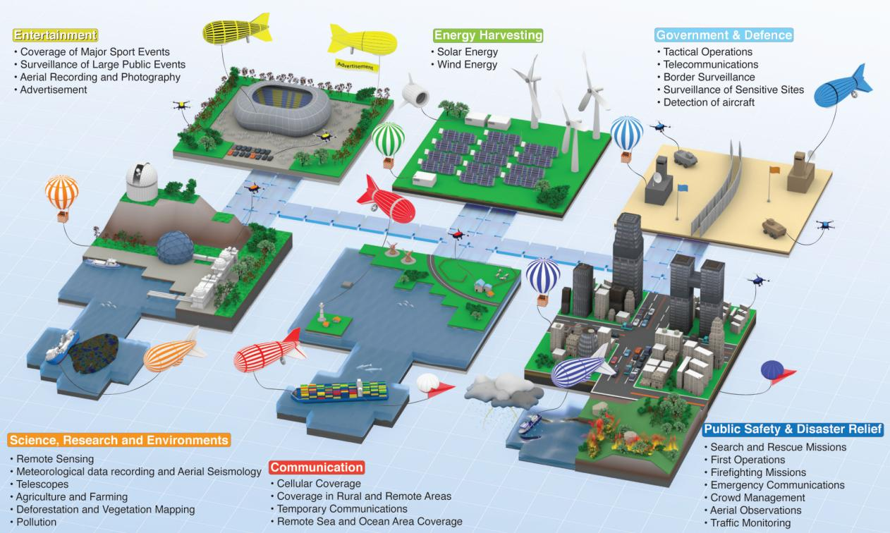

FIGURE 16. Applications of NTFPs.  
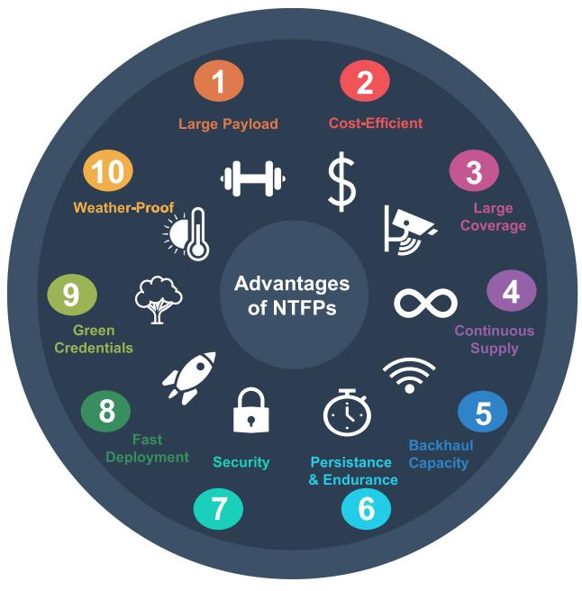  
(a) Pros of NTFPs.

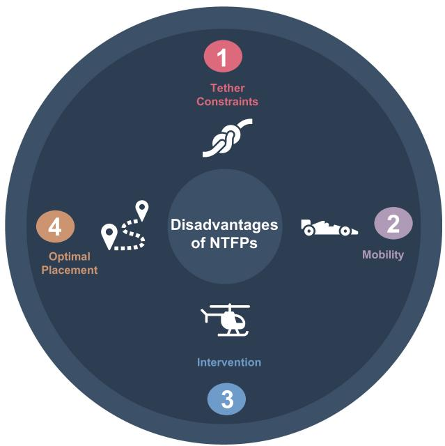  
(b) Cons of NTFPs.  
FIGURE 17. Pros and cons of NTFPs.

## 8) FAST DEPLOYMENT

One of NTFPs’ biggest advantages is their fast and quick deployment, which makes them suitable for safety missions and disaster relief operations. In addition, NTFPs can be moved and relocated. In contrast, tower masts, once erected, cannot be moved elsewhere. NTFPs can also be used in areas where it is not feasible to erect a tower mast, such as during a disaster situation where the communications infrastructure is severely damaged or destroyed or over land that is not suitable for erecting a tower mast. In summary, NTFPs can be quickly deployed, easily reconfigured, and rapidly relocated.

## 9) GREEN CREDENTIALS

Another advantage is that NTFPs have low consumption of fuel and power compared to tower masts. In India for instance, nearly 2.5 billion liters of diesel are burned each year to operate tower masts [44]. The 2.5 billion liters of diesel emit 6.6 million metric tons of Carbon Dioxide $( \mathrm { C O } ^ { 2 } )$ per year [109]. This number will increase to reach 15 billion to cover rural and remote areas in India which will dramatically increase the carbon footprint and pollution in the atmosphere. In addition, the dense deployment of 5G next-generation Node-B base stations (gNBs) triggered a sentiment of suspect and fear among a non-negligible proportion of the population [110]. This fear is exacerbated by the media myths and false reports regarding health effects caused by electromagnetic field exposure [111]. Thus, antagonizing the public against 5G (and eventually 6G), and leading to the rise of movements against installing new gNBs2. To circumvent this issue, some works are proposing NTFP communication with green antennas [114]. Hence, reducing the population’s exposure to electromagnetic fields and public concerns.

## 10) WEATHER-PROOF

NTFPs’ tether and envelope are weather-proof, they can withstand high and low temperatures, humidity, rain, snow, lightning, and other harsh weather conditions. This advantage allows NTFPs to carry out their tasks under bad and severe weather conditions.

## G. CONS OF NTFPS

Fig. 17(b) summarizes the cons of using NTFPs.

## 1) MOBILITY

Although NTFPs are rapid to deploy and have better mobility than ground stations, they are still limited in their movement due to the physical constraint imposed by the tether. The tether offers continuous power and data supply to the platforms, but at a cost to mobility. Compared to free-flying platforms, NTFPs cannot move beyond the radius of the tether’s length.

## 2) TETHER CONSTRAINTS

One constraint that we mentioned before is the limited mobility imposed by the tether. Also, the tether itself can be an issue if it sustains damages (intentionally or unintentionally), preventing the supply of data and communications. A damaged tether may hinder an ongoing operation, especially critical operations such as military missions and disaster relief operations. Hence, it is always recommended to protect and attend to the tether, and also have several tethers attached to the platform for redundancy.

## 3) OPTIMAL PLACEMENT

Free-flying platforms can hover or fly freely in the air. Hence, they can move to optimize their positions. However, NTFPs are constrained by the tether preventing them from optimizing their position.

## 4) INTERVENTION OPERATIONS

NTFPs are not designed for intervention operations since they cannot move freely or quickly in the air compared to aircraft. The capabilities of NTFPs must match the requirements of the mission.

## H. NTFPS, SATELLITES, AND TOWER MASTS

Fig. 18 shows comparisons among NTFPs and other flying platforms and communications infrastructures. In Fig. 18(a), we see a comparison among NTFPs, satellites, and tower masts in terms of the communications aspect. NTFPs have more advantages in communications than disadvantages. For instance, if we compare NTFPs with satellites, we notice that satellites have more coverage and endurance than NTFPs, but with a far greater cost, greater delay, and longer time to deploy. Also, if we compare NTFPs with tower masts, we can see that NTFPs outperform tower masts in terms of mobility (tower masts are static), coverage due to their altitude, cost, and LOS probability.

## I. NTFPS AND FREE-FLYING PLATFORMS

From Fig. 18(b), we see the comparison between NTFPs and free-flying platforms. Free-flying platforms outperform NTFPs only in mobility and LOS probability. On the other hand, NTFPs have a lower cost, better backhaul link capacity, better endurance and persistence, constant power and data supply, and less pollution. To make a comparison between NTFPs free-flying platforms, we will focus mainly on two major features: backhaul capacity and mobility. These two features/constraints affect severally the performance of nonterrestrial networks; hence, we will discuss them in more detail.

## 1) BACKHAUL

Free-flying platforms have a wireless backhaul system using either RF, millimeter Wave (mmWave) or FSO communications [115]. However, having a wireless backhaul can have several limitations and drawbacks. For instance, blockages can hinder the LOS communication and therefore decrease the backhaul link performance, especially when using mmWave frequencies [116]. FSO communication offers larger data rates but they are very sensitive to pointing errors. Hence, the free-flying platforms must have low mobility to maintain LOS communication. Finally, the distance, interference, and jamming affect negatively the backhaul capacity. NTFPs on the other hand, have a resilient and robust backhaul wired link [117]. Therefore, it is immune again interference, jamming, distance, blockage, and fading. Thus, providing a high data rate and secure backhaul. However, this will come with a cost of mobility, which will be discussed next.

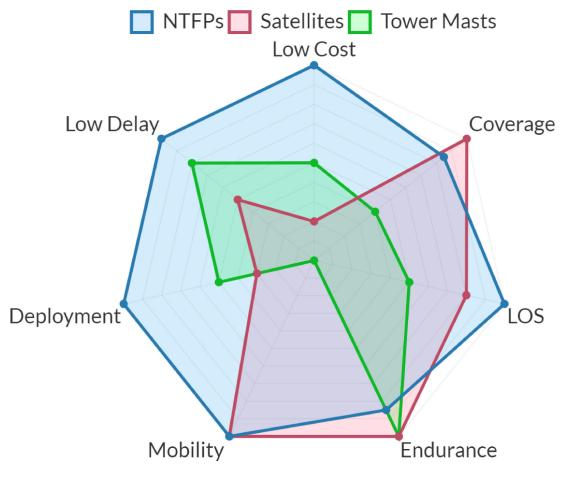  
(a) NTFPs, satellites, and tower masts.

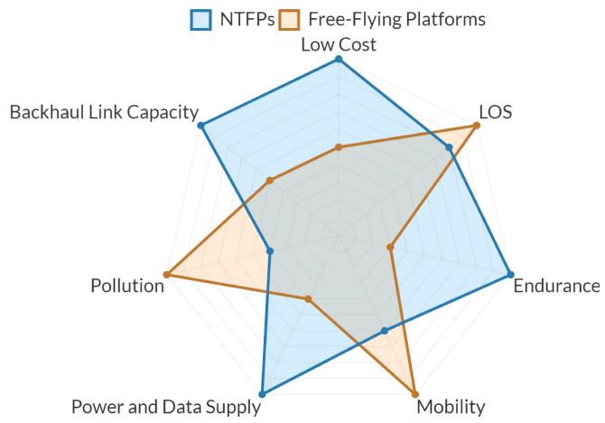  
(b) NTFPs and free-flying platforms.  
FIGURE 18. Comparisons among NTFPs and other flying platforms and communications infrastructures.

## 2) MOBILITY

Mobility allows free-flying platforms to be in LOS with the user [118]. For instance, when a target user is in NLOS, the platform can change its location accordingly to be in LOS in the user. For instance, UAVs can change their location to either provide coverage for a specific user or serve opportunistically several users at the same time [119]. In addition, when serving a specific user, they can optimize their location (and altitude) to maximize the coverage and the data rate of the user. However, this is not the case for NTFPs since their mobility is limited by the tether’s length [47], [51]. NTFPs tether is a double-edger feature, that is, it allows the NTFP to stay in the same position for a prolonged period with a constant supply of power and data. However, the tether imposes restricted mobility, and the optimal positioning of the NTFP is with respect to the tether length constraint. To summarize, NTFPs are more suitable for the type of applications in which the flying platform can stay in the same position for a prolonged period. On the contrary, free-flying platforms are more suitable for applications that require unbounded mobility in which the flying platforms can freely change their position.

## J. REGULATIONS

## 1) SOCIO-TECHNICAL CONCERNS OF NTFPS

Although NTFPs offer several advantages and applications, several concerns that have to be taken into account regarding these platforms such as privacy, data protection, and public safety. Before we explain the regulations related to NTFPs, we describe the socio-technical concerns related to these platforms:

\- Privacy: Since NTFPs have great coverage over the area of interest, they can be unintentionally (or intentionally) a threat to the privacy of individuals and businesses. Therefore, legislation and regulations must be established to protect privacy.

\- Data Protection: Due to their coverage, NTFPs can collect massive amounts of data from the public, such as images, videos, and personal data. These data must be protected from abuse according to data protection laws, and operations of NTFPs should be subject to regulation that protects personal information [121].

\- Public Safety: Another critical issue of NTFPs is public safety. Although NTFPs present fewer safety issues to the public than free-flying platforms, regulations must still be issued to protect the public. Some possible risks include an NTFP falling on the public, a cut in the power supply, the platform landing procedure when the tether is cut [122], a collision with flying aircraft, etc.

\- Public Acceptance: For NTFPs to be ubiquitous in the future, the public must accept such technology as part of their daily lives. Having floating platforms everywhere can make the public uneasy and reluctant to accept such technology. In addition, the public might have the feeling that they are constantly monitored or surveilled. Therefore, governments and communication agencies must reassure the public about NTFPs by raising awareness about the benefits of NTFPs and addressing the public concern about NTFPs.

Like free-flying platforms, NTFPs are subject to regulations. However, depending on the country, tUAVs and tethered LTA aerostats might not be subject to the same regulations3

We will outline below the regulations as they apply to tUAVs and tethered LTA aerostats, and highlight the main differences between tethered and free-flying regulations.

TABLE 3. Different Requirements Between Free-Flying UAVs and tUAVs [23]
<table><tr><td rowspan=1 colspan=1></td><td rowspan=1 colspan=1>Requirements</td><td rowspan=1 colspan=1>Free-flying UAV</td><td rowspan=1 colspan=1>tUAV</td></tr><tr><td rowspan=1 colspan=1>Captive system</td><td rowspan=1 colspan=1>Have a physical connection with a mechanical strength.</td><td rowspan=1 colspan=1>Not Required</td><td rowspan=1 colspan=1>Compulsory</td></tr><tr><td rowspan=1 colspan=1>Max. altitude</td><td rowspan=1 colspan=1>90 m–152 m (see Table IV).</td><td rowspan=1 colspan=1>Compulsory</td><td rowspan=1 colspan=1>Compulsory</td></tr><tr><td rowspan=1 colspan=1>Loss of data link</td><td rowspan=1 colspan=1>Restore the data line or interrupt the flight to reduce the effect on third partiesin the air or on the ground.</td><td rowspan=1 colspan=1>Compulsory</td><td rowspan=1 colspan=1>Not Required</td></tr><tr><td rowspan=1 colspan=1>Identification</td><td rowspan=1 colspan=1>Remote direct identification system.</td><td rowspan=1 colspan=1>Compulsory</td><td rowspan=1 colspan=1>Not Required</td></tr><tr><td rowspan=1 colspan=1>Registration</td><td rowspan=1 colspan=1>Have a unique physical serial number.</td><td rowspan=1 colspan=1>Compulsory</td><td rowspan=1 colspan=1>Compulsory</td></tr><tr><td rowspan=1 colspan=1>Geo-fencing</td><td rowspan=1 colspan=1>Load and update data containing information on airspace limitations in relationto UAV position and altitude imposed in relation to geographical areas.</td><td rowspan=1 colspan=1>Compulsory</td><td rowspan=1 colspan=1>Compulsory</td></tr><tr><td rowspan=1 colspan=1>Security</td><td rowspan=1 colspan=1>Data link system protected against unauthorized access to command and controlfunction.</td><td rowspan=1 colspan=1>Compulsory</td><td rowspan=1 colspan=1>Not Required</td></tr><tr><td rowspan=1 colspan=1>Endurance</td><td rowspan=1 colspan=1>Clear warning signal when the battery of the UAV or its control station reachesa low level.</td><td rowspan=1 colspan=1>Compulsory</td><td rowspan=1 colspan=1>Compulsory</td></tr><tr><td rowspan=1 colspan=1>Visibility</td><td rowspan=1 colspan=1>Equipped with positioning and navigation lights.</td><td rowspan=1 colspan=1>Compulsory</td><td rowspan=1 colspan=1>Compulsory</td></tr></table>

TABLE 4. Regulations Regarding UAV Heights for Commercial purposes [120]
<table><tr><td rowspan=1 colspan=1>Country</td><td rowspan=1 colspan=1>Max altitude</td><td rowspan=1 colspan=1>Min distance topeople</td></tr><tr><td rowspan=1 colspan=1>Canada</td><td rowspan=1 colspan=1>90 m</td><td rowspan=1 colspan=1>150 m</td></tr><tr><td rowspan=1 colspan=1>Germany</td><td rowspan=1 colspan=1>100 m</td><td rowspan=1 colspan=1>not over crowds</td></tr><tr><td rowspan=1 colspan=1>Spain</td><td rowspan=1 colspan=1>120 m</td><td rowspan=1 colspan=1>not over groups</td></tr><tr><td rowspan=1 colspan=1>United States</td><td rowspan=1 colspan=1>122 m</td><td rowspan=1 colspan=1>N/A</td></tr><tr><td rowspan=1 colspan=1>Chile</td><td rowspan=1 colspan=1>130 m</td><td rowspan=1 colspan=1>30 m</td></tr><tr><td rowspan=1 colspan=1>Japan</td><td rowspan=1 colspan=1>150 m</td><td rowspan=1 colspan=1>30 m</td></tr><tr><td rowspan=1 colspan=1>Colombia</td><td rowspan=1 colspan=1>123 m</td><td rowspan=1 colspan=1>N/A</td></tr></table>

## 2) TUAVS

Whether tUAVs should be considered as kites or balloons is debated; however, the U.S. FAA states that tUAVs fall under the same category as free-flying UAVs when it comes to regulations. However, some countries do not classify tUAVs as free-flying UAVs, since they are tethered to an anchor point. Hence, the classification of tUAVs depends on the aviation laws of each country [124].

Table 3 shows the main requirements related to UAVs. We can see from Table 3 that tUAVs are not under the same constraints safety-wise as their free-flying counterparts, making tUAVs easier to deploy. We can also see that from the set of requirements presented in Table 3, three of them have no impact on the tUAVs:

\- Loss of data links: In this situation, free-flying UAVs can fly away with all the risks and safety issues involved. tUAVs, on the other hand, cannot fly away since they are tethered to the ground station. Therefore, there is no need to restore the lost data link or abort the flight.

\- Identification: Free-flying UAVs have remote direct identification systems that allow the UAV to be identified in the case of flyaway situations. However, tUAVs are exempted from this requirement since their flying perimeter is limited by the tether length (between 90 m and 160 m).

\- Security: In the case of free-flying UAVs, the data are transmitted through the air, which makes them vulnerable to eavesdroppers jammers and subject to interference. In contrast, tUAVs transmit data via their tether, decreasing signal loss, signal attenuation, and interference. However, the tether has to be protected from physical harm and hijacking.

Another aspect worth noting about tUAVs is pilot requirements. Free-flying UAVs require a qualified pilot with a flying certificate. But in the case of tUAVs, the pilot does not need to possess any certification. Plus, the tether makes it easier to stabilize the UAV’ movements.

Furthermore, when there is a ground power cut, a safety mechanism activates a battery to keep the UAV in the air. This mechanism also triggers an alarm that alerts the pilot so the UAV can be landed.

## 3) TETHERED LTA PLATFORMS AND HELIKITES

The regulations related to NTFPs can be divided into three types: regulations related to flight and aviation, regulations related to communications, and regulations related to the equipment that the platform is tethered with.

\- Flight and Aviation Regulations: The FAA and European Aviation Safety Agency (EASA) require that all tethered aerostats have a rapid deflation device that will automatically and rapidly deflate the aerostat if the tether is cut [123]. If the device does not respond or does not function properly, the nearest air traffic control must be notified about the location and time of the escape of the aerostat. The deflation devices are activated when the tethered aerostat exceeds a predetermined distance from a given location monitored by a Global Positioning System (GPS), or when the aerostat has exceeded a predetermined altitude monitored by a barometric pressure sensor. The aerostat must be illuminated if it is flying from sunset to sunrise [123], [126]. In addition, protection of the envelope, loss of lifting gas, the tether can also be subject to regulations [126].

\- Communications Regulations: Missions or operations that require communications via tethered aerostats are regulated by the U.S. Federal Communications Commission (FCC). For further information about the regulations concerning tethered aerostats, the reader is advised to read the electronic code on the federal regulation website [127].

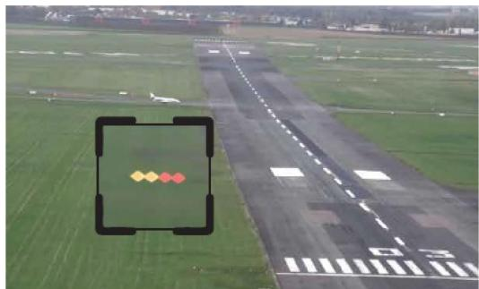  
(a) PAPI lights beside the runway.

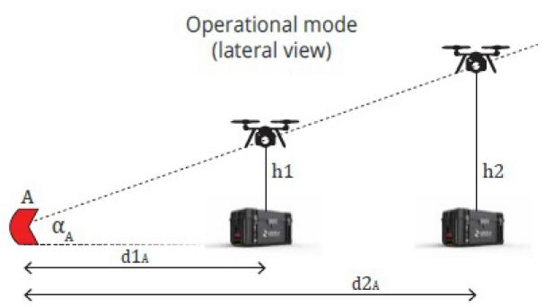  
(c) Two tUAVs at two different distances to calibrate the PAPI.  
FIGURE 19. The PAPI mode of operation, and its calibration by a tUAV [125].

\- Transportation Regulations: Regulations may also apply to the vehicle to which the aerostat is attached.

## III. CASE STUDIES, PROJECTS, AND COMPANIES RELATED TO NTFPS

In this section, we explore the numerous applications of NTFPs. We present projects and case studies from reallife scenarios involving NTFPs. Also, for completeness, we present the major companies that manufacture and sell NTFPs worldwide.

## A. PROJECTAND CASE STUDIES

## 1) PARIS AIRPORT MAINTENANCE

The Precision Approach Path Indicator (PAPI) is a system with four lights (two white lights and two red lights) placed beside landing runways that help pilots assess their landing slope (as shown in Fig. 19(a)). If the PAPI displays two white lights and two red lights, then the airplane has the correct slope. If the PAPI shows three white lights or more, then the slope is too high; if it shows three red lights or more, then the slope is too low (Fig. 19(b)).

To calibrate the precision of this system, maintenance is carried out using elevating work platforms, which block access to the runway. Closing the runway causes time loss, complicated maintenance logistics, and risks associated with the ground operators on the runway and the operators on the elevating work platforms.

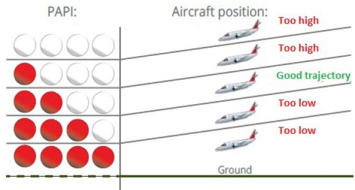  
(b) The PAPI red and white lights.

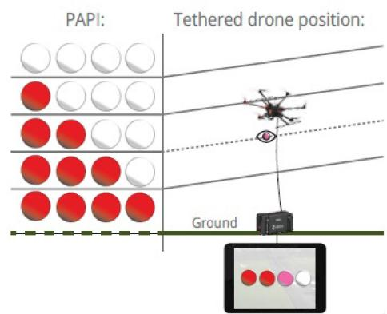  
(d) The tUAV calibrating the transition between each color.

To solve this problem, the French airport authority Groupe ADP used a tUAV at the Paris airport Charles-de-Gaulle. An Elistair hexacopter was used to perform the maintenance task and calibrate the PAPI. The tUAV allows a clear view of the Paris airport runways. The advantages of using a tUAV to perform this task are: 1) it can stay in a stationary position for prolonged periods, 2) the tUAV can take off and land on a very small surface (1,2 m diameter), 3) the tUAV can detect precisely the boundary of each color, which is depicted in pink (a mix of white and red) as shown in Fig. 19(d). To further increase the accuracy of the PAPI, two tUAVs are placed at different distances and altitudes; hence, by using the required threshold angle $\alpha _ { A }$ , the threshold can be verified by checking the accurate altitude of the pink color detected by the tUAVS at distances $d 1 _ { A }$ and $d 2 _ { A }$ , as shown in Fig. 19(c).

The use of a tUAV prevents any risk to the operators, such as falling from the elevated work platforms. Since the UAV is tethered, it is directly linked to the control tower, which permits secure and interference-free communications. Also, the tUAV can be deployed over the runway with the necessary safety measures, while the rest of the airport continues running without interruption. Finally, the tUAV calibrates all the thresholds in one hour.

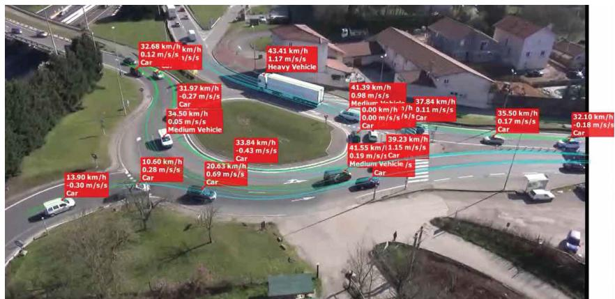  
(a) A snapshot of the traffic video after DataFromSky processing.

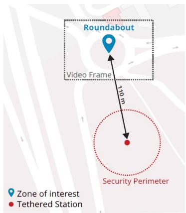  
(b) The tUAV placement.  
FIGURE 20. An aerial view of the roundabout and the placement of the tUAV [128].

## 2) ROAD TRAFFIC MONITORING IN LYON

To monitor traffic in Lyon, Elistair proposed a solution using their tUAV to continuously monitor a roundabout. Lyon, which is the second largest urban area in France, has a big concentration of traffic flow, especially in the suburban areas.

The tUAV was equipped with a Full HD camera, and the operation lasted 3 hours during rush hours. The tUAV was placed 110 m away from the roundabout. For security reasons, the tUAV was located within a 50 m secured radius, as depicted in Fig. 20(b), to ensure that the operation would not be interrupted or jeopardized.

Using the tUAV offered several advantages. For example, the tether cable allowed the tUAV to maintain a steady position when controlling the camera. Also, the tether allowed safe data transfer and data display in real-time. The cloud-based platform DataFromSky was used to analyze the road-traffic data collected from the tUAV with artificial intelligence and machine learning tools [129].

The tUAV recorded the traffic flow in the roundabout, then the videos were uploaded to DataFromSky. After processing and analyzing the data, DataFromSky sent a video and metrics, such as speed, acceleration, and trajectory of the vehicles, as shown in Fig. 20(a). It also provided the quantity, categories, and the types of vehicles: cars, motorcycles, trucks, or buses.

Thus, using a tUAV for traffic monitoring has an easy configuration and fast deployment. The tUAVs also outperformed the traditional traffic monitoring method in terms of mobility and coverage. By using a tether cable: 1) the UAV maintained a persistent and steady position to record the traffic; 2) the communications and data were secured; 3) the tUAV could stay aloft for several hours (days if needed) thanks to the constant supply of power.

## 3) BORDER SECURITY IN SOUTHERN TEXAS

Rio Grande Valley, located in southern Texas along the Mexican border, has accounted for the highest number of apprehended illegal immigrants in the U.S. since 2016 [132].

The U.S. Department of Homeland Security (DHS) and Customs and Border Protection (CBP) is facing a huge challenge in monitoring this very long border. Also, the terrain in this area is challenging, limiting the capabilities of ground-based surveillance systems, and pushing the DHS and CBP to seek an elevated or aerial solution.

To deal with this challenge, the DHS and CBP used TCOM tethered blimps. The tethered blimps provided large coverage and continuous surveillance of the Rio Grande Valley to the border authorities. The advantage of tethered blimps is that they can stay aloft for several weeks while providing real-time videos and monitoring, which helps the authorities make better decisions. Also, the blimps have a high degree of mobility, can be rapidly deployed, are battle-proven, and are low-cost.

After using the tethered blimps, the border authorities have witnessed a decrease in illegal immigrant crossings, thanks to the tethered blimps’ wide coverage and long persistence.

## 4) OIL-SPILL DETECTION IN THE ARCTIC OCEAN, NORWAY

The Norwegian Clean Seas Association for Operating Companies, also called NOFO, is an oil-spill response organization. NOFO works with 30 offshore operators, providing and managing oil-spill preparedness plans. An aerial solution can detect oil spills better than at sea level. Using an aerial camera offers wide coverage for assessing the extent as well as the thickness of the oil spill. Although aircraft and UAVs can be a solution, they lack persistence and steadiness in the air, especially for long oil-sweeping missions.

To overcome these limitations, NOFO used a Helikite system called “The Ocean Eye” to detect oil spilling. Helikites have the advantage of being small and compact; they can be easily handled, rapidly deployed, and can sustain harsh sea weather. The Helikite can be anchored to the cleaning ship or nearby boats, as shown in Fig. 22. The Helikite provides real-time video of the oil spill, which helps the cleaning boat locate accurate positioning and, thus, extract more oil in a shorter time from the sea.

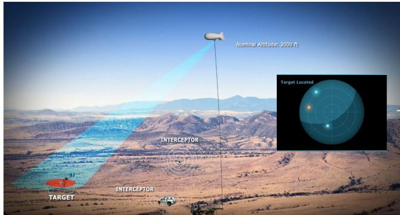

FIGURE 21. Borders control with a tethered TCOM blimp [130].  
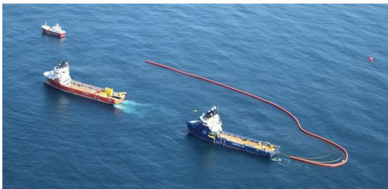  
FIGURE 22. NOFO using Helikite to detect and clean up oil spills [131].

## 5) AERIAL PHOTOGRAPHIC SURVEY OF ARMARNA, EGYPT

A Cambridge University research group wanted to conduct archaeological photography of the ancient site Armarna in Egypt, where the famous Tutankhamen was born. They wanted to take still stereo-images of the site. They used Helikites equipped with two 35 mm Single-Lens Reflex (SLR) cameras. The Helikites provided ultra-sharp, still stereoimages of the whole area.

The Helikite is a low-cost solution, allowing it to get closed to the site with low vibrations, and with a steady position to take still images. Additionally, the Helikite performed very well under the challenging hot weather conditions in Egypt.

## 6) AEROSTATS ALL AUSTRALIA (AAA) MOBILE COVERAGE

According to [133], nearly 70% of Australia does not have mobile coverage. To deal with that problem, a project named AAA has offered a plan to extend mobile coverage throughout Australia and the surrounding sea areas. In order to do so, the AAA project proposes the use of NTFPs to bring wide coverage at a lower cost than other alternative solutions. The AAA envisions mobile coverage with low latency for all mobile users in remote areas. In the short term (5 years), AAA proposes doubling Australian coverage from one-third to two-thirds of the total land areas. Over the long term, AAA aims to provide mobile coverage to all the Australia.

## 7) ALTAEROS SUPERTOWER

The Altaeros SuperTower is a solution proposed and developed by Altaeros to provide cellular coverage in rural areas (Fig. 23). Standard infrastructure solutions have the disadvantage of being expensive and not lucrative in areas with few subscribers. The SuperTower is a tethered blimp that flies at an altitude of 240 m. The coverage gained by flying at this high altitude allows one SuperTower to replace 15 cell towers, reducing costs by 60%. Hence, using this solution can accelerate the implementation of a mobile network more quickly and efficiently than standard cell towers, with significantly less cost [134]–[136].

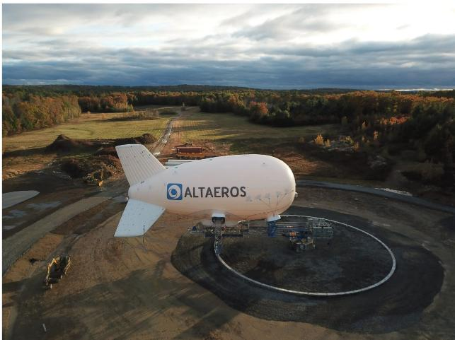  
FIGURE 23. Altaeros SuperTower setup [22].

TABLE 5. LTA NTFP Companies
<table><tr><td rowspan=1 colspan=1>Type</td><td rowspan=1 colspan=1>Company</td></tr><tr><td rowspan=1 colspan=1>Blimps</td><td rowspan=1 colspan=1>• TCOM [21]•Lindstrand  Technologies[137]• CNIM Air Space [138]• ADASI [139]• Altaeros [22]</td></tr><tr><td rowspan=1 colspan=1>Balloons</td><td rowspan=1 colspan=1>• Vigilance [140]• Drone Aviation Corp [141]• SkyDoc [142]</td></tr><tr><td rowspan=1 colspan=1>BATs</td><td rowspan=1 colspan=1>• Altaeros [22]</td></tr></table>

TABLE 6. HTA NTFP Companies
<table><tr><td>Type tUAVs</td><td>Company</td></tr><tr><td rowspan="4"></td><td>• Elistair [23] • Equinox Innovative Systems [143]</td></tr><tr><td>• Tethered Drone Systems [144]</td></tr><tr><td>• Hoverfly Tech [145]</td></tr><tr><td>• Drone Aviation Corp [141]</td></tr><tr><td rowspan="2">Air Wind Turbines</td><td>• Fotokite Sigma [146]</td></tr><tr><td>• Makani [32] • Airborne Wind Europe [147]</td></tr></table>

## B. COMPANIES RELATED TO NTFPS

Here we present the major companies that manufacture and sell NTFPs. Table 5 shows the companies that manufacture LTA platforms, i.e., blimps, balloons, and BATs.

Table 6 shows the companies that manufacture HTA platforms, such as tUAVs and airwind turbines.

TABLE 7. Hybrid NTFP Companies
<table><tr><td rowspan=1 colspan=1>Type</td><td rowspan=1 colspan=1>Company</td></tr><tr><td rowspan=1 colspan=1>Helikite</td><td rowspan=1 colspan=1>•Allsopp Helikite [33]</td></tr><tr><td rowspan=1 colspan=1>Hybrid Airship</td><td rowspan=1 colspan=1>• Hybrid Air Vehicles [34]• Lockheed Martin [35]</td></tr></table>

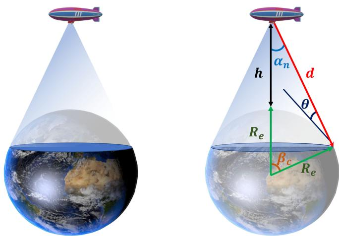  
FIGURE 24. Coverage of NTFPs from a geometric perspective.

Finally, Table 7 shows the companies that manufacture hybrid platforms, such as Helikites and hybrid airships. We recall that hybrid airships have the possibility to be tethered, but are not systematically NTFPs.

Note that there are companies that propose solutions for UAVs, such as Spooky Action [148] and AeroMana [149]. These companies propose a tether configuration that can be plugged into existing UAVs without any modifications. This will give additional freedom of choice to free-flying UAVs, by allowing them to be tethered when needed.

## IV. NTFPS FROM A WIRELESS COMMUNICATIONS PERSPECTIVE

## A. GEOMETRIC ANALYSIS

In order to evaluate the performance of NTFPs, we have to investigate the geometrical aspect between a given NTFP (e.g., blimp) and the Earth. This can be carried out following an approach similar to that used for LEO satellites [150], [151]. Fig. 24 shows the geometrical aspect and the coverage surface between a blimp and a user located on the ground. In Fig. 24, $R _ { e } = 6 3 7 8$ km denotes the Earth’s radius at sea level, h is the height of the blimp above the Earth, d is the distance between the blimp and the ground user, also known as the slant range, $\alpha _ { n }$ is the nadir angle, that is, the angle under which the blimp views the ground user, $\beta _ { c }$ is the central angle, that is, the geocentric angle between the user and blimp nadir, and θ is the elevation angle, that is, the angle between the slant range and the horizon plane.

Following the same approach as [150], [151], we obtain the following equations:

$$
\alpha _ { n } + \beta _ { c } + \theta = \frac { \pi } { 2 } ,\tag{1}
$$

$$
d \cos ( \theta ) = ( h + R _ { e } ) \sin ( \beta _ { c } ) ,\tag{2}
$$

and

$$
\begin{array} { r } { d \sin ( \alpha _ { n } ) = R _ { e } \sin ( \beta _ { c } ) . } \end{array}\tag{3}
$$

When distance d is required, to compute path loss, we apply the law of cosines for the triangle in Fig. 24, which yields

$$
( h + R _ { e } ) ^ { 2 } = R _ { e } ^ { 2 } + d ^ { 2 } - 2 R _ { e } d \cos \left( \frac { \pi } { 2 } + \theta \right) .\tag{4}
$$

Solving equation (4) with respect to d yields the following solution:

$$
d = R _ { e } \left[ \sqrt { \left( \frac { R _ { e } + h } { R _ { e } } \right) ^ { 2 } - \cos ^ { 2 } ( \theta ) } - \sin ( \theta ) \right] .\tag{5}
$$

Hence, d reaches its maximum value when $\theta = 0$ , which is given by

$$
d _ { \operatorname* { m a x } } = d \left( \theta = 0 \right) = \sqrt { h ^ { 2 } + 2 h R _ { e } } .\tag{6}
$$

Also, from applying the law of sines in Fig. 24, we get

$$
{ \frac { \sin ( \alpha _ { n } ) } { R _ { e } } } = { \frac { \sin \left( { \frac { \pi } { 2 } } + \theta \right) } { R _ { e } + h } }\tag{7}
$$

Then, we have

$$
\sin ( \alpha _ { n } ) = \frac { R _ { e } \cos ( \theta ) } { R _ { e } + h } .\tag{8}
$$

Finally, the angle $\alpha _ { n }$ is given by

$$
\alpha _ { n } = \sin ^ { - 1 } { \bigg ( } { \frac { R _ { e } \cos ( \theta ) } { R _ { e } + h } } { \bigg ) } .\tag{9}
$$

To calculate $\beta _ { c }$ , we use equation (2):

$$
\beta _ { c } = \sin ^ { - 1 } \bigg ( \frac { d } { R _ { e } + h } \cos ( \theta ) \bigg ) .\tag{10}
$$

Also, we can use equations (1) and (9) to calculate $\beta _ { c }$ ; hence,

$$
\beta _ { c } = \frac { \pi } { 2 } - \theta - \sin ^ { - 1 } \bigg ( \frac { R _ { e } } { R _ { e } + h } \cos ( \theta ) \bigg ) .\tag{11}
$$

Finally, the surface coverage achieved by the blimp can be computed as follows:

$$
S _ { c o v } = 2 \pi R _ { e } ^ { 2 } \left[ 1 - \cos ( \beta _ { c } ) \right] .\tag{12}
$$

To better assess the impact of h and θ on different metrics, such as surface coverage and the rang d, we plotted different curves in Fig. 25 and Fig. 26.

In Fig. 25(a), we plotted the surface coverage as a function of h for several values of θ. We can see that, as the altitude of the blimp increases (h increases), the surface coverage increases as well. This remark is intuitive because as the altitude of the blimp increases, the blimp can cover a greater surface. We can also notice that, the difference between the surface coverage when h = 1 km and when $h = 4 0$ km is three orders of magnitude.

The range d is plotted in Fig. 26(b) as a function of the elevation angle θ for several values of h. We can see that the range d decreases as the elevation increases. For instance, when $\theta = 9 0$ , the user is exactly below the blimps, which corresponds to the shortest distance possible between the blimp and the user. Inversely, when $\theta = 0 ,$ , the user is the farthest from the blimp, which corresponds to $d _ { \mathrm { m a x } }$

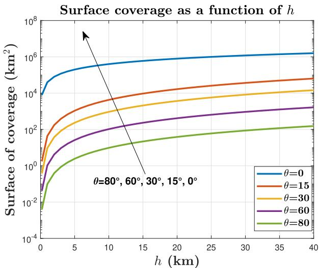

(a) Surface coverage as a function of h for several values of θ. Surface coverage as a function of θ  
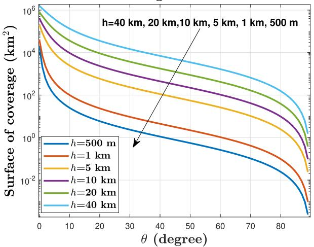  
(b) Surface coverage as a function of θ for several values of h. FIGURE 25. Surface coverage as a function of θ and h.

## B. PERFORMANCE ANALYSIS

Very few works have investigated the performance of NTFPs in wireless communications. Most focus on free-flying platforms, such as HAPs and UAVs. For example, in the absence of terrestrial infrastructure, UAVs are used to assist cellular networks in a post-disaster scenario. But two major issues limiting the connection between UAVs and the core network are backhaul constraints and limited energy.

To address this issue, the work in [152] proposed a multihop connection using several UAVs to alleviate the backhaul constraint. However, by increasing the hops, the latency increased and the spectral efficiency of communications was reduced.

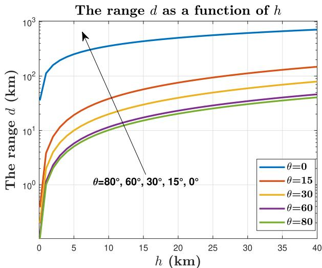

(a) The range d as a function of h for several values of θ The range d as a function of θ  
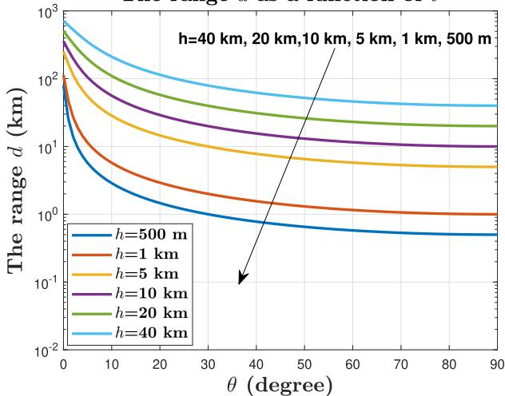  
(b) The range d as a function of θ for several values of h. FIGURE 26. The range d as a function of θ and h.

The authors in [115] proposed multihop mixed FSO/RF backhaul solution using several (untethered) HAPs. The HAPs extend the backhaul of a ground station to assist mobile users. The ground station-HAP link and HAP-HAP link are using FSO communications, whereas the HAP-mobile user link are using RF communications. In the context of content delivery, the authors in [116] evaluated the performance of UAV integrated terrestrial cellular networks. The UAVs use mmWave communications for backhaul. The results showed that the UAV integrated cellular network achieves higher content delivery performance than the conventional terrestrial network. Considering the energy constraint of the untethered UAVs, the authors in [153] studied the performance of a UAV-enabled cellular network while considering the influence of the spatial distribution of the charging stations. The performance is derived as a function of the battery size, the density of the charging stations, and the time required for recharging/replacing the battery.

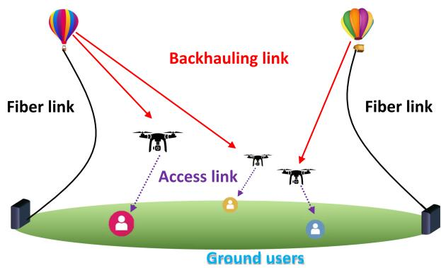  
FIGURE 27. Backhaul connection between UAVs and tethered balloons.

To overcome the backhaul and energy limitations, NTFPs benefit from a wired backhaul solution with a constant power supply. The authors in [117] proposed a configuration with a tethered balloon connected to the core network via fiber, as shown in Fig. 27. The tethered balloon acted as a “flying base station” located at a higher altitude than the UAVs, which created a strong LOS backhaul connection. The proposed configuration showed an increase in the achievable end-to-end data rate of the users. Plus, they proposed a framework that optimized the transmit power, placement, and association of the UAVs.

Regarding the use of tUAVs, the authors in [154] proposed a hybrid solution to overcome these challenges. The solution consists of three different types of UAVs: UAVs that acted as communication drones, tUAVs that provided a backhaul connection to the communication drones via an RF/FSO hybrid link [155], [156], and UAVs that powered the communication UAVs by providing on-the-fly battery charging. The authors showed that unlimited cellular communications could be provided while guaranteeing a minimum rate for all users. The work in [157] investigated the usage of tUAVs to improve the end-to-end performance between the base stations and the end-user. The tUAV uses a hybrid RF/mmWave/FSO communication and the communication strategy is chosen based on the minimum least total path loss criteria.

In [158], the authors proposed a tUAV as a backhaul solution instead of a base station. They also used an (untethered) UAV as a relay between the tUAV and the end-user. The authors argued that the main motivation behind the usage of tUAV is the improved system coverage due to its high altitude and the seamless service provided via the tethered with stable power and a reliable wired data link connection. In addition, the tUAV overcomes one of the main limitations of base stations, which is the down-tilted antenna. The authors compared UAV placement in the aforementioned setting and compared it to the cellular system. Their results showed better performance in terms of optimum UAV height, maximum coverage radius, and maximum relaying distance.

Using tUAVs as airborne base stations has huge potential to extend network capacity and coverage for 6G [48]. In [51], the authors investigated the optimal placement of a tUAV tethered to a rooftop to minimize the path loss between the tUAV and a ground user; constraints included the limited length of the tether and the inclination angle of the tUAV for safety issues. The authors in [47] compared the performance of UAVs and tUAVs under heavy traffic conditions. Their results showed that tUAVs outperformed UAVs.

To extend the backhaul capacity of ground base stations, the authors in [159] used tUAV assisted cellular downlink communication for multiple ground users. The tUAV was connected and powered by the ground base station. The authors jointly optimize the power allocation strategy and the trajectory design of the TUAV under the tether length constraint. They also maximized the minimum average throughput to achieve fair performance among all users. Their proposed algorithm achieved a higher max-min throughput while guaranteeing fairness in comparison with other schemes.

NTFPs can also be used to connect other flying platforms, such as future flying cars, with the core network. Indeed, flying cars require a reliable aerial wireless communications network. The communications technologies currently used in vehicular communications are ill-suited for flying cars due to their lack of aerial coverage [11].

As shown in [160], tUAVs are used as part of a hybrid communication network involving satellite and terrestrial networks. The trifecta satellite-tUAV-terrestrial is used to enhance maritime coverage using Non-Orthogonal Multiple Access (NOMA). The tUAVs are used to coordinate with terrestrial base stations. The authors proposed a joint power allocation scheme to cop with interference amount different users and different network segments. The ergodic sum-rate was maximized using large-scale Channel State Information (CSI). The results showed a substantial maritime coverage enhancement.

Finally, NTFPs can be used as a relay between airborne platforms and ground stations. For instance, in [161], the authors considered communications between free-flying HAPs and ground-based stations. However, in this case, CSI were hard to obtain due to the high altitude and mobility of the HAPs. Thus, without CSI knowledge, the performance in terms of sum-rate was significantly degraded. To overcome the absence of CSI and maximize the sum-rate, the authors proposed an interference alignment scheme that used a tethered balloon as a relay between the HAPs and the groundbased stations. The proposed scheme achieved the maximum sum-rate without CSI. Additionally, they showed that there is an optimal altitude for the tethered balloon that maximized the achievable sum-rate.

## C. NTFPS INTEGRATION WITH B5G/6G KEY ENABLERS 1) RECONFIGURABLE INTELLIGENT SURFACE (RIS)

RIS has attracted a lot of attention during the last years and is considered one of the key enablers for B5G/6G networks. RIS is made of a thin layer of low-cost passive reflective meta-surfaces [162], [163]. These meta-surfaces can change the phase and amplitude of the incident signals in a controlled fashion, and thus, can reflect the signals to the intended destination. Moreover, RIS can significantly improve communication data rates. In addition, due to their flexible structure, they can be placed or coated around different shapes and surfaces.

Integrating RIS on NTFPs depends on the type and shape of the platform. For instance, the RIS surface can be coated around the envelope of a tethered blimp since blimps are usually very large [164]. This will allow the usage of a large number of reflectors on a single NTFP. In the case of tUAV, they can be placed horizontally on the payload surface. There is also a new type of RIS called intelligent omni-surface [165]. They have antennas placed on both sides of the meta-surface allowing them to reflect the incident signal on both sides. They can be used in NTFPs to provide 260-degree coverage and alleviate the blind spots that result from the standard RIS.

Using RIS increases the overall performance of the network, however, there are additional advantages related to RIS-NTFPs compared to the terrestrial RIS. RIS is easily mounted or coated on NTFPs, which is not the case of terrestrial RIS since a proper location has to be found in order to install the RIS. In addition, placing RIS on a surface will limit the coverage because the transmitter and the receiver have to be on the same side of RIS. RIS-NTFPs overcome this limitation by placing the RIS at a high altitude, offering a full field of view. Another advantage is that NTFPs have a clear LOS and therefore, RIS-NTFPs have LOS with a large number of transmitters and receivers. This is not the case for terrestrial RIS, especially in urban environments where the signal undergoes drastic attenuation and several reflections. Finally, when considering RIS placed on aerial platforms, the major drawback is their endurance [165]. In fact, for prolonged periods, the free-flying platforms such as HAPs and UAV will run out of power, which is not the case with NTFPs since they have a continuous supply of power.

RIS-NTFPs can be used for A2G and Ground-to-Air (G2A) communications, A2A communications, and Groundto-Ground (G2G) communications. In A2G/G2A communications, RIS-NTFP acts as an aerial base station and consequently enhances the performance of the network by improving its coverage, data rate, and connectivity. In A2A communications, RIS-NTFP assists the transmissions between free-flying platforms, EVTOLs, and satellites by providing ubiquitous seamless connectivity. Finally, in G2G communications, RIS-NTFPs assist the ground communications between a pair of transmitter-received, hence extending the reach and the coverage of the ground base stations/devices.

## 2) NON-ORTHOGONAL MULTIPLE ACCESS (NOMA)

NOMA is a multiple access scheme that multiplexes users on the power domain allowing them to use the same time, frequency, and code [166]–[169]. This allows NOMA to achieve higher spectral efficiency than the traditional multiple access schemes. NOMA is envisioned to be the multiple access scheme in 5G. Although it is early to speculate what the 6G multiple access will be since there is no definite consensus in the scientific community, some works envision NOMA to be used in 6G and can support the capacity demand in next-generation cellular networks [170], [171]. NOMA allocates different power to the users. NOMA users received the superimposed signals of all the users. Each user will try to decode its message from the received signal. For instance, in a NOMA setting involving 3 users, where user-1 has the highest power, user-2 has the second-highest power, and user-3 has the lowest power. The decoding process will be carried out as follows, user-1 decodes its message and considers user-2 and user-3 signals as interference. For user-2, it will first decode the user-1 message by considering its message and user-3 message as interference, then, by using Successive Interference Cancellation (SIC), the user-1 message is then removed. After that, it decodes its message, by considering the user-3 message as interference. Finally, for user-3, it has to decode user-1 message while its message and user-2 message are considered as interference, then remove it via SIC. It will proceed to decode the user-2 message while considering its message as interference, then remove it via SIC. After that, it decodes its message. NOMA users are usually ranked either by their channel gain status or by Quality-of-Service (QoS) requirements. When users are ordered according to their channel gain status, the user with lower channel gain has more power allocated to it, and conversely, the user with a better channel gain has less power allocated to it. On the other hand, NOMA can order users according to their QoS requirements. That is, a user with higher priority has more power and a user with lower priority has lower power. NOMA is considered as the potential candidate multiple access technique for B5G/6G, and combining NTFPs with NOMA can further enhance the performance of communications. Thus, NTFPs can communicate with several users at the same time using the same resources.

NTFPs can be used in vehicular communications especially in urban environments4 by serving several vehicles using the same resources (time, frequency, and code). Depending on the scenarios, NTFPs can use NOMA and communicate with vehicles according to their QoS requirements [172]–[174]. For instance, a vehicle with urgent requirements such as receiving alert messages will have a higher priority, thus, a higher power allocation, than a vehicle that has less stringent requirements and lower priority such as infotainment (see Fig. 28). For equally QoS requirements, NTFPs can use NOMA to serve vehicles or mobile users according to their channel gain status. Therefore, the NTFP will allocate more power to vehicles or users with a bad channel gain such as the ones located at the edge of the network, and less power to the ones closer to the NTFP. The same can be applied to EVTOLs in the future UAM. It is expected that airborne platforms such as NTFPs will serve EVTOLs either as an aerial base station or in an ad hoc fashion. In the future UAM, EVTOL will be semi-autonomous then fully autonomous, thus, requiring higher spectral efficiency, lower latency, and more streaming requirements than vehicular communications. NTFPs can leverage NOMA to serve EVTOL either according to their channel gain status or QoS requirements [175].

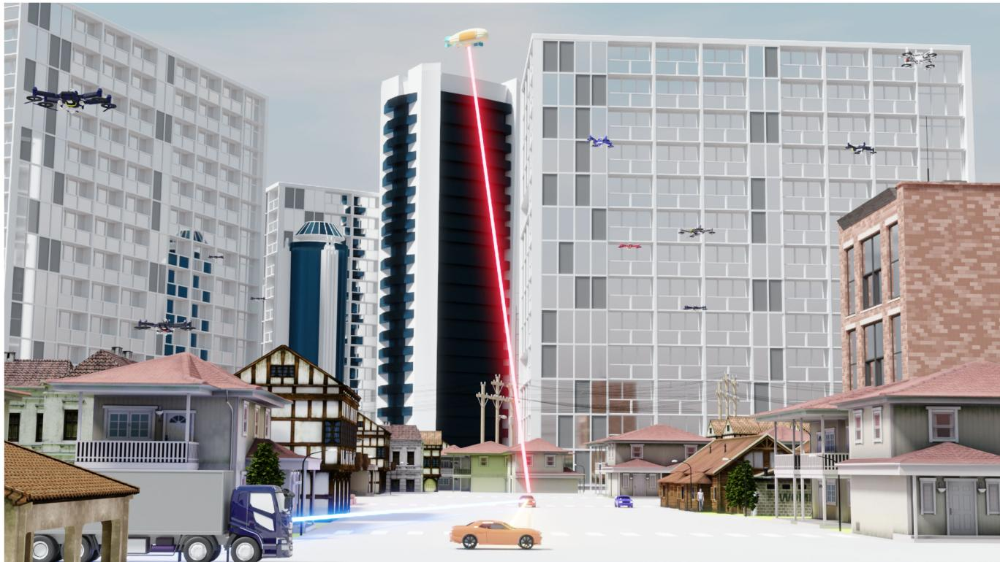  
FIGURE 28. NTFP communicating with vehicles using NOMA in UAM.

Since NTFPs are part of the NTN network, they can connect satellites to ground users in a relay fashion by using NOMA. The communication between a satellite and NTFP can be done via orthogonal multiple access, and NTFP can then forward the message using NOMA to several users on the ground. Thus, alleviating the long distance-induced latency by increasing the spectral efficiency of the network. Additionally, NTFPs thanks to their ability to stay aloft in the same position for a prolonged period can use NOMA to forward and interconnect several free-flying platforms at the same time by acting as a fixed relay.

## 3) FREQUENCY SPECTRUM

a) Millimeter Wave/Terahertz (mmWave/THz): The B5G/6G networks are expected to offer higher data rates than 5G. The frequencies that will enable these ultra-high data rates are mmWave (in 30 - 300 GHz range) and THz (0.1-10 THz). These frequencies can sustain bandwidth-hungry applications (e.g., virtual reality). Besides, the frequencies are immune to interference and eavesdropping thanks to highly directional beams that make the signal hard to intercept [176]. However, the ultra-high data rates provided by these frequencies come at the cost of blockage-prone signals due to their small wavelength and severe path loss attenuation caused by molecular absorption. In addition, several challenges can result from beam misalignment issues. NTFPs are a relevant solution to overcome some of the aforementioned drawbacks of these frequencies. To cope with the signal blockage, NTFPs offer a clear LOS link between the transmitters and receivers. In addition, signal molecular absorption at higher altitudes becomes negligible, thus, THz is well suited for NTFP-HAP and NTFP-satellite communications. THz can also be used for NTFP-UAV communications since THz frequencies are not highly impacted by the Doppler effect. Finally, RIS-NTFP can also be used for mmWave and THz bands [176]. Experiments have shown that meta-surfaces and graphene patches can adjust the phase of THz [177].

b) Free-Space Optics/Visible Light Communication (FSO/VLC): FSO is a transmission technique that uses a coherent lightwave of the laser diode to transmit information. FSO has several advantages such as it uses a license-free band, it is immune to electromagnetic interference, it provides high data rates, it has a wide spectrum availability, and it has a long-distance transmission range. However, FSO communications are heavily impacted by weather conditions, high mobility, and pointing errors. NTFPs will mainly use FSO to communicate with satellites in a setting where NTFPs are used as relays between satellites and ground nodes [178]. Besides, NTFPs can use FSO to communicate with each other or to communicate with other free-flying platforms such as UAVs and HAPs. Finally, NTFPs can use

FSO to provide backhaul links to terrestrial nodes through a fixed infrastructure such as buildings. To overcome the aforementioned drawbacks such as atmospheric turbulence and optical signal sensitivity, NTFPs can retrofit an FSO system into the already existing RF infrastructure. That way, NTFPs can benefit from the RF resilience to atmospheric turbulence while accessing the high data rates offered by FSO communications [179].

VLC uses visible light frequencies through Light-Emitting Diodes (LEDs) to attain high data rates. It has attracted great attention during the last years, especially for short-distance communications. VLC has several benefits and advantages such as high data rates transmissions, license-free spectrum, immunity to electromagnetic waves, and can be used simultaneously for both communication and illumination. VLC suffers certain drawbacks such as having a limited range/coverage, being prone to interference from light sources (e.g., sunlight), and the necessity of having a LOS with the receiver [180]. For these reasons, VLC has been mostly used for indoor applications and short-distance transmissions when LOS link is available [181]. There are several challenges related to VLC that need to be addressed in the future, and NTFPs can overcome some of these drawbacks by guaranteeing a LOS link due to their altitude. Although it is used mainly for indoor applications, VLC has proven robust even in outdoor scenarios, but it suffers heavily from direct daylight. However, when direct sunlight is avoided, it has been shown that scattered sunlight only degrade the Signal to Interference plus Noise Ratio (SINR), and in that case, VLC transceivers will adapt the data rate according to the reduced SINR [182].

Since VLC is primarily used for short-distance links, LAP-NTFPs will use VLC to communicate with a high data rate and interference-free communications when they are close to each other [183]. For instance, UAVs near the NTFP can communicate with high data rates and secure communications. LAP-NTFPs can also communicate with ground users when LOS is available [184], [185].

## 4) NTFPS USING LOW POWER WIDE AREA NETWORKS(LPWANS) FOR IOT APPLICATIONS

LPWANs, which stands for Low Power Wide Area Networks, are wireless wide area networks that allow long-range communications with a low data rate between a large number of Internet of Things (IoT) devices distributed over a wide geographical area. The LPWAN data rate usually ranges from 0.3 kbits up to 200 kbit/s, and can have a transmission range of several kilometers. Most LPWA technologies use the SubGHz range since it provides long-distance and reliable communications over a wide coverage area. LPWAN can be categorized into two categories: Licensed and unlicensed. We will present the two most known technologies of each category, namely Narrow Band IoT (NB-IoT), the 3GPP technology for an LPWAN used in cellular networks (Licensed), and Low Range (LoRa) patented by Semtech (unlicensed). Although this section focus on the integration ofNTFPs with cellular technologies (5G and 6G), LoRa is a complementary solution ofNB-IoT. Hence, we added the usage ofNTFPs with LoRafor the sake ofcompleteness.

a) NB-IoT (Licensed): NB-IoT is a radio access LPWAN technology in 3GPP through releases 13 to the latest releases 17. NB-IoT is mainly used for IoT applications that require real-time responsiveness with large data rates.5 It is also used for Low latency-sensitive applications that require high quality of service [186]. For organizations or applications when security is a requirement, NB-IoT is more secure than LoRa since it leverages the existing cellular infrastructure. However, NB-IoT consumes more power than LoRa, consequently, the battery life of IoT devices that use NB-IoT is shorter than the one using LoRa. In addition, NB-IoT is not suited for applications involving mobility since the NB-IoT standard allows single handshaking between the cell tower and the end devices/sensors. Finally, the cost related to NB-IoT products along with the maintenance, operating cost is higher than LoRa. NB-IoT requires license contracts with mobile network operators.

Mounting an aerial base station NB-IoT on an NTFPs extends the reach of the cellular network since NTFPs are connected to the access backhaul. Hence, combining the extended coverage offered by NTFPs and NB-IoT long-range will further increase their reach compared to the terrestrial NB-IoT. For the sake of simplicity, we will refer to the usage of an NB-IoT base station mounted on an NTFP as NB-IoT-NTFP.

In agriculture, NB-IoT-NTFP will target applications that require real-time feedback such as emergency and real-time tracking applications. NB-IoT-NTFP will be used for collar tracking of livestock and pets. If a collar tag is missing or deviating from the usual path or locations, the farmer/owner will be immediately notified. Furthermore, NB-IoT-NTFP will be used to detect alarms such as smoke and fire alarms. Detecting fire is a matter of seconds; hence, real-time monitoring using NB-IoT-NTFP is mandatory in these situations. NB-IoT-NTFP is a good choice for applications that need secure and reliable transactions such as retail transactions and smart payments. NB-IoT-NTFP relies on a cellular network that provides faster data rates than LoRa with a secure link. The usage of NB-IoT-NTFPs is also well suited in urban areas. They can be used for smart parking since finding a parking spot is often difficult in crowded cities and time-consuming. NB-IoT-NTFPs can also be used to make reservations for parking spots. They can also be used for smart street lighting to reduce energy consumption and lighting cost for outdoor street lighting.

b) LoRa (Unlicensed): The radio technology LoRa uses the SubGHz frequency bands 6 and a spread-spectrum technique based on Chirp-Spread-Spectrum (CSS) modulation [187]. LoRa Wide Area Network (LoRaWAN) specification, on the other hand, is a networking protocol for wireless, batterypowered systems that use LoRa. A LoRaWAN is composed of three distinct parts: a single network server, one or several gateways, and one/several end devices/sensors. In the uplink, the data is sent by the devices to the gateways, and in turn, gateways send the data to the network server. The reverse steps are carried out in the downlink. LoRa is usually used in remote areas such as secluded villages and small towns since mobile network operators deploy their carrier-grade 4G or 5G in areas with dense populations. Hence, organizations prefer to use LoRa instead of deploying their own private 4G/5G infrastructure due to the high complexity and cost of the deployment and maintenance [188].

LoRa is mainly used when the IoT devices/sensors transmit data intermittently on a fixed schedule. Consequently, the batteries of a large number of LoRa devices can operate for years (up to 20 years). We note that when using LoRa, the data are not continuously being sent and received data in real-time. This makes LoRa not suitable for critical and latency-sensitive IoT applications, and in that case, NB-IoT is more suitable for these types of applications.

Mounting a LoRa gateway on NTFPs will exploit the benefits of both by combining the long-range and reliable transmission of LoRa with the clear LOS and ability to stay in the air in the same position of NTFPs. We will refer to the usage of LoRa gateway mounted on an NTFP as LoRa-NTFP for the sake of simplicity. LoRa-NTFP can be used for farm management applications, livestock monitoring, and aerial data collection from various IoT sensors. Additionally, in rural areas, when there is an outage of internet connection, the LoRa-NTFP gateway stores the data collected from the IoT sensor during the outage, and then forwards the data to the network server when the internet is available, hence acting as data storage. From a CAPEX/OPEX perspective, LoRa-NTFP provides reliable communications for remote areas at an affordable cost.

LoRa-NTFP is better suited for rural areas than urban areas. It will bring coverage for agriculture applications such as tracking the water usage, assessing the soil pH level, and recording rainfall to cite a few. These applications are not latency-sensitive and do not require immediate and real-time feedback since their metrics do not change drastically during a short period. A LoRa-NTFP can be deployed close to a farm while still benefiting from a LOS with a large number of devices. This solution is more relevant and cost-efficient for farmers than NB-IoT.

In vehicular communications, LoRa-NTFP will send packets that require short message transmissions for latencytolerant applications. LoRa-NTFP will also have the advantage of LOS to reach vehicles in obstructed corners. Moreover, the devices/sensors on the vehicles connect to the network server via several gateways, therefore, vehicles can move between gateways without affecting the transmission. In the same fashion, LoRa-NTFP will be a good solution for supply chain tracking. The shipments in transit or storage do not require constant and large data transmission. In that regard, LoRa-NTFP can leverage the low data rate, long-range, and latency of LoRa communications with the clear LOS of NTFPs to keep a constant track of the shipments while preserving the batteries of the devices/sensors.

## 5) MASSIVE MIMO

Massive Multiple-Input Multiple-Output (mMIMO) systems are introduced in new wireless communication standards as 5G and 6G [1], [189]. This technology has gained considerable momentum during the last decade due to the spatial multiplexing of users and high beamforming gain. This makes mMIMO a compelling and attractive key enabler of 5G/B5G networks. The mMIMO paradigm can significantly increase spectral efficiency, energy efficiency, throughput, and diversity gain thanks to a large number of antennas. For THz communication, a larger number of smaller antennas (ultra mMIMO) can be allocated in a fixed aperture volume [190], [191]. In addition, mMIMO technologies are key techniques for the increase of system capacity and coverage, and thus for the enhancement of the user QoS. Multi-user mMIMO precoding, or digital beamforming, aims to focus the transmitted power on the receivers [192].

NTFPs have different sizes, and depending on the size, they can carry a small, medium, or a large number of antenna arrays. Therefore, NTFPs can serve mobile and static users with different QoS. The design of mMIMO array antennas with reasonable size promotes the use of mmWave bands, as the size of an antenna element is proportional to the wavelength. Hence, NTFPs can use mMIMO to produce highly directional beams with narrow beamwidths when using mmWave communications, and ultra mMIMO when using THz communications. Moreover, higher bandwidth is available in the mmWave band in the sub-6 GHz band. MmWave mMIMO systems can thus increase the network capacity where the high path loss in the mmWave band is compensated by the mMIMO beamforming gain [193]. To design mmWave mMIMO equipment with reasonable price and complexity, NTFPs can use hybrid MIMO, which reduces the number of RF chains while maintaining the beamforming gains of mMIMO. For dense cells such as in urban environment, NTFPs can combine both hybrid MIMO and NOMA to serve a high number of users with respect to the number of RF chains [194].

## D. NTFP COMMUNICATIONS FOR 6G USE CASES

Now we show how NTFPs will be the key enablers to interconnect heterogeneous networks and communications for 6G. To this end, they will be the bridge between land, air, sea, and space by being connected to ground communications (e.g., cellular communications and vehicular communications), air communications (e.g., UAV communications and HAP communications), maritime communications (underwater communications, and remote-sea communications) and satellite communications, as shown in Fig. 29. One key aspect of 6G is that everything will be connected. In that context, more than 3 billion do not have access to an internet connection, NTFPs will help bridge the digital divide and bring connection to rural and remote areas.

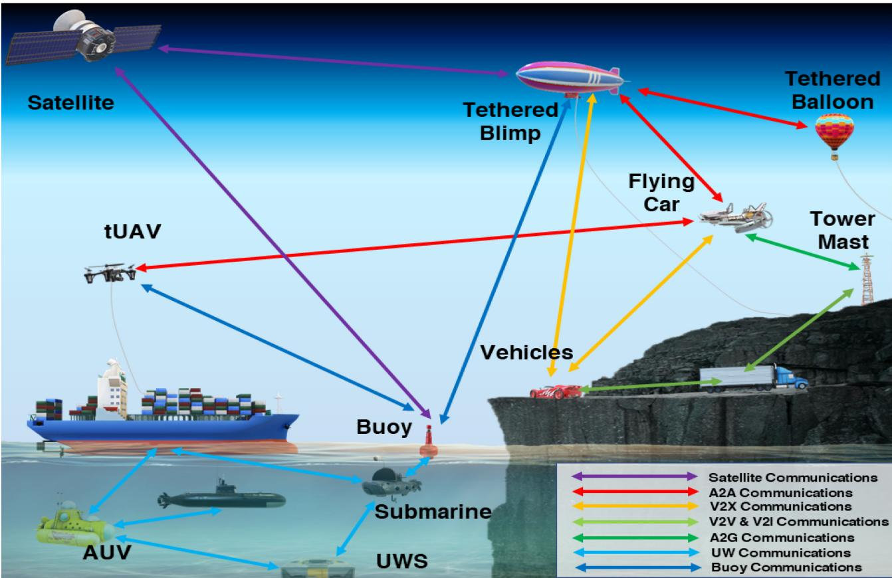  
FIGURE 29. Various type of communications used by NTFPs.

They will also provide last-mile connectivity, ensuring seamless connection to vehicles and flying cars, interconnecting airborne platforms, providing coverage remote sea areas, and serving as a relay between satellite communications and ground/sea communications

## 1) REMOTE COMMUNICATIONS AND LAST MILE CONNECTIVITY

To connect the unconnected, NTFPs are a cost-efficient solution to bridge the digital divide and provide a high data rate connection to remote areas. They are used as aerial base stations with a huge backhaul capacity to provide last-mile connectivity for hard-to-reach areas [48]. Additionally, this solution is ready to be used immediately, can be quickly deployed, and is cost-efficient. NTFPs can be easily deployed in underserved and rural areas where terrestrial communications are lacking. Their low cost makes them an attractive solution since most of the mobile network providers do not deploy their communication infrastructures in lowincome/low-density population areas. This is because mobile network providers consider remote communications more of a business concern rather than a crucial technical requirement.

However, NTFPs can overcome this concern with their relatively low cost and rapid deployment. In addition, their high altitude offers a larger coverage than terrestrial infrastructures. NTFPs can leverage mmWave/THz combined with mMIMO (and ultra mMIMO) to provide a high data rate to end-users. In addition, LoRa-NTFP is better suited for agriculture applications in rural areas while being cost-efficient.

## 2) COMMUNICATIONS FOR AUTONOMOUS VEHICLES

With the upcoming rise of autonomous vehicles, the need for seamless connectivity, high reliability, and low latency communications is of utmost importance [195]–[200]. Autonomous and driverless vehicles need to be constantly connected and aware of their surroundings. NTFPs allow these vehicles to be connected all the time with their wide mobile coverage and high data rate connection. They also guarantee seamless connectivity at the edge and under-connected areas. In addition, NTFPs will assist regular vehicles, especially in urban areas. In fact, vehicular communications undergo blockage and attenuation in an urban environment due to buildings. NTFPs overcome this limitation thanks to their altitudes. Hence, NTFPs can use mmWave frequencies combined with mMIMO to offer a high data rate to vehicles while still maintaining a LOS connection. Moreover, NTFPs can leverage NOMA using mmWave to serve several vehicles using the same resources with high data rates (Fig. 28) [201]. NTFPs can also act as relays in Adhoc vehicular communications, hence, RIS mounded on NTFPs will act as reflectors.

## 3) EVTOLS IN UAM

UAM proposes a safe and well-regulated aviation transportation system using semi-automated, highly automated, or fully automated aerial vehicles. These aerial vehicles will operate at a low altitude within urban areas. Advanced Air Mobility (AAM), on the other hand, is the extension of UAM to use cases that are not specific to urban environments. This includes intercity trips, cargo delivery, and private aerial vehicles. EVTOLs will be part of UAM and AAM first as semi-automated aerial vehicles, then after UAM reaches a maturity stage, EVTOLs will be highly and fully automated aerial vehicles [202]. EVTOLs are expected to be part of our daily lives in the next decade and 6G envisions to serve them as of 2030 [11]. EVTOLs need to be constantly connected, in order to avoid collisions, acquire other vehicles’ positions, or change their itinerary when necessary. However, terrestrial networks, as they are now, are not suitable for EVTOL communications. EVTOL cruising altitudes range from 250- 300 m, which is way above tower masts. In addition, tower mast antennas are tilted downward to better serve ground users since they were not designed to serve aerial users in the first place. NTFPs overcome this limitation by proving great coverage and by flying above EVTOLs [175]. In addition, NTFPs will use several key enablers for EVTOLs such as NOMA and RIS as the air-radio interface, as well as mmWave/mMIMO for high data rates.

## 4) AIRBORNE COMMUNICATIONS

Airborne platforms will be ubiquitous in 6G forming threedimensional networks since NTNs are already part of the latest 3GPP release. Hence, these platforms need to maintain constant connectivity among themselves and with the other nodes of the networks whether they are ground platforms, aerial platforms, or satellites [203]. NTFPs stay aloft for a prolonged period at the same position, which allows them to be used as a stable and fixed relay to interconnect different airborne solutions flying at different altitudes, such as HAPs and UAV [204]–[207], and to interconnect HAPs with ground users. NTFPs can offer a secure and reliable backhaul link to free-flying platforms whether through RF or FSO. They can also use mmWave combined with mMIMO to deliver directed beams with high data communications. In addition, since NTFPs can carry RIS and act as aerial relays in an airborne constellation.

## 5) MARITIME COMMUNICATION

Maritime economy and maritime activities have witnessed significant growth with various activities and applications, such as fisheries, maritime transportation, sea monitoring, deep-sea mining, surveillance, and inspection missions (e.g., oil and gas facilities). However, as important as these activities are, they still lack broadband communications capable of withstanding the needs of these activities and applications. For instance, underwater missions rely heavily on a massive number of Autonomous Underwater Vehicles (AUVs), Remote Operated Vehicles (ROVs), and UnderWater Sensors (UWSs). These vehicles need to transmit large amounts of data among themselves and between the shore. Another example is that fishers or travelers need an internet connection on their cruise ship. NTFPs are a suitable solution to connect the sea (above and under the surface) with the shore by providing broadband connectivity and mobile coverage. They are also less costly compared to satellite solutions, and with lower latency [49], [53], [54]. In addition, FSO is the best solution to underwater communications, since they can achieve high data rates without undergoing the severe attenuation that RF signals do.

## 6) SATELLITE COMMUNICATIONS

LEO satellites are witnessing a boom during the last decades [208]–[210]. Thousands of LEO satellites are launched into orbits as part of the Starlink and OneWeb project. NTFPs will play an important role by connecting satellites with ground platforms. In fact, satellite communications suffer attenuation and delay. Hence, NTFPs can act as a relay by converting a long-range transmission using one single hop into a short-range transmission using multiple hops. This will alleviate the overall propagation delay and improve the data rate [204]. Communications between satellites and NTFPs can be done via FSO, and then NTFPs can use RF to serve ground users.

## E. ECONOMICS OF NTFPS

One of the several advantages of NTFPs is that they are costefficient. Therefore, it is relevant to investigate the economic aspects of using NTFPs in the context of wireless communications. To this end, we present two analyses: the first one was conducted in the AAA project [133], and the second one was done by Altaeros for their SuperTowers [22], [135]. The analysis carried out in the AAA project provides a detailed deployment plan for 250 NTFPs over four years. The analysis done by Altaeros compared the cost of one single NTFP with several cell towers during their respective lifetime.

## 1) AAA ANALYSIS

As mentioned in Section III, the AAA project aimed to extend mobile coverage in Australia by using tethered aerostats, especially in remote areas [133]. One of the main advantages of using tethered aerostats is that they cost less than alternative solutions. We will show the costs of using tethered solutions from a CAPEX/OPEX perspective, as demonstrated in [133]. Also, we review the different stages proposed in the AAA project and the level of support.

The AAA project proposed a three-stage deployment strategy spread over four years:

\- Stage 1: Aerostat center for excellence,

\- Stage 2: Aerostat co-location with existing remote Australia cell towers, and

\- Stage 3: Public Safety Agency Points-of-Presence (PoPs) and point-to-point links.

a) Stage 1: The tasks and responsibilities of the aerostat center for excellence include designing and testing the aerostats, carrying out trials across Australia, designing Radio Access Network (RAN), obtaining regulatory approvals, and training the operators and the support personnel, etc. For more details, we invite the reader to read the AAA report [133].

b) Stage 2: The advantage behind co-locating tethered aerostats with an existing cell tower is that there are existing access roads, fiber optic backhaul, and electricity, which, according to [133], reduce the cost of a tethered aerostat from \$2 million to \$500 k. However, they recommend some security measures such as the length of the tether has to respect a given distance in case the tethered aerostat cannot be taken down (for instance, due to winch malfunction), hence protecting the communications structure in its vicinity. Also, they recommend that the tethered aerostat have a dedicated radio spectrum in order to avoid interference with the already existing cell site.

c) Stage 3: New tethered aerostat sites will act as new Public Safety Agency PoPs. They should be erected on the major Australian islands and external territories. The sites on islands and territories that have high strategic importance should be erected jointly with the defense department and border surveillance. In that context, larger tethered aerostats can carry heavier payloads. Therefore, they can carry both communication payloads as well as surveillance payloads, such as cameras, sensors, etc., allowing the tethered aerostats to be used for both communications and surveillance.

They also plan to offer four levels of support, depending on the task and requirements:

\- Level 1: Weekly on-site inspections and recovery of aerostats before/after cyclones

\- Level 2: Support for monthly service and setting up new aerostat sites

\- Level 3: Major service, technology upgrades, and major repair performed annually

\- Level 4: Joint collaboration with vendors requiring expertise

d) Level 1 - Support to Inspect and Protect Aerostat: Each site requires two people, called the L1 crew, for a weekly inspection that includes winching the aerostat down, visually inspecting it, applying the necessary adjustments, and then winching it back. These weekly inspections extend the operation life of an aerostat to ten years. Although tethered aerostats perform better in adverse weather than other airborne solutions, such as HAPs, aircraft, UAVs, and free-flying platforms, the L1 crew have to winch down the aerostat when there are cyclones and strong winds, check if there are any damages, apply the necessary repairs if needed, and winch the aerostat up. The L1 crew may be regular contractors or trusted locals. While the aerostat is winched down, the L1 crew will have access to satellite communication.

e) Level 2 - Monthly Service and Setup of New Aerostats: Ten L2 crews of two people each will provide basic repairs and refill the aerostats with helium. They will also erect new aerostat sites, train the L1 crews, and prepare the aerostats for the L3 crews.

TABLE 8. Total OPEX From Year 1 to Year 4
<table><tr><td rowspan=1 colspan=1>OPEX</td><td rowspan=1 colspan=1>Annual Cost</td></tr><tr><td rowspan=1 colspan=1>L1 SupportL2 SupportL3 and L4 Support</td><td rowspan=1 colspan=1>$ 25   M$ 15   M$ 10   M</td></tr><tr><td rowspan=1 colspan=1>Total L1 to L4 Support</td><td rowspan=1 colspan=1>$50   M</td></tr><tr><td rowspan=1 colspan=1>Center for Aerostat ExcellenceAmortization</td><td rowspan=1 colspan=1>$ 10   M$ 10   M</td></tr><tr><td rowspan=1 colspan=1>OPEX</td><td rowspan=1 colspan=1>$ 75   M</td></tr></table>

f) Level 3 - Supportfor Aerostat Annual Overhaul and Technology Upgrade: The L3 crew offers necessary technological and physical upgrades and an annual overhaul. They also perform repairs and on-demand facilities.

g) Level 4 - Expert Support: The L4 expert support will be provided by vendors and the Australian Center for Aerostat Excellence.

In total, the cost estimates provided by [133] for 250 aerostats are \$25 million Per Annum (PA) L1 support, \$15 million PA for L2 support, and \$10 million PA for L3 plus L4 support. Hence, the total cost of all support is \$50 million PA. The Australian Center for Aerostat Excellence requires a budget of \$10 million PA for administration fees and research and development. A further amortization budget of \$10 million is dedicated to refurbishing the tethered aerostats every five to ten, which is 20% PA of the total support budget. The total OPEX is shown in Table 8, and the total CAPEX and OPEX for year 1 through year 4 (until a full fleet operation is completed) is shown in Table 9.

It is noted in [133] that the funding allocated to the AAA project would save the government and National Broadband Network \$1 billion in a Sky Muster satellite which is twice the cost of the AAA project. Also, the AAA bandwidth is 250 Gbps, whereas the satellite bandwidth is only 135Gbps, which is double the aggregate bandwidth [211].

## 2) ALTAEROS SUPERTOWER ANALYSIS

The SuperTower made by Altaeros is a high capacity and long-endurance NTFP, that delivers data and provides coverage [22]. Altaeros conducted a cost analysis with CAPEX/OPEX comparisons between NTFPs (SuperTowers) and cell towers [135]. The aim of this comparison was to investigate whether NTFPs are cost-effective compared to cell towers over their lifetime. A single cell tower is 40–60 m tall with a coverage radius of 10–15 km. This means that the tower has a service area ranging between 300–700 km2. On the other hand, an NTFP that flies at a low altitude, for instance, 250 m, has a radius of 40–60 km with a service area ranging between 5,000–10,000 km2. Hence, a single NTFP has a coverage equivalent of 16 cell towers, as shown in Fig. 30. Table 10 shows a CAPEX/OPEX analysis between 16 cell towers and a single NTFP and their Net Present Value (NPV) during their lifetime. We can see from Table 10 that one NTFP flying at an altitude of 250 m is equivalent to 16 cell towers in terms of coverage at 50% of the cost. Furthermore, we can see that the NTFP has 90% lower CAPEX and 30% lower OPEX compared to 16 cell towers. This analysis considers that the NTFP flies at an altitude of 250 m. If we consider that the NTFP flies at 900 m such as the platforms described in the AAA project, the coverage of the NTFP will be the equivalent of 160 standard cell towers in terms of coverage (as depicted in Fig. 30).

TABLE 9. Combined CAPEX and OPEX for Year 1–4
<table><tr><td rowspan=1 colspan=1>Year</td><td rowspan=1 colspan=1>Stage</td><td rowspan=1 colspan=1>Description</td><td rowspan=1 colspan=1>CAPEX</td><td rowspan=1 colspan=1>OPEX</td><td rowspan=1 colspan=1>Total</td></tr><tr><td rowspan=1 colspan=1>Year 1</td><td rowspan=1 colspan=1>Stage 1</td><td rowspan=1 colspan=1>Setup center of excellence</td><td rowspan=1 colspan=1>$10  M</td><td rowspan=1 colspan=1>$10 M</td><td rowspan=1 colspan=1>$20  M</td></tr><tr><td rowspan=1 colspan=1>Year 2</td><td rowspan=1 colspan=1>Stage 2</td><td rowspan=1 colspan=1>80 aerostats cell-sites co-located x $500K</td><td rowspan=1 colspan=1>$40  M</td><td rowspan=1 colspan=1>$25 M</td><td rowspan=1 colspan=1>$ 65  M</td></tr><tr><td rowspan=1 colspan=1>Year 3</td><td rowspan=1 colspan=1>Stage 2 + Stage 3</td><td rowspan=1 colspan=1>70 aerostats x $500K + 50 aerostats x$2M</td><td rowspan=1 colspan=1>$135  M</td><td rowspan=1 colspan=1>$50 M</td><td rowspan=1 colspan=1>$185  M</td></tr><tr><td rowspan=1 colspan=1>Year 4</td><td rowspan=1 colspan=1>Stage 3</td><td rowspan=1 colspan=1>50 aerostats x $2M</td><td rowspan=1 colspan=1>$100  M</td><td rowspan=1 colspan=1>$75M</td><td rowspan=1 colspan=1>$175  M</td></tr><tr><td rowspan=1 colspan=1>Year 1-4</td><td rowspan=1 colspan=1>All stages</td><td rowspan=1 colspan=1>Combined CAPEX and OPEX</td><td rowspan=1 colspan=1>$160M</td><td rowspan=1 colspan=1>$285M</td><td rowspan=1 colspan=1>$445M</td></tr></table>

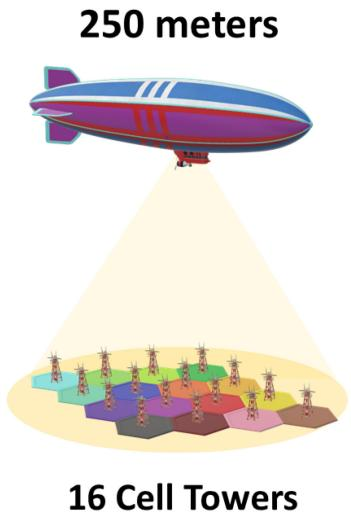

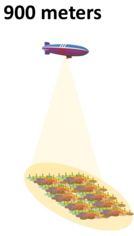  
FIGURE 30. Comparison between the coverage of NTFPs and cell towers.

TABLE 10. CAPEX/OPEX Analysis Between Cell Towers and a Single NTFP
<table><tr><td rowspan=1 colspan=1></td><td rowspan=1 colspan=1>16xCell Towers</td><td rowspan=1 colspan=1>1xSuperTower</td></tr><tr><td rowspan=1 colspan=1>RAN/Site SetupBackhaul Setup</td><td rowspan=1 colspan=1>$1280    K$ 560    K</td><td rowspan=1 colspan=1>$105   K$35  K$</td></tr><tr><td rowspan=1 colspan=1>CAPEX</td><td rowspan=1 colspan=1>$1840    K</td><td rowspan=1 colspan=1>$140   K</td></tr><tr><td rowspan=4 colspan=1>Tower RentSite Operations &amp; MaintenanceBackhaul ServicePower &amp; Other</td><td rowspan=1 colspan=1>$ 240    K</td><td rowspan=1 colspan=1>$400   K</td></tr><tr><td rowspan=1 colspan=1>$ 112    K</td><td rowspan=1 colspan=1>$ 10   K</td></tr><tr><td rowspan=2 colspan=1>$ 256    K$128    K</td><td rowspan=1 colspan=1>$ 60   K</td></tr><tr><td rowspan=1 colspan=1>$ 25   K</td></tr><tr><td rowspan=1 colspan=1>OPEX</td><td rowspan=1 colspan=1>$736    K</td><td rowspan=1 colspan=1>$495   K</td></tr><tr><td rowspan=1 colspan=1>NPV during their Lifetime</td><td rowspan=1 colspan=1>$ 9.6  M</td><td rowspan=1 colspan=1>$ 4.7M</td></tr></table>

## V. CHANNEL MODELING OF NTFPS

In this section, we provide a comprehensive channel modeling framework for NTFPs. Furthermore, for this section, the term

LAP refers to all the platforms that fly at ultra low-altitudes (50 m–150 m), low-altitudes (200 m–600 m), and mediumaltitudes (0.7 km–5 km). Also, we do not include channel modeling for U-HAP since there is only one paper that considers the feasibility of NTFPs flying at such altitudes [66]. For the sake of completeness, we consider both RF links and FSO links. Indeed, FSO links can provide a high speed connection via Air-to-Air (A2A) communications between NTFPs at different altitudes, and with ground stations or ground users via Air-to-Ground (A2G) communications [212]. Finally, at the end of this section, we summarize all channel models in Table 11 with the relevant references.

## A. LAPS CHANNEL MODELING USING RF LINKS(SUB-6 GHZ)

For LAPs channel modeling considering RF links, we present both large-scale fading and small-scale fading.

## 1) LARGE-SCALE PATH LOSS

The International Telecommunication Union (ITU) proposed a model for deriving LOS probability in an urban environment between a transmitter at $h _ { T X }$ and a receiver at elevation h [213]. The LOS probability is a function of the following parameters:

$p _ { \alpha } \colon$ the ratio of the built-up land area to the total land area,

$p _ { \beta } \colon$ the mean number of buildings per km2,

$p _ { \gamma } \colon$ which is a scale parameter that models the buildings’ heights. The distribution of the buildings’ heights follows a Rayleigh distribution given by $f ( H ) =$ $\begin{array} { r } { \frac { H } { \gamma ^ { 2 } } \exp \left( \frac { H ^ { 2 } } { 2 \gamma ^ { 2 } } \right) } \end{array}$ , where H is the building height in meters.

Hence, according to [213], the LOS probability denoted by P(LOS) is expressed as

P(LOS)

$$
= \prod _ { n = 0 } ^ { m } \left[ 1 - \exp \left( - \frac { \left[ h _ { T X } - \frac { - ( n + \frac { 1 } { 2 } ) ( h _ { T X } - h _ { R X } ) } { m + 1 } \right] ^ { 2 } } { 2 \gamma ^ { 2 } } \right) \right] ,\tag{13}
$$

where $m = \mathrm { f l o o r } ( r \sqrt { p _ { \alpha } p _ { \beta } - 1 } )$ and r is the ground projection of the distance between the transmitter and the receiver as shown in Fig. 31. In the case of LAPs, h can be neglected since the height of the receiver is much lower than the height of buildings and the LAP altitude. In [214], the authors showed that (13) can be expressed as a function of θ and the environment parameters as follows:

TABLE 11. Channel Modeling for NTFPs Considering RF and FSO Links  
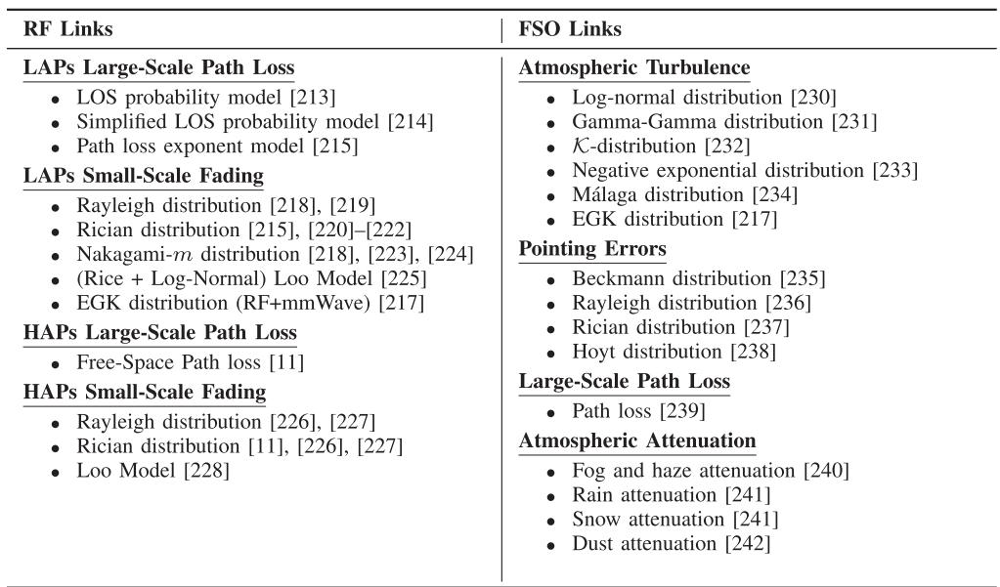

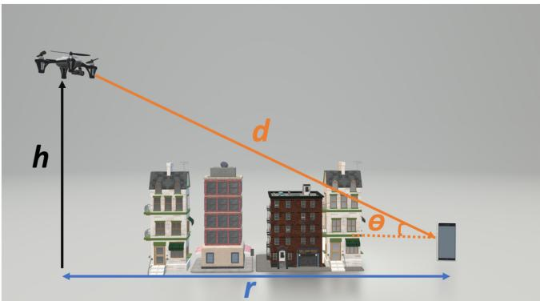  
FIGURE 31. Connection between a LAP and a mobile user in an urban environment.

$$
\mathrm { P } ( \mathrm { L O S } , \theta ) = \frac { 1 } { 1 + a _ { 1 } \exp ( - b _ { 1 } ( \theta - a _ { 1 } ) ) } ,\tag{14}
$$

where the parameters $a _ { 1 }$ and $b _ { 1 }$ are a function of the environment variables $p _ { \alpha } , p _ { \beta }$ , and $p _ { \gamma }$ . We note that the Non-Line-Of-Sight (NLOS) probability equals $\mathrm { P } ( \mathrm { N L O S } , \theta ) = 1 -$ P(LOS, θ ).

The expression of path loss is then expressed as

$$
\begin{array} { r l } & { \mathrm { P L } ( \alpha _ { \mathrm { P L } } , \theta , d ) = d ^ { - \alpha _ { \mathrm { P L } } ( \theta ) } } \\ & { ~ \times \left[ \mathrm { L o s s } _ { \mathrm { L O S } } \cdot \mathrm { P } ( \mathrm { L O S } , \theta ) + \mathrm { L o s s } _ { \mathrm { N L O S } } \cdot \mathrm { P } ( \mathrm { N L O S } , \theta ) \right] , } \end{array}\tag{15}
$$

where Loss and Loss denote the mean additional losses for the LOS and NLOS transmissions, respectively, $d$ is the distance between the transmitter and the receiver, and $\alpha _ { \mathrm { P L } } ( \cdot )$ is the path loss exponent.

The path loss exponent is a function of the density of buildings and an obstacle between the transmitter and the receiver.

For instance, larger values of $\alpha _ { \mathrm { P L } }$ are assumed in dense urban areas, whereas lower values of $\alpha _ { \mathrm { P L } }$ are assumed for rural areas. Hence, the path loss exponent α (θ ) can be modeled as a function of P(LOS, θ )), which, in turn, is a function of θ. Consequently, the path loss exponent is defined as [215]

$$
\alpha _ { \mathrm { P L } } ( \theta ) = a _ { 2 } \mathrm { P } ( \mathrm { L O S } , \theta ) + b _ { 2 } ,\tag{16}
$$

where the expression of $a _ { 2 }$ and $b _ { 2 }$ are given by

$$
a _ { 2 } = \frac { \alpha _ { \frac { \pi } { 2 } } - \alpha _ { 0 } } { \mathrm { P } ( \mathrm { L O S } , \frac { \pi } { 2 } ) - \mathrm { P } ( \mathrm { L O S } , 0 ) } \cong , \alpha _ { \frac { \pi } { 2 } } - \alpha _ { 0 }\tag{17}
$$

and

$$
b _ { 2 } = a _ { 0 } - a _ { 2 } { \mathrm P } ( { \mathrm { L O S } } , 0 ) \cong a _ { 0 } ,\tag{18}
$$

where α π and $\alpha _ { 0 }$ are the path loss exponent values when $\theta = \pi / 2 ^ { ^ { \angle } }$ and $\theta = 0$ , respectively. The values of $\alpha _ { \frac { \pi } { \gamma } }$ are usually smaller since the transmitter is in LOS with the receiver, whereas the values of $\alpha _ { 0 }$ are usually larger since there are more obstacles when $\theta = 0$ . Also, $\mathrm { P } ( \mathrm { L O S } , 0 )  0$ and $\mathrm { P } ( \mathrm { L O S } , { \frac { \pi } { 2 } } )  1$ . For more comprehensive path loss models of LAPs, we direct the readers to reference [216].

## 2) SMALL-SCALE FADING

In the following, we will present the most common models to characterize the small-scale fading for LAPs, such as Rayleigh, Rician, Nakagami-m, and Loo model. For the sake of completeness, we also present a more generalized distribution called Extended Generalized- (EGK) [217], which embodies numerous distributions (as shown in [217], Table 1) for RF links including mmWave frequencies.

a) Rayleigh Distribution: This distribution is widely and extensively used in the literature. It is used to model a transmission when the path between the transmitter and the receiver is heavily obstructed, and when LOS is not available. It can be used when the cooperative transmission between

LAPs is considered [218]. Also, it has been shown in [219] that the fading model in urban environments with large elevation angles follows the Rayleigh distribution. We recall the Rayleigh distribution is given by

$$
f ( y ) = \frac { y } { \sigma ^ { 2 } } \exp \left( \frac { - y ^ { 2 } } { 2 \sigma ^ { 2 } } \right) .\tag{19}
$$

b) Rician Distribution: Rician distribution is used to model fading of transmission with LOS for LAPs [215], [220]–[222]. We recall the Rician distribution is given by

$$
f ( y ) = \frac { y } { \sigma ^ { 2 } } e ^ { \frac { - ( y ^ { 2 } + a _ { \mathrm { L O S } } ^ { 2 } ) } { 2 \sigma ^ { 2 } } } I _ { 0 } \left( \frac { y a _ { \mathrm { L O S } } } { \sigma ^ { 2 } } \right) ,\tag{20}
$$

where $y \ge 0 , a _ { \mathrm { L O S } }$ and $\sigma$ denotes the magnitude of the LOS and the diffuse multipath components, respectively, and $I _ { 0 } ( \cdot )$ is the zeroth–order modified Bessel function.

Also, the Rician parameter K is defined as

$$
K = { \frac { a _ { \mathrm { L O S } } ^ { 2 } } { 2 \sigma ^ { 2 } } } .\tag{21}
$$

In Rician fading, the Rician factor, commonly noted by K, is a parameter that measures the severity of the fading. For instance, $K = 5 . 2 9$ dB when the LAP is in the takeoff and landing phase, whereas K = 19.14 dB when the LAP flies at an altitude of 20–30 m o [220]. In [221], the authors proposed a piece-wise model of K as a function of the altitude. The authors in [215] proposed a model of K as a function of the elevation angle:

$$
K ( \theta ) = a _ { 3 } \cdot \exp ( b _ { 3 } \theta ) ,\tag{22}
$$

where

and

$$
a _ { 3 } = k _ { 0 } , b _ { 3 } = \frac { 2 } { \pi } \ln \left( \frac { k _ { \frac { \pi } { 2 } } } { k _ { 0 } } \right) ,\tag{23}
$$

where $k _ { \frac { \pi } { \gamma } }$ and $k _ { 0 }$ are the values of K at $\begin{array} { r } { \theta = \frac { \pi } { 2 } } \end{array}$ and $\theta = 0$ respectively. Hence, larger values of θ lead to higher values of K, which characterizes fewer multipath scatters. In contrast low values of θ lead to low values of K, which characterizes severe multipath scatters [215]. Also, the A2A channel for LAPs can also be modeled as a Rician fading distribution [222].

c) Nakagami-m Distribution: Nakagami-m distribution offers great flexibility to model LAP channels, since it embodies several other different distributions thanks to its Nakagami shape and spread-controlling parameters defined by m and , respectively [218], [223]. The Nakagami-m distribution is given by

$$
f ( y ) = \frac { 2 m ^ { m } } { \Gamma ( m ) \Omega ^ { m } } y ^ { 2 m - 1 } e ^ { \frac { - m y ^ { 2 } } { \Omega } } ,\tag{24}
$$

where 	(·) denotes the Gamma function. The authors in [224] showed that the Nakagami–m distribution fits the empirical measurement better than the Rayleigh distribution.

d) Loo Model (Rice+Log-Normal) Distribution: Loo Model is composed of the Rician and log–normal distributions. The authors in [225] showed that the Loo model fits the empirical

data of A2G narrowband channels in urban areas. The Loo model is given by

$$
\begin{array} { r l } & { f ( y ) = \cfrac { y } { \sigma ^ { 2 } \sqrt { 2 \pi \Sigma _ { A } ^ { 2 } } } } \\ & { \times \int _ { a _ { \mathrm { L O S } } = 0 } ^ { \infty } \cfrac { 1 } { a _ { \mathrm { L O S } } } e ^ { \frac { - ( 2 0 \log a _ { \mathrm { L O S } } - M _ { A } ) ^ { 2 } } { 2 \Sigma _ { A } ^ { 2 } } } e ^ { \frac { - ( y ^ { 2 } + a _ { \mathrm { L O S } } ^ { 2 } ) } { 2 \sigma ^ { 2 } } } I _ { 0 } \left( \frac { y a _ { \mathrm { L O S } } } { \sigma ^ { 2 } } \right) d a _ { \mathrm { L O S } } , } \end{array}\tag{25}
$$

where $M _ { A }$ and denote the mean and standard deviation of the Gaussian distribution for the direct LOS signal, respectively, and $a _ { \mathrm { L O S } }$ is the amplitude of LOS signal.

e) Extended Generalized- (EGK) Distribution (RF+mmWave): The PDF of the EGK distribution is given by

$$
\begin{array} { l } { \displaystyle f _ { y } ( \boldsymbol { y } ) = \frac { 2 \psi } { \Gamma ( m _ { s } ) \Gamma ( m ) } \left( \frac { | \mathcal { B } _ { s } | \mathcal { B } } { \Omega } \right) ^ { m \psi } \boldsymbol { y } ^ { 2 m \psi - 1 } } \\ { \displaystyle \qquad \times \Gamma \left( m _ { s } - m \frac { \psi } { \psi _ { s } } , 0 , \left( \frac { | \mathcal { B } _ { s } | } { \Omega } \right) ^ { m \psi } \boldsymbol { y } ^ { 2 \psi } , \frac { \psi } { \Psi _ { s } } \right) , } \end{array}\tag{26}
$$

where m and $m _ { s }$ represent the fading severity and shadowing severity, respectively, $\psi$ and $\psi _ { s }$ represent the fading shaping factor and shadowing shaping factor, respectively, and  represents the average power of the received signal envelope. The functions $B _ { s }$ and are defined as

$$
B _ { s } = \Gamma ( m _ { s } + 1 / \psi _ { m } ) / \Gamma ( m _ { s } ) ,\tag{27}
$$

$$
B = \Gamma ( m + 1 / \psi ) / \Gamma ( m ) .\tag{28}
$$

3) BEAMFORMING MODELING FOR MMWAVE (30-300 GHZ) For mmWave communications, high gain directional beams are required to compensate for the high path loss and scattering. Generally, the directional gain is approximated using a simple sectored antenna model. In that case, the directional gain G() can have two values: 1) $G _ { \mathrm { m a x } }$ if the azimuth angle is within the half-power beamwidth ( ); 2) $G _ { \mathrm { m i n } }$ otherwise as shown in (29)

$$
G ( \Psi ) = \left\{ \begin{array} { l l } { G _ { \mathrm { m a x } } , } & { \mathrm { i f } \ \Psi \leq \frac { \Phi } { 2 } , } \\ { G _ { \mathrm { m i n } } , } & { \mathrm { o t h e r w i s e . } } \end{array} \right.\tag{29}
$$

When assuming perfect beam alignment, the effective antenna gain is $G _ { \mathrm { e q } } = G _ { \mathrm { m a x } } ^ { 2 }$ However, perfect beam alignment between the transmitter and the receiver antennas is not always feasible. Consequently, beam steering errors can result from beam misalignment. In the literature, the beam steering error denoted by  is assumed to follow a Gaussian distribution with mean zero and variance $\sigma _ { e } ^ { 2 }$ . Considering that, the gain angle is symmetric, it is common to consider the absolute value of the beam steering error ||. In that case, || follows a half-normal distribution with the following Cumulative Distribution Function (CDF) $F _ { | \epsilon | } ( x ) = \mathrm { e r f } ( x / \sqrt { 2 \sigma _ { e } } )$ . Consequently, the Probability Density Function (PDF) of the effective antenna gain is given by

$$
\begin{array} { r l r } { \displaystyle f _ { G _ { \mathrm { e q } } } ( x ) = F _ { | \epsilon | } \left( \frac { \Phi } { 2 } \right) ^ { 2 } \delta _ { ( x - G _ { \mathrm { m a x } } ^ { 2 } ) } } & { } & \\ { + \ : 2 F _ { | \epsilon | } \left( \frac { \Phi } { 2 } \right) \left( 1 - F _ { | \epsilon | } \left( \frac { \Phi } { 2 } \right) \right) \delta _ { ( x - G _ { \mathrm { m a x } } G _ { \mathrm { m i n } } ) } } & { } & \\ { + \left( 1 - F _ { | \epsilon | } \left( \frac { \Phi } { 2 } \right) \right) ^ { 2 } \delta _ { ( x - G _ { \mathrm { m i n } } ^ { 2 } ) } , } & { ( 3 - G _ { \mathrm { m a x } } ^ { 2 } G _ { \mathrm { m a x } } ^ { 2 } ) } \end{array}\tag{0}
$$

where $\delta _ { ( \cdot ) }$ is the Kronecker delta function.

## B. HAPS CHANNEL MODELING USING RF LINKS(SUB-6 GHZ)

For HAPs channel modeling considering RF links, we present both large-scale fading and small-scale fading.

## 1) LARGE-SCALE PATH LOSS

The large-scale fading of communication between a HAP and a given receiver located on the ground is mainly caused by free-space path loss. The path loss equation is given by

$$
\mathrm { P L } _ { \mathrm { F r e e ~ S p a c e } } = { \left( \frac { c } { 4 \pi d f } \right) } ^ { 2 } ,\tag{31}
$$

where $c$ is the speed of light and f is the operating frequency. We recall that d is the distance between the transmitter and the receiver.

## 2) SMALL-SCALE FADING

a) Rayleigh: Although the Rayleigh distribution is not often used to characterize small-scale fading for HAPs, some works have considered Rayleigh fading for HAPs [226], [227]. For instance, the authors in [227] used a two-states channel model with the assumption that when the channel is considered “good,” the Rician model is used to model the fading, whereas when the channel is considered “bad,” the Rayleigh model is used.

b) Rician: The Rician model is commonly used in the literature to model small-scale fading for HAPs [11], [226], [227]. c) Loo Model: In [228], the authors provided a multi-states model considering a Ka-band channel for HAPs. First, they modeled the effect of tropospheric weather on the amplitude of the transmitted signal as a Gaussian distribution defined by

$$
f _ { w , r } ( r ) = \frac { 1 } { \sqrt { 2 \pi \sigma _ { w , r } ^ { 2 } } } \exp \left( - \frac { \left( r - m _ { w , r } \right) ^ { 2 } } { 2 \sigma _ { w , r } ^ { 2 } } \right) ,\tag{32}
$$

where $m _ { w , r }$ and $\sigma _ { w , r } ^ { 2 }$ respectively denote the mean and variance of the Gaussian distribution of amplitude.

Then, to model impairment related to the ground environment, they provided a three-states model, with $S \in \{ s _ { 1 } , s _ { 2 } , s _ { 3 } \}$ defining the different states. The first state, $s _ { 1 } ,$ describes a LOS state, the second one, $s _ { 2 }$ , describes a moderate shadowing state, and the last one, s3, describes a deep shadowing state. The Loo model for these three states is given by

$$
\begin{array} { r l r } { f _ { S , r } ( r ) = \frac { 8 . 6 8 6 } { \sigma _ { S } ^ { 2 } \Sigma _ { d B , S } \sqrt { 2 \pi } } } & { } & \\ { \int _ { 0 } ^ { \infty } \frac { 1 } { a _ { \mathrm { L O S } } } \exp { \left( - \frac { \left( 2 0 \log \left( a _ { \mathrm { L O S } } \right) - M _ { d B , S } \right) ^ { 2 } } { 2 \Sigma _ { d B , S } ^ { 2 } } \right) } } \\ { \times } & { \exp { \left( - \frac { r ^ { 2 } + a _ { \mathrm { L O S } } ^ { 2 } } { 2 \sigma _ { S } ^ { 2 } } \right) } I _ { 0 } \left( \frac { r a _ { \mathrm { L O S } } } { \sigma _ { S } ^ { 2 } } \right) d a _ { \mathrm { L O S } } , } & { ( \mathrm { k g } ) } \end{array}\tag{33}
$$

where $a _ { \mathrm { L O S } }$ is the amplitude of LOS signal, and $M _ { d B , S }$ and $\Sigma _ { d B , S }$ denote the mean and standard deviation, respectively, of the log-normal distribution for the state S.

## C. CHANNEL MODELING USING FSO LINKS (187–370 THZ)

An FSO signal undergoes different types of fluctuation and attenuation due to atmospheric turbulence, pointing errors, path loss attenuation, and atmospheric attenuation [229]. Atmospheric turbulence is caused by random fluctuations of the refractive index, causing, in turn, fluctuation in the intensity and phase of the received signal. Pointing errors arise from the misalignment of the transmitter and the receiver. Finally, path loss and atmospheric attenuation depend on the atmospheric and weather conditions, such as fog, rain, snow, and dust.

## 1) ATMOSPHERIC TURBULENCE

The FSO signal undergoes atmospheric turbulence causing fluctuations in the intensity and phase of the received signal. Several models are used to characterize atmospheric turbulence for an FSO link. For instance, in weak-to-moderate turbulence, the log-normal distribution is used [230]. In moderate-to-strong turbulence, the Gamma-Gamma distribution [231] or the -distribution [232] is used. A negative exponential distribution is used when the turbulence effect is very strong [233]. Finally, the Málaga distribution, also called the -distribution, embodies all the aforementioned distributions [234]. For the sake of completeness, we add the EGK distribution to model the turbulence effect since it encompasses numerous distributions [217].

Fig. 32 shows the PDF of different atmospheric turbulence distributions.

a) Log-Normal Distribution: Considering weak turbulence conditions, a log-normal distribution is used. The PDF of the log-normal distribution modeling atmospheric turbulence, denoted by $I _ { a } ,$ is given by

$$
f _ { I _ { a } } ( I _ { a } ) = \frac { 1 } { 2 I _ { a } \sqrt { 2 \pi \sigma ^ { 2 } } } \exp \left( - \frac { ( \log ( I _ { a } ) + 2 \sigma ^ { 2 } ) ^ { 2 } } { 8 \sigma ^ { 2 } } \right) ,\tag{34}
$$

where $\sigma ^ { 2 }$ is the variance, which is given by

$$
\sigma ^ { 2 } = \frac { \sigma _ { \mathrm { R } } ^ { 2 } } { 4 } = 0 . 3 k ^ { \frac { 7 } { 6 } } C _ { n } ^ { 2 } ( h ) d ^ { \frac { 1 1 } { 6 } } ,\tag{35}
$$

where $\sigma _ { \mathrm { R } } ^ { 2 }$ is the Rytov variance for a plane wave propagation $( \sigma _ { \mathrm { R } } ^ { 2 } = 1 . 2 3 k ^ { \frac { 7 } { 6 } } C _ { n } ^ { 2 } ( h ) d ^ { \frac { 1 1 } { 6 } } ) , C _ { n } ^ { 2 } ( h )$ is the index of refraction structure parameter at an altitude $h ,$ and $k = 2 \pi / \lambda$ is the

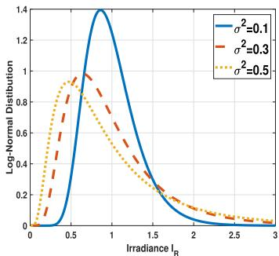  
(a) Log-normal distribution.

  
(b) Gamma-Gamma distribution.

  
(c) Negative exponential distribution.

  
(d) K-distribution  
FIGURE 32. Different atmospheric-turbulence distributions.

optical wavenumber. The expression of $C _ { n } ^ { 2 } ( h )$ is given by

$$
\begin{array} { l } { { C _ { n } ^ { 2 } ( h ) = 0 . 0 0 5 9 4 \left( \frac { v _ { \mathrm { w i n d } } } { 2 7 } \right) ^ { 2 } ( 1 0 ^ { - 5 } h ) ^ { 1 0 } } } \\ { { \mathrm { } \times \exp \left[ - \frac { h } { 1 0 0 0 } \right] + 2 . 7 \times 1 0 ^ { - 1 6 } \exp \left[ - \frac { h } { 1 5 0 0 } \right] + C _ { n } ^ { 2 } ( 0 ) , } } \end{array}\tag{36}
$$

where $v _ { \mathrm { w i n d } }$ is the wind speed and $C _ { n } ^ { 2 } ( 0 )$ is the structure constant at level ground.

b) Gamma-Gamma Distribution: For moderate-to-strong turbulence, the Gamma-Gamma fading is used to model atmospheric turbulence. Hence, the PDF of the irradiance, $I _ { a } ,$ is given by

$$
f _ { I _ { a } } ( I _ { a } ) = \frac { 2 ( \alpha \beta ) ^ { ( \alpha + \beta ) / 2 } } { \Gamma ( \alpha ) \Gamma ( \beta ) } I _ { a } ^ { ( \alpha + \beta ) / 2 - 1 } K _ { \alpha - \beta } ( 2 \sqrt { \alpha \beta I _ { a } } ) ,\tag{37}
$$

where $K _ { v } ( \cdot )$ is the modified Bessel function of the second kind and order v. α and $\beta$ are the turbulence fading parameters, and under the plane wave approximation, are expressed as follows:

$$
\alpha = \bigg [ \exp \bigg ( \frac { 0 . 4 9 \sigma _ { R } ^ { 2 } } { ( 1 + 1 . 1 1 \sigma _ { R } ^ { 1 2 / 5 } ) ^ { 7 / 6 } } \bigg ) - 1 \bigg ] ^ { - 1 } ,\tag{38}
$$

$$
\beta = \biggl \lbrack \exp \biggl ( \frac { 0 . 5 1 \sigma _ { R } ^ { 2 } } { ( 1 + 0 . 6 9 \sigma _ { R } ^ { 1 2 / 5 } ) ^ { 5 / 6 } } \biggr ) - 1 \biggr \rbrack ^ { - 1 } .\tag{39}
$$

c) -Distribution: The -distribution can be achieved as a multiplication of a Gamma distribution and an exponential distribution. The PDF is therefore given by

$$
f _ { I _ { a } } ( I _ { a } ) = \frac { 2 \alpha } { \Gamma ( \alpha ) } ( \alpha I _ { a } ) ^ { ( \alpha - 1 ) / 2 } K _ { \alpha - 1 } ( 2 \sqrt { \alpha I _ { a } } ) .\tag{40}
$$

d) Negative Exponential Distribution: The negative exponential distribution is used to model strong turbulence conditions. The PDF of its distribution is given as

$$
f _ { I _ { a } } ( I _ { a } ) = \frac { 1 } { I _ { a } ( 0 ) } \exp ( - I _ { a } / I _ { a } ( 0 ) ) , \ I _ { a } ( 0 ) > 0 ,\tag{41}
$$

where $\mathbb { E } [ I _ { a } ] = I _ { a } ( 0 )$ is the mean of receiver optical irradiance. e) Málaga Distribution ( -Distribution): As mentioned before, the -distribution embodies all the aforementioned distributions. The PDF of the irradiance $I _ { a }$ of -Distribution is given by

$$
f _ { I _ { a } } ( I _ { a } ) = A \sum _ { m = 1 } ^ { \beta } a _ { m } I _ { a } K _ { ( \alpha - m ) } \left( 2 \sqrt { \frac { \alpha \beta I _ { a } } { g \beta + \Omega ^ { \prime } } } \right) , I _ { a } > 0 ,\tag{42}
$$

where

$$
A \triangleq \frac { 2 \alpha ^ { \alpha / 2 } } { g ^ { 1 + \alpha / 2 } \Gamma ( \alpha ) } \bigg ( \frac { g \beta } { g \beta + \Omega ^ { \prime } } \bigg ) ^ { \alpha + \beta / 2 } ,\tag{43}
$$

$$
a _ { m } \triangleq \binom { \beta - 1 } { m - 1 } \frac { ( g \beta + \Omega ^ { \prime } ) ^ { 1 - m / 2 } } { ( m - 1 ) ! } \bigg ( \frac { \Omega ^ { \prime } } { g } \bigg ) ^ { m - 1 } \bigg ( \frac { \alpha } { \beta } \bigg ) ^ { m / 2 } ,\tag{44}
$$

where $g$ is the average power of the scattering component and $\Omega ^ { \prime }$ is the average power from the coherent contributions.

f) EGK Distribution: We recall that the PDF of the EGK distribution is given by

$$
f _ { I _ { a } } ( I _ { a } ) = \frac { 2 \psi } { \Gamma ( m _ { s } ) \Gamma ( m ) } \left( \frac { \mathcal { B } _ { s } \mathcal { B } } { \Omega } \right) ^ { m \psi } I _ { a } ^ { 2 m \psi - 1 }
$$

$$
\times \Gamma \left( m _ { s } - m \frac { \psi } { \psi _ { s } } , 0 , \left( \frac { \mathcal { B } _ { s } \mathcal { B } } { \Omega } \right) ^ { m \psi } I _ { a } ^ { 2 \psi } , \frac { \psi } { \Psi _ { s } } \right) ,\tag{45}
$$

where m and $m _ { s }$ represent the fading severity and shadowing severity, respectively, ψ and $\psi _ { s }$ represent the fading shaping factor and shadowing shaping factor, respectively, and  represents the average power of the received signal envelope. The functions $B _ { s }$ and are given by (27) and (28).

## 2) POINTING ERRORS

The pointing errors originate from a misalignment between the transmitter and the receiver due to errors in tracking, vibrations in the system, or building sway. We assume that a Gaussian beam, with a beamwidth denoted by $w _ { z }$ , propagates in a photo-detector. We denote the radial displacement by $r _ { d e p } .$ . Hence, the collected power at a given distance z is approximated by the following formula:

$$
I _ { p } \approx A _ { 0 } \exp \left( - \frac { 2 r _ { d e p } ^ { 2 } } { w _ { z _ { e q } } ^ { 2 } } \right) ,\tag{46}
$$

where we denote by $w _ { z _ { e q } }$ the equivalent beamwidth given by

$$
w _ { z _ { e q } } = w _ { z } ^ { 2 } \frac { \sqrt { A _ { 0 } \pi } } { 2 v \exp ( - v ^ { 2 } ) } ,\tag{47}
$$

where $A _ { 0 } = [ \mathrm { e r f } ( v ) ] ^ { 2 }$ is the maximum fraction of the collected power, and $\begin{array} { r } { v = \sqrt { \frac { a ^ { 2 } \pi } { w _ { z } ^ { 2 } } } } \end{array}$ is the ratio between the aperture radius denoted by a and the beamwidth $w _ { z }$

The radial displacement at the receiver is expressed as $\mathrm { r } _ { d e p } = [ x y ] ^ { T }$ , where x and y are the vertical and horizontal displacement on the plane.

Consequently, the distribution of $r _ { d e p } = | \mathbf { r } _ { d e p } | = \sqrt { x ^ { 2 } + y ^ { 2 } }$ depends on the distribution of x and y. Assuming independent Gaussian displacements on the horizontal and elevation axes, $r _ { d e p }$ can have several distributions depending on the Gaussian parameters. For instance, several distributions are used in the literature for modeling pointing errors, such as the Beckmann distribution [235], Rayleigh distribution [236], Rician distribution [237], and Hoyt distribution [238].

a) Beckmann Distribution: When both the x and y displacements are nonzero mean Gaussian random variables with $x \sim$ $\mathcal { N } ( \mu _ { x } , \sigma _ { x } )$ and $y \sim \mathcal N ( \mu _ { y } , \sigma _ { y } )$ , then $r _ { d e p }$ follows a Beckmann distribution with a PDF given by [235]

$$
\begin{array} { l } { { f _ { { r d e p } } ( { r _ { d e p } } ) = \displaystyle \frac { { r _ { d e p } } } { { 2 \pi } \sigma _ { x } \sigma _ { y } } } } \\ { { \displaystyle \int _ { 0 } ^ { 2 \pi } \exp \left( - \frac { ( { r _ { d e p } } \cos ( \theta ) - \mu _ { x } ) ^ { 2 } } { 2 \sigma _ { x } ^ { 2 } } - \frac { ( { r _ { d e p } } \sin ( \theta ) - \mu _ { y } ) ^ { 2 } } { 2 \sigma _ { y } ^ { 2 } } \right) d \theta } . } \end{array}\tag{48}
$$

The nth moment of the pointing error effect, denoted by $I _ { p } ,$ is given by

$$
\begin{array} { l } { \displaystyle \mathbb { E } [ I _ { p } ^ { n } ] = \frac { A _ { 0 } ^ { 2 } \xi _ { x } \xi _ { y } } { \sqrt { ( n + \xi _ { x } ^ { 2 } ) ( n + \xi _ { y } ^ { 2 } ) } } } \\ { \displaystyle \qquad \times \exp \left( - \frac { 2 n } { w _ { z _ { e q } } ^ { 2 } } \left[ \frac { \mu _ { x } ^ { 2 } } { 1 + \frac { n } { \xi _ { x } ^ { 2 } } } + \frac { \mu _ { y } ^ { 2 } } { 1 + \frac { n } { \xi _ { y } ^ { 2 } } } \right] \right) , } \end{array}\tag{49}
$$

where $\begin{array} { r } { \xi _ { x } = \frac { w _ { z e q } } { 2 \sigma _ { x } } } \end{array}$ and $\begin{array} { r } { \xi _ { y } = \frac { w _ { z e q } } { 2 \sigma _ { v } } } \end{array}$ b) Rayleigh Distribution: If both x and y have zero mean and the same variance, that is, $\mu _ { x } = \mu _ { y } = 0$ and $\sigma _ { x } = \sigma _ { y } = \sigma$ then $r _ { d e p }$ follows a Rayleigh distribution with the PDF given by [236]

$$
f _ { r _ { d e p } } ( r _ { d e p } ) = \frac { r _ { d e p } } { \sigma ^ { 2 } } \exp \left( - \frac { r _ { d e p } ^ { 2 } } { 2 \sigma ^ { 2 } } \right) ,\tag{50}
$$

and the PDF of the pointing error $I _ { p }$ given by

$$
f _ { I _ { p } } ( I _ { p } ) = \frac { \xi ^ { 2 } } { A _ { 0 } ^ { \xi ^ { 2 } } } I _ { p } ^ { \xi ^ { 2 } - 1 } ,\tag{51}
$$

where $\begin{array} { r } { \xi = \frac { w _ { z e q } } { 2 \sigma ^ { 2 } } } \end{array}$

c) Rician Distribution: In case both displacements have different non-zero means and the same variance, that is, $\mu _ { x } \neq \mu _ { y }$ and $\sigma _ { x } = \sigma _ { y } = \sigma$ , then $r _ { d e p }$ follows a Rician distribution with the PDF given by [237]

$$
f _ { r _ { d e p } } ( r _ { d e p } ) = \frac { r _ { d e p } } { \sigma ^ { 2 } } \exp \left( - \frac { ( r _ { d e p } ^ { 2 } + s ^ { 2 } ) } { 2 \sigma ^ { 2 } } \right) I _ { 0 } \left( \frac { r _ { d e p } s } { \sigma ^ { 2 } } \right) ,\tag{52}
$$

where $s = \sqrt { \mu _ { x } ^ { 2 } + \mu _ { y } ^ { 2 } }$ . The PDF of the pointing error $I _ { p }$ is given by

$$
\begin{array} { c } { { f _ { I _ { p } } ( I _ { p } ) = \displaystyle { \frac { \xi ^ { 2 } \exp ( \frac { - s ^ { 2 } } { 2 \sigma ^ { 2 } } ) } { { A _ { 0 } ^ { \xi } } ^ { 2 } } I _ { p } ^ { \xi ^ { 2 } - 1 } } } } \\ { { \times I _ { 0 } \left( \displaystyle { \frac { s } { \sqrt { 2 } \sigma ^ { 2 } } \sqrt { - w _ { z _ { e q } } \log \left( \frac { I _ { p } } { A _ { 0 } } \right) } } \right) . } } \end{array}\tag{53}
$$

d) Hoyt Distribution: When x and y have zero mean and different variances, that is, $\mu _ { x } = \mu _ { y } = 0$ and $\sigma _ { x } \neq \sigma _ { y }$ , then $r _ { d e p }$ follows a Hoyt distribution with the PDF given by [238]

$$
\begin{array} { r l r } {  { f _ { r _ { d e p } } ( r _ { d e p } ) = \frac { r _ { d e p } } { q \sigma _ { y } ^ { 2 } } } } \\ & { } & { \times \exp ( - \frac { r _ { d e p } ^ { 2 } ( 1 + q ^ { 2 } ) } { 4 q ^ { 2 } \sigma _ { y } ^ { 2 } } ) I _ { 0 } ( \frac { r _ { d e p } ^ { 2 } ( 1 - q ^ { 2 } ) } { 4 q ^ { 2 } \sigma _ { y } ^ { 2 } } ) , } \end{array}\tag{54}
$$

where $\begin{array} { r } { q = \frac { \sigma _ { x } } { \sigma _ { y } } = \frac { \xi _ { x } } { \xi _ { y } } } \end{array}$ . The PDF of the pointing error $I _ { p }$ is given by

$$
f _ { I _ { p } } ( I _ { p } ) = \frac { \xi _ { x } \xi _ { y } } { A _ { 0 } } \biggl ( \frac { I _ { p } } { A _ { 0 } } \biggr ) ^ { \frac { \xi _ { x } ^ { 2 } ( 1 + q ^ { 2 } ) } { 2 } - 1 }
$$

$$
\times I _ { 0 } \bigg ( \frac { \xi _ { x } ^ { 2 } ( 1 - q ^ { 2 } ) } { 2 } \log \bigg ( \frac { I _ { p } } { A _ { 0 } } \bigg ) \bigg ) ,\tag{55}
$$

where $0 \leq I _ { p } \leq A _ { 0 }$

## 3) ATMOSPHERIC ATTENUATION

The FSO signal is affected by the path loss, which depends on the distance between the transmitter and receiver, but also on the atmospheric conditions given by [239]

$$
I _ { A t t } = \frac { A _ { r } } { ( \Theta d ) ^ { 2 } } \mathrm { A t t } ,\tag{56}
$$

where $A _ { r }$ is the receiver effective area and  is the beam divergence. The parameter $\mathrm { A t t } \in \{ \mathrm { A t t } _ { \mathrm { f o g } } , \mathrm { A t t } _ { \mathrm { r a i n } } , \mathrm { A t t } _ { \mathrm { s n o w } } , \mathrm { A t t } _ { \mathrm { d u s t } } \}$ represents the atmospheric attenuation, and it depends on atmospheric conditions, such as fog, rain, snow, and dust, denoted by $\mathrm { { A t t } _ { f o g } }$ [240], $\mathrm { { A t t } } _ { \operatorname* { r a i n } }$ [241], $\mathbf { A t t _ { s n o w } }$ [241], and $\mathrm { { A t t } _ { d u s t } }$ [242], respectively.

## VI. OPEN CHALLENGES AND DISCUSSION A. TECHNOLOGICAL CHALLENGES

As discussed in Section IV-C, mmWave and THz communications are some of the key enablers for 5G/6G. These frequencies will enable very high data rates and offer an abundant bandwidth. However, mmWave and THz frequencies require very high antenna gain and narrow (pencil) beams. Obtaining accurate beam alignment and beam tracking is a challenging task. Especially, for fast-moving nodes such as vehicles and EVTOLs in UAM. Moreover, at these frequencies, the blockage is very detrimental to communication, especially for time-sensitive and critical applications. Although estimation and adjustment of the beams relying upon radio signals may work for static nodes, it is not suitable for fast-moving ones. Hence, solutions have to be developed such as predicting nodes mobility via machine learning algorithms. In addition, pre-recorded data environments could be used to locate potential building blockage according to the node location.

Regarding FSO, the main issues are sensitivity to pointing errors, scattering, and turbulence. Pointing errors can be induced by thermal expansion, vibrations, wind load, etc. Scattering is induced by weather conditions, mainly fog and Mie scattering). Finally, turbulence is caused by the random variations of the refractive index due to temperature and pressure fluctuations.

## B. COORDINATION CHALLENGES

There are different types of NTFPs with different costs, altitudes, and payload. Therefore, when establishing a deployment plan, one has to consider the tradeoff between the coverage provided, the cost related to the platforms, and the duration of the mission of each type of NTFP. A hybrid configuration would comprise different types of NTFPs for coverage. Larger tethered blimps would act as a macro base station, Helikites and tethered balloons act as a micro base station, and tUAV act as a pico base station. The number of each type would depend on the cost/coverage of each NTFP.

When having a constellation of NTFPs, coordination challenges can arise from such configuration among NTFPs, and between NTFPs and other communication platforms such as satellites, free-flying platforms, and terrestrial infrastructures. To coordinate NTFPs, there are two main approaches, centralized coordination or decentralized coordination. In centralized coordination, one central unit (a ground station or an NTFP) will regulate and coordinate all the NTFPs in the constellation. Hence, the central unit will assign different tasks to NTFPs while receiving feedback data from them. In decentralized coordination, NTFPs will coordinate the task among themselves in an ad hoc configuration. However, both of these approaches have their drawbacks. In the centralized approach, if the central unit is shut down (due to malfunction or physical damage), all the NTFPs in the constellation will be disconnected. Therefore, there must always be a redundancy central unit. For instance, when a central unit is selected, potential backup central units are designated. If the main central unit is inactive, one of the backup central units will act as the main central unit. In decentralized coordination, NTFPs would not have all the data about the environment; hence, an optimal decision cannot be taken.

Solutions using Artificial Intelligence (AI) techniques can overcom this drawback. Since NTFPs are tethered to ground station units, they benefit from computation and storage power. This will allow them to perform distributed learning via the ground station unit data processing. For instance, Federated learning (FL) is usually used in applications that require data security and privacy, allowing global learning and keeping the training data locally. NTFPs would use FL models without sharing their data with the central unit and only share local updates. This will decrease the data transmitted and latency of the transmission while preserving the security of data. In this scenario, the NTFPs constellation is composed of a central unit and several NTFPs could use FL. Each of these NTFPs trains a local FL model using thir gathered data. Then shares their local model with the central unit, which aggregates the received models, generates a global FL model, then shares it with the NTFP constellation. It is worth noting that NTFPs are versatile and can be used in different applications. For instance, an NTFP would have the initial task to provide coverage in a given area, then, upon request, can act as a monitoring and surveillance platform.

## C. INTERFERENCE CHALLENGES

NTFPs, thanks to their high altitudes, have a clear LOS communication to serve ground and aerial nodes. LOS communications are one of the main benefits of using NTFPs; however, the LOS advantage comes with an exacerbated interference since all the interfering nodes are also in LOS with the NTFP. Ground and aerial nodes that are far away from the NTFP can interfere with increased LOS probability, thus, decreasing the performance of the NTFP transmission. This highlights the need for advanced resource allocation and robust beamforming techniques without adding extra computational power to the end-user. The interference issue will become more critical in the new 6G use cases that require ultra-high reliability communications such as virtual reality (VR) applications and autonomous vehicles (ground vehicles and EVTOLs). Moreover, in UAM, it is expected that the air space will be congested with several types of aerial platforms such as cargo UAVs and EVTOLs. Therefore, all these platforms will interfere with a clear LOS at the NTFP. In addition, cargo UAVs and especially EVTOLs require a highly reliable safety communication since an accident in the air can cause severe harm and damage.

One approach to cope with the interference is by performing a perfect beamforming alignment between the NTFP and the receiver node. Beamforming alignment is more crucial for mmWave and THz communications. FSO and VLC communications can provide a high data rate while being immune to interference. However, FSO is not suitable to serve highly mobile nodes such as vehicles and EVTOLs. In addition, VLC can be used for aerial communications between NTFPs and close UAVs; however, direct sunlight is the main issue that can degrade the performance of such communications.

## D. REGULATORY CHALLENGES

Although we discussed the regulations related to NTFPs in Section II-J, we ought to address some of the aspects in more detail and the challenges related to NTFP as a communication infrastructure in the future NTN. Before we dive into some of the regulatory challenges related to NTFPs, one aspect that needs to be addressed is the fact that NTFP includes a heterogeneous set of platforms with diverse characteristics. Hence, a set of regulations must be issued as a unified regulation framework for NTFPs that includes different types of NTFPs and take into consideration their different characteristics. Regulations related to tethered blimps, tethered balloons, Helikites, and tUAVs are often different (depending on the country) since they belong to different types of aerial platforms. Therefore, the new regulations have to take into consideration NTFPs as new NTN technology and must have their own set of regulations for different types of NTFPs and different applications since these regulations might differ from one application to another. In the following, we will address two regulatory challenges, the security of communications and data, and NTFPs protection.

Although NTFPs have a secure tethered backhaul link compared to free-flying platforms the wireless link between an NTFP and end-users can be subject to jamming and eavesdropping. Investigating the physical layer security performance of NTFPs is a crucial research area. One type of communication that has been proven robust to jamming and eavesdropping is FSO communication. The use of FSO communication becomes more pertinent when NTFPs use it to extend the backhaul link. In addition, mmWave and THz communications are robust against jamming and eavesdropping. However, perfect beamforming alignment is required to prevent eavesdropping through highly directional signals.

Another solution that can be used to secure NTFP communications is Quantum Key Distribution (QKD). QKD is a protocol based on quantum physics that is being recently considered as a promising method to secure communications.

NTFPs provide coverage with a large footprint. Therefore, if an NTFP is out of service due to a hijacking or malicious attack, a massive number of nodes served by this NTFP will become unconnected from the network. This highlights the importance of NTFPs protection and therefore, regulations must be established to safeguard NTFPs. Usually, three NTFPs’ components are vulnerable to attacks: the envelope/shell, the tether, and the mooring station. The envelope is visible from a long distance, so it can be easily targeted by malicious attackers. Moreover, the envelope does not need high firepower to be deflated. The tether can be cut, which causes the envelope to flyaway causing the NTFP to be out of service. The tether can also be hijacked, which makes the safety of data comprised. Finally, the mooring station can be either destroyed or hijacked. Therefore, the regulatory challenges must first address the backup issues when an NTFP is out of service, and how to provide coverage in that area; and also address data protection if the NTFP is hijacked. Second, regulatory challenges must be issued to protect NTFPs from malicious attackers. For instance, to protect the NTFP envelope and tether, ground or aerial units (e.g., NTFPs) equipped with radar and computer vision functionalities can be used to detect any potential threats. To protect the mooring station, the NTFP can be placed in a gated and supervised location.

## VII. CONCLUSION

In this survey, we provided an extensive review of NTFPs. The survey was composed of two main parts. The first part presented NTFPs from a general perspective and offered an overview of this solution for all readers interested irrespective of their background by reviewing all the existing types of NTFPs, including their components, characteristics, applications, advantages, challenges, and regulations. It also contained detailed NTFPs case studies in different applications to highlight their versatility. Finally, major companies related to NTFPs were presented. The second part demonstrated how NTFPs are integrated as wireless communication infrastructures. We briefly provided a basic geometry analysis of NTFPs with respect to Earth. Then, we presented the works investigating the performance of NTFPs. We then described how NTFPs would be used alongside key enabling 6G technologies such as RIS, NOMA, mmWave/THz, FSO, VLC, LPWAN for IoT applications, and mMIMO. Following this, we showed how NTFPs with 6G technologies will be used in the future 6G use cases such as flying cars and global connectivity. To highlight the cost-effectiveness of NTFPs, we carried out an economic analysis in terms of CAPEX/OPEX and compared it with tower masts. For the sake of completeness, we provided a comprehensive channel model framework for NTFPs considering different altitudes, (LAPs and HAPs), and for different links (RF and FSO). These channel models are also applicable for free-flying platforms. Finally, we addressed the challenges related to NTFPs and discussed the open problems related to them.

## ACKNOWLEDGMENT

Fig. 14 and Fig. 16 were created by Heno Hwang, scientific illustrator at King Abdullah University of Science and Technology (KAUST). The authors would like to thank the associate editor and the reviewers for their thoughtful comments and efforts towards improving this paper.

## REFERENCES

[1] S. Dang, O. Amin, B. Shihada, and M.-S. Alouini, “What should 6G be?,” Nature Electron., vol. 3, no. 1, pp. 20–29, 2020.

[2] K. David and H. Berndt, “6G vision and requirements: Is there any need for beyond 5G?,” IEEE Veh. Technol. Mag., vol. 13, no. 3, pp. 72–80, Sep. 2018.

[3] V. Raghavan and J. Li, “Evolution of physical-layer communications research in the post-5G era,” IEEE Access, vol. 7, pp. 10392–10401, 2019.

[4] A. Yastrebova, R. Kirichek, Y. Koucheryavy, A. Borodin, and A. Koucheryavy, “Future networks 2030: Architecture & requirements,” in Proc. 10th Int. Congr. Ultra Modern Telecommun. Control Syst. Workshops, 2018, pp. 1–8.

[5] W. Saad, M. Bennis, and M. Chen, “A vision of 6G wireless systems: Applications, trends, technologies, and open research problems,” IEEE Netw., vol. 34, no. 3, pp. 134–142, May/Jun. 2020.

[6] E. C. Strinati et al., “6G: The next frontier: From holographic messaging to artificial intelligence using subterahertz and visible light communication,” IEEE Veh. Technol. Mag., vol. 14, no. 3, pp. 42–50, Sep. 2019.

[7] F. Tariq, M. R. Khandaker, K.-K. Wong, M. A. Imran, M. Bennis, and M. Debbah, “A speculative study on 6G,” IEEE Wireless Commun., vol. 27, no. 4, pp. 118–125, Aug. 2020.

[8] ITU Publications, “Measuring digital development: Facts and figures,” 2021. [Online]. Available: https://www.itu.int/en/ITU-D/Statistics/ Documents/facts/FactsFigures2021.pdf

[9] E. Yaacoub and M.-S. Alouini, “A key 6G challenge and opportunity– connecting the base of the pyramid: A survey on rural connectivity,” Proc. IEEE, vol. 108, no. 4, pp. 533–582, Apr. 2020.

[10] “6G summit, connecting the unconnected,” [Online]. Available: http: //6gsummit.org/

[11] N. Saeed, T. Y. Al-Naffouri, and M.-S. Alouini, “Wireless communication for flying cars,” Frontiers Commun. Netw., vol. 2, pp. 16, 2021.

[12] Lynk, “Lynk global,” [Online]. Available: https://lynk.world/

[13] A. S. T., “Ast & science, space mobile, transforming connectivity,” [Online]. Available: https://ast-science.com/

[14] B. Han, W. Jiang, M. A. Habibi, and H. D. Schotten, “An abstracted survey on 6G: Drivers, requirements, efforts, and enablers,” 2021, arXiv:2101.01062.

[15] M. W. Akhtar, S. A. Hassan, R. Ghaffar, H. Jung, S. Garg, and M. S. Hossain, “The shift to 6G communications: Vision and requirements,” Hum.-Centric Comput. Inf. Sci., vol. 10, no. 1, pp. 1–27, 2020.

[16] W. Saad, M. Bennis, M. Mozaffari, and X. Lin, Wireless Communications and Networking for Unmanned Aerial Vehicles. Cambridge, U.K.: Cambridge Univ. Press, 2020.

[17] G. Kurt et al., “A vision and framework for the high altitude platform station (HAPS) networks of the future,” IEEE Commun. Surveys & Tutorials, vol. 23, no. 2, pp. 729–779, 2021.

[18] F. Rinaldi et al., “Non-terrestrial networks in 5G & beyond: A survey,” IEEE Access, vol. 8, pp. 165178–165200, 2020.

[19] G. Araniti, A. Iera, S. Pizzi, and F. Rinaldi, “Toward 6G non-terrestrial networks,” IEEE Netw., vol. 36, no. 1, pp. 113–120, Jan./Feb. 2021.

[20] K. Mahmood, N. Ismail, and N. M. Suhadis, “Tethered aerostat envelope design and applications: A review,” in Proc. AIP Conf., 2020, vol. 2226, Art. no. 050003.

[21] TCOM, “Tcom web site,” [Online]. Available: https://tcomlp.com/

[22] Altaeros, “Altaeros website,” [Online]. Available: http://www.altaeros. com/

[23] Elistair, “Elistair-the tethered drone company,” [Online]. Available: https://elistair.com//

[24] U. Kalabic, C. Vermillion, and I. Kolmanovsky, “Reference governor´ design for computationally efficient attitude and tether tension constraint enforcement on a lighter-than-air wind energy system,” in Proc. Eur. Control Conf., 2013, pp. 1004–1010.

[25] M. Kehs, C. Vermillion, and H. Fathy, “Online energy maximization of an airborne wind energy turbine in simulated periodic flight,” IEEE Trans. Control Syst. Technol., vol. 26, no. 2, pp. 393–403, Mar. 2018.

[26] J. Samson and R. Katebi, “Adaptive envelope control design for a Buoyant Airborne wind energy system,” in Proc. Amer. Control Conf., 2015, pp. 2395–2400.

[27] A. Saleem and M.-H. Kim, “Aerodynamic analysis of an airborne wind turbine with three different aerofoil-based buoyant shells using steady RANS simulations,” Energy Convers. Manage., vol. 177, pp. 233–248, 2018.

[28] P. Williams, B. Lansdorp, and W. Ockesl, “Optimal crosswind towing and power generation with tethered kites,” J. Guid., Control, Dyn., vol. 31, no. 1, pp. 81–93, 2008.

[29] B. Lansdorp and P. Williams, “The Laddermill: Innovative wind energy from high altitudes in Holland and Australia,” Windpower, 2006.

[30] M. L. Loyd, “Crosswind kite power (for large-scale wind power production),” J. Energy, vol. 4, no. 3, pp. 106–111, 1980.

[31] Kitewinder, “Kitewinder website,” [Online]. Available: https:// kitewinder.fr/

[32] Makani Power, [Online]. Available: https://makanipower.com/

[33] Allsopp, “Allsopp helikites website,” [Online]. Available: http://www. allsopphelikites.com/

[34] Hybrid Air Vehicles, [Online]. Available: https://www.hybridairvehicles.com/

[35] L. M., “Lockheed martin website,” [Online]. Available: https://www. lockheedmartin.com/

[36] K.-S. Zhang, Z.-H. Han, and B.-F. Song, “Flight performance analysis of hybrid airship: Revised analytical formulation,” J. Aircr., vol. 47, no. 4, pp. 1318–1330, 2010.

[37] J. Meng, M. Li, L. Zhang, M. Lv, and L. Liu, “Aerodynamic performance analysis of hybrid air vehicles with large Reynolds number,” in Proc. IEEE Int. Conf. Unmanned Syst., 2019, pp. 403–409.

[38] Smithsonianmag.com, “What really sparked the Hindenburg disaster,” [Online]. Available: https://www.smithsonianmag.com/sciencenature/what-really-sparked-the-hindenburg-disaster-85867521/

[39] History.com, “The Hindenburg disaster,” [Online]. Available: https:// www.history.com/this-day-in-history/the-hindenburg-disaster

[40] D. A. C., “Drone aviation corp,” [Online]. Available: https:// droneaviationcorp.com/

[41] Gore, “Gore cables & cable assemblies,” [Online]. Available: https: //www.gore.com/

[42] Deregt, “Deregt aerostats and UAVs cables,” [Online]. Available: www.deregtcables.com

[43] V. Gawande, P. Bilaye, A. Gawale, R. Pant, and U. Desai, “Design and fabrication of an aerostat for wireless communication in remote areas,” in Proc. 7th AIAA ATIO Conf, 2nd CEIAT Int. ConfInnov. Integr. Aero Sci., 17th LTA Syst. Tech. Conf; Followed 2nd TEOS Forum, 2007, Art. no. 7832.

[44] P. Chopra, R. Manchanda, R. Mehrotra, and S. Jain, “A new topology for telecom and broad band services in spars, remote and hilly areas,” WSEAS Trans. Commun., vol. 10, no. 9, pp. 273–286, 2011.

[45] F. U. A. V., “Fortress UAV, UAV repair & maintenance experts,” [Online]. Available: https://www.fortressuav.com

[46] Comprehensivecom, “Comprehensive communication services,” [Online]. Available: https://www.comprehensivecom.net/

[47] O. M. Bushnaq, M. A. Kishk, A. Çelik, M.-S. Alouini, and T. Y. Al-Naffouri, “Optimal deployment of tethered drones for maximum cellular coverage in user clusters,” IEEE Trans. Wireless Commun., vol. 20, no. 3, pp. 2092–2108, Mar. 2021.

[48] M. Kishk, A. Bader, and M.-S. Alouini, “Aerial base station deployment in 6G cellular networks using tethered drones: The mobility and endurance tradeoff,” IEEE Veh. Technol. Mag., vol. 15, no. 4, pp. 103–111, Dec. 2020.

[49] F. B. Teixeira et al., “Enabling broadband internet access offshore using tethered balloons: The BLUECOM+ experience,” in Proc. OCEANS, 2017, pp. 1–7.

[50] K. M. Gajra and R. S. Pant, “Soptas: Solar powered tethered aerostat system,” in Proc. 1st Int. Conf. Non Conventional Energy, 2014, pp. 65–68.

[51] M. A. Kishk, A. Bader, and M.-S. Alouini, “On the 3-D placement of airborne base stations using tethered UAVs,” IEEE Trans. Commun., vol. 68, no. 8, pp. 5202–5215, Aug. 2020.

[52] D. F. Carlson et al., “Surface ocean dispersion observations from the ship-tethered aerostat remote sensing system,” Front. Mar. Sci., vol. 5, 2018, Art. no. 479.

[53] F. B. Teixeira, T. Oliveira, M. Lopes, J. Ruela, R. Campos, and M. Ricardo, “Tethered balloons and TV white spaces: A solution for realtime marine data transfer at remote ocean areas,” in Proc. IEEE 3rd Underwater Commun. Netw. Conf., 2016, pp. 1–5.

[54] R. Campos, T. Oliveira, N. Cruz, A. Matos, and J. M. Almeida, “Bluecom : Cost-effective broadband communications at remote ocean areas,” in Proc. OCEANS, 2016, pp. 1–6.

[55] D. Akita, “Feasibility study of a sea-anchored stratospheric balloon for long-duration flights,” Adv. Space Res., vol. 50, no. 4, pp. 508–515, 2012.

[56] R. Fesen and Y. Brown, “A method for establishing a long duration, stratospheric platform for astronomical research,” Exp. Astron., vol. 39, no. 3, pp. 475–493, 2015.

[57] Flickr, [Online]. Available: https://www.flickr.com/photos/ keyslibraries/15004011277/

[58] G. Aglietti, T. Markvart, A. Tatnall, and S. Walker, “Aerostat for electrical power generation–concept feasibility,” Proc. Inst. Mech. Eng., Part G: J. Aerosp. Eng., vol. 222, no. 1, pp. 29–39, 2008.

[59] K. Chiba, R. Nishikawa, M. Onda, S. Satori, and R. Akiba, “Aerodynamic influences on a tethered high-altitude lighter-than-air platform system to its behavior,” Aerosp. Sci. Technol., vol. 70, pp. 405–411, 2017.

[60] P. Y. Bely, R. Ashford, and C. D. Cox, “High-altitude aerostats as astronomical platforms,” in Proc. SPIE Space Telescopes Instrum., 1995, vol. 2478, pp. 101–116.

[61] S. Badesha and J. Bunn, “Dynamic simulation of high altitude tethered balloon system subject to thunderstorm windfield,” in Proc. AIAA Atmospheric Flight Mechanics Conf. Exhibit, 2002, Art. no. 4614.

[62] S. S. Badesha, “SPARCL: A high-altitude tethered balloon-based optical space-to-ground communication system,” in Proc. SPIE Free-Space Laser Commun. Laser Imag. II, 2002, vol. 4821, pp. 181–193.

[63] S. Badesha, A. Euler, and L. Schroder, “Very high altitude tethered balloon parametric sensitivity study,” in Proc. 34th Aerosp. Sci. Meeting Exhibit, 1996, Art. no. 579.

[64] S. Badesha, A. Euler, and L. Schroder, “Very high altitude tethered balloon trajectory simulation,” in Proc. 21st Atmospheric Flight Mechanics Conf., 1996, Art. no. 3440.

[65] G. Aglietti, “Dynamic response of a high-altitude tethered balloon system,” J. Aircr., vol. 46, no. 6, pp. 2032–2040, 2009.

[66] K. Izet-Ünsalan and D. Ünsalan, “A low cost alternative for satellitestethered ultra-high altitude balloons,” in Proc. 5th Int. Conf. Recent Adv. Space Technol., 2011, pp. 13–16.

[67] Y.-C. Chim et al., “Employing ad-hoc networking with aerial communications nodes for wireless tactical experimentation,” in Proc. IEEE Mil. Commun. Conf., 2006, pp. 1–7.

[68] Z. Weiwei, “The integrated panoramic surveillance system based on tethered balloon,” in Proc. IEEE Aerosp. Conf., 2015, pp. 1–7.

[69] Air Combat Command, “Air combat command, tethered aerostat radar system,” 2006. [Online]. Available: https://www.acc.af.mil/About-Us/ Fact-Sheets/Display/Article/199135/tethered-aerostat-radar-system/

[70] C. R. Dusane, A. V. Wani, R. S. Pant, D. Chakraborty, and B. Chakravarthy, “An elevated balloon-kite hybrid platform for surveillance,” in Proc. 23rd AIAA Lighter-Than-Air Syst. Technol. Conf., 2017, Art. no. 3995.

[71] N. Sharma, R. Sehgal, R. Sehgal, and R. Pant, “Design fabrication and deployment of a tethered aerostat system for aerial surveillance,” in Proc. Nat. Level Conf. Adv. Aerial/Road Veh. Appl., 2014, pp. 18–19.

[72] S. D. Prior, “Tethered drones for persistent aerial surveillance applications,” Defence Glob., pp. 78–79, 2015.

[73] K. Krisztián, “Military ballooning in point of hungarian defense force’s communication support,” Repüléstudományi Közlemények, vol. 28, no. 1, pp. 27–40, 2016.

[74] B. E. Y. Belmekki and M.-S. Alouini, “On the usage of networked tethered flying platforms for massive events-case study: Hajj pilgrimage,” IEEE Veh. Technol. Mag., 2021, arXiv:2111.00900.

[75] H. Hariyanto, H. Santoso, and A. K. Widiawan, “Emergency broadband access network using low altitude platform,” in Proc. Int. Conf. Instrum., Commun., Inf. Technol., Biomed. Eng., 2009, pp. 1–6.

[76] A. Qiantori, A. B. Sutiono, H. Hariyanto, H. Suwa, and T. Ohta, “An emergency medical communications system by low altitude platform at the early stages of a natural disaster in Indonesia,” J. Med. Syst., vol. 36, no. 1, pp. 41–52, 2012.

[77] S. H. Alsamhi, M. S. Ansari, O. Ma, F. Almalki, and S. K. Gupta, “Tethered balloon technology in design solutions for rescue and relief team emergency communication services,” Disaster Med. Public Health Prep., vol. 13 no. 2, pp. 203–210, 2019.

[78] A. Valcarce et al., “Airborne base stations for emergency and temporary events,” in Proc. Int. Conf. Pers. Satell. Serv., 2013, pp. 13–25.

[79] C. Barrado, R. Messeguer, J. López, E. Pastor, E. Santamaria, and P. Royo, “Wildfire monitoring using a mixed air-ground mobile network,” IEEE Pervasive Comput., vol. 9, no. 4, pp. 24–32, Oct.– Dec. 2010.

[80] S. Alsamhi, F. Almalki, O. Ma, M. Ansari, and M. Angelides, “Performance optimization of tethered balloon technology for public safety and emergency communications,” Telecommun. Syst., vol. 75, pp. 235–244, 2020.

[81] S. H. Alsamhi, M. S. Ansari, and N. S. Rajput, “Disaster coverage predication for the emerging tethered balloon technology: Capability for preparedness, detection, mitigation, and response,” Disaster Med. Public Health Preparedness, vol. 12, no. 2, pp. 222–231, 2018.

[82] A. A. Kanoria and R. S. Pant, “Winged aerostat systems for better station keeping for aerial surveillance,” Adv. Mater. Res., vol. 433, pp. 6871–6879, 2012.

[83] S. S. Badesha, A. D. Goldfinger, and T. W. Jerardi, “Optical communication system using a high altitude tethered balloon,” U.S. Patent 7 046 934, May 16 2006.

[84] S. Alsamhi et al., “Tethered balloon technology for green communication in smart cities and healthy environment,” in Proc. 1st Int. Conf. Intell. Comput. Eng., 2019, pp. 1–7.

[85] S. Alsamhi, S. K. Gapta, N. Rajput, and R. Saket, “Network architectures exploiting multiple tethered balloon constellations for coverage extension,” in Proc. 6th Int. Conf. Adv. Eng. Sci. Appl. Math., 2016, pp. 1–6.

[86] P. Bilaye, V. Gawande, U. Desai, A. Raina, and R. Pant, “Low cost wireless internet access for rural areas using tethered aerostats,” in Proc. IEEE Region 10 3rd Int. Conf. Ind. Inf. Syst., 2008, pp. 1–5.

[87] X. Chen and L. Vierling, “Spectral mixture analyses of hyperspectral data acquired using a tethered balloon,” Remote Sens. Environ., vol. 103, no. 3, pp. 338–350, 2006.

[88] J. Wu et al., “Experimental results of the balloon-borne spectral camera based on ghost imaging via sparsity constraints,” IEEE Access, vol. 6, pp. 68740–68748, 2018.

[89] Y. Inoue, S. Morinaga, and A. Tomita, “A blimp-based remote sensing system for low-altitude monitoring of plant variables: A preliminary experiment for agricultural and ecological applications,” Int. J. Remote Sens., vol. 21, no. 2, pp. 379–385, 2000.

[90] L. A. Vierling, M. Fersdahl, X. Chen, Z. Li, and P. Zimmerman, “The short wave aerostat-mounted imager (Swami): A novel platform for acquiring remotely sensed data from a tethered balloon,” Remote Sens. Environ., vol. 103, no. 3, pp. 255–264, 2006.

[91] Y.-H. Jo, J. Sha, J.-I. Kwon, K. Jun, and J. Park, “Mapping bathymetry based on waterlines observed from low altitude Helikite remote sensing platform,” Acta Oceanologica Sinica, vol. 34, no. 9, pp. 110–116, 2015.

[92] J.-S. Lee, J.-Y. Baek, D. Jung, J.-S. Shim, H.-S. Lim, and Y.-H. Jo, “Estimate of coastal water depth based on aerial photographs using a low-altitude remote sensing system,” Ocean Sci. J., vol. 54, no. 3, pp. 349–362, 2019.

[93] M. Garstang, M. Murday, W. R. Seguin, J. D. Brown, and N. E. Laseur, “Fluctuations in humidity, temperature, and horizontal wind as measured by a subcloud tethered-balloon system,” IEEE Trans. Geosci. Electron., vol. 9, no. 4, pp. 199–208, Oct. 1971.

[94] A. Balasuriya, T. Pennington, T. Scudere, M. McCann, R. Thayer, and R. Wronski, “Development of an autonomous mobile marine meteorological station–swims,” in Proc. OCEANS Anchorage, 2017, pp. 1–4.

[95] D. Hu, B. Qi, R. Du, H. Yang, J. Wang, and J. Zhuge, “An atmospheric vertical detection system using the multi-rotor UAV,” in Proc. Int. Conf. Meteorol. Observ., 2019, pp. 1–4.

[96] S. Krishnamoorthy et al., “Detection of artificially generated seismic signals using balloon-borne infrasound sensors,” Geophys. Res. Lett., vol. 45, no. 8, pp. 3393–3403, 2018.

[97] S. Krishnamoorthy et al., “Aerial seismology using balloon-based barometers,” IEEE Trans. Geosci. Remote Sens., vol. 57, no. 12, pp. 10191–10201, Dec. 2019.

[98] F. Deschesnes and M. Nahon, “Design improvements for a multitethered aerostat system,” in Proc. AIAA Atmospheric Flight Mechanics Conf. Exhibit, 2005, Art. no. 6126.

[99] C. Lambert, A. Saunders, C. Crawford, and M. Nahon, “Design of a one-third scale multi-tethered aerostat system for precise positioning of a radio telescope receiver,” in Proc. CASI Flight Mechanics Operations Symp., 2003, pp. 1–12.

[100] J. T. Fitzsimmons, B. Veidt, and P. E. Dewdney, “Steady-state analysis of the multi-tethered aerostat platform for the large adaptive reflector telescope,” in Proc. SPIE Radio Telescopes, 2000, vol. 4015, pp. 476–487.

[101] M. Nahon, G. Gilardi, and C. Lambert, “Dynamics/control of a radio telescope receiver supported by a tethered aerostat,” J. Guid., Control, Dyn., vol. 25, no. 6, pp. 1107–1115, 2002.

[102] A. Bajoria, N. K. Mahto, C. K. Boppana, and R. S. Pant, “Design of a tethered aerostat system for animal and bird hazard mitigation,” in Proc. First Int. Conf. Recent Adv. Aerosp. Eng., 2017, pp. 1–6.

[103] R. S. Pant, “Tethered aerostat systems for agricultural applications in India,” Inst. Eng., 2016, Art. no. 82.

[104] B. Silva et al., “Mapping two competing grassland species from a low-altitude Helium balloon,” IEEE J. Sel. Topics Appl. Earth Observ. Remote Sens., vol. 7, no. 7, pp. 3038–3049, Jul. 2014.

[105] P. Fiorentin et al., “MINLU: An instrumental suite for monitoring light pollution from drones or airballoons,” in Proc. 5th IEEE Int. Workshop Metrol. AeroSpace, 2018, pp. 274–278.

[106] G. S. Aglietti, S. Redi, A. R. Tatnall, and T. Markvart, “Harnessing high-altitude solar power,” IEEE Trans. Energy Convers., vol. 24, no. 2, pp. 442–451, Jun. 2009.

[107] G. Aglietti, T. Markvart, A. Tatnall, and S. Walker, “Solar power generation using high altitude platforms feasibility and viability,” Prog. Photovolt.: Res. Appl., vol. 16, no. 4, pp. 349–359, 2008.

[108] K. Ghosh, A. Guha, and S. P. Duttagupta, “Power generation on a solar photovoltaic array integrated with lighter-than-air platform at low altitudes,” Energy Convers. Manage., vol. 154, pp. 286–298, 2017.

[109] GSMA, “The true cost of providing energy to telecom towers in India,” [Online]. Available: https://www.gsma.com/membership/wpcontent/uploads/2013/01/true-cost-providing-energy-telecomtowers-india.pdf/

[110] “5G appeal: Scientists and doctors warn of potential serious health effects of 5G,” Accessed on: Feb. 27, 2022. [Online]. Available: https://www.jrseco.com/wp-content/uploads/2017-09-13- Scientist-Appeal-5G-Moratorium.pdf

[111] M. Warwick, “Red sky at night, cell tower’s alight: Nearly half of UK consumers think 5G is a health risk,” Accessed on: Feb. 27, 2022. [Online]. Available: https://www.telecomtv.com/content/5g/red-skyat-night-cell-towers-alight-nearly-half-of-uk-consumers-think-5gis-a-health-risk-39753/

[112] L. Falcioni et al., “Report of final results regarding brain and heart tumors in Sprague-Dawley rats exposed from prenatal life until natural death to mobile phone radiofrequency field representative of a 1.8 GHz GSM base station environmental emission,” Environ. Res., vol. 165, pp. 496–503, 2018.

[113] National Toxicology Program et al., “Toxicology and carcinogenesis studies in hsd: Sprague Dawley SD rats exposed to whole-body radio frequency radiation at a frequency (900 MHz) and modulations (GSM and CDMA) used by cell phones,” National Toxicology Program, U.S. Dept. of Health and Human Services, Washington, DC, USA, Tech. Rep, 2018.

[114] Z. Lou, A. Elzanaty, and M.-S. Alouini, “Green tethered UAVs for EMF-aware cellular networks,” IEEE Trans. Green Commun. Netw., vol. 5, no. 4, pp. 1697–1711, Dec. 2021.

[115] P. K. Singya and M.-S. Alouini, “Mixed FSO/RF based multiple HAPs assisted multiuser multiantenna terrestrial communication,” Front. Commun. Netw., p. 8, Mar. 2022.

[116] W. Wang, N. Cheng, Y. Liu, H. Zhou, X. Lin, and X. Shen, “Content delivery analysis in cellular networks with aerial caching and mmwave backhaul,” IEEE Trans. Veh. Technol., vol. 70, no. 5, pp. 4809–4822, May 2021.

[117] A. Alzidaneen, A. Alsharoa, and M.-S. Alouini, “Resource and placement optimization for multiple UAVs using backhaul tethered balloons,” IEEE Wireless Commun. Lett., vol. 9, no. 4, pp. 543–547, Apr. 2020.

[118] R. Arshad, L. Lampe, H. ElSawy, and M. J. Hossain, “Integrating UAVs into existing wireless networks: A stochastic geometry approach,” in Proc. IEEE Globecom Workshops, 2018, pp. 1–6.

[119] O. M. Bushnaq, A. Celik, H. ElSawy, M.-S. Alouini, and T. Y. Al-Naffouri, “Aeronautical data aggregation and field estimation in IoT networks: Hovering and traveling time dilemma of UAVs,” IEEE Trans. Wireless Commun., vol. 18, no. 10, pp. 4620–4635, Oct. 2019.

[120] C. Stöcker, R. Bennett, F. Nex, M. Gerke, and J. Zevenbergen, “Review of the current state of UAV regulations,” Remote Sens., vol. 9, no. 5, 2017, Art. no. 459.

[121] R. L. Finn, D. Wright, L. Jacques, and P. De Hert, “Study on privacy, data protection and ethical risks in civil remotely piloted aircraft systems operations,” Final Report, Luxembourg: Publications Office of the European Union, vol. 39, 2014.

[122] The Washington Post, “The military lost control of a giant, unmanned surveillance blimp,” [Online]. Available: https: //www.washingtonpost.com/news/the-switch/wp/2015/10/28/thearmy-lost-control-of-a-giant-unmanned-surveillance-blimp/

[123] F. A. A., “The Federal Aviation Administration, title 14: Aeronautics and space, part 101 – moored balloons, kites, amateur rockets, unmanned free balloons, and certain model aircraft, and part 107 – small unmanned aircraft systems,” [Online]. Available: https://www. ecfr.gov/

[124] Library of Congress, “Library of Congress, regulation of drones,” [Online]. Available: https://www.loc.gov/law/help/regulation-of-drones/

[125] Elisair, “Paris airport maintenance use case,” [Online]. Available: https://elistair.com/airport-maintenance-use-case/

[126] EASA, “Easy access rules for tethered gas balloons (cs-31tgb),” [Online]. Available: https://www.easa.europa.eu/

[127] F. C. C., “The federal communications commission (FCC),” [Online]. Available: https://www.fcc.gov/

[128] Elisair, “Roundabout traffic monitoring use case in lyon,” [Online]. Available: https://elistair.com/roundabout-traffic-monitoringuse-case/

[129] DataFromSky, “Deep traffic video analysis - datafromsky,” [Online]. Available: https://datafromsky.com/

[130] TCOM, “TCOM case study: Border patrol in southern texas,” [Online]. Available: https://tcomlp.com/aerostat-system-border-patrol/

[131] NOFO, “The Norwegian Clean Seas Association for operating companies,” [Online]. Available: https://www.nofo.no/

[132] U.S. Customs and Border Protection, “U.S. border patrol southwest border apprehensions,” [Online]. Available: https://www.cbp. gov/newsroom/stats/usbp-sw-border-apprehensions

[133] AAA, “Aerostats all Australia (AAA) mobile coverage,” [Online]. Available: https://www.bal.com.au/AAA.pdf

[134] T. Staedter, “Soaring ‘supertowers’ aim to bring mobile broadband to rural areas,” in Proc. IEEE Spectr., 2018.

[135] B. Glass, “Supertower: An introduction to tethered aerial cell towers 6G, summit, connecting the unconnected,” [Online]. Available: http: //6gsummit.org/

[136] Altaeros, “Altaeros supertower,” [Online]. Available: https://smallcells.3g4g.co.uk/2019/04/

[137] Lindstrand Technologies, [Online]. Available: https://www.lindstrandtech.com/

[138] CNIM Air Space, [Online]. Available: https://cnim-air-space.com/fr/

[139] ADASI, “ADASI Get the edge with the autonomous advantage,” [Online]. Available: https://adasi.ae/

[140] vigilance, “Vigilance,” [Online]. Available: http://www.vigilance.nl/

[141] Drone Aviation Corp, [Online]. Available: https://droneaviationcorp. com/

[142] SkyDoc, “Skydoc balloon,” [Online]. Available: http://www.skydocballoon.com/

[143] Equinox Innovative Systems, [Online]. Available: https://www.equinoxinnovativesystems.com/

[144] Tethered Drone Systems, [Online]. Available: https://tethereddronesystems.co.uk/

[145] Hoverfly, “Hoverfly technology,” [Online]. Available: https://hoverflytech.com/

[146] Fotokite, “Fotokite,” [Online]. Available: https://fotokite.com/

[147] AWE, “Airborne wind Europe,” [Online]. Available: https://airbornewindeurope.org/

[148] Spooky Action Robotics, [Online]. Available: https://spookyactionrobotics.com

[149] Aeromana, [Online]. Available: https://www.aeromana.com/

[150] S. Cakaj, B. Kamo, V. Koliçi, and O. Shurdi, “The range and horizon plane simulation for ground stations of low earth orbiting (LEO) satellites,” Int. J. Commun. Netw. Syst. Sci., vol. 4, no. 9, pp. 585–589, 2011.

[151] M. Geyer et al., “Earth-referenced aircraft navigation and surveillance analysis,” John A. Volpe Nat. Transp. Syst. Center (US), Tech. Rep., DOT-VNTSC-FAA-16-12, 2016.

[152] P. Li and J. Xu, “Placement optimization for UAV-enabled wireless networks with multi-hop backhauls,” J. Commun. Inf. Netw., vol. 3, no. 4, pp. 64–73, Dec. 2018.

[153] Y. Qin, M. A. Kishk, and M.-S. Alouini, “Performance evaluation of UAV-enabled cellular networks with battery-limited drones,” IEEE Commun. Lett., vol. 24, no. 12, pp. 2664–2668, Dec. 2020.

[154] M. Y. Selim and A. E. Kamal, “Post-disaster 4G/5G network rehabilitation using drones: Solving battery and backhaul issues,” in Proc. IEEE Globecom Workshops, 2018, pp. 1–6.

[155] E. Zedini, H. Soury, and M.-S. Alouini, “On the performance analysis of dual-hop mixed FSO/RF systems,” IEEE Trans. Wireless Commun., vol. 15, no. 5, pp. 3679–3689, May 2016.

[156] M. Alzenad, M. Z. Shakir, H. Yanikomeroglu, and M.-S. Alouini, “FSO-based vertical backhaul/fronthaul framework for 5G wireless networks,” IEEE Commun. Mag., vol. 56, no. 1, pp. 218–224, Jan. 2018.

[157] V. U. Pai and B. Sainath, “UAV selection and link switching policy for hybrid tethered UAV-assisted communication,” IEEE Commun. Lett., vol. 25, no. 7, pp. 2410–2414, Jul. 2021.

[158] N. E.-D. Safwat, I. M. Hafez, and F. Newagy, “3D placement of a new tethered UAV to UAV relay system for coverage maximization,” Electronics, vol. 11, no. 3, 2022, Art. no. 385.

[159] J. Wang, H. Zhang, S. Guo, and D. Yuan, “Trajectory design and resource allocation for tethered-UAV assisted wireless networks,” in Proc. IEEE/CIC Int. Conf. Commun. China, 2021, pp. 647–652.

[160] X. Fang, W. Feng, Y. Wang, Y. Chen, N. Ge, and Z. Ding, “Nomabased hybrid satellite-UAV-terrestrial networks for beyond 5G maritime Internet of Things,” 2021, arXiv:2104.03755.

[161] P. Sudheesh, M. Mozaffari, M. Magarini, W. Saad, and P. Muthuchidambaranathan, “Sum-rate analysis for high altitude platform (HAP) drones with tethered balloon relay,” IEEE Commun. Lett., vol. 22, no. 6, pp. 1240–1243, Jun. 2018.

[162] M. Di Renzo et al., “Reconfigurable intelligent surfaces vs. relaying: Differences, similarities, and performance comparison,” IEEE Open J. Commun. Soc., vol. 1, pp. 798–807, 2020.

[163] F. H. Danufane, M. Di Renzo, J. De Rosny, and S. Tretyakov, “On the path-loss of reconfigurable intelligent surfaces: An approach based on green’s theorem applied to vector fields,” IEEE Trans. Commun., vol. 69, no. 8, pp. 5573–5592, Aug. 2021.

[164] G. K. Kurt et al., “A vision and framework for the high altitude platform station (HAPS) networks of the future,” IEEE Commun. Surv. Tut., vol. 23, no. 2, pp. 729–779, Apr.–Jun. 2021.

[165] J. Ye, J. Qiao, A. Kammoun, and M.-S. Alouini, “Non-terrestrial communications assisted by reconfigurable intelligent surfaces,” in Proc. IEEE, 2022.

[166] Z. Ding, X. Lei, G. K. Karagiannidis, R. Schober, J. Yuan, and V. K. Bhargava, “A survey on non-orthogonal multiple access for 5G networks: Research challenges and future trends,” IEEE J. Sel. Areas Commun., vol. 35, no. 10, pp. 2181–2195, Oct. 2017.

[167] K. S. Ali, M. Haenggi, H. ElSawy, A. Chaaban, and M.-S. Alouini, “Downlink non-orthogonal multiple access (NOMA) in poisson networks,” IEEE Trans. Commun., vol. 67, no. 2, pp. 1613–1628, Feb. 2019.

[168] Z. Shi, S. Ma, H. ElSawy, G. Yang, and M.-S. Alouini, “Cooperative HARQ-assisted NOMA scheme in large-scale D2D networks,” IEEE Trans. Commun., vol. 66, no. 9, pp. 4286–4302, Sep. 2018.

[169] K. Ali, H. ElSawy, and M.-S. Alouini, “Meta distribution of downlink non-orthogonal multiple access (NOMA) in poisson networks,” IEEE Wireless Commun. Lett., vol. 8, no. 2, pp. 572–575, Apr. 2019.

[170] Y. Liu, W. Yi, Z. Ding, X. Liu, O. Dobre, and N. Al-Dhahir, “Developing NOMA to next generation multiple access (NGMA): Future vision and research opportunities,” 2021, arXiv:2103.02334.

[171] Z. Ding and H. V. Poor, “On the application of BAC-NOMA to 6G mMTC,” IEEE Commun. Lett., vol. 25, no. 8, pp. 2678–2682, Aug. 2021.

[172] B. E. Y. Belmekki, A. Hamza, and B. Escrig, “On the outage probability of cooperative 5G NOMA at intersections,” in Proc. IEEE 89th Veh. Technol. Conf., 2019, pp. 1–6.

[173] B. E. Y. Belmekki, A. Hamza, and B. Escrig, “Outage performance of NOMA at road intersections using stochastic geometry,” in Proc. IEEE Wireless Commun. Netw. Conf., 2019, pp. 1–6.

[174] B. E. Y. Belmekki, A. Hamza, and B. Escrig, “Outage analysis of cooperative NOMA using maximum ratio combining at intersections,” in Proc. Int. Conf. Wireless Mobile Comput., Netw. Commun., 2019, pp. 1–6.

[175] A. Abu Zaid, B. E. Y. Belmekki, and M.-S. Alouini, “Technological trends and key communication enablers for eVTOLs,” 2021, arXiv:2110.08830

[176] R. Kowerdziej, M. Olifierczuk, J. Parka, and J. Wrobel, “Terahertz characterization of tunable metamaterial based on electrically controlled nematic liquid crystal,” Appl. Phys. Lett., vol. 105, no. 2, 2014, Art. no. 022908.

[177] Z. Liu and B. Bai, “Ultra-thin and high-efficiency graphene metasurface for tunable terahertz wave manipulation,” Opt. Exp., vol. 25, no. 8, pp. 8584–8592, 2017.

[178] P. K. Singya and M.-S. Alouini, “Performance of UAV assisted multiuser terrestrial-satellite communication system over mixed FSO/RF channels,” IEEE Trans. Aerosp. Electron. Syst., vol. 58, no. 2, pp. 781–796, Apr. 2022.

[179] A. Trichili et al., “Retrofitting FSO systems in existing RF infrastructure: A non-zero sum game technology,” IEEE J. Commun. Soc., pp. 2597–2615, 2021.

[180] A. Costanzo, V. Loscrí, V. Deniau, and J. Rioult, “On the interference immunity of visible light communication (VLC),” in Proc. IEEE Glob. Commun. Conf., 2020, pp. 1–6.

[181] A. Costanzo and V. Loscri, “Visible light indoor positioning in a noiseaware environment,” in Proc. IEEE Wireless Commun. Netw. Conf., 2019, pp. 1–6.

[182] M. Ayyash et al., “Coexistence of WiFi and LiFi toward 5G: Concepts, opportunities, and challenges,” IEEE Commun. Mag., vol. 54, no. 2, pp. 64–71, Feb. 2016.

[183] A. Ashok, “Position: Dronevlc: Visible light communication for aerial vehicular networking,” in Proc. 4th ACM Workshop Visible Light Commun. Syst., 2017, pp. 29–30.

[184] A. Amantayeva, M. Yerzhanova, and R. C. Kizilirmak, “UAV location optimization for UAV-to-vehicle multiple access channel with visible light communication,” in Proc. Wireless Days, 2019, pp. 1–4.

[185] Y. Wang, M. Chen, Z. Yang, T. Luo, and W. Saad, “Deep learning for optimal deployment of UAVs with visible light communications,” IEEE Trans. Wireless Commun., vol. 19, no. 11, pp. 7049–7063, Nov. 2020.

[186] M. Chen, Y. Miao, Y. Hao, and K. Hwang, “Narrow band Internet of Things,” IEEE Access, vol. 5, pp. 20557–20577, 2017.

[187] B. Foubert and N. Mitton, “Long-range wireless radio technologies: A survey,” Future Internet, vol. 12, no. 1, 2020, Art. no. 13.

[188] J. P. S. Sundaram, W. Du, and Z. Zhao, “A survey on lora networking: Research problems, current solutions, and open issues,” IEEE Commun. Surv. Tut., vol. 22, no. 1, pp. 371–388, Jan.–Mar. 2020.

[189] E. Björnson, J. Hoydis, and L. Sanguinetti, “Massive MIMO networks: Spectral, energy, and hardware efficiency,” Foundations Trends Signal Process., vol. 11, no. 3–4, pp. 154–655, 2017.

[190] S. Nie, J. M. Jornet, and I. F. Akyildiz, “Intelligent environments based on ultra-massive MIMO platforms for wireless communication in millimeter wave and terahertz bands,” in Proc. IEEE Int. Conf. Acoust., Speech, Signal Process., 2019, pp. 7849–7853.

[191] I. F. Akyildiz, C. Han, and S. Nie, “Combating the distance problem in the millimeter wave and terahertz frequency bands,” IEEE Commun. Mag., vol. 56, no. 6, pp. 102–108, Jun. 2018.

[192] I. Khaled, A. E. Falou, C. Langlais, B. ELHassan, and M. Jezequel, “Performance evaluation of linear precoding mmWave multi-user MIMO systems with NYUSIM channel simulator,” in Proc. IEEE Middle East North Afr. Commun. Conf., 2019, pp. 1–6.

[193] I. Khaled, C. Langlais, A. El Falou, B. A. Elhassan, and M. Jezequel, “Multi-user angle-domain MIMO-NOMA system for mmWave communications,” IEEE Access, vol. 9, pp. 129443–129459, 2021.

[194] I. Khaled, C. Langlais, A. El Falou, M. Jezequel, and B. Elhasssan, “Joint single-and multi-beam angle-domain NOMA for hybrid mmWave MIMO systems,” in Proc. Workshop Smart Antennas, 2021, pp. 1–6.

[195] M. Giordani, M. Polese, M. Mezzavilla, S. Rangan, and M. Zorzi, “Toward 6G networks: Use cases and technologies,” IEEE Commun. Mag., vol. 58, no. 3, pp. 55–61, Mar. 2020.

[196] B. E. Y. Belmekki, A. Hamza, and B. Escrig, “On the performance of 5G non-orthogonal multiple access for vehicular communications at road intersections,” Veh. Commun., vol. 22, 2020, Art. no. 100202.

[197] B. E. Y. Belmekki, A. Hamza, and B. Escrig, “Performance analysis of cooperative noma at intersections for vehicular communications in the presence of interference,” Ad Hoc Netw., vol. 98, 2020, Art. no. 102036.

[198] B. E. Y. Belmekki, A. Hamza, and B. Escrig, “Performance analysis of cooperative communications at road intersections using stochastic geometry tools,” Digit. Signal Process., vol. 116, 2021, Art. no. 103112.

[199] B. E. Y. Belmekki, A. Hamza, and B. Escrig, “Cooperative vehicular communications at intersections over Nakagami-m fading channels,” Veh. Commun., vol. 19, 2019, Art. no. 100165.

[200] M. J. Farooq, H. ElSawy, and M.-S. Alouini, “A stochastic geometry model for multi-hop highway vehicular communication,” IEEE Trans. Wireless Commun., vol. 15, no. 3, pp. 2276–2291, Mar. 2016.

[201] B. E. Y. Belmekki, A. Hamza, and B. Escrig, “Outage analysis of cooperative noma in millimeter wave vehicular network at intersections,” in Proc. IEEE 91st Veh. Technol. Conf., 2020, pp. 1–6.

[202] G. Pan and M.-S. Alouini, “Flying car transportation system: Advances, techniques, and challenges,” IEEE Access, vol. 9, pp. 24586–24603, 2021.

[203] F. Fourati, S. H. Alsamhi, and M.-S. Alouini, “Bridging the urban-rural connectivity gap through intelligent space, air, and ground networks,” 2022, arXiv:2202.12683.

[204] N. Saeed, H. Almorad, H. Dahrouj, T. Y. Al-Naffouri, J. S. Shamma, and M.-S. Alouini, “Point-to-point communication in integrated satellite-aerial 6G networks: State-of-the-art and future challenges,” IEEE Open J. Commun. Soc., vol. 2, pp. 1505–1525, 2021.

[205] R. Arshad, H. ElSawy, L. Lampe, and M. J. Hossain, “Handover rate characterization in 3D ultra-dense heterogeneous networks,” IEEE Trans. Veh. Technol., vol. 68, no. 10, pp. 10340–10345, Oct. 2019.

[206] F. Hsieh, F. Jardel, E. Visotsky, F. Vook, A. Ghosh, and B. Picha, “UAV-based multi-cell haps communication: System design and performance evaluation,” in Proc. IEEE Glob. Commun. Conf., 2020, pp. 1–6.

[207] G. K. Kurt and H. Yanikomeroglu, “Communication, computing, caching, and sensing for next-generation aerial delivery networks: Using a high-altitude platform station as an enabling technology,” IEEE Veh. Technol. Mag., vol. 16, no. 3, pp. 108–117, Sep. 2021.

[208] O. Kodheli et al., “Satellite communications in the new space era: A survey and future challenges,” IEEE Commun. Surv. Tut., vol. 23, no. 1, pp. 70–109, Jan.–Mar. 2020.

[209] R. Wang, M. A. Kishk, and M.-S. Alouini, “Ultra-dense LEO satellitebased communication systems: A novel modeling technique,” IEEE Commun. Mag., vol. 60, no. 4, pp. 25–31, 2022.

[210] F. Fourati and M.-S. Alouini, “Artificial intelligence for satellite communication: A review,” Intell. Converged Netw., vol. 2, no. 3, pp. 213–243, 2021.

[211] S. M. H., “Nbn’s first satellite, sky muster, launches successfully into orbit,” [Online]. Available: https://www.smh.com.au/technology/ nbns-first-satellite-sky-muster-launches-successfully-into-orbit-20151001-gjymxv.html

[212] Mynaric, “Connectivity for the skies & beyond,” [Online]. Available: https://mynaric.com/

[213] P. Data, “Prediction methods required for the design of terrestrial broadband millimetric radio access systems operating in a frequency range of about 20–50 GHz,” Draft New Reco. ITU-R P.[DOC. 3/47], Working Party K, vol. 3, 2003.

[214] A. Al-Hourani, S. Kandeepan, and S. Lardner, “Optimal LAP altitude for maximum coverage,” IEEE Wireless Commun. Lett., vol. 3, no. 6, pp. 569–572, Dec. 2014.

[215] M. M. Azari, F. Rosas, K.-C. Chen, and S. Pollin, “Ultra reliable UAV communication using altitude and cooperation diversity,” IEEE Trans. Commun., vol. 66, no. 1, pp. 330–344, Jan. 2018.

[216] A. A. Khuwaja, Y. Chen, N. Zhao, M.-S. Alouini, and P. Dobbins, “A survey of channel modeling for UAV communications,” IEEE Commun. Surv. Tut., vol. 20, no. 4, pp. 2804–2821, Jan.–Mar. 2018.

[217] F. Yilmaz and M.-S. Alouini, “A new simple model for composite fading channels: Second order statistics and channel capacity,” in Proc. 7th Int. Symp. Wireless Commun. Syst., 2010, pp. 676–680.

[218] I. Y. Abualhaol and M. M. Matalgah, “Performance analysis of multicarrier relay-based UAV network over fading channels,” in Proc. IEEE Globecom Workshops, 2010, pp. 1811–1815.

[219] W. G. Newhall et al., “Wideband air-to-ground radio channel measurements using an antenna array at 2 GHz for low-altitude operations,” in Proc. IEEE Mil. Commun. Conf., 2003, pp. 1422–1427.

[220] X. Cai et al., “Low altitude UAV propagation channel modelling,” in Proc. 11th Eur. Conf. Antennas Propag., 2017, pp. 1443–1447.

[221] X. Ye, X. Cai, X. Yin, J. Rodríguez-Piñeiro, L. Tian, and J. Dou, “Air-to-ground Big-Data-assisted channel modeling based on passive sounding in LTE networks,” in Proc. IEEE Globecom Workshops, 2017, pp. 1–6.

[222] N. Goddemeier and C. Wietfeld, “Investigation of air-to-air channel characteristics and a UAV specific extension to the rice model,” in Proc. IEEE Globecom Workshops, 2015, pp. 1–5.

[223] E. W. Frew and T. X. Brown, “Airborne communication networks for small unmanned aircraft systems,” Proc. IEEE, vol. 96, no. 12, pp. 2008–2027, Dec. 2008.

[224] E. Yanmaz, R. Kuschnig, and C. Bettstetter, “Achieving air-ground communications in 802.11 networks with three-dimensional aerial mobility,” in Proc. IEEE INFOCOM, 2013, pp. 120–124.

[225] M. Simunek, F. P. Fontán, and P. Pechac, “The UAV low elevation propagation channel in urban areas: Statistical analysis and timeseries generator,” IEEE Trans. Antennas Propag., vol. 61, no. 7, pp. 3850–3858, Jul. 2013.

[226] S. Karapantazis and F. Pavlidou, “Broadband communications via high-altitude platforms: A survey,” IEEE Commun. Surv. Tut., vol. 7, no. 1, pp. 2–31, Jan.–Mar. 2005.

[227] J. L. Cuevas-Ruíz and J. A. Delgado-Penín, “Channel modeling and simulation in HAPS systems,” in Proc. Eur. Wireless2004, pp. 24–27.

[228] J. Zhao, Q. Wang, Y. Li, J. Zhou, and W. Zhou, “Ka-band based channel modeling and analysis in high altitude platform (HAP) system,” in Proc. IEEE 91st Veh. Technol. Conf., 2020, pp. 1–5.

[229] A. Trichili, M. A. Cox, B. S. Ooi, and M.-S. Alouini, “Roadmap to free space optics,” J. Opt. Soc. Amer. B, vol. 37, no. 11, pp. A184–A201, 2020.

[230] H. E. Nistazakis, E. A. Karagianni, A. D. Tsigopoulos, M. E. Fafalios, and G. S. Tombras, “Average capacity of optical wireless communication systems over atmospheric turbulence channels,” J. Lightw. Technol., vol. 27, no. 8, pp. 974–979, 2009.

[231] A. Al-Habash, L. C. Andrews, and R. L. Phillips, “Mathematical model for the irradiance probability density function of a laser beam propagating through turbulent media,” Opt. Eng., vol. 40, no. 8, pp. 1554–1562, 2001.

[232] T. A. Tsiftsis, H. G. Sandalidis, G. K. Karagiannidis, and M. Uysal, “Optical wireless links with spatial diversity over strong atmospheric turbulence channels,” IEEE Trans. Wireless Commun., vol. 8, no. 2, pp. 951–957, Feb. 2009.

[233] H. Nistazakis, V. Assimakopoulos, and G. Tombras, “Performance estimation of free space optical links over negative exponential atmospheric turbulence channels,” Optik, vol. 122, no. 24, pp. 2191–2194, 2011.

[234] A. Jurado-Navas, J. M. Garrido-Balsells, J. F. Paris, A. Puerta-Notario, and J. Awrejcewicz, “A unifying statistical model for atmospheric optical scintillation,” Numer. Simul. Phys. Eng. Process., vol. 181, no. 8, pp. 181–205, 2011.

[235] H. AlQuwaiee, H.-C. Yang, and M.-S. Alouini, “On the asymptotic capacity of dual-aperture FSO systems with generalized pointing error model,” IEEE Trans. Wireless Commun., vol. 15, no. 9, pp. 6502–6512, Sep. 2016.

[236] A. A. Farid and S. Hranilovic, “Outage capacity optimization for freespace optical links with pointing errors,” J. Lightw. Technol., vol. 25, no. 7, pp. 1702–1710, 2007.

[237] F. Yang, J. Cheng, and T. A. Tsiftsis, “Free-space optical communication with nonzero boresight pointing errors,” IEEE Trans. Commun., vol. 62, no. 2, pp. 713–725, Feb. 2014.

[238] W. Gappmair, S. Hranilovic, and E. Leitgeb, “OOK performance for terrestrial FSO links in turbulent atmosphere with pointing errors modeled by Hoyt distributions,” IEEE Commun. Lett., vol. 15, no. 8, pp. 875–877, Aug. 2011.

[239] A. Vavoulas, H. G. Sandalidis, and D. Varoutas, “Weather effects on FSO network connectivity,” IEEE/OSA J. Opt. Commun. Netw., vol. 4, no. 10, pp. 734–740, Oct. 2012.

[240] F. Nadeem, V. Kvicera, M. S. Awan, E. Leitgeb, S. S. Muhammad, and G. Kandus, “Weather effects on hybrid FSO/RF communication link,” IEEE J. Sel. Areas Commun., vol. 27, no. 9, pp. 1687–1697, Dec. 2009.

[241] P. Data, “Prediction methods required for the design of terrestrial lineof-sight systems,” Recommendation ITU-R, 2007, Art. no. 530.

[242] M. A. Esmail, H. Fathallah, and M.-S. Alouini, “An experimental study of FSO link performance in desert environment,” IEEE Commun. Lett., vol. 20, no. 9, pp. 1888–1891, Sep. 2016.

BAHA EDDINE YOUCEF BELMEKKI received the B.S. degree in electronics, and the M.Sc. degree in wireless communications and networking from the University of Science and Technology Houari Boumediene, Algiers, Algeria, in 2011 and 2013, respectively, and the Ph.D. degrees in wireless communications and signal processing from the National Polytechnic Institute of Toulouse (INPT), Toulouse, France, in 2020. From 2013 to 2014, he was with the Department of Radio Access Network, Huawei Technologies, Algiers, Algeria. From 2014 to 2016, he was an Assistant Professor with the University of Science and Technology Houari Boumediene. From 2019 to 2021, he was a teaching and research Assistant with INPT. He is currently a Postdoctoral Research Fellow with the Communication Theory Laboratory, King Abdullah University of Science and Technology, Thuwal, Saudi Arabia. His research interests include non-orthogonal multiple access systems and stochastic geometry analysis of vehicular and aerial networks.

MOHAMED-SLIM ALOUINI (Fellow, IEEE) was born in Tunis, Tunisia. He received the Ph.D. degree in electrical engineering from the California Institute of Technology, Pasadena, CA, USA, in 1998. He was a Faculty Member with the University of Minnesota, Minneapolis, MN, USA, then with Texas A&M University at Qatar, Education City, Doha, Qatar, before joining the King Abdullah University of Science and Technology, Thuwal, Saudi Arabia as a Professor of electrical and computer engineering in 2009. His current research interests include the modeling, design, and performance analysis of wireless communication systems.