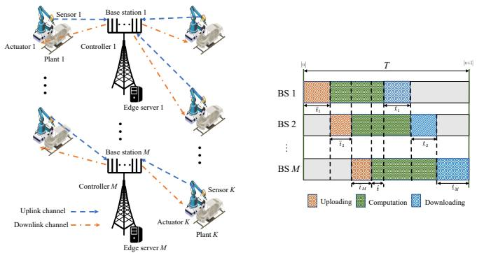
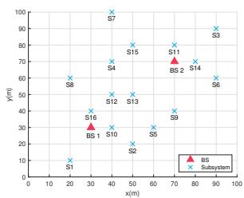
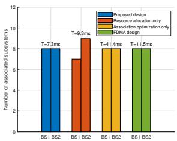
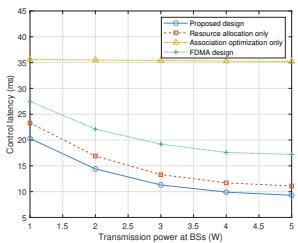
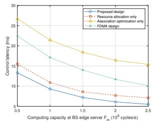

# User Association and Communication-Computation Co-Design for Wireless Control Networks

Zhilin Liu∗, Yiyang Li∗, Huijun Xing∗, Ye Zhang†, Jie Xu∗, and Shuguang Cui∗

∗School of Science and Engineering (SSE), Shenzhen Future Network of Intelligence Institute (FNii-Shenzhen),

Guangdong Provincial Key Laboratory of Future Networks of Intelligence,

The Chinese University of Hong Kong (Shenzhen)

†School of Computer Science, Beijing Information Science and Technology University

Email: zhilinliu@link.cuhk.edu.cn, yiyangli1@link.cuhk.edu.cn, huijunxing@link.cuhk.edu.cn,

yezhang@bistu.edu.cn, xujie@cuhk.edu.cn, shuguangcui@cuhk.edu.cn

Abstract—This paper studies a wireless networked control system with multiple base stations (BSs) cooperatively coordinating the wireless control of a number of subsystems each consisting of a plant, a sensor, and an actuator. In this system, each sensor first offloads the sensing data to its associated BS, which then employs mobile edge computing (MEC) to process the data and sends the command signals back to the actuator for remote control. We consider the time-division-multiple-access (TDMA) service protocol among different BSs, in which different BSs implement the uplink data collection and downlink command broadcasting over orthogonal time slots. We also employ the massive multipleinput multiple-output (MIMO) at BSs, based on which each BS serves its associated subsystems over the same time-frequency resources. We jointly design the BS-sensor/actuator associations and sensors/actuators as well as the joint communication and computation resource allocation to minimize the closed-loop control latency of the multiple subsystems while ensuring control stability. The optimization considers the transmission uncertainty caused by the hyper reliable and low-latency communications (HRLLC) and the inter-user interference, as well as the communication and computation resource constraints. To solve the non-convex problem, we develop an efficient algorithm by employing the techniques of alternating optimization and successive convex approximation (SCA). Numerical results show that the proposed joint BS-sensor/actuator association and resource allocation design significantly outperforms other benchmark schemes.

## I. INTRODUCTION

Wireless networked control is a key usage scenario for sixthgeneration (6G) networks [1], enabling industrial automation by allowing remote controllers, such as base stations (BSs), to wirelessly collect sensing data and send commands, enhancing system flexibility, scalability, and cost efficiency [2]. Typically, BSs collect sensor data, process it via edge servers, and transmit commands to actuators for control. Efficient coordination of communication, computation, and control between BS controllers and subsystems is essential. Ensuring stability

The work was supported in part by the National Natural Science Foundation of China under grants No. 92267202, the Basic Research Project No. HZQB-KCZYZ-2021067 of Hetao Shenzhen-HK S&T Cooperation Zone, the National Natural Science Foundation of China under grants No. 62471424 and 62293482, the Shenzhen Fundamental Research Program under grant No. JCYJ20210324133405015, and the National Key R&D Program of China with grant No. 2018YFB1800800, the Shenzhen Outstanding Talents Training Fund 202002, the Guangdong Research Projects No. 2017ZT07X152 and No. 2019CX01X104, the Guangdong Provincial Key Laboratory of Future Networks of Intelligence (Grant No. 2022B1212010001), the Shenzhen Key Laboratory of Big Data and Artificial Intelligence (Grant No. ZDSYS201707251409055), and the Guangdong Major Project of Basic and Applied Basic Research (No. 2023B0303000001). Ye Zhang and Jie Xu are the corresponding authors.

and efficiency in wireless networked control requires lowlatency, high-reliability processing across sensor-BS-actuator links, necessitating a joint design of communication, computation, and control. This is challenging due to the coupling of communication and computation in the closed-loop system, where sensing data latency and reliability directly impact command signal computation. Moreover, subsystems sharing distributed BS resources face load imbalances, leading to inefficient resource use and degraded performance. Efficient sensoractuator association and resource allocation are thus essential to balance loads and ensure reliable subsystem operation within limited resources.

In the literature, there have been several works investigating wireless networked control with joint communication and control co-design while ignoring the computation process [3]– [5]. For instance, [3] studied a wireless networked control system with a single BS coordinating multiple subsystems. The works [4] focused on the optimization of communication under control stability constraints to minimize energy consumption. Furthermore, [5] explored the joint communication and control co-design in wireless networked control systems, optimizing network energy consumption and control costs.

Another line of related work investigating the joint communication and computation design in mobile edge computing (MEC) networks to enhance the computation performance [6]– [8]. In particular, [6] studied a single-cell MEC system with multiple users, in which the system energy consumption was minimized while meeting the users’ computation latency requirements. [7] further considered the multi-cell MEC systems, in which the user association becomes a new design issue for enhancing the overall system performance. Despite the advancements in communication-control and communicationcomputation co-design independently, there is only a handful of prior works studying the co-design of control, communication, and computation processes in MEC-enabled wireless networked control systems [8]. However, these prior works mainly consider single BS scenarios, which are impractical for large-scale industrial Internet-of-things (IIoT) deployments requiring multiple BSs to support numerous devices over wide areas.

Different from prior works, this paper considers a wireless networked control system with multiple BSs, each equipped with an MEC server and a controller, for coordinating the control of multiple subsystems comprising plants, sensors, and actuators. The distributed resources pose challenges in BSsensor/actuator association, communication-computation coordination, and inter-subsystem interference. To address these, We propose a time-division-multiple-access (TDMA) protocol for cascaded communication and computation, with uplink data collection and downlink broadcasting over orthogonal time slots. Massive multiple-input multiple-output (MIMO) enables spatial multiplexing to serve multiple sensors and actuators. We jointly optimize BS-sensor/actuator associations and resource allocation to minimize closed-loop control latency while considering hyper reliable and low-latency communications (HRLLC) uncertainties and inter-user interference. To solve the non-convex problem, we employ alternating optimization and successive convex approximation (SCA) techniques. Numerical results show the proposed design outperforms benchmarks.

II. SYSTEM MODEL  


<details>
<summary>flowchart</summary>

```mermaid
graph TD
    subgraph Top_Layer
  A["Sensor 1"] --> B["Base station 1"]
  C["Actuator 1"] --> D["Controller 1"]
  E["Plant 1"] --> F["Edge server 1"]
  G["..."] --> H["..."]
        I["..."]
    end

    subgraph Middle_Layer
  J["Sensor K"] --> K["Base station M"]
  L["Controller M"] --> M["Edge server M"]
  N["Actuator K"] --> O["..."]
  P["Plant K"] --> Q["..."]
  R["..."] --> S["..."]
    end

  T["Timing Diagram"] --> U["T"]
  U --> V["BS 1: t1, t2, ..., tM"]
  U --> W["BS 2: t1, ..., tM"]
  U --> X["..."]
  U --> Y["BS M: t1, ..., tM"]
    style Top_Layer fill:#f9f,stroke:#333
    style Middle_Layer fill:#ccf,stroke:#333
    style Timeframe
    note right of T
        Uplink channel -.-> Right
        Downlink channel -.-> Left
    end
```
</details>

Fig. 1. The MEC-enabled wireless networked control system with multiple BSs serving a set of control subsystems and the TDMA protocol for control across multiple BSs.

As shown in Fig. 1, we consider a wireless networked control system, in which M BSs cooperatively coordinate the wireless control of K subsystems each consisting of a plant, a sensor, and an actuator. Let $\mathcal { M } = \{ 1 , \dots , M \}$ denote the set of BSs, and $K = \{ 1 , \ldots , K \}$ denote the set of subsystems. Each BS, equipped with N antennas and connected to an edge server as a controller, employs massive MIMO, assuming $\breve { N } \gg K$ . Note that in the wireless networked control system, each plant of subsystem $k \in \mathcal { K }$ is sampled at regular intervals defined by the period $T ,$ , which corresponds to the total duration for oneround processing. In this work, we focus on one sample period of duration T , in which each subsystem is associated with one single BS, and each BS may be associated with multiple subsystems. In each sample period, each BS $m \in { \mathcal { M } }$ first receives the sensing information from sensors of its associated subsystems and then computes the feedback command. Subsequently, BS m sends the command signals back to the corresponding actuators of the subsystems for wireless control. With massive MIMO, each BS can serve its associated sensors or actuators over the same time-frequency resource via spatial multiplexing. We define the BS-sensor/actuator association indicator $\alpha _ { m , k } ,$ where $\alpha _ { m , k } ~ = ~ 1$ indicates subsystem k is associated with $m .$ , and $\alpha _ { m , k } = 0$ otherwise. To ensure that each subsystem is linked to only one BS, the association constraints are as follows:

$$
\alpha_ {m, k} \in \{0, 1 \}, \quad \forall m \in \mathcal {M}, k \in \mathcal {K}, \tag {1}
$$

$$
\sum_ {m \in \mathcal {M}} \alpha_ {m, k} = 1, \quad \forall k \in \mathcal {K}. \tag {2}
$$

Furthermore, we consider the TDMA protocol among BSs as illustrated in Fig. 1, where different BSs serve their respectively associated sensors and actuators over orthogonal time slots. In particular, the whole sample period of duration T is divided into $2 M + 1$ time slots: the first M slots is utilized for sensors’ data uploading, the (M +1)-th slot is reserved for computation, and the last M slots is used for commands downloading. Specifically, we denote the set of sensors/actuators associated $\kappa _ { m } .$ $\bigcup _ { m = 1 } ^ { M } \mathcal { K } _ { m } = \mathcal { K } = \{ 1 , . . . , K \}$ . In slot $m ,$ sensors of plant $k \in \mathcal { K } _ { m }$ transmit their state vector $\hat { \mathbf { x } } _ { k } \in \mathbb { R } ^ { a \times 1 }$ (where a is the number of state parameters) to BS m via short-packet communication. From slot $( m + 1 )$ to slot $( M + m )$ , BS m processes the received sensing data $\{ \hat { \pmb { x } } _ { k } \} _ { k \in \mathcal { K } _ { m } }$ to obtain the corresponding control command signal $\hat { \mathbf { u } } _ { k } ^ { } \in \mathbb { R } ^ { a \times 1 }$ for each sub-system $\bar { k } \in \mathcal { K } _ { m }$ via edge computing. Subsequently, in slot $M + m + 1$ , BS m sends the control command signal $\hat { \mathbf { u } } _ { k } \in \mathbb { R } ^ { a \times 1 }$ back to plant $k \in \mathcal { K } _ { m }$ for remote control. Define $\lambda _ { k }$ as the size of the uplink state vector, $\hat { \lambda } _ { k }$ as the input size for edge computing, and $\underline { { \lambda } } _ { k }$ as the size of the downlink control signal for plant k. For BS $m \in \mathcal { M }$ , we denote $\bar { t } _ { m }$ as the duration of slot m for uploading, $\hat { t }$ as the duration of slot $M + 1$ for dedicated computation, and $\underline { { t } } _ { m }$ as the duration of slot $M + m + 1$ for commands downloading. Therefore, the total sample duration T is given $\begin{array} { r } { T = \sum _ { m = 1 } ^ { \overline { { M } } } \bar { t } _ { m } + \hat { t } + \sum _ { m = 1 } ^ { M } \underline { { t } } _ { m } } \end{array}$ variable to be optimized.

## A. Wireless Control Model

We first introduce the wireless networked control model [9] by focusing on one particular subsystem $k \in \mathcal { K }$ . In general, the state vector ${ \hat { \mathbf { } } } _ { k } ( { \bar { t } } )$ of subsystem k changes continuously with time t. Let $\mathbf { A } _ { k } ^ { \prime } \in \mathbb { R } ^ { a \times a ^ { \prime } }$ and $\mathbf { B } _ { k } \in \mathbb { R } ^ { a \times 1 }$ denote the system parameters for plant k, and $\tilde { { \bf n } } _ { k } ( t ) \ \in \ \mathbb { R } ^ { a \times 1 }$ denote the disturbance or the independent and identically distributed additive white Gaussian noise (AWGN) with mean zero and covariance ${ \bf R } _ { k }$ . The change of state vector ${ \hat { \mathbf { } } } _ { k } ( t )$ of subsystem k is governed by $d \hat { { \bf x } } _ { k } ( t ) \breve { = } { \bf A } _ { k } \hat { { \bf x } } _ { k } ( t ) d t + { \bf B } _ { k } \hat { { \bf u } } _ { k } ( t ) d t + d \bar { { \bf n } } _ { k } ( t )$ . Assume that the sampling of each plant’s state vectors occurs at the beginning of each sample period $i ,$ and the control commands are input at the end of each sample period. Then, following [8], the discrete-time control model is expressed as $\pmb { x } _ { k } [ i + 1 ] \overset {  } { = } \dot { \Gamma } _ { k } \pmb { x } _ { k } [ i ] + \pmb { \Lambda } _ { k } \mathbf { u } _ { k } [ i ] + \mathbf { n } _ { k } [ i ]$ , where ${ \pmb x } _ { k } [ i ]$ denotes the state vector of sample i such as position, velocity, or voltage levels, while ${ \mathbf { u } } _ { k } [ i ]$ denotes the input vector of sample i. We have $\mathbf { { \Gamma } } \mathbf { T } _ { k } = e ^ { T \mathbf { A } _ { k } } \in \mathbb { R } ^ { a \times a } , ^ { 1 }$ and $\begin{array} { r } { \mathbf { \Delta } \mathbf { \Lambda } \mathbf { 1 } _ { k } = \left( \int _ { 0 } ^ { T } e ^ { \mathbf { A } _ { k } t } d t \right) \mathbf { B } _ { k } \in \mathbb { R } ^ { a \times a } } \end{array}$ [10]. To ensure system stability, the Lyapunov-like function $\bar { \Delta } ( \bar { \mathbf { x } } _ { k } [ i ] ) ~ = ~ \mathbf { x } _ { k } [ i ] ^ { \top } \mathbf { Q } _ { k } \mathbf { x } _ { k } [ i ]$ is used, where $\mathbf { Q } _ { k }$ is positive definite. Stability is guaranteed if:

$$
\mathbb {E} \left[ \Delta \left(\mathbf {x} _ {k} [ i + 1 ]\right) \mid \mathbf {x} _ {k} [ i ] \right] \leq \eta_ {k} \Delta \left(\mathbf {x} _ {k} [ i ]\right) + \operatorname{Tr} \left(\mathbf {Q} _ {k} \mathbf {R} _ {k}\right), \tag {3}
$$

where $\eta _ { k } < 1$ is the convergence rate. Considering transmission reliability, the control input ${ \mathbf { u } } _ { k } [ i ]$ depends on successful data transmission. For successful transmission, feedback control is applied: $\mathbf { u } _ { k } [ i ] = - \mathbf { F } _ { k } \mathbf { x } _ { k } [ i ] ;$ otherwise, $\mathbf { \dot { u } } _ { k } [ i ] = 0$ . $\Gamma _ { k } ^ { \mathrm { c l o s e } } = \Gamma _ { k } - \Lambda _ { k } \mathbf { F } _ { k } , 3$

$$
\eta_ {k} \mathbf {Q} _ {k} - (1 - \varepsilon_ {k}) (\mathbf {\Gamma} _ {k} ^ {\text { close }}) ^ {\top} \mathbf {Q} _ {k} \mathbf {\Gamma} _ {k} ^ {\text { close }} - \varepsilon_ {k} (\mathbf {\Gamma} _ {k} ^ {\text { open }}) ^ {\top} \mathbf {Q} _ {k} \mathbf {\Gamma} _ {k} ^ {\text { open }} \succeq 0, \tag {4}
$$

where $\varepsilon _ { k }$ is the overall outage probability.

## B. Communication between BSs and Plants

In this subsection, we consider the wireless transmission for state information uploading from the plants to the corresponding BS in the uplink and that for control command downloading in the downlink. Let $\pmb { g } _ { m , k } \in \mathbb { C } ^ { N \times 1 }$ denote the channel vector between plant k and BS m. Note that the massive MIMO is employed at each BS to serve its associated plants via spatial multiplexing. In particular, the BS implements the low-complexity matched-filter (MF) based linear receiver by setting the receive beamforming vector as $\begin{array} { r } { \bar { \bf w } _ { m , k } = \frac { { \bf g } _ { m , k } ^ { H } } { \| { \bf g } _ { m , k } \| } } \end{array}$ for

$$
{ } ^ { 1 } \text { Here,~ } e ^ { T \mathbf { A } _ { k } } = \mathbf { I } + \mathbf { A } _ { k } T + \frac { 1 } { 2 } ( \mathbf { A } _ { k } T ) ^ { 2 } + \cdots + \frac { 1 } { n ! } ( \mathbf { A } _ { k } T ) ^ { n } + \cdots .
$$

its associated plant $k . ^ { 2 }$ Let $\bar { p } _ { m , k }$ denote the transmission power of plant k during the uploading. Let $\xi _ { m , l , k } = \left| \pmb { g } _ { m , l } ^ { H } \bar { \pmb { w } } _ { m , k } \right| ^ { 2 }$ denote the equivalent channel power gain from plant l to BS m based on the MF-based receive beamforming for plant k. Thus, the received signal-to-interference-plus-noise ratio (SINR) at the BS for its associated plant k is expressed as

$$
\bar {\gamma} _ {m, k} = \frac {\bar {p} _ {m , k} \xi_ {m , k , k}}{\sum_ {l = 1 , l \neq k} ^ {K} \bar {p} _ {m , l} \xi_ {m , l , k} + \sigma^ {2}}, \tag {5}
$$

where $\sigma ^ { 2 }$ denotes the noise power at the BS receiver. Due to the HRLLC requirements, we consider the short-packet or finite blocklength transmission. We denote $B _ { 0 }$ as the system bandwidth, and $\bar { \varepsilon } _ { k }$ as the outage probability for the sensor of plant k uploading data to BS m. In such a case, according to [12], the achievable uplink transmission rate for plant k is expressed as

$$
\bar {r} _ {k} \approx B _ {0} \left[ \sum_ {m = 1} ^ {M} \alpha_ {m, k} \log_ {2} (1 + \bar {\gamma} _ {m, k}) - \sqrt {\frac {\tilde {V}}{\sum_ {m = 1} ^ {M} \alpha_ {m , k} \bar {t} _ {m} B _ {0}}} Q ^ {- 1} (\bar {\varepsilon} _ {k}) \right], \tag {6}
$$

where $Q ^ { - 1 } ( x )$ denotes the inverse of Q-function defined as Q(x) = R ∞x $\begin{array} { r } { Q ( x ) ~ = ~ \int _ { x } ^ { \infty } \frac { 1 } { \sqrt { 2 \pi } } e ^ { - \frac { t ^ { 2 } } { 2 } } d t } \end{array}$ 2π t2 , and $\tilde { V } ~ = ~ ( \log _ { 2 } e ) ^ { 2 }$ denotes the approximated channel dispersion [13]. Based on (6), the uplink outage probability $\bar { \varepsilon } _ { k }$ is expressed as

$$
\bar {\varepsilon} _ {k} = Q \left(\log_ {e} 2 \cdot \sum_ {m = 1} ^ {M} \alpha_ {m, k} \left(\sqrt {\bar {t} _ {m} B _ {0}} \log_ {2} (1 + \bar {\gamma} _ {m, k}) - \frac {\bar {\lambda} _ {k}}{\sqrt {\bar {t} _ {m} B _ {0}}}\right)\right). \tag {7}
$$

Next, we consider the command signals broadcasting in the last M slots after the BSs obtain the control command signals. Each BS employs the massive MIMO with MF precoding to transmit these control signals. Let $\zeta _ { m , l , k } ~ = ~ \left| { \underline { { { w } } } } _ { m , l } { \underline { { { g } } } } _ { m , k } ^ { ~ H } \right| ^ { : 2 }$ wm,lgm,kH 2 denote the equivalent power gain from BS m to the actuator of plant k, where $\begin{array} { r } { \underline { { \pmb { w } } } _ { m , l } = \frac { \pmb { g } _ { m , l } ^ { H } } { \| \pmb { g } _ { m , l } \| } } \end{array}$ is the precoding vector for plant l. Let pm,k $\underline { { p } } _ { m , k }$ denote the downlink transmission power of BS m for plant $k .$ . Let $\underline { { P } } _ { m }$ denote the total downlink transmission power available at BS m for all associated plants. Therefore, we have $\begin{array} { r } { \sum _ { k \in \mathcal { K } } \alpha _ { m , k } \underline { { p } } _ { m , k } \le \underline { { P } } _ { m } , \forall m \in \mathcal { M } } \end{array}$ . Accordingly, the SINR at the receiver of plant k from its associated BS m during the downlink process is expressed as

$$
\underline {{\gamma}} _ {m, k} = \frac {\underline {{p}} _ {m , k} \zeta_ {m , k , k}}{\sum_ {l = 1 , l \neq k} ^ {K} \underline {{p}} _ {m , l} \zeta_ {m , l , k} + \sigma^ {2}}. \tag {8}
$$

Similar to (7), the downlink outage probability is expressed as

$$
\underline {{\varepsilon}} _ {k} = Q \left(\log_ {e} 2 \cdot \sum_ {m = 1} ^ {M} \alpha_ {m, k} \left(\sqrt {\underline {{t}} _ {m} B _ {0}} \log_ {2} \left(1 + \underline {{\gamma}} _ {m, k}\right) - \frac {\underline {{\lambda}} _ {k}}{\sqrt {\underline {{t}} _ {m} B _ {0}}}\right)\right). \tag {9}
$$

Furthermore, the transmission is successful only if there is no outage occured in both uplink and downlink. Therefore, the overall outage probability $\varepsilon _ { k }$ of plant k is expressed as $\varepsilon _ { k } = 1 - ( 1 - \bar { \varepsilon } _ { k } ) ( 1 - \underline { { \varepsilon } } _ { k } )$ .

## C. Edge Computation at BSs

As shown in Fig. 1, after the state information is uploaded, the corresponding BS starts the edge computation to obtain the feedback control information for the subsystwith first-come-first-served (FCFS) scheduling policy. Let $F _ { m }$ denote the maximum computation frequency at BS $m ,$ and $S _ { k }$ (in cycles/bit) denote the CPU cycles required per bit for subsystem $k .$ Recall that $\hat { \lambda } _ { k }$ is the number of computing bits for plant k. Following the TDMA protocol, we have the following constraint to ensure the computing tasks are

2Note that the MF based receiver is asymptotically optimal when M becomes sufficiently large and the multi-antenna channels are independently distributed, thus making it a practically appealing choice [11].

successfully completed within the allocated time periods (i.e., from $( m + 1 )$ to slot $( M + m ) )$ :

$$
\sum_ {k \in \mathcal {K}} \alpha_ {m, k} S _ {k} \hat {\lambda} _ {k} \leq F _ {m} \left(\sum_ {i = m + 1} ^ {M} \bar {t} _ {i} + \hat {t} + \sum_ {i = 1} ^ {m - 1} \underline {{t}} _ {i}\right), \forall m \in \mathcal {M}, \tag {10}
$$

where the right-hand-side represents the total computational capacity available at BS m within the allocated time slots. This takes into account the durations of the uploading time slots of $\left( \Sigma _ { i = m + 1 } ^ { M } \bar { t } _ { i } \right)$ time $\hat { t } ,$ and the downloading time slots of the preceding BSs $\left( \sum _ { i = 1 } ^ { m - 1 } \underline { { t } } _ { i } \right)$ computational load required by BS m to process the computing bits for all associated subsystems.

## D. Problem Formulation

To facilitate the derivation, we reformulate the control stability constraint (4) by introducing $\varepsilon _ { \mathrm { t h } }$ as the threshold for communication reliability, leading to $\varepsilon _ { k } = 1 - ( 1 - \varepsilon _ { \mathrm { t h } } ) ^ { 2 }$ . Under this setting, constraint (4) becomes

$$
\eta_ {k} \mathbf {Q} _ {k} - \left(1 - \varepsilon_ {\mathrm{th}}\right) ^ {2} \boldsymbol {\Gamma} _ {k} ^ {\text { close } T} \mathbf {Q} _ {k} \boldsymbol {\Gamma} _ {k} ^ {\text { close }} \tag {11}
$$

$$
- \left(1 - (1 - \varepsilon_ {\mathrm{th}}) ^ {2}\right) \boldsymbol {\Gamma} _ {k} ^ {\text { open } T} \mathbf {Q} _ {k} \boldsymbol {\Gamma} _ {k} ^ {\text { open }} \succeq \mathbf {0}, \quad \forall k \in \mathcal {K}.
$$

Using the small-sampling-time approximation [14] $\Gamma _ { k } \approx { \bf I } +$ $T \mathbf { A } _ { k }$ and $\mathbf { A } _ { k } \approx T \mathbf { B } _ { k }$ , constraint (4) is approximated as

$$
\left(\eta_ {k} - 1\right) \mathbf {Q} _ {k} + \left[ \left(1 - \varepsilon_ {\mathrm{th}}\right) ^ {2} \left(\mathbf {K} _ {k} ^ {T} \mathbf {B} _ {k} ^ {T} \mathbf {Q} _ {k} + \mathbf {Q} _ {k} \mathbf {B} _ {k} \mathbf {K} _ {k}\right) \right.
$$

$$
\left. - \left(\mathbf {A} _ {k} ^ {T} \mathbf {Q} _ {k} + \mathbf {Q} _ {k} \mathbf {A} _ {k}\right) \right] T + \left[ (1 - \varepsilon_ {\mathrm{th}}) ^ {2} \left(\mathbf {A} _ {k} ^ {T} \mathbf {Q} _ {k} \mathbf {B} _ {k} \mathbf {K} _ {k} + \mathbf {K} _ {k} ^ {T} \mathbf {B} _ {k} ^ {T} \mathbf {Q} _ {k} \mathbf {A} _ {k} \right. \right.
$$

$$
\left. - \mathbf {K} _ {k} ^ {T} \mathbf {B} _ {j} ^ {T} \mathbf {Q} _ {j} \mathbf {B} _ {j} \mathbf {K} _ {j}\right) - \left. \mathbf {A} _ {k} ^ {T} \mathbf {Q} _ {k} \mathbf {A} _ {k} \right] T ^ {2} \succeq 0, \quad \forall k \in \mathcal {K}. \tag {12}
$$

Furthermore, we define

$$
\boldsymbol {\Upsilon} _ {k} = \left[ (1 - \varepsilon_ {\mathrm{th}}) ^ {2} \left(\mathbf {K} _ {k} ^ {T} \mathbf {B} _ {k} ^ {T} \mathbf {Q} _ {k} + \mathbf {Q} _ {k} \mathbf {B} _ {k} \mathbf {K} _ {k}\right) - \left(\mathbf {A} _ {k} ^ {T} \mathbf {Q} _ {k} + \mathbf {Q} _ {k} \mathbf {A} _ {k}\right) \right], \tag {13}
$$

$$
\boldsymbol {\Phi} _ {k} = \left[ (1 - \varepsilon_ {\mathrm{th}}) ^ {2} \left(\mathbf {A} _ {k} ^ {T} \mathbf {Q} _ {k} \mathbf {B} _ {k} \mathbf {K} _ {k} + \mathbf {K} _ {k} ^ {T} \mathbf {B} _ {k} ^ {T} \mathbf {Q} _ {k} \mathbf {A} _ {k}\right) \right. \tag {14}
$$

$$
\left. - \left(1 - \varepsilon_ {\mathrm{th}}\right) ^ {2} \mathbf {K} _ {k} ^ {T} \mathbf {B} _ {j} ^ {T} \mathbf {Q} _ {j} \mathbf {B} _ {j} \mathbf {K} _ {j} - \mathbf {A} _ {k} ^ {T} \mathbf {Q} _ {k} \mathbf {A} _ {k} \right],
$$

and re-express (4) or (12) as

$$
\boldsymbol {\Phi} _ {k} T ^ {2} + \boldsymbol {\Upsilon} _ {k} T + (\eta_ {k} - 1) \mathbf {Q} _ {k} \succeq \mathbf {0}, \forall k \in \mathcal {K}, \tag {15}
$$

where $\Phi _ { k } , \boldsymbol { \Upsilon } _ { k } ,$ , and $\mathbf { Q } _ { k }$ are real symmetric matrices.

Our objective is to minimize the sample period T of the whole network under the constraints on control stability, maximum transmission power, and communication error probability. As such, the control stability constrained latency minimization problem is formulated as

$$
\text {(P1)}: \min _ {p, t, \alpha} T \tag {16}
$$

$$
\text { s.t. } 0 \leq \bar {\varepsilon} _ {k} (\alpha_ {m, k}, \bar {p} _ {m, k}, \bar {t} _ {m}) \leq \varepsilon_ {\mathrm{th}}, \forall m \in \mathcal {M}, k \in \mathcal {K}, \tag {16a}
$$

$$
0 \leq \underline {{\varepsilon}} _ {k} (\alpha_ {m, k}, \underline {{p}} _ {m, k}, \underline {{t}} _ {m}) \leq \varepsilon_ {\text { th }}, \forall m \in \mathcal {M}, k \in \mathcal {K}, \tag {16b}
$$

$$
\boldsymbol {\Phi} _ {k} T ^ {2} + \boldsymbol {\Upsilon} _ {k} T + (\eta_ {k} - 1) \mathbf {Q} _ {k} \succeq \mathbf {0}, \forall k \in \mathcal {K}, \tag {16c}
$$

$$
F _ {m} \left(\sum_ {i = m + 1} ^ {M} \bar {t} _ {i} + \hat {t} + \sum_ {i = 1} ^ {m - 1} \underline {{t}} _ {i}\right) \geq \sum_ {k \in \mathcal {K}} \alpha_ {m, k} S _ {k} \hat {\lambda} _ {k}, \forall m \in \mathcal {M}, (1 6 d)
$$

$$
\sum_ {m = 1} ^ {M} \bar {t} _ {m} + \hat {t} + \sum_ {m = 1} ^ {M} \underline {{t}} _ {m} = T, \tag {16e}
$$

$$
\alpha_ {m, k} \in \{0, 1 \}, \forall m \in \mathcal {M}, k \in \mathcal {K}, \tag {16f}
$$

$$
\sum_ {m \in \mathcal {M}} \alpha_ {m, k} = 1, \forall k \in \mathcal {K}, \tag {16g}
$$

$$
\alpha_ {m, k} \bar {p} _ {m, k} \leq \bar {P} _ {k}, \forall m \in \mathcal {M}, k \in \mathcal {K}, \tag {16h}
$$

$$
\sum_ {k \in \mathcal {K}} \alpha_ {m, k} \underline {{p}} _ {- m, k} \leq \underline {{P}} _ {m}, \forall m \in \mathcal {M}. \tag {16i}
$$

This problem requires a joint management of the BSsensor/actuator association(α $\in \mathbb { R } ^ { M \times \tilde { K } } , [ \alpha ] _ { m , k } \ = \ \alpha _ { m , k } )$ , transmission power control( $\begin{array} { c c l } { \pmb { p } } & { = } & { \{ \bar { p } _ { m , k } , \overset { \cdot } { \underline { { p } } } _ { m , k } \} ) . } \end{array}$ , and time allocations $\pmb { t } = \{ \bar { t } _ { m } , \hat { t } , \pmb { \underline { { t } } _ { m } } , T \} )$ ). In problem (P1), constraints (16a) and (16b) ensure the HRLLC transmission for uplink and downlink. Constraint (16c) is the control constraint that ensures the stability of the control system, and constraint (16d) specifies the computation resource limitations. Problem (P1) is a non-convex combinatorial optimization problem, which is challenging to solve.

## III. PROPOSED SOLUTION TO PROBLEM (P1)

In this section, we first relax the binary variable constraints in (16f) into continuous forms as

$$
\alpha_ {m, k} \in [ 0, 1 ], \quad \forall m \in \mathcal {M}, k \in \mathcal {K}. \tag {17}
$$

(18)

We will handle problem (P1.1) next by using the alternating optimization, in which {t, p} and {t, α} are optimized under given α and $^ { p , }$ respectively, in an alternating manner. First, we optimize α and t in problem (P1.1) with given p.

## A. Optimization of t and α with Given p

The optimization problem of t and α is formulated as

(P2) : min T t,α (19)

$\mathrm { s . t . ~ } 0 \leq \bar { \varepsilon } _ { k } \mathopen { } \mathclose \bgroup \left( \alpha _ { m , k } , \bar { t } _ { m } \aftergroup \egroup \right) \leq \varepsilon _ { \mathrm { t h } } , \forall m \in \mathcal { M } , k \in \mathcal { K } ,$ (19a)

$0 \leq \varepsilon _ { k } ( \alpha _ { m , k } , \underline { { t } } _ { m } ) \leq \varepsilon _ { \mathrm { t h } } , \forall m \in \mathcal { M } , k \in \mathcal { K } ,$ (19b)

$( 1 6 \mathrm { c } ) , ( 1 6 \mathrm { d } ) , ( \mathrm { i } 6 \mathrm { e } ) , ( 1 6 \mathrm { g } ) , ( 1 6 \mathrm { h } ) , \mathrm { a n d } ( 1 7 ) .$

Problem (P2) is non-convex since the reliability constraints in (19a) and (19b) and control stability constraint (16c) are non-convex. To address this, we introduce auxiliary variables and transformations, as detailed in our supplementary material [15] to reformulate the problem into a convex form. By combining the transformations as detailed in [15], problem (P2) is equivalently re-expressed as

$\begin{array} { r l } & { ( \mathrm { P 3 } ) : \underset { t , \alpha , \overline { { B } } , \underline { { B } } , c } { \operatorname* { m i n } } T } \\ & { \mathrm { s . t . } ( \mathrm { 1 6 g } ) , ( \mathrm { 1 6 h } ) , ( \mathrm { 1 6 d } ) , ( \mathrm { 1 6 e } ) , ( \mathrm { 1 7 } ) , } \end{array}$ (20)

$$
\left(\sqrt {\bar {t} _ {m} B _ {0}} \log_ {2} \left(1 + \bar {\gamma} _ {m, k}\right) - \frac {\bar {\lambda} _ {k}}{\sqrt {\bar {t} _ {m} B _ {0}}}\right) \geq \bar {\beta} _ {m, k}, \tag {20a}
$$

$$
\left(\sqrt {t _ {m} B _ {0}} \log_ {2} \left(1 + \underline {{\gamma}} _ {m, k}\right) - \frac {\underline {{\lambda}} _ {k}}{\sqrt {t _ {m} B _ {0}}}\right) \geq \underline {{\beta}} _ {m, k}, \tag {20b}
$$

$$
\frac {\sum_ {m = 1} ^ {M} \left(\alpha_ {m , k} + \bar {\beta} _ {m , k}\right) ^ {2} - \left(\alpha_ {m , k} - \bar {\beta} _ {m , k}\right) ^ {2}}{4 \log_ {2} e} \geq Q ^ {- 1} \left(\varepsilon_ {\mathrm{th}}\right), \forall k \in \mathcal {K}, \tag {20c}
$$

$$
\frac {\sum_ {m = 1} ^ {M} \left(\alpha_ {m , k} + \underline {{\beta}} _ {m , k}\right) ^ {2} - \left(\alpha_ {m , k} - \underline {{\beta}} _ {m , k}\right) ^ {2}}{4 \log_ {2} e} \geq Q ^ {- 1} \left(\varepsilon_ {\mathrm{th}}\right), \forall k \in \mathcal {K}, \tag {20d}
$$

(20e)

(20f)

$\Phi _ { k } \mathbf { \bar { c } } + \mathbf { \bar { Y } } _ { k } T + \left( \eta _ { k } - 1 \right) \mathbf { Q } _ { k } \mathbf { \bar { \xi } } = \mathbf { 0 } , \forall k \in \mathcal { K } .$ (20g)

For problem (P3), the constraints in (20c), (20d), and (20e) are still non-convex. Therefore, we further employ the SCA technique to deal with the above constraints in an iterative manner. Specifically, in each inner iteration $\bar { o } \geq 1$ , let $T ^ { ( \bar { o } ) }$ , α m,k , $\alpha _ { m , k } ^ { ( \bar { o } ) } , ~ { \bar { \beta } } _ { m , k } ^ { ( \bar { o } ) }$ , and $\underline { { \beta } } _ { m , k } ^ { ( \bar { o } ) }$ denote the local points of $T , \ \alpha _ { m , k } ,$ , $\bar { \beta } _ { m , k } .$ , and $\underline { { \beta } } _ { m , k } ,$ respectively. Based on the first-order Taylor expansion, the non-convex constraints in (20c) and (20d) are expressed as (21) and (22) at the top of the next page, respectively, and (20e) is expressed as

$$
- T ^ {(\bar {o}) ^ {2}} + c + \left(- 2 T ^ {(\bar {o})}\right) \left(T - T ^ {(\bar {o})}\right) \leq 0. \tag {23}
$$

Accordingly, problem (P3) is approximated as (P4.o¯) in the o¯-th inner iteration for SCA as

$$
\boldsymbol {t}, \alpha , \boldsymbol {B}, \underline {{\boldsymbol {B}}}, c
$$

Problem (P4.o¯) is convex and thus can be optimally solved by convex solvers such as CVX [16]. Notice that the firstorder approximations in the left-hand-side of (21), (22), and (23) serve as upper bounds of those in (20c), (20d), and (20e). Therefore, solving the series of problems in (P4.o¯) is ensured to result in monotonically decreasing objective values. Therefore, by solving problem (P4.o¯) in an iterative manner, a converged solution to problem (P2) or equivalently (P3) is obtained.

## B. Joint Optimization of t and p with Given α

Next, we optimize p and t in problem (P1.1) with given user association α. The problem is expressed as

$( \mathrm { P 5 } ) : \operatorname* { m i n } _ { p , t } \quad T$ p,t (24)

$\mathrm { ~ s . t . ~ } 0 \leq \bar { \varepsilon } _ { k } ( \bar { p } _ { m , k } , \bar { t } _ { m } ) \leq \varepsilon _ { \mathfrak { h } } , \forall m \in \mathcal { M } , k \in \mathcal { K } ,$ (24a)

$0 \leq \underline { { \varepsilon } } _ { k } ( \underline { { p } } _ { m . k } , \underline { { t } } _ { m } ) \leq \varepsilon _ { \mathrm { t h } } , \forall m \in \mathcal { M } , k \in \mathcal { K } ,$ (24b)

$( 1 6 \mathrm { c } ) , ( \mathrm { i } \ddot { 6 } \ddot { \mathrm { d } } ) , ( 1 6 \mathrm { e } ) , ( 1 6 \mathrm { h } ) , \mathrm { a n d } ( 1 6 \mathrm { i } ) .$

Notice that problem (P5) is non-convex since transmission reliability constraints (24a) and (24b) and control stability constraint (16c) are non-convex. To address this, we introduce auxiliary variables and transformations, as detailed in our supplementary material [15] to reformulate the problem into a convex form. By combining the transformations as detailed in [15], problem (P5) is equivalently re-expressed as

$( \mathrm { P 6 } ) : \qquad \operatorname* { m i n } _ { \mathbf { \mu } _ { - } } \quad T$ (25)

$$
\boldsymbol {p}, \boldsymbol {t}, c, \bar {\tau} _ {m}, \underline {{\tau}} _ {m}, \overline {{\boldsymbol {D}}}, \underline {{\boldsymbol {D}}}
$$

ms.t. (16d), (16e), (16h), (16i), (20e), (20f), (20g),

$$
\bar {d} _ {m, k} \leq \log_ {2} \left(1 + \frac {\bar {p} _ {m , k} \xi_ {m , k}}{\sum_ {i = 1 , i \neq k} ^ {K} \bar {p} _ {m , i} \xi_ {m , i , k} + \sigma^ {2}}\right), \tag {25a}
$$

$$
\underline {{d}} _ {m, k} \leq \log_ {2} \left(1 + \frac {\underline {{p}} _ {m , k} \xi_ {m , k}}{\sum_ {i = 1 , i \neq k} ^ {K} \underline {{p}} _ {m , i} \xi_ {m , i , k} + \sigma^ {2}}\right), \tag {25b}
$$

(25c)

(25d)

$$
\log_ {2} e Q ^ {- 1} \left(\varepsilon_ {\mathrm{th}}\right) + \sum_ {m = 1} ^ {M} \alpha_ {m, k} \left(\frac {\bar {\lambda} _ {k}}{\sqrt {B _ {0}} \bar {\tau} _ {m}} + \frac {\sqrt {B _ {0}}}{4} \right.
$$

$$
\left(\left(\bar {d} _ {m, k} - \bar {\tau} _ {m}\right) ^ {2} - \left(\bar {d} _ {m, k} + \bar {\tau} _ {m}\right) ^ {2}\right)\left. \right) \leq 0, \forall k \in \mathcal {K}, \tag {25e}
$$

$$
\log_ {2} e Q ^ {- 1} \left(\varepsilon_ {\text {th}}\right) + \sum_ {m = 1} ^ {M} \alpha_ {m, k} \left(\frac {\underline {{\lambda}} _ {k}}{\sqrt {B _ {0}} \underline {{\tau}} _ {m}} + \frac {\sqrt {B _ {0}}}{4} \right.
$$

$$
\left(\left(\underline {{d}} _ {m, k} - \underline {{\tau}} _ {m}\right) ^ {2} - \left(\underline {{d}} _ {m, k} + \underline {{\tau}} _ {m}\right) ^ {2}\right)\left. \right) \leq 0, \forall k \in \mathcal {K}. \tag {25f}
$$

Problem (P6) is non-convex due to the non-convexity of (20e), (25a), (25b), (25c), (25d), (25e), and (25f). Therefore, we employ the SCA technique to deal with the above constraints in an iterative manner. In each inner iteration $\underline { o } \geq 1$ , let $T ^ { ( \underline { { o } } ) }$ ,

$$
\sum_ {m \neq 1} ^ {M} \left(\left(\alpha_ {m, k} ^ {(\bar {o})} + \bar {\beta} _ {m, k} ^ {(\bar {o})}\right) ^ {2} + 2 \left(\alpha_ {m, k} - \alpha_ {m, k} ^ {(\bar {o})}\right) \left(\alpha_ {m, k} ^ {(\bar {o})} + \bar {\beta} _ {m, k}\right) + 2 \left(\bar {\beta} _ {m, k} - \bar {\beta} _ {m, k} ^ {(\bar {o})}\right) \left(\alpha_ {m, k} + \bar {\beta} _ {m, k} ^ {(\bar {o})}\right)\right) - \left(\alpha_ {m, k} - \bar {\beta} _ {m, k}\right) ^ {2} \geq 4 \log_ {2} e \cdot Q ^ {- 1} (\varepsilon_ {\mathrm{th}}), \forall k \in \mathcal {K}, \tag {21}
$$

$$
\sum_ {m = 1} ^ {\infty} \left(\left(\alpha_ {m, k} ^ {(\bar {o})} + \underline {{\beta}} _ {m, k} ^ {(\bar {o})}\right) ^ {2} + 2 \left(\alpha_ {m, k} - \alpha_ {m, k} ^ {(\bar {o})}\right) \left(\alpha_ {m, k} ^ {(\bar {o})} + \underline {{\beta}} _ {m, k}\right) + 2 \left(\underline {{\beta}} _ {m, k} - \underline {{\beta}} _ {m, k} ^ {(\bar {o})}\right) \left(\alpha_ {m, k} + \underline {{\beta}} _ {m, k} ^ {(\bar {o})}\right)\right) - \left(\alpha_ {m, k} - \underline {{\beta}} _ {m, k}\right) ^ {2} \geq 4 \log_ {2} e \cdot Q ^ {- 1} (\varepsilon_ {\mathrm{th}}), \forall k \in \mathcal {K}. (2 2)
$$

$$
\bar {d} _ {m, k} \leq \log_ {2} \left(\sum_ {i = 1} ^ {K} \bar {p} _ {m, i} \xi_ {m, i, k} + \sigma^ {2}\right) - \log_ {2} \left(\sum_ {\substack {i = 1 \\ i \neq k}} ^ {K} \bar {p} _ {m, i} ^ {(\underline {{o}})} \xi_ {m, i, k} + \sigma^ {2}\right) \sum_ {\substack {i = 1 \\ i \neq k}} ^ {K} \left(\bar {p} _ {m, i} - \bar {p} _ {m, i} ^ {(\underline {{o}})}\right) \left(\frac {\log_ {2} e \xi_ {m , i , k}}{\sum_ {\substack {i = 1 \\ i \neq k}} ^ {K} \bar {p} _ {m , i} ^ {(\underline {{o}})} \xi_ {m , i , k} + \sigma^ {2}}\right), \forall m \in \mathcal {M}, k \in \mathcal {K}. \tag{29}
$$

$$
\underline{d}_{m,k}\leq \log_{2}\left(\sum_{i = 1}^{K}\underline{p}_{m,i}\zeta_{m,i,k} + \sigma^{2}\right) - \log_{2}\left(\sum_{\substack{i = 1\\ i\neq k}}^{K}\underline{p}_{m,i}^{(\underline{o})}\zeta_{m,i,k} + \sigma^{2}\right)\sum_{\substack{i = 1\\ i\neq k}}^{K}\left(\underline{p}_{m,i} - \underline{p}_{m,i}^{(\underline{o})}\right)\left(\frac{\log_{2}e\zeta_{m,i,k}}{\sum_{\substack{i = 1\\ i\neq k}}^{K}\underline{p}_{m,i}^{(\underline{o})}\zeta_{m,i,k} + \sigma^{2}}\right),\forall m\in \mathcal{M},k\in \mathcal{K}. \tag{30}
$$

$$
\log_ {2} e Q ^ {- 1} \left(\varepsilon_ {\mathrm{th}}\right) + \sum_ {m = 1} ^ {M} \alpha_ {m, k} \left(\frac {\bar {\lambda} _ {k}}{\sqrt {B _ {0}} \bar {\tau} _ {m}} + \frac {\sqrt {B _ {0}}}{4} \left(\left(\bar {d} _ {m, k} - \bar {\tau} _ {m}\right) ^ {2}\right)\right) - \sum_ {m = 1} ^ {M} \alpha_ {m, k} \frac {\sqrt {B _ {0}}}{4} \cdot \left(\left(\bar {d} _ {m, k} ^ {(o)} + \bar {e} _ {m} ^ {(o)}\right) ^ {2} + 2 \left(\bar {d} _ {m, k} - \bar {d} _ {m, k} ^ {(o)}\right) \right. \tag {31}
$$

$$
\left. \cdot \left(\overline {{d}} _ {m, k} ^ {(\underline {{o}})} + \bar {e} _ {m}\right) + 2 \left(\bar {e} _ {m} - \bar {e} _ {m} ^ {(\underline {{o}})}\right) \cdot \left(\overline {{D}} _ {m, k} + \bar {e} _ {m} ^ {(\underline {{o}})}\right)\right) \leq 0, \forall k \in \mathcal {K}.
$$

$$
\log_ {2} e Q ^ {- 1} \left(\varepsilon_ {\mathrm{th}}\right) + \sum_ {m = 1} ^ {M} \alpha_ {m, k} \left(\frac {\underline {{\lambda}} _ {k}}{\sqrt {B _ {0}} \underline {{\tau}} _ {m}} + \frac {\sqrt {B _ {0}}}{4} \left(\left(\underline {{d}} _ {m, k} - \underline {{\tau}} _ {m}\right) ^ {2}\right)\right) - \sum_ {m = 1} ^ {M} \alpha_ {m, k} \frac {\sqrt {B _ {0}}}{4} \cdot \left(\left(\underline {{d}} _ {m, k} ^ {(o)} + \underline {{e}} _ {m} ^ {(o)}\right) ^ {2} + 2 \left(\underline {{d}} _ {m, k} - \underline {{d}} _ {m, k} ^ {(o)}\right) \right. \tag {32}
$$

$$
\left. \cdot \left(\underline {{d}} _ {m, k} ^ {(\underline {{o}})} + \underline {{e}} _ {m}\right) + 2 \left(\underline {{e}} _ {m} - \underline {{e}} _ {m} ^ {(\underline {{o}})}\right) \cdot \left(\underline {{D}} _ {m, k} + \underline {{e}} _ {m} ^ {(\underline {{o}})}\right)\right) \leq 0, \forall k \in \mathcal {K}.
$$

$\begin{array} { r } { \overline { d } _ { m , k } ^ { ( \underline { o } ) } , \underline { d } _ { m , k } ^ { ( \underline { o } ) } , \bar { p } _ { m , k } ^ { ( \underline { o } ) } , \underline { p } _ { m , k } ^ { ( \underline { o } ) } , \bar { \tau } _ { m } ^ { ( \underline { o } ) } } \end{array}$ $\underline { { \tau } } _ { m } ^ { ( \underline { { o } } ) }$ denote the local points of $\begin{array} { r } { T , \bar { d } _ { m , k } , \underline { { d } } _ { m , k } , \bar { p } _ { m , k } , \underline { { p } } _ { m , k } , \bar { \tau } _ { m , k } , \bar { \tau } _ { m } . } \end{array}$ , and $\underline { { \tau } } _ { m } ,$ respectively. Based on the first-order Taylor expansion, the non-convex constraints in (20e), (25c), and (25d) are expressed as

$$
\sqrt {(\underline {{o}})} = - T ^ {(\underline {{o}}) ^ {2}} + c + \left(- 2 T ^ {(\underline {{o}})}\right) \left(T - T ^ {(\underline {{o}})}\right) \leq 0, \tag {26}
$$

$$
\sqrt {\bar {t} _ {m} ^ {(o)}} + \frac {1}{2} \cdot \left(\bar {t} _ {m} - \bar {t} _ {m} ^ {(o)}\right) \cdot \left(\bar {t} _ {m} ^ {(o)}\right) ^ {- 1 / 2} \leq \bar {\tau} _ {m}, \forall m \in \mathcal {M}, \tag {27}
$$

$$
\sqrt {\underline {{t}} _ {m} ^ {(o)}} + \frac {1}{2} \cdot (\underline {{t}} _ {m} - \underline {{t}} _ {m} ^ {(o)}) \cdot (\underline {{t}} _ {m} ^ {(o)}) ^ {- 1 / 2} \leq \underline {{\tau}} _ {m}, \forall m \in \mathcal {M}. \tag {28}
$$

Besides, constraints (25a), (25b), (25e), and (25f) are approximated as (29), (30), (31), and (32) at the top of the page.

Accordingly, we approximate problem (P5) as $( \mathrm { P } 7 . \underline { { o } } )$ in the o-th inner iteration for SCA, which is expressed as

$$
(\mathrm{P} 7. \underline {{o}}): \quad \min \quad \_ \quad T
$$

$$
\begin{array}{l} \boldsymbol {p}, \boldsymbol {t}, c, \bar {\tau} _ {m}, \underline {{\tau}} _ {m}, \overline {{D}}, \underline {{D}} \\ \text {s.t. (16d), (16e), (16h), (16i), (20g), (26), (27), (28),} \\ \text {(29), (30), (31), and (32).} \end{array}
$$

$( \mathrm { P } 7 . \underline { { o } } )$ is convex and thus is optimally solvable by convex solvers such as CVX. Notice that the first-order approximations in the left-hand-side of (26), (29), (30), (27), (28), (31), and (32) serve as upper bounds of those in (20e), (25a), (25b), (25c), (25d), (25e), and (25f), respectively. Therefore, solving the series of problems in $( \mathrm { P } 7 . \underline { { o } } )$ is ensured to result in monotonically decreasing objective values. Therefore, by solving problem $( \mathrm { P } 7 . \underline { { o } } )$ in an iterative manner, a converged solution of problem (P5) or equivalently (P6) is obtained.

With problems (P2) and (P5) solved, problem (P1.1) is addressed through alternating optimization. Specifically, transmission power {p} is fixed to solve (P2) for $\scriptstyle \left\{ t , \alpha \right\}$ , followed by solving (P5) under given {α} to update $\{ t , p \}$ . This iterative process ensures convergence, as control latency does not increase, and terminates when the objective value reduction is below the threshold. Once (P1.1) is solved, α is rounded from the relaxed domain $\alpha _ { m , k } ~ \in ~ [ 0 , 1 ]$ to $\alpha _ { m , k } ~ \in ~ \{ 0 , 1 \}$ , ensuring compliance with the original binary constraint.

## IV. NUMERICAL RESULTS

In this section, we evaluate the performance of our proposed design via numerical simulations. The parameter settings of the simulations are as follows. We set $M = 2 \ \mathrm { B S s } , \ N =$ 32 antennas, and $K = 1 6$ plants. The considered network is shown in Fig. 2 with two BSs are located at (30,30) m and $( 7 0 , 7 0 )$ m, and subsystems are located uniformly over [0, 100] m. For control model, we consider $a = 2$ state values with $\mathbf { R } _ { k } = [ 1 , 0 ; 0 , 1 ]$ . We consider a standard second-order system where $\mathbf { A } _ { k } = [ \bar { 1 } , 1 ; 0 , 1 ] , \mathbf { B } _ { k } = [ 1 , 0 ; 0 , 1 ] , \mathbf { Q } _ { k } = [ 1 , 0 ; 0 , 1 ]$ , and $\eta _ { k } = 0 . 8 , \forall k \in \mathcal { K } \left[ 1 7 \right]$ . For communication model, we set $\underline { { P } } _ { m } = 5 \mathbf { W } , \forall m \in \mathcal { M } .$ and $\bar { P } _ { k } \ = \ 0 . 5 \mathrm { W } , \forall k \in \mathcal { K }$ . The bandwidth is set as $B _ { 0 } = 1 0  { \mathrm { M H z } }$ and the noise power spectral density is set as $N _ { 0 } = - 1 1 0 \mathrm { d B m / H z }$ . The path loss between BS and plant is modeled as $\begin{array} { r } { \beta _ { 0 } \left( \frac { d _ { m , k } } { d _ { 0 } } \right) ^ { - \xi } } \end{array}$ , where $\beta _ { 0 } = - 3 0 \mathrm { d B }$ is the path loss at the reference distance $d _ { 0 } = 1 \mathrm { m } , d _ { m , k }$ is the distance between plant k and BS $m ,$ and $\xi$ is the path loss exponent. The channel vector $\mathbf { \Delta } _ { \mathbf { \pmb { g } } _ { m , k } }$ is randomly generated from Rayleigh fading with the average channel powers set according to the path loss. For computation process, we set $S _ { 1 } = S _ { 2 } \stackrel { = } { = }$ 1000cycles/bit and $F _ { m } \ \stackrel { \cdot } { = } \ 1 \times 1 0 ^ { 9 } \mathrm { c y c l e s / s }$ . We assume that ${ \bar { \lambda } } _ { k } = { \hat { \lambda } } _ { k } = \Delta _ { k } = 5 0 0 { \mathrm { b i t s , } } \forall k \in { \mathcal { K } } .$ .



<details>
<summary>scatterplot</summary>

| Subsystem | x(m) | y(m) |
|---|---|---|
| S1 | 20 | 10 |
| S8 | 20 | 40 |
| S16 | 30 | 35 |
| S10 | 30 | 30 |
| S2 | 40 | 25 |
| S12 | 40 | 50 |
| S13 | 50 | 75 |
| S15 | 50 | 80 |
| S7 | 40 | 95 |
| S11 | 70 | 80 |
| S9 | 60 | 40 |
| S14 | 80 | 75 |
| S6 | 80 | 65 |
| S3 | 90 | 95 |
| S6 | 90 | 65 |
| BS 1 | 30 | 30 |
| BS 2 | 70 | 75 |
The chart displays a scatter plot with x-axis labeled 'x(m)' and y-axis labeled 'y(m)'. The legend indicates 'Subsystem' as the series.
</details>

Fig. 2. The considered wireless networked control system, where 2 BSs and 16 subsystems are placed.



<details>
<summary>bar chart</summary>

| Category | Proposed design | Resource allocation only | Association optimization only | FDMA design |
|---|---|---|---|---|
| BS1 BS2 | 8 | 7 | 9.3 | 81.4 |
| BS1 BS2 | 0 | 7 | 9.3 | 11.5 |
T=7.3ms, T=41.4ms, T=11.5ms
</details>

Fig. 3. Number of subsystems per BS with equal transmission power and computation frequency.3

$^ { 3 } { \bf S } 1 ,$ S2, S5, S8, S10, S12, S13, and S16 are associated with BS1 and the other subsystems are associated with BS2 in our proposed design, the resource allocation only scheme and the FDMA design. S1, S2, S5, S8, S10, S12, and S16 are associated with BS1 and the other subsystems are associated with BS2 in the resource allocation only scheme.

## A. Benchmark Schemes for Comparison

In this subsection, we introduce the following four benchmark schemes for performance comparision:

• Association optimization only: We only optimize BSsensor/actuator association with equal transmission power allocation. This corresponds to problem (P2) with equal transmission power allocated to each plant as $\bar { p } _ { m , k } ~ =$ P¯k = 0.5W and pm,k $\bar { P } _ { k } = 0 . 5 \mathrm { w }$ $\begin{array} { r } { \underline { { p } } _ { m , k } = \frac { \underline { { P } } _ { m } } { \sum _ { k \in \mathcal { K } } \alpha _ { m , k } } , \forall m \in \mathcal { M } , \forall k \in \mathcal { K } . } \end{array}$ P m .  
k • Resource allocation only: We only optimize the transmission power allocation between plants and BSs, with predetermined BS-sensor/actuator association and the association between BSs and sensors/actuators is determined based on proximity.  
• FDMA design: The FDMA protocol is used for communication among BSs, with the bandwidth $B _ { 0 }$ uniformly allocated to subsystems at each BS to ensure orthogonal frequency resources. Each sample period T is divided into three sequential slots: uploading slot where subsystems transmit data to BSs with duration $\bar { t } = \operatorname* { m a x } \{ \bar { t } _ { m } \} , \forall m \in$ M, computing slot where BSs process data with $\hat { t } \ =$ max $\{ \hat { t } _ { m } \} , \forall m ^ { \setminus } \in \mathcal { M } .$ , and downloading slot where BSs send commands back with $\underline { { t } } = \operatorname* { m a x } \{ \underline { { t } } _ { m } \} , \forall m \in \mathcal { M }$ .

B. Simulation Results  


<details>
<summary>line chart</summary>

| Transmission power at BSs (W) | Proposed design | Resource allocation only | Association optimization only | FDMA design |
|---|---|---|---|---|
| 1 | 20.5 | 23.5 | 35.0 | 28.0 |
| 2 | 14.5 | 17.5 | 35.0 | 22.0 |
| 3 | 12.0 | 13.0 | 35.0 | 19.0 |
| 4 | 10.5 | 11.5 | 35.0 | 17.5 |
| 5 | 9.5 | 11.0 | 35.0 | 16.5 |
</details>

Fig. 4. Control latency versus transmission power at BSs.



<details>
<summary>line chart</summary>

| Computing capacity at BS edge server F_m (10^9 cycles/s) | Proposed design (ms) | Resource allocation only (ms) | Association optimization only (ms) | FDMA design (ms) |
|--- | --- | --- | --- | ---|
| 0.5 | 13.0 | 15.0 | 27.0 | 22.0 |
| 1.0 | 8.0 | 10.0 | 21.0 | 17.0 |
| 1.5 | 6.0 | 8.0 | 18.0 | 14.0 |
| 2.0 | 5.0 | 7.0 | 16.0 | 12.0 |
| 2.5 | 4.0 | 6.0 | 15.0 | 10.0 |
</details>

Fig. 5. Control latency versus computing capability of edge server.

Fig. 3 shows the number of subsystems associated with each BS under our proposed design and the three benchmark schemes. It is observed that our proposed design achieves lower closed-loop control latency than the other benchmark schemes via efficient user association and resource allocation. Furthermore, it is observed that less subsystems are associated with BS1 under resource allocation only scheme. This is due to that for resource allocation only scheme, subsystems are associated with the nearest BS, resulting in disproportionate computation and communication load on BS2.

Fig. 4 shows the closed-loop control latency versus the transmission power $\underline { { P } } _ { m }$ with our proposed algorithm and three benchmarks. It is observed that the control latency decreases with the improvement of transmission power $\underline { { P } } _ { m }$ of BS in our proposed design, the FDMA design, and the resource allocation only scheme. Conversely, the association optimization only scheme has minimal impact on latency, which remains nearly static regardless of changes in the BS power. This indicates that altering association or evenly distributing resources without power adjustments does not effectively reduce latency.

Fig. 5 shows the closed-loop control latency versus the computation frequency of edge server $F _ { m }$ achieved by different designs. It is observed that with $F _ { m }$ increasing, the closed-loop control latency decreases for all schemes. This is due to the fact that higher computation frequencies enhance the processing capabilities of the network, enabling quicker data processing.

It is observed that when the computing capabilities are limited, our proposed design outperforms the FDMA design. This means that our design has an advantage in practical scenarios where the computing resources are constrained.

## V. CONCLUSION

In this paper, we investigated a wireless networked control system with multiple BSs managing subsystems of plants, sensors, and actuators. Sensors offload data to BSs for MEC processing, and BSs send control signals back using TDMA and massive MIMO for efficient communication and computation. A closed-loop control latency minimization problem is formulated, optimizing BS-sensor/actuator associations and resource allocation under HRLLC constraints. To solve the non-convex problem, an alternating optimization algorithm with SCA was proposed. Numerical results shown that the proposed design achieves lower latency and better stability than benchmarks.

## REFERENCES

[1] W. Xu, Z. Yang, D. W. K. Ng, M. Levorato, Y. C. Eldar, and M. Debbah, “Edge learning for B5G networks with distributed signal processing: Semantic communication, edge computing, and wireless sensing,” IEEE J. Sel. Top. Signal Process., vol. 17, no. 1, pp. 9–39, Jan. 2023.  
[2] P. Park, S. Coleri Ergen, C. Fischione, C. Lu, and K. H. Johansson, “Wireless network design for control systems: A survey,” IEEE Commun. Surv. Tutor., vol. 20, no. 2, pp. 978–1013, Dec. 2018.  
[3] K. Paradkar and D. Shah, “Discrete-time proportional derivative controller for wireless networked control system with network constraints,” in 2020 IEEE International Women in Engineering (WIE) Conference on Electrical and Computer Engineering (WIECON-ECE), Bhubaneswar, India, 2020, pp. 206–210.  
[4] B. Chang, G. Zhao, L. Zhang, M. A. Imran, Z. Chen, and L. Li, “Dynamic communication QoS design for real-time wireless control systems,” IEEE Sens. J., vol. 20, no. 6, pp. 3005–3015, Mar. 2020.  
[5] R. Fu, J. Chen, Y. Lin, A. Zou, C. Chen, X. Guan, and Y. Ma, “Smart sensing and communication co-design for IIoT-based control systems,” IEEE Internet Things J., vol. 11, no. 3, pp. 3994–4014, Feb. 2024.  
[6] F. Wang, J. Xu, X. Wang, and S. Cui, “Joint Offloading and Computing Optimization in Wireless Powered Mobile-Edge Computing Systems,” IEEE Trans. Wireless Commun., vol. 17, no. 3, pp. 1784–1797, Dec. 2018.  
[7] X. Cao, F. Wang, J. Xu, R. Zhang, and S. Cui, “Joint computation and communication cooperation for energy-efficient mobile edge computing,” IEEE Internet Things J., vol. 6, no. 3, pp. 4188–4200, Jun. 2019.  
[8] Y. Li, X. Song, Z. Wei, Z. Feng, and J. Xu, “Joint communication and computation optimization for wireless networked control with URLLC,” in 2023 IEEE 98th Vehicular Technology Conference (VTC2023-Fall), Hong Kong, China, 2023, pp. 1–5.  
[9] R. C. D. R. H. Bishop, Modern Control Systems. USA: Prentice-Hall, 2011.  
[10] P. Park, S. C. Ergen, C. Fischione, C. Lu, and K. H. Johansson, “Wireless network design for control systems: A survey,” IEEE Commun. Surv. Tutor., vol. 20, no. 2, pp. 978–1013, Dec. 2017.  
[11] F. Rusek, D. Persson, B. K. Lau, E. G. Larsson, T. L. Marzetta, O. Edfors, and F. Tufvesson, “Scaling up MIMO: Opportunities and challenges with very large arrays,” IEEE Signal Process. Mag., vol. 30, no. 1, pp. 40–60, Jan. 2013.  
[12] Y. Polyanskiy, H. V. Poor, and S. Verdu, “Channel coding rate in the ´ finite blocklength regime,” IEEE Trans. Inf. Theory, vol. 56, no. 5, pp. 2307–2359, May. 2010.  
[13] W. Yang, G. Durisi, T. Koch, and Y. Polyanskiy, “Quasi-static multipleantenna fading channels at finite blocklength,” IEEE Trans. Inf. Theory, vol. 60, no. 7, pp. 4232–4265, Jul. 2014.  
[14] E. B. Lee and L. Markus, Foundations of Optimal Control Theory. Wiley New York, 1967, vol. 87.  
[15] Z. Liu, Y. Li, H. Xing, Y. Zhang, J. Xu, and S. Cui, “Wireless control over edge networks: Joint user association and communication-computation co-design,” arXiv preprint arXiv:2501.11015, 2025.  
[16] M. Grant and S. Boyd, “CVX: Matlab software for disciplined convex programming, version 2.1,” 2014.  
[17] M. W. Spong, “The swing up control problem for the acrobot,” IEEE Control Syst. Mag., vol. 15, no. 1, pp. 49–55, Feb. 1995.